# AZtec EDS (TEM) User Guide

**Part Number:** 51-1720-498 | **Source:** Oxford Instruments NanoAnalysis (Complete 130-Page Technical Manual)

---

## Disclaimer

Oxford Instruments accepts no responsibility for consequences resulting from the use of this document if any unauthorized changes are made to its content or format.

While every effort has been made to ensure the accuracy of the information contained herein, Oxford Instruments NanoAnalysis cannot guarantee that this information is free from errors, omissions, or inaccuracies. Furthermore, it is the policy of Oxford Instruments NanoAnalysis to pursue continuous product improvement. Accordingly, the company reserves the right to make changes to the information contained in this document without prior notice.

This manual provides no warranties, express or implied, including, without limitation, implied warranties of merchantability and fitness for a particular purpose.

## Copyright

The information contained in this document is proprietary and is the intellectual property of Oxford Instruments NanoAnalysis.

This document is issued by Oxford Instruments NanoAnalysis on the condition that any recipient shall make every reasonable effort to prevent the disclosure of such confidential information to any third party without the written consent of Oxford Instruments NanoAnalysis.

No part of this document may be reproduced, transmitted, reprinted, or otherwise disclosed in any form without the written consent of Oxford Instruments NanoAnalysis.

## Intended Audience

This User Guide provides information on how to use the Oxford Instruments AZtec EDS system in conjunction with the Oxford Instruments EDS detector range. It is intended for both general and advanced users and covers all aspects of acquiring, re-analyzing, and processing EDS data using the AZtec EDS software.

Users are expected to be familiar with the safe operation of a Transmission Electron Microscope (TEM) and associated equipment, and to possess:

- Basic TEM skills, such as loading specimens, focusing, changing magnification, forming images, and moving the specimen inside the microscope. If you are unfamiliar with any of these tasks, refer to your TEM manual.
- Basic EDS specimen preparation skills or access to appropriately prepared specimens.
- A basic understanding of EDS.

## Contact Information

**Oxford Instruments NanoAnalysis**  
Halifax Road  
High Wycombe  
HP12 3SE, UK  
Tel: +44 (0) 1494 442255  
Fax: +44 (0) 1494 461033  
Email: nanoanalysis@oxinst.com  
[www.oxford-instruments.com](https://www.oxford-instruments.com)

---

## Table of Contents

- **[1. Introduction](#1-introduction)**
  - [1.1. Introduction to AZtec EDS](#11-introduction-to-aztec-eds)
  - [1.2. The EDS System](#12-the-eds-system)
  - [1.3. AZtec EDS Software](#13-aztec-eds-software)
  - [1.4. EDS System Calibration](#14-eds-system-calibration)
- **[2. Preparing for EDS Analysis](#2-preparing-for-eds-analysis)**
  - [2.1. Specimen Storage](#21-specimen-storage)
  - [2.2. Setting Up the TEM for EDS](#22-setting-up-the-tem-for-eds)
  - [2.3. Selecting an EDS Acquisition Mode](#23-selecting-an-eds-acquisition-mode)
  - [2.4. Setting Up the EDS Detector](#24-setting-up-the-eds-detector)
- **[3. Describing Specimens](#3-describing-specimens)**
  - [3.1. Describe Specimen Workspace](#31-describe-specimen-workspace)
  - [3.2. Project Summary](#32-project-summary)
  - [3.3. Pre-defined Elements](#33-pre-defined-elements)
- **[4. Locating Acquisition Areas](#4-locating-acquisition-areas)**
  - [4.1. AZtecLive Workspace](#41-azteclive-workspace)
  - [4.2. Using AZtecLive](#42-using-azteclive)
- **[5. Specimen Imaging](#5-specimen-imaging)**
  - [5.1. Scan Image Workspace](#51-scan-image-workspace)
  - [5.2. Acquiring Images](#52-acquiring-images)
  - [5.3. Viewing and Presenting Images](#53-viewing-and-presenting-images)
  - [5.4. Saving and Exporting Images](#54-saving-and-exporting-images)
- **[6. Handling Specimen Drift](#6-handling-specimen-drift)**
  - [6.1. Using AutoLock Drift Correction](#61-using-autolock-drift-correction)
  - [6.2. Monitoring Drift Correction](#62-monitoring-drift-correction)
- **[7. Analyzer - Guided](#7-analyzer---guided)**
  - [7.1 Acquire Spectra](#71-acquire-spectra)
  - [7.2 Confirm Elements](#72-confirm-elements)
  - [7.3 Calculate Composition](#73-calculate-composition)
  - [7.4 Compare Spectra](#74-compare-spectra)
- **[8. Analyzer - Custom](#8-analyzer---custom)**
  - [8.1 Acquire and Confirm](#81-acquire-and-confirm)
  - [8.2 Compare Spectra](#82-compare-spectra)
- **[9. Mass-Thickness Measurement Workflow](#9-mass-thickness-measurement-workflow)**
  - [9.1 User Workflow](#91-user-workflow)
- **[10. Point & ID - Guided](#10-point--id---guided)**
  - [10.1 Acquire Spectra](#101-acquire-spectra)
  - [10.2 Confirm Elements](#102-confirm-elements)
  - [10.3 Calculate Composition](#103-calculate-composition)
  - [10.4 Compare Spectra](#104-compare-spectra)
- **[11. Point & ID - Custom](#11-point--id---custom)**
  - [11.1 Acquire and Confirm](#111-acquire-and-confirm)
  - [11.2 Compare Spectra](#112-compare-spectra)
- **[12. Linescan - Guided](#12-linescan---guided)**
  - [12.1 Acquire Line Data](#121-acquire-line-data)
  - [12.2 Construct Linescans](#122-construct-linescans)
- **[13. Linescan - Custom](#13-linescan---custom)**
  - [13.1 Acquire and Construct - Linescan](#131-acquire-and-construct---linescan)
- **[14. Mapping - Guided](#14-mapping---guided)**
  - [14.1 Acquire Map Data](#141-acquire-map-data)
  - [14.2 Construct Maps](#142-construct-maps)
  - [14.3 Analyze Phases](#143-analyze-phases)
- **[15. Mapping - Custom](#15-mapping---custom)**
  - [15.1 Acquire and Construct](#151-acquire-and-construct)
  - [15.2 Analyze Phases](#152-analyze-phases)
- **[16. Optimize](#16-optimize)**
  - [16.1 Calibrate](#161-calibrate)
  - [16.2 k-factors](#162-k-factors)
  - [16.3 Sum Peak Correction](#163-sum-peak-correction)

---

## 1. Introduction

This User Guide provides users with all necessary information on how to acquire EDS data using an Oxford Instruments AZtec EDS system configured with one of the Oxford Instruments EDS detectors. It is intended for both general and advanced users and covers all aspects of EDS data acquisition and analysis, including:

- Preparing to acquire EDS data.
- Setting up to acquire EDS data.
- Acquiring EDS data.
- Viewing and analyzing EDS data.

### 1.1. Introduction to AZtec EDS

AZtec EDS is a powerful and flexible tool for characterizing materials at the micro- and nanoscale. It combines the speed and accuracy required for routine analytical results with the flexibility and power needed for applications that push the frontiers of EDS technology.

It offers the following features:

- **Easy to use:** Guided workflows for system setup, data acquisition, and analysis using intelligent tools (such as **Tru-Q**) ensure accurate results on all specimens.
- **Flexible:** Experts can customize the tools available on screen (**Custom Mode**), tune settings to solve challenging applications, and use powerful re-analysis tools to optimize data after acquisition.
- **Fast and powerful:** The latest generation of detectors enables high-speed and high-sensitivity data acquisition, while the software allows real-time acquisition, processing, and display of data.
- **Innovative:** Powerful tools solve real-world problems:
  - **AZtecLive:** Combines live electron imaging with live X-ray chemical imaging, providing an intuitive new way to interact with and investigate specimens.
  - **AZtecFeature:** A high-speed, easy-to-use particle analysis system with application-specific profiles.

### 1.2. The EDS System

The Oxford Instruments AZtec EDS system comprises the following components:

#### EDS Detector

The EDS detector captures X-rays generated from the specimen and converts the energy of each individual X-ray into a voltage signal of proportional magnitude. For more information on how an EDS detector works, refer to [Section 1.2.1 How the EDS Detector Works](#121-how-the-eds-detector-works).

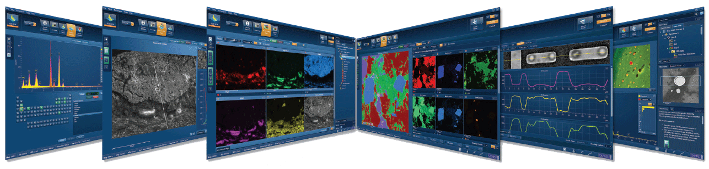

Currently, Oxford Instruments offers two types of EDS detectors: the **Ultim** series and the **Xplore** series. Previous EDS detector models include the **X-Max**, **X-MaxN**, and **X-Act** detector series.

##### Ultim EDS Detectors

The Ultim series of EDS detectors represents Oxford Instruments' latest range of high-end, large-area SDD EDS detectors.

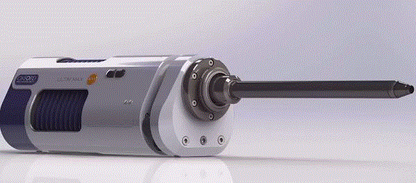

Available models include:

- **Ultim Max:** High-performance large-area SDD detector delivering improved resolution, quality, and performance for SEM analysis.
- **Ultim Max TEM:** High-performance, low-profile 80 mm² windowless detector for nanoscale analysis and elemental mapping in the TEM.
- **Ultim Max TLE:** Optimized 100 mm² windowless detector for atomic-scale elemental characterization in the TEM.
- **Ultim Extreme:** Windowless 100 mm² detector designed to maximize sensitivity and spatial resolution for nanoscale applications. It uses a specialized geometry to achieve high EDS performance in ultra-high-resolution FEG-SEMs while imaging at optimal working distances.

##### Xplore EDS Detectors

The Xplore series of EDS detectors is Oxford Instruments' latest entry-level SDD EDS detector range. They are optimized for routine analysis and use the same proven technology as the Ultim detector series.

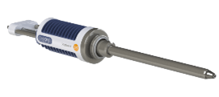

Available models include:

- **Xplore:** Detector series for routine analysis in the SEM.
- **Xplore TEM:** 80 mm² detector optimized for routine applications in 120 kV and 200 kV TEMs.

#### Control Module

The EDS control module is used to:

- Power, communicate with, and control the EDS detector.
- Synchronize the EDS detector with other input signals and control the microscope beam.
- Process X-rays detected by the EDS detector.

Ultim and Xplore detectors are controlled by the **X1** or **X4** EDX acquisition modules. Earlier detector models are controlled by **mics** and **Xstream** control modules:

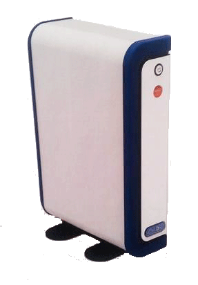

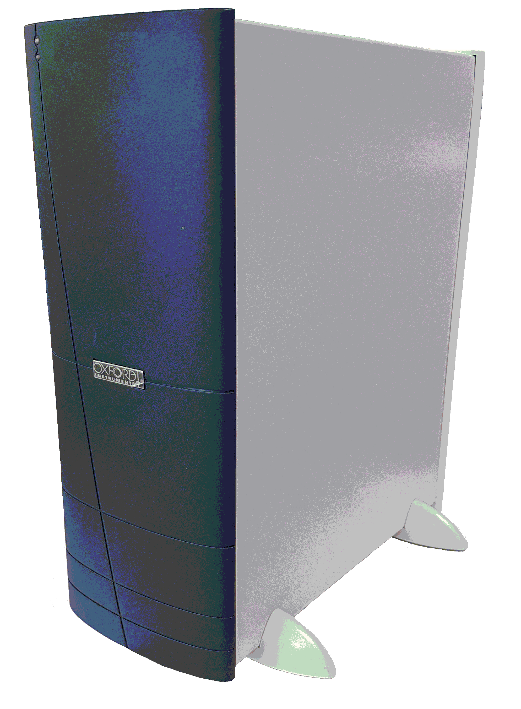

- **X1 / X4 Control Module**
- **mics / xstream Control Module**

#### EDS Computer

The EDS computer:

- Runs the AZtec EDS software used to acquire, process, and analyze EDS data.
- Communicates with the electron microscope.
- Controls the EDS hardware.
- Receives data from the control module.

#### 1.2.1. How the EDS Detector Works

An SDD EDS detector typically has the following architecture:

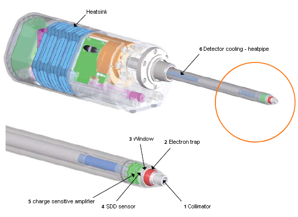

| Item | Description |
| :--- | :--- |
| **Collimator** | The collimator provides a limiting aperture through which X-rays must pass to reach the detector. This ensures that only X-rays originating from the region excited by the electron beam are detected, excluding stray X-rays from other parts of the microscope chamber. |
| **Electron Trap** | Electrons penetrating the detector produce background artifacts and can overload the measurement chain. The electron trap is a permanent magnet assembly that strongly deflects any passing electrons.  **Note:** Some Ultim Extreme detectors do not have an electron trap; instead, they rely on the microscope lens field to trap electrons. |
| **Window** | When the microscope chamber is vented to atmospheric pressure, the window provides a barrier that maintains the vacuum and cleanliness inside the detector. Windows are typically made of a thin polymer transparent to X-rays down to 100 eV, mounted on a support grid that holds the window in place. On instruments with very high vacuum, such as TEMs, windowless detectors can be used, providing much higher sensitivity to light elements. |
| **Sensor** | The sensor is a semiconductor Silicon Drift Detector (SDD) device that converts an X-ray of a specific energy into a proportional electrical charge through an ionization process. A field gradient applied using concentric ring electrodes on the back of the SDD collects the charge released by each detected X-ray at the anode. |
| **Charge-Sensitive Amplifier** | The charge-sensitive amplifier (CSA) is connected directly to the sensor. It is the first stage of the amplification process, measuring the charge released in the crystal by an incident X-ray and converting it into a voltage output. |
| **Detector Cooling** | SDD detectors operate at tens of degrees below zero Celsius and are cooled by a Peltier device bonded to the SDD sensor. Heat from these devices is transferred via a heat pipe to cooling fins on the detector body, where it is dissipated. |

The detector operates through a three-stage process that converts the energy of each individual X-ray into a voltage signal of proportional magnitude:

1. X-rays are converted into electrical charge by ionizing atoms in the SDD.
2. The charge is converted into a voltage signal by the charge-sensitive amplifier, with each voltage step output corresponding to a single X-ray.
3. The voltage signal is fed into the pulse processor for measurement.

##### Converting X-ray Energy into Charge

The SDD sensor is made of high-purity silicon with a large-area contact on the entrance side facing the incident X-rays. On the opposite side is a small central anode contact surrounded by a number of concentric drift electrodes:

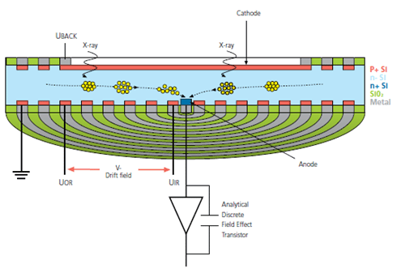

When a bias voltage is applied across the SDD detector chip and the detector is exposed to X-rays, each detected X-ray is converted into an electron cloud with a charge directly proportional to the characteristic energy of the X-ray. These electrons are promoted into the conduction band of the silicon semiconductor, leaving behind holes within the sensor that behave like free positive charges. The electrons then "drift" down the field gradient between the drift rings and are collected at the anode.

##### Converting Charge into a Voltage Signal

The charge accumulated at the SDD anode is converted into a voltage signal by the charge-sensitive amplifier:

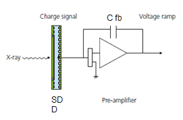

During operation, charge accumulates on a feedback capacitor. This charge has two sources:

1. Leakage current in the sensor material.
2. Charge generated by X-ray photons absorbed in the detector.

The output of the preamplifier caused by charge accumulation is a steadily increasing voltage "ramp" due to leakage current, upon which sharp steps are superimposed by the charge produced by each X-ray event. The accumulated charge must be periodically restored to prevent the preamplifier from saturating. Therefore, at a predetermined charge level, the capacitor is discharged—a process known as **restore** or **"reset"**.

Because noise limits the precision with which each step is measured, the output waveform exhibits fluctuations. Imprecise measurements broaden the histogram of measured energies for photons of identical energy. Consequently, noise affects the width of X-ray spectral peaks, particularly in the low-energy region. Noise is influenced by the charge-sensitive amplifier gain, input capacitance, and leakage current.

Low noise is essential for distinguishing low-energy X-rays such as Be Kα, Si Ll, and Al Ll from noise fluctuations. For example, the spectrum below shows the separation of Al, Si, and Be K and L peaks from the baseline noise:

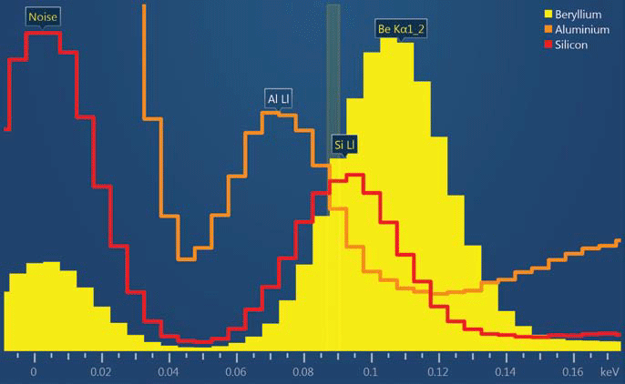

##### Measuring the Voltage Signal

The charge released by a single X-ray photon appears at the output of the preamplifier as a voltage step on a linearly increasing voltage ramp:

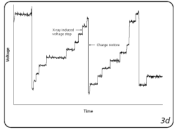

The fundamental role of the pulse processor is to accurately measure the energy of the incident X-ray and count it digitally into the corresponding channel in the computer. It must optimize the removal of noise from the raw X-ray signal and must rapidly and accurately identify X-ray energy events across a wide range from 100 eV to 40 keV. It also needs to distinguish events arriving very close together in time at the detector to prevent pulse pile-up effects.

Using digital pulse-shaping technology, the signal from the preamplifier is digitized at the input of the pulse processor, and pulse shaping and noise reduction are performed via digital computation.

The preamplifier output is continuously sampled by an Analog-to-Digital Converter (ADC), and the X-ray pulse height is typically measured by subtracting the average of a set of values measured before the X-ray event from the average of another set of values measured after the event. The resulting step measurement value is then sent directly to the computer's multichannel analyzer (MCA).

By averaging the signal, noise on the detector voltage ramp is effectively filtered out. The duration over which the waveform is averaged is sometimes referred to as the **Process Time**, although different timing definitions may apply depending on the processing scheme used.

#### 1.2.2. Resolution and Detector Noise

Resolution is the single most widely accepted measure of detector quality and provides a useful indication of detector performance. It is defined as the **Full Width at Half Maximum (FWHM)** of a spectral peak. The smaller the number, the better the detector's resolution, and the better it performs at resolving closely spaced X-ray lines.

The resolution achieved by a detector depends on the noise sources in the sensor and how they are handled by the counting chain. Undesired noise typically has three primary sources:

1. **Voltage Noise:** Voltage noise is influenced by the gain of the charge-sensitive amplifier and the sum of capacitances of components in the SDD/charge-sensitive amplifier circuit (such as the sensor anode). Voltage noise can be reduced by signal averaging using a long process time in the pulse processor. Therefore, the lower the capacitance in the SDD and charge-sensitive amplifier circuit, the shorter the process time needed and the higher the possible count rate.
2. **Leakage Current:** Leakage current originates from the bias voltage applied to the SDD and increases the slope of the voltage ramp. It is a source of "shot noise"; at long process times, the baseline signal varies over the time used to integrate the ramp, thereby degrading resolution. For a given detector design, leakage is proportional to the area and thickness of the SDD and increases with rising temperature. To achieve optimal resolution, SDD detectors are cooled using Peltier technology.
3. **1/f Noise:** The contribution of 1/f noise to resolution arises from characteristics of the detector (such as contacts and dielectric materials) and is largely independent of process time.

The resolution of an EDS detector is conventionally measured using the **Mn Kα** X-ray line. This is convenient for EDS detector manufacturers because it allows an ⁵⁵Fe radioactive source emitting Mn Kα to monitor individual sensor and detector performance without requiring an electron microscope. Under an electron microscope, Mn Kα resolution can also be easily measured by placing a piece of pure manganese under the electron beam.

##### Incomplete Charge Collection (ICC)

If all electron-hole pairs generated by an X-ray do not drift to the electrical contacts, the charge signal measured by the charge-sensitive amplifier will be smaller than expected, and the measured energy will be lower than the actual energy of the incident X-ray. This phenomenon is known as **Incomplete Charge Collection (ICC)**, resulting in counts appearing in the spectrum at energies below that of the X-rays they represent—typically forming a tail on the low-energy side of the spectral peak. All detectors experience some degree of incomplete charge collection. Low-energy X-rays have a very shallow penetration depth, and charge collection near the front contact is often poor. Consequently, low-energy X-ray peaks are broader with a lower average energy than expected, because the level of charge collection varies as each X-ray is measured. Thus, incomplete charge collection causes the measured resolution of a detector at low energies to be worse than theoretically predicted. In extreme cases, it can be the dominant factor governing resolution at these very low energies.

The figure below shows how the resolution of an EDS detector varies with energy and depends on three factors:

1. Constant dispersion based on the crystal material used in the detector.
2. The level of electronic noise.
3. Low-energy peak broadening caused by incomplete charge collection.

   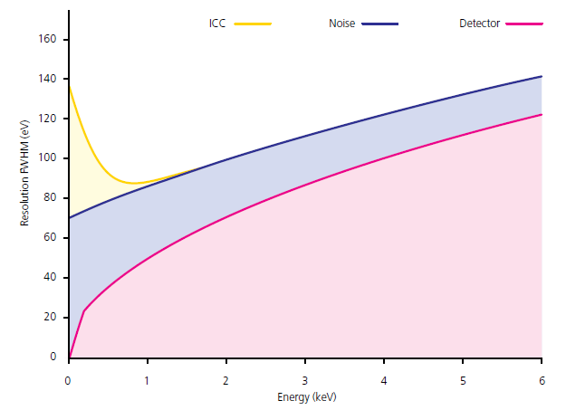

##### How Resolution Varies with Count Rate and Process Time

The longer the **Process Time (<i>T</i>p)**, the lower the voltage noise. Provided leakage current noise remains low, the resolution of the peaks displayed in the spectrum improves, making it easier to separate or resolve a peak from another peak of similar energy. For example:

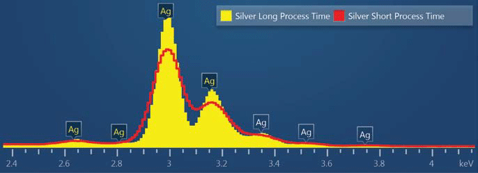

However, there is a trade-off between process time and the speed of data measurement. The longer the process time, the more time is spent measuring each individual X-ray and the fewer events can be measured. The longest process time used by the processor provides the best possible resolution, whereas the shortest process time provides maximum spectral throughput at the expense of some loss in resolution.

Productivity depends on the measured count rate—called the **Acquisition Rate** (output count rate)—rather than the **Input Count Rate** (entering the detector). As the input rate increases, the acquisition rate also increases, but an increasing number of events are rejected. This occurs because higher count rates increase the probability that another X-ray event arrives within time <i>T</i>p while the first X-ray is being measured. This interferes with the measurement and requires it to be rejected. If the input count rate increases sufficiently, the proportion of rejected X-ray events will exceed the gain in measured events, and with further increases in input rate, the acquisition rate will begin to fall.

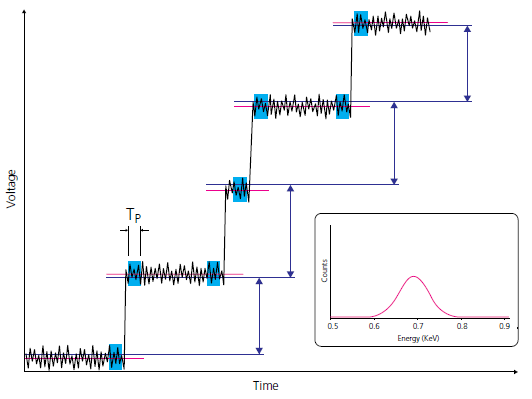

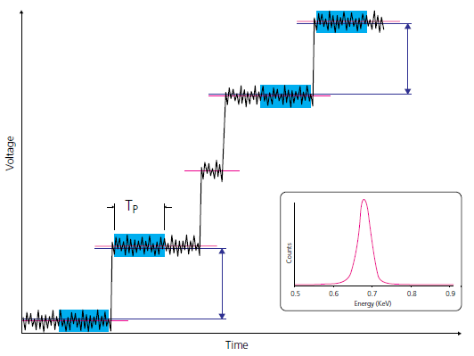

The step on the voltage ramp is measured by averaging different numbers of signal samples. A shorter <i>T</i>p allows all steps to be measured, but the variance of each measured step is large, leading to inaccurate X-ray energy measurement and poorer peak resolution. A long <i>T</i>p means some steps are too close together to be measured; however, noise averaging is much better, so spectral peaks exhibit superior resolution.

Therefore, for each process time, there is a maximum acquisition rate corresponding to the highest possible speed at the chosen resolution. The maximum acquisition rate for each process time is a characteristic of the detector pulse processor used. By determining the maximum acquisition rate at each processor setting and the resolution at that rate, the efficiency and performance of the detector/processor measurement chain can be evaluated. Best resolution can be achieved at tens of thousands of counts per second (input count rate), while maximum throughput is measured in hundreds of thousands of counts per second. For example:

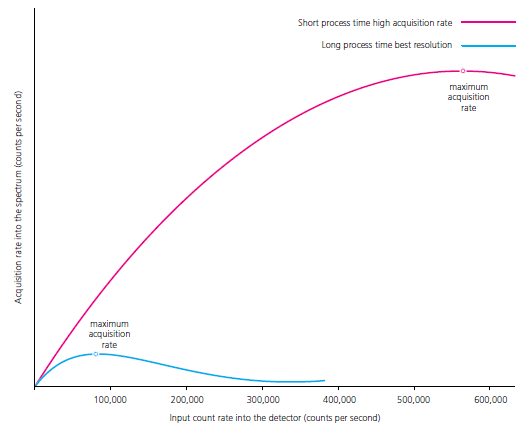

#### 1.2.3. Challenges of Analyzing at Very High Count Rates

Quantitative EDS analysis has been performed at input count rates up to 200,000 cps, and X-ray maps have been collected at input count rates exceeding 500,000 cps. However, under these count-rate conditions, additional effects must also be taken into account.

##### Ballistic Deficit

The electron cloud generated by an incident X-ray spreads out before reaching the anode. This is a concern for SDD detectors because the speed at which the electron cloud drifts to the anode for signal collection is relatively slow. The longer the path distance between the point where the X-ray is absorbed and the anode, the more the electron cloud spreads. When the electron cloud approaches the anode, an output signal begins to be induced, but the full signal step is not realized until the entire electron cloud is collected. The larger the electron cloud, the longer this takes. Consequently, the rise time of the signal pulse depends on the original interaction point within the detector. For example:

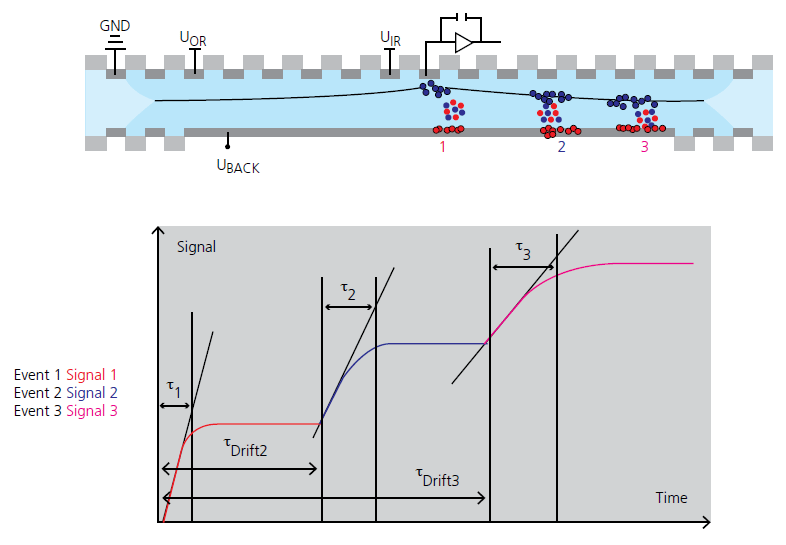

To achieve very high count rates, a short process time must be used to measure signals rapidly. If the process time used is too short, the pulse may fail to reach its maximum peak height, causing a defect in the measurement known as **"ballistic deficit"**. For example:

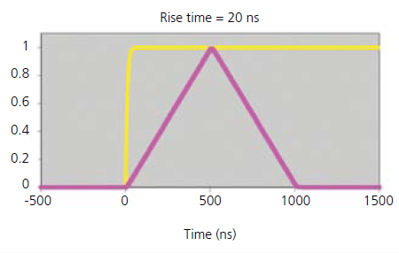

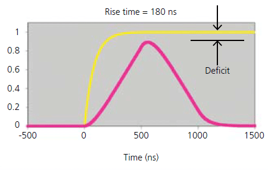

Consequently, as process time is reduced and SDDs are operated at high count rates, ballistic deficit becomes a significant issue. Because pulses from a large-area detector have varying rise times, the resulting effect resembles incomplete charge collection, producing tailing on the low-energy side of peaks. Distortion of the peak shape from an ideal model degrades the accuracy of spectrum processing, especially for overlapping peaks.

Therefore, to operate a large-area SDD detector at high count rates, ballistic deficit must be addressed. Using a symmetrical design that limits the drift path distance to the anode helps mitigate this issue. Special pulse-processing techniques can also be employed to ensure that measurements are insensitive to variations in rise time. Although this limits maximum speed, it ensures that good analytical performance is maintained.

##### Pulse Pile-Up

**Pulse pile-up** occurs when pulses from two X-rays arrive so close together in time that the pulse processor cannot distinguish the voltage signals as separate events. As a result, the two X-rays are measured as one, and a count is added to the spectrum in the channel corresponding to the sum of the two X-ray energies. This most commonly manifests in the spectrum as **sum peaks**, which appear at the sum energy position of two lower-energy major peaks. For example, in the Al₂O₃ spectrum below, a sum peak appears at 2.97 keV. This peak is labeled as Ag, when in reality it is the Al K + Al K sum peak. The spectrum also shows another sum peak at 2.01 keV, which has been labeled as P, when it is actually the O K + Al K sum peak:

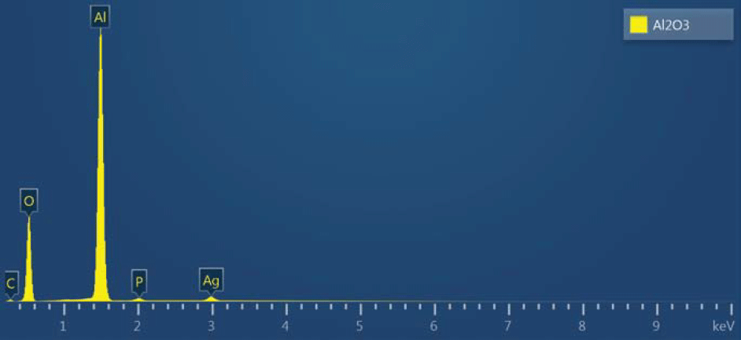

Pulse pile-up can occur between any pair of pulses: continuum X-rays can pile up with characteristic X-rays, creating a **"pile-up continuum"** on the high-energy side of major peaks. Pile-up of continuum X-rays with other continuum X-rays causes the background to extend beyond the **Duane-Hunt limit** or the effective landing voltage of the incident electrons. Continuum artifacts affect the accuracy of spectrum processing, particularly for algorithms that use background modeling rather than background filtering. Uncorrected pulse pile-up leads to multiple analytical errors, including incorrect element identification, inaccurate peak ratios, and quantitative results that vary with count rate.

Pulse processors typically use a **pile-up inspector channel** to ensure that only one photon is measured at a time. The inspector channel is designed to detect the arrival of every incoming event. Its circuitry has a time constant that determines the minimum time between events that can be recognized. If the time constant is short, the noise level will be high and the inspector will miss low-energy events, though it will be very effective at detecting high-energy events that arrive close together. If the time constant is longer, all low-energy events will be detected, but events arriving very close together cannot be distinguished. If any event is missed—whether a low-energy event or an event arriving too closely in time—the inspector will fail to veto the measurement, and sum-peak artifacts will appear. As a compromise, a pulse processor should ideally have multiple such circuits, each with a different time constant, to ensure effective pulse pile-up protection across the entire detectable energy range. Therefore, an effective pile-up inspector should produce spectra free from sum-peak artifacts. When operating an SDD detector at such high count rates, even with an electronic pile-up inspector, some sum-peak artifacts will inevitably appear in the spectrum.

In addition to pile-up inspection, another method is available to correct any sum peaks in the spectrum. This **"Pile-up Correction"** requires identifying all sum-peak events, removing them from the spectrum, and placing them back into the correct spectral channels. A successful algorithm has been developed for this task using a detailed model of the pile-up inspector circuitry and predictive statistical methods to determine pile-up in the spectrum. Using this algorithm, sum-peak events in the spectrum can be detected and corrected even while the spectrum is being acquired. For example, if pulse pile-up correction is properly applied to the spectrum above, the artifacts are eliminated:

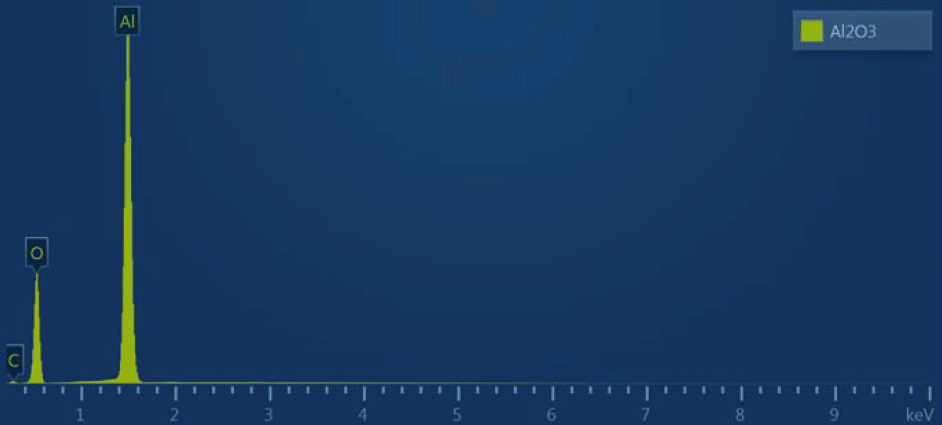

### 1.3. AZtec EDS Software

AZtec EDS software is an advanced software package designed to enable complete specimen analysis using EDS. It is engineered with:

- Guided workflows for system setup, data acquisition, and data analysis, ensuring all users can obtain and analyze EDS data from their specimens.
- A customizable structure tailored for users of all experience levels and a wide range of EDS applications.

Key features of the User Interface (UI) include:

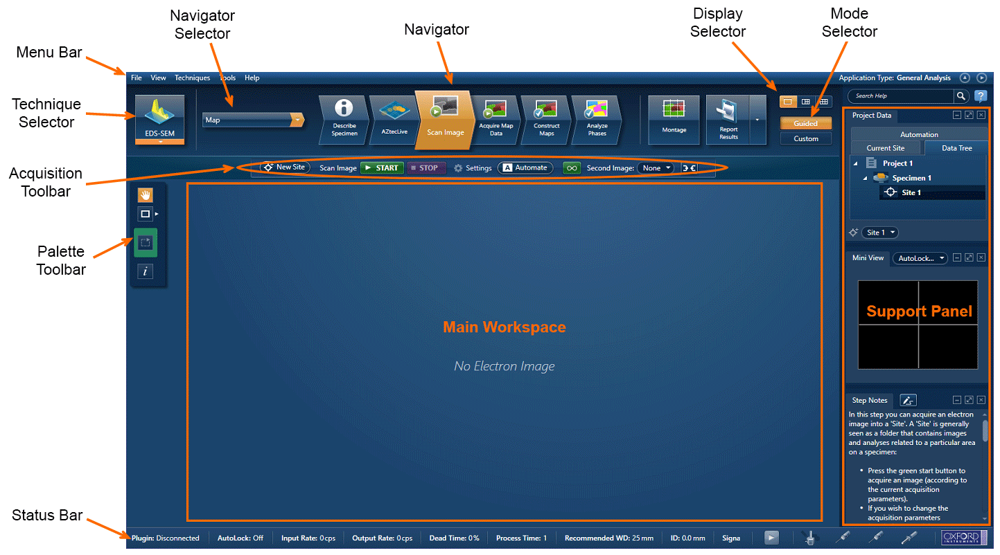

| Item | Description |
| :--- | :--- |
| **Menu Bar** | Features a standard drop-down menu bar for performing various operations, including opening, saving, and importing projects, application zoom level, language and appearance, user settings, and help. |
| **Technology Selector** | Selects the technique to be used from a drop-down menu. The available list depends on the licensed hardware. |
| **Navigator Selector** | Selects the type of analysis to perform (e.g., Map or Linescan) from a drop-down menu. The available list depends on the licensed analysis types. |
| **Navigator** | A series of steps that guide the user through the analysis. |
| **Display Selector** | Selects how items are displayed in the Main Workspace. |
| **Mode Selector** | Selects whether to use **Guided Mode** or **Custom Mode**. |
| **Main Workspace** | The primary work area. The type of information displayed depends on the selected Navigator step. |
| **Acquisition Toolbar** | A toolbar containing settings menus and acquisition controls for the current step. |
| **Palette** | A toolbar containing useful local tools for the current workspace. |
| **Context Menu** | Right-clicking an item opens a context menu providing quick access to numerous useful menu options for individual images, maps, spectra, or datasets. |
| **Support Panel** | The Support Panel is located on the right. It can contain up to three sections: **Data View**, **Mini Views**, and **Step Notes**. • **Data View** has three tabs showing the Data Tree for the current site, the Data Tree for the entire project, and the Data Tree and controls for Large Area Mapping (automation). • **Mini Views** provide a quick and easy summary of useful detector information. For example, they can display detector status, the EDS detector count-rate meter, or a live EDS spectrum. The information shown depends on the selected Navigator step and can be chosen by the user from a drop-down menu. • The **Step Notes** panel provides basic instructions on how to complete everything in the current Navigator step. Users can edit the Step Notes. |
| **Status Bar** | The Status Bar is located at the bottom of the UI. • The left side displays various hardware parameters. **Note:** The displayed parameters can be configured via Preferences accessed from the **Tools** menu. • The right side contains several hardware icons used to access pop-up windows for the microscope and installed detectors. These pop-ups report current status and allow basic control of the microscope and installed detectors. • To the left of the hardware icons is a progress icon indicating whether data is currently being acquired and the progress of that acquisition. |
| **Status Messages** | Status messages appear as pop-ups in the bottom-right corner of the UI. They can be informational (blue), warnings (yellow), or errors (red). |

For more information on the AZtec User Interface, including how to customize its settings, refer to the *AZtec User Guide*.

#### 1.3.1. Guided and Custom Modes

AZtec EDS offers two different modes:

- **Guided Mode:** Designed for all types of users and ideal for those who prefer step-by-step analysis. Each step in the Navigator has a clear purpose, allowing you to always see what is currently happening and what should be done next. For example:

  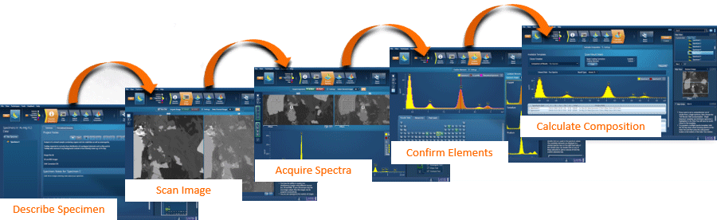

  This is the default mode and is the mode shown throughout this help guide.

- **Custom Mode:** Provides many different ways of working and is ideal for users who prefer freedom and flexibility to perform tasks as needed. Choose which features are visible and how and where they are displayed. For example:

  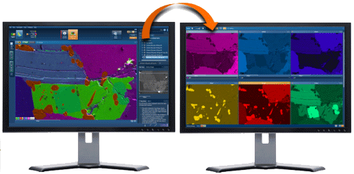

To switch between the two modes, use the **Mode Selector** to the right of the Navigator at the top of the software.

### 1.4. EDS System Calibration

For the EDS system to operate properly, it is calibrated by an engineer during installation.

If necessary, the user can optimize system performance by updating the **Energy Calibration**. This measures spectral peak positions to fine-tune the energy calibration and measures the system resolution. This enables accurate correction to ensure optimal peak identification.

If performing **standardless quantitative analysis** *(non-standardized / unstandardized quantitative analysis, where a beam calibration is needed for absolute/total or beam-current-referenced quantification)*, a **Beam Measurement** must also be performed in addition to the Energy Calibration. This measurement is used to calculate and store the beam current under the current beam conditions so that it can be accounted for during quantitative analysis to obtain accurate results.

---

## 2. Preparing for EDS Analysis

This section contains information that may be helpful when preparing to perform EDS on a specimen. It covers:

- Specimen storage.
- Setting up the TEM for EDS.
- Selecting an EDS acquisition mode.
- Positioning the detector.

EDS in the TEM allows the composition of a specimen to interact with and be analyzed by the electron beam. Specimen requirements for EDS in a TEM mirror those for TEM imaging, the primary condition being that the specimen must be **electron transparent**.

Many techniques can be used to prepare TEM specimens for EDS. Selecting the right technique depends heavily on the composition and structure of the specimen. Unfortunately, no single technique works for all materials, so it may be necessary to experiment with different methods to find the best approach for a particular specimen.

Some of the most common techniques for preparing TEM specimens for EDS include:

- Mechanical and ion polishing.
- Dual-beam FIB/SEM.
- Electropolishing.

Information on these techniques can be found in the *AZtec Acquisition User Guide*.

> **Note:** Oxford Instruments accepts no responsibility for the safety of the guidelines described in this section. Always follow the manufacturer's health and safety instructions.

### 2.1. Specimen Storage

Once a specimen has been prepared for analysis, it is important to store it properly to avoid degradation *(or having to re-prepare it)*. When choosing suitable storage for a specimen, there are several important considerations:

- Dust or other particles do not accumulate on the specimen surface.
- The specimen surface is not scratched or further deformed.
- The specimen does not develop an oxide layer (for some materials, such as magnesium, this may be unavoidable and require quick re-polishing prior to further analysis).
- The specimen does not absorb moisture. This is especially important for moisture-sensitive materials such as halite and iron.
- The specimen is kept at a cool temperature.

These considerations indicate that a suitable place to store specimens is in a desiccator, or at least in an appropriate container inside a cleanroom. When handling specimens, avoid touching their surfaces and use appropriate specimen holders/containers.

### 2.2. Setting Up the TEM for EDS

This section provides general recommendations for setting up a TEM for EDS. The exact procedure required to configure a TEM for EDS depends on the specific model of Transmission Electron Microscope (TEM) being used and the type of EDS experiment being performed. Refer to your TEM manual or a more experienced operator for more specific instructions.

#### Mounting the Specimen

The specimen should be mounted according to the method specific to each TEM. Care should be taken regarding the orientation of the specimen relative to the EDS detector to optimize the line of sight between the specimen and the detector as much as possible.

An example is shown below highlighting the orientation of the specimen and Cu pillar relative to the EDS detector for a FIB lift-out. In the example below, configurations **B** and **C** will result in increased background signal from the FIB grid and reduced X-rays from the specimen. Configuration **A** is optimized for EDS analysis because there is a clear line of sight between the specimen and the detector.

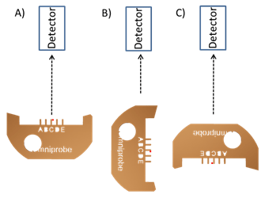

#### Configuring the TEM for EDS

Before setting up the TEM for EDS, you must:

- Properly align the TEM to ensure the electron beam is circular and can be condensed to a point source.
- Select an appropriate beam current (spot size) that produces an acceptable input count rate while maintaining a microscope resolution level suitable for the analysis. For some forms of analysis—particularly atomic-resolution mapping—a compromise must be made between microscope resolution and count rate; in such cases, system resolution cannot be compromised, so analysis must be carried out at low input count rates.
- Optimize the line of sight between the specimen and the detector to eliminate shadowing effects from the TEM specimen holder and specimen grid. Where possible, tilt the specimen approximately **20–30°** toward the detector.

When selecting an appropriate beam current (spot size), you must consider:

- **Resolution:** Reducing the beam current reduces the spot size, thereby improving spatial resolution.
- **Typical Analysis:** For mapping, increasing the beam current allows a shorter process time and achieves the same number of counts in a much shorter acquisition time. However, for quantitative analysis, the accuracy of a longer process time is more important, so reducing the beam current may be preferable.
- **Detector Settings:** Beam current affects the detector's input/output count rates and dead time. If a specific process time must be used, adjust the beam current to obtain optimal dead time, maximum output count rate, and consequently the best possible counting statistics.

### 2.3. Selecting an EDS Acquisition Mode

To select an EDS acquisition mode:

1. Use the **Technology Selector** drop-down menu to select the **EDS-TEM** technology:

   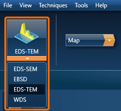

2. Use the **Navigator Selector** drop-down menu to select the type of EDS experiment to perform:

   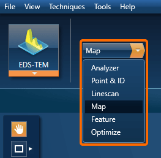

Available tabs/options depend on licensed modules and may include:

- **Analyser:** EDS spectra are acquired from the current field of view on the microscope.
- **Point & ID:** EDS spectra are acquired from defined areas or points within the current field of view.
- **Linescan:** EDS spectra are acquired at defined points along one or more lines.
- **Map:** EDS map data is acquired from a defined two-dimensional area.
- **Feature:** Automated particle analysis. For more information on using AZtecFeature, refer to the *AZtecFeature User Guide*.
- **Optimise:** Performs calibration optimization, creates standards, and optimizes pile-up correction.

The Navigator should now update to display the Navigator steps for the selected experiment.

> **Note:** When AZtec is opened, the last used technology and navigator are loaded automatically.

### 2.4. Setting Up the EDS Detector

Once the specimen is set up in the microscope for EDS, the EDS detector can be positioned at the EDS position inside the microscope chamber and cooled. This section describes how to:

- Control and monitor the detector position.
- Control and monitor the detector operating status.

Certain EDS detectors mounted on a TEM may also feature additional EDS detector protection.

#### 2.4.1. Controlling and Monitoring Detector Position

The methods available to control and monitor detector position depend on the detector model.

##### Ultim, Xplore TEM, and X-Max Detectors

There are two ways to control the position of Ultim, Xplore TEM, and X-Max detectors:

1. Using the **Insertion** tab in the **EDS Detector Control** window, accessible from the right side of the Status Bar:

   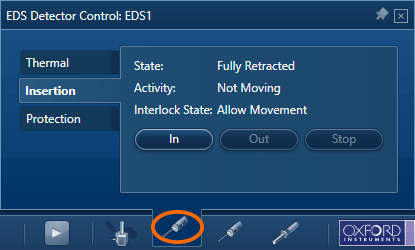

   - Click the **In** button to fully insert the detector.
   - Click the **Out** button to fully retract the detector.
   - Click **Stop** to halt detector movement at any time.
2. Using the control buttons on the detector body:

   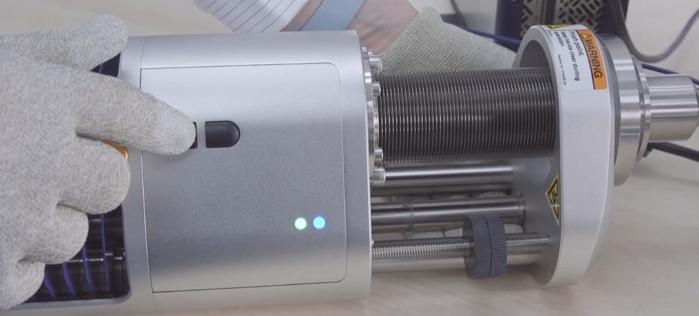

   - Press and hold either button to fully insert or retract the detector.
   - Briefly tap either button to nudge the detector in or out.

Detector movement status can be monitored from the **Activity** field in the **EDS Detector Control** window. Available activities include:

- **Stopped**
- **Moving In**
- **Moving Out**
- **Auto Retracting**

Detector position can be monitored from the **Status** field in the **EDS Detector Control** window. Available positions include:

| Status | Description |
| :--- | :--- |
| **Fully In** | The detector is fully inserted into the microscope chamber and ready for acquisition. |
| **Fully Out** | The detector is fully retracted from the microscope chamber. |
| **Indeterminate** | The detector is located somewhere between the two end-stops. |
| **Fault** | A fault has occurred. |

#### 2.4.2. Controlling and Monitoring Detector Operating Status

For all detector models, the **Thermal Control** tab in the **EDS Detector Control** window can be used to monitor and control the operating status. The operating status can also be monitored using the LEDs on the detector body.

> **Note:** If the detector is not cooled, the Start button for EDS data acquisition will be disabled.

For all detector models, the **Thermal Control** tab in the **EDS Detector Control** window has the same options:

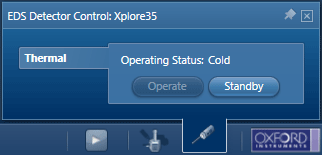

- Click **Operate** to start the cooling process and put the detector into operating mode.
- Click **Standby** to start the detector warm-up process and put the detector into standby mode.

The **Operating Status** field and the LEDs on the detector body can be used to view the current detector status. Possible states include:

| State | Ultim | Xplore | Xplore (TEM) | X-Max | X-Act | Description |
| :--- | :---: | :---: | :---: | :---: | :---: | :--- |
| **Standby** | Left LED  | Steady flashing  | Left LED  |  |  | Detector is warm and in standby mode. Saves power and preserves detector lifetime. |
| **Warming** | Off | Steady flashing  | Off | Off | Off | Standby mode selected; the detector is warming up to room temperature. |
| **Cooling** | Right LED  | Flash frequency increases as detector cools  | Right LED  |  |  | Operate mode selected; the detector is cooling down. |
| **Cold** | Right LED  |  | Right LED  |  |  | Detector is cooled and ready for data acquisition. |
| **Fault** | Left LED  | Flashing fault sequence  | Left LED  |  |  | Detector is in a fault state. |

#### 2.4.3. EDS Detector Protection

Depending on your available software licenses, some EDS detectors mounted on a TEM may be equipped with additional detector protection to safeguard the detector against potential damage from high-energy X-rays and electrons. Detector protection takes two forms:

1. **Low Magnification Protection:** Available for X-Max and Ultim detectors. Whenever the microscope is in low-magnification mode, the detector automatically retracts to protect it from X-rays. When it is safe to do so, the detector can be re-inserted following the instructions in [Section 2.4.1 Controlling and Monitoring Detector Position](#241-controlling-and-monitoring-detector-position).  
   **Note:** A microscope hardware interlock is required for this protection to function.
2. **Flux Protection:** Once the X-ray flux exceeds a threshold for longer than a specified delay time, the detector will automatically retract to protect it from potential damage. Once the microscope settings have been adjusted to levels suitable for the detector, the detector can be re-inserted following the instructions in [Section 2.4.1 Controlling and Monitoring Detector Position](#241-controlling-and-monitoring-detector-position). If overload persists, the detector will retract again.

Select the **Enable Flux Protection** option on the **Protection** tab of the **EDS Detector Control** window to enable or disable flux protection. When enabled, you can customize the **Protection Delay** and **Threshold** values. Default values can be restored from User Preferences.

> **Note:** When AZtec closes, these values revert to the engineer defaults. When AZtec opens, the custom user values are restored.

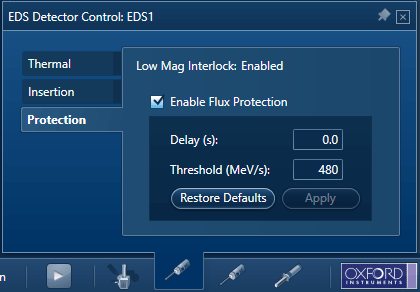

---

## 3. Describing Specimens

Before acquiring any data with AZtec, you can enter information about the specimen to be analyzed into the software. This information can take two forms:

1. General information about the specimen saved with the AZtec project, such as a Project Summary.
2. Information about the specimen used by the software.

This information is entered in the first Navigator step, **Describe Specimen**:

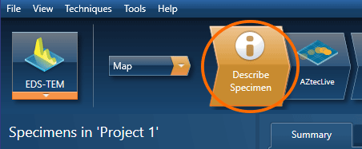

### 3.1. Describe Specimen Workspace

The **Describe Specimen** Navigator step has the following structure:

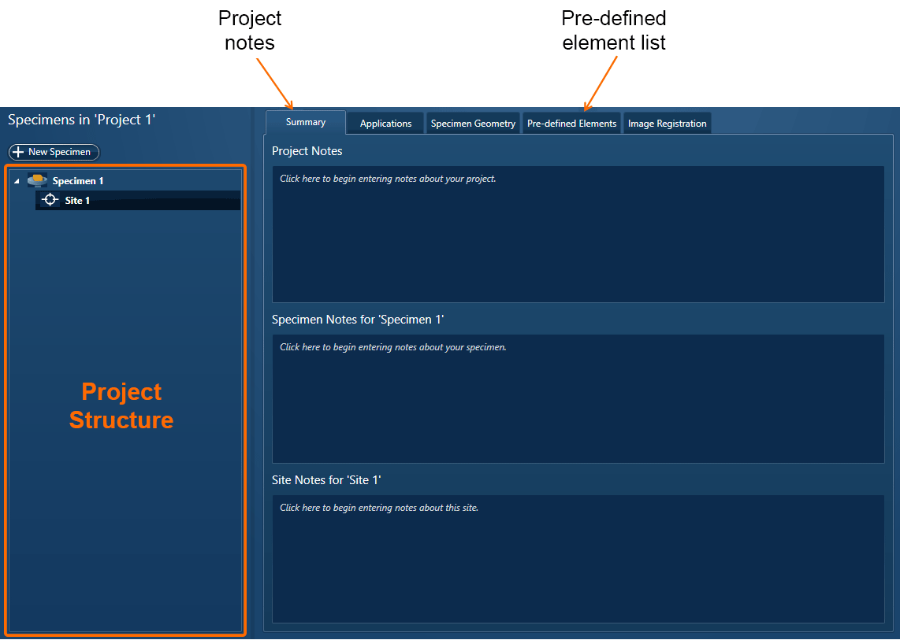

The **Project Structure** pane on the left side of the Main Workspace displays the current project structure. It can also be used to add a **New Specimen** to the project.

The tabs at the top of the Main Workspace are used to select different **Describe Specimen** panes where different types of project information can be entered. Available tabs depend on the selected Navigator and licensed system modules. Tabs applicable to EDS include:

- **Summary:** Used to create and save notes about specimens and projects.
- **Application:** Used to select an application-specific profile to be used as part of AZtecFeature.  
  **Note:** This tab is only displayed if the system has an AZtecFeature license.
- **Specimen Geometry:** Used to specify specimen tilt when using a pre-tilted specimen holder.
- **Pre-defined Elements:** Used to specify whether any particular elements must be included in the analysis and whether AutoID should be performed.

- **Image Registration:** Used to register an image to assist in navigating the specimen. For more details on image registration, refer to the Image Registration step.

### 3.2. Project Summary

In AZtec, you can create notes about specimens and projects that are saved with the project for future reference.

#### Creating Notes

1. Go to the **Summary** tab of the **Describe Specimen** step:

   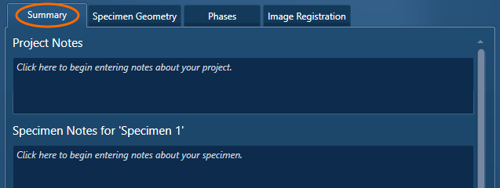

2. Click in the **Project Notes**, **Specimen Notes**, or **Site Notes** section as required.

   > **Note:** If the project already contains data, to add notes for a different specimen or site, select the specimen or site from the list on the left side of the screen or from the Data Tree, and then enter the information in the **Specimen or Site** field in the Main Workspace.

3. Enter the desired information. When the field is active, you can use the standard text formatting tools provided in the formatting toolbar that appears above the field:

   

   Images and tables can be copied from other programs and pasted into the field.

#### Editing Existing Notes

- Select the correct specimen or site, then click in the field under the **Summary** tab and edit the notes.
- Alternatively, select the specimen or site to edit from the list on the left side of the **Describe Specimen** tab screen or from the Data Tree, and select **Edit Notes**. This opens the **Specimen or Site Notes** window, where information can be edited in the same way as on the **Summary** tab:

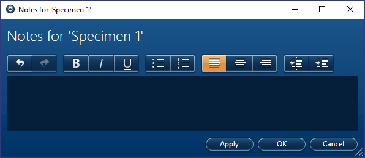

### 3.3. Pre-defined Elements

The **Pre-defined Elements** tab in the **Describe Specimen** Navigator step can be used to:

- Define any elements that must be included in the analysis, regardless of whether they are detected automatically.
- Define whether AutoID should be performed during EDS acquisition.
- Load a pre-defined set of elements to be included from a user profile.
- Save the current set of pre-defined elements that must be included in the analysis to a user profile.

Any element marked in green in the **Periodic Table** on the **Pre-defined Elements** tab is an element that **must be included** in the analysis. These elements will be identified in the EDS spectrum whether or not they were identified by AutoID. This is useful for confirming whether a specimen contains a specific list of elements and viewing the contribution of each element (even if one of those elements is absent).

#### Including Elements

You can include elements in the following ways:

- Double-click an element in the Periodic Table until it turns green.
- Select an element so that it is highlighted in the Periodic Table (single-click), then click **Include**.
- Hold down the `Ctrl` key on the computer keyboard and select multiple elements in the Periodic Table so that they are highlighted. Press the **Include** button to set all selected elements to be included.
- Choose to load a pre-defined list of included elements by clicking the **Load from Profile** button. This loads the list from the currently loaded application-specific profile.

To save the currently included list of elements to the current user profile, click the **Save to Profile** button to the right of the Periodic Table.

#### Stopping Inclusion of Elements

- Double-click an element in the Periodic Table until its background is no longer green.
- Select an element so that it is highlighted in the Periodic Table (single-click), then click **Clear**.
- Press the **Clear All** button to remove the inclusion setting for all currently included elements.
- Hold down the `Ctrl` key on the computer keyboard and select multiple included elements in the Periodic Table so that they are highlighted. Press the **Clear** button to remove the inclusion setting for all of those elements.

By default, the **Perform AutoID during acquisition** option is enabled. It can be disabled by unchecking the box directly below the Periodic Table. When AutoID is enabled during EDS acquisition, AZtec automatically:

- Identifies and analyzes peaks in the spectrum.
- Deduces the corresponding elements that produced the peaks.
- Labels the peaks accordingly in the spectrum.

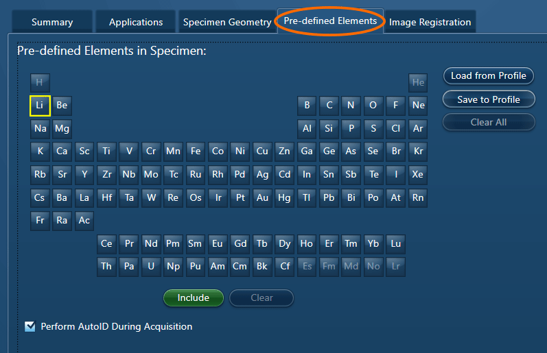

---

## 4. Locating Acquisition Areas

Traditionally, EDS has been performed in two separate, linear and iterative steps:

1. Identifying areas of interest via electron imaging on the microscope.
2. Collecting EDS spectra and/or maps.

The limitations of this approach are:

- Before acquiring EDS data, you cannot see the composition of the phases present in the acquisition area.
- Phases with similar average atomic number contrast may not be distinguishable from one another using imaging alone, making it impossible to identify the phase of interest solely through imaging.

**AZtecLive** provides an alternative EDS workflow that solves these problems and enables you to identify areas of interest on a specimen in the most efficient manner. It works by acquiring EDS data and electron images simultaneously—even while the specimen stage is moving. This allows constituent elements, their relative abundances and distributions, and specimen morphology to be visualized and characterized in real time. Appropriate regions of the specimen can then be selected for deeper analysis.

### 4.1. AZtecLive Workspace

The structure of the **AZtecLive** Navigator step is shown below:

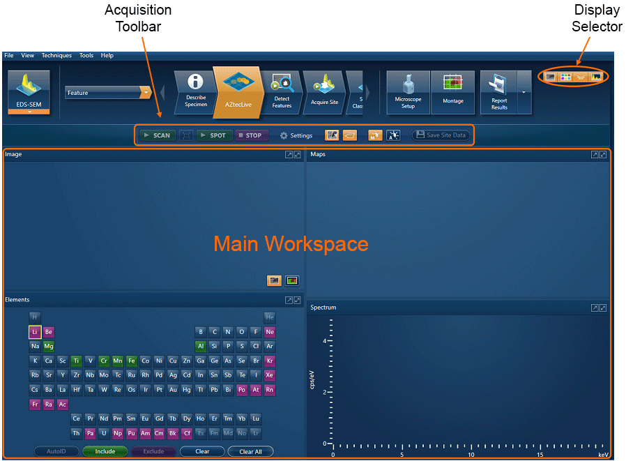

| Item | Icon | Description |
| :--- | :---: | :--- |
| **Acquisition Toolbar** | — | Toolbar containing settings and acquisition controls for the current Navigator step. |
| **Display Selector — Image** |  | Displays the **Image** pane. |
| **Display Selector — Maps** |  | Displays the **EDS Maps** pane. |
| **Display Selector — Elements** |  | Displays the **Elements** pane. Used to view detected elements, select elements to include or exclude, and choose whether to use AutoID. |
| **Display Selector — Spectrum** | 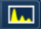 | Displays the **Spectrum** pane. |
| **Main Workspace** | — | Uses the Display Selector to show the currently selected items in up to four panes. Use the arrows in the top-right corner of each pane to undock or maximize it. Can be used in conjunction with the **Live Trace Mini View**. |

#### 4.1.1. Acquisition Toolbar

The Acquisition Toolbar contains the tools used to control AZtecLive:

| Tool / Icon | Description |
| :---: | :--- |
| **Scan** | Starts simultaneous acquisition of the electron image and EDS data. |
| **Reduced Area Scan**  | Switches to a reduced-area scan. This feature can be useful when focusing the specimen. |
| **Spot** | Places the beam in Spot mode. The spot is marked with a yellow cross on the electron image. This feature can be used to view the EDS spectrum from a single point rather than the entire field of view. |
| **STOP** | Stops acquisition. |
| **Settings** | Accesses the Live Acquisition Settings. |
| **Improve Static Quality**  | Select this option to allow AZtec to integrate data while the microscope stage is stationary and image settings are unchanged, improving image and map quality. As soon as a change in microscope stage position or image settings is detected, the image and map data refresh continuously. |
| **Motion Detection Sensitivity**  | Available when **Improve Static Quality** is selected. Enabled by default (highlighted in orange). When active, AZtecLive monitors image changes and refreshes every frame when movement is detected. If image stability is poor (e.g., brightness fluctuations, high noise, or vibration), disable this option (button turns blue) so AZtecLive stays in **Improve Static Quality** mode until stage movement is reported via microscope communication or working distance/magnification changes. |
| **Manual Brightness & Contrast**  | Applies manual brightness and contrast adjustment. |
| **Auto Brightness & Contrast**  | Applies automatic brightness and contrast adjustment. |
| **Save Site Data** | Saves the displayed images, maps, and spectrum. |

#### 4.1.2. AZtecLive Acquisition Settings

The **Live Acquisition Settings** window is used to define the settings used by AZtecLive:

Select:

- **Dwell Time (µs):** The amount of time the beam spends on each pixel. The longer the dwell time, the more data is collected from each pixel; however, the longer it takes to acquire the image.
- **Image Source:** Selects the image input source. The **SE** image input source displays whichever image source is currently selected on the microscope. The **BSE** image input signal is only available on certain connected systems.
- **Energy Range (keV):** The energy range used to collect EDS data. The most appropriate energy range depends on the microscope accelerating voltage. It should be set so that all energy lines that could potentially be excited are displayed. For example, if the microscope is set to 10 kV, an energy range of 0–10 keV is most appropriate because plotting higher energies will not show any additional data since energy lines above 10 keV will not be excited. If the microscope is set to 15 kV, an energy range of 0–20 keV may be more appropriate because energy lines between 10 and 15 keV can be displayed within this range.
- **Process Time:** Refers to the length of time required to process the X-ray signal from the EDS detector and remove noise from the data. If Process Time is set to **Default**, it is set to a fixed general-purpose process time. For the fastest acquisition rate at the expense of some resolution, choose a shorter process time. To improve spectral resolution or resolve elements with similar energies, a longer process time is required.

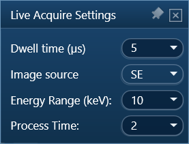

### 4.2. Using AZtecLive

To use AZtecLive, perform the following steps:

1. Select any elements that must be included or excluded regardless of whether they are present in either of the following:
   - The **Elements** pane.
   - The **Pre-defined Elements** tab in the **Describe Specimen** Navigator step.  
   > **Note:** If elements are included or excluded in the **Elements** pane of the **AZtecLive** Navigator step, they will override any elements already set in the **Describe Specimen** Navigator step.
2. Choose whether to improve EDS map quality while the specimen stage is stationary.
3. Use the **Live Acquisition Settings** window to select suitable settings for acquiring images and EDS data.
4. Click **Scan** to start scanning the current field of view on the microscope.  
   AZtecLive begins acquiring an electron image and simultaneously acquiring EDS data from the area scanned by the electron beam. The image and EDS data are continuously updated.  
   If AutoID was selected on the **Pre-defined Elements** tab of the **Describe Specimen** step, elements in the live sum spectrum will be identified and displayed on the spectrum.  
   If any elements were set to be included, elemental maps for those elements will be displayed.
5. To detect the elements present in the current field and visualize elemental maps for those elements, click **AutoID** in the **Elements** pane.  
   The appropriate elemental maps will now be displayed.  
   > **Note:** Once AutoID has been executed, the list of displayed elemental maps is fixed. To update the list, click **AutoID** in the **Elements** pane. Any additional detected elements will be added to the elemental map display. Even if an element is no longer present, its elemental map will not be removed. To remove an element, deselect it in the **Elements** pane or set it to **Exclude**. To clear the entire elemental map list, click **Clear All** in the **Elements** pane.
6. Move around the specimen using any of the following methods:
   - Use the microscope controls.
   - Double-click a point on the electron image or an EDS map; the stage will move to center that position.
   - Select a field of interest in the **Live Trace Mini View** and select **Move To** to move to that field.
7. To check whether other elements are present, click **AutoID** in the **Elements** pane.
8. To view the spectrum from a single point—for example, to visualize the elements in a specific feature—click **Spot** to place the beam in Spot mode. The beam position is marked with a yellow cross on the electron image and EDS maps. Click elsewhere on the electron image or one of the EDS maps to move the beam to that location.  
   To return to scanning the full field of view, click **Scan**.
9. To save the current data, click **Save Site Data** on the Acquisition Toolbar. A **Live Trace** item will be added to the Data Tree.  
   If this is the first Live Trace to be saved, or if the stage position, magnification, or accelerating voltage has changed since the last save, a new **Site** will be created for the data.  
   In **Scan** mode, the electron image, displayed elemental maps, and sum spectrum are saved to the current Site.  
   In **Spot** mode, the current spot spectrum is saved to the current Site. In addition, if the electron image, elemental maps, and sum spectrum do not already exist in the current Site, they will also be saved.

---

## 5. Specimen Imaging

AZtec allows you to acquire images of the specimen surface using the TEM and visualize them in the AZtec software using the **Scan Image** Navigator step:

Images can be acquired using any detector available on the microscope. The acquired images can then be used to assist subsequent EDS analysis by allowing accurate definition of the specimen regions from which data will be acquired.

> **Note:** This Navigator step is available in all EDS acquisition Navigators except the **Analyser** Navigator, where the current field of view on the microscope is always used to acquire EDS spectra.

This chapter explains how to use AZtec to:

- Acquire and enhance images.
- Interrogate images.
- Edit and annotate current and previously saved images.
- Save or export images for reporting.

### 5.1. Scan Image Workspace

The structure of the **Scan Image** Navigator step is shown below:

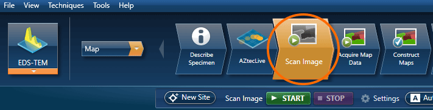

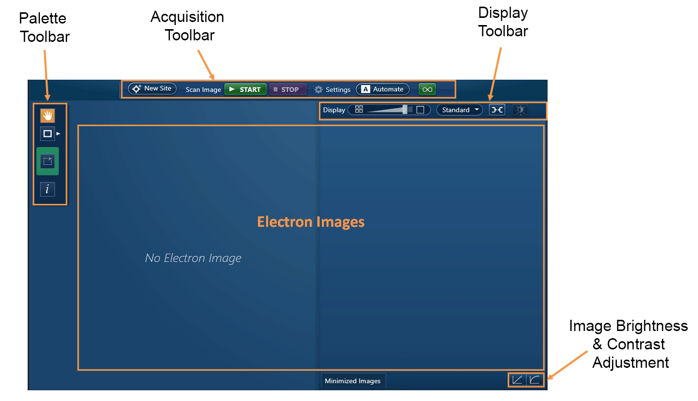

| Item | Description |
| :--- | :--- |
| **Palette Toolbar** | Toolbar containing tools relevant to the current workspace, such as the **Pan** tool for moving and zooming images, and **Annotation** tools for creating annotations on images. |
| **Acquisition Toolbar** | Toolbar containing settings menus and acquisition controls for the current Navigator step. |
| **Display Toolbar** | Toolbar containing tools for customizing image display. Displayed when in **Image and Image List** or **Full Screen Image List** display mode. |
| **Electron Image** | Main Workspace displaying electron images. The layout depends on the selected display mode: • **Full Screen Image:** Displays up to two simultaneously acquired images full screen. • **Image and Image List:** Displays the selected image on the left and individual images as smaller thumbnails on the right. • **Full Screen Image List:** Displays all individual images acquired simultaneously. 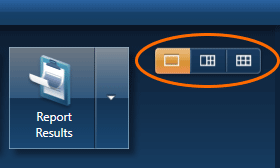 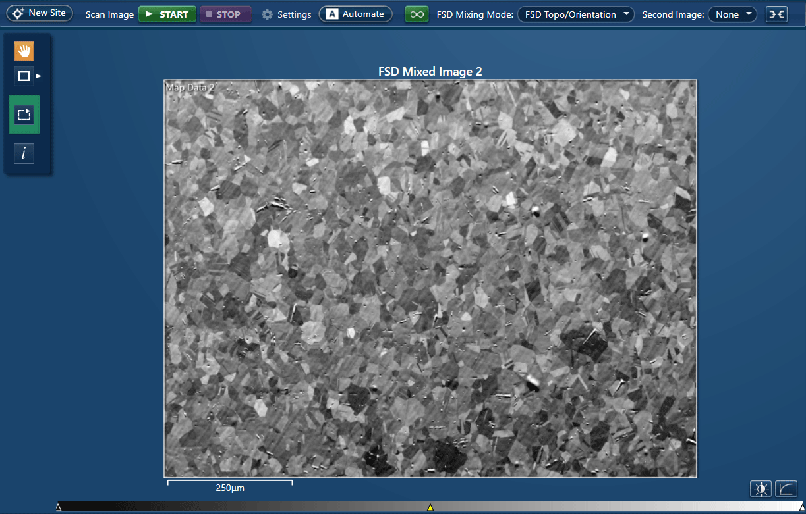 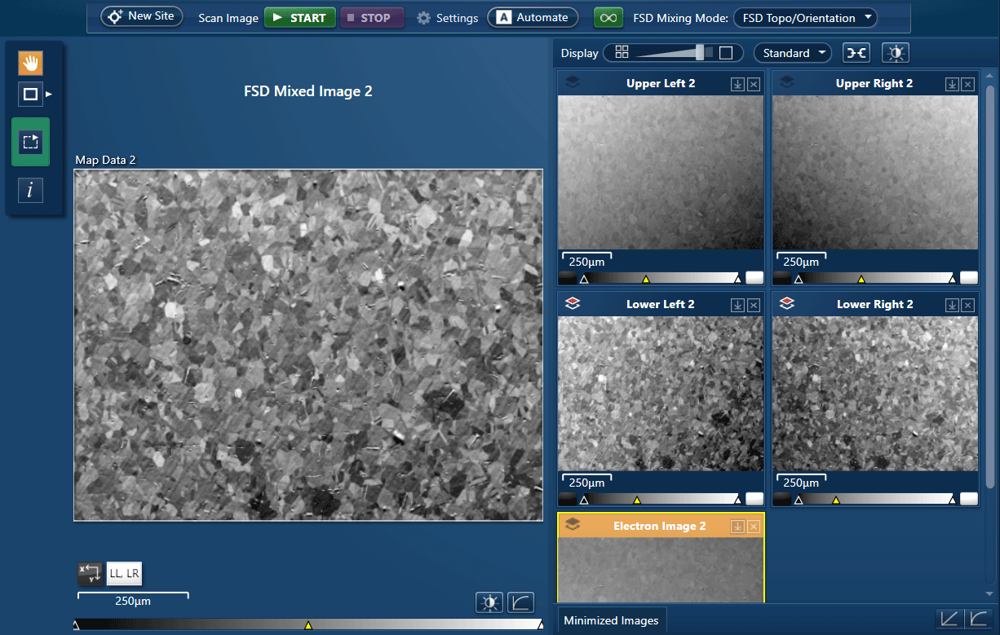 |
| **Image Brightness & Contrast Adjustment** | Adjusts the contrast, brightness, and gamma levels of the image: 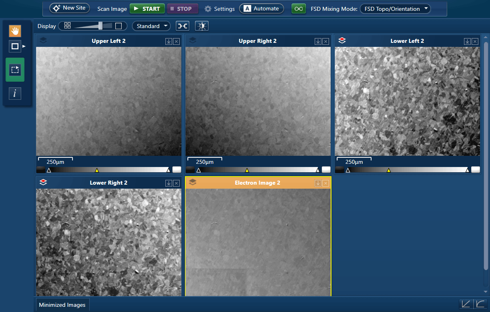 |

#### 5.1.1. Palette

The Palette toolbar contains tools relevant to the current workspace.

| Icon | Description |
| :---: | :--- |
| **Pan**  | Allows images and EDS spectra to be panned (moved) and zoomed in/out. For more information, refer to [Section 5.3.1 Pan and Zoom Tools](#531-pan-and-zoom-tools). |
| **Annotate**  | Allows annotating images. For more information, refer to [Section 5.3.2 Annotating Images](#532-annotating-images). |
| **Show Data Values**  | To view information for a specific data point: 1. Select the **Show Data Values** tool from the Palette toolbar. 2. Hover the mouse cursor over the data point. The data for that point is displayed. |

#### 5.1.2. Acquisition Toolbar

The Acquisition Toolbar contains the acquisition controls for the current workspace:

| Tool / Icon | Description |
| :---: | :--- |
| **New Site**  | Creates a new Site in the Data Tree. |
| **Start**  | Starts acquisition. |
| **Stop**  | Stops acquisition. • If the number of frames is set to 1, acquisition stops immediately. • If the number of frames is greater than 1, acquisition stops after the current frame completes. Click **Stop** again to stop acquisition immediately. |
| **Settings** 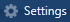 | Opens the **Scan Image Settings** window. |
| **Continuous**  | Starts continuous image acquisition. |

#### 5.1.3. Display Toolbar

When in **Image and Image List** or **Full Screen Image List** mode, the **Display Toolbar** appears at the top of the AZtec Main Workspace:

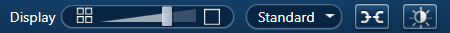

It is used to select the display size and information shown for individual images.

| Control | Description |
| :---: | :--- |
| **Size Slider** 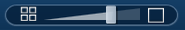 | Adjusts the display size of all images in the image list using the slider. |
| **Display Mode Drop-Down** 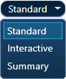 | Selects how images in the image list are displayed from the drop-down menu: • **Standard:** Default display mode with basic editing options, such as changing the layering that makes up a Layered Image. • **Interactive:** Contains more advanced editing options, such as changing image colors and adjusting each map's contribution: 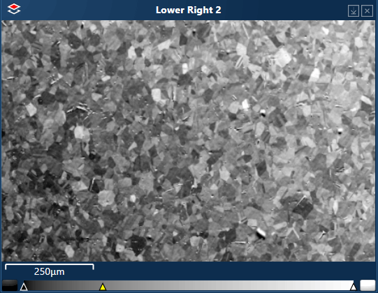 • **Summary:** Contains a summary of the settings used: 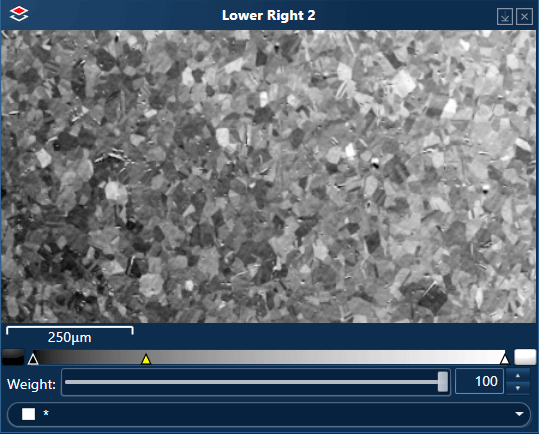  |
| **Link / Unlink Images**  | Links or unlinks images in the image list. When linked, zooming or panning on one image produces the same effect across all images in the image list. |
| **Brightness & Contrast**  | Opens the **Brightness and Contrast Adjustment** window, where you can adjust the brightness, contrast, and gamma levels of the currently selected image. |

### 5.2. Acquiring Images

To acquire high-quality images of specimen microstructure in AZtec, the microscope must first be properly configured for the specimen and the type of image to be collected. Parameters to pay attention to during setup include:

- Signal type.
- Beam conditions (probe current), accelerating voltage (spot size).
- Magnification.
- Focus.

Once the microscope is properly set up and the suitability of the settings has been verified, images can be acquired in AZtec. To acquire an appropriate image, it is recommended to first select suitable image acquisition settings (i.e., image input source and image resolution). You can then acquire the image as described in [Section 5.2.2 Acquiring an Image](#522-acquiring-an-image).

To assist with optimizing the image, AZtec also provides **Continuous Image Acquisition**.

Once suitable images have been acquired in AZtec, they can be used to define acquisition areas for any subsequent EDS analysis—for example, to mark areas to be mapped or regions from which spectra will be collected.

> **Note:** If the specimen is prone to charging or drifting, it is recommended to return to the **Scan Image** Navigator step at regular intervals and acquire a new image. Using the most recent image ensures that subsequent EDS acquisition sampling points are accurately positioned relative to the image. Referring to [Chapter 6 Handling Specimen Drift](#6-handling-specimen-drift) may also be helpful.

#### 5.2.1. Selecting Image Acquisition Settings

Before acquiring an image in AZtec, it is important to select the image acquisition settings to be used. These settings can be specified from the **Settings** menu on the Acquisition Toolbar:

| Item | Description |
| :--- | :--- |
| **Image Scan Size** | Defines the resolution of the entire image in the X direction (i.e., the number and size of pixels). Resolution in the Y direction depends on the aspect ratio of the image. |
| **Dwell Time (µs)** | Defines the amount of time the beam spends on each pixel. |
| **Input Signal** | Image types available for acquisition: • **BF:** Bright Field. • **ADF:** Annular Dark Field. |
| **Number of Frames** | The number of times the beam scans a single frame and averages them together to produce the image. |
| **Frame Time (s)** | The time taken to acquire a complete frame. |
| **AutoLock** | Displays the current status of AZtec drift correction. Click **Settings** to configure drift correction. For more information on using AZtec drift correction, refer to [Chapter 6 Handling Specimen Drift](#6-handling-specimen-drift). |

##### Image Quality Settings

Image scan size, dwell time, and number of frames all affect image quality and the time required to acquire an image. To quickly preview a specimen, use the lowest scan size (resolution) and dwell time (time per pixel). To obtain higher-quality images—for example, for reports or resolving small features—use a larger scan size (higher resolution) to provide more pixels and a longer dwell time to reduce the amount of noise in the image.

Acquiring multiple frames and averaging them together also helps reduce noise in the image. This is very useful for acquiring high-quality images of beam-sensitive specimens where an excessively long dwell time would cause charging or specimen damage.

##### Image Input Signal

Within AZtec, up to two image inputs can be acquired simultaneously from the microscope, although depending on the microscope only one image input may be connected. In such cases, the connected input generally provides whichever image type is currently selected on the microscope (i.e., BF or ADF).

#### 5.2.2. Acquiring an Image

Image acquisition is controlled from the Acquisition Toolbar. To acquire an electron image using the current acquisition settings, click the **Start** button.

The image will be displayed as it is acquired. When a new electron image is acquired for the first time, a new electron image entry is added to the Data Tree. If two electron images are acquired simultaneously, two image entries are added. For example:

By default, each additional image acquired in the same Site of Interest—even with different settings—will overwrite the current image. Therefore, if you are dissatisfied with the current image and wish to re-acquire it, change any settings and click the **Start** button on the image Acquisition Toolbar again.

If multiple images are required for a single Site of Interest, acquire the first image, then click the **padlock icon** next to the image in the Data Tree to lock it. This prevents the image from being overwritten:

Then configure and acquire the new image. The new image will be added to the Data Tree. For example:

During image acquisition, a green progress bar is displayed above the entry in the Data Tree:

A similar progress bar can also be seen in the **Current Acquisition Status** window on the Status Bar:

If you need to stop image acquisition for any reason, click the red **Stop** button:

- If **Number of Frames** is set to 1, acquisition stops immediately.
- If **Number of Frames** is greater than 1, acquisition stops after the current frame finishes. Click **Stop** again to stop acquisition immediately.

#### 5.2.3. Continuous Image Acquisition

In AZtec, images of the full field of view or a reduced area can be acquired continuously. This feature can be used to:

- Optimize specimen focus.
- Observe whether there are any instabilities in the specimen that might affect data acquisition (such as charging or drift). When using Continuous Scan, these behaviors become obvious because the image updates after every frame.

To acquire images continuously, click the **Continuous** acquisition button on the Acquisition Toolbar:

The image will begin acquiring continuously. Acquisition progress is indicated by a horizontal green line across the image:

The **Continuous Scan** toolbar also appears above the image:

Use this toolbar to:

- Change the **Dwell Time**.
- Toggle between scanning the **Full Field of View** and a **Reduced Area** (icon turns orange):

  

  This feature can be useful when focusing the specimen—namely:

  

  - Centering the reduced area in the field of view.

  

  - Adjusting the position and size of the reduced area using the mouse.

To stop Continuous Scan:

- Click **Stop** once to stop scanning after the current frame finishes. The **Stop** button flashes red and displays **Stopping** until acquisition completes.
- Click **Stop** twice to stop scanning immediately.

> **Note:** If Continuous Scan is running in a Reduced Area, AZtec will acquire one complete frame before stopping image acquisition.

### 5.3. Viewing and Presenting Images

AZtec provides a number of tools for interrogating images and optimizing their display for reporting. These include:

- Selecting the display size and information shown for individual images.
- Zooming and panning spectra/images.
- Using annotations to highlight or measure features of interest.
- Viewing information for specific data points.
- Enhancing image appearance by adjusting brightness, contrast, gamma, and color.

#### 5.3.1. Pan and Zoom Tools

To make viewing and interrogating electron images or maps easier, AZtec provides functions to pan (move) and zoom images. To access these tools, click the **Pan** tool icon  on the Palette toolbar on the left side of the screen.

In multi-image and map display modes, before starting to zoom or pan, it is recommended to use the **Link** tool  to choose whether to zoom in or out on individual images/maps or all of them together:

> **Note:** When the button background is orange, images and maps are linked.

There are two ways to zoom in or out on an image or map:

1. Scroll the mouse wheel while hovering the cursor over the image or map.
2. Hold down the `Ctrl` key on the computer keyboard and left-click on the image or map. Move the mouse to the right to zoom in, or to the left to zoom out.

To move an image or map, with the **Pan** tool selected, press and hold the left mouse button and drag the image. Release the left mouse button to stop moving the image.

To return an image to its initial size:

1. Right-click the image to open the context menu.
2. For an individual image or map in a display pane, select **Reset Image Scale**. For an electron image, layered image, or map displayed in the Image pane, select **Reset Image Scale**, and then choose **Fit Image to Display** or **Fill Display with Image**:

   

#### 5.3.2. Annotating Images

The **Annotate** tool  is located on the Palette toolbar:

It allows images and spectra to be annotated, including:

- Features and angles to be measured.
- Rectangle and ellipse markers created to highlight features.
- Text to be added.

To create an annotation, click the arrow to the right of the **Annotate** tool on the Palette toolbar. This expands the list of available annotation tools:

##### Creating a Rectangle or Ellipse Marker

1. Press the left mouse button at the starting point.
2. Drag the mouse to draw the shape.
3. Release the left mouse button to complete the annotation.

##### Adding Text

1. Left-click at the point where you want the text to appear.
2. Enter the text.
3. Click again to finish.

##### Deleting or Editing Annotations

1. Select the **Pan** tool (hand symbol) from the Palette toolbar.
2. Click the annotation to select it (highlighted with red handles/dots):

   

3. Press the `Delete` key on the computer keyboard to delete it, or click and drag a red handle to move or resize the annotation.

##### Adding an Arrow to a Text Annotation

1. Click to select the text.
2. Press and hold the left mouse button on the red dot where you want to add an arrow.
3. Drag that point to form the arrow.
4. Release the mouse button to complete.

   

Annotation styles can be configured by right-clicking the image or map to open the context menu and selecting **Annotations** > **Style...**:

This opens the **Set Style** window, where line style, font size, and color can be specified:

All annotations created after changing these settings, as well as any existing annotations that were selected when the style was changed, will be displayed in the new style. Unselected existing annotations will continue to be displayed in the old style.

Annotation visibility can be toggled using the context menu by checking or unchecking **Annotations** > **Show**.

#### 5.3.3. Viewing Information for Specific Data Points

To view information for a specific data point:

1. Select the **Show Data Values** tool from the Palette toolbar.
2. Hover the mouse cursor over the data point.  
   The data for that point will be displayed.

#### 5.3.4. Enhancing Image Appearance

Within AZtec, the appearance of TEM images can be enhanced or optimized to reveal details more clearly. There are several ways to enhance an image:

- Adjusting brightness, contrast, and gamma levels.
- Changing the color scheme used in the image.

##### Brightness, Contrast, and Gamma Adjustment

You can adjust the brightness, contrast, and gamma levels of the currently displayed image by clicking the **Brightness & Contrast** icon on the Display Toolbar and beneath the main electron image :

This opens the **Brightness and Contrast Adjustment** window:

This adjustment window can then be used to:

- Manually adjust brightness and contrast using the sliders.
- Perform **Auto Brightness** adjustment. This tool uses a linear scale to assign an intensity range to the image across the full grayscale range.
- Perform **Auto Gamma** adjustment. This tool adjusts the gamma curve to bring out mid-tones while preserving the maximum and minimum values, helping reveal detail in the image.

In addition, **Auto Brightness** and **Auto Gamma** adjustments can be performed by clicking the corresponding icons at the bottom of the Scan Image workspace.

##### Setting Image Colors

Changing the color of an image can help enhance certain details. In **Standard** or **Interactive** image display modes, colors can be set using the image **Color Bar** displayed beneath each image:

If the color bar is not visible, it can be accessed by right-clicking the image to open the context menu and selecting **View** > **Color Bar**:

Click the color box at either end of the color bar to open the **Choose Color** window and select colors for the brightest or darkest points in the image:

In **Interactive** or **Summary** display mode, a drop-down menu can be used to set the color for the brightest point:

### 5.4. Saving and Exporting Images

Images can be exported directly from the **Scan Image** Navigator step. This is useful when:

- A single standalone image is needed.
- The image will be analyzed in third-party software.
- A specific image needs to be added to an existing report.

Images can be exported as:

- Data files in **TIFF**, **TSV**, or **CSV** format.
- Displayed images with or without acquisition areas and annotations.

#### Exporting an Image in Data Format

1. Right-click the image in the Main Workspace or Data Tree to open the context menu.
2. Select **Export Data Only**.
3. For images in the Main Workspace, choose the format to export them in. Images in the Data Tree can only be exported in **TIFF** format.

#### Exporting an Image

1. Right-click the image in the Main Workspace to open the context menu.
2. Select **Export**.
3. Choose the method to export the image (i.e., **Save**, **Copy**, **Print**, **Email**):

   

To configure the display settings for the image to be exported, select the **Settings...** option. Available options depend on the image being exported and may include specifying:

- The final size of the image.
- Whether to display the image title.
- Whether to display any annotations currently on the image.
- Whether to display color and scale bars on the image.
- The method to be used to export the image.

---

## 6. Handling Specimen Drift

In some situations, you may find that the specimen moves slightly (**drifts**) over time. This phenomenon may become apparent in several ways:

- Comparing a post-acquisition image with the original electron image reveals an offset between the two images.

This offset can occur for many reasons, including:

- Thermal drift caused by temperature or environmental changes.
- Specimen charging.
- Outgassing or unstable adhesives under the electron beam.
- Mechanical drift caused by the stage or specimen holder.

When drift occurs, the ideal solution is to eliminate the cause of the drift. For example, if drift is caused by temperature changes, allow the specimen to stabilize inside the microscope before attempting to image. If it is due to another factor, such as specimen mounting or charging, you can try to reduce drift by:

- Changing the specimen mounting method. For example, if adhesive tabs were used, try mounting the specimen with conductive paint and additionally drawing a conductive track from the stub onto the specimen surface, or try using a conductive mounting medium.
- Applying a thin conductive coating, such as carbon, to the specimen.
- Changing microscope operating conditions—for example, try lowering probe current and accelerating voltage.
- Selecting different camera/scan acquisition controls to reduce the time the beam spends on each pixel.

If the cause of specimen drift cannot be eliminated, AZtec provides **AutoLock Drift Correction** to compensate for drift during data acquisition.

The default drift correction is a **reactive** method using the following procedure:

- Acquire a **reference image** before starting any analysis.
- Periodically pause acquisition.
- Acquire a **tracking image**.
- Compare the tracking image with the reference image.
- Determine the amount of drift between the two images.
- Adjust the microscope beam scan to compensate for the image drift.
- Resume acquisition.

In addition, AZtec provides two other drift correction methods:

- **Frame-by-Frame Drift Correction**
- **Predictive Drift Correction**

**Frame-by-Frame Drift Correction** is a reactive drift correction method that can be used instead of conventional AutoLock drift correction. It is a specialized method used when acquiring multiple frames during EDS mapping.

**Predictive Drift Correction** works in conjunction with reactive correction to attempt to predict the amount of drift occurring within a given time interval and automatically correct for it. It uses the following method:

- Acquire two reference images separated by a user-defined time interval.
- Compare the reference images to calculate the rate and direction of any drift.
- Periodically apply corrections to the beam scan between tracking images to account for any potential drift.
- Update the predictive correction each time a tracking image is acquired.

AutoLock is available in any of the acquisition Navigators. It is accessed under **Scan Image Settings** from the **Scan Image** toolbar in the **Scan Image** Navigator step:

### 6.1. Using AutoLock Drift Correction

Before setting up AutoLock drift correction, it is helpful to consider the nature of the drift occurring, as this influences the most suitable settings. For example:

- How much drift is occurring—that is, how far does the specimen drift in roughly one minute?
- How consistent is the drift? Is the specimen drifting primarily in one direction, or does it change direction frequently (e.g., due to vibration)?
- How long will the entire acquisition take? How far is the specimen likely to drift over the course of the acquisition?

To set up **AutoLock Drift Correction**:

1. Create a new Site of Interest or select a Site that does not contain multiple images or any data.  
   > **Note:** AutoLock cannot be configured in a Site that contains more than one set of electron images or any data.
2. Set the field of view that will be used for acquisition.
3. Confirm that there are recognizable features within the current field of view for drift correction to use—that is, avoid flat, low-contrast images.
4. In the **Scan Image** Navigator step, click the **Settings** icon on the **Scan Image** toolbar:

   

   This opens **Scan Image Settings**:

   

   Click the AutoLock **Settings** icon to open **AutoLock Settings**:

   

5. Decide whether to use AutoLock in **Auto** or **Custom** mode:
   - **Auto:** Uses the default drift correction settings for this technique. Suitable for most applications. For more information on these settings, refer to [Section 6.1.2 Custom Drift Correction](#612-custom-drift-correction).
   - **Custom:** Provides access to more advanced options to customize drift correction. This may be necessary for specimens with large amounts of drift, inconsistent drift, or for analyses performed at very high resolution.
6. Configure the drift correction settings as described in [Section 6.1.1 Auto Drift Correction](#611-auto-drift-correction) and [Section 6.1.2 Custom Drift Correction](#612-custom-drift-correction).  
   Once satisfied with the settings, close the **AutoLock Settings** window.  
   Once electron images are acquired in a Site where drift correction is enabled, the drift correction settings take effect and will also apply to all data acquisitions within that Site.  
   > **Note:** If electron images have already been acquired in the Site, they must be re-acquired before the drift correction settings take effect.
7. Proceed with image acquisition and set up data acquisition.  
   > **Note:** Once a dataset has been acquired using drift correction, a new Site must be created before acquiring additional images with drift correction.  
   > **Note:** Once configured, AutoLock remains ON until set back to **Off**. This persists across creating new Sites and restarting the software. AutoLock can be turned off in **Settings** on the **Scan Image** step.  
   > **Note:** Settings selected for AutoLock can be saved in a user profile. Once saved, they are automatically loaded each time AutoLock is enabled.

#### 6.1.1. Auto Drift Correction

If **Auto** is selected for **AutoLock Drift Correction**, the **AutoLock Settings** window contains options for configuring the **Reference / Tracking Image** and **Scan Settings**:

Select suitable settings for each of the following:

- **Reference / Tracking Image:**
  - **Input Signal:** Make sure to select an image type that provides reproducible results and displays features that AutoLock can use to perform drift correction.  
    > **Note:** The input signal used for drift correction reference and tracking images does not have to be the same as the input signal used for acquiring the main images.
- **Scan Settings:**
  - **Image Scan Size:** Affects the precision of drift correction. The larger the image scan size used, the higher the resolution and the better the precision. Ideally, the scan size should be set to the same resolution as that used for data acquisition.
  - **Dwell Time:** Affects the alignment of drift correction. Longer dwell times yield lower noise and better alignment.

When choosing **Scan Settings**, there is usually a trade-off between speed and image quality. A smaller scan size and shorter dwell time than the ideal are often chosen in order to:

- Save acquisition time by minimizing the time spent acquiring drift correction images.
- Ensure tracking image acquisition is short enough that no drift occurs while the image is being acquired. Any drift occurring during tracking image acquisition will adversely affect the correction.

#### 6.1.2. Custom Drift Correction

If **Custom** is selected for **AutoLock Drift Correction**, the **AutoLock Settings** window contains options to:

- Configure the Reference / Tracking Image.
- Configure Scan Settings.
- Choose whether to use additional drift correction options, such as Frame-by-Frame correction or Predictive Drift Correction.

1. In the **Reference / Tracking Image** section, select the image input signal type to be used for acquiring the images used for drift correction.  
   > **Note:** The input signal used for drift correction reference and tracking images does not have to be the same as the input signal used for acquiring the main images.
2. Select the **AutoLock Mode**. Choose either **In-Field** or **Extended Field** mode:
   - **In-Field Mode** allows the acquisition area to be located anywhere within the field of view and to extend right to the edge of the field of view. Therefore, this mode is best suited to applications where the acquisition area needs to extend to the edge of the field of view (i.e., not restricted to the area inside the tracking image as in Extended Field mode). However, this mode also has a limitation: even a small amount of drift may cause one or more edges of the acquisition area to fall outside the field of view, causing acquisition to stop.
   - If significant drift occurs during acquisition, **Extended Field Mode** may be more appropriate. The acquisition area is confined within the tracking image area, which is a percentage of the field-of-view width defined by the selected **Maximum Drift** level. The larger the expected drift, the larger the **Maximum Drift** value that should be selected and the smaller the tracking image area will be, allowing the specimen to drift further before the acquisition area reaches the edge of the field of view.
   - When **Extended Field Mode** is selected, an additional option becomes available: **Maintain Object Size**. If this option is selected, the tracking image retains the original field of view from the microscope, and the microscope magnification is reduced so that the tracking image corresponds to the relevant percentage of the field-of-view width.
3. Select appropriate values for **Scan Settings**, including:
   - **Image Scan Size:** Affects the precision of drift correction. The larger the image scan size used, the higher the resolution and the better the precision. Ideally, the scan size should be set to the same resolution as that used for data acquisition.
   - **Dwell Time:** Affects the alignment of drift correction. Longer dwell times yield lower noise and better alignment.
4. Configure the **Measurement Interval**. This is the length of time between each tracking image acquisition. Immediately after this interval, drift correction is applied.  
   Choose one of the following options:

   - **Automatic measurement interval:** The system uses an adaptive method to determine an appropriate measurement interval. This approach is suitable when drift is fairly consistent or gradually decreases over time.  
     Check the **Use automatic measurement interval** box to use this option.
   - **Custom measurement interval:** Allows defining a fixed measurement interval from 5 s to 30 min. This approach is suitable when drift is very rapid or changes direction frequently.  
     Uncheck the **Use automatic measurement interval** box and enter the interval value to use in the **Measurement Interval (s)** field. This approach is suitable when drift is extremely predictable or slow.  
     > **Note:** When choosing a suitable value for Custom Measurement Interval, it is important to consider how much drift is occurring. Ideally, drift correction should be performed frequently enough to minimize the magnitude of each adjustment. Thus, for slow drift, a longer measurement interval can be used. For faster drift or drift that frequently changes direction, a shorter time interval should be used, although this will slow down overall acquisition speed.
5. If **Extended Field Mode** is selected and you are acquiring an EDS map with a large number of frames and a relatively fast frame rate, choose whether to use **frame-by-frame drift correction** and how many frames should be acquired between drift corrections.
6. Choose whether to use **Predictive Drift Correction**.  
   Predictive Drift Correction predicts the amount of drift occurring and corrects for it at regular intervals between tracking images without pausing acquisition. Compared with reactive drift correction alone, it provides smoother/better drift compensation and also reduces the size of adjustments that need to be made by reactive drift correction.  
   If this option is selected, specify the **Reference Interval (s)**. This is the time interval used to acquire the two reference images on which Predictive Drift Correction bases its calculation.

### 6.2. Monitoring Drift Correction

The progress of AutoLock drift correction can be monitored from the **Mini Views**. Three different views are available:

1. **AutoLock Progress:** A graphical display of drift correction indicating the magnitude and direction of drift.
2. **AutoLock History:** A performance histogram showing the number of offset corrections applied at various distances (in tracking-image pixels). It can be used to quickly evaluate drift.
3. **AutoLock Info:** Statistical information on the current status of drift correction, the size of the last drift correction, and the maximum drift correction size.

#### 6.2.1. AutoLock Progress

In the **AutoLock Progress Mini View**, the field of view and tracking image are displayed. The progress of drift correction is overlaid as a yellow trace on the field of view, indicating the amount of drift that has occurred:

This view can be used to visually assess the amount of specimen drift and whether the specimen has drifted close to the edge of the field of view. It is also useful for visualizing the type of drift occurring—for example, whether drift is occurring in a single direction only and whether the drift rate is constant. This information can be used to optimize drift correction settings and determine whether Predictive Drift Correction can be used.

#### 6.2.2. AutoLock History

The **AutoLock History Mini View** uses a histogram to display the history of AutoLock drift corrections during a single acquisition. This makes it easy to evaluate the amount of drift occurring during each correction interval and verify the suitability of the drift correction settings.

For example:

The horizontal axis represents the correction magnitude applied in image pixels. The vertical axis shows the percentage of corrections applied at that size.

For a stable specimen, the correction sizes should be small (i.e., most corrections should lie in the bars on the left side of the histogram).

As the amount of specimen drift increases, the histogram data spreads toward the right.

For an unstable specimen with large amounts of drift, the histogram will show a large peak on the right, indicating that large amounts of drift were detected. In this case, it is recommended to stop acquisition and reduce the amount of drift occurring. If this is not possible, the drift correction settings should be adjusted to provide more regular measurement intervals.

Right-clicking the histogram opens a context menu allowing the histogram data to be exported as a **CSV** file containing raw drift values (time and distance).

#### 6.2.3. AutoLock Info

The **AutoLock Info Mini View** displays useful diagnostic information and drift correction data:

| Item | Description |
| :--- | :--- |
| **AutoLock Status** | Displays the current status of drift correction. Possible values are: • **Idle:** Drift correction is up to date. The next drift correction has not yet been executed. • **Pending:** Drift correction is pending. This state begins once AZtec finishes its current call/operation. • **Acquiring:** A tracking image is currently being acquired. |
| **Drift Extent (%)** | Displays the possible drift range expressed as a percentage of the tracking image field-of-view width. As the Drift Extent value increases and approaches the drift correction limit, the color bar changes in the sequence Green → Yellow → Red. |
| **Last Drift Correction** | Displays the magnitude of the last drift correction in nm and in tracking-image pixels. |
| **Max Drift Correction** | Displays the magnitude of the maximum drift correction in nm and in tracking-image pixels. |

##### Calculating Drift Extent

**Drift Extent** is the potential drift range measured from the center of the microscope field of view, expressed as a percentage of the tracking image field-of-view width.

In **Extended Field** mode, the extent value is always determined by the tracking image area because the tracking area encloses the acquisition area. The initial extent depends on the size of the tracking image, which in turn depends on the selected **Maximum Drift** level.

For example, if **Extended Field Mode** is selected with a **Maximum Drift** of 150%, the size of the tracking image is 25% of the field of view. Because the tracking image is placed at the center of the field of view and Drift Extent is calculated from the center of the field of view to the edge of the tracking image, the initial Drift Extent is 25%:

In **In-Field** mode, because the acquisition area does not have to lie inside the tracking area, Drift Extent may be determined by either the tracking image area or the acquisition area, depending on which region is closer to the edge of the field of view. For example:

---

## 7. Analyzer - Guided

There are two operating modes in the **Analyzer** application: **Guided** mode and **Custom** mode.

This navigator contains the following steps:

### 7.1 Acquire Spectra

**Analyzer** is the core application. Spectra can be acquired from points or areas on the specimen using a stationary probe or in STEM mode.

Near the top of the workspace is an acquisition toolbar. It controls the starting and stopping of spectrum acquisition.

There is a **Settings** gear icon used to select acquisition parameters.

The toolbar located on the left side of the workspace contains various tools for spectrum processing and annotation, as shown in the screenshot below:

The **Compare Spectra and MiniQuant Results** option is located in the upper-right corner of the **Spectrum Viewer**. You can compare the current spectrum with any other spectrum in an open project in the Data Tree. Live **MiniQuant** results can be viewed in a table or bar chart.

Right-clicking in the **Spectrum Viewer** displays a context menu with many useful shortcuts.

#### 7.1.1 Acquire Spectra - Settings

Each setting is described in detail below:

##### Energy Range (keV)

Select a spectrum energy range from the available options in the **Energy Range** drop-down list: **Auto**, **0–10 keV**, **0–20 keV**, and **0–40 keV**.

The appropriate energy range should be selected in conjunction with the microscope's current accelerating voltage. If the accelerating voltage is above 10 kV and you want to view X-ray lines that may be excited above 10 keV, select the 20 keV range. Below 10 kV, since no lines are generated above 10 keV, selecting the 10 keV range is more appropriate.

In **Auto** mode, the system checks the accelerating voltage set on the microscope and sets an appropriate energy range in the software.

##### Number of Channels

Select the number of channels to use for displaying the spectrum from the drop-down list. Available options are **Auto**, **1024**, **2048**, and **4096 (4K)**.

The number of eV/channel depends on the energy range and the selected number of channels:

| Energy Range (keV) | Number of Channels  | eV/channel  |
| :--- | :--- | :--- |
| 0–10 | 4096 | 2.5 |
| 0–10 | 2048 | 5 |
| 0–10 | 1024 | 10 |
| 0–20 | 4096 | 5 |
| 0–20 | 2048 | 10 |
| 0–20 | 1024 | 20 |
| 0–40 | 4096 | 10 |
| 0–40 | 2048 | 20 |
| 0–40 | 1024 | 40 |

In **Auto** mode, the system checks the selected energy range and sets an appropriate number of channels.

> **Note:** The energy calibration routine is performed for all process times as well as all available energy ranges and numbers of channels. This means that if you change any of these settings after performing an energy calibration, there is no need to re-optimize the system.

##### Process Time

Select a process time from the **Process Time** drop-down list. Available options are **Default** and **1** through **6**. Process time refers to the length of time used during operation to reduce noise generated by the X-ray signal emitted from the ED detector. Selecting different process times reduces different amounts of noise. The longer the process time, the lower the noise. When noise is minimized, the resolution of the peaks displayed in the spectrum is improved; in other words, the peaks become narrower, making it easier to distinguish or deconvolve them from other peaks that may be close in energy.

If **Default** is selected, the process time is automatically set to an appropriate value.

There is a trade-off between the process time used and the speed at which data is acquired into the X-ray spectrum. **Process Time 1** is the shortest time, giving the highest X-ray acquisition rate, though resolution is reduced. **Process Time 6** is the longest time, giving the highest resolution, though the maximum acquisition rate is reduced. Therefore, the longer the process time, the slower the data acquisition rate—that is, for a given input count rate, the higher the system dead time. (The input rate is not affected by the pulse processor.)

##### Acquisition Mode

There are three options available to terminate an acquisition operation: **Auto**, **Live Time**, and **Counts**.

* If **Auto** mode is selected, acquisition continues until sufficient counts have been collected in the spectrum for quantitative analysis. **Auto** mode stops when the count reaches 300,000.
* You can choose to stop acquisition after a preset **Live Time**. Enter the desired time (in seconds) in the text box. This time is the duration during which counts are collected into the spectrum. Because the live-time clock runs more slowly than the real-time clock, an acquisition time of "100" live seconds takes longer than 100 actual seconds. The extended time compensates for the dead time between the output count rate and the input count rate.
* You can choose to stop acquisition at a preset number of **Counts**. Enter a value in the **Count Limit** text box. The default value for **Count Limit** is 300,000.

##### Pulse Pile-Up (Sum Peak) Correction

If you want to automatically correct the spectrum for pulse pile-up (sum peaks), check the **Pulse Pile-Up Correction** check box. To disable this correction function, uncheck this box.

A sum peak occurs when a subsequent pulse arrives and triggers the measurement system while the previous pulse is still being processed. When this happens, neither pulse is displayed at its correct position. The result is a peak at a higher energy equivalent to the combined energy of the two photons.

The largest sum peak has an energy equal to twice the energy of the main peak—for example, the Fe Kα sum peak has an energy of approximately 12.8 keV.

> **Note:** The sum peak correction algorithm assumes that the count rate at each energy remains constant throughout the analysis period. Therefore, the correction works best when analyzing individual pixels, points, or regions of uniform composition. If the composition of the data acquisition area is non-uniform, or if the spectrum is reconstructed from a SmartMap over an area of varying composition, the correction will not work as well.

#### 7.1.2 Acquire Spectra - Toolbar

On the **Acquire Spectra** screen, there is a toolbar on the left side of the workspace, as shown in the screenshots below:

> **Callout Key (Top to Bottom):**
> 1. Tools for panning, normalizing, and adding annotations (click the drop-down arrow to display alternative options).
> 2. Tools for defining analysis points and regions on an electron image.
> 3. Tools for specifying points or regions on a Layered Image or SmartMap for spectrum reconstruction.
> 4. Tool for displaying data values on an image or spectrum.

##### Pan

With the **Pan** tool, you can expand the spectrum along the vertical axis and shift the spectrum along the horizontal axis. To expand the spectrum along the horizontal axis using the selected Pan tool, hold down the **Ctrl** key and drag the spectrum with the left mouse button.

##### Normalize Spectra

You can normalize two spectra to a selected point or region.

**Normalize Spectra (Point)** 

You have the current spectrum open in the Spectrum Viewer.

1. Use the **Compare** drop-down list to select a second spectrum. The second spectrum will be overlaid on the current spectrum.
2. Select the **Normalize Spectra (Point)** option from the toolbar. The cursor changes to a vertical double arrow (↕).
3. Double-click the spectrum to set the normalization point along the X-axis. A window appears on either side of this point. Within this window, both spectra are scaled along the Y-axis to the mean value (typically in cps/eV).

**Normalize Spectra (Region)**

You have the current spectrum open in the Spectrum Viewer.

1. Use the **Compare** drop-down list to select a second spectrum. The second spectrum will be overlaid on the current spectrum.
2. Select the **Normalize Spectra (Region)** option from the toolbar. The cursor changes to a crosshair (+).
3. Click in the Spectrum Viewer to select the start point of the energy window. A default window around this point is displayed. Drag the mouse to define the window, then release the mouse button. A window is created between the start point and the end point (where the mouse was released). Within this window, both spectra are scaled along the Y-axis to the mean value (typically in cps/eV).

##### Annotations

The five tools for adding annotations to the current spectrum and image are **Caliper**, **Angle**, **Text**, **Rectangle**, and **Ellipse**. Select a tool by clicking it, then click on the spectrum/image to add the annotation. For example, to add text, select the Text annotation tool, click the spectrum where you want to enter text, and begin typing. To delete an annotation, double-click it to select it, then press the **Delete** key on your keyboard.

##### Spectrum Acquisition Tools

There are four spectrum acquisition tools: **Point**, **Rectangle**, **Ellipse**, and **Freehand**. Select one of these tools to acquire spectra from points and/or areas on the image.

##### Spectrum Reconstruction Tools

You can reconstruct spectra from a SmartMap using the **Point**, **Rectangle**, **Ellipse**, and **Freehand** tools. These tools are enabled during map acquisition.

##### Show Data Values

With this tool, you can view the energy (keV) and counts for any channel in the spectrum. Simply select **Show Data Values** from the toolbar and hover over the spectrum. As you move between channels, these values are displayed.

#### 7.1.3 Compare Spectra and MiniQuant Results

The live **Compare** and instant **MiniQuant** options are available in the **Acquire Spectra**, **Confirm Elements**, and **Calculate Composition** (**Compare Results - Two Spectra** template) steps. You can view results without leaving acquisition mode. Using these options, you can:

* View results during analysis.
* Compare the current spectrum with a control spectrum during acquisition.
* View MiniQuant results in a table or bar chart.

Click the  icon in the upper-right corner of the **Spectrum Viewer** in the **Acquire Spectra**, **Confirm Elements**, or **Calculate Composition** window to access **Compare and MiniQuant Options**:

In the example above, Spectrum 1 is the current spectrum and Spectrum 2 is the comparison spectrum. You can select a comparison spectrum from the projects currently available in the Data Tree. The comparison spectrum can come from any project, any sample, and any site of interest currently available in the Data Tree. To select a comparison spectrum, click the down arrow (Spectrum 2 in the example above). The spectra available in the current project, sample, and site of interest are shown as follows:

Click a displayed spectrum to select it for comparison. The selected spectrum is overlaid as a line spectrum on top of the current spectrum. MiniQuant results are displayed in a table, as shown in the example below:

Results are displayed in **wt%** (weight percent).

The statistical error is displayed as **σ** (weight percent sigma) of the calculated wt%. This is the overall confidence value for the analysis. You can use sigma to evaluate results, especially when element concentrations are low. For example, if an element has a concentration of 0.2 wt% and σ is 0.12 wt%, the detected element is at a statistically significant level if the spectrum acquisition time is extended. If σ is 0.4 wt%, extending the acquisition time is pointless; simply assume the element (if present) is at a level above this detection limit.

If an element symbol is shown in **red**, it indicates that the peak area used for quantification is less than 10 sigma. This is very useful because only peaks above statistical noise are likely to yield reliable higher wt% values.

Press the chart button  to display the results in a chart:

The sigma value is displayed as a black or white vertical band across each bar in the chart results, as shown in the example above. In this example, the full scale of the bar chart is 50%.

If an element symbol is shown in **red**, it indicates that the peak area used for quantification is less than 10 sigma. This is very useful because only peaks above statistical noise are likely to yield reliable higher wt% values.

If you want to change the MiniQuant settings, press :

Click the radio buttons to make your selection, then press the **Apply** button. The results update immediately.

> **Note:** The quantitative analysis settings in MiniQuant and Calculate Composition are identical. Updating one also updates the other, and vice versa.

---

### 7.2 Confirm Elements

This step is designed to help you confirm the elements identified by **AutoID** in the spectrum. These elements can then be used to create a confirmed element list for qualitative and quantitative analysis. Many tools are available here to assist you in manually confirming elements, including **Line Markers**, **Overlays**, **Element Peak Shapes**, and **Show Possible Elements**.

#### 7.2.1 How to Confirm Elements

1. Start with the largest peak. Press the **Question Mark** icon to select the **Show Possible Elements** tool from the toolbar on the left side of the interface, then double-click a peak in the Spectrum Viewer. Possible elements are displayed in a stacked spectrum view on the right side of the window (you can double-click any of these elements to add or remove them from the confirmed element list):

   

2. You can use **Confirm Elements Settings** to control the element peak overlays you want to see in the Spectrum Viewer. These overlays are very useful for interrogating complex spectra:

   

3. When you are satisfied with every identified element, press **Include/Exclude** to build the confirmed element list.

#### 7.2.2 Confirm Elements - Settings

To display **Confirm Elements Settings**, click the gear icon  near the top of the screen. The screenshot below shows the various available options:

To select any of these options, simply check the relevant check box.

##### Show Markers

Clicking an element in the confirmed element list adds markers for that element. Line series are color-coded:

*  **K series** (Red)
*  **L series** (Green)
*  **M series** (Purple)

##### Show Peak Shapes

**Peak Shapes** (one for each line series of each element) are fitted to the spectrum using Filtered Least Squares (FLS). This effectively removes background effects and corrects for peak overlaps. **Fitted Spectrum** displays the fitted peak shapes overlaid on the approximate position of the background, making it easy to see whether an element has been missed or whether a peak shape does not match the observed peak shape well.

##### Show Fitted Spectrum

This tool is very useful for checking trace elements where peak overlaps occur.

It overlays the fitted spectrum onto the current spectrum. The shape of the fitted spectrum is based on the elements currently labeled in the spectrum (AutoID). If any peak is labeled incorrectly or any element is omitted, the fitted spectrum will not overlay properly onto the current spectrum. If there are significant differences between the fitted spectrum and the current spectrum, use the **Show Possible Elements** tool to label elements on portions of the spectrum. Then manually add possible identified elements one by one by double-clicking them in the stacked spectrum view, and test whether they improve the goodness of fit of the overlay.

##### Show Without Pulse Pile-Up Correction

This is a very useful tool for displaying the sum peaks that are removed during pulse pile-up processing.

Sum peaks need to be removed from the spectrum; if left in, they could be misidentified as characteristic X-ray lines of elements that are not actually present in the specimen.

The following Al2O3 spectrum contains sum peaks that were identified as P and Ag:

When sum peak correction is applied to a spectrum, the sum peaks are removed, but it does not indicate where in the spectrum the correction was applied. The following shows the spectrum after sum peak correction:

When the **Show Without Sum Peak Correction** option is selected, the current spectrum is overlaid with the spectrum line without sum peak correction applied. The difference visible between the sum-peak-corrected spectrum and the **Show Without Sum Peak Correction** overlay indicates the artifact peaks that have been removed from the spectrum, as shown in the spectrum below. The overlay helps identify which peaks in the spectrum are sum peaks:

---

### 7.3 Calculate Composition

In this step, you can use any of the **Available Templates** to view quantitative analysis results in greater detail.

To view the results, select the template you want to use:

* If you want to view detailed results from a single spectrum, select the **All Results Table (Customisable) - Single Spectrum** template; any spectrum highlighted in the Data Tree will display its results in this template.
* To populate a multi-spectrum template, hold down the **Ctrl** key while selecting spectra in the Data Tree, and press the **Add Selected Spectra** button at the bottom of the Data Tree window.
* To compare quantitative analysis results of two spectra, select the **Compare Results - Two Spectra** template. Then select the comparison spectrum from the **Compare** option in the **MiniQuant and Compare** options. In the Spectrum Viewer, the comparison spectrum is overlaid on the current spectrum. Quantitative analysis results will be displayed in the table below:

* If you wish to change the **Quant Settings**, press the **Settings** button to display the **Quant Settings** dialog box. Make your changes and press **Apply and Save** . The recalculated results will be displayed. Alternatively, make changes to the quant settings and press **Save** . Press the **Close** button to close the **Quant Settings** dialog box.
* Then press the **Re-Quantify** button to display the recalculated results.

##### Quant Results Details

Displays a summary of the settings used for the current quantitative analysis.

##### Quant Results View

The information displayed in the **Quant Results View** depends on the selected template. You can view quantitative results, as well as spectrum details, spectrum processing, and diagnostic tables.

#### 7.3.1 Quant Settings

The quantitative analysis settings are described below:

##### Processing Options

To make the right choice, you need some knowledge of the specimen. For example, can all elements in the specimen be detected and analyzed, or are you analyzing a mineral where existing oxygen is more commonly calculated?

* **All Elements**
  Use this option when processing spectra from specimens where all elements can be readily detected by X-rays (such as steels, alloys, and other materials containing only trace amounts of elements lighter than Na).

* **Oxide Stoichiometry**
  Use this option if you want to calculate oxygen concentration under the assumption that oxygen concentration is constrained by a predefined stoichiometry with all other analyzable elements. The stoichiometry is defined by the oxygen ion valency and the valencies of the other measured elements:

  * **Number of Ions**: Enter the number of oxygen ions stoichiometrically combined with other elements. The calculation is based on the number of oxygen ions and how many atoms are contained per unit cell.
  * **Valency**: When **Oxygen by Stoichiometry** is selected, the option to choose a valency for each analyzable element becomes available. When you click an element symbol in the periodic table, the most common valency value for that element is displayed. To use a different value, enter the new value in the **Valency** text box.

##### Element List

You can select different element list types depending on how the spectrum is quantified:

* **Current Spectrum**
  If this option is selected, each spectrum is quantified using the elements confirmed in the **Confirm Elements** step for the current spectrum.

* **Fixed List**
  Select this option if you want to define a list of elements to use for quantifying spectra. For example, if you frequently quantify similar spectra, you may only want to quantify the spectra using specific elements. Define the **Fixed List** using the **Periodic Table**. To include an element in this list, click the corresponding element symbol on the periodic table and press , or double-click the element symbol.

* **Fixed List and Current Spectrum**
  Select this option when you know which elements are contained in the specimen and still want to include any other elements that may be present. You can define the **Fixed List** using the **Periodic Table**, as described in item 2 above. The **Confirmed Elements List** comes from the **Current Spectrum**. This list includes all elements identified by AutoID as well as any other elements manually added to the **Confirmed Elements List**. An example of the elements quantified when **Fixed List and Current Spectrum** is selected is shown in tabular form below:

| | Fixed List | Current Spectrum | Combined List |
| :--- | :--- | :--- | :--- |
| Spectrum 1 | Si, O | Si, O, Al, Ca | Si, O, Al, Ca |
| Spectrum 2 | Si, O | B, N | Si, O, B, N |

##### Quant Element List Details

In this tab, you can view details for each element in the list. By default, the X-ray lines used for quantitative analysis are automatically selected. If the **Auto-Select Lines for All Elements** option is unchecked, you can manually select the X-ray line for each element. You can check the **Fixed Wt%** option and enter a value.

##### Strip Element Peaks

**Strip Element Peaks** allows you to select elements that should not be quantified in the spectrum, but whose effects need to be accounted for when processing the spectral data—for example, elements present in an oxide layer or support grid.

To strip an element from the spectrum, select the desired element from the drop-down list and press **Add Element**. Use **Add Element** or **Remove Element** to add or remove additional elements, respectively.

Selecting an element for peak stripping means that its peaks are automatically stripped from the spectrum, and typically this element is not quantified. A peak-stripped element is only quantified if the stripped element is oxygen and its composition is calculated by stoichiometry.

##### Ratio Standard

A proportionality factor known as the **k-factor** is used to relate the characteristic X-ray intensities <i>I</i>A / <i>I</i>B from a thin specimen to the actual concentrations in wt% in the following form:

CA / CB = KAB &middot; IA / IB

where <i>I</i> = intensity, <i>C</i> = concentration, and <i>K</i> = k-factor.

You can access the **k-factors** step in the **Optimize** navigator in the software.

##### Specimen

The conventional method of applying absorption correction to quantitative analysis is to define the thickness and density for the specimen so the software can calculate the correction.

The **Measure Mass-Thickness** option, together with calibration settings you can define, allows you to measure both the mass-thickness (product of density and linear thickness) and the chemical composition of a thin specimen without needing to measure the beam current for the specimen. Using these measurements removes the need to define the specimen thickness and density. If the density is known, the software outputs the local thickness of the specimen as part of the quantitative analysis results.

By disabling absorption correction, you can specify that the specimen is inhomogeneous in depth (for example, a specimen composed of multiple layers with different chemical compositions) and that specimen self-absorption correction should not be applied.

| Setting | Default | Definition |
| :--- | :--- | :--- |
| **Measure Mass-Thickness** | | Select to calculate mass-thickness. For more information, see the **Mass-Thickness Measurement Workflow**. |
| **Calibration Material (Element)** | `Si3N4 (Si)` | It is recommended to use the Si3N4 calibration specimen supplied with this system (part number `51-1606-058`) or purchase this calibration specimen from Oxford Instruments NanoAnalysis. |
| **Calibration Element µg/cm²** | | Enter the Calibration Element µg/cm2 printed on the reference standard label. |
| **Calibration Beam Measurement** | `1.00` | Where possible, perform a beam measurement on the reference standard and update the value here. Otherwise, leave it at the default value. |
| **Specimen Beam Measurement** | `1.00` | Where possible, perform a beam measurement on the specimen and update the value here. Otherwise, leave it at the default value. |
| **Thickness (nm)** | | If the **Measure Mass-Thickness** option is selected, this option is grayed out. When the specimen density is entered, the effective thickness (nm) and mass-thickness (µg/cm2) are calculated. Otherwise, both thickness and specimen density must be entered to calculate the specimen absorption correction. |
| **Density (g/cm³)** | | Enter a reliable estimate of the specimen density. |
| **Disable Absorption Correction** | | Select this option when the specimen is known to be inhomogeneous in depth and you wish to avoid applying an inappropriate specimen self-absorption correction. |

##### Threshold Quant Results

Quantitative results are displayed with a `+/-` value representing **Sigma** (standard deviation) based on counting statistics. Generally, results smaller than 3 Sigma are not significant and can therefore be set to zero. Threshold control is applied so that results below a chosen Sigma can be set to zero. Threshold control also ensures that insignificant negative values sometimes produced during trace element analysis are set to zero.

To enable **Threshold Quant Results**, check this option in **Quant Settings**.

The default value for Sigma is set to **3**, representing a confidence level of 99.7%.

##### Apply and Save

If you have changed **Quant Settings** and pressed , the settings are saved and the currently selected spectrum is quantified. The quantitative analysis results update immediately.

##### Save

If you have changed **Quant Settings** and pressed , the new settings are saved for use the next time you perform quantitative analysis.

---

### 7.4 Compare Spectra

This workspace is available in both the **Point & ID** and **Analyzer** navigators. It allows you to compare spectra acquired from different sites of interest and samples within the currently open project.

This step has the following layout:

> **Callout Key:**
> - **谱图 (Top-Left):** Spectrum viewer comparing overlaid spectra.
> - **数据树 (Top-Right):** Data Tree listing available projects, specimens, sites, and spectra.
> - **添加所选谱图 (Middle-Right):** **Add Selected Spectra** button.
> - **删除谱图 / 选择参照谱图 (Middle-Left):** **Remove Spectrum** and **Select Reference Spectrum** buttons.
> - **表格 (Bottom):** Comparison table showing spectrum color and line thickness selectors.

You can compare spectra acquired using different settings, such as energy range (0–10, 0–20, or 0–40 keV) and number of channels (1024, 2048, or 4096).

Holding down the **Ctrl** key and pressing **Add Selected Spectra** adds spectra associated with the current site of interest to the comparison table. Note that if you have acquired spectra in **Point & ID**, the positions of all spectra associated with the current site of interest are displayed on the image. You can add spectra to this table from any project, sample, and site of interest in the Data Tree.

Select the spectra you want to compare one by one from the Data Tree, then press **Add Selected Spectra**. This adds all the spectra you want to compare to the **Compare** table.

If you want to remove any spectrum from this table, highlight the spectrum and click **Remove Spectrum**.

You can select the spectrum against which you want all other spectra compared by choosing a reference spectrum from the comparison table and pressing **Select Reference Spectrum**.

#### 7.4.1 Compare Spectra Settings

You can change the color of individual spectra by selecting a color from the drop-down list in the comparison table.

To change the line thickness of individual spectra, select from the **Line Thickness** drop-down list in the comparison table. To apply the selected line thickness globally, select it from **Compare Spectra Settings**  near the top of the comparison viewer.

##### Normalize

Normalization is a very useful feature for comparing spectra acquired using different input X-ray count rates, such as spectra acquired using two different beam currents. Note that you can normalize spectra using either a point or a region.

**Normalize Spectra (Point)**

1. Select this option from the toolbar near the top-left corner of the Compare Spectra screen.
2. Double-click the spectrum to set the normalization point along the X-axis.

A window appears on either side of this point. Spectra in the comparison viewer are scaled within the window to the mean value of cps/eV (Y-axis).

**Normalize Spectra (Region)**

1. Select this option from the toolbar near the top-left corner of the Compare Spectra screen.
2. Click and drag along the X-axis to set a normalization region.

Spectra in the comparison viewer are scaled within the normalization region selected in the previous step to the mean value of cps/eV (Y-axis).

##### Spectrum Display

**Spectrum Display** options can be found in the Spectrum Viewer's context menu. These options are useful when comparing two spectra that have small differences masked by statistics. The display options are:

* **Histogram**: Displays the spectrum as a histogram. Each acquisition energy is a discrete line. At high magnification, the spectrum appears stepped. This is the default setting.
* **Line**: Displays the spectrum as a continuous line without smoothing. At high magnification, the spectrum appears spiky.
* **Smooth**: Displays the spectrum as a continuous line with smoothing applied.

---

## 8. Analyzer - Custom

There are two operating modes in the **Analyzer** application: **Guided** mode and **Custom** mode.

This navigator contains the following steps:

### 8.1 Acquire and Confirm

**Acquire and Confirm** is the main step of the **Analyzer** navigator in **Custom** mode.

This step has the following layout:

> **Callout Key:**
> - **采集谱图 (Top):** **Acquire Spectrum** viewer.
> - **定量分析结果 (Bottom-Left):** **Quant Results** panel.
> - **确认元素 (Bottom-Right):** **Confirm Elements** periodic table & controls.

In **Custom** mode, the three components are combined into a single workspace named **Acquire and Confirm**. It offers the convenience of working in one window so you can acquire spectra and obtain quantitative analysis results without having to exit.

* You can choose which components to display in the workspace by pressing the relevant buttons on the toolbar . You can toggle components on or off in the view.
* Press  to undock a component as a free-floating window. Press  to switch to full-screen view.
* To re-dock a free-floating window back into the main workspace, press .

Each component functions identically to its counterpart in the Guided navigator.

### 8.2 Compare Spectra

This workspace is available in both the **Point & ID** and **Analyzer** navigators. It allows you to compare spectra acquired from different sites of interest and samples within the currently open project.

This step has the following layout:

You can compare spectra acquired using different settings, such as energy range (0–10, 0–20, or 0–40 keV) and number of channels (1024, 2048, or 4096).

Holding down the **Ctrl** key and pressing **Add Selected Spectra** adds spectra associated with the current site of interest to the comparison table. Note that if you have acquired spectra in **Point & ID**, the positions of all spectra associated with the current site of interest are displayed on the image. You can add spectra to this table from any project, sample, and site of interest in the Data Tree.

Select the spectra you want to compare one by one from the Data Tree, then press **Add Selected Spectra**. This adds all the spectra you want to compare to the **Compare** table.

If you want to remove any spectrum from this table, highlight the spectrum and click **Remove Spectrum**.

You can select the spectrum against which you want all other spectra compared by choosing a reference spectrum from the comparison table and pressing **Select Reference Spectrum**.

---

## 9. Mass-Thickness Measurement Workflow

This workflow employs a new analytical method in TEM that can measure the **mass-thickness** (product of density and linear thickness) as well as the elemental composition of thin specimens without needing to measure the microscope beam current.

This method uses an **Oxford Instruments NanoAnalysis** reference standard (a silicon nitride thin film on a silicon support) in which the mass-thickness (areal density) of a specific element is known. The standard takes the form of a 3 mm TEM grid with a 1 mm × 1 mm aperture covered by a uniform thin film serving as the reference film.

The reference standard may be delivered with a new system (depending on configuration) or can be ordered directly from Oxford Instruments NanoAnalysis using part number **51-1606-058**. The label of the reference standard supplied by Oxford Instruments NanoAnalysis looks similar to the figure below:

### 9.1 User Workflow

#### Beam Measurement

1. Open **Quant Settings** in the **Calculate Composition** step of **Analyzer** or **Point & ID** mode. Under the **Specimen** section:
   * Check **Measure Mass-Thickness**.
   * Ensure **Calibration Material (Element)** is pre-selected as `Si3N4 (Si)`.
   * Enter the **Calibration Element µg/cm²** provided on the standard's label into the **Calibration Element µg/cm²** field.
2. Load the reference standard into a suitable TEM specimen holder so that when inserted into the microscope, the thin film is on top of the support and facing the beam.
   Note that a low-background Be holder with an analytical cutout is recommended.
3. Insert the holder into the TEM and tilt it by 7° or more to ensure the detector's line of sight is not blocked.
4. With the beam on, locate the aperture and position the beam near the center. Align the microscope so that the X-ray detector count rate reaches an appropriate level (for example, an input count rate of 2 kcps with Process Time 6 for improved resolution).
   Note that you can check the count rate using the **Count Rate Meter** in AZtec **Mini View**.
5. Use the **Confirm Elements** step in **Analyzer** or **Point & ID** to verify that there are no spurious Al peaks.
6. In the **Calibrate** step of **Optimize** mode, select **Beam Measurement** from the **Routine** drop-down menu.
7. Ensure the **Element** drop-down menu is set to the default element **Silicon**.
8. In the **Settings** menu, set **Total Counts in Spectrum** to **600k counts**.
9. Click the **Start** button.
10. Once the measurement is complete, record the beam measurement result in **kcps**.
    It is good practice to copy and paste the results into a spreadsheet for future comparison and reference.

11. Repeat **Beam Measurement** to check whether the result is within 2% fluctuation of the previous value, thereby determining whether the beam current is stable.
    To determine the time required for the TEM beam current to stabilize, it helps to record the time and count rate and plot kcps versus time in a spreadsheet.
12. If you have not already done so, check whether the specimen holder is shadowing (blocking) the line of sight.
    You can move the stage to various x and y positions and repeat **Beam Measurement** at each position to check for detector line-of-sight shadowing. A range of x and y positions where the observed count rate does not drop significantly defines a "safe" area for analysis. Typically, a 600 µm × 600 µm square region around the center of the reference film is sufficient to observe the extent of holder shadowing. If you use the same holder and tilt angle settings, you do not need to repeat this test for subsequent analyses.
13. If your microscope has a convenient and reproducible method for measuring beam current, record the reading directly and enter the result in the **Calibration Beam Measurement** field in **Quant Settings**, accessible from the **Calculate Composition** step in **Analyzer** and **Point & ID** modes.
    If not, simply leave the beam current value at its default of **1**.
14. If the beam current is constant, remove the reference standard and replace it with the specimen.

#### Data Acquisition

1. Load the specimen into the same specimen holder used for **Beam Measurement**.
2. Insert the holder into the TEM, ensuring it is tilted to the same angle used for the reference standard. This helps ensure that the detector line of sight is not blocked in the specimen area being analyzed.
3. If your microscope has a convenient and reproducible method for measuring beam current, record the reading directly and enter the result in the **Specimen Beam Measurement** field in **Quant Settings**, accessible from the **Calculate Composition** step in **Analyzer** or **Point & ID** modes.
   If not, simply leave the beam current value at its default of **1**.
   Note that the simplest procedure is to ensure the beam current is the same for both the reference standard and specimen measurements, and enter the default value of **1** for both beam current fields.
4. Acquire the specimen spectrum.
   If the **Measure Mass-Thickness** option is selected in the **Quant Settings** window of the **Calculate Composition** step, the software calculates the composition of each element and the mass-thickness of the entire specimen. It also applies specimen self-absorption correction.
   Note that if you attempt to perform quantitative analysis with **Calibration Element µg/cm²** set to `0`, a warning is displayed.
5. To calculate the effective thickness (nm) as well as the mass-thickness (µg/cm2) of the specimen, enter a reliable estimate of the specimen density in the **Quant Settings** window.
6. If the specimen is known to be inhomogeneous (for example, containing embedded particles or layers with different chemical compositions), self-absorption correction should not be applied because it assumes a homogeneous thin film. You can select **Disable Absorption Correction** in the **Quant Settings** window of the **Calculate Composition** step to avoid applying an inappropriate correction.
   Although elemental weight percentages are not meaningful for an inhomogeneous specimen, the mass per unit area (µg/cm2) values are directly related to areal density (atoms/cm2) and can be copied and pasted into a spreadsheet for further processing to learn more about the specimen, especially when you have knowledge of the specimen structure.

> **Notes:**
> * If you change any settings in the **Quant Settings** window, click the **Re-Quantify** button in the **Calculate Composition** step to apply them to the current quantitative analysis.
> * When using **Measure Mass-Thickness** mode:
>   * You cannot estimate element concentrations by stoichiometry. If you attempt to do so, a warning will appear.
>     If you need to use an element (such as oxygen) by stoichiometry, you can do so using the conventional **Cliff-Lorimer** correction method. If you wish to apply absorption correction, you can manually enter the thickness obtained in **Measure Mass-Thickness** mode using directly measured oxygen.

>   * You must set the calibration element **Si** as the **Ratio Standard** element, and the **K** series as the **Ratio Standard** line. If you attempt to quantify with a different ratio standard element, the system will issue a warning.

---

## 10. Point & ID - Guided

**Point & ID** is an image-centric application that requires electron image acquisition before X-ray spectrum acquisition can take place. There are two operating modes: **Guided** and **Custom**.

This navigator contains the following steps:

### 10.1 Acquire Spectra

In this step, you acquire spectra from the current electron image (SE/BSE). If you have acquired a SmartMap, you can also reconstruct spectra from layered images or X-ray maps. Both the live **Compare** and instant **MiniQuant** options are available here.

This step has the following layout:

> **Callout Key:**
> - **工具栏 (Top-Left):** Left-side palette toolbar for image/spectrum interaction and region selection.
> - **谱图 (Bottom-Left):** **Spectrum Viewer** displaying acquired EDS peaks.
> - **采集工具栏 (Top-Right):** **Acquisition Toolbar** (*Start*, *Stop*, *Settings*) and upper-right view display switcher.

You can use the controls on the upper-right side of the screen  to display components such as images and spectra.

Near the top of the workspace is an acquisition toolbar:

It controls the starting and stopping of spectrum acquisition. There is a **Settings** gear icon  used to select acquisition parameters.

The toolbar located on the left side of the workspace contains various tools for image and spectrum processing, enhancement, annotation, and area selection.

The image view includes manual and automatic brightness controls, contrast controls, and color controls. You can use these controls to enhance and highlight specific particle features in the image.

The **Compare Spectra and MiniQuant Results** options are located in the upper-right corner of the Spectrum Viewer. You can compare the current spectrum with any other spectrum in an open project in the Data Tree. Live **MiniQuant** results can be viewed in a table or bar chart:

### 10.2 Confirm Elements

This step is designed to help you confirm the elements identified by **AutoID** in the spectrum. These elements can then be used to create a confirmed element list for qualitative and quantitative analysis. Many tools are available here to assist you in manually confirming elements, including **Line Markers**, **Overlays**, **Element Peak Shapes**, and **Show Possible Elements**:

> **Callout Key:**
> - **? (Top-Left):** **Show Possible Elements** tool on the left toolbar.
> - **确认元素设置 (Top-Right):** **Confirm Elements Settings** gear icon.
> - **可能存在的元素 (Middle-Right):** **Candidate Elements** stacked peak comparison list.
> - **元素列表 (Bottom):** Periodic table and element list for confirming elements.

#### 10.2.1 How to Confirm Elements

1. Start with the largest peak. Press the **Question Mark** icon to select the **Show Possible Elements** tool from the toolbar on the left side of the interface, then double-click a peak in the Spectrum Viewer. Possible elements are displayed in a stacked spectrum view on the right side of the window (you can double-click any of these elements to add or remove them from the confirmed element list):

   

   
2. You can use **Confirm Elements Settings** to control the element peak overlays you want to see in the Spectrum Viewer. These overlays are very useful for interrogating complex spectra.
3. When you are satisfied with every identified element, press **Include/Exclude** to build the confirmed element list.

### 10.3 Calculate Composition

In this step, you can use any of the **Available Templates** to view quantitative analysis results in greater detail.

To view the results, select the template you want to use:

* If you want to view detailed results from a single spectrum, select the **All Results Table (Customisable) - Single Spectrum** template; any spectrum highlighted in the Data Tree will display its results in this template.
* To populate a multi-spectrum template, hold down the **Ctrl** key while selecting spectra in the Data Tree, and press the **Add Selected Spectra** button at the bottom of the Data Tree window.
* To compare quantitative analysis results of two spectra, select the **Compare Results - Two Spectra** template. Then select the comparison spectrum from the **Compare** option in the **MiniQuant and Compare** options. In the Spectrum Viewer, the comparison spectrum is overlaid on the current spectrum. Quantitative analysis results will be displayed in the table below:

* If you wish to change the **Quant Settings**, press the **Settings** button to display the **Quant Settings** dialog box. Make your changes and press **Apply and Save** . The recalculated results will be displayed. Alternatively, make changes to the quant settings and press **Save** . Press the **Close** button to close the **Quant Settings** dialog box.
* Then press the **Re-Quantify** button to display the recalculated results.

##### Quant Results Details

Displays a summary of the settings used for the current quantitative analysis.

##### Quant Results View

The information displayed in the **Quant Results View** depends on the selected template. You can view quantitative results, as well as spectrum details, spectrum processing, and diagnostic tables.

### 10.4 Compare Spectra

This workspace is available in both the **Point & ID** and **Analyzer** navigators. It allows you to compare spectra acquired from different sites of interest and samples within the currently open project.

This step has the following layout:

You can compare spectra acquired using different settings, such as energy range (0–10, 0–20, or 0–40 keV) and number of channels (1024, 2048, or 4096).

Holding down the **Ctrl** key and pressing **Add Selected Spectra** adds spectra associated with the current site of interest to the comparison table. Note that if you have acquired spectra in **Point & ID**, the positions of all spectra associated with the current site of interest are displayed on the image. You can add spectra to this table from any project, sample, and site of interest in the Data Tree.

Select the spectra you want to compare one by one from the Data Tree, then press **Add Selected Spectra**. This adds all the spectra you want to compare to the **Compare** table.

If you want to remove any spectrum from this table, highlight the spectrum and click **Remove Spectrum**.

You can select the spectrum against which you want all other spectra compared by choosing a reference spectrum from the comparison table and pressing **Select Reference Spectrum**.

---

## 11. Point & ID - Custom

**Point & ID** is an image-centric application that requires electron image acquisition before X-ray spectrum acquisition can take place. There are two operating modes: **Guided** and **Custom**.

### 11.1 Acquire and Confirm

In the **Acquire and Confirm** step, four operations are combined into a single window. **Acquire and Confirm** is the main step of the **Point & ID** navigator in **Custom** mode. It is intended for users who do not require guidance during analysis. The workspace is divided into four quadrants. Each quadrant represents an application:

> **Callout Key:**
> - **扫描图像 (Top-Left):** **Scan Image** pane.
> - **采集谱图 (Top-Right):** **Acquire Spectrum** pane.
> - **定量分析结果 (Bottom-Left):** **Quant Results** pane.
> - **确认元素 (Bottom-Right):** **Confirm Elements** pane.

* Press the relevant buttons in the toolbar  to toggle applications on or off in the view within any quadrant.
* Press  in the upper-right corner of a view to undock a quadrant view as a free-floating window. Press  to switch to full-screen view.
* To re-dock a free-floating window back into the main application window, press .

Each application functions identically to its counterpart in the Guided navigator.

### 11.2 Compare Spectra

This workspace is available in both the **Point & ID** and **Analyzer** navigators. It allows you to compare spectra acquired from different sites of interest and samples within the currently open project.

This step has the following layout:

You can compare spectra acquired using different settings, such as energy range (0–10, 0–20, or 0–40 keV) and number of channels (1024, 2048, or 4096).

Holding down the **Ctrl** key and pressing **Add Selected Spectra** adds spectra associated with the current site of interest to the comparison table. Note that if you have acquired spectra in **Point & ID**, the positions of all spectra associated with the current site of interest are displayed on the image. You can add spectra to this table from any project, sample, and site of interest in the Data Tree.

Select the spectra you want to compare one by one from the Data Tree, then press **Add Selected Spectra**. This adds all the spectra you want to compare to the **Compare** table.

If you want to remove any spectrum from this table, highlight the spectrum and click **Remove Spectrum**.

You can select the spectrum against which you want all other spectra compared by choosing a reference spectrum from the comparison table and pressing **Select Reference Spectrum**.

---

## 12. Linescan - Guided

### 12.1 Acquire Line Data

In this step, you can acquire EDS spectra along a defined line or rectangular grid of points across the specimen, as shown below:

> **Callout Key:**
> - **电子图像 (Left):** Electron image showing the defined scan line.
> - **线 (Top-Right):** Extracted electron image strip along the scan line.
> - **谱图 (Bottom-Right):** Linescan element intensity profiles along the line.

#### 12.1.1 Acquiring a Linescan or Grid from an Electron Image

A single linescan is a quick and easy way to view changes in element concentration across a feature of interest or an interface.

In addition, by creating multiple linescans across a feature of interest or an interface, you can significantly improve the statistics and gain a better understanding of the specimen:

After setting the number of lines or the line spacing, you simply use a tool to select a rectangular region of interest on the specimen; these "multiple" linescans can be set either horizontally or vertically. The software then collects spectrum data from each linescan and also produces a sum of the spectrum data from all linescans.

Some applications require collecting spectra from a grid of points. You can use the same tool for this purpose. By setting a smaller number of points, only a few points are collected along each line, and these points then serve as a grid.

##### Acquiring a Single Linescan

In the **Describe Specimen** step, you select the elements for which linescans are being acquired by selecting the **AutoID** options, **Predefined Elements**, or both. To view the acquisition settings, click  on the toolbar in the title bar.

1. On the acquisition toolbar, select the linescan type: **Line**, **TruLine**, or **QuantLine**.

   > **Note:** **TruLine** data processing uses the **TruLine** settings on the **EDS Element Settings** tab in the **User Profile** screen. You can access the User Profile from the **Tools** menu. On the **EDS Element Settings** tab, you can enable thresholding by selecting the **Apply Thresholding for TruLine** check box and entering a Sigma threshold between `0.0` and `3.0` in the text box below.

2. Select  **Acquire Line** from the left-hand toolbar.
3. Click on the image to set the start point, then drag the mouse to define the line. Release the mouse button to set the end point. A line with a start point and an end point is defined on the image.
4. Press  to begin acquisition. The corresponding portion of the image is zoomed and rotated above the **Linescan Viewer**. This operation aligns the defined line horizontally to match the x-axis of the **Linescan Viewer**:

   

   The progress of line data acquisition is displayed on the **Current Site** tab of the **Data View**:

   

   While data is being acquired, the element linescans begin populating the **Linescan Viewer**. The results of quantitative line analysis are saved in the **Data Tree** under the **SEM Line Quant Results** container:

   

5. To stop acquisition, click the red **STOP** button or the Stop button on the toolbar.
6. To cancel line processing, click the **Cancel Processing** button on the acquisition toolbar.

##### Acquiring a Linescan or Grid Using an Electron Image

1. Click the **Settings** gear icon  in the top toolbar to open the **EDS Acquire Line Data Settings** dialog.
2. In the **Acquisition Time** section, choose to acquire data until stopped manually or for a fixed time, and select the number of channels to acquire.
3. For **Line Definition**, choose whether to define the number of **Points** or the **Separation** between points.
4. Enter the appropriate number of points or point separation.
5. If acquiring multiple linescans, select vertical or horizontal linescans under **Multiple Line Orientation**.
6. Under **Multiple Line Definition**, choose whether to define the number of lines or the line spacing.
7. Enter the number of lines to scan or the line spacing.
8. Close the dialog ().
9. On the left-hand toolbar, select the tool for defining a single linescan or multiple linescans.
10. Click and drag on the map/image to mark the appropriate linescan or region of interest.
11. In the top toolbar, click **Start**.

The lines appear on the image. The data appears in the **Data Tree**:

-  Container for all line data
-  Container for data from each line
-  Spectrum and data sum for a single line
-  Data sum for all lines (`L1 - L4`)

#### 12.1.2 Operating and Displaying Linescans

##### Displaying Linescans

The controls in the upper-right corner of the **Acquire Line Data** screen provide the following views:

- Display electron image full-screen 
- Display linescan with electron image 
- Display linescan full-screen 

Several options are available for viewing **Linescans**:

- **Stacked**: Multiple linescans are overlaid together and displayed in a single view.
- **Tiled Vertically**: Individual element linescans are displayed in separate views. You can use the **Display** slider to change the height of the individual views.
- **Table**: Displays the value at each point along the line.

You can pan and zoom linescans using mouse controls. Both viewers (the image viewer and the line viewer) respond synchronously to mouse interaction.

- **Hold down the left mouse button:**
  - **Move left/right**: Pans left/right (if the view exceeds the window size). *Tip: If the element list and lines obscure the right end of the linescan, pan fully to the left.*
  - **Move up/down**: Changes the scale height.
- **Mouse wheel:**
  - Zooms the x-range in/out around the current x-value (defined by the mouse position). The image zooms in/out to match the displayed data.
  - If data in the viewer becomes hidden due to the pan/zoom state, the line on the rotated image turns into a yellow dashed line to indicate that more data is present.

- **Linescan Viewer features:**
  - Dragging directly on an axis pans the visible range.
  - Scrolling the mouse wheel over an axis expands or shrinks the visible range.

The thickness of lines in the plot can be set globally on the **Linescan Viewer** tab of the **Preferences** screen. The following table lists the thickness values (in pixels):

| Thickness | Value (in pixels) |
| :--- | :--- |
| Thin | 0.5 |
| Normal | 1.0 |
| Thick | 2.0 |
| Thicker | 4.0 |

In addition, you can change the color and thickness of individual lines from **Settings** on the **Linescan Viewer** toolbar.

##### Measuring the Distance Between Two Points

You can use the **Caliper** tool to measure the distance between two points in the **Linescan Viewer**.

1. Select the **Caliper** tool from the left-hand toolbar and move the mouse over the **Linescan Viewer** (**Stacked** or **Tiled**). This cursor tracks the movement of the mouse.
2. Double-click to set the first measurement point.
3. Move the mouse to draw a region on the viewer representing the distance between the two points. As the second cursor moves, the measurement updates.

   

4. Double-click to fix the position of the second cursor.

> **Note:** Unlike calipers on images, linescan calipers are not saved with the data. When you switch to another tool, the caliper information disappears (and will not reappear when you switch back).

Create a new region by double-clicking a new (start) point on the viewer. You can then place the second marker as described above to define the measurement range.

To remove this region from the viewer, switch to another tool on the toolbar.

In the **Tiled Vertically** view, you can use the **Caliper** tool within a single linescan to display the distance between two points.

##### Viewing Element Counts and Percentages

1. From the left-hand toolbar, select .
2. Click on a line in the **Linescan Viewer**. A vertical cursor appears at that position and displays the value for each element at that location. For example:

   

If no **Sigma threshold** is applied to **TruLine** processing, some values may be negative. To view the Sigma threshold setting, go to the **Tools** menu, select **User Profile**, and then select the **EDS Element Settings** tab.

##### Comparing Element Quantities

In the **Stacked** view, the **Normalise Y Axis** option is available on the **Linescan Viewer** context menu. It allows you to compare linescans that have different maximum count rates. This is useful in **QuantLine** displays. The maximum value of each linescan is scaled to the height of the viewer. This allows you to inspect details of minimum values in linescans with lower count rates.

Note that normalized linescans do not have a Y-axis because the absolute values are meaningless.

##### Smoothing Linescans

The **Smoothing Factor** option is available in the **Linescan Viewer** settings. It allows you to smooth linescans after normalization to achieve a clearer visual result, as shown in the screenshots below:

- Typical linescan *(left)*
- Smoothed linescan *(right)*

The **Smoothing Factor** uses a moving average to remove fluctuations in the data.

The available options are:

- **1**: No smoothing applied
- **3**: Three-point data average
- **5**: Five-point data average

An alternative way to reduce the effect of noise in linescans is to apply a **Binning Factor**. Binning is particularly effective when using **TruLine**.

##### Reconstructing a Single Spectrum from a Linescan

You can inspect the spectrum and element quantities at any point along a line.

1. On the toolbar to the left of the image viewer, click .
2. Move the cursor to any point on the line in the **Linescan Viewer**.
3. Click to extract the spectrum for the point in the project.

You can view the spectrum in the **Mini View**. The data is also saved in the **Data Tree** with the following icon:

##### Reconstructing Multiple Spectra from Multiple Linescans

You can create spectra from multiple linescans previously created from an image or an X-ray map. To prevent generating excessive amounts of data, you can apply a binning factor to limit the number of points. Spectrum data is useful in other parts of the software (such as **Point & ID**).

1. In the **Data Tree**, select the **Multiple Line Data** container: 
2. Right-click the container and select **Reconstruct Spectra from Each Linescan** from the context menu.
3. In the **Reconstruct Spectra** dialog, select a **Binning Factor**.
   The spectrum count updates accordingly and displays how many spectra will be added to the **Data Tree**.
4. Click **Start** to extract the spectra for the points in the project. Close the dialog.

The spectrum data is displayed in the **Data Tree** inside each linescan container under **Multiple Line Data**:

##### Using Spectra in Point & ID

1. In the **Data Tree**, select the **Multiple Line Data** container: 
2. Right-click the container and select **Select Reconstructed Spectra** or **Select Sum Spectra** from the context menu.
3. Select the **Point & ID** navigator.
4. In the **Calculate Composition** step, under **Available Templates**, select **Summary Table - Multiple Spectra**.
5. When the **Add Selected Spectra** button appears below the **Data Tree**, click it. The data is displayed below the **Quant Results View**. If necessary, change the **Result Type** setting.

#### 12.1.3 Extracting Linescan Data from SmartMaps

You can extract linescan data from SmartMaps. However, in some cases, a single linescan may not provide an accurate description of the elemental composition across the specimen. For example:

You can obtain better results by summing data from several linescans within a rectangular region. For example:

The data in this "wide" linescan is the sum of data from multiple pixels perpendicular to a virtual line passing through the center of the rectangle. A wide linescan can be vertical or horizontal:

The result is a single linescan that can be treated like a conventional "thin" linescan.

##### Reconstructing Linescan Data from SmartMaps

To collect the data:

1. In the **Data Tree**, select some map data.
2. To collect a single line of linescan data, select  on the left-hand toolbar, then click and drag on the X-ray map.
3. To collect a wide line of linescan data, select  or  from the left-hand toolbar:

   Click on the map to set one corner point, then drag the mouse to define the rectangle. Release the mouse button to set the opposite corner. The portion of the image along the centerline of the rectangle is displayed above the **Linescan Viewer**.

   The spectrum is displayed in the **Linescan Viewer**. The data is added to the  container in the **Data Tree**:

   

   -  **EDS Data** container
   -  **Line Sum Spectrum**
   -  **Line Data**

##### Extracting Multiple Linescans from an X-Ray Map

1. In the **Data Tree**, select the map data: 
2. Click the **Settings** gear icon  in the top toolbar to open the **EDS Acquire Line Data Settings** dialog.
3. If a grid is required, set **Number of Points** to an appropriately small number.
4. Select vertical or horizontal linescans under **Multiple Line Orientation**.
5. Under **Multiple Line Definition**, choose either the number of lines or the line spacing in the region of interest. Note that the specified number of lines is the maximum number that can be extracted. The actual number of lines depends on the size of the extracted region and the resolution of the map data.
6. Type the number of lines or line spacing value.
7. Close the dialog ().
8. On the left-hand toolbar, select this tool: 
9. Click and drag on the map to mark the rectangular region of interest.
10. In the top toolbar, click **Start**.

The data appears in the **Data Tree**. For example:

-  Container for multiple linescans
-  Container and total line data for each linescan
-  **EDS Data** container
-  **Line Sum Spectrum**
-  Line data for each element

#### 12.1.4 Exporting Linescan Data

You can export linescan data from an individual spectrum or from all spectra as a linescan image or as numerical data. Images are useful in documents or emails. Numerical data is suitable for further processing in spreadsheets or other software.

To export a linescan image:

1. In the toolbar above the **Linescan Viewer**, select **Tiled Vertically** (for individual spectra) or **Stacked** (for all spectrum data) from the drop-down list.

   

2. In the **Linescan Viewer**, right-click on one or more spectra to open the context menu, and then select **Export**. Choose **Save As**, **Copy**, **Print**, or **Email**.

Exported images include information from the **Caliper** or **Show Data Values** tools.

You can export numerical data in two ways. For **Line** and **TruLine**, the values are X-ray counts. For **QuantLine**, the values are percentages.

To export part or all of the numerical data directly to a spreadsheet program (such as Microsoft® Excel®):

1. On the toolbar above the **Linescan Viewer**, select **Table** from the drop-down list.
2. To select all data, click a row in the table and press **Ctrl+A**. To select only part of the data, click a row and drag, or use click and **Shift+Click**.
3. Right-click and select **Copy**.
4. Paste the data into the spreadsheet.

To export data from an individual spectrum or all spectra as a TSV or CSV file (which can then be read by spreadsheet programs such as Microsoft® Excel®):

1. In the toolbar above the **Linescan Viewer**, select **Tiled Vertically** (for individual spectra) or **Stacked** (for all spectrum data) from the drop-down list.
2. In the **Linescan Viewer**, right-click the spectrum to open the context menu. Select **Export**, and then select **TSV or CSV**.
3. In the file browser, select the file type as **CSV** or **TSV**, change the file name if necessary, and then save the file.

> **Note:** You can also export numerical data using the context menu of the **EDS Data** container or the contents of the container in the **Data Tree**.

#### 12.1.5 Linescan Data

A **Line** item is included under **Site** in the **Data Tree** to store line data. By default, this line data is labeled `Line Data #`, where `#` is an automatically incrementing number under the current site (`Site 1`), as shown below:

| Icon | Description |
| :---: | :--- |
|  | The Line item is a container for EDS data. All linescans and sum spectra are contained in the **EDS Data** container. Right-click this icon for details. |
|  | The sum spectrum is referred to as the **Line Sum Spectrum**. |
|  | The name of an element linescan consists of the element symbol and line. |
|  | A spectrum extracted from a single point on the linescan. |

#### 12.1.6 Acquire Line Data - Settings

Settings for acquiring linescans can be accessed via  in the **Acquire Line Data** window:

You can specify the acquisition time, energy range (keV), number of channels, process time, pixel dwell time (ms), number of points on the line or spacing between points, and real time per pass (s).

In **Auto** mode, the system checks the accelerating voltage of the microscope and sets an appropriate spectrum energy range. Based on the selected energy range, the system automatically selects an appropriate value for the number of channels.

Under **Line Definition**, you can determine the number of points to be acquired in the line. To explicitly specify the number, select **Points** and enter the number of evenly spaced points to acquire. Alternatively, select **Separation** and enter the distance (in micrometers). The number of points is calculated using the length of the line.

If you want to acquire high-quality data at the optimal speed, use the **Default Process Time**.

#### 12.1.7 Toolbars

##### Acquire Line Data - Acquisition Toolbar

These controls are located at the top of the window, above the electron image and linescan.

| Control | Description |
| :---: | :--- |
|  | Starts acquiring linescan data. |
|  | Stops acquiring linescan data. |
| **Settings**  | Opens a window where you can specify acquisition parameters, such as the number of acquisition points along the line. |
|  | Provides the following processing options: **Line**, **TruLine**, or **QuantLine**. |

##### Linescan Viewer - Toolbar

These controls are located above and below the linescan.

| Control | Description |
| :---: | :--- |
|  | Changes the height of each element linescan in the **Stacked** view. |
|  | Provides the following display options: • **Stacked**: Multiple linescans are overlaid together and displayed in one view. • **Tiled Vertically**: Individual element linescans are displayed in separate views. You can use the **Display** slider to change the height of each view. • **Table**: Displays data for each point and element in tabular form. |
| **Settings**  | Allows you to change the color and thickness of each line and the smoothing factor for all linescans. |
|  | Extracts all spectra from the line. |
| **Line Display Type**  | Displays percentage by weight, atomic %, oxide, or apparent concentration (EDS-SEM mode). Available only for **QuantLine** processing. |
| **Binning Factor**  | Sets the binning factor. Binning produces a more averaged signal with lower overall noise. |

##### Acquire Line Data - Left Toolbar

These controls are located at the upper-left of the electron image.

| Control | Description |
| :---: | :--- |
|  | Pans and zooms the image or linescan. |
|  | Adds annotations to the image. The Caliper tool measures the distance between points on the image and linescan. |
|  | Marks a line on the specimen and acquires data. |
|  | Marks a rectangular region on the specimen and extracts data as multiple linescans. |
|  | Extracts a spectrum from a point on the linescan. |
|  | Extracts linescan data between two points on an X-ray map. |
|  | Extracts a wide horizontal line of linescan data from an X-ray map. |
|  | Extracts a wide vertical line of linescan data from an X-ray map. |
|  | Extracts parallel lines or a grid of points of linescan data from a SmartMap. |
|  | Displays intensity on any point on the electron image, or counts per second / element percentage on each linescan. |

---

### 12.2 Construct Linescans

In this step, you can define energy windows and configure X-ray series to update the display of element linescans in the viewer.

This step contains the following layout:

> **Callout Key:**
> - **图像查看器 (Top-Left):** Electron **Image Viewer** showing the scan line.
> - **谱图查看器 (Bottom-Left):** **Spectrum Viewer** displaying energy windows.
> - **已选元素 (Far Right):** **Selected Element Details** toggle arrow.
> - **线扫描详细信息 (Bottom-Right):** **Linescan Details** periodic table and controls.

You can use **AutoID** for the initial display, and then use the periodic table and controls in the **Linescan Details** dialog to add or remove elements as needed.

In addition, you can view the linescan sum spectrum and move from the **Construct Linescans** step to the **Confirm Elements** step to confirm elements manually.

#### 12.2.1 Manually Selecting Energy Windows and X-Rays

1. Press  to open the **Selected Element Details** dialog:

   

   The default setting is automatic X-ray series and energy window width selection.

2. To manually define the width of the energy window, select the **Specify Energy Window** option. Enter the **Lower Energy (keV)** and **Upper Energy (keV)** values, and press .
3. To manually select the X-ray line for an element linescan, select the **Specify Series** option. Select the line from the **Series** drop-down list, and press .

#### 12.2.2 Linescan Display

Three different display options are provided in the controls near the upper-right corner of the **Construct Linescans** screen:

- Display electron image full-screen 
- Display linescan with electron image 
- Display linescan full-screen 

---

## 13. Linescan - Custom

This navigator contains the following steps:

### 13.1 Acquire and Construct - Linescan

When the Linescan application is in Guided mode, the three components—Scan Image, Acquire Line Data, and Construct Linescans—are arranged as separate steps. In Custom mode, these three components are grouped together to form a single workspace called **Acquire and Construct**. It provides the convenience of working on a single screen without having to exit or switch steps.

The user interface components are docked into four quadrants in the workspace. Each component can be undocked into a free-floating window. It can be dragged to another monitor, resized, or displayed full-screen.

Near the upper-right corner of the workspace, there is a toolbar  with icons that allow you to toggle each component on and off.

---

## 14. Mapping - Guided

This navigator contains the following steps:

### 14.1 Acquire Map Data

In this step, you can acquire X-ray maps from the entire viewing area or a selected region of your sample. These maps show the spatial distribution of all elements in the sample. Results can be displayed either as a Layered Image or as individual maps. In Layered Image form, the colors of the individual elements are blended together and overlaid onto the electron image. Spectra from selected regions can be reconstructed either during or after data acquisition. Generating Layered Images or X-ray maps is a very useful way to understand your sample.

> **Note:** "I want to understand the distribution of certain key elements at a defect. Once I have this information, I can determine the cause of the defect and make recommendations to production."

This step includes the following layout:

> **Callout Key:**
> - **电子图像 (Left):** Live or acquired electron image with map scan region.
> - **分布图 (Right):** Elemental X-ray maps and Layered Image tiles.

#### 14.1.1 QuantMap

QuantMap enables the acquisition of quantitative elemental maps, visualizing the spatial distribution of elemental concentrations in the sample. QuantMap can be accessed in the **Acquire Map Data** step in Guided mode and the **Acquire and Construct** step of the Mapping navigator. You can acquire live quantitative maps or generate QuantMaps from existing SmartMap data. When acquiring a live QuantMap, spectral data is first collected from each pixel in the region of interest. The data is later automatically processed using the QuantMap settings selected when generating the QuantMap.

The acquisition speed of QuantMap is determined by many factors, including resolution, pixel binning factor, the number of elements in the quantification list, and whether **Pulse Sum Peak Correction** is enabled. It is important to collect a reasonable number of counts per pixel in the spectral data, as this affects the quality of the analysis.

Although "spectrum imaging" techniques (such as SmartMapping) are powerful, they can still produce misleading results when overlapping peaks are present. QuantMap uses peak deconvolution to accurately identify and quantify each pixel in the X-ray map. Therefore, even when the spectrum contains overlapping peaks, elemental concentrations are displayed accurately.

In QuantMap mode, when you press , the maps begin to build from the spectral data collected at each pixel. The data is deconvolved and intensity-corrected according to the currently selected **QuantMap Settings**.

The QuantMap for each element in the list is automatically saved in the **Data Tree** together with the Sum Spectrum. Standard map icons are red, TruMaps are yellow, and QuantMaps are green:

QuantMap data is saved in the **TEM Map Quant Results** container in the **Data Tree**. You can display the **Details** dialog by right-clicking in **TEM Map Quant Results**:

You can use the tools on the left side of the workspace to reconstruct a spectrum from any pixel in the QuantMap.

Reconstructed spectra are saved to the **Data Tree** and can be easily identified by this icon: 

The following describes the features available in QuantMap.

##### Discrete Color Images

This feature is available in all mapping modes. To enable it, click .

Note that in Discrete Color mode, map images cannot be layered, and **AutoLayer** is disabled. You can view the color scale code for an individual elemental map by selecting the map in the Data Tree.

There are two modes when using Discrete Color: one in which the map brightness is maximized so that each pixel can be clearly distinguished (**Auto Brightness**), and another in which maps are normalized against each other so that they can be compared (**Normalize Brightness**): 

**Auto Brightness** takes the maximum and minimum pixel values and generates a 12-color scale, dividing the pixels across all of these colors. Every map, regardless of its maximum and minimum values, contains all 12 colors. Therefore, when viewing the maximum pixel range (white in this example), one map might contain, for example, 30,000 counts, while another map for a sample containing less of that element might contain, for example, 2,500 counts and still appear white. Thus, if you view two maps and check the colors, white pixels indicate a high concentration in one map and a lower concentration in the other.

To adjust the maximum and minimum values in the color scale, you need to right-click and enable the color scale control in the elemental map via the **View** menu:

**Discrete Color Code** makes it possible to visualize the true elemental concentrations in the sample. Each color band has an associated concentration range, making it very easy to interrogate the sample. The number in each swatch of the color code represents the upper limit of the band percentage, while the associated tooltip details the range, as shown in the image below:

To display the **Discrete Color Code**:

1. Click this icon below the maps: 
2. Right-click in the image on the left, and in the **View** menu, select **Color Code**.
3. Open the **Map Data** folder in the **Data Tree**.
4. Select a map from a set of QuantMaps in the **Data Tree**: 

The selected QuantMap will be displayed using the color code, as shown in the screenshot above. Each color band in the color code shows the upper limit of the elemental concentration range. The associated tooltip details the range. In the example above, it is 54 - 59%.

In the case of Standard maps and TruMaps, the color code bands show counts per second (cps).

##### Normalize Brightness

You can further enhance the visualization of true elemental concentrations in the sample by clicking the **Normalize Brightness** button: 

The software determines the minimum and maximum pixel values across all maps and then adjusts each map to apply the same brightness and contrast levels. For Layered Images, pixel intensities can then be compared between maps. When viewing Discrete Color images, each color represents the same numerical range. You can then compare all maps using the same color code. For example, if dark green represents 31 - 48% in one elemental map, this range is the same in all maps.

When normalizing, all maps are divided into 12 color ranges. However, exact count ranges are provided for each of the 12 colors for display. So if the range for white pixels is 10,000 counts and a particular element contains no pixels above 10,000 counts, that element will not contain white. This means some maps will show all 12 colors, while others will contain any range from 1–11 colors. In this mode, a color in one map can be directly compared with another map. Therefore, having white in both maps means those pixels have the same concentration.

##### Map Display Type

Depending on the processing options selected in **QuantMap Settings**, maps can be represented as **Weight %**, **Atomic %**, or **Oxide %**. When changing the **Map Display Type**, the maps are displayed immediately without needing to reprocess the data. QuantMap data is saved in the **TEM Map Quant Results** container in the **Data Tree**.

Note that changing the **Map Display Type** does not change the **Result Type** in MiniQuant.

##### TEM Map Quant Results

Calculated results are saved in the **Data Tree** in the **TEM Map Quant Results** container under this icon: 

When switching the mapping mode from QuantMap to Standard Mapping or TruMap, and then back to QuantMap, the map images are regenerated immediately without reprocessing the data. For Standard maps and TruMaps, data is lost when switching mapping modes.

##### Reprocess

Any changes to QuantMap Settings, Pixel Binning Factor, or the Element List affect the validity of the results. Therefore, if parameters are changed, you must press the **Reprocess** button. The software deletes the existing results container and creates a new container from which QuantMaps are generated.

##### Element List

Adding or removing elements using the QuantMap Element List does not automatically reprocess results in other mapping modes. When adding or removing elements to generate a QuantMap, you must press the **Reprocess** button to recalculate the data and display the correct maps.

##### QuantMap Export

You can export map data as TSV or CSV file formats for use in spreadsheet applications (such as Microsoft® Excel®).

* Right-click on a map. In the context menu, select **Export Map Data Values**. In the file browser, select **TSV** or **CSV**, and click **Save**.

You can export an individual map as a TIFF file format for use in reports or processing in image applications. In the context menu, select **Export Data Only**.

You can batch-export QuantMaps as TIFF file formats. Ctrl-click to select multiple spectra/maps in the **Data Tree**, and select the **Export Data Only** option in the context menu.

##### EDS-TEM Quant Settings

Access the quantification settings from the **Settings** gear icon next to the **QuantMap/QuantLine Mode** button. In the **Settings** dialog, you can immediately apply changes to the data by pressing the **Apply and Save** button. This triggers reprocessing of the current data, working in the same way as pressing the **Reprocess** button after making changes such as **Pixel Binning Factor** or the element list.

Note that if settings in QuantMap/QuantLine are changed, this affects the general quantification settings for the rest of the software, except for **Pulse Sum Peak Correction**. If **Pulse Sum Peak Correction** is turned on in QuantMap/QuantLine, it is enabled only in QuantMap/QuantLine and nowhere else in the software.

The **Quant Settings** for QuantMap/QuantLine are described below.

##### Processing Options

To make the right choice, you need some knowledge of the sample. For example, can all elements in the sample be detected and analyzed, or are you analyzing a mineral where oxygen is more commonly calculated as present?

* **All Elements**  
  Use this option when processing spectra from samples where X-rays from all elements can be readily detected (such as steels, alloys, and other materials with trace amounts of elements lighter than Na).

* **Oxide by Stoichiometry**  
  Use this option if you want to calculate oxygen concentration under the assumption that oxygen concentration is constrained by the predefined stoichiometry of all other analyzable elements. Stoichiometry is defined by the valence of the oxygen ion and the valences of the other measured elements:

  * **Number of Ions**  
    Enter the number of oxygen ions stoichiometrically combined with other elements. The calculation is based on the number of oxygen ions and how many atoms are contained per unit cell.

##### Ratio Standard

A proportionality factor known as the k-factor is used to relate the characteristic X-ray intensities <i>I</i>A / <i>I</i>B of particles in a thin specimen to the actual concentrations in wt% in the following form:

CA / CB = KAB &middot; IA / IB

where <i>I</i> = intensity, <i>C</i> = concentration, and <i>K</i> = k-factor.

##### Deconvolve Elements (Peak Stripping)

Deconvolve Elements can be used to select elements in the spectrum that should not be quantified, but whose influence needs to be accounted for when processing the spectral data—for example, elements present in an oxide layer or support grid.

To strip/deconvolve an element from the spectrum, select the desired element from the drop-down list and press **Add Element**. Use **Add Element** or **Remove Element** to add or remove more elements, respectively.

Selecting an element for peak deconvolution means that its peaks are automatically stripped from the spectrum, though the element itself is typically not quantified. Only when the deconvolved element is oxygen and its composition is calculated by stoichiometry will that deconvolved element be quantified.

##### Threshold Quant Results

Quantitative results are displayed with a `+/-` value, which is the Sigma (standard deviation) derived from counting statistics. Generally, results less than 3 Sigma are not significant and can therefore be set to zero. Threshold control is applied so that results below the selected Sigma can be set to zero. Threshold control also ensures that insignificant negative values sometimes produced by trace element analysis are set to zero.

To enable **Threshold Quant Results**, check this option in **QuantMap/QuantLine Settings**.

The default value for Sigma is set to 3, representing a confidence level of 99.7%.

##### Sample Thickness and Density

If you want to apply absorption correction to the calculated concentrations, you will need to know the density and thickness of the material. Absorption correction is recorded in the **All Results** section of the quantitative analysis results.

Enter the thickness (nm) and density (g/cm³) in the spaces provided. These values will be used for the next spectrum quantification. To recalculate the current analysis with different values, edit the desired values and go to the **Calculate Composition** step.

---

### 14.2 Construct Maps

In this step, you can select which elements to include and exclude for the maps.

You can change the default X-ray line used for Window Integral maps for any given element. You can also define energy windows and specify the window width yourself instead of using the automatic width calculation function.

Various tools help the user confirm the elemental composition of the analyzed area. You can go from the **Construct Maps** step to the **Confirm Elements** step.

To reduce the effect of noise in the maps, a **Pixel Binning Factor** can be applied.

This step includes the following layout:

---

### 14.3 Analyze Phases

In the **Analyze Phases** step, the AutoPhaseMap tool converts X-ray maps into phase maps. Phase maps help you see the constituent elements of each phase and understand how phases are distributed across the sample.

The AutoPhaseMap tool is designed to automatically separate different chemical compositions in the sample based on spectral information. This operation is based on statistical analysis of the data and does not require you to specify the number of phases to detect. As long as the same set of elements is used, AutoPhaseMap always provides consistent results.

> **Note:** If you are using QuantMaps and have specified a coating element for your sample, if this coating element is detected, it will be removed from the element list because the current quantification excludes this coating element. Processing QuantMap results can lead to different phase maps compared to processing TruMap results.
>
> For more advanced users who want to specify window limits in WI mapping mode, the AutoPhase algorithm uses the specified values and calculates the results accordingly. When WI maps are selected, this affects the AutoPhaseMap results.

The window includes the following parts:

* **Individual Phase Maps** (top-right) are displayed according to the distribution and size of each phase. The first few maps show large areas of densely grouped elements. Later maps show smaller areas with finer distribution. You can change the colors in the phase maps to better represent the element groups (or "phases") of interest.
* On the **Image** tab (top-left), you can view any image in the project, such as an EDS Layered Image. The **Phases** tab displays a combined image of multiple phase maps and electron images that you select.
* **Spectrum** (bottom-left) displays the spectrum extracted from the pixels of the currently selected phase. You can also use the tools on the left toolbar to closely inspect any point or region of interest in the spectrum.
* **Phase Details** (bottom-right) shows the area of each phase (in pixels) and its percentage of the total map area. These results can be copied into a spreadsheet.

> **Callout Key:**
> - **元素分布图 / 组合式相分布图 / 图像 (Top-Left):** Element maps / combined Phase Image / Electron Image viewer.
> - **单个相分布图和电子图像 (Top-Right):** Individual phase maps and electron images.
> - **谱图 (Bottom-Left):** **Spectrum Viewer** for the selected phase.
> - **最小化的相分布图 / 相详细信息 (Bottom-Right):** Minimized phase maps tab and **Phase Details** statistics table.

The toolbars around the window can be used to change how data is processed and displayed, as well as to analyze the data.

#### 14.3.1 Find Phases

In the **Analyze Phases** step, the software automatically converts X-ray maps into phase maps. Phase maps help you see the constituent elements of phases and understand how phases are distributed across the sample. You can run this step while acquiring map data or afterward.

If map data is being acquired, phase analysis repeats periodically until acquisition finishes, or you can click the **Cancel Processing** button. Best results are obtained if phase analysis is run after all map data has been acquired and elements have been identified.

1. In the acquisition toolbar, click the green **Find Phases** button to start processing. When processing completes, phase map data is displayed in the **Data Tree**, for example:

   

2. To re-run processing with different settings, select  in the top toolbar. Any changed settings are retained in the **User Profile** and become the default settings the next time the analysis is run.
3. Once processing is complete, you can manipulate the phases as needed:
   * Use the tools in the left toolbar to inspect the spectrum at any point or area within a phase to confirm composition.
   * Select individual phase maps to include in the combined phase map; electron images can also be included.
   * Combine individual phases that you want to analyze as a single phase.
   * Delete individual phases that are irrelevant to the analysis.
   * Rename phase maps in the **Data Tree** to identify potentially important phases—for example, renaming `CaSiO` to Calcium Metasilicate.
   * Change the colors of individual phases for easier identification.

#### 14.3.2 About Phase Maps

Each phase derives its name from its major elements. For example, a phase with the following spectrum might be named `2 FeTiO`. Although the spectrum also contains Si and Al, their amounts are too small to be included in the phase name.

The ordering of cation and anion names is set similarly to compound naming conventions. The phase name is a possible indication of the compound.

##### Phase Order

Phase order depends on the distribution and quantity of each element group. The first few phases represent large areas of densely grouped elements. Later phases represent sparser, smaller-area distributions, for example:

* `2 SiO` shows one large area or several large areas containing Si and O.
* `24 SiO` shows smaller, potentially more dispersed areas containing Si and O.

##### Number of Phases

More or fewer phases can be displayed by changing the analysis settings or manually combining phases.

#### 14.3.3 Combine Phases

To simplify the results of phase analysis, you can combine some phases. The result is a new phase with a combined spectrum, and the overall number of phases is reduced.

For example, these phases have similar spectra and may be considered the same phase:

You can use several methods to combine similar phases:

* Set a higher **Grouping Level** to automatically combine any number of similar phases.
* Manually combine any two phases.

To manually combine two phases:

1. In the phase maps, select a phase.
2. Right-click and select **Merge Into...** from the context menu.

   

3. Select the other phase from the list.

The first phase will disappear. The spectrum, phase name, and color of the second phase will update to include the information from the first phase.

#### 14.3.4 Phase Maps in the Data Tree

The **EDS Data** folder contains phase map data in a folder labeled **Phase Map #** by default, where `#` is an auto-incrementing number. For example:

| Icon | Description |
| :---: | :--- |
|  | The **EDS Data** container includes the **Phase Maps** folder, which contains all phase maps. |
|  | A phase map's name consists of a number and its elements, for example: `2 AlMgO`. To rename a phase, right-click this icon and select **Rename**. |
|  | A spectrum extracted from one of the phases. Right-click this icon for details. |

#### 14.3.5 Analyze Phases Settings

The software processes the data acquired from the maps according to the **Boundary Tolerance**, **Grouping Level**, and **Normalize** settings. To view the settings, click the **Settings** button. Default settings are stored in the **User Profile**.

##### Boundary Tolerance

Boundary Tolerance controls behavior at the boundaries of each phase.

* If Boundary Tolerance is low, every pixel in a phase represents a pure spectrum. If a pixel consists of several phases, it will be unidentified and displayed in black.
* If Boundary Tolerance is high, all pixels are placed into the phase that fits them best. Each phase's spectrum will contain a small amount of elements from neighboring phases.

*Low Boundary Tolerance setting*

*High Boundary Tolerance setting*

##### Grouping Level

Phase analysis identifies all phases in the sample. Grouping combines similar phases together, creating a smaller, more manageable total number of phases.

* If the Grouping Level is low, the system displays a larger number of phases. Later maps will show phases occupying smaller areas that may indicate trace compounds.
* If the Grouping Level is high, the system displays fewer phases. Maps typically show a few larger areas.

If the **Grouping Level** is too high, regions considered separate phases will be merged together. To resolve this, lower the **Grouping Level** until all expected phases are displayed, and then manually merge any unwanted phases.

##### Normalize

Using AutoPhaseMap **Find Phases** finds all pixels with similar spectral content and groups them together. If the same material is under beam current at different locations, as long as the sample geometry, detector collection efficiency, and beam current are the same, the spectral content at those locations should be identical. The default mode of AutoPhaseMap assumes this condition holds and provides maximum selectivity when finding phases.

However, in certain situations this assumption does not hold, for example:

* When the field of view of the map is so wide that X-ray collection efficiency varies across the field of view
* When beam current fluctuates significantly during a single frame
* When acquiring multiple fields of view (e.g., LAM) and the average beam current varies between fields of view
* When analyzing very small particles or thin samples of variable thickness where the incident electron beam passes through the material

Under these conditions, spectra from different pixels of the same material may have the same appearance, but their intensities may differ. In such cases, if **Normalize** is selected in the settings, AutoPhaseMap automatically corrects for intensity variations and delivers better performance. Note that selectivity is reduced when normalization must be used, so it is recommended to use this setting only when necessary.

#### 14.3.6 Analyze Phases Toolbars

The following toolbars are available in the **Analyze Phases** step.

##### Map Display Tools

These controls are located above and below the phase maps.

| Icon | Description |
| :---: | :--- |
|  | Displays the phase image, phase maps, or both. |
|  | Sets the number of maps per row in Standard and Interactive display modes. |
|  | Provides map display options: • **Standard** - Individual images can be added to or removed from the combined image. • **Interactive** - Similar to Standard. Links zoom and pan across all maps. • **Summary** - A compact display where the color of each phase can be changed. |
|  | Links images so that all layers can be manipulated using the **Pan** or **Zoom** controls. |
|  | Adjusts the brightness and contrast of the currently selected image or map. |
|  | Adds the selected phase map or electron image to the combined phase image. |
|  | Minimizes the map. Located in the top-right corner of each map; moves the map to the **Minimized Phases** tab below. |
|  | Removes a map or electron image from the phase analysis (top-right corner of the image). |
|  | Restores a minimized map to normal size from the **Minimized Phases** tab below. |
|  | Sets the phase color. Applies only to **Interactive** and **Summary** map displays. |

##### Processing Toolbar

The following controls are located at the top of the window, above the phase maps.

| Icon | Description |
| :---: | :--- |
|  | Starts processing element maps to create each phase map. During processing, a **Cancel** button and progress bar are displayed. |
|  | Shows processing progress. Hover the cursor over the progress bar for a few seconds for more details. |
|  | Stops processing. |
|  | Adjusts settings used during processing: • **Boundary Tolerance** controls behavior at each phase boundary. • **Grouping Level** determines the number of phases viewed. |

##### Phase Map Toolbar

The following controls are located at the top-left of the window.

| Icon | Description |
| :---: | :--- |
|  | Moves the image. Click the **Pan** tool, then click and drag the image. Use the mouse wheel to zoom. |
|  | Normalizes spectra. |
|  | Adds annotations to the current image. Tools include Caliper, Angle, Text, Rectangle, and Ellipse. |
|  | Defines points and regions on the map image to extract spectra. |
|  | Displays energy and counts at any point in the Spectrum Viewer (bottom-left), and displays the phase at any point in the phase maps (top-right). |

#### 14.3.7 Context Menu - Phase Maps

When right-clicking a phase map in the **Analyze Phases** step, several shortcut menu options are available:

| Menu Option | Description |
| :--- | :--- |
| Reset Image Scale | Restores the map to its initial size, undoing all zoom operations performed by the mouse wheel. |
| View | Shows or hides the scale bar. |
| Export | Provides output options. For example, you can print the map or send it via email. |
| Details | Displays details such as resolution and phase analysis settings. |
| Merge Into | Merges the selected phase into another phase. |
| Delete | Deletes the selected phase. |

---

## 15. Mapping - Custom

This navigator contains the following steps:

### 15.1 Acquire and Construct

When the Mapping application is in Guided mode, **Scan Image**, **Acquire Map Data**, and **Construct Maps** are arranged as separate steps. Across these three steps there are 4 widgets: the Image window, the X-ray Map window, the Spectrum Reconstruction window, and the Confirm Elements window. In Custom mode, these four widgets are combined into a single workspace called **Acquire and Construct**. It provides the convenience of working in one window without having to exit.

The user interface widgets are docked in four quadrants within the workspace. Each widget can be undocked as a free-floating window. It can be dragged to another monitor, resized, or displayed full-screen.

Near the top-right corner of the workspace is a toolbar  with icons that allow you to toggle each widget on or off.

This step includes the following layout:

> **Callout Key:**
> - **电子图像/分层图像 (Top-Left):** Electron image / EDS Layered Image viewer.
> - **元素分布图 (Top-Right):** Element maps viewer.
> - **谱图查看器 (Bottom-Left):** **Spectrum Viewer**.
> - **已选元素详情 (Bottom-Right):** **Selected Element Details** periodic table.

The user interface elements are described below:

##### Electron Image / Layered Image

The Scan Image widget is docked in the top-left quadrant. Using it, you can acquire electron images and Layered Images. You can choose to display either the electron image or the Layered Image.

Press  to acquire or display an electron image. Press  to acquire map data or display a Layered Image.

##### Element Maps

Here you can acquire elemental maps and view them in three different view modes: **Standard**, **Interactive**, or **Summary**. For details on all features, visit the **Acquire Map Data** link below.

##### Spectrum Viewer

This can be either the Sum Spectrum or a reconstructed spectrum. In the top-right corner of the Spectrum Viewer, there is a link to the **Confirm Elements** step of the Point & ID navigator. This link is useful when identifying and confirming small peaks in the spectrum. Select **Map** to return from the **Confirm Elements** screen to the **Acquire and Confirm** workspace.

##### Selected Element Details

You can select the elements needed for the maps from **Selected Element Details**. You can define energy windows for Window Integral maps and choose which X-ray lines you want to use for mapping instead of using automatically selected energy windows and line series. When you select a map from the Element Maps display, the energy window and X-ray markers for that element are displayed in the Spectrum Viewer. To view details on defining energy windows and selecting X-ray lines, visit the **Construct Maps** topic link below.

---

### 15.2 Analyze Phases

In the **Analyze Phases** step, the AutoPhaseMap tool converts X-ray maps into phase maps. Phase maps help you see the constituent elements of each phase and understand how phases are distributed across the sample.

The AutoPhaseMap tool is designed to automatically separate different chemical compositions in the sample based on spectral information. This operation is based on statistical analysis of the data and does not require you to specify the number of phases to detect. As long as the same set of elements is used, AutoPhaseMap always provides consistent results.

> **Note:** If you are using QuantMaps and have specified a coating element for your sample, if this coating element is detected, it will be removed from the element list because the current quantification excludes this coating element. Processing QuantMap results can lead to different phase maps compared to processing TruMap results.
>
> For more advanced users who want to specify window limits in WI mapping mode, the AutoPhase algorithm uses the specified values and calculates the results accordingly. When WI maps are selected, this affects the AutoPhaseMap results.

The window includes the following parts:

* **Individual Phase Maps** (top-right) are displayed according to the distribution and size of each phase. The first few maps show large areas of densely grouped elements. Later maps show smaller areas with finer distribution. You can change the colors in the phase maps to better represent the element groups (or "phases") of interest.
* On the **Image** tab (top-left), you can view any image in the project, such as an EDS Layered Image. The **Phases** tab displays a combined image of multiple phase maps and electron images that you select.
* **Spectrum** (bottom-left) displays the spectrum extracted from the pixels of the currently selected phase. You can also use the tools on the left toolbar to closely inspect any point or region of interest in the spectrum.
* **Phase Details** (bottom-right) shows the area of each phase (in pixels) and its percentage of the total map area. These results can be copied into a spreadsheet.

The toolbars around the window can be used to change how data is processed and displayed, as well as to analyze the data.

#### 15.2.1 Find Phases

In the **Analyze Phases** step, the software automatically converts X-ray maps into phase maps. Phase maps help you see the constituent elements of phases and understand how phases are distributed across the sample. You can run this step while acquiring map data or afterward.

If map data is being acquired, phase analysis repeats periodically until acquisition finishes, or you can click the **Cancel Processing** button. Best results are obtained if phase analysis is run after all map data has been acquired and elements have been identified.

1. In the acquisition toolbar, click the green **Find Phases** button to start processing. When processing completes, phase map data is displayed in the **Data Tree**, for example:

   

2. To re-run processing with different settings, select  in the top toolbar. Any changed settings are retained in the **User Profile** and become the default settings the next time the analysis is run.
3. Once processing is complete, you can manipulate the phases as needed:

   * Use the tools in the left toolbar to inspect the spectrum at any point or area within a phase to confirm composition.
   * Select individual phase maps to include in the combined phase map; electron images can also be included.
   * Combine individual phases that you want to analyze as a single phase.
   * Delete individual phases that are irrelevant to the analysis.
   * Rename phase maps in the **Data Tree** to identify potentially important phases—for example, renaming `CaSiO` to Calcium Metasilicate.
   * Change the colors of individual phases for easier identification.

#### 15.2.2 About Phase Maps

Each phase derives its name from its major elements. For example, a phase with the following spectrum might be named `2 FeTiO`. Although the spectrum also contains Si and Al, their amounts are too small to be included in the phase name:

The ordering of cation and anion names is set similarly to compound naming conventions. The phase name is a possible indication of the compound.

##### Phase Order

Phase order depends on the distribution and quantity of each element group. The first few phases represent large areas of densely grouped elements. Later phases represent sparser, smaller-area distributions, for example:

* `2 SiO` shows one large area or several large areas containing Si and O.
* `24 SiO` shows smaller, potentially more dispersed areas containing Si and O.

##### Number of Phases

More or fewer phases can be displayed by changing the analysis settings or manually combining phases.

#### 15.2.3 Combine Phases

To simplify the results of phase analysis, you can combine some phases. The result is a new phase with a combined spectrum, and the overall number of phases is reduced.

For example, these phases have similar spectra and may be considered the same phase:

You can use several methods to combine similar phases:

* Set a higher **Grouping Level** to automatically combine any number of similar phases.
* Manually combine any two phases.

To manually combine two phases:

1. In the phase maps, select a phase.
2. Right-click and select **Merge Into...** from the context menu.

   

3. Select the other phase from the list.

The first phase will disappear. The spectrum, phase name, and color of the second phase will update to include the information from the first phase.

#### 15.2.4 Phase Maps in the Data Tree

The **EDS Data** folder contains phase map data in a folder labeled **Phase Map #** by default, where `#` is an auto-incrementing number. For example:

| Icon | Description |
| :---: | :--- |
|  | The **EDS Data** container includes the **Phase Maps** folder, which contains all phase maps. |
|  | A phase map's name consists of a number and its elements, for example: `2 AlMgO`. To rename a phase, right-click this icon and select **Rename**. |
|  | A spectrum extracted from one of the phases. Right-click this icon for details. |

#### 15.2.5 Analyze Phases Settings

The software processes the data acquired from the maps according to the **Boundary Tolerance**, **Grouping Level**, and **Normalize** settings. To view the settings, click the **Settings** button. Default settings are stored in the **User Profile**.

##### Boundary Tolerance

Boundary Tolerance controls behavior at the boundaries of each phase.

* If Boundary Tolerance is low, every pixel in a phase represents a pure spectrum. If a pixel consists of several phases, it will be unidentified and displayed in black.
* If Boundary Tolerance is high, all pixels are placed into the phase that fits them best. Each phase's spectrum will contain a small amount of elements from neighboring phases.

*Low Boundary Tolerance setting*

*High Boundary Tolerance setting*

##### Grouping Level

Phase analysis identifies all phases in the sample. Grouping combines similar phases together, creating a smaller, more manageable total number of phases.

* If the Grouping Level is low, the system displays a larger number of phases. Later maps will show phases occupying smaller areas that may indicate trace compounds.
* If the Grouping Level is high, the system displays fewer phases. Maps typically show a few larger areas.

If the **Grouping Level** is too high, regions considered separate phases will be merged together. To resolve this, lower the **Grouping Level** until all expected phases are displayed, and then manually merge any unwanted phases.

##### Normalize

Using AutoPhaseMap **Find Phases** finds all pixels with similar spectral content and groups them together. If the same material is under beam current at different locations, as long as the sample geometry, detector collection efficiency, and beam current are the same, the spectral content at those locations should be identical. The default mode of AutoPhaseMap assumes this condition holds and provides maximum selectivity when finding phases.

However, in certain situations this assumption does not hold, for example:

* When the field of view of the map is so wide that X-ray collection efficiency varies across the field of view
* When beam current fluctuates significantly during a single frame
* When acquiring multiple fields of view (e.g., LAM) and the average beam current varies between fields of view
* When analyzing very small particles or thin samples of variable thickness where the incident electron beam passes through the material

Under these conditions, spectra from different pixels of the same material may have the same appearance, but their intensities may differ. In such cases, if **Normalize** is selected in the settings, AutoPhaseMap automatically corrects for intensity variations and delivers better performance. Note that selectivity is reduced when normalization must be used, so it is recommended to use this setting only when necessary.

#### 15.2.6 Analyze Phases Toolbars

The following toolbars are available in the **Analyze Phases** step.

##### Map Display Tools

These controls are located above and below the phase maps.

| Icon | Description |
| :---: | :--- |
|  | Displays the phase image, phase maps, or both. |
|  | Sets the number of maps per row in Standard and Interactive display modes. |
|  | Provides map display options: • **Standard** - Individual images can be added to or removed from the combined image. • **Interactive** - Similar to Standard. Links zoom and pan across all maps. • **Summary** - A compact display where the color of each phase can be changed. |
|  | Links images so that all layers can be manipulated using the **Pan** or **Zoom** controls. |
|  | Adjusts the brightness and contrast of the currently selected image or map. |
|  | Adds the selected phase map or electron image to the combined phase image. |
|  | Minimizes the map. Located in the top-right corner of each map; moves the map to the **Minimized Phases** tab below. |
|  | Removes a map or electron image from the phase analysis (top-right corner of the image). |
|  | Restores a minimized map to normal size from the **Minimized Phases** tab below. |
|  | Sets the phase color. Applies only to **Interactive** and **Summary** map displays. |

##### Processing Toolbar

The following controls are located at the top of the window, above the phase maps.

| Icon | Description |
| :---: | :--- |
|  | Starts processing element maps to create each phase map. During processing, a **Cancel** button and progress bar are displayed. |
|  | Shows processing progress. Hover the cursor over the progress bar for a few seconds for more details. |
|  | Stops processing. |
|  | Adjusts settings used during processing: • **Boundary Tolerance** controls behavior at each phase boundary. • **Grouping Level** determines the number of phases viewed. |

##### Phase Map Toolbar

The following controls are located at the top-left of the window.

| Icon | Description |
| :---: | :--- |
|  | Moves the image. Click the **Pan** tool, then click and drag the image. Use the mouse wheel to zoom. |
|  | Normalizes spectra. |
|  | Adds annotations to the current image. Tools include Caliper, Angle, Text, Rectangle, and Ellipse. |
|  | Defines points and regions on the map image to extract spectra. |
|  | Displays energy and counts at any point in the Spectrum Viewer (bottom-left), and displays the phase at any point in the phase maps (top-right). |

#### 15.2.7 Context Menu - Phase Maps

When right-clicking a phase map in the **Analyze Phases** step, several shortcut menu options are available:

| Menu Option | Description |
| :--- | :--- |
| Reset Image Scale | Restores the map to its initial size, undoing all zoom operations performed by the mouse wheel. |
| View | Shows or hides the scale bar. |
| Export | Provides output options. For example, you can print the map or send it via email. |
| Details | Displays details such as resolution and phase analysis settings. |
| Merge Into | Merges the selected phase into another phase. |
| Delete | Deletes the selected phase. |

---

## 16. Optimize

This navigator contains the following steps:

### 16.1 Calibrate

In the **Calibrate** step, two types of calibration can be performed:

* **Energy Calibration**
* **Beam Measurement**

#### 16.1.1 Energy Calibration

Energy calibration requires acquiring a high-quality spectrum from a suitable element from which spectrometer gain details can be calculated and saved.

Any element can be used as an energy calibration standard provided the peak to be used does not overlap with other peaks. There must be no peaks within 100 eV of the calibration peak.

To perform Energy Calibration:

1. Select **Energy Calibration** from the **Calibration Routine** drop-down list.
2. Select an element from the **Calibration Element** drop-down list.
3. Select the element standard sample within the microscope's field of view. Adjust the working distance to the recommended value and adjust the beam current to achieve an optimal count rate.
4. Press  to begin acquiring the calibration spectrum. The current settings will be used to acquire the spectrum. Windows within the peak range of the element's X-ray line series will be shaded. A progress bar near the top of the **Calibrate** window shows the estimated time to complete calibration spectrum acquisition.

   **Result:** Once spectrum acquisition is complete, you will see the message: *"Do you wish to perform Energy Calibration using the acquired spectrum?"*

5. Perform one of the following actions:
   * To complete the calibration, click **Yes**.
   * To retain the existing calibration, click **No**.

> **Tip:** Once a spectrum has been quantified, details of the energy calibration can be found in the **Spectrum Details** view in the **Calculate Composition** step.

##### Calibration Elements for EDS-TEM

When you select a calibration element, the choice of element depends on whether you are performing Energy Calibration or Beam Measurement.

##### Energy Calibration

The table below shows the elements permitted for calibration:

| K | Ca | Sc | Ti | V | Cr | Mn | Fe | Co | Ni | Cu | Zn |
| :---: | :---: | :---: | :---: | :---: | :---: | :---: | :---: | :---: | :---: | :---: | :---: |

X-ray peaks usually involve multiple lines; accurate calibration requires a large peak whose line energies and intensities are well known. We recommend using pure elements, most commonly Co, Ni, or Cu. If a pure element is unavailable, a compound with an unoverlapped K line may be used. However, this causes a loss of accuracy because line energies in a compound can differ by up to 2 eV compared to those in pure elements.

##### Beam Measurement

In EDS-TEM, if mass thickness measurement or thickness measurement is not included in the quantitative analysis routine, it is not necessary to perform a beam measurement calibration.

If you want to include mass thickness measurement or thickness measurement in your quantitative analysis, you must perform a beam measurement prior to any sample measurements.

A reference standard supported by Oxford Instruments (silicon nitride membrane on a Si support) should be used for beam measurement. This standard has a known mass thickness (areal density) for a specific element and takes the form of a 3 mm TEM grid with a 1 mm x 1 mm aperture covered by a uniform film serving as the reference membrane.

#### 16.1.2 Beam Measurement

In EDS-TEM, if mass thickness measurement or thickness measurement is not included in the quantitative analysis routine, it is not necessary to perform a beam measurement calibration.

If you want to include mass thickness measurement or thickness measurement in your quantitative analysis, you must perform a beam measurement prior to any sample measurements.

A reference standard supported by Oxford Instruments (silicon nitride membrane on a Si support) should be used for beam measurement. This standard has a known mass thickness (areal density) for a specific element and takes the form of a 3 mm TEM grid with a 1 mm x 1 mm aperture covered by a uniform film serving as the reference membrane.

##### Why do we need to perform a Beam Measurement?

By performing a beam measurement on a known standard with a known mass thickness, the number of counts for given operating conditions can be determined. AZtec can apply this microscope calibration to subsequent measurements, making direct measurement of mass thickness and unknown samples possible.

##### How often should I perform a Beam Measurement?

In each quantitative analysis session where you may want to measure mass thickness, we recommend performing a beam measurement before starting each session.

##### How to Perform a Beam Measurement

1. Open **Quant Settings** in the **Calculate Composition** step of **Analyzer** or **Point & ID** mode. Under the **Specimen** section:
   * Check **Measure Mass Thickness**.
   * Ensure **Calibration Material (Element)** is pre-selected as `Si3N4 (Si)`.
   * Enter the **Calibration Element µg/cm²** provided on the standard's label into the **Calibration Element µg/cm²** field.
2. Load the reference standard into an appropriate TEM specimen holder so that when inserted into the microscope, the membrane is on top of the support and facing the beam.
   Note that a low-background Be holder with an analytical cutout is recommended.
3. Insert the holder into the TEM and tilt it by 7° or more to ensure the detector line of sight is not obstructed.
4. With the beam on, locate the aperture and position the beam near the center. Align the microscope so that the X-ray detector count rate reaches a suitable level (for example, an input count rate of 2 kcps with a process time of 6 for improved resolution).
   Note that you can check the count rate using the **Count Rate Meter** in AZtec's **Mini-view**.
5. Use the **Confirm Elements** step in **Analyzer** or **Point & ID** to confirm there is no spurious Al peak.
6. In the **Calibrate** step of **Optimize** mode, select **Beam Measurement** from the **Routine** drop-down menu.
7. Ensure the **Element** drop-down menu is set to the default element **Si**.
8. In the **Settings** menu, set **Total Counts in Spectrum** to 600k counts.
9. Click the **Start** button.
10. Once the measurement is complete, record the beam measurement result in kcps.
    It is best to copy and paste the results into a spreadsheet and save them for future comparison and reference.
11. Determine whether the beam current is stable by repeating **Beam Measurement** to check if the result fluctuates within 2% of the previous value.
    To calculate the time required for the TEM beam current to stabilize, it is helpful to record the time and count rate and plot kcps versus time in a spreadsheet.
12. If you have not already done so, check whether the specimen holder is obstructing the line of sight.
    You can move the stage to various x and y positions and repeat **Beam Measurement** at each position to check for detector line-of-sight shadowing. A range of x and y positions where the observed count rate does not drop significantly represents a "safe" area for analysis. Typically, a 600 µm x 600 µm square region around the center of the reference membrane is sufficient to observe the extent of holder shadowing. If you use the same holder and tilt setting, this test does not need to be repeated for subsequent analyses.
13. If your microscope can measure the beam current by some convenient and repeatable method, record the reading directly and enter the result in the **Calibration Beam Measurement** field in **Quant Settings**, accessible via the **Calculate Composition** step in **Analyzer** and **Point & ID** modes.
    If not, simply leave the beam current value at the default of `1`.
14. If the beam current is constant, remove the reference standard and replace it with your sample.

---

### 16.2 k-factors

Corrections normally associated with thick SEM specimens cannot be applied to thin TEM specimens. Therefore, quantification may be performed using a simple ratio technique pioneered in the early 1970s (Cliff and Lorimer, 1975) by Cliff and Lorimer at the University of Manchester Institute of Science and Technology (UMIST). Cliff and Lorimer observed that matrix corrections are not required when analyzing very thin films because self-absorption in the film is negligible. In this case, peak intensity is proportional to concentration and specimen thickness. They eliminated the effect of varying specimen thickness by taking ratios of elemental peak intensities and introduced a "k-factor" to relate intensity ratios to concentration ratios:

CA / CB = KAB &middot; IA / IB

where <i>I</i>A = peak intensity of element A, and <i>C</i>A is the concentration in weight percent or mass fraction. Each pair of elements requires a different k-factor, which depends on the detector efficiency, ionization cross-section, and fluorescence yield of the two elements involved.

You can access the **k-factors** step in the **Optimize** navigator. Two options are available to define k-factors for analysis:

* **Experimentally Derived**
* **Externally Calculated**

Each option is described below to help you choose the one best suited to your analysis.

##### Experimentally Derived

A single k-factor relates the concentrations of two elements to their X-ray peak intensities. When analyzing more than two elements, external standards can be used to relate known concentrations to measured intensities, thereby deriving a number of k-factors. If all ratios are taken relative to a single element (referred to as the standard ratio element), sensitivity response curves can be plotted for any given detector/microscope analytical system.

A series of standards are used to generate these curves; it is particularly important that the materials used have accurately known compositions, are stable/sensitive to the electron beam, and are thin enough to meet thin-film analysis requirements. It is also necessary to make a series of measurements on the standards to account for specimen inhomogeneity and counting statistics variations. It must be noted that experimentally derived k-factors are specific to a particular system and, to some extent, are derived for a specific beam energy and EDS window thickness. Furthermore, both theoretical and experimentally derived k-factors depend on kV.

The formula for <i>k</i>ab is given below:

kab = (Ca Ib) / (Cb Ia)

where <i>a</i> is the analytical line, <i>b</i> is the standard ratio line, <i>C</i>a and <i>C</i>b are the concentrations of the elements giving rise to analytical lines <i>a</i> and <i>b</i>, respectively, and <i>I</i>a and <i>I</i>b are their respective intensities (corrected for dose = beam current × live time).

If a single spectrum acquired from a specimen containing the elements giving rise to X-rays <i>a</i> and <i>b</i> determines the intensities, no dose correction is necessary.

> **Note:** It is assumed that the data used here to calculate k-factors was acquired using the same analytical equipment (detector and microscope) used to analyze the unknown. Given this assumption, no additional correction factors need to be calculated for detector efficiency.

##### Externally Calculated (Theoretical k-factors)

Theoretical values for k-factors can be determined using the X-ray type (K-series, L-series, etc.) of the selected standard ratio. For a given X-ray <i>a</i> and standard ratio line <i>b</i>, the k-factor <i>k</i>ab is calculated as follows:

kab = (Aa &omega;b Qb) / (Ab &omega;a Qa)

where <i>A</i>a and <i>A</i>b are the atomic weights of the elements giving rise to analytical lines <i>a</i> and <i>b</i>, respectively, and <i>Q</i>a and <i>Q</i>b are the ionization cross-sections for the shell producing the given analytical line once ionization occurs at a specific accelerating voltage. The fluorescence yields <i>&omega;</i>a and <i>&omega;</i>b are the probabilities of emitting the analytical line after the corresponding shell has been ionized. Note that the above formula does not include the common detector efficiency factors normally expected; these factors are automatically included during TEM Cliff-Lorimer quantification of the specimen under study.

When k-factors are known relative to a standard ratio line and theoretically derived k-factors are used, any element can be selected as the standard ratio element. Typically, Si is selected, though other elements such as Fe may still be used. The choice usually depends on the types of samples commonly analyzed in the microscope.

---

### 16.3 Sum Peak Correction

Sum peaks occur when a subsequent pulse arrives and triggers the measurement system while the previous pulse is still being processed. When this happens, neither pulse appears in its correct position. The result is a peak with a higher energy equal to the sum of the energies of the two photons.

The largest sum peak can have an energy twice that of the main peak—for example, the Fe Kα sum peak has an energy of approximately 12.8 keV. Other sum peaks can also exist from combinations of other lines, and this issue is usually more prominent at lower energies. The size of sum peaks can be reduced by lowering the count rate and dead time. Experimentally, to determine whether a peak is a sum peak, re-collect the spectrum at a lower count rate and check whether the peak disappears.

A commonly observed sum peak is for Al Kα, which occurs at the same energy as Ar Kα.

##### Sum Peak Correction

Without user intervention, Sum Peak Correction is automatically applied to all spectra acquired by the system. When applying the correction, the characteristics of the specific detector are also taken into account. In this case, the factor value is referred to as the **Factory Setting**.

However, if you want to see the effect of the correction on a spectrum, or observe the result obtained with a different correction factor, this step allows you to do so.

Note that the user interface for **Pile-up Factor Optimization** is disabled when no spectrum is selected or for a spectrum currently being acquired.

##### Pile-up Factor Optimization

The currently selected spectrum automatically appears in this step. Additionally, if you want to optimize the pile-up factor on another previously acquired spectrum, select it from the Data Tree.

The corrected spectrum is displayed as solid-filled, while the uncorrected spectrum is displayed as a line.

There are two options:

* **Use Factory Setting**
* **Custom**

By default, **Use Factory Setting** is selected, and the automatically applied factor is visible in the factor box. You can observe the effect of the correction by looking at the uncorrected and corrected spectra. If you want to optimize the correction, select **Custom** and change the factor while observing its effect on the solid-filled, corrected spectrum. Note that you need to click **Update** to see the effect of the new factor on the spectrum.

##### Apply and Save

Once you have determined the factor you wish to use, click **Apply and Save** to save the new pile-up factor to the current User Profile and apply the new factor to subsequent spectrum processing.
