# AZtec EDS (TEM) 用户指南 — 完整中文原版

> **产品编号:** 51-1720-498 | **来源:** Oxford Instruments NanoAnalysis (*AZtec EDS TEM User Guide*, 130 页完整原版)
> **提示:** 本网页包含原文全部 16 章完整文字内容及全部技术图表截图；如需切换英文完整译本，请点击顶部工具栏 **English Original** 按钮。

---

> **第 2 页 / Page 2**

免责声明如果对文档内容或格式进行任何未经授权的更改，Oxford Instruments 将不对由本文档使用造成的后果承担任何责任。尽管已尽力确保所含信息的准确性，但Oxford Instruments NanoAnalysis 无法保证这些信息没有任何错误、遗漏或误差。此外，Oxford Instruments NanoAnalysis 的政策是不断进行产品改进。因此，本公司保留更改本文档所含信息的权利，恕不另行通知。本手册不提供任何明示或默示的担保，包括但不限于对针对特定用途的适销性和适用性的默示担保。版权所有本文档所含信息为专有信息，属于Oxford Instruments NanoAnalysis 的知识产权。本文档由Oxford Instruments NanoAnalysis 发布，前提是接受文档的任何人应尽最大努力避免在未经Oxford Instruments NanoAnalysis 书面同意的情况下将此类保密信息泄露给任何第三方。未经Oxford Instruments NanoAnalysis 书面同意，不得对本文档的任意部分以任何形式进行复制、传播、转载或任何其他方式的公开。目标受众本用户指南包含有关如何将Oxford Instruments AZtec EDS 系统结合Oxford Instruments EDS 系列探测器使用的信息。它适用于普通用户和高级用户，涵盖使用AZtec EDS 软件采集、重新分析和处理EDS 数据的各个方面。它要求用户熟悉透射式电子显微镜(TEM) 和相关设备的安全操作，并具备以下条件：

-  基本的TEM 技能，例如装载样品、聚焦、改变放大倍数、生成图像和在电镜内移动样品。如果
对其中任何一项不熟悉，请参阅TEM 手册。

-  基本的EDS 样品制备技能或具备以适当方式制备的样品。
-  对于EDS 的基本了解。
联系信息Oxford Instruments NanoAnalysis Halifax Road High Wycombe HP12 3SE, UK电话：+44 (0) 1494 442255传真：+44 (0) 1494 461033电子邮件：nanoanalysis@oxinst.com www.oxford-instruments.com

---

> **第 3 页 / Page 3**

目录

## 1. 简介

4

### 1.1. AZtec EDS 简介

4

### 1.2. EDS 系统

4

### 1.3. AZtec EDS 软件

14

### 1.4. EDS 系统校准

17

2. 为EDS 分析准备
18

### 2.1. 样品储存

18 2.2. 为EDS 设置TEM 18 2.3. 选择EDS 采集模式19 2.4. 设置EDS 探测器20

## 3. 描述样品

24

### 3.1. 描述样品工作区

24

### 3.2. 项目摘要

25

### 3.3. 预定义的元素

25

## 4. 定位采集区域

27

### 4.1. AZtecLive 工作区

27 4.2. 使用AZtecLive 30

## 5. 样品成像

31

### 5.1. 扫描图像工作区

31

### 5.2. 采集图像

35

### 5.3. 查看和展示图像

39

### 5.4. 保存并导出图像

44

## 6. 处理样品漂移

46 6.1. 使用AutoLock 漂移修正47

### 6.2. 监视漂移修正

51

## EDS 导航器

55

---

> **第 4 页 / Page 4**

## 1. 简介

本用户指南为用户提供了所有必要的信息，包括如何使用配置Oxford Instruments EDS 探测器之一的Oxford Instruments AZtec EDS 系统采集EBSD 数据。它适用于普通用户和高级用户，涵盖EDS数据采集和分析的所有方面，包括：

-  准备采集EDS 数据：
-  设置以采集EDS 数据。
-  采集EDS 数据。
-  查看并分析EDS 数据。
### 1.1. AZtec EDS 简介

AZtec EDS 是一种在微观和纳米刻度上对材料进行表征的强大而灵活的工具。它结合了常规分析结果的速度和准确性以及推动EBSD 技术前沿的应用所需的灵活性和强大功能。它有以下特性：

-  易于使用：，使用智能工具( 如Tru-Q) 的系统设置、数据采集和分析的向导工作流，确保所有
样品的结果准确。

-  灵活：专家可以自定义屏幕上可用的工具( 自定义模式) ，调整设置以解决困难的应用，并使用
功能强大的重新分析工具优化采集后的数据。

-  快速和强大：最新一代的探测器允许高速和高灵敏度的数据采集，而软件允许实时采集、处理
和显示数据。

-  创新：强大的工具可以解决现实中的问题：
° AZtecLive：实时电子图像与实时X 射线化学图像相结合，提供了一种与样品交互和执行样品调查的直观新方法。° AZtecFeature：高速、易于使用的颗粒分析系统，具有特定于应用的配置文件。

### 1.2. EDS 系统

Oxford Instruments AZtec EDS 系统包括以下组件：EDS 探测器EDS 探测器捕捉样本产生的X 射线，并将每个单独的X 射线的能量转换成大小成比例的电压信号。有关EDS 探测器如何工作的更多信息，请参阅EDS 探测器工作原理部分。

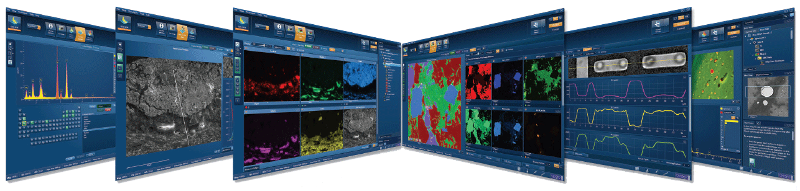

---

> **第 5 页 / Page 5**

目前 Oxford Instruments 提供两种类型的EDS 探测器，即Ultim 系列探测器和Xplore 系列探测器。EDS 探测器的先前型号包括XMax、XMaxN 和X-Act 探测器系列。Ultim EDS 探测器Ultim 系列EDS 探测器是Oxford Instruments 高端、大区域SDD、EDS 探测器的最新系列。可用的模型包括：

-  Ultim Max：高性能大区域SDD 探测器，提高了SEM 分析的分辨率、质量和性能。
-  Ultim Max TEM：高性能、低矮式80 mm2 无窗探测器，用于纳米级分析和TEM 中元素面扫描。
-  Ultim Max TLE：优化的100 mm2 无窗探测器，用于在TEM 中的原子级元素表征。
-  Ultim Extreme：无窗100 mm2 探测器针对纳米级应用设计成最大限度的灵敏度和空间分辨率。
它采用了一个基础几何条件，在超高分辨率FEG-SEM 中实现EDS 性能，同时在最佳工作距离处成像。Xplore EDS 探测器Xplore 系列的EDS 探测器是Oxford Instruments 出品的最新入门级SDD EDS 探测器系列。它们针对日常分析进行了优化，并使用了与Ultim 探测器系列相同的技术，以获得经验证的性能。可用的模型包括：

-  Xplore：SEM 中用于例行分析的探测器系列。
-  Xplore TEM：80mm2 探测器针对120 kV 和200 kV TEM 中的例行应用进行了优化。
控制模块EDS 控制模块用于：

-  为EDS 探测器供电、与其通信以及控制它。
-  将EDS 探测器与其他输入信号同步，控制电镜束流。
-  处理EDS 探测器检测到的X 射线。
Ultim 和Xplore 探测器由X1 或X4 EDX 采集模块控制。以前的探测器型号由mics 和Xstream 控制模块控制：

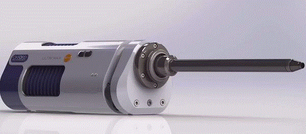

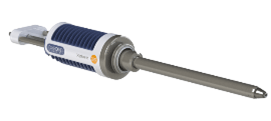

---

> **第 6 页 / Page 6**

X1 / X4 控制模块mics / xstream 控制模块EDS 计算机EDS 计算机：

-  运行AZtec EDS 软件，其用于采集、处理和分析的EDS 数据。
-  与电镜通信。
-  控制EDS 硬件。
-  接收来自控制模块的数据。
1.2.1. EDS 探测器工作原理SDD EDS 探测器通常具有以下结构：

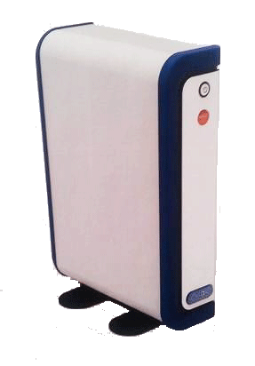

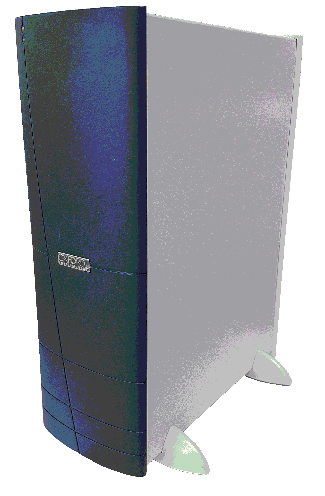

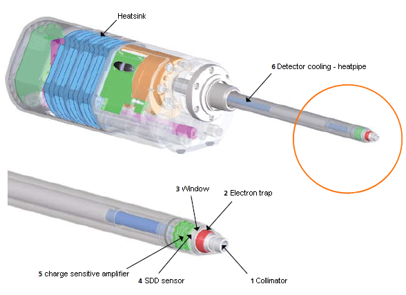

---

> **第 7 页 / Page 7**

项目描述准直器准直器提供了一个限制孔，X 射线必须通过它才能到达探测器。这样可以确保只检测到来自被电子束激发区域的X 射线，而不包括来自电镜室其他部分的杂散X 射线。电子阱穿透探测器的电子会产生背景伪影，也会使测量链过载。电子阱是一个永久磁铁组件，它能强烈地偏转任何经过的电子。注意：一些Ultim Extreme 探测器没有电子阱。相反，它们依靠电镜镜头视场来捕获电子。窗口当电镜室通风到大气压力时，窗口提供了一个屏障，可保持探测器内的真空和清洁。它们通常由一种低至100 eV 并对X 射线透明的薄聚合物制成，该聚合物被放置在一个支撑网格上，支撑网格将窗口固定在适当的位置。在真空度非常高的仪器中，例如TEM，可以使用无窗探测器，这使得对轻元素的灵敏度更高。传感器传感器是一种半导体硅漂移探测器(SDD) 装置，它通过电离过程将具有特定能量的X 射线转换成比例大小的电荷。在SDD 的背面使用环形电极施加的场梯度来收集阳极处检测到的每个X 射线释放的电荷。电荷敏感放大器电荷传感器放大器直接连接到传感器。它是放大过程的第一个阶段，测量入射X 射线在晶体中释放的电荷，并将其转换为电压输出。探测器冷却中SDD 探测器在零下几十度的温度下工作，并由绑定在SDD 传感器上的Peltier 装置进行冷却。这些装置的热量通过热管传递到探测器主体的散热片上，在那里散热。它的工作原理是通过三个阶段的过程将每个单独X 射线的能量转换成大小成比例的电压信号：

1. 通过将SDD 中原子离子化，将X 射线转换为电荷。
2. 电荷通过电荷敏感放大器转换成电压信号，每个电压阶跃输出对应于单条X 射线。
3. 电压信号输入脉冲处理器以进行测量。
将X 射线能量转换成电荷SDD 传感器由高纯度硅制成，入口侧有一个大面积触点，面向入射的X 射线。在另一侧有一个中心小阳极触点，周围有许多同心漂移电极：

---

> **第 8 页 / Page 8**

当在SDD 探测器芯片上施加偏压，并且探测器暴露于X 射线下时，它将检测到的每个X 射线转换成电子云，电荷与X 射线的特征能量成正比。这些电子被提升到硅半导体的导带中，并在传感器内留下类似于自由正电荷的空穴。然后，电子沿着漂移环之间的场梯度“漂移”下来，在阳极处收集。将电荷转换为电压信号在SDD 阳极处积聚的电荷通过电荷敏感放大器转换为电压信号：在操作过程中，电荷在反馈电容器上积聚。这种电荷有两个来源：

1. 传感器材料的电流泄漏。
2. X 射线从探测器中吸收的光子中产生的电荷。
由电荷积累引起的前置放大器的输出是由于泄漏电流而稳定增加的电压“斜坡”，由于每个X 射线事件产生的电荷，在这个斜坡上叠加了陡阶跃。积累的电荷必须定期恢复，以防止前置放大器饱和。因此，在预先确定的电荷水平下，电容器被放电，这个过程称为恢复或“重置”。由于噪声限制了每个阶跃的测量精度，输出波形呈现出波动。如果测量不精确，这将扩展相同能量光子的测量直方图。因此，噪声影响X 射线谱峰的宽度，特别是在低能量区。噪声受电荷敏感放大器增益、输入电容和泄漏电流的影响。低噪声是区分低能量X 射线如铍Kα、硅LI 和铝LI 与噪声波动的必要条件。例如，以下谱图显示了Al、Si 和Be 的K 和L 谱峰与基线噪声的分离：

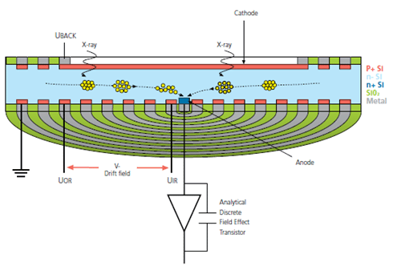

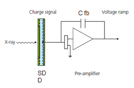

---

> **第 9 页 / Page 9**

测量电压信号单个X 射线光子释放的电荷在前置放大器的输出端出现，作为线性增加的电压斜坡上的电压阶跃：脉冲处理器的基本作用是精确测量入射X 射线的能量，并在计算机的相应通道中对其进行数字计数。它必须优化对原始X 射线信号噪声的去除，并且需要快速、准确地识别从100eV 到40keV 的大范围X 射线能量事件。它还需要及时区分到达探测器的非常接近的事件，以防止和峰效应。利用数字脉冲整形技术，在脉冲处理器的输入端对来自前置放大器的信号进行数字化，并通过数字计算实现整形和降噪。前置放大器输出由模数转换器(ADC) 连续采样，X 射线脉冲高度通常通过将X 射线事件之前测量的一组值的平均值从事件后测量的另一组值的平均值减去来测量。然后，阶跃测量的结果值直接发送到计算机多通道分析仪。通过对信号进行平均，有效地滤除了探测器电压斜坡上的噪声。将波形平均的时间有时被称为处理时间，但是根据所使用的处理方案，可以应用不同的定时定义。1.2.2. 分辨率和探测器噪声分辨率是探测器质量的唯一最被接受的测量方法，它提供了探测器性能的有用指示。它被定义为谱峰最大高度(FWHM) 一半处的宽度。数字越小，探测器的分辨率就越好，并且由于X 射线谱线间距很近，在解析谱峰时效果也就更好。

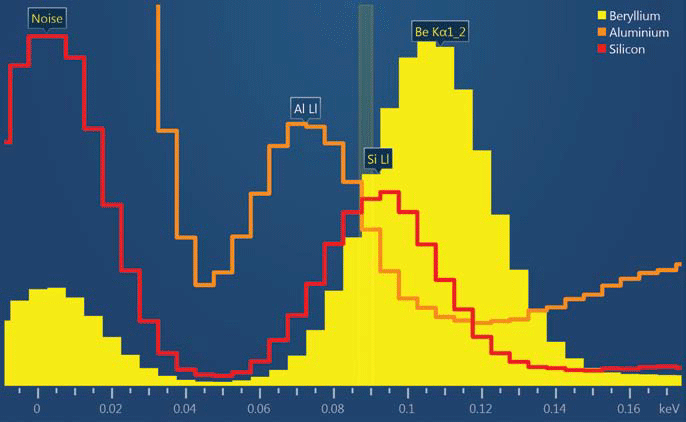

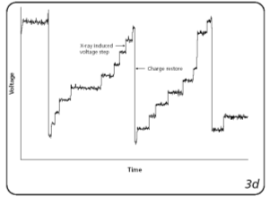

---

> **第 10 页 / Page 10**

探测器所实现的分辨率取决于传感器的噪声源以及计数链对它们的处理方式。不期望的噪声通常有三个主要来源：

1. 电压噪声：电压噪声受电荷敏感放大器增益和SDD/电荷敏感放大器电路( 例如传感器阳极)
中部件电容之和的影响。在脉冲处理器中使用长处理时间的信号平均可以降低电压噪声。因此，SDD 和电荷敏感放大器电路中的电容越低，处理时间越短，可能的计数率也越高。

2. 泄漏束流：泄漏束流来自施加到SDD 上的偏置电压，并在电压斜坡上增大斜率。它是“散粒噪
声”的一个来源，在长处理时间内，基线信号会随着积分斜坡所用的时间而变化，从而影响分辨率。对于给定的探测器设计，泄漏量与SDD 的面积和厚度成正比，并随温度升高而增大。为了实现最佳分辨率，SDD 探测器采用Peltier 技术进行冷却。

3. 1/F 噪声：1/F 对分辨率的贡献是由于探测器的特性( 如触点和电介质材料) ，并且在很大程度
上与处理时间无关。EDS 探测器的分辨率传统上是用锰Kα 线的X 射线来测量的。这对EDS 探测器的制造商很方便，因为它允许MnKα 发射55Fe 放射源来监测单个传感器和探测器的性能，而不需要SEM。在电子显微镜下放置一片纯锰于电子束下，也可以很容易地测量MnKα 的分辨率。不完全电荷收集如果X 射线产生的所有电子-空穴对没有漂移到电触点上，则电荷灵敏放大器测量到的电荷信号将小于预期值，所测得的能量将低于入射X 射线的能量。这种现象被称为不完全电荷收集(ICC)，其结果是在谱图中出现的计数的能量低于它们所代表的X 射线的能量，通常为谱峰的低能量侧的尾部。所有探测器都会在一定程度上经历不完全电荷收集。低能量X 射线的穿透深度很浅，在靠近正面接触处电荷收集通常很差。因此，低能量X 射线的谱峰将更宽，平均能量低于预期，这是因为测量每个X 射线时电荷收集的水平不同。因此，不完全的电荷收集导致探测器在低能量下测量的分辨率比理论上预测的要差。在极端情况下，它可能是在这些非常低的能量下控制分辨率的主导因素。下图显示了EDS 探测器的分辨率如何随能量变化，并取决于三个因素：

1. 基于探测器中使用的晶体材料的恒定分散。
2. 电子噪声的水平。
3. 电荷收集不完全导致的低能谱峰展宽。
分辨率如何随计数率和处理时间的影响而变化

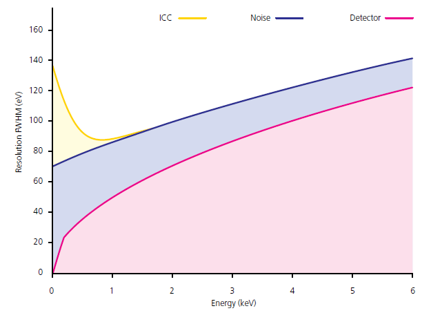

---

> **第 11 页 / Page 11**

处理时间越长(TP)，电压噪音越低。如果泄漏束流噪声仍然很低，谱图中显示的谱峰的分辨率将提高，并且更容易将其与能量相近的另一个谱峰分离或将其解析。例如：但是，处理时间与数据测量的速度之间存在着权衡。处理时间越长，测量每一个X 射线所花费的时间就越多，可测量的事件也就越少。处理器使用的最长的处理时间提供了可能的最佳分辨率，而最短的处理时间提供了谱图的最大吞吐量，但是会有一些分辨率的损失。生产率取决于测量的计数率，称为采集速率，而不是输入计数率( 输入探测器) 。随着输入速率增加，采集速率也随之增加，但会拒绝越来越多的事件。这是因为计数率的增加增加了另一个X 射线事件在测量第一个X 射线时在时间TP 内到达的可能性。这将干扰测量并需要将其拒绝。如果输入计数率充分增大，被拒绝的x 事件的比例将超过测量事件的增加，并且随着输入速率的进一步增加，采集速率将开始下降。通过平均不同的信号测量数来测量电压斜坡上的阶跃。较短的Tp 可以测量所有的阶跃，但每个测量的阶跃的变化很大，因此X 射线能量测量不准确，谱峰分辨率较差。长Tp 意味着有些阶跃靠得太近而无法测量。然而，噪声平均效果更好，因此谱峰显示出更好的分辨率因此，对于每个处理时间，存在一个最大采集速率，该速率对应于所选分辨率的最大可能速度。每个处理时间的最大采集速率是所用探测器脉冲处理器的特征。通过确定每个处理器设置的最大采集速率和此速率下的分辨率，可以评估探测器/处理器测量链的工作效率和性能。最佳分辨率可以在每秒万次计数( 输入计数率) 时达到，最大吞吐量以每秒十万次计数来衡量。例如：

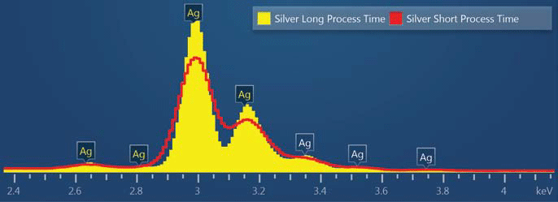

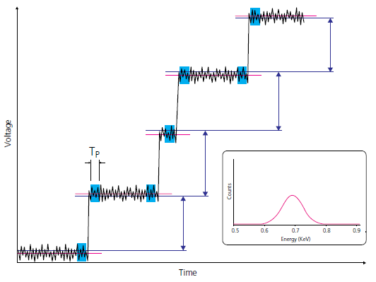

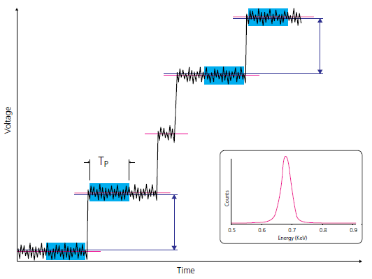

---

> **第 12 页 / Page 12**

1.2.3. 以极高计数率进行分析的挑战已经以高达200,000 cps 的输入计数率执行EDS 定量分析，并以超过500,000 cps 的输入计数率收集了X 射线分布图。但是，在这些计数率条件下，还需要考虑其他影响。弹道亏损由入射的X 射线生成的电子云在到达阳极之前散布开来。这对于SDD 探测器来说是个问题，因为电子云漂移到阳极进行信号收集的速度相对较慢。X 射线被吸收的点与阳极之间的路径距离越长，电子云散布的越多。当电子云靠近阳极时，开始感应输出信号，但是直到收集到整个电子云为止，才能实现完整的信号步长。电子云越大，这一时间越长。因此，信号脉冲的上升时间取决于探测器中原始的相互作用点。例如：为了获得很高的计数率，必须使用较短的处理时间快速测量信号。如果使用的处理时间太短，则脉冲可能无法达到其最大峰值高度，因此测量中会出现缺陷，即“弹道亏损”。例如：

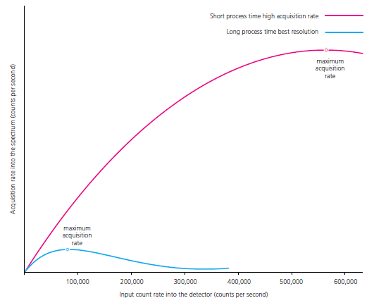

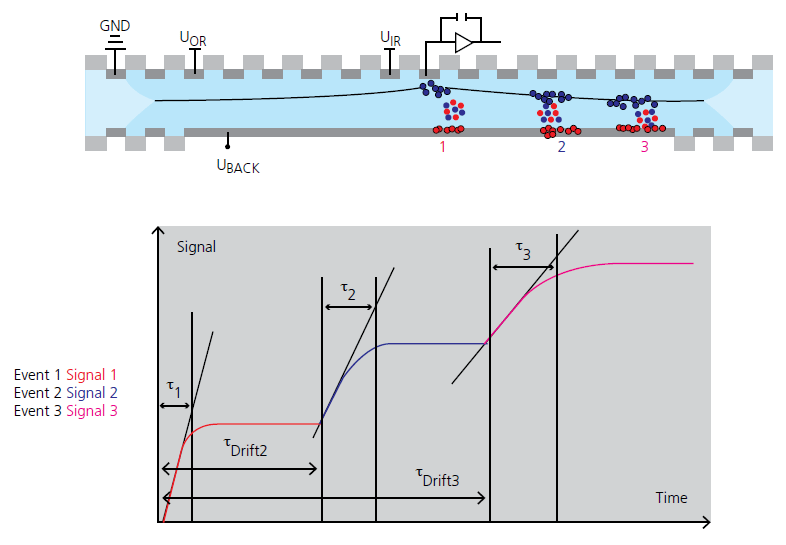

---

> **第 13 页 / Page 13**

因此，随着处理时间的减少以及高计数率下SDD 的操作模式，弹道亏损成为一个重要的问题。由于来自大面积探测器的脉冲将具有不同的上升时间，因此产生的效果将类似于电荷收集未完成，在峰值的低能量侧出现拖尾。谱峰峰型状偏离理想模型的失真会降低谱图处理的准确性，特别是对于重叠谱峰。因此，要以高计数率运行大面积SDD 探测器，必须解决弹道亏损的问题。通过使用对称设计限制漂移到阳极的路径距离，可以改善该问题。也可以使用特殊的脉冲处理技术来确保测量对上升时间的变化不敏感。尽管这限制了最大速度，但可以确保保持良好的分析性能。脉冲和峰当来自两个X 射线的脉冲非常靠近，以至于脉冲处理器无法将电压信号区分为单独的信号时，会发生脉冲和峰。结果是对两个X 射线的测量像是一个，并且在通道的谱图中添加了一个计数，该计数是两个X 射线的能量之和。这在谱图中最常表现为和峰，这种和峰在两个能量较低的主峰的总和能量位置出现。例如，在以下Al2O3 谱图中，和峰出现在2.97 keV 处。该峰被标记为Ag，而实际上却是AlK + AlK 的和峰。谱图还显示了另一个在2.01 keV 处的和峰，已被标记为P，而实际上是OK + AlK 的和峰：任何一对脉冲都会发生脉冲和峰，连续X 射线会与特征X 射线堆积，从而在主峰的高能量侧产生“堆积连续体”。连续X 射线与其他连续X 射线的堆积会导致背景超出Duane Hunt 限或入射电子的有效着陆电压。连续假象会影响谱图处理的准确性，特别是对于使用背景建模而非背景过滤的算法。未经修正的脉冲和峰会导致多种分析错误，包括元素识别不正确，峰比不准确以及定量结果随计数率而变化。

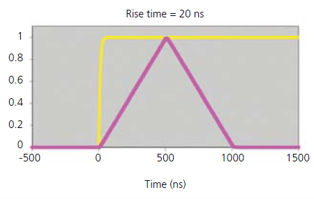

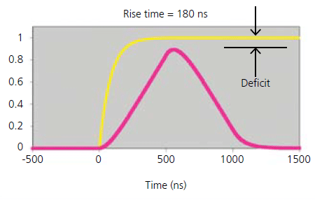

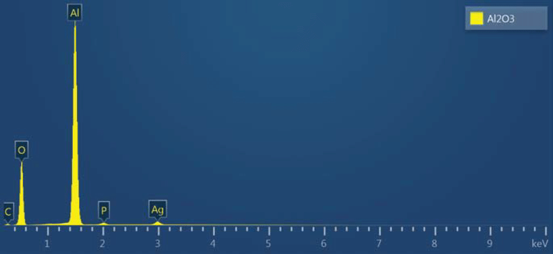

---

> **第 14 页 / Page 14**

脉冲处理器通常使用和峰检查通道以确保一次仅测量一个光子。检查通道旨在检测每个进入事件的到达。其电路具有一个时间常数，该常数确定可以所识别的事件之间的最短时间。如果时间常数短，则噪音水平会很高，并且检查器将错过低能量事件，但对于发现彼此靠近的高能量事件将非常有效。如果时间常数较长，将检查到所有低能量事件，但无法区分到达时间接近的事件。如果错过任何事件，即低能量事件或到达时间过近的事件，检查器将无法否决测量，因而会出现和峰假象。为了折衷，理想情况下，脉冲处理器应具有多个这样的电路，每个电路具有不同的时间常数，以确保在可检测能量的整个范围内都具有有效的脉冲和峰保护。因此，有效的脉冲检查应提供没有和峰假象的谱图。使用SDD 探测器以如此高的计数率工作时，即使有电子和峰检查器，在谱图中也不可避免地会出现一些和峰假象。除和峰检查外，存在可用于修正谱图中的任何和峰的另一种方法。这种“和峰修正”需要识别所有和峰事件，将其从谱图中删除，然后再放回正确的谱图通道中。已经开发出一种成功的算法来完成此任务，该算法使用和峰检查电路的详细模型和预测性统计方法来确定谱图中的堆积。使用此算法，即使在采集谱图的过程中，也可以检测和修正谱图中的和峰事件。例如，如果上面的谱图正确应用了脉冲和峰修正，便可以消除假象：

### 1.3. AZtec EDS 软件

AZtec EDS 软件是一个高级软件包，设计成允许使用EDS 完成样品分析。它被设计成具有：

-  用于系统设置、数据采集和数据分析的指导工作流程，可确保所有用户都可以获得并分析其
样品的EDS 数据。

-  一种可针对各水平用户和各种EDS 应用进行定制的结构。
用户界面(UI) 的主要功能包括：

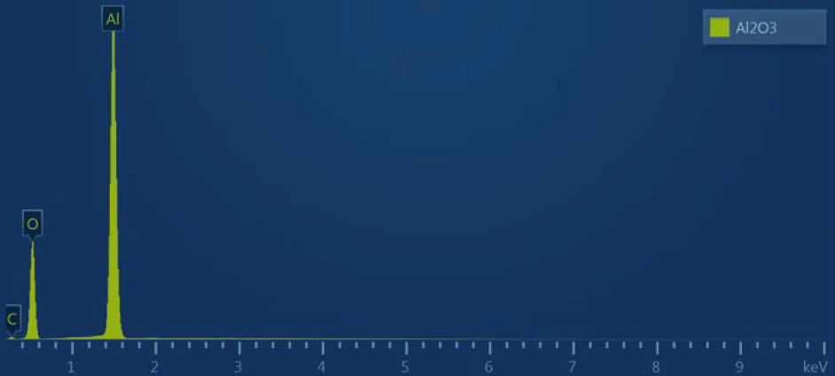

---

> **第 15 页 / Page 15**

项目描述菜单栏具有用于执行各种操作的典型下拉菜单栏，包括打开、保存和导入项目、应用程序缩放级别、语言和外观、用户设定和帮助。技术选择器从下拉菜单中选择要使用的技术。可用列表取决于授权硬件。导航器选择器从下拉菜单中选择要执行的分析类型( 例如，分布图或线扫描) 。可用列表取决于授权分析类型。导航器指导用户完成分析的一系列步骤。显示选择器选择项目在主工作区的显示方式。模式选择器选择是使用向导模式还是自定义模式。主工作区主要工作区域。显示的信息类型取决于所选导航器步骤。采集工具栏包含用于当前步骤的设置菜单和采集控件的工具栏。调色工具栏包含用于当前工作区的实用本地工具。

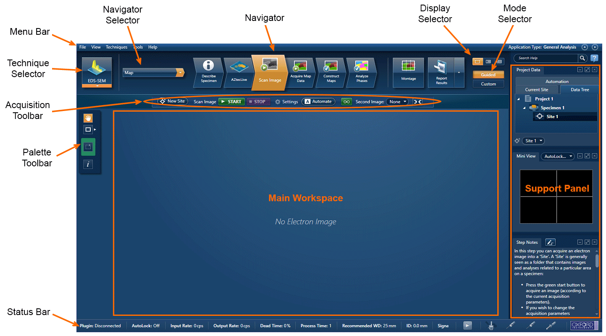

---

> **第 16 页 / Page 16**

项目描述板上下文菜单通过右键单击项目，可使用上下文菜单快速访问各个图像、分布图、谱图或数据集的诸多实用菜单项。支持面板支持面板位于右侧。它最多可包含三个部件：数据视图、迷你视图和步骤注释。数据视图有三个选项卡，显示当前区的数据树、整个项目的数据树以及大区域面扫描的数据树和控件( 自动化) 。迷你视图用于快速轻松地查看实用探测器信息的摘要。例如，它可以显示探测器状态、EDS 探测器计数率计或实时EDS 频谱。显示的信息取决于所选导航器步骤。它可由用户使用下拉菜单进行选择。步骤注释面板提供如何完成当前导航器步骤中所有事项的基本说明。用户可编辑步骤注释。状态栏状态栏位于UI 的底部。左侧显示各种硬件参数。注意：显示的参数可以通过从“工具”菜单访问的首选项进行配置。右侧含有大量硬件图标，用于访问电镜和已安装探测器的弹出窗口。这些弹出窗口用于报告当前状态并可实现电镜和安装的探测器的基本控制。硬件图标左侧是一个用于指示数据是否正在采集的进度图标以及该采集可能的进度为何。状态消息状态消息作为弹出窗口出现在UI 的右下角。它们可能是信息( 蓝色) 、警告( 黄色) 或错误( 红色) 。有关Aztec 用户界面的更多信息，包括如何自定义其设置的信息，请参阅Aztec 用户指南。1.3.1. 向导和自定义模式AZtec EDS 有两个不同的模式可用：

-  向导模式：这种模式是为所有类型的用户设计的，非常适合于喜欢逐步分析的用户。导航器的
每个步骤都有一个明确的目的，使它能够始终看到当前正在发生的事情以及下一步应该做什么。例如：

---

> **第 17 页 / Page 17**

这是默认模式，也是此帮助中显示的模式。

-  自定义模式：这种模式提供了许多不同的工作方式，非常适合那些喜欢自由和灵活操作的用
户，在他们需要时做自己想做的事情。选择哪些功能是可见的，以及它们显示的方式和位置。例如：要在两种模式之间切换，请使用软件顶部导航器右侧的模式选择器。

### 1.4. EDS 系统校准

为了使EDS 系统正常工作，在安装过程中由工程师对其进行校准。如果需要，用户可以通过更新能量标定来优化系统的性能。这将测量谱图谱峰位置以微调能量标定，并测量系统的分辨率。这实现准确的修正，以确保最佳的谱峰识别。如果进行非标准化定量分析，除了能量标定外，还必须进行束流测量。该测量用于计算和存储当前束流条件下的束流，以便在定量分析中考虑它并获得准确的结果。

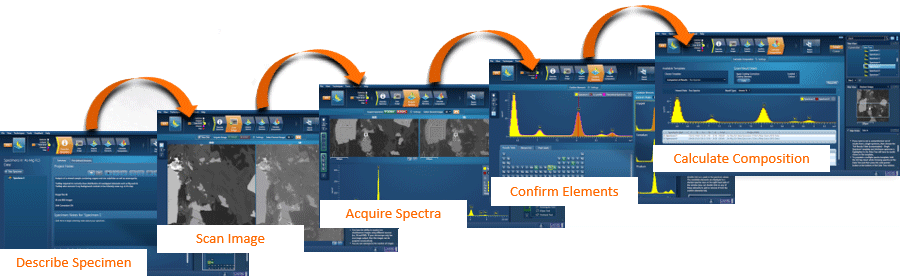

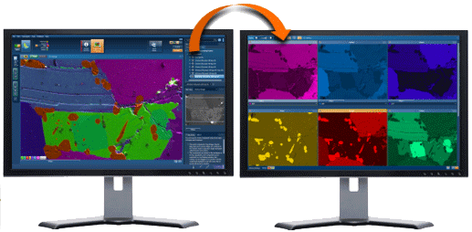

---

> **第 18 页 / Page 18**

2. 为EDS 分析准备
该部分包含在准备对示例执行EDS 时可能有帮助的信息。它包括有关以下方面的信息：

-  。
-  样品储存。
-  为EDS 设置TEM。
-  选择EDS 采集模式。
-  定位探测器。
TEM 中的EDS 允许样品的成分与要分析的电子束互动。TEM 反射镜成像要求中的EDS 样品要求，其中主要条件是样品应为电子透明。有许多技术可以用来准备样品，用于EDS 的TEM 样品。选择正确的技术非常依赖于样品的成分和结构。遗憾的是，没有一种技术可以适用于所有材料，所以可能有必要用不同的方法进行试验，以找到适合特定样品的最佳方法。为EDS 准备TEM 样品的一些最常见的技术包括：

-  机械和例子抛光。
-  双束流FIB/SEM。
-  电抛光。
在AZtec EBSD 采集用户指南中有关于这些技术的信息。注意：Oxford Instruments 对本部分所述指南的安全性不承担任何责任。务必遵照制造商的健康和安全说明。

### 2.1. 样品储存

为分析准备好样品后，重要的是以适当的方式也将其存储，以避免需要它。在为样品选择合适的存储时，有许多重要的注意事项：

-  样品表面不积聚灰尘或其他颗粒。
-  样品表面无划伤或进一步变形。
-  样品没有采集氧化层( 在某些材料上这可能是不可能的，比如镁，在进一步分析之前需要快速
重新抛光) 。

-  样品未采集水分。这尤其适用于岩盐和铁等对水分非常敏感的材料。
-  样品保存在凉爽的温度下。
这些注意事项表明，保存样品的合适位置是在干燥器中，或者至少是在洁净室的适当容器中。移动样品时，避免接触其表面，并使用合适的样品容器。2.2. 为EDS 设置TEM该部分包含为EDS 设置TEM 的一般建议。为EDS 进行设置所需的准确程序取决于所使用的透射电子显微镜(TEM) 的确切型号和所进行的EDS 实验的类型。有关更具体的说明，请参阅TEM 手册或更有经验的操作员。

---

> **第 19 页 / Page 19**

安装样品应按照特定于每个TEM 的方法安装样品。应注意样品相对于EDS 探测器的方向，尽可能优化样品和探测器之间的视线。下面给出了一个例子，突出显示了样品和Cu 柱相对于FIB 提取所用EDS 探测器的取向。在下面的例子中，配置B 和C 将导致来自FIB 网格的背景信号增加和来自样本的X 射线减少。配置A 针对EDS 分析进行了优化，因为样品和探测器之间的视线清晰。为EDS 配置TEM在为EDS 设置TEM 之前，必须：

-  正确对准TEM，确保电子束是圆形的，可以凝聚成点源。
-  选择合适的束流( 点大小) ，在保持适合分析的显微镜分辨率水平的同时，产生可接受的输入
计数率。对于某些分析形式，特别是原子分辨率面扫描，必须在显微镜分辨率和计数率之间进行折衷，在这种情况下，系统的分辨率不能受到影响，因此必须以低输入计数率进行分析。

-  优化样品和探测器之间的视线，消除TEM 样品架和样品网格的阴影效应。如有可能，样品应
向探测器倾斜约20–30°。在选择合适的束流( 点尺寸) 时，必须考虑：

-  分辨率：减小束流，减小点尺寸，从而提高空间分辨率。
-  典型分析：对于面扫描，增大束流可以缩短处理时间，并且可以在短得多的采集时间内实现相
同数量的计数。然而，对于定量分析而言，较长处理时间的准确度更为重要，因此减少束流可能会更好。

-  探测器设置：束流会影响探测器的输入输出计数率和死时间。如果需要使用特定的处理时间，
则调整束流以给出最佳的死时间、最大输出计数率以及因此而可能获得的最佳统计数据。2.3. 选择EDS 采集模式选择一个EDS 采集模式：

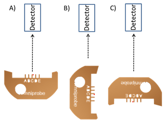

---

> **第 20 页 / Page 20**

1. 使用技术选择器下拉菜单选择EDS-TEM 技术：
2. 使用导航器选择器下拉菜单选择要执行的EDS 实验类型：
可用的选项卡取决于和已授权的模块。它们可能包括：

-  分析器：EDS 谱图是从电镜上的当前视场采集的。
-  Point&ID：EDS 谱图是从当前视野中定义的区域或点采集的。
-  线扫描：沿一条或多条线采集所定义点的EDS 谱图。
-  分布图：从定义的二维区域采集EDS 分布图数据。
-  特征：自动颗粒分析。有关使用AZtec Feature 的更多信息，请参阅AZtec Feature 用户指
南。

-  优化：执行校准优化，创建标准并优化和峰校正。
导航器现在应该更新以显示所选实验的导航器步骤。注意：打开Aztec 时，将自动加载最后使用的技术和导航器。2.4. 设置EDS 探测器一旦在电镜中设置好样品用于EDS，EDS 探测器就可以定位在电镜室中的EDS 位置并冷却。本部分描述以下操作：

-  控制和监视探测器的位置。
-  控制和监视探测器的操作状态。
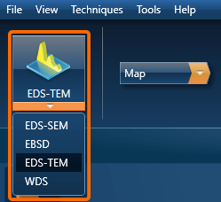

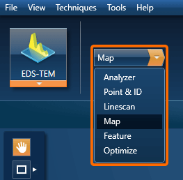

---

> **第 21 页 / Page 21**

安装在TEM 上的某些EDS 探测器也可能具有额外的EDS 探测器保护。2.4.1. 控制和监视探测器位置控制和监视探测器位置可用的方法取决于探测器型号。Ultim、Xplore TEM 和X-Max 探测器有两种方法可以控制Ultim、Xplore TEM 和Xmax 探测器的位置：

1. 使用“EDS 探测器控制”窗口中的“插入”选项卡，该窗口可从状态栏右侧访问：
-  单击“移入”按钮完全插入探测器：
-  单击“移出”按钮完全缩回探测器：
-  单击“停止”随时停止探测器移动。
2. 使用探测器主体上的控制按钮：
-  长按其中一个按钮以完全插入或缩回探测器。
-  轻按其中一个按钮以向内轻推或向外轻拉探测器。
可以从“EDS 探测器控制”窗口的“活动”字段监视探测器移动的状态。可用活动包括：

-  停止。
-  移入。
-  移出。
-  自动缩回。
可以从“EDS 探测器控制”窗口的“状态”字段监视探测器的位置。可用位置包括：

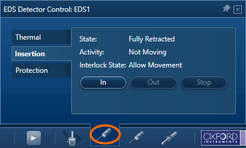

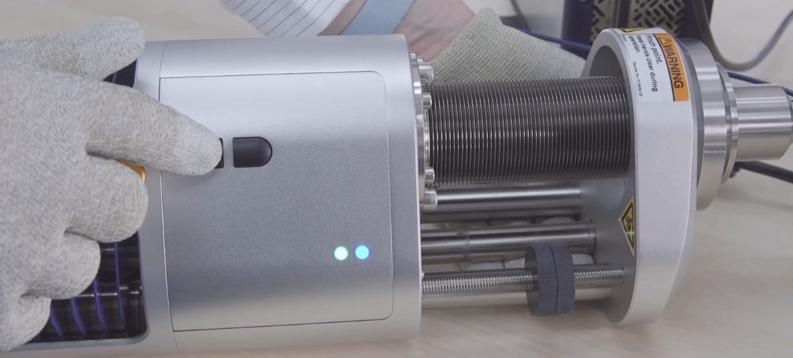

---

> **第 22 页 / Page 22**

状态描述完全插入探测器完全插入电镜样品室并且可用于采集。完全缩回探测器完全从电镜样品室缩回。不确定位置探测器位于两端挡板之间的某个位置。故障出现故障。2.4.2. 控制和监视探测器操作状态对于所有探测器型号，都可以使用“EDS 探测器控制”窗口的“热控制”选项卡来监视和控制操作状态。还可以使用探测器主体上的LED 监视操作状态。注意：如果探测器未冷却，则用于EDS 数据采集的开始按钮将禁用。对于所有探测器型号，“EDS 探测器控制”窗口的“热控制”选项卡都具有相同的选项：单击“运行”以启动冷却过程，并使探测器进入操作模式。单击“待机”以启动探测器预热过程，并使探测器进入待机模式。探测器主体上的“运行状态”字段和LED 可用于查看当前探测器状态。可能的状态包括：状态Ultim Xplore Xplore(TEM)X- Max X- Act描述待机左侧LED稳定闪烁左侧LED探测器为温暖状态并处于待机模式。可以节能并保护探测器寿命。加热关闭稳定闪烁关闭关闭关闭已选择待机模式，探测器正在预热到室温。致冷右侧LED探测器冷却时，闪烁频率增加右侧LED已选择运行模式，探测器正在冷却。冷右侧LED右侧LED探测器已冷却，准备好数据采集。

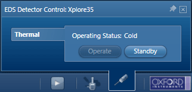

---

> **第 23 页 / Page 23**

状态Ultim Xplore Xplore(TEM)X- Max X- Act描述故障左侧LED闪烁故障序列左侧LED探测器出现故障2.4.3. EDS 探测器保护根据现有的软件许可证，安装在TEM 上的某些EDS 探测器可能会安装额外的探测器保护装置，以保护探测器免受高能X 射线和电子造成的潜在损坏。探测器保护有两种形式：

1. 低放大倍率保护：可用于X-Max 和Ultim 探测器。每当电镜处于低倍率模式时，探测器都会自
动缩回以保护其免受X 射线的伤害。在安全的情况下，可以按照控制和监视探测器位置一节中的说明重新插入探测器。注意：电镜需要硬件联锁才能使保护起作用。

2. 通量保护：一旦X 射线的通量超过了阀值的时间超过了指定延迟时间，探测器将自动缩回以
保护其免受潜在损坏。一旦将电镜设置调整为适合探测器，可以按照控制和监视探测器位置部分中的说明重新插入探测器。如果仍持续过载，探测器会再一次缩回。选中EDS 探测器控制窗口“保护”选项卡上的“启用通量保护”选项可启用或禁用通量保护。启用时，可以自定义保护延迟和阈值的值。可以从用户首选项恢复默认值。注意：AZtec 关闭时，这些值将恢复为工程师默认值。AZtec 打开时，将恢复自定义用户值。

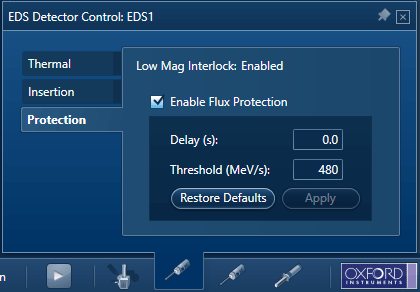

---

> **第 24 页 / Page 24**

## 3. 描述样品

在使用AZtec 采集任何数据之前，可以在软件中输入待分析样品的相关信息。该信息可能有两种形式：

1. 关于刚刚与AZtec 项目一起保存的示例的一般信息。例如项目摘要。
2. 有关软件使用的样品的信息。
此信息在第一个导航步骤“样品描述”中输入：

### 3.1. 描述样品工作区

“描述样品”导航器步骤具有以下结构：主工作区左侧的项目结构窗格用于显示当前项目结构。它也可用于向项目中添加“新样品”。主工作区顶部的选项卡用于选择不同的“描述样品”窗格，在其中可以输入不同类型的项目信息。可用的选项卡取决于所选的导航器和已授权的系统模块。适用于EDS 的选项卡包括：

-  摘要：用于创建和保存有关示例和项目的注释。
-  应用程序：用于选择要用作AZtecFeature 一部分的特定于应用程序的配置文件。
注意：此选项卡仅在系统具有AZtecFeature 许可证时显示。

-  样品几何条件：用于指定使用预倾斜样品架时的样品倾斜度。
-  预定义的元素：用于指定分析中是否必须包含任何特定元素以及是否应执行AutoID。
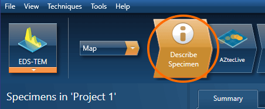

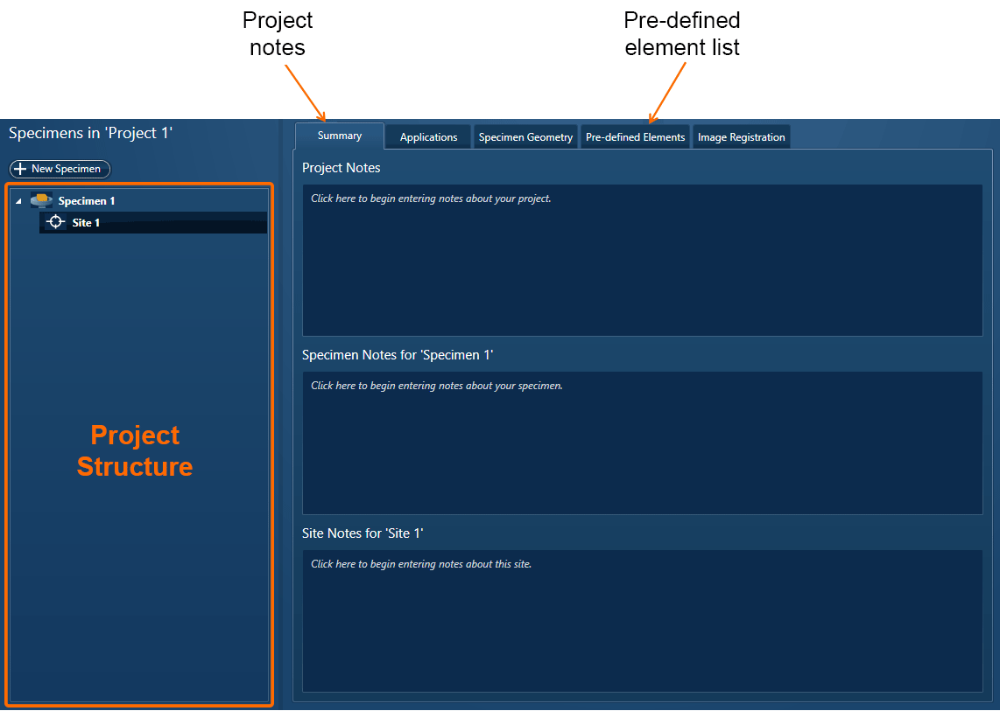

---

> **第 25 页 / Page 25**

-  图像配准：用于配准要用于帮助导航样品的图像。
有关图像配准的详细信息，请参阅图像配准步骤。

### 3.2. 项目摘要

在AZtec 中，可以创建与项目一起保存的关于示例和项目的注释，以便以后参考。创建注释：

1. 转到描述样品步骤的“摘要”选项卡：
2. 根据需要，在“项目注释”、“样品注释”或“区注释”部分中单击。
注意：如果项目已经包含数据，要为不同的样品或区添加注释，请从屏幕左侧的列表或数据树中选择样品或区，然后在主工作区的“样品或区”字段中输入信息。

3. 输入所需的信息。
当字段处于活动状态时，可以使用出现在字段上方的格式化工具栏中提供的标准文本格式编排工具。图像和表格可以从其他程序复制并粘贴到字段中。编辑现有注释：

-  选择正确的样品或区，然后单击“摘要”选项卡下的字段并编辑注释。
-  从“描述样品”选项卡屏幕左侧的列表或数据树中选择要编辑的样品或区，然后选择“编辑注
释”。这将打开“样品或区注释”窗口，在该窗口中，可以按照与“摘要”选项卡相同的方式编辑信息：

### 3.3. 预定义的元素

“描述样品”导航器步骤中的“预定义元素”选项卡可用于：

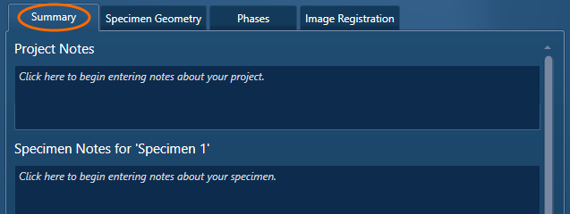

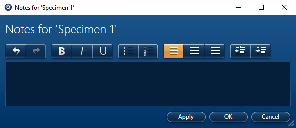

---

> **第 26 页 / Page 26**

-  定义必须包含在分析中的任何元素，无论这些元素是否已被自动检测到。
-  定义在EDS 采集期间是否应执行AutoID。
-  加载必须从用户配置文件中包含的预定义元素集。
-  将分析中必须包含的当前预定义元素集保存到用户配置文件中。
在“预定义元素”选项卡的“周期表”中标记为绿色的任何元素都是必须包含在分析中的元素。将在EDS 谱图中标识这些元素，而无论是否通过AutoID 标识了它们。这对于确认样品是否包含特定元素列表以及查看每个元素的贡献都是有用的( 即使其中一个元素不存在) 。可通过以下方式加入元素：

-  在周期表中双击元素，直至其变绿。
-  选择元素，使其在周期表中高亮显示( 单击一次) ，然后单击“包含”。
-  按住电脑键盘上的"Ctrl" 键，选择元素周期表中的多个元素，使它们突出显示。按下“包含”按
钮设置要包含的所有选定元素。

-  通过单击“从配置文件加载”按钮，选择加载预定义的包含元素列表。这将从当前加载的应用
程序特定配置文件加载列表。要将当前包含的元素列表保存到当前用户配置文件中，请单击周期表右侧的“保存到配置文件”按钮。停止包含元素：

-  双击周期表中的元素，直到其背景不再是绿色。
-  选择元素，使其在周期表中高亮显示( 单击一次) ，然后单击“清除”。
-  按“全部清除”按钮删除所有当前包含的元素的包含设置。
-  按住电脑键盘上的"Ctrl" 键，选择元素周期表中的多个所包含元素，使它们突出显示。按“清
除”按钮删除所有这些元素的包含设置。默认情况下，“采集期间执行AutoID”选项处于启用状态。可以通过取消选中周期表正下方的复选框来禁用它。当在EDS 采集期间启用AutoID 时，AZtec 会自动：

-  标识并分析谱图中的峰。
-  推导出产生峰值的相关元素。
-  相应地在谱图中标记峰。
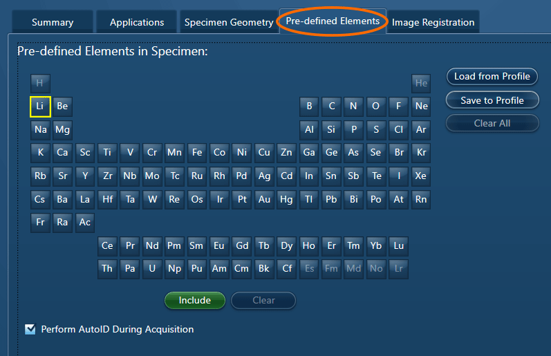

---

> **第 27 页 / Page 27**

## 4. 定位采集区域

传统上，EDS 以线性和迭代的方式分为两个独立步骤执行：

1. 关注的区域通过电镜上的电子成像识别。
2. 谱图和/或分布图的EDS 收集。
该技术的限制在于：

-  在采集EDS 数据之前，无法查看采集区域中存在的相的成分。
-  具有类似平均原子序数对比度的相可能无法单独使用成像彼此分离，从而导致无法仅使用成
像来识别关注的相。AZtecLive 提供了一个替代的EDS 工作流，可以解决这些问题，并允许以最有效的方式识别样品中关注的区域。它的工作原理是，即使在样品台移动的情况下，也能同时采集EDS 数据和电子图像。这使得组分元素、它们的相对丰度和分布以及样品的形态都可以实时可视化和表征。然后可以选择样品的适当区域进行更深入的分析。

### 4.1. AZtecLive 工作区

AZtecLive 导航器步骤的结构如下所示：项目描述采集工具栏包含用于当前导航器步骤的设置和采集控件的工具栏。

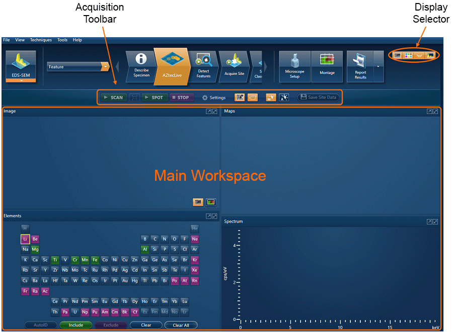

---

> **第 28 页 / Page 28**

项目描述显示选择器选择项目在主工作区的显示方式。显示图像窗格。显示EDS 分布图窗格。显示“元素”窗格。用于查看检测到的元素，选择要包含或排除的元素以及是否使用AutoID。显示谱图窗格。主工作区使用“显示选择器”将当前选定的项目显示为最多四个窗格。使用每个窗格右上角的箭头解锁或最大化每个窗格。可结合实时轨迹迷你视图来使用它。4.1.1. 采集工具栏采集工具栏包含用于控制AZtecLive 的工具：项目描述扫描开始同时采集电子图像和EDS 数据。切换至减小的区域扫描。该功能可能在聚焦样品时有用。点将束流置于点模式。这个点在电子模式上用一个黄色十字标记。此功能可用于查看单个点的EDS 谱图，而不是整个视场。STOP( 停止)停止采集。设置访问实时采集设置。在样品静止时，改善EDS 数据的品质。选择此选项可使Aztec 在电镜样品台静止且图像设置无更改期间对数据进行整合来改善图像和分布图的质量。一旦检测到电镜样品台位置或图像设置发生更改，图像和分布图数据将不断刷新。动作检测灵敏度。选中“改善静态质量”选项时，该选项可用。默认情况下，选项为选中状态( 橙色) 。

---

> **第 29 页 / Page 29**

项目描述选项为活动状态( 橙色) 时，AZtecLive 将监测图像变化。当检测到图像变化时，AZtecLive 将关闭“改善静态质量”模式，并刷新图像和分布图数据的每一帧。如果图像质量或稳定性较差( 即亮度和对比度波动、图像噪声高或振动) ，图像中的明显变化会导致AZtecLive 关闭“改善静态质量”模式，即使图像并未发生真正的变化。在这种情况下，应禁用该选项( 按钮显示为蓝色) 。AZtecLIVE 将继续保持“改善静态质量”模式，直至电镜通讯中读取到样品台活动，或是工作距离或放大倍率发生变化。应用手动亮度和对比度调节。应用自动亮度和对比度调节。保存区数据保存显示的图像、分布图和谱图。4.1.2. AZtecLive 采集设置“实时采集设置”窗口用于定义AZtecLive 要使用的设置：选择：

-  驻留时间(µs)：束流在每个像素上花费的时间量。
驻留时间越长，从每个像素获取的数据量就越大。然而，采集图像所需的时间也越长。

-  图像来源：选择图像输入源。
SE 图像输入源将允许显示当前在电镜上选择的图像源。BSE 图像输入信号仅在连接的某些系统上可用。

-  能量范围(keV)：用于收集EDS 数据的能量范围。
最适当的能量范围取决于电镜加速电压。它的设置应该使所有可能被激发的能量线都能显示出来。例如，如果电镜设定为10 keV，0-10 keV 的能量范围最为适当，因为绘制更高的能量将不会显示任何额外的数据，因为高于10 keV 的能量线将不会被激发。如果电镜设定为15 keV，0-20 keV 的能量范围可能更为适当，因为在此范围内可以显示10 和15 keV 之间的能量线。

-  处理时间：指处理EDS 检测器发出的X 射线信号以及消除数据噪音所需的时间长度。
如果处理时间设置为“默认”，则处理时间将设置为固定的通用处理时间。要获得最快的采集速率，而在分辨率上有所损失，请选择较短的处理时间。要提高谱图的分辨率或解析具有相似能量的元素，需要更长的处理时间。

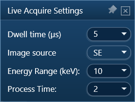

---

> **第 30 页 / Page 30**

4.2. 使用AZtecLive要使用AZtecLive，请执行以下操作：

1. 选择必须包含或排除的任何元素，无论它们是否存在于以下任一项中：
-  “元素”窗格。
-  “描述样本导航器”步骤中的“预定义元素”选项卡。
注意：如果在AZtecLive 导航器步骤的“元素”窗格中包含或排除元素，则它们将覆盖已在“描述样本导航器”步骤中设置的任何元素。

2. 当样品台固定时，选择是否改善EDS 分布图的质量。
3. 使用采集即时设置窗口，为采集图像和EDS 数据选择合适的设置。
4. 单击“扫描”，开始扫描显微镜上的当前视野。
AZtecLive 开始从电子束扫描的区域采集电子图像并同时采集EDS 数据。将持续对图像和EDS 数据进行更新。如果在“描述样品”步骤的“预定义元素”选项卡中选择了AutoID，则实时总谱图中的元素将被识别并显示在谱图上。如果将任何元素设置为必须包含，则将显示这些元素的元素分布图。

5. 要检测当前字段中存在的元素并可视化这些元素的元素映射，请单击“元素”窗格中的
“AutoID”。现在将显示适当的元素分布图。注意：一旦执行了AutoID，显示的元素分布图的列表会被固定。要更新列表，可单击“元素”窗格中的AutoID。检测到的任何其他元素都将添加到元素分布图显示中。即使元素不再存在，也不会删除元素分布图。要删除元素，请在“元素”窗格中取消选择该元素或将其设置为“排除”。要清除整个元素分布图列表，可单击“元素”窗格中的“全部清除”。

6. 通过以下方式在样品周围移动：
-  使用电镜控件。
-  双击电子图像或EDS 分布图上的一个点。样品台将移动至居中位置。
-  在实时轨迹迷你视图中选择感兴趣的字段，然后选择“移动到”以移动到该字段。
7. 若要检查是否存在其他元素，请单击“元素”窗格中的“AutoID”。
8. 要查看单个点的谱图，例如要可视化特定特征中的元素，请单击“点”将束流置于点模式。束流
的位置用黄色十字标记在电子图像和EDS 分布图上。单击电子图像或其中一张EDS 分布图上的其他地方，将束流移动到该位置。要返回至整个视野的扫描，单击“扫描”。

9. 要保存当前数据，请单击采集工具栏中的“保存区数据”。一个实时轨迹项目将被添加至数据
树。如果这是要保存的第一个实时轨迹，或者如果自上次保存以来，样品台位置、放大倍数或加速电压发生了变化，则会为数据创建一个新的区。在“扫描”模式下，电子图像、显示的元素分布图和总谱图将被保存到当前区。在“点”模式下，当前点谱图将被保存到当前区。此外，如果电子图像、元素分布图和总谱图未存在于当前区中，则它们将被保存。

---

> **第 31 页 / Page 31**

## 5. 样品成像

Aztec 允许使用TEM 采集样品表面的图像，并使用导航器步骤“扫描图像”在Aztec 软件中可视化：可以使用电镜上可用的任何探测器采集图像，。然后采集到的图像可用于帮助进行后续的EDS 分析，方法是允许准确定义将从中采集数据的样品区域。注意：除分析器导航器外，所有的EDS 采集导航器中都可以使用此导航器步骤，其中电镜上的当前视场始终用于采集EDS 谱图。本章说明了如何使用AZtec 来：

-  采集和增强图像。
-  查询图像。
-  编辑和注释当前和以前保存的图像。
-  保存或导出图像以用于报告。
### 5.1. 扫描图像工作区

扫描图像导航器步骤的结构如下所示：项目描述调色板工具栏包含与当前工作区相关的工具的工具栏。例如，允许图像移动和放大缩小的平移工具，以及允许在图像上创建注释的注释工具。

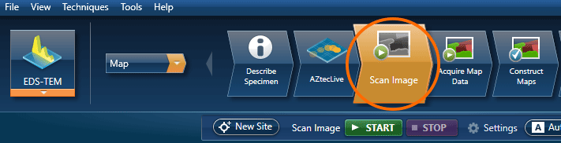

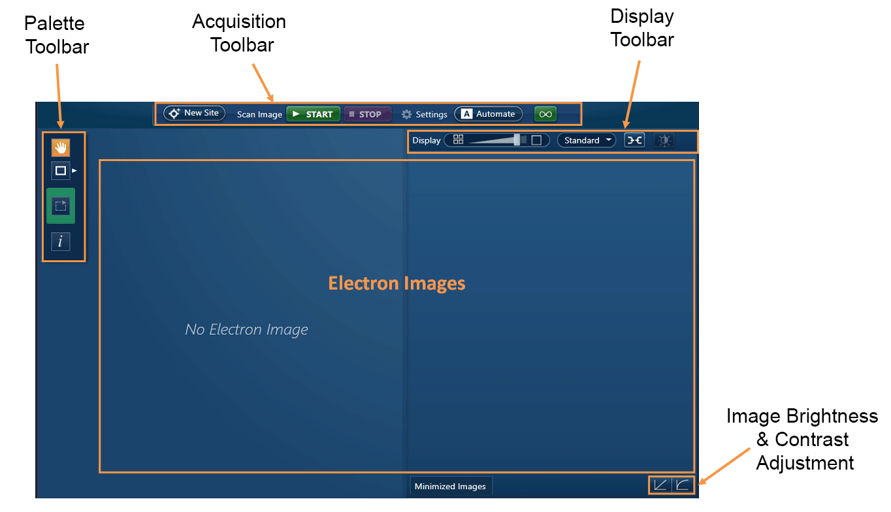

---

> **第 32 页 / Page 32**

项目描述采集工具栏包含用于当前导航器步骤的设置菜单和采集控件的工具栏。显示工具栏工具栏，包含用于自定义图像的工具。在处于“显示图像和图像列表”或“全屏显示图像列表”显示模式时显示。电子图像显示电子图像的主工作区。此空间的布局取决于当前选定的显示模式：

-  图像全屏：最多可全屏显示两个同时采集的图像。
-  图像和图像列表选定的图像显示在左侧，单个图像在右侧显示为较小的图
像。

-  全屏图像列表：显示同时采集的所有单个图像。
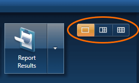

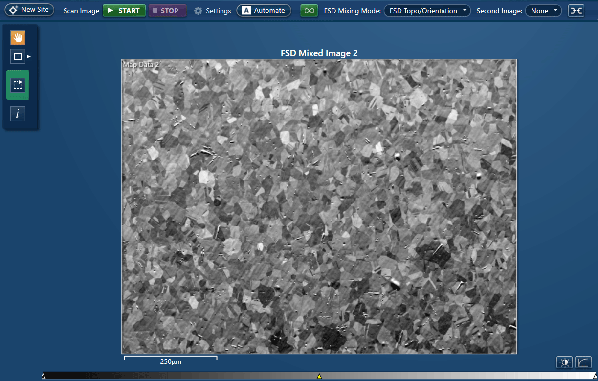

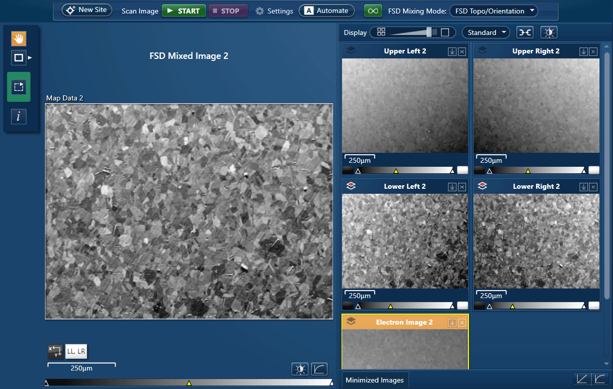

---

> **第 33 页 / Page 33**

项目描述图像亮度和对比度调整调整图像的对比度、亮度和Gamma 水平。5.1.1. 调色板调色板工具栏包含与当前工作区相关的工具。项目描述平移：允许图像和EDS 谱图平移( 移动) 和放大及缩小。有关平移和缩放图像的更多信息，请参阅平移和缩放工具( 位于样品成像小节) 。注释：允许注释图像。有关注释图像的更多信息，请参见注释工具小节( 位于样品成像小节) .显示数据值工具：查看特定数据点的信息：

1. 从调色板工具栏中选择“显示数据值”工具。
2. 将鼠标悬停在数据点上方。
将显示该点的数据。5.1.2. 采集工具栏采集工具栏包含用于当前工作区的采集控件：项目描述在数据树中新建区。

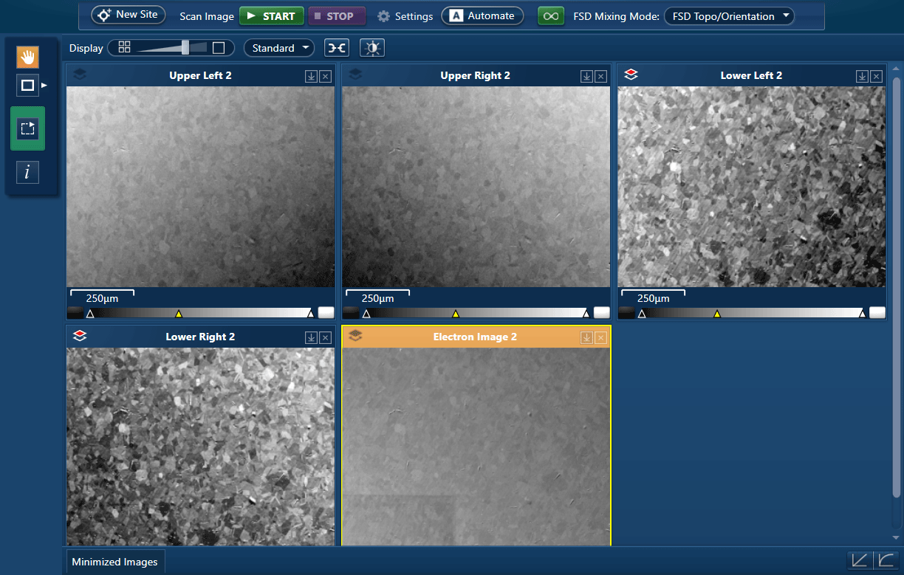

---

> **第 34 页 / Page 34**

项目描述开始采集。停止采集。

-  如果采集帧数设为1，那么将立即停止采集。
-  如果采集帧数大于1，那么将在该帧结束后停止采集。再次单击“停止”按
钮立即停止采集。随即打开扫描图像设置窗口。开始连续图像采集。5.1.3. 显示工具栏当处于图像和图像列表或全屏显示图像列表模式时，显示工具栏位于Aztec 主工作区的顶部：它用于选择单个图像显示的大小和信息。项目描述使用滑块调整图像列表中所有图像的显示大小。使用下拉菜单选择图像列表中图像的显示方式。从以下项中选择：

-  标准：具有基本编辑选项的默认显示模式，例如可以更改构成分
层图像的分层。

-  交互式：包含更高级的编辑选项，如更改图像颜色的功能。对于
分层图像，它还允许调整每个单独分布图的贡献。

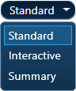

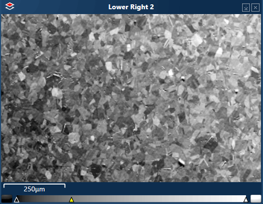

---

> **第 35 页 / Page 35**

项目描述

-  摘要：包含所用设置的摘要。
在图像列表中链接/取消链接图像。链接时，在一个图像上缩放或平移将对图像列表中的所有图像产生相同的影响。打开“亮度和对比度调整”窗口，在该窗口中可以调整当前所选图像的亮度、对比度和Gamma 水平。

### 5.2. 采集图像

要在AZtec 中采集高质量的样品微结构图像，必须首先针对样品和要采集的图像对电镜进行适当的设置。正确设置时应注意的参数包括：

-  信号类型。
-  束流条件( 探针电流) 、加速电压( 点尺寸) 。
-  放大倍率。
-  聚焦。
正确设置电镜并验证设置的适用性后，即可在AZtec 中采集图像。为了采集合适的图像，建议首先选择合适的图像采集设置( 即图像输入源和图像分辨率) 。然后可以按照采集图像部分中所述来采集图像。为帮助优化图像，AZtec 还提供连续图像采集。一旦在AZtec 中采集到适合的图像，这些图像便可用于为任何后续EDS 分析定义采集区域。例如，这些图像可用于标记要进行面扫描的区域或要采集谱图的区域。注意：如果样品容易带电或漂移，建议以固定时间间隔返回“扫描图像”导航器”步骤并采集新图像。使用最近的图像将确保后续的EDS 采集采样点相对于图像正确定位。参阅处理样品漂移部分可能也会有所帮助。5.2.1. 选择图像采集设置

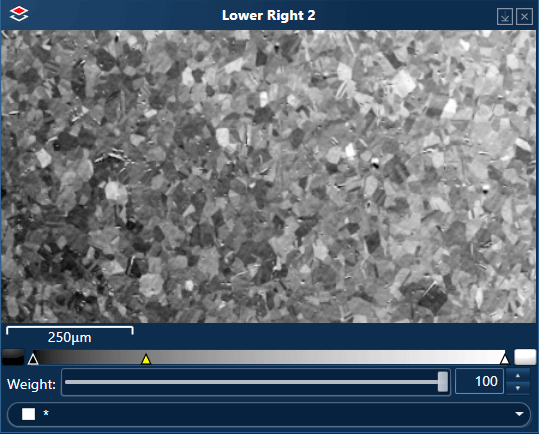

---

> **第 36 页 / Page 36**

在Aztec 中采集图像之前，选择要使用的图像采集设置非常重要。可以从采集工具栏的“设置”菜单中指定这些设置：项目描述图像扫描尺寸定义整个图像在x 方向上的分辨率( 即像素的数量和大小) 。Y 方向的分辨率取决于图像的纵横比。驻留时间( 微秒)定义束流在每个像素上花费的时间量。输入信号可用于采集的图像类型：

-  BF：明亮视场。
-  ADF：环形暗视场。
帧数量束流扫描单个帧并将它们一起平均以生成图像的次数。帧时间( 秒)采集整个帧所用的时间。AutoLock显示Aztec 漂移校正的当前状态。点击“设置”来设置漂移校正。有关使用AZtec 漂移修正的更多信息，请参阅处理样品漂移部分。图像质量设置

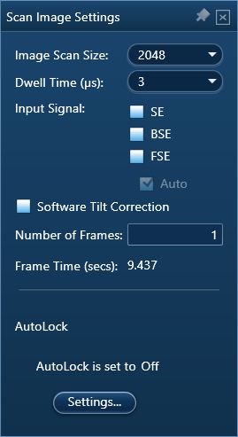

---

> **第 37 页 / Page 37**

图像扫描尺寸、停留时间和帧数都会影响图像质量和采集图像所需的时间。要快速查看样本，请使用最低扫描大小( 分辨率) 和停留时间( 每个像素所用的时间) 。要获得更高质量的图像，例如报告和解析小特征，可使用更大的扫描尺寸( 更高的分辨率) 以向图像提供更多像素和更长驻留时间，减少图像中的噪声量。采集多个帧，然后将这些帧一起平均，也有助于减少图像中的噪声。这对于采集高质量的光束敏感样品图像非常有用，因为过长的驻留时间会导致带电或样品损坏。图像输入信号在Aztec 内部，尽管根据电镜只能连接一个图像输入，一次可以从电镜获得最多两个图像输入。在这种情况下，连接的输入通常允许获得电镜上的当前图像类型( 即BF 或ADF) 。5.2.2. 采集图像图像采集通过采集工具栏控制。要使用当前的采集设置采集电子图像，单击“开始”按钮。图像将在采集时显示出来。第一次采集新的电子图像时，将在数据树中添加一个新的电子图像条目。如果同时采集两个电子图像，则添加两个图像条目。例如：默认情况下，在相同目标区采集的每个额外图像即便设置不同，也将会覆盖当前图像。因此，如果您对当前图像不满意并想要重新采集，请更改任意设置并再次单击图像采集工具栏中的“开始”按钮。如果单个相关区需要多张图像，请采集第一张图像。然后在数据树中单击图像旁边的挂锁图标将其锁定。这会避免该图像被覆盖。然后设置并采集新的图像。数据树中将添加新的图像。例如：

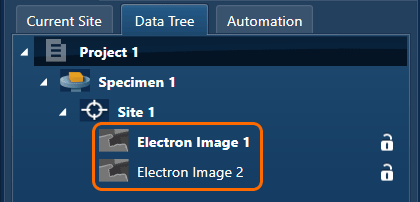

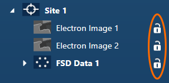

---

> **第 38 页 / Page 38**

在采集图像的过程中，数据树中的条目上方会显示绿色进度条。状态栏的“Current Acquisition Status( 当前采集状态) ”窗口中也可看到相似的进度条。如果出于任何原因需要停止图像采集，请单击红色“停止”按钮：

-  如果采集帧数设为1，那么将立即停止采集。
-  如果采集帧数大于1，那么将在该帧结束后停止采集。再次单击“停止”按钮立即停止采集。
5.2.3. 连续图像采集在AZtec 中，可以连续采集全视场或减小区域的图像。此功能可用于：

-  优化样品的聚焦。
-  观察样本中是否存在任何可能会影响数据采集的不稳定性( 例如充电或漂移) 。当使用连续扫
描时，这些行为是显而易见的，因为图像将在每一帧之后切换。要连续采集图像，请在采集工具栏中单击连续采集按钮：图像将开始连续采集。采集进度由图像上的绿色水平线显示：

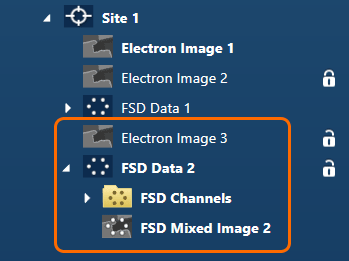

---

> **第 39 页 / Page 39**

图像上方也会出现“连续扫描”工具栏：使用工具栏实现以下操作：

-  更改驻留时间。
-  在扫描整个视场和减小的区域之间切换( 图标显示为橙色) ：
该功能可能在聚焦样品时有用。即：

-  使减小区域在视场中居中。
减小区域的位置和大小可以使用鼠标调整。要停止连续扫描：

-  当前帧完成后，单击一次“停止”以停止扫描。“停止”按钮将闪烁红色并显示“正在停止”，直到
完成采集为止。

-  单击“停止”两次立即停止扫描。
注意：如果连续扫描是在减小的区域进行，AZtec 将在停止图像采集之前采集完整的一帧。

### 5.3. 查看和展示图像

---

> **第 40 页 / Page 40**

在Aztec 中有许多工具用于查询图像并优化它们的显示以进行报告。它们包含：

-  选择单个图像显示的大小和信息。
-  对谱图进行缩放和平移。
-  使用注释突出显示或测量所关注特征。
-  查看特定数据点的信息。
-  通过调整亮度、对比度、Gamma 和颜色，增强图像外观。
5.3.1. 平移和缩放工具为了便于查看和查询电子图像或分布图，AZtecCrystal 具有允许图像平移( 移动) 和缩放的功能。要访问这些工具，从屏幕左侧的调色板工具栏中单击平移工具图标：在多个图像和分布图的显示模式下，在开始缩放或平移之前，建议使用“链接”工具选择是放大还是缩小单个图像或分布图：注意：当按钮的背景为橙色时，将链接各个图像和分布图。在图像或分布图上进行缩放操作的方法有两种：

1. 将鼠标悬停在图像或分布图上方时，使用鼠标上的滚轮。
2. 按住计算机键盘上的“Ctrl”键，然后在图像或分布图上点击鼠标左键。将鼠标移动至右侧进行
放大，移动至左侧进行缩小。若要移动图像或分布图，请在选定“平移”工具的情况下，按下鼠标左键并拖动图像。松开鼠标左键停止移动图像。可通过以下操作将图像返回至其初始尺寸：

1. 右键单击图像以访问上下文菜单。
2. 对于显示窗格中的单个图像或分布图，请选择“重置图像比例”。
对于显示在图像窗格中的电子图像、分层图像或分布图，请选择“图像重置比例”，然后选择“使图像适合显示屏大小”或“使用图像填充显示屏”。5.3.2. 注释图像注释工具位于调色板工具栏：

---

> **第 41 页 / Page 41**

它允许对图像和谱图进行注释，包括：

-  要测量的特征和角度。
-  为突出显示特征而创建的矩形和椭圆形标记。
-  要添加的文本。
要创建注释，可单击调色板工具栏中注释工具右侧的箭头。这将最大化可用的注释工具列表：如需创建矩形或椭圆标记：

1. 在起点按下鼠标左键。
2. 拖动鼠标绘制形状。
3. 松开鼠标左键完成注释。
如需添加文字：

1. 在想要显示文字的点处单击鼠标左键。
2. 添加文字。
3. 再次单击完成操作。
删除或编辑注释：

1. 从调色板工具栏选择平移工具( 手形符号) 。
2. 单击注释将其选中( 突出显示为红点) 。

---

> **第 42 页 / Page 42**

3. 按下计算机键盘上的删除键将其删除，或单击并拖动红点来移动注释或调整其尺寸。
将箭头添加至文本注释：

1. 单击选择文字。
2. 在您要添加箭头的红点上按住鼠标左键。
3. 拖动该点形成箭头。
4. 松开鼠标按钮完成操作。
通过右键单击图像或分布图访问上下文菜单并选择“注释”和“样式…”，可以配置注释的样式。这将打开“设置样式”窗口，其中可以指定线条、字体大小和颜色：更改这些设置后所作的所有注释及更改样式时选中的现有注释都将以新样式显示。未选定的现有注释将以旧样式显示。可以使用上下文菜单并选中或取消选中“注释”、“显示”选项来更改注释显示。5.3.3. 查看特定数据点的信息查看特定数据点的信息：

---

> **第 43 页 / Page 43**

1. 从调色板工具栏中选择“显示数据值”工具。
2. 将鼠标悬停在数据点上方。
将显示该点的数据。5.3.4. 增强图像外观在AZtec 内，可以增强或优化TEM 图像的外观，以便更清晰地看到细节。有多种方法可以增强图像：

-  调整亮度、对比度和Gamma 水平。
-  更改图像中使用的颜色。
亮度、对比度和Gamma 调整通过单击“显示”工具栏中和主电子图像下的亮度和对比度图标，可以针对当前显示的图像调整亮度、对比度和Gamma 水平：这将打开亮度和对比度调整窗口：然后此调整窗口可用于：

-  使用滑块手动调整亮度和对比度。
-  执行自动亮度调整。此工具使用线性刻度在整个灰度范围内为图像指定强度范围。
-  执行自动Gamma 调整。此工具调整Gamma 曲线以显示中间色调，同时保留最大值和最小
值。它有助于显示图像中的细节。此外，可通过单击扫描图像工作区底部的相关图标来执行自动亮度和自动Gamma 调整。设置图像颜色改变图像的颜色有助于增强一些细节。在标准或交互式图像显示模式下，可以使用显示在每个图像下面的图像颜色栏来设置颜色：

---

> **第 44 页 / Page 44**

如果颜色标尺不存在，可以通过右键单击图像以访问上下文菜单，然后选择“视图”和“颜色标尺”来访问：单击颜色标尺任一端的颜色框以打开“选择颜色”窗口，并为图像中最亮或最暗的点选择颜色：在交互式或摘要显示模式下，可以使用下拉菜单将颜色设置为最亮的点：

### 5.4. 保存并导出图像

可以从扫描图像导航器步骤直接导出图像。这可以用于以下情况：

-  需要单个图像。
-  将在第三方软件中分析图像。
-  需要将特定的图像添加至现有报告。
图像可以导出为：

-  TIFF、TSV 或CSV 格式的数据文件。
-  显示具有或没有任何采集区域和注释的图像。
以数据格式导出图像：

1. 右键单击主工作区或数据树中的图像以访问上下文菜单。
2. 选择“仅导出数据”。
3. 对于主工作区中的图像，选择导出它们要采用的格式。只能以TIFF 格式导出数据树中的图
像。导出图像：

---

> **第 45 页 / Page 45**

1. 右键单击主工作区中的图像以访问上下文菜单。
2. 选择“导出”。
3. 选择导出图像的方式( 即保存、复制、打印、以电子邮件发送) 。
要配置要导出为图像的图像的显示设置，请选择“设置...”选项。可用选项取决于要导出的图像，可能包括指定：

-  图像的最终大小。
-  是否显示图像标题。
-  是否显示图像上当前的任何注释。
-  是否在图像上显示颜色和比例尺。
-  应当用来导出图像的方式。

---

> **第 46 页 / Page 46**

## 6. 处理样品漂移

在某些情况下，可能会发现随着时间的推移，样品会轻微移动( 漂移) 。该现象可能通过多种方式变得明显：

-  将采集后图像与原始电子图像进行比较，可以看出两个图像之间存在偏移。
该偏移可能因为许多原因而发生，包括：

-  温度或环境变化引起的热漂移。
-  带电样品。
-  在电镜下散发气体或不稳定的粘接剂。
-  由于样品台或样品夹持器而产生的机械漂移。
当出现漂移时，最理想的解析是消除漂移的原因。例如，如果漂移是由温度变化引起，在试图成像之前，让样品在电镜内稳定下来。如果这是由于另一个因素，如进样，则可尝试通过以下方式减少漂移：

-  更改样品安装方法。例如，如果使用了粘性标签，则尝试使用导电涂料安装样品，并另外从存
根在样品表面上画一条线。或者尝试使用导电安装介质。

-  在样品上涂上一层薄的导电涂层，如碳。
-  更改电镜操作条件。例如，尝试降低探针电流和加速电压。
-  选择不同的相机采集控件以减少束流在每个像素上花费的时间量。
如果无法消除样品漂移的原因，则Aztec 提供自动锁定漂移修正，以补偿数据采集过程中的漂移。默认漂移修正是一种反应式方法，使用以下方法：

-  在开始任何分析之前采集参考图像。
-  采集会定期暂停。
-  采集跟踪图像。
-  将跟踪图像与参考图像比较。
-  确定两个图像之间的漂移量。
-  调整电镜束流扫描以补偿图像漂移量。
-  恢复采集。
此外，AZtec 还提供了另外两种漂移修正方法：

-  逐帧漂移修正。
-  预测漂移修正。
逐帧漂移修正是一种反应性漂移修正，可以代替传统的自动锁定漂移修正。这是一种特殊的方法，可用于EDS 分布图采集时采集多帧。预测漂移修正与反应性修正一起作用，尝试预测给定时间间隔内发生的漂移量，并对其进行自动修正。它使用以下方法：

-  以用户定义的时间间隔采集两个参考图像。
-  比较参考图像，计算任何漂移的速率和方向。
-  在跟踪图像之间定期对束流扫描进行修正，以考虑任何潜在的漂移。
-  每次采集跟踪图像时，都会更新预测修正。
它可用于采集导航器中的任一个。它位于从“扫描图像”导航器步骤的“扫描图像”工具栏访问的“扫描图像设置”中：

---

> **第 47 页 / Page 47**

6.1. 使用AutoLock 漂移修正在设置AutoLock 漂移校正之前，考虑正在发生的漂移非常有用，因为它会影响最适合的设置。例如：

-  发生了多少漂移？即样品在大约一分钟内漂移多远？
-  漂移的一致性如何？样品主要是朝一个方向漂移还是频繁改变方向( 例如由于振动) ？
-  整个采集将使用多长时间？在采集过程中，样本可能漂移了多远？
要设置AutoLock 漂移修正：

1. 新建感兴趣区或选择不包含多个图像或任何数据的区。
注意：AutoLock 不能在包含多于一组电子图像或任何数据的区中进行配置。

2. 设置将用于采集的视场。
3. 确认在当前视场内，漂移校正可使用可识别特征，即避免使用平坦、低对比度的图像。
4. 在“扫描图像导航器”步骤中，单击“扫描图像”工具栏中的“设置”图标：
这将打开“扫描图像设置”：单击AutoLock“设置”图标打开AutoLock 设置：

---

> **第 48 页 / Page 48**

5. 考虑是在“自动”还是“自定义”中使用AutoLock：
-  自动：使用该技术的默认漂移校正设置。它适合大多数应用。
有关这些设置的更多信息，请参阅自定义漂移修正部分。

-  自定义：允许访问更高级的选项来自定义漂移校正。对于漂移量较大、漂移不一致或以极
高分辨率分析的样品，这可能是必要的。

6. 如Auto Drift Correction 和Custom Drift Correction部分中所述，配置漂移修正的设置。
如果对设置满意，关闭“AutoLock 设置”窗口。一旦在设置了漂移校正的区中采集了电子图像，漂移校正设置将生效。它还将应用于该区内的所有数据采集。注意：如果已经在区中采集到电子图像，则必须在漂移校正设置生效之前重新获取这些图像。

7. 继续进行图像采集并设置数据采集。
注意：一旦使用漂移校正采集了数据集，必须先创建一个新区，然后才能通过漂移校正采集更多图像。注意：一旦配置，AutoLock 将保持开启，直至重新设置为“关”。这包括创建新区和重启软件时。可以在扫描图像步骤的“设置”中关闭AutoLock。注意：为AutoLock 选择的设置可保存在用户配置文件中。一旦保存，它们将在每次启用AutoLock 时自动加载。6.1.1. 自动漂移修正如果选择“自动”、“AutoLock 漂移修正”，则“AutoLock 设置窗口将包含用于配置参考/跟踪图像和扫描设置的选项：

---

> **第 49 页 / Page 49**

为以下各项选择合适的设置：

-  参考/跟踪图像：
° 输入信号：务必选择一种图像类型，该图像类型可提供可重复的结果并显示可被AutoLock用来执行漂移修正的特征。注意：用于漂移修正参考和跟踪图像的输入信号不必与用于采集图像的输入信号相同。

-  扫描设置：
° 图像扫描尺寸：这会影响漂移修正的精度。使用的图像扫描尺寸越大，分辨率越高，精度越好。理想情况下，扫描尺寸应设置为与数据采集所采用分辨率相同的分辨率。° 驻留时间：这会影响漂移修正的排列。驻留时间越长，噪音越低，排列效果越好。选择“扫描设置”时，通常需要在速度和图像质量之间进行权衡。通常选择比理想情况更小的扫描大小和更短的驻留时间，以便：

-  通过最大程度缩短采集漂移修正图像的时间来节省采集时间。
-  确保跟踪图像采集足够短，以使得图像采集期间不会发生漂移。如果在采集跟踪图像时发生
任何漂移，则会对修正产生不利影响。6.1.2. 自定义漂移修正如果选择了“自定义”、“AutoLock 漂移修正”则“AutoLock 设置”窗口将包含用于实现以下操作的选项：

-  配置参考/跟踪图像。
-  配置扫描设置。
-  选择是否使用其他漂移修正选项，例如逐帧修正或预测漂移修正。

---

> **第 50 页 / Page 50**

1. 在“参考/跟踪图像”部分中，选择要用于采集漂移修正所用图像的图像输入信号类型。
注意：用于漂移修正参考和跟踪图像的输入信号不必与用于采集图像的输入信号相同。

2. 选择AutoLock 模式。选择视场内和扩展视场模式之一。
视场内模式允许采集区域位于视场内的任何位置，并延伸到视场的边缘。因此，该模式最适用于需要将采集区域扩展到视场边缘的应用( 即，根据扩展视场模式，不限于跟踪图像区域内的区域) 。但是，该模式也具有局限性：即使少量的漂移也可能导致采集区域的一个或多个边缘位于视场之外，以及导致采集停止。如果在采集过程中发生大量漂移，则扩展视场模式可能更合适。采集区域被限制在跟踪图像区域内，是由选定的最大漂移级别定义的视场宽度的百分比。预期的漂移越大，应选择的最大漂移就越大，并且跟踪图像区域将更小，但是在采集区域到达视场边缘之前，样本可能发生的漂移就越多。如果选择了扩展视场模式，则还可以使用另一个选项，即“保持对象尺寸”。如果选择此选项，则跟踪图像会从电镜获得原始视场，并且电镜上的放大倍率会降低，因此跟踪图像即为视场宽度的相关百分比。

3. 为“扫描设置”选择合适的值，包括：
-  图像扫描尺寸：这会影响漂移修正的精度。使用的图像扫描尺寸越大，分辨率越高，精度越
好。理想情况下，扫描尺寸应设置为与数据采集所采用分辨率相同的分辨率。

-  驻留时间：这会影响漂移修正的排列。驻留时间越长，噪音越低，排列效果越好。
4. 配置测量间隔。这是每次跟踪图像采集之间的时间长短。在此间隔之后，会立即应用漂移修
正。选择使用以下选项之一：

---

> **第 51 页 / Page 51**

-  Automatic measurement interval:系统使用自适应方法确定合适的测量间隔。这种方法适
用于漂移相当一致或随时间逐渐减小的情况。选中“使用自动测量间隔”复选框以使用此选项。

-  自定义测量间隔：可定义5 s 到30 min 的固定测量间隔。这种方法适用于漂移非常快速或
随频繁更改方向的情况。取消选中“使用自动测量间隔”复选框，然后在“测量间隔( 秒) ”字段中输入要使用的间隔值。这种方法适用于漂移极其容易预测或速度缓慢的情况。注意：为自定义测量间隔选择合适的值时，务必考虑正在发生的漂移量。理想情况下，应经常执行漂移修正，以最大程度地减少调整量。这样，对于缓慢的漂移，可以使用长测量间隔。对于较快的漂移或方向频繁更改的漂移，应使用更短的时间间隔，虽然这样会减缓采集速度。

5. 如果选择扩展视场模式且采集具有大量帧和相对较快帧率的EDS 分布图，选择是否使用
frame-by-frame drift correction，以及漂移修正之间应采集多少帧。

6. 选择是否使用预测漂移修正。
预测漂移修正可预测发生的漂移量，并在跟踪图像之间的规则间隔内对其进行修正，而不会暂停采集。与被动漂移修正相比，它可以更理想地修正漂移，并且还能减小需要由被动漂移修正进行的调整的大小。如果选择此选项，请指定参考间隔( 秒) 。这是用于采集两个参考图像的时间间隔，预测漂移修正基于这两个图像进行计算。

### 6.2. 监视漂移修正

可以从迷你视图监视AutoLock 漂移修正的进度。有三种不同的视图可用：

1. AutoLock 进程：漂移修正的图形显示，指示漂移的大小和方向。
2. AutoLock 历史记录：性能直方图显示已应用的各种距离( 按跟踪图像像素) 的偏移修正数。它
可用于快速评估漂移。

3. AutoLock 信息：有关漂移修正的当前状态、上次漂移修正的大小和漂移修正的最大大小的统
计信息。6.2.1. AutoLock 进程在“AutoLock 进程迷你视图”中，显示视场和跟踪图像。漂移修正的进度以黄色轨迹重叠在视场上，表明发生的漂移量：

---

> **第 52 页 / Page 52**

该视图可用于以图形方式可视化样品漂移量，以及样品是否已漂移到靠近视场边缘的位置。该视图对于可视化正在发生的漂移类型也很有用。例如，漂移是否仅发生在一个方向上，以及漂移速率是否恒定。该信息可用于优化漂移修正设置，以及确定是否可以使用预测漂移修正。6.2.2. AutoLock 历史记录“AutoLock 历史记录迷你视图”使用直方图显示单次采集期间AutoLock 漂移修正的历史记录。由此可以轻松评估每次修正间隔期间发生的漂移量，并验证漂移修正设置的适用性。例如：水平轴表示在图像像素中应用的修正量。垂直轴显示已应用的该尺寸的修正百分比。

---

> **第 53 页 / Page 53**

对于稳定样本，修正尺寸应较小( 即大多数修正应位于直方图左侧的条形图中) 。随着样本漂移量的增加，直方图数据将向右扩散。对于具有大量漂移的不稳定样本，直方图将在右侧具有较大的峰值，表示检测到大量漂移。在这种情况下，建议停止采集，减少发生的漂移量。如果无法做到这一点，则应调整漂移修正设置以提供更规则的测量间隔。右键单击直方图访问上下文菜单，可以将直方图的数据导出为包含原始漂移值( 时间和距离) 的CSV 文件。6.2.3. AutoLock 信息“AutoLock 信息迷你视图”显示有用的诊断信息和漂移修正数据：项目描述AutoLock 状态显示漂移修正的当前状态。可能是：

-  闲置：漂移修正为最新。下一次漂移修正尚未执行。
-  待执行：漂移修正待执行。当AZtec 完成当前调用后，即开始该状态。
-  正在采集：正在采集跟踪图像。
漂移程度(%)显示可能的漂移范围，以跟踪图像视场宽度的百分比表示。随着漂移程度值的增加和达到漂移修正极限，颜色标尺将以绿色- 黄色- 红色的顺序变化。上次漂移修正以nm 和跟踪图像像素为单位显示上一次漂移修正的大小。最大漂移修正以nm 和跟踪图像像素为单位显示最大漂移修正的大小。

---

> **第 54 页 / Page 54**

计算漂移程度漂移程度是从电镜视场中心开始的潜在漂移范围，以跟踪图像视场宽度的百分比表示。在扩展模式下，始终由跟踪图像区域确定程度值，因为跟踪区域包含了采集区域。初始程度取决于跟踪图像的大小，图像大小则取决于所选最大漂移的级别。例如，如果选择扩展视场模式，且最大漂移为150%，跟踪图像的大小为视场的25%。由于将跟踪图像放置在视场的中心，并且漂移程度是从视场中心到跟踪图像的边缘计算，因此初始漂移程度为25%：在视场内模式下，由于采集区域不必位于跟踪区域内，因此可以由跟踪图像区域或采集区域来确定漂移程度，具体取决于哪个区域更靠近视场边缘。例如：

---

> **第 55 页 / Page 55**

7. 分析器- 向导
在分析器应用程序中有两种工作模式：向导模式和自定义模式。该导航器包含以下步骤。

#### 7.1 采集谱图

分析器是核心应用程序。可以通过由静电探头或在STEM 模式中生成的样品上的点或区域采集谱图。工作区的顶部附近有一个采集工具栏。它可以控制谱图采集的开始和结束。有一个“设置”齿轮，用于选择采集参数。位于工作区左侧的工具栏有各种用于谱图处理和注释的工具，如下面的屏幕截图所示：比较谱图与MiniQuant 结果on page 5选项位于“谱图”查看器的右上角。您可以将当前谱图与数据树上已打开项目中的任何其他谱图进行比较。可以在表或条形图中查看到即时MiniQuant 结果。右键单击谱图查看器，将显示很多有用的快捷菜单。

#### 7.1.1 采集谱图- 设置

下文详细介绍了各个设置：

---

> **第 56 页 / Page 56**

能量范围(keV)从“能量范围”下拉列表中的可用选项中选择一个谱图能量范围，可用选项包括：“自动”、“0-10 keV”、“0- 20 keV”和“0-40 keV”。应结合电镜的当前加速电压选择适当的能量范围。如果加速电压高于10 kV，要查看可能要在高于10 keV 激发的谱线，应选择20 keV 的范围。低于10 kV 时，由于没有谱线在10 keV 以上产生，所以选择10 keV 范围更为妥当。在自动模式下，系统会检查电镜上设置的加速电压，并在软件中设置一个适当的能量范围。通道数量从下拉列表中选择要用于显示谱图的通道数量，可用选项包括“自动”、“1024”、“2048”和“4096 (4K)”。eV/channel 的数量取决于能量范围和所选择的通道数量：能量范围(keV)通道数量eV/channel 0-10 4096 2.5 0-10 2048 5 0-10 1024 10 0-20 4096 5 0-20 2048 10 0-20 1024 20 0-40 4096 10 0-40 2048 20 0-40 1024 40在自动模式下，系统会检查选择的能量范围，并设置一个适当的通道数量。注意：能量标定例程是为所有处理时间以及所有可用能源范围和通道数量执行的。这意味着，如果您在执行了能量标定之后更改了任何这些设置，无需重新优化系统。Process Time( 处理时间)从“处理时间”下拉列表中选择处理时间，可用选项包括“默认”和1 至6。处理时间是指操作期间用于降低由于ED 探头发出X 射线信号所产生的噪音的时间长度。选择不同的处理时间，可以降低不同量的噪音。处理时间越长，噪音越低。如果噪音被减小到最小，谱图中显示的谱峰的分辨率将得到提高，换言之，谱峰将变窄，更容易将其与其能量上可能相近的其他谱峰区分或分解开来。如果选择了“默认”，处理时间将自动设置为一个适当的值。使用的处理时间与数据采集到X 射线谱图中的速度之间存在着相互关联。处理时间1 时间最短，这时X射线的采集速度最高，但是分辨率会有所降低。处理时间6 时间最长，这时分辨率最高，但是最高采集速度有所降低。因此，处理时间越长，数据采集速度就越低，也就是，在给定的输入计数率，系统死时间越长。( 输入速率不受脉冲处理器的影响。)采集模式有三个选项可用于终止采集操作：自动、活时间和计数。

---

> **第 57 页 / Page 57**

- 如果选择了“自动”模式，将一直采集，直到谱图中采集了足够的计数用于定量分析。“自动”模式计
数到300,000 时停止。

- 您可以选择在预设的活时间结束时停止采集。在文本框中输入需要的时间( 单位：秒) 。此时间是谱
图中计数的采集时间。由于活时间时钟的运行速度比实时时钟的运行速度要慢，因此“100”活秒的采集时间比实际100 秒的时间要长。延长的时间用于抵消由于输出计数率与输入计数率之间的死时间。

- 您可以选择在预设的计数结束时停止采集。在“计数限制”文本框中输入值。“计数限制”的默认值为
300,000。和峰修正如果您要自动修正谱图的脉冲和峰，选中“脉冲和峰修正”复选框。如果您要禁用此修正功能，取消选中此框。在需要处理上一脉冲期间，下一个脉冲已经到达并触发了测量系统时，就出现了和峰情况。出现这种情况时，这两个脉冲均不会显示在正确的位置。导致的结果是一个谱峰的能量较高，相当于两个光子的总能量。最大的和峰其能量将是主谱峰能量的两倍- 例如，Fe Ka 和峰的能量约为12.8 keV。注意：和峰修正算法假定，在整个分析期间每种能量的计数率保持不变。因此，在对同一成分的各个像素、点或区域进行分析时，修正效果最佳。如果数据采集区域成分是不均匀的，或者谱图是根据SmartMap 在一个成分变化的区域重建的，修正效果不佳。

#### 7.1.2 采集谱图- 工具栏

在“采集谱图”屏幕上，工作区的左侧有一个工具栏，如下面的屏幕截图所示：

---

> **第 58 页 / Page 58**

平移通过平移工具，您可以沿着纵轴展开谱图和沿着横轴移动谱图。要使用选择的平移工具沿着横轴展开谱图，按住Ctrl 键，并用鼠标左键拖动谱图。归一化谱图您可以将两个谱图沿选择的点或区域进行归一化。归一化谱图( 点)您在谱图查看器中打开了当前谱图。

1. 使用“比较”下拉列表选择第二个谱图。第二个谱图将覆盖在当前谱图上。
2. 从工具栏中选择“归一化谱图( 点) ”选项。光标将变成上下箭头(↕)。
3. 双击谱图以沿X 轴设置归一化点。此点的任意一侧会出现一个窗口。在此窗口中，两个谱图沿着Y
轴按比例缩放到平均值( 通常为cps/eV) 。归一化谱图( 区域)您在谱图查看器中打开了当前谱图。

1. 使用“比较”下拉列表选择第二个谱图。第二个谱图将覆盖在当前谱图上。
2. 从工具栏中选择“归一化谱图( 区域) ”选项。光标将变成十字(+)。
3. 单击谱图查看器以选择能量窗口的起点。将显示有关此点的默认窗口。拖动鼠标定义窗口，然后释
放鼠标。将在起点和终点( 鼠标释放处) 之间创建一个窗口。在此窗口中，两个谱图沿着Y 轴按比例缩放到平均值( 通常为cps/eV) 。注释用于向当前谱图和图像添加注释的五个工具分别是卡尺、角度、文本、矩形和椭圆。通过单击某个工具来选择此工具，然后单击谱图/图像以添加注释。例如，要添加文本，选择文本注释工具，单击要输入文本的谱图，然后开始输入文本。要删除某个注释，双击此注释选中它，然后按键盘上的Delete 键。

---

> **第 59 页 / Page 59**

谱图采集工具有四种谱图采集工具：点、矩形、椭圆和手绘。选择其中一个工具以从图像上的点和/或区域采集谱图。谱图重构工具您可以使用点、矩形、椭圆和手绘等工具根据SmartMap 重构谱图。这些工具在分布图采集过程都已启用。显示数据值使用此工具，您可以查看谱图的能量(keV) 和任何通道的计数。只需从工具栏中选择“显示数据值”，然后悬停在谱图上即可。当您在通道之间移动时，将显示这些值。

#### 7.1.3 比较谱图与MiniQuant 结果

实时比较和即时MiniQuant 选项可以在采集谱图、确认元素和计算成分( 结果比较- 两个谱图模板) 步骤中使用。您可以在不离开采集模式的情况下查看结果。使用这些选项，您可以：

- 在分析期间查看结果。
- 比较当前谱图和采集期间的控制谱图。
- 在表格或柱形图中查看MiniQuant 结果。
在“采集谱图”、“确认元素”或“计算成分”窗口中单击“谱图查看器”右上角的来访问“比较和Min- iQuant 选项”：在上述示例中，谱图1 是当前谱图，谱图2 是比较谱图。您可以在数据树中当前可用的项目中选择比较谱图。该比较谱图可以来自数据树中目前可用的任何项目、任何样品和任何感兴趣区。若要选择比较谱图，请单击向下箭头( 上述示例中的谱图2) 。当前项目、样品和感兴趣区中可用的谱图如下所示：

---

> **第 60 页 / Page 60**

单击显示的谱图以选择它进行比较。所选谱图将作为线谱图叠加在当前谱图上。MiniQuant 结果在表格中显示，如下面的示例所示：结果以wt%( 重量百分比) 显示。统计误差以计算的wt% 的σ( 重量百分比sigma) 显示。它是用于分析的总置信数值。您可以使用sigma 来评估结果，尤其是在元素浓度较低时。例如，如果一种元素的浓度是0.2 wt% 且σ 是0.12 wt%，若谱图的采集时间延长，检测到的元素在统计上处于显著的水平。如果σ 是0.4 wt%，则延长采集时间毫无意义，假设元素( 如果存在) 处于高于此检测限的水平即可。如果元素符号为红，则表示用于定量的峰区域小于10 sigma。这十分有用，因为只有高于统计噪音的峰才可能给出较高的Wt% 值。按在图表中显示结果：

---

> **第 61 页 / Page 61**

sigma 值将以跨过图表结果中各柱形的黑色或白色垂直带显示，如上述示例所示。在本例下，柱形图的全刻度为50%。如果元素符号为红，则表示用于定量的峰区域小于10 sigma。这十分有用，因为只有高于统计噪音的峰才可能给出较高的Wt% 值。如果您想要更改MiniQuant 设置，请按：单击单选按钮做出选择，然后按“应用”按钮。结果将立即更新。注意：MiniQuant 和计算成分中的定量分析设置相同。更新一个同时也更新另一个，反之亦然。

---

> **第 62 页 / Page 62**

#### 7.2 确认元素

此步骤设计旨在帮助您确认在谱图中已被AutoID 标定的元素。然后这些元素可以用于创建已确认元素列表以进行定性和定量分析。这里有包括“线系标记”、“叠加”、“元素谱峰峰形”和“显示可能存在的元素”在内很多的工具，它们均可用以协助您手动确认元素。

#### 7.2.1 如何确认元素：

- 从最大的谱峰开始。按“问号”图标，从界面左手边的工具栏中选择“显示可能存在的元素”工具，然
后在谱图查看器中双击一个谱峰。可能存在的元素将在窗口右手边的一个堆叠谱图视图中显示( 您可以双击这些元素中的任何一个以便在确认元素列表中添加或删除) 。

- 您可以通过“确认元素设置”来控制谱图查看器中希望看到的元素的谱峰叠加。这些叠加对于查询
复杂谱图非常有用。

- 当对于标识的每个元素都满意时，请按“包括/排除”来建立确认元素列表。

---

> **第 63 页 / Page 63**

#### 7.2.2 如何确认元素

1. 从最大的谱峰开始。按“问号”图标，从界面左手边的工具栏中选择“显示可能存在的元素”工具，然
后在谱图查看器中双击一个谱峰。可能存在的元素将在窗口右手边的一个堆叠谱图视图中显示( 您可以双击这些元素中的任何一个以便在确认元素列表中添加或删除) 。

2. 您可以通过“确认元素设置”来控制谱图查看器中希望看到的元素的谱峰叠加。这些叠加对于查询
复杂谱图非常有用。

3. 当对于标识的每个元素都满意时，请按“包括/排除”来建立确认元素列表。
#### 7.2.3 确认元素- 设置

若要显示“确认元素设置”，请单击屏幕顶部附近的齿轮图标。下面的屏幕截图显示了不同的可用选项：若要选择这些选项中的任何一个，只需勾选相关复选框。

---

> **第 64 页 / Page 64**

显示标记单击已确认元素列表中的一个元素会为该元素添加标记。线系都以颜色编码。K 线系( 红)L 线系( 绿)M 线系( 紫)显示谱峰峰型“谱峰峰型”( 对应每个元素的每个线系的一个) 使用滤波最小二乘(FLS) 法与谱图拟合。这可有效地去除背景效应并修正谱峰重叠。“拟合谱图”显示在背景的近似位置上叠加的拟合谱峰峰型，从而方便的查看是否遗漏某元素或谱峰峰型是否与观察到的谱峰峰型匹配不佳。显示拟合的谱图此工具对于检查存在谱峰重叠的微量元素非常有用。它将拟合谱图叠加到当前谱图上。拟合谱图的形状基于当前谱图中标记的元素(AutoID)。如果任何谱峰标记不正确或任何元素被遗漏，则拟合谱图不会正确地叠加到当前谱图上。如果拟合谱图和当前谱图存在最大差异，可使用“显示可能存在的元素”工具来标定谱图部分上的元素。然后通过在堆叠谱图视图中逐个双击标定的可能元素来手动添加，并测试它们是否提高了叠加拟合度。显示无脉冲和峰修正这是非常有用的工具，可用于显示在脉冲累积过程中去除的和峰。需要从谱图中去除和峰，如果将它们留下，会被错误地标为元素的特征X 射线谱线，而这些元素并未在样品中出现。以下Al2O3 谱图包含和峰，这些峰被识别为P 和Ag：

---

> **第 65 页 / Page 65**

在向谱图应用和峰修正时，和峰将去除，但是不会显示在谱图中的哪个位置应用了修正。以下所示为经过和峰修正的谱图：在选中“显示无和峰修正”选项后，当前谱图将叠加上未应用和峰修正的谱线。在和峰修正谱图和“显示无和峰修正”重叠图之间可以看到的差别表明假象峰已从谱图中移除，如以下谱图所示。重叠图可以帮助识别谱图中的哪些峰是和峰。

#### 7.3 计算成分

在此步骤中，您可以使用“可用模板”中的任意一个来更加详细地查看定量分析结果。若要查看结果，请选择您要使用的模板：

---

> **第 66 页 / Page 66**

- 如果您想从单个谱图查看详细结果，那么就选择“全部结果表( 可定制) - 单谱图”模板，任何在数据
树中突出显示的谱图将在此模板中显示结果。

- 若要填充多谱图模板，需在数据树中选择谱图时按住Ctrl 键，并按数据树窗口底部的“添加所选谱
图”按钮。

- 若要比较两个谱图的定量分析结果，则选择“结果比较- 两个谱图”模板。然后从“Mini Quant 和比较”
选项中的“比较”选项选择比较谱图。在谱图查看器上，比较谱图将叠加在当前谱图上。定量分析结

---

> **第 67 页 / Page 67**

果将在下表中显示。

- 如果您希望更改“定量分析设置”，则按“设置”按钮来显示“定量分析设置”对话框。进行更改并按
。将显示重新计算的结果。或者对定量设置进行更改并按。按“关闭”按钮关闭“定量设置”对话框。

- 然后按“重新定量分析”按钮来显示重新计算的结果。
定量分析结果详情显示用于当前定量分析的设置摘要。定量分析结果视图定量分析结果视图中显示的信息取决于选择的模板。可以查看定量结果，以及谱图详情、谱图处理和诊断表。

#### 7.3.1 定量分析设置

以下对定量分析设置进行了描述：处理选项要做出正确选择，则需要对样品具有一定了解。例如，是否能够检测和分析样品中的所有元素，或您是否正在对一种更常计算现存氧气的矿物进行分析？

- 所有元素
当处理所有元素均能被轻松探测的X 射线样品( 如钢铁、合金和其他具有微量比Na 更轻的元素的材料) 的谱图时，可使用该选项。

- 氧化物化学计量法
如果想要在假定氧浓度受其他所有可分析元素的预定义化学计量法限制的条件下计算氧浓度，请使用此选项。化学计量法由氧离子化合价和其他被测元素的化合价定义：离子数量输入与其他元素以化学计量方式结合的氧离子数量。计算的依据是氧离子数量以及每个晶胞中含有多少原子。化合价在选中“按化学计量法确定的氧”时，为每个可分析元素选择化合价的选项变为可用。在您单击周期表中的元素符号时，将显示元素化合价的最常见值。要使用其他值，在“化合价”文本框中输入新值。元素列表您可根据谱图的定量方式选择不同的元素列表类型：

- 当前谱图
如果选中了该选项，将使用当前谱图的“确认元素”步骤中确认的元素对每个谱图进行定量。

- 固定列表
如果希望定义用来定量谱图的一列元素，请选择该选项。例如，如果时常定量相似谱图，您可能只希望使用确定元素对谱图进行定量。使用“周期表”定义“固定列表”。要将某个元素包括在此列表中，在周期表上单击相应的元素符号并按或双击此元素符号。

---

> **第 68 页 / Page 68**

- 固定列表和当前谱图
在您了解样品中包含的元素并仍希望包含任何可能存在的其他元素时，请选择该选项。您可使用“周期表”定义“固定列表”，如以上编号2 项目所述。“已确认的元素列表”来自“当前谱图”。该列表包括所有由AutoID 标识的元素以及已手动添加至“已确认的元素列表”的任何其他元素。选择“固定列表和当前谱图”后被定量的元素以表格形式显示在下面示例中：固定列表当前谱图组合列表谱图1 Si、O Si、O、Al、Ca Si、O、Al、Ca谱图2 Si、O B、N Si、O、B、N定量元素列表详情您可以在该选项卡中查看列表中每个元素的详情。默认设置为用于定量分析的X 射线被自动选中。如果未勾选“为所有元素自动选择线”选项，您可以为每个元素手动选择X 射线。您可以勾选“固定权重%”选项并输入值。剥离元素谱峰剥离元素谱峰可用于选择谱图中不应进行定量分析、但在处理谱图数据时需要考虑其影响的元素。例如存在于氧化层或支持网格中的元素。如果要从谱图中剥离元素，从下拉列表中选择需要的元素后按“添加元素”。使用“添加元素”或“删除元素”可分别添加或删除更多元素。选择某个元素进行谱峰剥离，则意味着谱峰将自动从谱图中剥离，但是往往不会对此元素进行定量分析。只有在谱峰剥离元素为氧，并且其成分按化学计量法计算时，该谱峰剥离元素才会被定量。比率标准一个被称为k 因子的比例因子用于将薄样品中的颗粒特征性X 射线强度IA/IB 和以wt% 表示的实际浓度用以下形式建立关联：CA/CB = KAB.IA/IB其中I = 强度，C = 浓度，K = k 因子您可在软件中的“最优化”导航器中访问“k 因子”步骤。样品对定量分析应用吸收修正的常规方法是为样品以及计算修正的软件定义厚度和密度。“测量质厚”选项以及您可以定义的标定设置，允许您测量质厚( 密度和线性厚度的乘积) 和薄样品的化学成分，而无需测量该样品的束流。利用这些测量，则无需对样品的厚度和密度进行定义。如果已知密度，则软件将输出样品的局部厚度作为定量分析结果的一部分。通过禁用吸收修正，您能够指定样品在深度位置不均匀( 例如，样品由具有不同化学成分的多个分层组成) 以及不应用样品自吸收修正。默认值定义测量质厚选择以计算质厚。有关更多信息，请参阅质厚测量程序。

---

> **第 69 页 / Page 69**

默认值定义校准材料( 元素)Si3N4 (Si) 建议使用本系统随附的Si3N4 校准样品( 部件号51- 1606-058) 或向Oxford Instruments NanoAnalysis 购买此校准样品。校准元素μg/cm2在参考标准品标签上输入校准元素μg/ cm2。校准束流测量1.00在允许的情况下，应对参考标准品进行束流测量，并在此处更新值。否则将其保留为默认值。样品束流测量1.00在允许的情况下，应对样品进行束流测量，并在此处更新值。否则将其保留为默认值。厚度(nm)如果已选择“测量质厚”选项，此选项将显示为灰色。输入样品密度时将计算有效厚度(nm) 和质厚(µg/cm2) 。否则将需要输入厚度和样品密度，以便计算样品吸收修正。密度(g/cm3)输入样品密度的可靠估计值。禁用吸收修正当已知样品在深度位置不均匀并希望避免应用不适当的样品自吸收修正时，可选择此选项。阈值预设定量分析结果定量结果用+/- 值显示，该值为基于计数统计得出的Sigma( 标准偏差) 。一般说来，小于3 Sigma 的结果并不重要，因此可以将其设定为零。应用阈值控制以便使已选Sigma 下的结果可设定为零。阈值控制还可以确保有时由微量元素分析产生的不重要的负值设定为零。要启用“阈值预设定量分析结果”，请在“定量分析设置”中勾选此选项。Sigma 的默认值设置为3，表示置信水平为99.7%。应用和保存如果您已更改“定量分析设置”并按下了，将对设置进行保存并对当前选择的谱图进行定量分析。定量分析结果将立即更新。保存如果您已更改“定量分析设置”并按下了，将保存新的设置，以便您下次进行定量分析时使用。

---

> **第 70 页 / Page 70**

#### 7.4 比较谱图

在Point & ID 和Analyzer 导航器中都提供了该工作区。该工作区可让您比较从当前打开的项目中的不同感兴趣区和样品中采集的谱图。该步骤包含以下布局：您可以比较使用不同设置采集的谱图，例如，能量范围( 0-10、0-20 或0-40 keV) 和通道数( 1024、2048 或4096) 。按下Ctrl 键并按“添加所选谱图”可以将与当前感兴趣区关联的谱图添加到比较表格。请注意，如果您已在Point & ID 中采集谱图，那么与当前感兴趣区关联的所有谱图的位置会在图像中显示。您可以从数据树的任何项目、样品和感兴趣区中将谱图添加到这个表格。从数据树中逐个选择谱图来选择您要比较的谱图，然后按“添加所选谱图”。这样会将您要比较的所有谱图添加至“比较”表格中：如果您想要从该表格删除任何谱图，请突出显示谱图并单击“删除谱图”。您可以通过从比较表格中选择参照谱图并按“选择参照谱图”来选择您想要所有其他谱图与之比较的谱图。

#### 7.4.1 比较谱图设置

您可以通过从比较表格的下拉列表中选择颜色来更改各个谱图的颜色。若要更改各个谱图的线粗细，请从比较表格的“线粗细”下拉列表中选择。

---

> **第 71 页 / Page 71**

若要全局应用所选线粗细，请从比较查看器顶部附近的“比较谱图设置”中选择。归一化归一化对于比较使用不同输入X 射线计数率采集的谱图是一个非常有用的功能，例如使用两种不同的束流采集的谱图。请注意，您可使用一个点或区域来归一化谱图。归一化谱图( 点)

1. 从比较谱图屏幕接近左上角的工具栏选择此选项。
2. 双击谱图以沿X 轴设置归一化点。
此点的任意一侧会出现一个窗口。比较查看器中的谱图在窗口中被缩放至cps/eV( Y 轴) 的平均值。归一化谱图( 区域)

1. 从比较谱图屏幕接近左上角的工具栏选择此选项。
2. 单击并沿X 轴拖动以设置一个归一化区域。
比较查看器中的谱图在上一步骤中选定的归一化区域中被缩放至cps/eV( Y 轴) 的平均值。谱图显示“谱图显示”选项可从谱图查看器的上下文菜单中找到。在对两个存在着微小差异但是此差异被统计所掩盖的谱图进行比较时，这些选项很有用。显示选项有：

- 直方图：将谱图显示为直方图。每个采集能量都是一条离散的线。在高放大倍率下，谱图呈阶梯
式。这是默认设置。

- 线：将谱图显示为一条连续的线，不使用平滑处理功能。在高放大倍率下，谱图呈尖峰式。
- 平滑：将谱图显示为一条连续的线，且应用平滑处理。

---

> **第 72 页 / Page 72**

8. 分析器- 自定义
在分析器应用程序中有两种工作模式：向导模式和自定义模式。该导航器包含以下步骤。

#### 8.1 采集和确认

采集和确认是“分析导航器”在“自定义”模式下的主要步骤。该步骤包含以下布局：在自定义模式下，这三个部件组合在一起形成一个名为“采集和确认”的工作区。它提供在一个窗口工作的便捷性，采集谱图和获取定量分析结果时无需退出。

- 您可以通过按工具栏
中的相关按钮，选择您要在工作区中显示哪些部件。您可以从视图中打开/关闭部件。

- 按
可取消停靠部件，将其作为视图右上角处的自由浮动窗口。按可切换到全屏视图。

- 要将自由浮动窗口重新停靠到主工作区，按
。每个部件与其在向导导航器中的对应部件的功能相同。

---

> **第 73 页 / Page 73**

#### 8.2 比较谱图

在Point & ID 和Analyzer 导航器中都提供了该工作区。该工作区可让您比较从当前打开的项目中的不同感兴趣区和样品中采集的谱图。该步骤包含以下布局：您可以比较使用不同设置采集的谱图，例如，能量范围( 0-10、0-20 或0-40 keV) 和通道数( 1024、2048 或4096) 。按下Ctrl 键并按“添加所选谱图”可以将与当前感兴趣区关联的谱图添加到比较表格。请注意，如果您已在Point & ID 中采集谱图，那么与当前感兴趣区关联的所有谱图的位置会在图像中显示。您可以从数据树的任何项目、样品和感兴趣区中将谱图添加到这个表格。从数据树中逐个选择谱图来选择您要比较的谱图，然后按“添加所选谱图”。这样会将您要比较的所有谱图添加至“比较”表格中：如果您想要从该表格删除任何谱图，请突出显示谱图并单击“删除谱图”。您可以通过从比较表格中选择参照谱图并按“选择参照谱图”来选择您想要所有其他谱图与之比较的谱图。

---

> **第 74 页 / Page 74**

### 9. 质厚测量的流程

此工作流程采用TEM 中的一种新分析方法，该方法可以测量薄样品的质厚( 产品密度和直线厚度) 以及元素组成，而不必测量电镜束流。此方法使用Oxford Instruments NanoAnalysis 参照标准品( 硅支撑体上的氮化硅薄膜) ，其某种元素的质厚( 面密度) 已知。该标准品将采用的形式为3mm TEM 网格，带1 mm x 1 mm 光圈，该光圈被作为参照薄膜的均匀薄膜所覆盖。可能使用新系统( 视配置而定) 交付参照标准品，或者也可以使用部件号直接向Oxford Instrument Nan- oAnalysis 订购：51-1606-058。Oxford Instruments NanoAnalysis 提供的参照标准品的标签与下图所示类似：

#### 9.1 用户的工作流程

束流测量

1. 在“分析器”或"Point & ID" 模式的“计算成分”步骤中打开“定量分析设置”。在“样品”部分下方：
o 勾选“测量质厚”。o 确保已将“校准材料( 元素) ”预先选择为Si3N4 (Si)。o 在“校准元素µg/cm2”字段中输入标准品标签上提供的“校准元素µg/cm2”。

2. 将参照标准品装入适当的TEM 样品架，以便插入电镜时使薄膜位于支撑体顶部并面向束流。
请注意，建议使用具有分析开口的低背景Be 样品架。

3. 将样品架插入TEM 并使其倾斜7° 或更大角度，以确保不阻挡检测器视线。
4. 束流开启后，定位光圈，并将束流放置在靠近中心的位置。对准电镜，使X 射线检测器计数率达到
适当水平( 例如，输入计数率为2 kcps，处理时间为6，可提高分辨率) 。请注意，您可以使用AZtec“迷你视图”中的“计数率计”检查计数率。

5. 在“分析器”或"Point & ID" 中使用“确认元素”步骤确认没有伪AI 峰。
6. 在“优化”模式的“校准”步骤中，从“例程”下拉菜单选择“束流测量”。
7. 确保“元素”下拉菜单设置为默认元素“硅”。
8. 在“设置”菜单中，将“谱图中的总计数”设置为600k 计数。
9. 单击“开始”按钮。
10. 完成测量后，以kcps 为单位记录束流测量结果。
最好将结果复制粘贴到电子表格中，保存以供将来对比和参考。

---

> **第 75 页 / Page 75**

11. 通过重复执行“束流测量”来查看结果是否在上一个值的2% 波动范围内，从而确定束流是否稳定。
计算TEM 束流达到稳定所需的时间，有助于记录时间和计数率并在电子表格中绘制kcps 与时间图。

12. 如果您之前没有这样做过，检查样品架是否阻挡了视线。
您可以将样品台移动到各个不同的x 和y 位置，对每个位置重复进行“束流测量”，以检查是否阻挡检测器视线。当在某个x 和y 位置范围内，观测的计数率未显著下降，即为分析的“安全”区域。通常情况下，参照薄膜中心周围的600 µm x 600 µm 正方形区域应能充分观测样品架阻挡的程度。如果您使用相同的样品架和倾角设置，无需重复此测试即可进行后续分析。

13. 如果您的电镜可通过某种既便捷又可重复的方法测量束流，请直接记录读数并在“定量分析设置”
的“校准束流测量”字段中输入结果，可通过“分析器”和"Point & ID" 模式的“计算成分”步骤访问此设置。如果没有，只需将束流值保留为默认值1 即可。

14. 如果束流是常量，请取出参照标准品并更换为样品。
数据采集

1. 将样品装入与“束流测量”所使用的相同的样品架。
2. 将样品架插入到TEM 中，确保它的倾斜角度与参照标准品使用的角度相同。这将有助于确保在分
析的样品区域中检测器视线没有受到阻挡。

3. 如果您的电镜可通过某种既便捷又可重复的方法测量束流，请直接记录读数并在“定量分析设置”
的“样品束流测量”字段中输入结果，可通过“分析器”或"Point & ID” 模式的“计算成分”步骤访问此设置。如果没有，只需将束流值保留为默认值1 即可。注意，最简单的操作方法是确保参照标准品和样品测量的束流相同，并对两个束流值均输入默认值1。

4. 采集样品谱图。
如果在“计算成分”步骤的“定量分析设置”窗口中选择了“测量质厚”选项，软件将计算每种元素的成分和整个样品的质厚。它还将对样品自吸收进行修正。注意，如果尝试在“校准元素µg/cm2”值为0 的情况下进行定量分析，将会显示警告。

5. 要计算样品的有效厚度(nm) 以及质厚( µg/cm2)，请在“定量分析设置”窗口中输入样品密度的可靠
估计值。

6. 如果已知样品不均匀( 例如具有不同化学成分的嵌入颗粒或分层) ，则不应进行自吸收修正，因为
它假定薄膜均匀。您可以在“计算成分”步骤的“定量分析设置”窗口中选择“禁用吸收修正”，避免应用不恰当的修正。尽管对于不均匀的样品来说，元素重量百分比不重要，但质量/单位区域(µg/cm2) 值与面密度( 原子数/cm2) 有着直接关联，可以将其复制粘贴到电子表格中进行进一步处理，了解与样品相关的更多信息，尤其当您对样品结构有所了解时。注意：o 如果您更改“定量分析设置”窗口中的任何设置，在将它们应用于当前定量分析时，单击“计算成分”步骤的“重新定量分析”按钮。o 在使用“测量质厚”模式时：o 您无法通过化学计量法估算元素浓度。如果尝试进行此操作，将出现警告。如果您需要通过化学计量法来使用元素( 例如氧) ，则可以通过常规的“Cliff-Lorimer”修正方法进行此操作。如果您希望应用吸收修正，则可以手动输入在“测量质厚”模式中使用直接测定的氧获取的厚度。

---

> **第 76 页 / Page 76**

o 您必须将校准元素Si 设置为“标准比率”元素，并将K 线系设置为“标准比率”线。如果您尝试对不同的标准比率元素进行定量分析，系统会发出警告。

---

> **第 77 页 / Page 77**

10. 点和ID - 向导
Point&ID 是以图像为中心的应用程序，要求在进行电子图像采集之后方可进行X 射线谱图采集。有“向导”和“自定义”两种操作模式。该导航器包含以下步骤。

#### 10.1 采集谱图

在此步骤中，您将从当前电子图像(SE/BSE) 中采集谱图。如果您已经采集了SmartMap，您还可以根据分层图像或X 射线分布图重建谱图。“实时比较”和“即时MiniQuant”两个选项在此处都可用。该步骤包含以下布局：您可以使用屏幕右上侧的控件来显示组件，如图像和谱图。工作区的顶部附近有一个采集工具栏：它可以控制谱图采集的开始和结束。有一个“设置”齿轮，用于选择采集参数。

---

> **第 78 页 / Page 78**

位于工作区左侧的工具栏有各种用于图像和谱图处理、功能增强、注释和区域选择的工具。图像视图中有手动和自动的亮度控件、对比度控件和颜色控件。您可以使用这些控件来增强和突出图像中的某些颗粒特征。比较谱图与MiniQuant 结果选项位于谱图查看器的右上角。您可以将当前谱图与数据树上已打开项目中的任何其他谱图进行比较。可以在表或条形图中查看到即时MiniQuant 结果。

#### 10.2 确认元素

此步骤设计旨在帮助您确认在谱图中已被AutoID 标定的元素。然后这些元素可以用于创建已确认元素列表以进行定性和定量分析。这里有包括“线系标记”、“叠加”、“元素谱峰峰形”和“显示可能存在的元素”在内很多的工具，它们均可用以协助您手动确认元素。

---

> **第 79 页 / Page 79**

#### 10.2.1 如何确认元素

1. 从最大的谱峰开始。按“问号”图标，从界面左手边的工具栏中选择“显示可能存在的元素”工具，然
后在谱图查看器中双击一个谱峰。可能存在的元素将在窗口右手边的一个堆叠谱图视图中显示( 您可以双击这些元素中的任何一个以便在确认元素列表中添加或删除) 。

2. 您可以通过“确认元素设置”来控制谱图查看器中希望看到的元素的谱峰叠加。这些叠加对于查询
复杂谱图非常有用。

3. 当对于标识的每个元素都满意时，请按“包括/排除”来建立确认元素列表。
#### 10.3 计算成分

在此步骤中，您可以使用“可用模板”中的任意一个来更加详细地查看定量分析结果。若要查看结果，请选择您要使用的模板：

---

> **第 80 页 / Page 80**

- 如果您想从单个谱图查看详细结果，那么就选择“全部结果表( 可定制) - 单谱图”模板，任何在数据
树中突出显示的谱图将在此模板中显示结果。

- 若要填充多谱图模板，需在数据树中选择谱图时按住Ctrl 键，并按数据树窗口底部的“添加所选谱
图”按钮。

- 若要比较两个谱图的定量分析结果，则选择“结果比较- 两个谱图”模板。然后从“Mini Quant 和比较”
选项中的“比较”选项选择比较谱图。在谱图查看器上，比较谱图将叠加在当前谱图上。定量分析结

---

> **第 81 页 / Page 81**

果将在下表中显示。

- 如果您希望更改“定量分析设置”，则按“设置”按钮来显示“定量分析设置”对话框。进行更改并按
。将显示重新计算的结果。或者对定量设置进行更改并按。按“关闭”按钮关闭“定量设置”对话框。

- 然后按“重新定量分析”按钮来显示重新计算的结果。
定量分析结果详情显示用于当前定量分析的设置摘要。定量分析结果视图定量分析结果视图中显示的信息取决于选择的模板。可以查看定量结果，以及谱图详情、谱图处理和诊断表。

#### 10.4 比较谱图

在Point & ID 和Analyzer 导航器中都提供了该工作区。该工作区可让您比较从当前打开的项目中的不同感兴趣区和样品中采集的谱图。该步骤包含以下布局：

---

> **第 82 页 / Page 82**

您可以比较使用不同设置采集的谱图，例如，能量范围( 0-10、0-20 或0-40 keV) 和通道数( 1024、2048 或4096) 。按下Ctrl 键并按“添加所选谱图”可以将与当前感兴趣区关联的谱图添加到比较表格。请注意，如果您已在Point & ID 中采集谱图，那么与当前感兴趣区关联的所有谱图的位置会在图像中显示。您可以从数据树的任何项目、样品和感兴趣区中将谱图添加到这个表格。从数据树中逐个选择谱图来选择您要比较的谱图，然后按“添加所选谱图”。这样会将您要比较的所有谱图添加至“比较”表格中：如果您想要从该表格删除任何谱图，请突出显示谱图并单击“删除谱图”。您可以通过从比较表格中选择参照谱图并按“选择参照谱图”来选择您想要所有其他谱图与之比较的谱图。

---

> **第 83 页 / Page 83**

11. 点和ID - 自定义
Point&ID 是以图像为中心的应用程序，要求在进行电子图像采集之后方可进行X 射线谱图采集。有“向导”和“自定义”两种操作模式。该导航器包含以下步骤。

#### 11.1 采集和确认

在采集和确认步骤中，四个操作组合成一个窗口。采集和确认是Point&ID 导航器在自定义模式下的主要步骤。它是针对在分析期间不需要任何指导的用户。工作区被分成四个象限。每个象限代表一个应用程序。

- 按工具栏中的相关按钮
可在任意象限内从视图中打开/关闭应用程序。

- 按
可取消停靠象限视图，将其作为视图右上角的自由浮动窗口。按可切换到全屏视图。

- 要将自由浮动窗口重新停靠到主应用程序窗口，按
。每个应用程序与其在向导导航器中的对应应用程序的功能相同。

---

> **第 84 页 / Page 84**

#### 11.2 比较谱图

在Point & ID 和Analyzer 导航器中都提供了该工作区。该工作区可让您比较从当前打开的项目中的不同感兴趣区和样品中采集的谱图。该步骤包含以下布局：您可以比较使用不同设置采集的谱图，例如，能量范围( 0-10、0-20 或0-40 keV) 和通道数( 1024、2048 或4096) 。按下Ctrl 键并按“添加所选谱图”可以将与当前感兴趣区关联的谱图添加到比较表格。请注意，如果您已在Point & ID 中采集谱图，那么与当前感兴趣区关联的所有谱图的位置会在图像中显示。您可以从数据树的任何项目、样品和感兴趣区中将谱图添加到这个表格。从数据树中逐个选择谱图来选择您要比较的谱图，然后按“添加所选谱图”。这样会将您要比较的所有谱图添加至“比较”表格中：如果您想要从该表格删除任何谱图，请突出显示谱图并单击“删除谱图”。您可以通过从比较表格中选择参照谱图并按“选择参照谱图”来选择您想要所有其他谱图与之比较的谱图。

---

> **第 85 页 / Page 85**

12. 线扫描- 向导
该导航器包含以下步骤。

#### 12.1 采集线数据

在此步骤中，您可以沿着电子图像或分布图上定义的线采集线扫描数据。该步骤包含以下布局：数据有几种处理方式：

- Line( 也被称为“窗口积分”) ，获取元素能量窗口中的计数，包括背景。Line 为X 射线能量给出了一
个快速而简便的表达。

- TruLine( 也被称为“过滤最小二乘法”(FLS)) 会进行进一步的处理。由于某些元素具有重叠的能量窗
口，因此有时候标准的X 射线制图(Line) 会给出误导性的结果。例如，钛的线扫描可能包括钡的信息。TruLine 选项通过将X 射线线系与每种元素的预期峰形进行比较，从而消除这一问题。线扫描针对由X 射线背景而产生的谱峰重叠和任何虚假变化进行了修正。

- QuantLine 进一步处理数据，显示在谱线上每个点处元素的原子或重量百分比。如果选中了“按化
学计量法确定的氧”选项，氧化物百分比也可用。在EDS-SEM 模式中可使用表观浓度。

#### 12.1.1 从电子图像采集线扫描或网格

单个线扫描是一种快速简单查看感兴趣的颗粒特征区或接触面上的元素浓度变化的方式。此外，通过在感兴趣的颗粒特征区或接触面上创建多个线扫描，您可以极大的改善统计数据，从而更好的了解样品。

---

> **第 86 页 / Page 86**

在设置了线数量或线间距后，你只需使用一个工具在样品上选择一个矩形感兴趣区域，此类“多个”线扫描可以设置为水平或垂直两种方式。随后软件从各线扫描中收集谱图数据，还从所有线扫描中产生谱图数据和。有些应用程序需要从点网格中采集谱图。为此您可以使用相同工具。通过设置较少的点数量，仅在各条线上收集几个点，这些点随后将作为网格。采集单个线扫描在“样品描述”步骤中，通过选择“AutoID 选项”、“预定义元素”或同时选中这两个选项，即可选择正采集线扫描的元素。要查看采集设置，请单击标题栏中工具栏上的“设置”齿轮。

1. 在采集工具栏中，选择线扫描类型：Line、TruLine 或QuantLine。
注意：TurLine 数据处理将使用“用户配置文件”屏幕中“EDS 元素设置”选项卡上的TurLine 设置。您可以通过“工具”菜单访问用户配置文件。在“EDS 元素设置”选项卡中，您可以通过选中“为TruLine 应用阈值”复选框来开启阈值，并在下方的文本框中输入0.0 到3.0 之间的Sigma 阈值。

2. 从左侧的工具栏中选择
“采集线”工具。

3. 单击图像以设置起点，然后拖动鼠标来定义线。松开鼠标以设置终点。图像上定义了一条带有起点
和终点的线。

---

> **第 87 页 / Page 87**

4. 按
开始采集。图像的相应部分将被缩放并在线扫描查看器上方旋转。此操作在水平方向上调整定义线，以与线扫描查看器的x 轴相符。线数据采集的进度在“数据视图”的“当前区”选项卡中显示：在采集数据的同时，元素线扫描将开始填充“线扫描查看器”。定量分析线的结果保存在“SEM 线定量分析结果”容器的“数据树”中。

5. 要停止采集，单击红色的STOP 按钮或本按钮：
6. 要取消线处理，请单击采集工具栏上的“取消处理”按钮。
使用电子图像采集线扫描或网格

1. 单击顶部工具栏中的“设置”齿轮，打开“EDS 采集线数据设置”对话框。
2. 在“采集时间”部分，选择采集数据直至手动停止或采集固定时间以及应采集的通道数。
3. 对于“线定义”，选择定义“点”的数量，或是定义点之间的“间隔”。
4. 输入适当的点数或点间隔。
5. 如采集多个线扫描，在“多个线取向”中选择垂直或水平线扫描。
6. 在“多个线定义”中选择定义线数量或线间距。
7. 输入要扫描的线数量或线间距。
8. 关闭对话框。(
)

9. 在左侧工具栏中，选择定义单个线扫描或多个线扫描的工具。
10. 在分布图上单击并拖动，标记适当的线扫描或感兴趣区。
11. 在顶部工具栏中，单击“开始”。

---

> **第 88 页 / Page 88**

线出现在图像中。数据出现在“数据树”中：所有线数据的容器来自每条线的数据的容器单线的谱图和所有线(L1 - L4) 的数据和

#### 12.1.2 线扫描的操作和显示

显示线扫描“采集线数据”屏幕右上角的控件提供以下不同的视图：

- 全屏显示电子图像
- 显示线扫描与电子图像
- 全屏显示线扫描
可以利用以下几个选项来查看“线扫描”：

- 堆叠- 多个线扫描叠加在一起，显示在单个视图中。
- 纵向平铺- 各个元素线扫描分别显示在单独的视图中。您可以使用“显示”滑动条更改各个视图的高
度。

- 表- 线上每个点的值。
您可以通过鼠标控制来平移和缩放线扫描。两个查看器( 图像和线视图) 会同步地对鼠标交互做出反应。

- 按住鼠标左键：
左移/右移- 向左/向右平移( 如果视图超出窗口大小) 。提示：如果元素列表和线遮住了线扫描的右端，则完全向左平移。上移/下移- 更改比例高度

- 鼠标滚轮
根据当前x 值，将x 范围放大/缩小( 由鼠标位置定义) 。图像将放大/缩小，以便与显示的数据相符。如果由于平移/缩放状态而使得查看器中的数据不可见，旋转图像上的线将变成黄色虚线，以说明有更多数据。

---

> **第 89 页 / Page 89**

- 线扫描查看器特性：
直接在轴上拖动将使可见范围平移。在轴上滚动鼠标滚轮将扩大/缩小可见范围。图中线的粗细可在“优选项”屏幕的“线扫描查看器”选项卡中全局设置。下表列出了粗细值( 以像素为单位) ：以像素为单位的粗细值细0.5正常1.0粗2.0更粗4.0此外，您还可以从“线扫描查看器”工具栏的“设置”中，更改单条线的色彩和粗细。测量两点之间的距离可以使用“卡尺”工具测量“线扫描查看器”中两点之间的距离。

1. 从左侧的工具栏中选择工具，并将鼠标移动到“线扫描查看器”( 堆叠或平铺) 上。此光标将跟踪鼠标
的移动。

2. 双击以设置第一个测量点。
3. 移动鼠标在查看器上绘制一片区域，该区域表示两点之间的距离。当第二个光标移动后，将出现
更新。

---

> **第 90 页 / Page 90**

4. 双击以固定第二个光标的位置。
注意：与图像上的卡尺不同，线扫描卡尺不与数据一起保存。当您切换到另一个工具时，卡尺信息将消失( 而且当您重新切换回来时也不会再显示) 。通过双击查看器上一个新的( 起) 点，创建一个新的区域。然后，您可以按照上述方法放置第二个标记，定义测量范围。要在查看器上去除此区域，您应切换到工具栏上的其他工具。在“纵向平铺”视图中，您可在单个线扫描中使用“卡尺”工具显示两点之间的距离。查看元素计数和百分比

1. 从左侧的工具栏中选择“显示数据值”工具：
2. 单击“线扫描查看器”中的线。该位置会出现一个纵向光标，并显示该位置处每个元素的值。例如：
如果没有对TruLine 处理应用Sigma 阈值，则某些值可能为负数。要查看Sigma 阈值设置，转到“工具”菜单，选择“用户配置文件”，然后选择“EDS 元素设置”选项卡。

---

> **第 91 页 / Page 91**

比较元素数量在“堆叠”视图中，线扫描查看器的上下文菜单上提供了“归一化Y 轴”选项。它允许您比较具有不同最大计数率的线扫描。这在QuantLine 显示中很有用。线扫描的最大值已按查看器的高度进行比例缩放。这样，您可以查看到计数率较低的线扫描的最小值的详情。请注意，由于绝对值毫无意义，所以已归一化的线扫描没有Y 轴。平滑处理线扫描“线扫描查看器”设置中提供了“平滑因子”选项。它允许您在归一化之后对线扫描进行平滑处理，从而获得更清晰的可视效果，如以下屏幕截图所示：典型线扫描平滑的线扫描“平滑因子”使用移动平均数来消除数据的波动性。可用的选项有：1：不应用平滑3：三个点的数据平均5：五个点的数据平均减少线扫描中噪音影响的一种可选方法是应用像素合并因子。在使用TruLine 时，像素合并尤为有效。从线扫描中重建单个谱图您可以检查线上任何点处的谱图和元素数量。

1. 在图像查看器左侧的工具栏中，单击“重建线点谱图”工具：
2. 将光标移至线扫描查看器中线上的任意点。
3. 单击提取项目中点的谱图。
您可以查看“迷你视图”中的谱图。数据还以以下图标形式保存在“数据树”中：

---

> **第 92 页 / Page 92**

从多个线扫描中重建多个谱图您可以从较早从图像或X 射线分布图创建的多个线扫描创建谱图。为防止产生过量数据，可以应用像素合并因子来限制点数量。谱图数据在软件的其他部分( 例如“Point&ID”) 中十分有用。

1. 在“数据树”中，选择“多个线数据”容器：
2. 右键单击该容器，从上下文菜单中选择“从每个线扫描重建谱图”。
3. 在“重建谱图”对话框中，选择一个像素合并因子。
谱图计数相应地更改，并显示多少谱图将添加到“数据树”中。

4. 单击“开始”为项目中的点提取谱图。关闭对话框。
谱图数据显示在“数据树”的“多个线数据”内部的各线扫描容器中：在“Point&ID”中使用谱图

1. 在“数据树”中，选择“多个线数据”容器：
2. 右键单击该容器，从上下文菜单中选择“选择重建的谱图”或“选择总谱图”。
3. 选择“Point&ID”导航器。
4. 在“计算成分”步骤中的“可用模板”下，选择“摘要表- 多个谱图”。
5. 在“添加选取的谱图”按钮显示在“数据树”下方时，单击该按钮。数据显示在“定量结果视图”下方。如
有必要，更改“结果类型”的设置。

#### 12.1.3 从SmartMaps 中提取线扫描数据

您可以从SmartMaps 中提取线扫描数据。尽管在某些情况下，单个线扫描可能不能给出整个样品元素成分的准确描述。例如：您可通过从矩形区域中的几个线扫描合计数据获得更好结果。例如：

---

> **第 93 页 / Page 93**

此“宽”线扫描中的数据是多个像素的数据和，这些像素与一条通过矩形中心的虚拟线垂直。宽线扫描可能为垂直或水平：结果为可被看做常规“细”线扫描的单个线扫描。从SmartMaps 中重建线扫描数据要收集数据：

1. 在“数据树”中，选择某些分布图数据：
2. 要收集线扫描数据的单个线，在左侧工具栏中选择以下工具，然后在X 射线分布图上单击并拖动。
3. 要收集线扫描数据的宽线，从左侧工具栏中选择以下工具之一：
单击分布图以设置顶角点，然后拖动鼠标来定义矩形。释放鼠标以设置其他角。沿着矩形中线的图像部分显示在“线扫描查看器”上方。谱图显示在“线扫描查看器”中。数据被添加到“数据树”中的容器中：例如：EDS 数据容器线总谱图线数据

---

> **第 94 页 / Page 94**

从X 射线分布图中提取多个线扫描

1. 在“数据树”中，选择分布图数据：
2. 单击顶部工具栏中的“设置”齿轮，打开“EDS 采集线数据设置”对话框。
3. 如果需要网格，将“点数量”设置为适当的较小数字。
4. 在“多个线取向”中选择垂直或水平线扫描。
5. 在“多个线定义”中选择感兴趣区中的线数量或线间距。请注意，指定的线数量是能够提取出的最大
数字。实际线数量取决于已提取区域和分布图数据分辨率的大小。

6. 键入线数量或线间距值。
7. 关闭对话框。(
)

8. 在左侧工具栏中，选择此工具：
9. 在分布图上单击并拖动，标记矩形感兴趣区。
10. 在顶部工具栏中，单击“开始”。
数据出现在“数据树”中。例如：多个线扫描的容器每个线扫描的容器与总线数据EDS 数据容器线总谱图各元素的线数据

#### 12.1.4 导出线扫描数据

您可以从单个谱图或所有谱图中将线扫描数据导出为线扫描图像或数值数据。图像在文档或电子邮件中十分有用。数值数据适用于电子表格或其他软件的进一步处理。要导出线扫描图像：

1. 在线扫描查看器上方的工具栏中，从下拉列表选择“纵向平铺”( 为单个谱图) 或“堆叠”( 为所有谱图
数据) 。

---

> **第 95 页 / Page 95**

2. 在线扫描查看器中，右键单击一个或多个谱图打开上下文菜单，然后选择“导出”。选择“另存为”、“复
制”、“打印”或“电子邮件”。导出的图像包括“卡尺”或“显示数据值”工具的相关信息。您可用两种方法导出数值数据。对于Line 和TruLine，值为X 射线计数。对于QuantLine，值为百分比。要将部分或全部数值数据直接导出到电子表格程序中( 如Microsoft® Excel®) ：

1. 在线扫描查看器上方的工具栏上，从下拉列表中选择“表”。
2. 要选择所有数据，单击表中的某行，然后按住Ctrl 键并按A。要仅选择部分数据，单击某行并拖动，
或使用单击和“Shift+单击”。

3. 右键单击并选择“复制”。
4. 将数据粘贴到电子表格中。
要将数据从单个谱图或所有谱图导出为TSV 或CSV 格式的文件( 之后可通过Microsoft® Excel® 等电子表格程序读取) ：

1. 在线扫描查看器上方的工具栏中，从下拉列表选择“纵向平铺”( 为单个谱图) 或“堆叠”( 为所有谱图
数据) 。

2. 在线扫描查看器中，右键单击谱图打开上下文菜单。选择“导出”，然后选择“TSV 或CSV”。
3. 在文件浏览器中，将类型选择为“CSV”或“TSV”，如有必要，更改文件名称，然后保存文件。
注意：您还可以通过使用“EDS 数据”容器中的上下文菜单或容器在“数据树”中的内容导出数值数据。

---

> **第 96 页 / Page 96**

#### 12.1.5 线扫描数据

数据树中的“区”下方包含一个“线”项，用于存储线数据。默认情况下，该线数据标记为“线数据#”，其中#是一个在当前区( 区1) 下自动增加的数字，如下所示：图标描述线项是EDS 数据的容器。所有线扫描和总谱图都包含在“EDS 数据”容器中。请右键单击此图标获取详情。总谱图被称为线总谱图。元素线扫描的名称由元素符号和线组成。从线扫描上单个点提取的谱图。

#### 12.1.6 采集线数据- 设置

通过“采集线数据”窗口中的“设置”齿轮可以访问采集线扫描的设置：

---

> **第 97 页 / Page 97**

您可以指定采集时间、能量范围(keV)、通道数、处理时间、像素驻留时间(ms)、线上的点数或点间的间距以及每次通过的实时时间(S)。在自动模式下，系统会检查电镜的加速电压，并设置适当的谱图能量范围。根据选择的能量范围，系统会自动为通道数量选择一个适当的值。在“线定义”处，您可以确定要在线中采集的点的数量。要明确规定数量，可以选择“点”，然后输入要采集的均匀分离的点的数量。或者，选择“分离”，输入距离( 微米) 。点的数量的计算采用线的长度。如果您希望以最佳的速度采集到高质量的数据，请使用“默认处理时间”。

#### 12.1.7 工具栏

采集线数据- 采集工具栏这些控件位于窗口顶部，在电子图像和线扫描的上方。控件描述开始采集线扫描数据。停止采集线扫描数据。设置打开一个窗口，您可以在其中指定采集参数，如沿线上的采集点数量。提供以下处理选项：Line、TruLine 或QuantLine。线扫描查看器- 工具栏这些控件在线扫描的上方和下方。控件描述在“堆叠”视图中更改每个元素线扫描的高度。

---

> **第 98 页 / Page 98**

控件描述提供的显示选项：

- 堆叠- 多个线扫描叠加在一起，显示在一个视图
中。

- 纵向平铺- 各个元素线扫描显示在单独的视图中。
您可以使用“显示”滑动条更改各个视图的高度。

- 表- 以表格形式显示每个点和元素的数据。
设置允许您更改每条线的色彩和粗细以及所有线扫描的平滑因子。从线中提出所有谱图。线显示类型显示按重量、原子数量、氧化物或表观浓度的百分比( EDS-SEM 模式) 。只能用于QuantLine 处理。像素合并因子设置像素合并因子。像素合并可以产生更平均的信号，其总体噪音更低。采集线数据- 左侧工具栏这些控件位于电子图像的左上方。控件描述平移和缩放图像或线扫描。为图像添加注释。卡尺工具用于测量图像和线扫描上的点之间的距离。在样品上标记线，然后采集数据。在样品上标记矩形区域，然后将数据作为多个线扫描提取。从线扫描上的点提取谱图。从X 射线分布图上的两点间提取线扫描数据。从X 射线分布图上提取线扫描数据的宽水平线。从X 射线分布图上提取线扫描数据的宽垂直线。

---

> **第 99 页 / Page 99**

控件描述从SmartMap 中提取几条线扫描数据的平行线或点网格。显示电子图像上任意点处的强度。显示每秒计数或每个线扫描上的元素百分比。

#### 12.2 构建线扫描

在此步骤中，你可以定义能量窗口并配置X 射线系列，以更新查看器中元素线扫描的显示。该步骤包含以下布局：您可以将AutoID 用于初始显示，然后使用“线扫描详情”对话框中的周期表和控件根据需要添加或删除元素。此外，您还以可以查看线扫描总谱图，并从构建线扫描步骤转到确认元素步骤以手动确认元素：

#### 12.2.1 手动选择能量窗口和X 射线

1. 按
以打开所选元素详细信息对话框：

---

> **第 100 页 / Page 100**

默认设置为自动X 射线线系和能量窗口宽度选择。

2. 要手动定义能量窗口的宽度，选中“指定能量窗口”选项。输入能量下限值(keV) 和能量上限值
(keV)，并按

3. 要为元素线扫描手动选择X 射线，选中“指定线系”选项。从“线系”下拉列表中选择线，并按
#### 12.2.2 线扫描显示

“构建线扫描”屏幕右上角附近的控件中提供了三种不同的显示选项：

- 全屏显示电子图
像

- 显示线扫描与电
子图像

- 全屏显示线扫描

---

> **第 101 页 / Page 101**

13. 线扫描- 自定义
该导航器包含以下步骤。

### 13.1 采集和构建- 线扫描

当线扫描应用程序处于向导模式，扫描图像、采集线数据和构建三个部件的线扫描都是作为单独的步骤安排的。在自定义模式下，这三个部件组合在一起形成一个名为“采集和构建”的工作区。它提供在一个屏幕上工作的便捷性，无需退出。用户界面的部件都停靠在工作区中的四个象限中。每个部件都可以取消停靠，作为自由浮动窗口。它可以拖到另一个监视器中，可以改变大小或者以全屏的形式显示。工作区右上角附近有一个工具栏，并带有使您可以切换每个部件开关状态的图标。

---

> **第 102 页 / Page 102**

14. 分布图- 向导
该导航器包含以下步骤。

#### 14.1 采集分布图数据

在此步骤中，您可以从样品的整个观察区域或选择区域中采集X 射线分布图。这些分布图显示样品中所有元素的空间分布。结果可以分层图像的形式显示，也可以单独分布图形式显示。在分层图像形式下，各个元素的颜色混合在一起，叠加在电子图像上。在数据采集过程之中或之后，都可以对选择区域的谱图进行重建。要了解样品的情况，生成分层图像或X 射线分布图是一种很有用的方式。注意：“我想了解在缺陷处某些关键元素分布的情况。一旦我掌握了此信息，我可以确定导致缺陷的原因并对生产部门提出我的建议。”该步骤包含以下布局：

#### 14.1.1 QuantMap

QuantMap 能够采集定量元素面分布图，使样品中元素浓度的空间分布实现可视化。在“向导”模式中的“采集分布图数据”步骤和“分布图”导航器的“采集和构建”步骤中可访问QuantMap。您可以采集实时定量分布图或从现有SmartMap 数据中生成QuantMap。在采集实时QuantMap 时，首先从感兴趣区的每个像素中采集谱图数据。稍后会使用生成QuantMap 时选择的QuantMap 设置自动处理数据。

---

> **第 103 页 / Page 103**

QuantMap 的采集速度由许多因素决定，包括分辨率、像素合并因子、定量分析列表中的元素数量和是否启用了“脉冲和峰修正”。重要的是需要在谱图数据中针对每个像素收集合理数量的计数，因为这将影响分析质量。“谱图成像”技术( 如SmartMapping) 虽然是一种强大的技术，但如果有重叠峰存在时仍可能产生误导性的结果。QuantMap 使用谱峰剥离方法对X 射线分布图中的每个像素进行正确标识和定量。因此，即使谱图中具有重叠峰，元素浓度也会正确显示。在QuantMap 模式中，在按下时，分布图开始通过从每个像素收集的谱图数据进行构建。根据已选择的当前“QuantMap 设置”对数据进行剥离和强度修正。列表中每个元素的Quantmap 在“数据树”中和总谱图自动保存在一起。标准分布图图标为红色，TruMaps为黄色，QuantMaps 为绿色：QuantMap 数据保存在“数据树”上的“TEM 分布图定量分析结果”容器中。可通过在“TEM 分布图定量分析结果”中单击鼠标右键显示“详情”对话框：您可以使用工作区左侧的工具从QuantMap 的任何像素中重建谱图。已重建的谱图保存到“数据树”中，并可通过此图标轻松辨别

---

> **第 104 页 / Page 104**

以下对QuantMap 中具有的功能进行了描述。离散彩色图像所有面扫描模式都具有此功能。要启用此功能请单击。请注意，在离散彩色模式中，分布图图像无法分层，且AutoLayer 已禁用。您可以通过在数据树中选择分布图查看单个元素面分布图的颜色刻度代码。使用离散彩色时有两种模式。一种模式中分布图亮度尽可能最大，使每个像素能被清晰分辨( 自动亮度) ，另一种模式中分布图进行彼此之间的归一化，使其能够相互比较( 归一化亮度) ：自动亮度可获得最大和最小像素值，并生成一个12 种颜色的比例尺，将像素划分到所有这些颜色中。每个分布图，无论其最大值和最小值，都包含所有12 种颜色。因此在查看最大像素范围( 此示例中为白色)时一个分布图可能包含例如30,000 个计数和另一个分布图，因为含有较少该元素的样品可能包含例如2,500 个计数并显示为白色。因此如果要查看两个分布图并检查颜色，白色像素意味着在一个分布图中浓度较高，在另一个分布图中浓度较低。要在颜色刻度中调整最大和最小值，您需要右键单击并通过“查看”菜单启用元素面分布图中的颜色刻度控制：

---

> **第 105 页 / Page 105**

“离散颜色代码”可使样品中的真实元素浓度可视化。每种颜色带具有一个相关浓度范围，使查询样品十分简单。每个颜色代码的色块中的数字代表衍射带百分比的上限，而相关的工具提示详细说明了范围，如以下图像所示：要显示“离散颜色代码”：

1. 单击分布图下方的该图标：
。

2. 在左侧的图像中，以鼠标右键单击，然后在“查看”菜单中，选择“颜色代码”。
3. 打开“数据树”中的“分布图数据”文件夹。
4. 在“数据树”的一组QuantMap 中选择一个分布图，
。将使用颜色代码显示已选QuantMap，如上方屏幕截图所示。颜色代码中的每个颜色带显示了元素浓度范围的上限。相关的工具提示详细说明了范围。在以上示例中为54 - 59%。在标准分布图和TruMap 的情况中，颜色代码带显示了每秒计数(cps)。归一化亮度您可通过单击“归一化亮度”按钮进一步增强样品中真实元素浓度的可视化：。软件决定了所有分布图上的最小和最大像素值，然后调整每个分布图以便应用相同的亮度和对比度水平。对分层图像来说，将能在分布图之间比较像素强度。查看离散彩色图像时，每种颜色将代表相同的数值范围。稍后您可以使用相同的颜色代码比较所有分布图。例如，如果一个元素面分布图中深绿色为31- 48%，则所有分布图中此范围均相同。在进行归一化时，所有分布图将分为12 个颜色范围。但将对12 种颜色的每一种提供精确的计数范围，以便于显示。所以如果白色像素的范围为10,000 计数，且某种特定元素不包含10,000 计数以上的像素，则该元素将不包含白色。这意味着某些分布图将显示12 种颜色，而某些则包含1-11 中的任意范围。在这种模式中，一个分布图的一种颜色可与另一个分布图直接进行比较。因此两个分布图中都包含白色意味着这些像素具有相同的浓度。

---

> **第 106 页 / Page 106**

面分布图显示类型在与“QuantMap 设置”中已选择的处理选项相关时，分布图可由重量百分比、原子百分比或氧化物百分比表示。在更改“面分布图显示类型”时，分布图会立即显示。您无需重新处理数据。QuantMap 数据保存在“数据树”上的“TEM 分布图定量分析结果”容器中。请注意，在更改“面分布图显示类型”时，不会更改MiniQuant 中的“结果类型”。TEM 分布图定量分析结果计算出的结果以此图标形式保存在“TEM 分布图定量分析结果”容器的“数据树”中。将面扫描模式由QuantMap 切换到标准面扫描或TruMap，随后又回到QuantMap 时，在无需重新处理数据的状态下立即重新生成分布图图像。在标准分布图和TruMap 的情况下，切换面扫描模式时数据会丢失。重新处理对QuantMap 设置、像素合并因子或元素列表的任何更改会影响结果的正确性。因此，如果更改了参数，则必须按“重新处理”按钮。软件会删除现有结果容器并创建新容器，QuantMap 将从该新容器生成。元素列表使用QuantMap 的元素列表添加或删除元素不会以其他面扫描模式自动重新处理结果。在添加或删除新元素以生成QuantMap 时，您必须按“重新处理”按钮重新计算数据并显示正确分布图。QuantMap 导出您可以将分布图数据导出为TSV 或CSV 文件格式，以通过电子表格应用程序( 如Microsoft® Excel®) 使用。

- 在分布图上单击鼠标右键。在上下文菜单中，选择“导出分布图数据值”。在文件浏览器中，选择“TSV
或CSV”，然后单击“保存”。您可以将单个分布图导出为TIFF 文件格式，以用于报告或在图像应用程序中进行处理。在上下文菜单中，选择“仅导出数据”。您可以将QuantMap 批量导出为TIFF 文件格式。使用按住Ctrl 并单击的方式在“数据树”中选择多个谱图，并在上下文菜单中选择“仅导出数据”选项。EDS-TEM 定量分析设置在“QuantMap/QuantLine 模式”按钮旁的“设置”齿轮中访问定量分析设置。在“设置”对话框中，您可以通过按“应用并保存”按钮立即将更改应用至数据。此操作启动了当前数据的重新处理，与在进行诸如“像素合并因子”或元素列表的更改后按“重新处理”按钮的作用方式相同。

---

> **第 107 页 / Page 107**

请注意，如果QuantMap/QuantLine 中的设置发生了更改，将对除“脉冲和峰修正”之外的软件其余部分的一般定量分析设置产生影响。如果在QuantMap/QuantLine 中将“脉冲和峰修正”打开，则仅能在QuantMap/QuantLine 中启用它，而无法在软件的其他任何位置启用。以下描述了QuantMap/QuantLine 的“定量分析设置”。处理选项要做出正确选择，则需要对样品具有一定了解。例如，是否能够检测和分析样品中的所有元素，或您是否正在对一种更常计算现存氧气的矿物进行分析？

- 所有元素
当处理所有元素均能被轻松探测的X 射线样品( 如钢铁、合金和其他具有微量比Na 更轻的元素的材料) 的谱图时，可使用该选项。

- 氧化物化学计量法
如果想要在假定氧浓度受其他所有可分析元素的预定义化学计量法限制的条件下计算氧浓度，请使用此选项。化学计量法由氧离子化合价和其他被测元素的化合价定义：离子数量输入与其他元素以化学计量方式结合的氧离子数量。计算的依据是氧离子数量以及每个晶胞中含有多少原子。比率标准一个被称为k 因子的比例因子用于将薄样品中的颗粒特征性X 射线强度IA/IB 和以wt% 表示的实际浓度用以下形式建立关联：CA/CB = KAB.IA/IB其中I = 强度，C = 浓度，K = k 因子剥离元素谱峰剥离元素谱峰可用于选择谱图中不应进行定量分析、但在处理谱图数据时需要考虑其影响的元素。例如存在于氧化层或支持网格中的元素。如果要从谱图中剥离元素，从下拉列表中选择需要的元素后按“添加元素”。使用“添加元素”或“删除元素”可分别添加或删除更多元素。选择某个元素进行谱峰剥离，则意味着谱峰将自动从谱图中剥离，但是往往不会对此元素进行定量分析。只有在谱峰剥离元素为氧，并且其成分按化学计量法计算时，该谱峰剥离元素才会被定量。阈值预设定量分析结果定量结果用+/- 值显示，该值为基于计数统计得出的Sigma( 标准偏差) 。一般说来，小于3 Sigma 的结果并不重要，因此可以将其设定为零。应用阈值控制以便使已选Sigma 下的结果可设定为零。阈值控制还可以确保有时由微量元素分析产生的不重要的负值设定为零。要启用“阈值预设定量分析结果”，请在“QuantMap/QuantLine 设置”中勾选此选项。Sigma 的默认值设置为3，表示置信水平为99.7%。样品厚度和密度如果想要将吸收修正应用到已计算的浓度，您将需要了解材料的密度和厚度。吸收修正记录在定量分析结果的“全部结果”部分中。

---

> **第 108 页 / Page 108**

在所提供的空格中输入厚度(nm) 和密度(g/cm3)。以上值稍后将用于下一次谱图定量。要用不同值重新计算当前分析，编辑所需的值并转到“计算成分”步骤。

#### 14.2 构建分布图

在此步骤中，您可以为分布图选择要包括和要排除的元素。您可以为任何给定的元素更改窗口积分分布图使用的默认X 射线。您还可以定义能量窗口，自行指定窗口宽度，不使用自动宽度计算功能。多种工具帮助用户确认分析区域的元素成分。您可以从构建分布图步骤转到确认元素步骤。要减少分布图中噪音的影响，可以应用像素合并因子。该步骤包含以下布局：

#### 14.3 分析相

在“分析相”步骤中，AutoPhaseMap 工具将X 射线分布图转换为相分布图。相分布图有助于查看各个相的构成元素，并有助于了解相基于样品的分布情况。AutoPhaseMap 工具旨在根据谱图信息自动分离样品中的不同化学成分。此操作基于数据的统计分析，无需您指定要检测的相的数量。只要使用的是相同的元素集，AutoPhaseMap 始终提供一致的结果。

---

> **第 109 页 / Page 109**

注意：如果您使用QuantMaps，并为您的样品指定了镀膜元素，则如果检测到此镀膜元素，该元素将从元素列表中移除，因为当前定量分析会排除此镀膜元素。与处理TruMap 结果时相比，处理QuantMap 结果时会导致不同的相分布图。对于更多想要在WI 映射模式中指定窗口限制的高级用户，AutoPhase 算法使用指定值并计算相应的结果。当选择WI 分布图时，这会影响AutoPhaseMap 结果。该窗口包括以下几部分：

- 单个相分布图( 右上方) 根据每个相的分布和大小进行显示。前几个分布图显示大区域的密集分组
元素。后几个分布图显示分布更为精细的较小区域。您可以更改相分布图中的颜色，以便更好地表示所关注的元素( 或“相”) 组。

- 在“图像”选项卡上( 左上方) ，可以查看项目中的任意图像，例如EDS 分层图像。“相”选项卡将显示
您从多个相分布图和电子图像中选择的图像组合。

- 谱图( 左下方) 会显示从当前所选相的像素中提取的谱图。您也可以使用左侧工具栏上的工具仔细
检查谱图中所关注的任意点或区域。

- “相细节”( 右下方) 会显示每个相的面积( 以像素为单位) 及其占分布图总面积的百分比。可将这些
结果复制到电子表格中。窗口周围的工具栏可用于更改数据的处理和显示方式，以及分析数据。

#### 14.3.1 查找相

在“分析相”步骤中，软件自动将X 射线分布图转换为相分布图。相分布图有助于查看相的构成元素，并有助于了解相基于样品的分布情况。您可在采集分布图数据时运行此步骤，也可在其之后运行。如果正在采集分布图数据，相分析会周期性重复直至采集结束，也可单击“取消处理”按钮。如果在采集完所有的分布图数据并标识完元素后运行相分析，会得到最佳结果。

1. 在采集工具栏中，单击绿色“查找相”按钮，开始处理。处理结束后，“数据树”上会显示相分布图数
据，例如：

---

> **第 110 页 / Page 110**

2. 要使用不同的设置重新运行处理，请选择顶部工具栏中的齿轮形“设置”图标。任何已更改的设置都
将保留在“用户配置文件”中，并成为下次运行该分析时的默认设置。

3. 处理完成后，可根据需要处理相：
- 使用左侧工具栏中的工具检查相中任何点或区域处的谱图，以确认成分。
- 选择要包含在合并相分布图中的单个相分布图，也可包含电子图像。
- 将要作为一个相分析的各个相合并在一起。
- 删除与分析无关的各个相。
- 重命名“数据树”中的相分布图以标识可能的重要相。例如，将CaSiO 重命名为偏硅酸钙。
- 更改各个相的颜色以便识别。
#### 14.3.2 关于相分布图

各相的名称源自自身的主要元素。例如，具有以下谱图的相的名称可为“2 FeTiO”。虽然谱图中也包含Si和Al，但由于这些元素的数量太少,因此未将其包括在相名称中。阳离子和阴离子的名称顺序设置类似于化合物的名称设置。相名称是化合物的可能指示。

---

> **第 111 页 / Page 111**

相顺序相顺序取决于各元素组的分布和数量。前几个相表示大面积的密集分组元素。后几个相表示更为稀疏的小面积分布，例如：

- 2 SiO 显示了包含Si 和O 的一个大区域或几个大区域。
- 24 SiO 显示了包含Si 和O 的较小、可能更为分散的区域。
相数量可通过更改分析设置或手动合并相的方式显示更多或更少的相。

#### 14.3.3 合并相

为了简化相分析的结果，您可以合并一些相。结果是形成具有组合谱图的新相，且整体上相的数量变少。例如，这些相具有类似的谱图，并可能被视为相同的相：您可以使用多种方法来合并类似的相：

- 设置更高的“分组级别”，自动合并任何数量的类似相。
- 手动合并任意两个相。
要手动合并两个相：

1. 在相分布图中，选择一个相。
2. 右键单击，并在上下文菜单中选择“合并为...”。

---

> **第 112 页 / Page 112**

3. 选择列表中的其他相。
第一个相将消失。第二个相的谱图、相名称和颜色将更新，会包含第一个相的信息。

#### 14.3.4 数据树中的相分布图

“EDS 数据”文件夹在默认标记为“相分布图#”的文件夹中包含有相分布图数据，其中# 是自动增加的数字。例如：图标描述“EDS 数据”容器包含“相分布图”文件夹，该文件夹包含所有的相分布图。相分布图的名称由数字及其元素构成，例如：2 AlMgO。要重命名相，请右键单击此图标并选择“重命名”。从其中一个相中提取的谱图。请右键单击此图标获取详情。

#### 14.3.5 分析相设置

软件将根据“边界阈值”、“分组级别”和“归一化”的设置处理从分布图中采集的数据。要查看设置，请单击“设置”按钮。默认设置存储在“用户配置文件”中。边界容差边界容差将控制各相边界处的行为。

- 如果边界容差偏低，则相中的每个像素均代表纯谱图。如果像素由若干相构成，此像素将无法识
别，显示为黑色。

- 如果边界容差偏高，则所有像素都将位于与其最为拟合的相中。每个相的谱图都会包含较少的邻
近相的元素。

---

> **第 113 页 / Page 113**

边界容差设置偏低边界容差设置偏高分组级别相分析将识别样品中的所有相。分组操作会将类似的相进行组合，从而创建更小、更易于管理的总体相数。

- 如果分组级别较低，系统将显示较大数量的相。之后的分布图将显示占用面积较小且可以提示痕
量化合物的相。

- 如果分组级别较高，系统则将显示更少数量的相。分布图通常显示几个较大的区域。
如果“分组级别”过高，被视为分离相的各区域将合并在一起。要解决这个问题，可降低“分组级别”，直到显示所有的预期相，然后手动合并其中不希望出现的相。归一化使用AutoPhaseMap“查找相”可以查找具有相似谱图内容的所有像素并将其分在一组。如果相同的材料在不同位置的束流下，只要样品几何条件、检测器收集效率和束流相同，则这些位置的谱图内容应相同。AutoPhaseMap 的默认模式假设此条件适用，并在查找相时提供最大的选择性。但在某些情况下此假设条件不适用，例如：

- 当分布图的视场过宽，使X 射线收集效率在视场中发生变化时
- 当束流在单个帧期间显著波动时
- 当采集多个视场( 例如LAM) 并且平均束流在不同视场中各有不同时
- 当分析厚度可变且入射电子束穿过材料的非常小的颗粒或薄样品时

---

> **第 114 页 / Page 114**

在这些条件下，来自相同材料不同像素的谱图可能具有相同的外观，但强度可能会有所不同。在这种情况下，如果在设置中选择“归一化”，AutoPhaseMap 将自动修正强度变化并提供更好的性能。注意，当必须使用归一化时，选择性会有所降低，因此建议仅在必要时才使用此设置。

#### 14.3.6 分析相工具栏

以下工具栏在“分析相”步骤中提供。分布图显示工具这些控件位于相分布图的上方和下方。设置描述显示相图像或相分布图，或两者都显示。设置在标准和交互式显示模式下每行的分布图数量。提供分布图显示选项：

- 标准- 可添加单个图像或将其从组合图像中移除。
- 交互- 与“标准”类似。链接所有分布图的缩放和平
移。

- 概要- 精简式显示，可在此处更改每个相的颜色。
对图像进行链接，以便使用“平移”或“缩放”控件处理所有图层。调节当前选择的图像或分布图的亮度和对比度。将所选相分布图或电子图像添加到组合的相图像。将分布图最小化。“最小化”图标位于每个分布图的右上角。如果视图中包含很多分布图，此图标将非常有用。分布图将移至“最小化的相”选项卡，位于显示的分布图下方。从相分析中移除分布图或电子图像。此图标位于图像的右上角。将最小化的分布图恢复为正常大小。最小化的分布图位于所显示分布图下方的选项卡上。此图标位于每个分布图的右上角。设置相颜色。此列表仅适用于“交互式”和“摘要”分布图显示。处理工具栏以下控件位于窗口顶部，在相分布图的上方。

---

> **第 115 页 / Page 115**

图标描述开始处理元素分布图以创建每个相分布图。处理期间会显示“取消”按钮和进度条。显示处理的进度。将光标悬停在进度条上方几秒钟可获取更多详情。停止处理。在处理期间调节所用的设置：

- “边界容差”将控制每个相边界处的行为。
- “分组级别”可确定查看的相数量。
相分布图工具栏以下控件位于窗口的左上方。图标描述移动图像。单击“平移”工具，然后单击并拖动图像。使用鼠标滚轮进行缩放。归一化谱图。向当前图像添加注释。工具包括卡尺、角度、文本、矩形和椭圆。定义分布图图像上的点和区域用以提取谱图。显示谱图查看器( 位于左下角) 中任何点处的能量和计数。显示相分布图( 位于右上角) 中任意点处的相。

#### 14.3.7 上下文菜单- 相分布图

在“相分析”步骤中右击相图时，有大量快捷菜单可供使用：菜单选项描述重置图像比例将分布图还原到初始大小，撤销由鼠标滚轮执行的所有缩放操作。视图显示或隐藏比例尺。

---

> **第 116 页 / Page 116**

菜单选项描述导出提供输出选项。例如，您可以打印分布图或使用电子邮件发送分布图。详细信息显示详情，例如，分辨率和相分析设置。合并为将选中的相合并入另一个相。删除删除选中的相。

---

> **第 117 页 / Page 117**

15. 分布图- 自定义
该导航器包含以下步骤。

#### 15.1 采集和构建

当分布图应用程序处于向导模式，扫描图像、采集分布图数据和构建的分布图都是作为单独的步骤安排的。在这三个步骤中有4 个部件：图像窗口、X 射线分布图窗口、谱图重建窗口和确认元素窗口。在自定义模式下，这四个部件组合在一起形成一个名为“采集和构建”的工作区。它提供在一个窗口上工作的便捷性，无需退出。用户界面的部件都停靠在工作区中的四个象限中。每个部件都可以取消停靠，作为自由浮动窗口。它可以拖到另一个监视器中，可以改变大小或者以全屏的形式显示。工作区右上角附近有一个工具栏，并带有使您可以切换每个部件开关状态的图标。该步骤包含以下布局：用户界面元素描述如下：电子图像/分层图像扫描图像部件停靠在左上象限内。使用它，您可以采集电子图像和分层图像。您可以选择显示电子图像或分层图像。

---

> **第 118 页 / Page 118**

按可采集或显示电子图像。按可采集分布图数据或显示分层图像。元素分布图您可以在此处采集元素分布图，并以标准、交互式或摘要三种不同的视图方式查看它们。要了解所有功能的详情，请访问以下“采集分布图数据”链接。谱图查看器它可以是总谱图，也可以是重构谱图。在谱图查看器的右上角有一个指向点和ID 导航器的确认元素步骤的链接。这个链接在标识和确认谱图中的小谱峰时很有用。选择“分布图”可从“确认元素”屏幕返回至“采集和确认”工作区。已选元素详情您可以从“已选元素详情”中选择分布图需要的元素。您可以为窗口积分分布图定义能量窗口，并选择您要用于制图的X 射线，而不是使用自动选择的能量窗口和线系。当您从元素分布图显示中选择一个分布图时，谱图查看器中将显示此元素的能量窗口和X 射线标记。要查看定义能量窗口和选择X 射线的详情，请访问以下“构建分布图”主题链接。

#### 15.2 分析相

在“分析相”步骤中，AutoPhaseMap 工具将X 射线分布图转换为相分布图。相分布图有助于查看各个相的构成元素，并有助于了解相基于样品的分布情况。AutoPhaseMap 工具旨在根据谱图信息自动分离样品中的不同化学成分。此操作基于数据的统计分析，无需您指定要检测的相的数量。只要使用的是相同的元素集，AutoPhaseMap 始终提供一致的结果。注意：如果您使用QuantMaps，并为您的样品指定了镀膜元素，则如果检测到此镀膜元素，该元素将从元素列表中移除，因为当前定量分析会排除此镀膜元素。与处理TruMap 结果时相比，处理QuantMap 结果时会导致不同的相分布图。对于更多想要在WI 映射模式中指定窗口限制的高级用户，AutoPhase 算法使用指定值并计算相应的结果。当选择WI 分布图时，这会影响AutoPhaseMap 结果。该窗口包括以下几部分：

---

> **第 119 页 / Page 119**

- 单个相分布图( 右上方) 根据每个相的分布和大小进行显示。前几个分布图显示大区域的密集分组
元素。后几个分布图显示分布更为精细的较小区域。您可以更改相分布图中的颜色，以便更好地表示所关注的元素( 或“相”) 组。

- 在“图像”选项卡上( 左上方) ，可以查看项目中的任意图像，例如EDS 分层图像。“相”选项卡将显示
您从多个相分布图和电子图像中选择的图像组合。

- 谱图( 左下方) 会显示从当前所选相的像素中提取的谱图。您也可以使用左侧工具栏上的工具仔细
检查谱图中所关注的任意点或区域。

- “相细节”( 右下方) 会显示每个相的面积( 以像素为单位) 及其占分布图总面积的百分比。可将这些
结果复制到电子表格中。窗口周围的工具栏可用于更改数据的处理和显示方式，以及分析数据。

#### 15.2.1 查找相

在“分析相”步骤中，软件自动将X 射线分布图转换为相分布图。相分布图有助于查看相的构成元素，并有助于了解相基于样品的分布情况。您可在采集分布图数据时运行此步骤，也可在其之后运行。如果正在采集分布图数据，相分析会周期性重复直至采集结束，也可单击“取消处理”按钮。如果在采集完所有的分布图数据并标识完元素后运行相分析，会得到最佳结果。

1. 在采集工具栏中，单击绿色“查找相”按钮，开始处理。处理结束后，“数据树”上会显示相分布图数
据，例如：

2. 要使用不同的设置重新运行处理，请选择顶部工具栏中的齿轮形“设置”图标。任何已更改的设置都
将保留在“用户配置文件”中，并成为下次运行该分析时的默认设置。

3. 处理完成后，可根据需要处理相：

---

> **第 120 页 / Page 120**

- 使用左侧工具栏中的工具检查相中任何点或区域处的谱图，以确认成分。
- 选择要包含在合并相分布图中的单个相分布图，也可包含电子图像。
- 将要作为一个相分析的各个相合并在一起。
- 删除与分析无关的各个相。
- 重命名“数据树”中的相分布图以标识可能的重要相。例如，将CaSiO 重命名为偏硅酸钙。
- 更改各个相的颜色以便识别。
#### 15.2.2 关于相分布图

各相的名称源自自身的主要元素。例如，具有以下谱图的相的名称可为“2 FeTiO”。虽然谱图中也包含Si和Al，但由于这些元素的数量太少,因此未将其包括在相名称中。阳离子和阴离子的名称顺序设置类似于化合物的名称设置。相名称是化合物的可能指示。相顺序相顺序取决于各元素组的分布和数量。前几个相表示大面积的密集分组元素。后几个相表示更为稀疏的小面积分布，例如：

- 2 SiO 显示了包含Si 和O 的一个大区域或几个大区域。
- 24 SiO 显示了包含Si 和O 的较小、可能更为分散的区域。

---

> **第 121 页 / Page 121**

相数量可通过更改分析设置或手动合并相的方式显示更多或更少的相。

#### 15.2.3 合并相

为了简化相分析的结果，您可以合并一些相。结果是形成具有组合谱图的新相，且整体上相的数量变少。例如，这些相具有类似的谱图，并可能被视为相同的相：您可以使用多种方法来合并类似的相：

- 设置更高的“分组级别”，自动合并任何数量的类似相。
- 手动合并任意两个相。
要手动合并两个相：

1. 在相分布图中，选择一个相。
2. 右键单击，并在上下文菜单中选择“合并为...”。
3. 选择列表中的其他相。
第一个相将消失。第二个相的谱图、相名称和颜色将更新，会包含第一个相的信息。

#### 15.2.4 数据树中的相分布图

“EDS 数据”文件夹在默认标记为“相分布图#”的文件夹中包含有相分布图数据，其中# 是自动增加的数字。例如：

---

> **第 122 页 / Page 122**

图标描述“EDS 数据”容器包含“相分布图”文件夹，该文件夹包含所有的相分布图。相分布图的名称由数字及其元素构成，例如：2 AlMgO。要重命名相，请右键单击此图标并选择“重命名”。从其中一个相中提取的谱图。请右键单击此图标获取详情。

#### 15.2.5 分析相设置

软件将根据“边界阈值”、“分组级别”和“归一化”的设置处理从分布图中采集的数据。要查看设置，请单击“设置”按钮。默认设置存储在“用户配置文件”中。边界容差边界容差将控制各相边界处的行为。

- 如果边界容差偏低，则相中的每个像素均代表纯谱图。如果像素由若干相构成，此像素将无法识
别，显示为黑色。

- 如果边界容差偏高，则所有像素都将位于与其最为拟合的相中。每个相的谱图都会包含较少的邻
近相的元素。边界容差设置偏低边界容差设置偏高

---

> **第 123 页 / Page 123**

分组级别相分析将识别样品中的所有相。分组操作会将类似的相进行组合，从而创建更小、更易于管理的总体相数。

- 如果分组级别较低，系统将显示较大数量的相。之后的分布图将显示占用面积较小且可以提示痕
量化合物的相。

- 如果分组级别较高，系统则将显示更少数量的相。分布图通常显示几个较大的区域。
如果“分组级别”过高，被视为分离相的各区域将合并在一起。要解决这个问题，可降低“分组级别”，直到显示所有的预期相，然后手动合并其中不希望出现的相。归一化使用AutoPhaseMap“查找相”可以查找具有相似谱图内容的所有像素并将其分在一组。如果相同的材料在不同位置的束流下，只要样品几何条件、检测器收集效率和束流相同，则这些位置的谱图内容应相同。AutoPhaseMap 的默认模式假设此条件适用，并在查找相时提供最大的选择性。但在某些情况下此假设条件不适用，例如：

- 当分布图的视场过宽，使X 射线收集效率在视场中发生变化时
- 当束流在单个帧期间显著波动时
- 当采集多个视场( 例如LAM) 并且平均束流在不同视场中各有不同时
- 当分析厚度可变且入射电子束穿过材料的非常小的颗粒或薄样品时
在这些条件下，来自相同材料不同像素的谱图可能具有相同的外观，但强度可能会有所不同。在这种情况下，如果在设置中选择“归一化”，AutoPhaseMap 将自动修正强度变化并提供更好的性能。注意，当必须使用归一化时，选择性会有所降低，因此建议仅在必要时才使用此设置。

#### 15.2.6 分析相工具栏

以下工具栏在“分析相”步骤中提供。

---

> **第 124 页 / Page 124**

分布图显示工具这些控件位于相分布图的上方和下方。设置描述显示相图像或相分布图，或两者都显示。设置在标准和交互式显示模式下每行的分布图数量。提供分布图显示选项：

- 标准- 可添加单个图像或将其从组合图像中移除。
- 交互- 与“标准”类似。链接所有分布图的缩放和平
移。

- 概要- 精简式显示，可在此处更改每个相的颜色。
对图像进行链接，以便使用“平移”或“缩放”控件处理所有图层。调节当前选择的图像或分布图的亮度和对比度。将所选相分布图或电子图像添加到组合的相图像。将分布图最小化。“最小化”图标位于每个分布图的右上角。如果视图中包含很多分布图，此图标将非常有用。分布图将移至“最小化的相”选项卡，位于显示的分布图下方。从相分析中移除分布图或电子图像。此图标位于图像的右上角。将最小化的分布图恢复为正常大小。最小化的分布图位于所显示分布图下方的选项卡上。此图标位于每个分布图的右上角。设置相颜色。此列表仅适用于“交互式”和“摘要”分布图显示。处理工具栏以下控件位于窗口顶部，在相分布图的上方。图标描述开始处理元素分布图以创建每个相分布图。处理期间会显示“取消”按钮和进度条。显示处理的进度。将光标悬停在进度条上方几秒钟可获取更多详情。

---

> **第 125 页 / Page 125**

图标描述停止处理。在处理期间调节所用的设置：

- “边界容差”将控制每个相边界处的行为。
- “分组级别”可确定查看的相数量。
相分布图工具栏以下控件位于窗口的左上方。图标描述移动图像。单击“平移”工具，然后单击并拖动图像。使用鼠标滚轮进行缩放。归一化谱图。向当前图像添加注释。工具包括卡尺、角度、文本、矩形和椭圆。定义分布图图像上的点和区域用以提取谱图。显示谱图查看器( 位于左下角) 中任何点处的能量和计数。显示相分布图( 位于右上角) 中任意点处的相。

#### 15.2.7 上下文菜单- 相分布图

在“相分析”步骤中右击相图时，有大量快捷菜单可供使用：菜单选项描述重置图像比例将分布图还原到初始大小，撤销由鼠标滚轮执行的所有缩放操作。视图显示或隐藏比例尺。导出提供输出选项。例如，您可以打印分布图或使用电子邮件发送分布图。详细信息显示详情，例如，分辨率和相分析设置。合并为将选中的相合并入另一个相。删除删除选中的相。

---

> **第 126 页 / Page 126**

### 16. 最优化

该导航器包含以下步骤。

#### 16.1 标定

在“校准”步骤中，可以进行两种类型的校准：o 能量标定o 束流测量

#### 16.1.1 能量标定

能量标定需要从适当的元素中采集到高质量的谱图，通过此元素可以计算和保存谱仪的增益详情。如果要使用的谱峰不与其他谱峰重叠，就可以将任何元素作为能量标定标准。标定谱峰的100 eV 之内，不得有任何谱峰。要执行能量标定：

1. 从“标定例程”下拉列表中选择“能量标定”。
2. 从“标定元素”下拉列表中选择元素。
3. 在电镜的视场内选择元素标准样品。将工作距离调节到推荐值，并调节束流以实现最佳计数率。
4. 按
开始标定谱图的采集。当前设置将用于采集谱图。元素X 射线线系的谱峰范围内的窗口将被上色。“标定”窗口顶部附近的进度条显示完成标定谱图采集的估计时间。结果：完成谱图采集后，您会看到消息“是否使用采集的谱图执行能量标定？”。

---

> **第 127 页 / Page 127**

5. 请执行以下操作之一：
- 要完成标定，请单击“是”。
- 要保留现有标定，请单击“否”。
提示：当谱图进行量化之后，能量标定的详情可以在计算成分步骤中的“谱图详情”视图中找到。EDS-TEM 的校准元素当您选择校准元素时，元素的选择取决于您要进行能量标定还是束流测量。能量标定下表显示了允许用于校准的元素。K Ca Sc Ti V Cr Mn Fe Co Ni Cu Zn X 射线谱峰通常涉及多个线，要准确地进行标定，需要其线能量和强度均为人们熟知的大谱峰。我们推荐使用纯元素，且最常使用Co、Ni 或Cu 元素。如果无法获得纯元素，则可以使用具有未重叠的K 线的化合物。但是，这样会引起准确度损失，因为化合物中的线能量与纯元素中的线能量相比，有时会相差多达2 eV。束流测量在EDS-TEM 中，若定量分析例程中不包括质厚测量或厚度测量，则无必要进行束流测量校准。若您想要将质厚测量或厚度测量加入定量分析，则在进行任何样品测量之前，必须进行束流测量。应当使用由Oxford Instruments 支持的参照标准品( Si 支撑体上的氮化硅薄膜) 进行束流测量。该标准品对特定元素具有已知质厚( 面密度) ，将采用的形式为3 mm TEM 网格，带1 mm x 1 mm 光圈，该光圈被作为参照薄膜的均匀薄膜所覆盖。

#### 16.1.2 束流测量

在EDS-TEM 中，若定量分析例程中不包括质厚测量或厚度测量，则无必要进行束流测量校准。若您想要将质厚测量或厚度测量加入定量分析，则在进行任何样品测量之前，必须进行束流测量。应当使用由Oxford Instruments 支持的参照标准品( Si 支撑体上的氮化硅薄膜) 进行束流测量。该标准品对特定元素具有已知质厚( 面密度) ，将采用的形式为3 mm TEM 网格，带1 mm x 1 mm 光圈，该光圈被作为参照薄膜的均匀薄膜所覆盖。我们为什么需要执行束流测量？通过在已知标准品上用已知质厚执行束流测量，可以测出给定的操作条件的计数数量。AZtec 可将该电镜校准应用到后续的测量中，让直接测量质厚和未知样品成为了可能。我应多久执行一次束流测量？在定量分析的各个对话环节中，您可能想测量质厚，我们推荐您在开始各个环节之前执行束流测量。如何执行束流测量

---

> **第 128 页 / Page 128**

1. 在“分析器”或"Point & ID" 模式的“计算成分”步骤中打开“定量分析设置”。在“样品”部分下方：
o 勾选“测量质厚”。o 确保已将“校准材料( 元素) ”预先选择为Si3N4 (Si)。o 在“校准元素µg/cm2”字段中输入标准品标签上提供的“校准元素µg/cm2”。

2. 将参照标准品装入适当的TEM 样品架，以便插入电镜时使薄膜位于支撑体顶部并面向束流。
请注意，建议使用具有分析开口的低背景Be 样品架。

3. 将样品架插入TEM 并使其倾斜7° 或更大角度，以确保不阻挡检测器视线。
4. 束流开启后，定位光圈，并将束流放置在靠近中心的位置。对准电镜，使X 射线检测器计数率达到
适当水平( 例如，输入计数率为2 kcps，处理时间为6，可提高分辨率) 。请注意，您可以使用AZtec“迷你视图”中的“计数率计”检查计数率。

5. 在“分析器”或"Point & ID" 中使用“确认元素”步骤确认没有伪AI 峰。
6. 在“优化”模式的“校准”步骤中，从“例程”下拉菜单选择“束流测量”。
7. 确保“元素”下拉菜单设置为默认元素“硅”。
8. 在“设置”菜单中，将“谱图中的总计数”设置为600k 计数。
9. 单击“开始”按钮。
10. 完成测量后，以kcps 为单位记录束流测量结果。
最好将结果复制粘贴到电子表格中，保存以供将来对比和参考。

11. 通过重复执行“束流测量”来查看结果是否在上一个值的2% 波动范围内，从而确定束流是否稳定。
计算TEM 束流达到稳定所需的时间，有助于记录时间和计数率并在电子表格中绘制kcps 与时间图。

12. 如果您之前没有这样做过，检查样品架是否阻挡了视线。
您可以将样品台移动到各个不同的x 和y 位置，对每个位置重复进行“束流测量”，以检查是否阻挡检测器视线。当在某个x 和y 位置范围内，观测的计数率未显著下降，即为分析的“安全”区域。通常情况下，参照薄膜中心周围的600 µm x 600 µm 正方形区域应能充分观测样品架阻挡的程度。如果您使用相同的样品架和倾角设置，无需重复此测试即可进行后续分析。

13. 如果您的电镜可通过某种既便捷又可重复的方法测量束流，请直接记录读数并在“定量分析设置”
的“校准束流测量”字段中输入结果，可通过“分析器”和"Point & ID" 模式的“计算成分”步骤访问此设置。如果没有，只需将束流值保留为默认值1 即可。

14. 如果束流是常量，请取出参照标准品并更换为样品。
### 16.2 K 因子

通常与厚SEM 样品相关的修正无法应用到薄TEM 样品中。因此，可能要通过使用一项简单的比例技术来执行定量操作，该技术于二十世纪七十年代初期( Cliff 和Lorimer，1975 年) 由Cliff 和Lorimer 在曼彻斯特大学科学与技术学院(UMIST) 率先开发。Cliff 和Lorimer 观察到，分析非常薄的薄膜时不需要基体修正，因为膜中的自吸收作用可忽略不计。在这种情况下，峰强度与浓度和样品厚度成比例。他们通过采用元素峰强度比消除了多变样品厚度的影响，并引进了“k 因子”使强度比和浓度比产生关联：CA/CB = KAB.IA/IB其中IA = A 元素的峰强度，CA 为以重量百分比或质量分数计的浓度。每个元素对需要不同的k 因子，这取决于两种相关元素的探头效率、电离截面和荧光产额。您可在“最优化”导航器中访问“k 因子”步骤。可使用以下两个选项定义用于分析的k 因子：

---

> **第 129 页 / Page 129**

- 实验衍生
- 外部计算
接下来对每个选项进行了描述，助您选择最适合您分析的选项。实验衍生单个k 因子将两种元素的浓度与其X 射线峰强度相关联。当分析两种以上的元素时，可以使用外部标准将已知浓度和测量的强度相关联，从而可以衍生k 因子的数量。如果所有比率的选取均是针对单个元素( 该元素即称为标准比率元素) ，则灵敏度响应曲线可能根据任何给定的探测器/电镜分析系统进行绘制。采用了一系列标准生成这些曲线，所用材料的成分确切可知，对电子束具有敏感性，且足够薄以满足薄膜分析的需求，这三点尤其重要。同时也有必要根据标准进行一系列的测量以考虑样品的不均匀性和计数的统计差异。必须注意，实验衍生的k 因子是针对特定系统，某种程度上是因特定光束能量和EDS 窗口厚度进行衍生。此外，理论和实验衍生的k 因子均取决于kV。下面给出了kab 的公式：kab= (CaIb)/(CbIa)其中a 为分析线，b 为标准比率线，Ca 和Cb 分别为得出分析线a 和b 的元素浓度，Ia 和Ib 为它们各自的强度( 剂量= 束流x 活动时间修正) 。如果从包含得出X 射线a 和b 的元素的样品中采集的单个谱图决定了强度，则没有必要执行修正。注意：我们假定使用与分析未知物所用的分析设备( 探头和电镜) 相同的设备采集此处用于计算k 因子的数据。做出以上假设后，则不需要为探头效率计算额外修正因子。外部计算( 理论k 因子)k 因子的理论值可以使用所选标准比率的X 射线类型( K 线系、L 线系等) 进行确定。对于给定的X 射线、a、标准比率线和b，k 因子kab 的计算方式如下：kab= (Aa ωb Qb)/(Ab ωa Qa )其中Aa 和Ab 分别为得出分析线a 和b 的元素的原子重量，Qa 和Qb 为特定加速电压下一旦发生电离则得出给定分析线的外壳的电离截面。荧光产额ωa 和ωb 为对应外壳被电离后发射分析线的可能性。请注意，以上公式不包括通常预期的常见探头效率因子；在对研究中的样品进行TEM Cliff-Lorimer 定量期间，已自动包括了这些因子。当k 因子相对于标准比率线为已知，且采用了理论衍生的k 因子时，可以选择任何元素作为标准比率元素。通常，Si 已选中，但仍然可以使用其他元素，例如Fe。其选择通常取决于电镜中通常分析的样品的类型。

#### 16.3 和峰修正

在需要处理上一脉冲期间，下一个脉冲已经到达并触发了测量系统时，就出现了和峰的情况。当发生这种情况时，两个脉冲都不会出现在其正确的位置上。其结果是具有更高能量的峰，相当于两个光子能量之和。

---

> **第 130 页 / Page 130**

最大的和峰其能量可以是主谱峰能量的两倍- 例如Fe Kα 和峰的能量约为12.8 keV。其他和峰也可存在于其他线的组合中，而该问题通常在更低能量中更为显著。和峰的大小可通过降低计数率和死时间来减小。在实验情况下，要确定一个峰是否为和峰，可在更低的计数率下再一次收集谱图，查看此峰是否消失。一个常被观测到的和峰为铝Kα，其与氩Kα 发生的能量相同。和峰修正无需用户干预，和峰修正会自动应用于系统所采集的所有谱图。在应用修正时，也会考虑到特定探测器的特性。在这种情况下，该因子的值被称为出厂设定。但是，如果希望查看谱图上修正的效果，或者查看不同的修正因子得到的结果，本步骤可允许您这么做。请注意，未选中谱图时或对于正在采集的谱图，累积因子优化的用户界面是禁用的。累积因子优化当前选中的谱图会自动出现在此步骤中。此外，如果希望在另一个以前采集的谱图上优化累积因子，请从数据树中选中它。显示谱图是实心的，未修正的谱图以线的形式显示。有两个选项：

- 使用出厂设定
- 自定义
默认情况下，“使用出厂设定”是选中的，自动应用的因子在因子框中可见。通过观察未修正和修正的谱图，可以观测到修正的效果。如果想优化修正，选择“自定义”，然后改变因子，同时观察其对实心的、修正后谱图的影响。请注意，需要单击“更新”来查看新因子对谱图的影响。应用和保存当确定了希望使用的因子后，单击“应用和保存”以将新的累积因子保存到当前用户配置文件中并将新的因子应用到后续的谱图处理中。
