# 3D Microelectronic Packaging: From Fundamentals to Applications — Complete Unabridged Engineering Handbook & Visual Atlas

> **Editors**: Yan Li & Deepak Goyal (*Springer Series in Advanced Microelectronics*, Vol. 64)
> **Scope**: Complete 18-Chapter Technical Synthesis, Mathematical & Physical Formulations, Process Flowcharts, **All 433 Extracted Textbook Figures & Graphs**, and **All 52 Extracted Textbook Tables**.
> **Organization**: Every chapter features **Part A (Executive Technical Synthesis, Analytical Deep-Dive, Mermaid Process Flows & ASCII Schematics)** followed by **Part B (Complete Unabridged Section-by-Section Textbook Reference & High-Resolution Visual Atlas)**.

---

## Master Table of Contents (All 18 Chapters)

| Ch. | Chapter Title | Core Technical Focus | Book Pages | Figures | Tables |
| :--- | :--- | :--- | :--- | :--- | :--- |
| **Ch. 1** | **Introduction to 3D Microelectronic Packaging** | Yan Li and Deepak Goyal | pp. 1–15 | 8 Figs | 0 Tables |
| **Ch. 2** | **3D Packaging Architectures and Assembly Process Design** | geleji / Packaging Architecture Team | pp. 17–47 | 29 Figs | 0 Tables |
| **Ch. 3** | **Materials and Processing of Through-Silicon Vias** | TSV Materials & Process Engineering | pp. 49–77 | 17 Figs | 1 Tables |
| **Ch. 4** | **Characterization and Modeling of Localized Mechanical Stress in 3D Microelectronic Packaging** | Micro-Raman & Stress Modeling | pp. 79–111 | 23 Figs | 2 Tables |
| **Ch. 5** | **Phase-Field-Crystal Model: A Tool for Probing Atoms in TSV** | PFC Atomistic Simulation | pp. 113–130 | 8 Figs | 0 Tables |
| **Ch. 6** | **Through-Silicon Via Protrusion in 3D Package** | TSV Cu Pumping & Protrusion | pp. 131–160 | 28 Figs | 1 Tables |
| **Ch. 7** | **Fundamentals and Failures in Die Preparation for 3D Packaging** | Wafer Thinning, Dicing & Fracture | pp. 161–185 | 20 Figs | 1 Tables |
| **Ch. 8** | **Wafer-Level and Die-Level Bonding Technologies for 3D Integration** | TCB, SAB & Direct Cu-Cu Hybrid Bonding | pp. 187–223 | 30 Figs | 5 Tables |
| **Ch. 9** | **Copper Micro and Nano Particles Mixture for 3D Interconnection** | Low-Temp Cu Sintering Interconnects | pp. 225–240 | 14 Figs | 1 Tables |
| **Ch. 10** | **Fundamentals of Bonding Technology and Process Materials for 2.5/3D Packages** | TCB Flux, Capillary/No-Flow Underfill & NCF/NCP | pp. 241–289 | 41 Figs | 13 Tables |
| **Ch. 11** | **Fundamentals of Solder Alloys in 3D Packaging** | Pb-Free Solders, IMC Kinetics & Kirkendall Voiding | pp. 291–328 | 27 Figs | 6 Tables |
| **Ch. 12** | **Fundamentals of Electromigration in Interconnects of 3D Packaging** | EM Driving Forces, Current Crowding & Thermomigration | pp. 329–371 | 29 Figs | 2 Tables |
| **Ch. 13** | **Fundamentals of Heat Dissipation in 3D IC Packaging and Thermal-Aware Design** | Hotspots, TIMs, Microfluidics & Thermal Co-Design | pp. 373–396 | 12 Figs | 5 Tables |
| **Ch. 14** | **Fundamentals of Advanced Materials and Processes in Organic Substrate Technology** | ABF Build-Up, Coreless Substrates, Desmear & SAP | pp. 397–424 | 19 Figs | 1 Tables |
| **Ch. 15** | **Thermal Stress and Its Effects on TSV Structures, Wafer Warpage and Package Reliability** | Thermo-Mechanics, Warpage Control & CPI | pp. 425–475 | 43 Figs | 8 Tables |
| **Ch. 16** | **Processing and Reliability of Solder Interconnections in Stacked Packaging** | Microbump Reflow, TCB, Full-IMC & Fatigue | pp. 477–502 | 18 Figs | 2 Tables |
| **Ch. 17** | **Interconnect Quality and Reliability of 3D Packaging** | Defects, Voiding, EM/TM & Mechanical Shock | pp. 503–554 | 35 Figs | 3 Tables |
| **Ch. 18** | **Fault Isolation and Failure Analysis of 3D Packaging** | Non-Destructive TDR/EOTPR/LIT/3D-XCT & PFA Workflows | pp. 555–612 | 34 Figs | 1 Tables |
| **Total** | **Complete 18-Chapter Volume** | **End-to-End 2.5D/3D Heterogeneous Integration** | **629 Pages** | **433 Figures** | **52 Tables** |

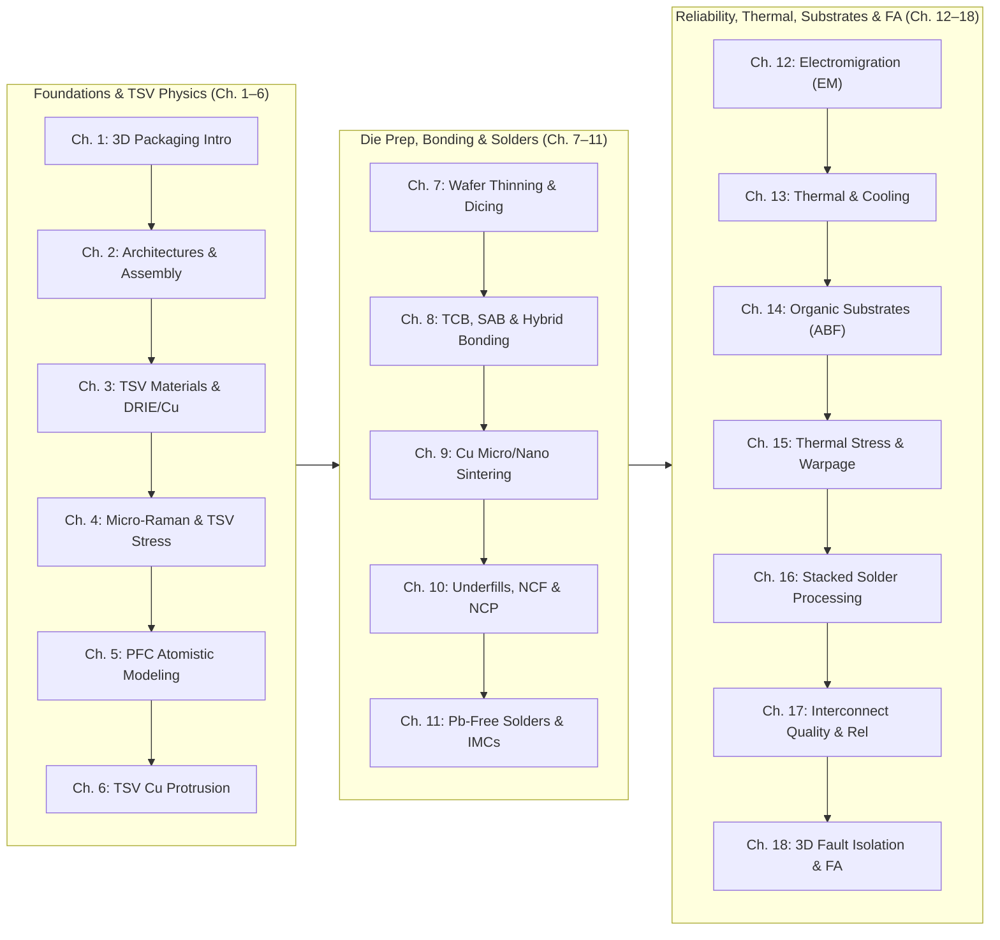

---


<!-- ===================================================================== -->
<!-- CHAPTER 01: INTRODUCTION TO 3D MICROELECTRONIC PACKAGING -->
<!-- ===================================================================== -->

## Chapter 1 — Introduction to 3D Microelectronic Packaging: Executive Technical Synthesis & Architectural Taxonomy

### 1.1 Commercial Paradigm Shifts & Flagship Industrial Milestones (2013–2019)

Advanced 3D microelectronic packaging bridges the integrated circuit (IC) and the complete electronic system, transitioning from a passive mechanical housing to an active determinant of system-level bandwidth, power efficiency, form factor, and cost scaling. Over the past decade, commercial production of 2.5D and 3D packages moved from laboratory pathfinding into high-volume manufacturing (HVM) across mobile, graphics, high-performance computing (HPC), and image-sensing markets:

| Year | Flagship Product / Platform | Packaging Architecture & Key Innovations | Interconnect Hierarchy & Pitch Scaling | Strategic System Impact |
| :--- | :--- | :--- | :--- | :--- |
| **Sept 2013** | **Apple A7** (iPhone 5S) | **Package-on-Package (PoP)**: Elpida (Micron) wire-bonded LPDDR3 mobile RAM package stacked vertically onto a flip-chip Apple A7 application processor package. | Flip-chip C4 bumps on bottom logic package; perimeter solder ball array joining top memory package to bottom substrate. | Minimized PCB footprint in ultra-thin smartphones while preserving modular pre-stack testing of memory and logic packages. |
| **Early 2014** | **SK Hynix HBM** (High Bandwidth Memory) | **3D Die-Stacked Memory Cube**: Up to 8 thinned DRAM dies vertically stacked on a base logic/buffer die. | **Through-Silicon Vias (TSVs)** + fine-pitch solder **micro-bumps** ($\mu\text{bumps}$). | Replaced narrow, high-power off-chip DDR channels with ultra-wide (1024-bit) vertical I/O buses, slashing pJ/bit energy and package footprint. |
| **July 2015** | **AMD Radeon™ Fury** | **2.5D Silicon Interposer Integration**: Large monolithic GPU die co-packaged side-by-side with four 3D HBM stacks on a common passive silicon interposer. | Sub-50 $\mu\text{m}$ pitch $\mu\text{bumps}$ (die-to-interposer); Cu damascene routing + TSVs inside Si interposer; C4 bumps (interposer-to-substrate); BGA balls (substrate-to-PCB). | First commercial GPU implementing HBM via TSVs and micro-bumps; eliminated long PCB traces between GPU and VRAM. |
| **2016** | **TSMC CoWoS®** (Chip-on-Wafer-on-Substrate) | **Wafer-Level 2.5D Heterogeneous Integration**: Multiple advanced logic and HBM stacks mounted on a multi-reticle Si interposer with dense BEOL-like Cu RDL and TSVs. | Fine-pitch $\mu\text{bumps}$ to Si interposer; through-interposer vias to organic build-up substrate. | Established the foundry standard for AI/HPC accelerators requiring terabit-per-second die-to-die bandwidth. |
| **2016** | **TSMC InFO-PoP** (Integrated Fan-Out PoP) | **Substrate-Less Fan-Out Wafer-Level Packaging**: Integrates mobile AP logic die with top-mounted DRAM PoP using high-density Redistribution Layers (**RDL**) and **Through InFO Vias (TIV)**. | Direct Cu RDL contact to die pads (eliminating C4 bumps and organic laminate substrate); vertical TIV pillars for top DRAM package interconnection. | Thinner profile, lower package thermal resistance, and reduced parasitic inductance/resistance compared to conventional Flip-Chip PoP. |
| **2016** | **Sony IMX260 CIS** (Samsung Galaxy S7 Edge) | **Xperi Direct Bond Interconnect (DBI® / Hybrid Bonding)**: 3D stacked back-illuminated CMOS image sensor (pixel array wafer bonded directly to ISP logic wafer). | **Bumpless Cu-to-Cu + Dielectric-to-Dielectric** direct hybrid bond at low temperature, scaling interconnect pitch below $5\text{ }\mu\text{m}$. | Eliminated micro-bump height, underfill, and bridging constraints; enabled pixel-level vertical connectivity at wafer scale. |
| **2018** | **Intel Kaby Lake-G & Stratix 10** | **EMIB** (Embedded Multi-Die Interconnect Bridge): Small, TSV-free silicon bridge dies with ultra-fine Cu routing embedded locally inside cavities of an organic package substrate. | Localized fine-pitch $\mu\text{bumps}$ ($40\text{--}55\text{ }\mu\text{m}$) over Si bridge zones; standard coarse-pitch flip-chip C4 bumps ($>100\text{ }\mu\text{m}$) elsewhere for direct power/ground delivery. | Delivered silicon-interposer-class die-to-die density between CPU/FPGA, HBM, and transceivers without the reticle limit, TSV cost, or parasitic loss of a full-area Si interposer. |
| **2019** | **Intel Lakefield** | **Foveros 3D Active Interposer Stacking + PoP**: Compute core chiplet stacked **Face-to-Face (F2F)** onto a base **Active I/O Interposer Die** containing TSVs, topped by a PoP LPDDR4X memory package. | F2F $\mu\text{bumps}$ ($50\text{ }\mu\text{m}$ pitch) between 10 nm compute die and 22FFL active base die; TSVs in base die to FLI C4 bumps; PoP MLI solder joints for DRAM. | Pioneered heterogeneous 3D logic-on-logic stacking where the bottom die acts as an active routing, power-regulation, and I/O hub. |

---

### 1.2 Physical & Economic Drivers: Extending Moore's Law via the Vertical Dimension

#### 1.2.1 Lithography Cost Escalation vs. Heterogeneous 3D Scaling
Since the introduction of the Intel 4004 microprocessor in 1971, transistor count per monolithic chip doubled roughly every 18–24 months:

$$N_{\text{transistors}}(t) = N_0 \cdot 2^{(t - t_0)/1.5\text{ yr}}$$

Historical architectural pivots—such as the 1990 transition from bipolar to CMOS logic (to curb thermal dissipation and circuit area while boosting clock speed and energy efficiency) and the early-2000s shift from frequency-scaled single-core CPUs to multi-core processors—sustained this trajectory. However, multi-core processors demand massive on-package cache capacity and memory bandwidth. Simultaneously, conventional 2D dimensional scaling via EUV and multi-patterning immersion lithography faces an exponential capital equipment cost curve that outpaces semiconductor industry revenue growth. 3D integration decouples functional density from monolithic die area, enabling chiplets fabricated on optimal process nodes to be assembled vertically and laterally at higher composite silicon yield and lower total cost.

#### 1.2.2 Form Factor & Volumetric Miniaturization Metrics
Replacing 2D planar packages with 3D stacked architectures achieves an order-of-magnitude (>90%) reduction across all primary structural dimensions:

| Structural Parameter | Conventional 2D Packaging | Advanced 3D Packaging | Dimensional Reduction Factor |
| :--- | :--- | :--- | :--- |
| **Silicon Die Thickness ($t_{\text{Si}}$)** | $500\text{--}780\text{ }\mu\text{m}$ | **$50\text{--}100\text{ }\mu\text{m}$** | **$\approx 90\%$ thinner** |
| **Package Substrate Core Thickness ($t_{\text{core}}$)** | $800\text{--}1000\text{ }\mu\text{m}$ | **$0\text{--}100\text{ }\mu\text{m}$** (coreless / ultra-thin) | **$>90\%$ thinner** |
| **Vertical Interconnect Diameter ($d_{\text{via/bump}}$)** | $100\text{--}250\text{ }\mu\text{m}$ (C4 / wirebond pad) | **$5\text{--}20\text{ }\mu\text{m}$** (TSVs & $\mu\text{bumps}$) | **$>90\%$ smaller diameter** |
| **Typical Inter-Chip Wiring Length ($L_{\text{wire}}$)** | $\sim 4\text{ mm}$ ($4000\text{ }\mu\text{m}$) | **$\sim 200\text{ }\mu\text{m}$** | **$20\times$ shorter** ($95\%$ reduction) |
| **Nearest-Neighbor Reachability (Equal Wire Radius $R$)** | **$8\text{ neighbors}$** ($3 \times 3 - 1$ planar grid) | **$116\text{ neighbors}$** (3D volumetric sphere/cube) | **$14.5\times$ higher connectivity** |

#### 1.2.3 Interconnect Accessibility, RC Delay, Noise, and Dynamic Power Reduction
In a 2D planar array, a central functional block can reach only $N_{2\text{D}} = (2k+1)^2 - 1 = 8$ immediate neighbors (for unit step $k=1$). In a 3D volumetric stack, within an identical interconnect radius $L_{\text{max}}$, the accessible neighborhood scales cubically ($N_{3\text{D}} \propto (L_{\text{max}}/p)^3$), connecting **116 neighboring elements** (Fig. 1.9).

```
2D PLANAR ACCESSIBILITY (8 Neighbors)         3D VOLUMETRIC STACK ACCESSIBILITY (116 Neighbors)
      +---+   +---+   +---+                            ___________________
      | N |---| N |---| N |                           /   /   /   /   /  /|
      +---+   +---+   +---+                          /___/___/___/___/  / |  <-- Top Tiers (z = +1, +2)
        |   \   |   /   |                           /   /   /   /   /  /| |
      +---+   +===+   +---+                        +---+---+---+---+  |/| |
      | N |---| C |---| N |   L_2D ~ 4 mm          |   |   |   |   |  | |/|  <-- Center Element [C]
      +---+   +===+   +---+                        +---+---+---+---+  |/| |      reaches 116 neighbors
        |   /   |   \   |                          |   |   | C |   |  | | |      within L_3D ~ 200 um
      +---+   +---+   +---+                        +---+---+---+---+  |/  /
      | N |---| N |---| N |                        |   |   |   |   |  /  /   <-- Bottom Tiers (z = -1, -2)
      +---+   +---+   +---+                        +---+---+---+---+ /__/
```

This $20\times$ interconnect length contraction ($4\text{ mm} \rightarrow 200\text{ }\mu\text{m}$) fundamentally transforms electrical performance:
1. **Propagation Delay & RC Time Constant**: Since interconnect resistance $R_{\text{int}} = \rho L / A$ and parasitic capacitance $C_{\text{int}} = c_0 L$ both scale linearly with length $L$, the intrinsic distributed interconnect delay scales quadratically with length:
   $$\tau_{RC} \approx \frac{1}{2} R_{\text{int}} C_{\text{int}} = \frac{1}{2} r_0 c_0 L^2$$
   Reducing $L$ by $20\times$ slashes intrinsic interconnect $RC$ delay by up to $400\times$ and time-of-flight latency proportionately.
2. **Signal Integrity & Electromagnetic Noise**: Shorter current return paths reduce loop inductance $L_{\text{loop}}$, directly suppressing reflection noise, capacitive/inductive crosstalk, Simultaneous Switching Noise ($\Delta V_{\text{SSN}} = N_{\text{sw}} L_{\text{eff}} \frac{dI}{dt}$), and electromagnetic interference (EMI).
3. **Dynamic Switching Power**: Because parasitic interconnect capacitance $C_{\text{int}} \propto L$, dynamic I/O power dissipation drops dramatically:
   $$P_{\text{dyn}} = \alpha C_{\text{total}} V_{DD}^2 f = \alpha \left(C_{\text{Tx}} + C_{\text{int}}(L) + C_{\text{Rx}}\right) V_{DD}^2 f$$
   Allowing devices to operate at higher transition frequencies $f$ within a lower thermal power envelope.

---

### 1.3 Taxonomy of 3D Microelectronic Packaging Architectures

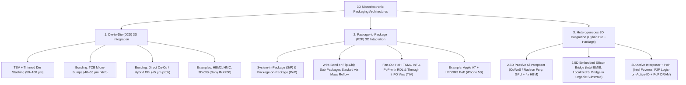

#### 1.3.1 Interconnect Hierarchy in Die-to-Die & Heterogeneous 3D Stacks
```
                +---------------------------------------+
                |          Memory Die 2 (Thinned)       |
                +---------------------------------------+
                     o   o   o   o   o   o   o   o        <-- Micro-bumps (5-20 um dia, <=40-55 um pitch)
                +---------------------------------------+
                |   |TSV|  Memory Die 1 (Thinned) |TSV| | <-- Through-Silicon Vias (2-10 um dia, 40-100 um depth)
                +---------------------------------------+
                     o   o   o   o   o   o   o   o        <-- Micro-bumps (bonded via TCB or Cu-Cu Hybrid)
         +----------------------------------------------------+
         |      |TSV|      Base Logic / Active IO Die   |TSV| |
         +----------------------------------------------------+
              (  )     (  )     (  )     (  )     (  )        <-- First Level Interconnect (FLI / C4 Bumps, ~100-150 um)
   ==================================================================
   |                Organic Package Laminate Substrate              |
   ==================================================================
         (    )          (    )          (    )          (    ) <-- Second Level Interconnect (SLI / BGA, ~400-1000 um)
   ------------------------------------------------------------------
                         Printed Circuit Board (PCB)
```
* Note: In combined package/die stacks (Fig. 1.13), **Mid-Level Interconnects (MLIs)** join a sub-package (such as a stacked 3D DRAM module) onto the main base substrate alongside the primary flip-chip CPU's FLIs.

---

### 1.4 Thermo-Compression Bonding (TCB) vs. Conventional Mass Reflow

Conventional 2D flip-chip assembly relies on **Mass Reflow** (flux dispensing, chip placement, and batch reflow in a convection oven over $5\text{--}10\text{ minutes}$). For ultra-thin 3D dies ($50\text{--}100\text{ }\mu\text{m}$) and thin substrates ($0\text{--}100\text{ }\mu\text{m}$ core) with fine-pitch micro-bumps ($\le 40\text{ }\mu\text{m}$), thermal warpage of both the die and the organic substrate at reflow temperatures ($250\text{--}300\text{ }^\circ\text{C}$) exceeds the restoring force of molten solder surface tension. This causes **die tilting**, **non-contact opens (NCO)**, and **solder bridging**.

**Thermo-Compression Bonding (TCB)** overcomes these failure modes through active mechanical and thermal control:

```mermaid
sequenceDiagram
    participant Pedestal as Heated Vacuum Pedestal (Substrate)
    participant Head as Precision Bond Head (Thinned Die)
    participant Solder as Micro-Bump Array (250–300 °C Peak)

    Note over Pedestal: 1. Pre-applied flux on substrate;<br/>held flat under vacuum to eliminate warpage
    Note over Head: 2. Thinned die picked & held flat<br/>by vacuum collet; optical alignment (<1–2 µm)
    Head->>Pedestal: 3. Touchdown & Constant Bond Force Applied
    Head->>Solder: 4. Rapid Heating (>100 °C/s ramp rate) above T_melt
    Solder->>Head: 5. Solder melts; Bond Head steps down to equalize joint coplanarity
    Head->>Solder: 6. Controlled upward retraction while molten to set exact standoff height
    Head->>Solder: 7. Abrupt Quench Cooling (>50 °C/s) below Solidus temperature
    Head->>Pedestal: 8. Vacuum release & Bond Head retraction (Cycle time ~ a few seconds/unit)
```

| Process Attribute | Conventional Mass Reflow | Thermo-Compression Bonding (TCB) | Direct Cu–Cu / Hybrid Bonding (DBI) |
| :--- | :--- | :--- | :--- |
| **Processing Mode & Cycle Time** | Batch oven process; up to **$10\text{ min}$** per batch | Serial unit-by-unit; **$2\text{--}5\text{ s}$** per die | Wafer-to-Wafer or Die-to-Wafer direct bond |
| **Warpage Mitigation** | Passive (relies on solder self-alignment & surface tension) | **Active vacuum flattening** on both bond head and hot pedestal | Ultra-flat CMP surfaces ($<1\text{ nm}$ roughness) |
| **Thermal Ramp / Cooling Rates** | Slow ($1\text{--}3\text{ }^\circ\text{C/s}$) | **$>100\text{ }^\circ\text{C/s}$ heating**; **$>50\text{ }^\circ\text{C/s}$ cooling** (refines grain size/IMC orientation) | Low-temperature bond ($150\text{--}250\text{ }^\circ\text{C}$ anneal); no melting phase |
| **Interconnect Pitch Capability** | $>100\text{ }\mu\text{m}$ | **$25\text{--}55\text{ }\mu\text{m}$** (bridging risk rises $<40\text{ }\mu\text{m}$) | **$<1\text{--}5\text{ }\mu\text{m}$** (bumpless embedded Cu pads) |
| **Mechanical Compliance & Challenges** | High solder volume provides high compliance | Compliant molten solder compensates height non-coplanarity; requires specialized fast-curing flux/NCF/NCP | Zero solder compliance; extreme cleanliness and sub-nm planarization required |

---

### 1.5 Comprehensive Matrix of 3D Microelectronic Packaging Challenges

| Challenge Domain | Core Physical & Manufacturing Bottlenecks | Root Failure Mechanisms | Engineering Mitigation & Book Reference |
| :--- | :--- | :--- | :--- |
| **1. Assembly, Yield, Test & Cost** (Sect. 1.4.1) | Multi-step TSV fabrication, ultra-thin wafer handling/dicing ($50\text{--}100\text{ }\mu\text{m}$), serial TCB unit throughput time (TPT), multi-reflow cycles in PoP. | Compound yield loss across stacked dies; non-contact opens; solder bridging; mechanical cracking during singulation. | Interconnect redundancy / fault-tolerant circuit design, Known Good Die (KGD) pre-bond sort, TPT optimization, step minimization (Chaps. 2, 7, 15, 17). |
| **2. Thermal Management, Design & Stress Modeling** (Sect. 1.4.2) | Vertical stacking of heat-generating dies concentrates heat flux density and blocks coolant routing; multiscale coupled thermo-mechanical + hygroscopic stresses. | Hotspot thermal runaway; CTE mismatch delamination; moisture vapor pressure popcorn cracking; Cu TSV anisotropic plasticity, recrystallization, and phase evolution. | High-$k$ TIMs/underfills, thermal TSVs, microchannel cooling (Chap. 13); multi-physics EDA design tools and microstructural FEA modeling (Chaps. 4–6, 15, 16). |
| **3. Materials & Substrates** (Sect. 1.4.3) | Narrow chip standoffs ($<15\text{--}25\text{ }\mu\text{m}$), tight bump pitches ($<40\text{ }\mu\text{m}$), rapid $2\text{--}5\text{ s}$ TCB cycles; high-density substrate trace/via scaling and embedded dies. | Capillary underfill voids; flux residue trapping & interfacial delamination; filler entrapment in solder joints; coreless substrate warpage. | No-clean / volatile flux chemistries, pre-applied Non-Conductive Film (NCF) / Paste (NCP) (Chap. 10); low-CTE coreless build-up substrates & embedded bridge routing (Chap. 14). |
| **4. Quality, Reliability & Failure Analysis (FI/FA)** (Sect. 1.4.4) | Multiscale interconnect span ($2\text{ }\mu\text{m}$ TSVs to $1000\text{ }\mu\text{m}$ BGA balls); severe mission profiles (ADAS, avionics, servers); buried 3D defects across multiple stacked tiers. | Electromigration (EM) in high-$J$ $\mu\text{bumps}$; brittle IMC conversion; fatigue cracking; destructive cross-sectioning artifacts in high-AR TSVs ($2\text{--}10\text{ }\mu\text{m} \times 40\text{--}200\text{ }\mu\text{m}$). | Non-destructive 3D Fault Isolation: **EOTPR** (Electro-Optic Terahertz Pulse Reflectometry), **3D X-ray CT**, **Lock-in Thermography (LIT)**, CSAM, and broad-beam ion milling / PFIB (Chaps. 12, 16–18). |

---
---

---

### Chapter 1 — Complete Unabridged Textbook Text, Figures (8) & Tables (0) [pp. 1–15]


### 1.1 Introduction

Microelectronic packaging is the bridge between the Integrated Circuit (IC) and the electronic system, which incorporates all technologies used between them [1]. Advanced 3D microelectronic packaging technology is the industry trend to meet portable electronics demand of ultra-thin, ultra-light, high performance with low power consumption. It also opens up a new dimension for the semiconductor industry to maintain Moore’s law with a much lower cost [1–3]. A wide variety of real products assembled by the advanced 3D packaging technology have been unveiled in the recent years. For example, the Apple A7 inside the iPhone 5S, introduced in September 2013, is a 3D package with Package on Package (POP) configuration [4]. As displayed in Fig. 1.1, the wire bond Elpida (nowMicron) memory(lowpower doubledataratetype-3(LPDDR3) mobilerandom access memory (RAM)) package is stacked on top of the Apple A7 flip chip package to achieve better performance with smaller form factor. In early 2014, SK Hynix announced its high bandwidth memory (HBM) products having higher bandwidth, less power consumption, and substantially small form factor, achieved by stacking up to eight DRAM dice interconnected through Through Silicon Vias (TSV) and micro bumps [5]. In July of 2015, AMD introduced the AMD Radeon™Fury graphics cards, the first Graphic Processing Unit (GPU) to implement HBM by TSVs and micro bumps [6]. Figure 1.2 shows a top down and schematic cross sectional view of the advanced 3D package. The big GPU die is integrated into the Si interposer


> **Fig. 1.1 POP inside iPhone 5s. (a) Top view of the Apple A7 package. (b) Schematic of the cross sectional view (not in scale) (Adapted from Ref. [4])**

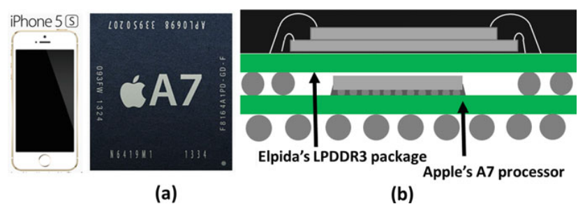


> **Fig. 1.2 Top view (a) and schematic cross sectional view (not in scale) (b) of the AMD Radeon™ Fury. The big GPU die is integrated into the Si interposer along with four HBM memory stacks by micro bumps and TSVs (Adapted from Ref. [6])**

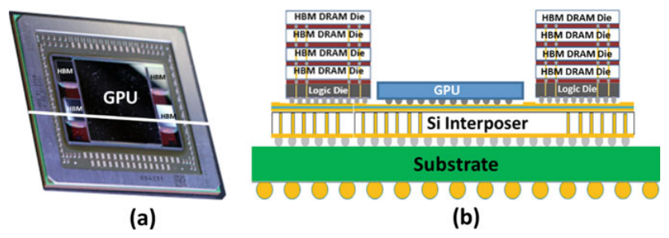

along with four HBM memory stacks by micro bumps and TSVs to ensure faster and shorter connection between chips [6]. Similar packaging technology is called Chip-On-Wafer-On-Substrate (CoWoS) in TSMC, which achieved volume production in 2016, having multiple, advanced chips integrated on a single Si interposer [7]. Since 2018, Intel launched Kaby Lake-G and Stratix 10 series products with the Embedded Multi-Die Interconnect Bridge (EMIB) technology [8]. Instead of using a full silicon interposer, field-programmable gate array (FPGA), transceivers, HBM die stacks, or GPUs in these products connect together through small Si chips embedded in organic substrates and localized high density micro bumps. In 2019, Intel announced Lakefield, the first product using 3D “active interposer” stacking technique called Foveros [9]. The IO, the cores, and the onboard LLC/DRAM can be manufactured as separate dice and get connected together through die stacking 3D packaging technique. The IO die, which is at the bottom of the stack, performs as an “active interposer” that can deal with routing data between the dies on top. As illustrated in Fig. 1.3, Integrated Fan-Out (InFO) -Package On Package (PoP)


> **Fig. 1.3 Schematic of Integrated Fan-Out (InFO)—Package on Package (PoP) from TSMC (Adapted from Ref. [10])**

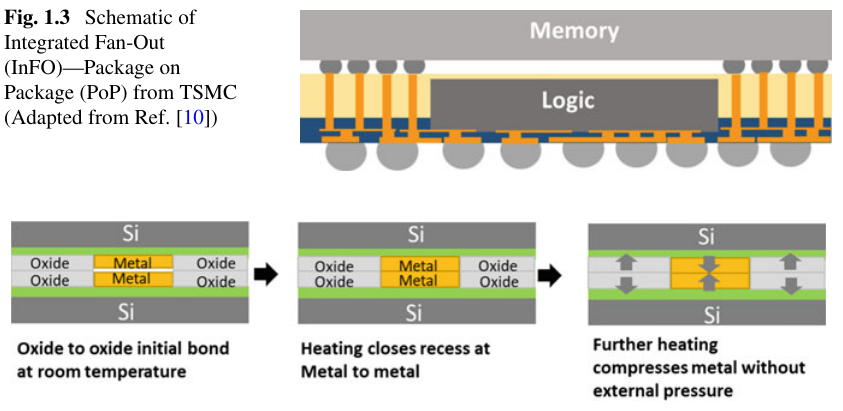


> **Fig. 1.4 Schematic of Hybrid bonding or Direct Bond Interconnect (DBI) technology from Xperi (Adapted from Ref. [11])**


fromTSMC,whichachievedvolumeproductionin2016,featureshighdensityRedistributionLayer(RDL)andThroughInFOVia(TIV)tointegratelogicdiewithDRAM packagestackingformobileapplication[10].ComparingtoFlipChipPoP,InFO_PoP has a thinner profile and better electrical and thermal performances because of no organic substrate and C4 bump. Hybrid bonding technology from Xperi, also called Direct Bond Interconnect (DBI), combines a dielectric bond with embedded metal to form interconnect. As demonstrated in Fig. 1.4, the low temperature hybrid bonding solution that allows wafers or die to be bonded with exceptionally fine pitch 3D electrical interconnect enables bump pitch scaling, and has been applied by Sony for 3D stacked backilluminated image sensors (IMX260) used in Samsung Galaxy S7 Edge in 2016 [11]. These real products bring the 3D packaging techniques from paper to reality, from concept to commercialization, and indicate the extensive applications of 3D packaging technology to microelectronics. 3D packaging technology involves multiple disciplines, for example materials science, mechanical engineering, physics, chemistry, and electrical engineering. A technical book, which could provide a comprehensive scope of 3D microelectronic packaging technology is desirable for graduate students and professionals in both academic and industry area. Current available books on 3D integration typically focus on processing of wafers, especially TSV fabrication, and do not cover other key elements in 3D packaging. This book is proposed to fill in the gap. It presents an thorough extend of 3D packaging, covering the fundamentals of interconnects, bonding process, advanced packaging materials, thermal management, thermal mechanical modeling, architecture design, quality and reliability, and failure analysis of 3D packages, which are critical for the success of advanced 3D packaging.

This chapter provides detailed illustration of motivations as well as various architectures of 3D packaging. Challenges in 3D packaging, including fabrication, assembly, cost, design, modeling, thermal management, material, substrate, quality, reliability, and failure analysis, are reviewed with brief introduction to the chapters addressing these challenges.


### 1.2 Why 3D Packaging


#### 1.2.1 Moore’s Law

Since Intel introduced the world’s first single-chip microprocessor, the Intel 4004, in 1971, an exponential growth of ICs has been observed following Moore’s law in terms of transistor number per chip [12]. As illustrated in Fig. 1.5, the number of transistors per Si chip doubles approximately every 18 months, resulting in a straight line on a log scale [12, 13]. In 1990, the bipolar transistor technology switched to CMOS in order to reduce thermal power, circuit size, and manufacturing costs, at the same time increase the operating speed and energy efficiency [3]. In the early 2000s, multi-core processors were developed to address the challenging thermal power issue in conventional single-core processors [3]. Since multicore processors require enormous cache capacity and memory bandwidth to achieve the designed performance, 3D packaging becomes one of the viable solutions to provide the required cache and bandwidth with a relatively low cost [3].


> **Fig. 1.5 Moore’s law predicts the exponential growth of ICs since 1970s (Adapted from Ref. [13])**

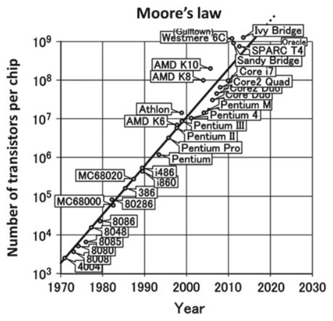


> **Fig. 1.6 The exponential growth of lithography equipment cost since 1970s (Adapted from Ref. [13])**

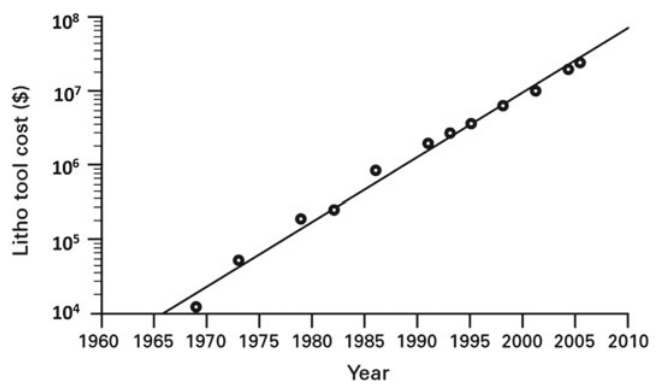

The conventional method to maintain Moore’s law is to decrease the dimensions of components by lithography, which is becoming more and more sophisticated and expensive [13]. Figure 1.6 illustrates the exponential growth of lithography equipment cost since 1970s, which presents an economic challenge as the capital cost rises faster than semiconductor industry revenue [13]. 3D integration technology, which has been recognized as an enabling technology for future low cost ICs, provides the third dimension to extend Moore’s law to ever higher density, more functionality, better performance with lower cost [3].


#### 1.2.2 Small Form Factor Requires 3D Packaging

Market demands of small form factor microelectronics head to 3D packages, which are ultra-light, ultra-thin, and with small chip footprint. Si chips in 3D packages are typically 50–100 µm thick, about 90% thinner compared with those in conventional packages. Substrate core thickness of 3D packaging is about 0–100 µm, more than 90% thinner than that of traditional packaging. High density interconnects in 3D packaging are on the order of 5–20 µm in diameter, more than 90% smaller than those in 2D packaging. Thus tremendous reduction in size and weight could be achieved by replacing conventional packaging with 3D technology [2]. Small form factor requires small chip footprint, which is defined as the printed circuit board area occupied by the Si chip, as illustrated in Fig. 1.7 [2]. By stacking multiple dice on top of each other using 3D packaging techniques, the chip footprint could be reduced dramatically. Figure 1.7 schematically demonstrates the difference between conventional 2D packages and 3D packages.


> **Fig. 1.7 a Schematic illustration of the footprint difference between conventional 2D packages (a) and 3D packages (b) (Adapted from Ref. [2])**

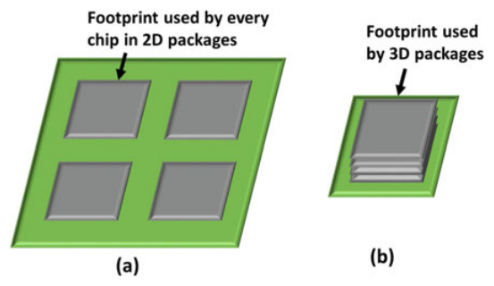


#### 1.2.3 Improved System Performance with Reduced Power

Interconnect length in 3D packages can be significantly reduced compared with conventional 2D packaging [2]. Figure 1.8a shows a typical interconnect length of 4 mm in a 2D package. The interconnect length could be reduced to 200 µm in a 3D package as demonstrated in Fig. 1.8b. Additionally 3D packaging can also greatly improve the interconnect usability and accessibility [2]. Figure 1.9 shows a comparison between 2D and 3D packaging in terms of the accessibility and usability of interconnection. In contrast to eight neighbors to the center element in the case of 2D packaging technology, the utilization of a 3D packaging configuration provides access to 116 neighbors within an equal interconnect length to a center element in the stack. The significant decrease in interconnect length as well as dramatic improvement in interconnect usability and accessibility result in much less delay in 3D devices, which is primarily limited by the time taken for the signal to travel along the interconnects [2]. Low latency and wide buses in 3D microelectronic systems lead to significant improvement to the system bandwidth [2]. Noise in well-designed 3D


> **Fig. 1.8 Schematic comparison between the wiring length in 2D packages (a) and 3D packages (b) (Adapted from Ref. [2])**

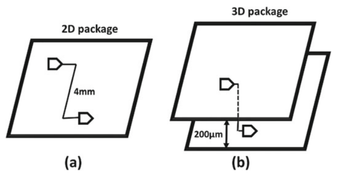


> **Fig. 1.9 Schematic comparison between 2D packages (a) and 3D packages (b) in terms of the interconnect accessibility and usability (Adapted from Ref. [2])**

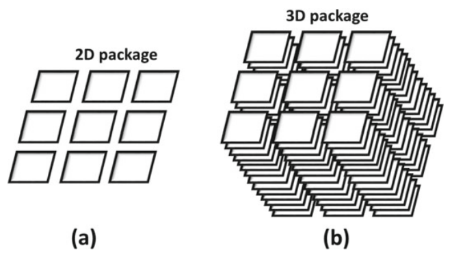

microelectronic systems, including reflection noise, crosstalk noise, simultaneous switching noise, and electromagnetic interference, can be reduced as a result of the reduction of interconnection length [2]. Additionally, as the parasitic capacitance in microelectronic packages is proportional to the interconnection length, the total power consumption in 3D packages is also reduced because of the reduced parasitic capacitance [2]. The power saving achieved by 3D technology enables 3D devices to perform at a faster rate or transition per second (frequency) with less power consumption. The overall system performance is greatly improved by applying 3D packaging technology [2].


### 1.3 3D Microelectronic Packaging Architectures

The various 3D packaging architectures could be divided into the following three categories: die to die 3D integration, package to package 3D integration, and heterogeneous 3D integration combining both package and die stacking [3, 14, 15]. Chapter 2 discusses different 3D packaging architectures in detail along with assembly and test flows.


#### 1.3.1 Die to Die 3D Integration

Die to die 3D integration is enabled by through silicon via (TSV) interconnections and thinned die to die bonding [3]. As illustrated in Fig. 1.10, two memory dice are stacked on top of a logic die with TSVs and micro-bumps. Fist Level Interconnect (FLI) solder joints connects the logic die with the substrate, while Second Level


> **Fig. 1.10 Schematic illustration of die to die 3D integration enabled by TSV and thinned die to die bonding (Adapted from Ref. [15])**

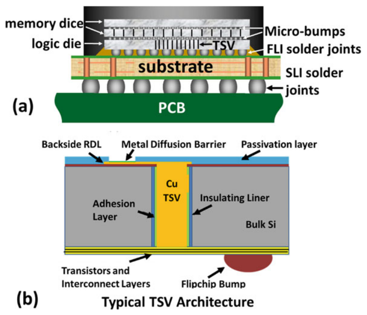

Interconnect (SLI) solder joints provides the connection between this 3D package to the Printed Circuit Board (PCB) [15]. The TSVs are formed by laser drilling or deep reactive ion etching, followed by liner deposition and copper fill. There are three typical manufacturing process for TSVs, Via First, Via Middle, and Via Last [16–18]. The detailed process flow of each process as well as the Pros and Cons of each process are discussed in Chaps. 2 and 3. Die to die bonding is implemented by either Thermal Compression Bonding (TCB) process for solder micro bumps or other alternative bonding process, for example Cu-Cu bonding. Conventional solder mass reflow process in 2D packages, which includes flux dispensing, die attaching, and solder reflow in ovens, is not able to assemble advanced 3D packages having much thinner dice and organic packages, along with much smaller and denser interconnects. As the extend of warpage from both dice and substrates at the reflow temperature overcomes solder surface tension, leading to die misalignment, and results in die tilting, solder joint non-contact opens, and solder bump bridging [19]. TCB bonding process is developed to replace the conventional solder mass reflow process for solder based micro bump assembly in 3D packages. As illustrated schematically in Fig. 1.11, the substrate with pre-applied flux is kept flat on hot pedestal under vacuum to eliminate the substrate warpage. The die is picked up by the bond head, secured and kept flat with vacuum to remove any incoming die warpage. After the die is precisely aligned to the substrate, the


> **Fig. 1.11 Schematic illustration of a typical Thermal Compression Bonding process (Adapted from Ref. [19])**

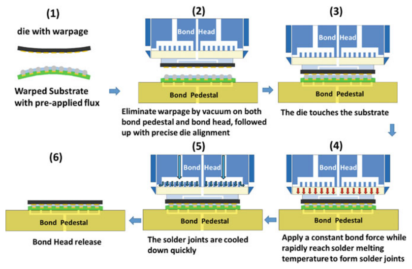

bond head with die touches the substrate. A constant bond force is then applied on the die through the bond head, while the die is heated up rapidly beyond the solder melting temperature, with a ramping rate higher than 100 °C/s. As soon as the solder joints melt, the die is moved further down to ensure all the solder joints are at the same height. The die is held in this position long enough so that the solder joint forms between the die and the substrate. While the solder is still in the molten state, the bond head with die could retract upwards to control the solder joint height. Subsequently, the solder joints are cooled abruptly below the solidus temperature, with a cooling rate of more than 50 °C/s, followed up with die release from the bond head [19]. Unlike the traditional solder mass reflow process, with up to 10 min of process time for units in batches, the TCB bonding process assemble units one by one with about a couple of seconds per unit [19]. Additionally, thermal ramping rates during both the heating and cooling cycles are much higher than the conventional method. These higher rates result in solder grain size and orientation differences that can affect mechanical properties as detailed in Chap. 10. Solder based micro bumps are more compliant, thus could compensate bump height variations, lack of co-planarity, and misalignment issues during high volume manufacture. However the TCB process peak temperature needs to be higher than the melting point of solder material, typically in the range of 250–300 °C, which brings more assembly and reliability challenges. Additionally, solder bridging risk gets much higher as bump pitch shrinks from more than 100 µm to less than 40 µm. Alternative bonding process, like hybrid bonding, which could address interconnects with less than 5 µm bump pitch, and assemble at relatively lower temperature is very


> **Fig. 1.12 Schematic illustration of package to package 3D integration (Adapted from Ref. [3])**

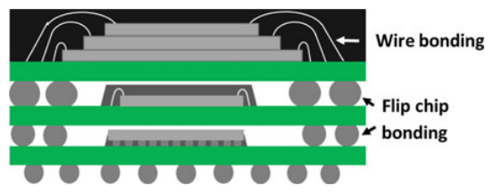

promising. Various types of alternative bonding process is reviewed in Chap. 8 as well as Pros and Cons comparing with solder based TCB process.


#### 1.3.2 Package to Package 3D Integration

System in Package (SIP) and Package on Package (POP) are typical configurations of package to package 3D integration, which is enabled by stacking packages through wire bonding or flip-chip bonding [3]. Comparing to die to die stacking, package to package stacking technique has a shorter development cycle, thus help bring products to market faster with a low price. As displayed in Fig. 1.12, a wire bonding package is stacked on top of the other wire bonding package by flip chip bonding. The two packages are then stacked on a flip chip package to form a POP. The conventional solder mass reflow process could still be used in package to package stacking if the package warpages are within control, and the interconnect size and density is comparable with traditional 2D packages. However market demands require packages to be ultra-thin, which limits the number of packages that could be stacked together. Additionally, solder joints and package materials in SIP and POP need to go through multiple cycles of reflow, bringing process and reliability challenges, like solder joint open, delamination between multiple layers in packages, and moisture control between each reflow process. Chapter 17 discusses in detail the processing and reliability of stacked packaging technique, as well as the Pros and Cons comparing with die stacking.


#### 1.3.3 Heterogeneous 3D Integration

Heterogeneous 3D integration assembles separately manufactured components into the same compacted package, thus provides enhanced functionality, lower power consumption, higher system performance, smaller size, and lower costs [9, 20]. Comparing with the monolithic die technology, the heterogeneous 3D integration allows the use of the best available technology node for each chiplet with different functions to maintain maximum performance. It also greatly improves the Si yield due to much smaller die size for each chiplet. The product development cycle can


> **Fig. 1.13 Schematic illustration of 3D packaging architectures having the combination of both die stacking and package stacking (Adapted from Ref. [15])**

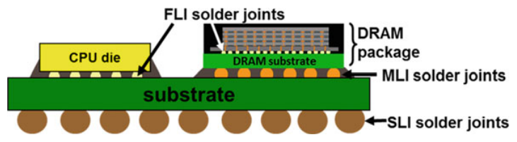

also be dramatically reduced by integrating commercially available components into the new packages [9, 20]. Depending on product needs, complex heterogeneous 3D packages can have the combination of both die stacking and package stacking [15]. As shown in Fig. 1.13, a 3D Dynamic Random Access Memory (DRAM) package formed by stacking four memory dice on top of the logic die through TSVs and micro bumps is integrated along with a flip CPU chip to form a 3D package by package stacking. FLIs between the CPU chip and the 3D package, MLIs between the DRAM package and the 3D package, as well as interconnects in the substrate provide connection between the CPU chip and the DRAM package [15]. Smaller and denser interconnects between chips and packages are highly desired for better performance, higher bandwidth, and lower power consumption. Figure 1.2 demonstrates the Silicon interposer technology, which could provide better connection between the GPU chip and the HBM die stacks through the Si interposer with dense Cu interconnects and TSVs [15, 21]. Embedded Multi-Die Interconnect Bridge (EMIB) technology is an alternative approach to provide localized high density interconnects between chiplets without Si interposer having TSVs [8]. As illustrated in Fig. 1.14, the link between dice is provided by fine Cu interconnects in Si bridges embedded in the organic substrate and confined denser FLIs between Si bridges and chips. Comparing with Si interposer technology, EMIB technology is able to provide similar performance with


> **Fig. 1.14 Schematic illustration of Embedded Multi-Die Interconnect Bridge (EMIB) technology providing localized high density interconnects between CPU die and HBM die stacks (Adapted from Ref. [8])**

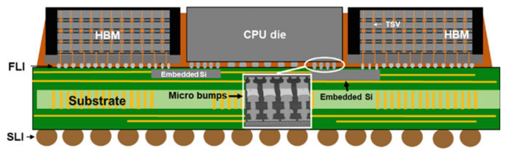


> **Fig. 1.15 Schematic illustration of a heterogeneous 3D package with Foveros technology providing Face to Face chip stacking between the CPU chip and the IO chip through TSVs and micro bumps. A POP configuration is used to stack a DRAM package to top of the CPU and IO die stack (Adapted from Ref. [9])**


a much lower cost, thus opens up new opportunities for heterogeneous 3D packaging [8]. Figure 1.15 illustrates a heterogeneous 3D package for small form factor products, where the package size is constrained. The CPU chip and the IO chip are stacked with Foveros technology, which provides Face to Face connection between chiplets through fine Cu interconnects in chips and micro bumps between chips. TSVs inside the bottom chip are used to connect the organic substrate through FLIs. A POP configuration is used to stack a DRAM package on top of the CPU and IO die stack [9]. The heterogeneous 3D integration approach provides an unprecedented flexibility to chip architects in new product design with various form factor requirements, very aggressive development timeline, better system performance, minimum power consumption, and lowest possible cost.


### 1.4 3D Microelectronic Packaging Challenges


#### 1.4.1 Assembly Process, Yield, Test, and Cost Challenges

3D packaging involves more challenging assembly steps than conventional packaging, such as TSV wafer fabrication and die singulation process (reviewed in Chap. 7), TCB of micro-bumps (discussed in Chap. 15), multiple solder reflow process for POP (refer to Chap. 17). The complicated process results in yield, test, and cost challenges [2], which could be addressed by redundancy or fault tolerant designs, through-put time (TPT) improvement of assembly process, and minimize process steps based on product quality and reliability requirement [2, 3].


#### 1.4.2 Thermal Management, Package Design, and Modeling Challenges

The 3D integration of heat generation components in close vicinity increases the heat flux density as well as complexity of coolant routing, thus leads to big challenges to the thermal management of 3D packaging [2, 3]. Chapter 13 presents the fundamentals of heat transfer along with advanced guidelines helpful to address the issue. Due to the increased system complexity, designing 3D packages could be very challenging, but could be addressed by designing and developing design software [2]. In addition to increased system complexity, 3D packaging involves multi-levels of solder joints, underfill, and molding compounds. Thermal stress due to the mismatch in coefficients of thermal expansion (CTE) and hygroscopic stress caused by excessive moisture absorption are often combined together, which complicates the stress modeling in 3D packaging [22, 23]. For interconnects with a couple of micrometer in diameter, like TSVs, it is found that microstructure, anisotropy of material properties, recrystallization, and time-dependent phase morphological evolution need to be considered during stress modeling [24]. Chapters 4–6 and 16 provide thorough discussions on the modeling of thermal mechanical and moisture stresses in 3D packaging.


#### 1.4.3 Material and Substrate Challenges

3Dpackagestypicallyhavesmallerinterconnectsize,tighterbumppitch,andreduced chip gap, which brings challenges to underfill, chip attachment, and deflux process. Additionally, the TCB process widely used in the chip attachment of 3D packages is very different from the conventional mass reflow process, as the whole bonding cycle completes in a few seconds rather than over 10 min [19]. Major modification of traditional underfill and flux material is essential to prevent underfill process, flux residue, and interconnect integrity induced yield loss, such as underfill voids, delamination because of flux residue, solder bump bridging or non-wets. Chapter 10 reviews the material challenges and provides guidelines for epoxy and flux material selection. To enable the highly integrated 3D packaging, both substrate and PCB need to fulfill the much higher signal and power density requirements. Smaller substrate vias, through holes (TH), and traces, along with much tighter pitches are desired. Furthermore embedded components, including both Si chip and packages, integrating into substrates or PCB is one of the approaches to achieve the product miniaturization with higher performance and lower power consumption goal. These result in significant challenges in substrate warpage control and flawless fabrication process to enable much finer interconnect size and pitch. Chapter 14 reviews the substrate material and

fabrication technology evolution, along with general recommendations in selecting and applying appropriate material and process technologies for 3D packaging.


#### 1.4.4 Quality, Reliability and Failure Analysis Challenges

Complex 3D packages have multiscale interconnects ranging from a few micrometers to 1000 micrometers. For instance, TSVs and micro-bumps are about a couple of micrometer in diameters, while the SLI connecting packages to the PCB could be up to 1000 µm in diameter. During 3D integration, interconnects need to go through multiple solder reflow process, defects generated during fabrication and assembly, CTE mismatch between different materials, and microstructure evolution in interconnects could lead to new quality and reliability issues. Additionally, the extended application of 3D packaging in products requiring much higher reliability, for instance, Advanced Driver Assistance Systems (ADAS), avionics, and high-end servers brings extra challenges to the quality and reliability of 3D packages. Chapters 3–6 review the quality and reliability of TSVs. Chapter 12 reviews the electro migration concerns in interconnects of 3D packages. Focusing on the reliability of multi-level solder joints in stacked packages, Chap. 16 explains the different reliability requirements between consumer electronics and high-reliability electronics. It also provides detailed discussions of use conditions, the roles of encapsulants and underfills, reliability tests and modeling to address complex reliability concerns in 3D packages. Chapter 17 provides an overview of quality and reliability of 3D packaging and demonstrates with case studies, along with field performance prediction. Failure analysis is critical for the technology development of 3D packaging, as in-depth root cause analysis of failures provides solution paths for resolving quality and reliability issues. Due to the complexity of 3D packages, Fault Isolation (FI) and Failure analysis (FA) become very challenging. First of all, multiple failures could exist in one unit post reliability tests, flawless failure analysis on each failure requires non-destructive high resolution techniques, including fault isolation, imaging, and material analysis. Additionally each electrical failure in a 3D package could come from various dice, assembly layers or interconnects, high resolution fault isolation techniques, which could provide three dimensional information of defects are highly desired. After the identification of defects, physical failure analysis needs to be performed for the root cause study. However interconnects in 3D packages, like TSVs, have small diameters (2–10 µm) and long lengths (40–200 µm), artifact free cross section techniques with short through-put time is critical for characterizing small defects in a relatively large cross sectional plane. Chapter 18 reviews advanced high resolution non-destructive FI and FA techniques, such as Electro Optic Terahertz Pulse Reflectometry (EOTPR), 3D X-ray Computed Tomography (CT), Lock-in Thermography (LIT), and acoustic microscopy. The applications of novel physical sample preparation techniques and various material analysis methods in 3D packaging failure analysis are also discussed. It also provides guidelines for

building up efficient 3D packaging FI-FA flow and performing in-depth root cause studies, along with case study demonstration.


### 1.5 Summary

3D packaging has provided a new dimension for semiconductor industry to maintain Moore’s law with much lower cost, and has been adopted as an effective approach to provide portable microelectronics with better performance, smaller power consumption,andlesscost.Therehasbeennumerousnoveltechnologicalinnovationsinvented for the development of advanced 3D packaging in the recent years. However, due to the much smaller and denser interconnects, complicated assembly process, unique TSV and micro-bump TCB process, and the extended application in high reliability products, there are tremendous challenges in highly integrated 3D packaging. Chapters in this book are written by experts from both academia and semiconductor industry. Chapter 2 provides an insightful overview of 3D packaging architecture and assembly process design. Chapters 3–7 focus on the fundamentals of TSV processing, reliability, and mechanical properties. Chapters 8–10 discuss the fundamentals of thermal compression bonding of micro bumps, process materials, direct Cu to Cu bonding, and other alternative interconnects in 3D packaging. Chapters 11 and 12 provide fundamentals of solder alloys and electro migration in interconnects of 3D packages. Chapter 13 presents a thorough review of thermal management in 3D packaging. Chapter 14 displays in great details the fundamentals of substrate materials and manufacture process. Chapter 15 covers the thermal mechanical and moisture modeling in 3D packaging. Chapter 16–18 illustrate a comprehensive overview of quality, reliability, fault isolation, and failure analysis of advanced 3D packages. Readers could obtain all-around knowledge about 3D packaging, including the fundamentals, developing areas, technique gaps, and guidelines for future research and development.

Acknowledgements The editors would like to thank John Elmer from Lawrence Livermore National Laboratory for his critical review of this chapter.


### References

1. I. Szendiuch, Radioengineering 20(1), 214 (2011) 2. S.F. Al-sarawi, D. Abbott, P.D. Franzon, IEEE Trans. Compon. Pack. Manufact. Technol. Part B 21(1), 2 (1998) 3. J.Q. Lu, Proc. IEEE 97(1), 18 (2009) 4. J.H. Lau, Chip Scale Rev. 18(1), 32 (2014) 5. L. Li, P. Chia, P. Ton, M. Nagar, S. Patil, J. Xue, J. DeLaCruz, M. Voicu, J. Hellings, B. Isaacson, M. Coor, R. Havens, in Conference Proceedings from the 66th Electronic Components and Technology Conference (ECTC) (2016), p. 1445

6. C. Lee, C. Hung, C. Cheung, P. Yang, C. Kao, D. Chen, M. Shih, C.C. Chien, Y. Hsiao, L. Chen, M. Su, M. Alfano, J. Siegel, J. Din, B. Black, in Conference Proceedings from the 66th Electronic Components and Technology Conference (ECTC) (2016), p. 1439 7. S.Y. Hou, W.C. Chen, C. Hu. C. Chiu, K.C. Ting, T.S. Lin, W.H. Wei, W.C. Chiou, J.C. Lin, C.Y. Chang, C.T. Wang, C.H. Wu, D. Yu, IEEE Trans. Electron Dev. 64(10), 4071 (2017) 8. R. Mahajan, R. Sankman, N. Patel, D. Kim, K. Aygun, Z. Qian, Y. Mekonnen, I. Salama, S. Sharan, D. Iyengar, D. Mallik, in Conference Proceedings from the 66th Electronic Components and Technology Conference (ECTC) (2016), p. 558 9. D.B. Ingerly, S. Amin, L. Aryasomayajula, A. Balankutty, D. Borst, A. Chandra, K. Cheemalapati, C.S. Cook, R. Criss, K. Enamul1, W. Gomes, D. Jones, K.C. Kolluru, A. Kandas, G.-S. Kim, H. Ma, D. Pantuso, C.F. Petersburg, M. Phen-givoni, A.M. Pillai, A. Sairam, P. Shekhar, P. Sinha, P. Stover, A. Telang, Z. Zell, in Conference Proceedings from the IEEE International Electron Devices Meeting (IEDM) (2019) 10. C. Tseng, C. Liu, C. Wu, D. Yu, in Conference Proceedings from the 66th Electronic Components and Technology Conference (ECTC) (2016), p. 1 11. G. Gao, L. Mirkarimi, G. Fountain, L. Wang, C. Uzoh, T. Workman, G. Guevara, C. Mandalapu, B Lee, R. Katkar, in Conference Proceedings from the 68th Electronic Components and Technology Conference (ECTC) (2018), p. 314 12. R.R. Tummala, Fundamentals of Microsystems Packaging (McGraw-Hill, 2001), pp. 4–41 13. D.C. Brock, Understanding Moore’s Law: Four Decades of Innovation (Chemical Heritage Foundation, 2006), pp. 67–84 14. Y. Li, P.K. Muthur Srinath, D. Goyal, J. Electron. Mater. 45(1), 116 (2016) 15. Z. Ma, D.G. Seiler, Metrology and Diagnostic Techniques for Nanoelectronics (Pan Stanford Publishing Pte. Ltd., 2017) 16. T.M. Bauer, S.L. Shinde, J.E. Massad, D.L. Hetherington, in Conference Proceedings from the 59th Electronic Components and Technology Conference (ECTC) (2009), p. 1165 17. G. Pares, N. Bresson, S. Minoret, V. Lapras, P. Brianceau, J. F. Lugand, R. Anciant, N. Sillon, in Conference Proceedings from the 11th Electronics Packaging Technology Conference (EPTC) (2009), p. 772 18. K.-.W Lee, H. Hashimoto, M. Onishi, Y. Sato, M. Murugesan, J.-.C Bea, T. Fukushima, T. Tananka, M. Koyanagi, in Conference Proceedings from the 64th Electronic Components and Technology Conference (ECTC) (2014), p. 304 19. A. Eitan, K.Hung, in Conference Proceedings from the 65th Electronic Components and Technology Conference (ECTC) (2015), p. 460 20. R. Viswanath, A. Chandrasekhar, S. Srinivasan, Z. Qian, R. Mahajan, in Conference Proceedings from the IEEE Electrical Design of Advanced Packaging and Systems Symposium (EDAPS) (2018), M-I.1 21. K. Zoschke, M. Wegner, M. Wilke, N. Jürgensen, C. Lopper, I. Kuna, V. Glaw, J. Röder1, O. Wünsch1, M.J. Wolf, O. Ehrmann, H. Reichl, in Conference Proceedings from the 60th Electronic Components and Technology Conference (ECTC) (2010), p. 1385 22. C.-H. Liu, J.-L. Tsai, C. Hung-Hsien, C.-L. Lu, S.-C. Chen, in Conference Proceedings from the 64th Electronic Components and Technology Conference (ECTC) (2014), p. 1628 23. C.-H. Liu, Y.-H. Liao, W.-T. Chen, C.-L. Lu, S.-C. Chen, in Conference Proceedings from the 65th Electronic Components and Technology Conference (ECTC) (2015), p. 1502 24. N. Nabiollahi, N. Moelans, M. Gonzalez, J.D. Messemaeker, C.J. Wilson, K. Croes, E. Beyne, I.D. Wolf, Microelectr. Reliab. 765 (2015)

---


<!-- ===================================================================== -->
<!-- CHAPTER 02: 3D PACKAGING ARCHITECTURES AND ASSEMBLY PROCESS DESIGN -->
<!-- ===================================================================== -->

## Chapter 2 — 3D Packaging Architectures and Assembly Process Design: Deep-Dive Analysis

### 2.1 Monolithic SoC vs. Heterogeneous SiP & Architectural Classification

A computing system integrates digital logic (CPUs, FPGAs), memory (SRAM, DRAM), and analog/RF/IO circuits (SERDES, PCIe, DDR, voltage regulators). Architects choose between two integration paradigms:

1. **System-on-Chip (SoC — Homogeneous Monolithic Integration)**: Preferred only when (a) all functional blocks are fabricable on the **same silicon process node** (e.g., CMOS logic + embedded SRAM, whereas high-density capacitor-based DRAM requires a fundamentally incompatible process flow), and (b) all required IP blocks exist in that node at an economically viable monolithic die yield.
2. **System-in-Package (SiP — Heterogeneous Integration)**: A subset of System-on-Package (SoP) that integrates separately manufactured components (chiplets, MEMS, passives, pre-packaged dies) into a single package to maximize yield resiliency, mix optimal process nodes, expand pre-assembly test coverage, and accelerate time-to-market.

#### Taxonomy of SiP & 3D TSV Architectures (Fig. 2.3a–e)
* **Planar Multi-Chip Package (MCP, Fig. 2.3a)**: Two or more dies placed side-by-side (SBS) on a multilayer organic laminate substrate connected via lateral package traces (e.g., 10th Gen Intel® Core™ Mobile CPU + PCH).
* **EMIB-Based Hybrid MCP (Fig. 2.3b)**: Planar and stacked dies (e.g., Intel 10 nm Agilex™ FPGA + HBM stacks + transceivers) interconnected laterally across localized, high-density silicon bridges embedded in the organic substrate.
* **2.5D Silicon Interposer SiP (Fig. 2.3c)**: Logic and 3D memory stacks placed side-by-side atop a full passive silicon interposer featuring fine-line damascene Cu routing and through-interposer TSVs.
* **3D TSV Die Stack Module (Fig. 2.3d & Fig. 2.4)**: Multiple thinned dies stacked vertically and interconnected via TSVs and $\approx 40\text{ }\mu\text{m}$ pitch solder micro-bumps (e.g., Micron Hybrid Memory Cube [HMC], JEDEC HBM2 4-high/8-high DRAM stacks on a base buffer die).
* **Foveros 3D Face-to-Face Logic Stack (Fig. 2.3e)**: Two active logic dies from different process nodes bonded Face-to-Face (e.g., Intel Lakefield compute die on an active TSV base die) combined with PoP memory stacking.

> [!WARNING]
> **Micro-Bump Pitch Scaling Bottleneck ($<40\text{ }\mu\text{m}$)**: While solder micro-bumps offer mechanical compliance that absorbs slight misalignment and non-coplanarity during TCB, shrinking pitch below $40\text{ }\mu\text{m}$ drastically reduces solder volume. Consequently, the entire joint converts rapidly into brittle **Intermetallic Compounds (IMCs, e.g., $\text{Cu}_6\text{Sn}_5, \text{Cu}_3\text{Sn}$)**, losing mechanical compliance, while simultaneously escalating solder bridging risk and blocking capillary underfill flow in narrow chip gaps. This drives the transition to direct **Cu–Cu and hybrid bonding** (Chap. 8).

---

### 2.2 Electrical Advantage: Interconnect Capacitance, Latency & Power Efficiency Model

#### 2.2.1 Transmitter–Receiver (Tx–Rx) Bit-Transition Energy Formulation
Consider a digital CMOS driver (Transmitter, $\text{Tx}$) communicating with a receiver ($\text{Rx}$) across an interconnect link (Fig. 2.5):

```
   V_dd
    |
  +-+--+
  | PMOS|  Tx Driver                Interconnect Channel                Rx Load
  +-+--+   (C_Tx)                        (C_int)                        (C_Rx)
    |        |                              |                             |
Vin o--------+------------/\/\/\------------+------------/\/\/\-----------+-----> Vout
    |        |            R_int             |            R_int            |
  +-+--+   =====                          =====                         =====
  | NMOS|  C_Tx                           C_int                         C_Rx
  +-+--+     |                              |                             |
    |       GND                            GND                           GND
   GND
```

During a $0 \rightarrow 1$ charging transition followed by a $1 \rightarrow 0$ discharging transition:
* Total capacitive load driven by the transmitter is:
  $$C_{\text{total}} = C_{\text{Tx}} + C_{\text{int}} + C_{\text{Rx}}$$
* Energy drawn from the power supply during $0 \rightarrow 1$ charging is $E_{0 \rightarrow 1} = C_{\text{total}} V_{DD}^2$, of which $\frac{1}{2} C_{\text{total}} V_{DD}^2$ is dissipated as heat in the PMOS pull-up resistance and interconnect resistance, and $\frac{1}{2} C_{\text{total}} V_{DD}^2$ is stored in the electric field of $C_{\text{total}}$.
* During the subsequent $1 \rightarrow 0$ transition, the stored energy $\frac{1}{2} C_{\text{total}} V_{DD}^2$ is discharged to ground through the NMOS pull-down transistor.
* For a continuous bit stream with switching activity factor $\alpha$ at clock/data frequency $f$ (bit rate $B \propto f$), the dynamic signaling power and energy per bit are:

$$P_{\text{link}} = \alpha \left(C_{\text{Tx}} + C_{\text{int}} + C_{\text{Rx}}\right) V_{DD}^2 f \implies E_{\text{bit}} = \frac{P_{\text{link}}}{B} \propto C_{\text{int}} V_{DD}^2$$

Assuming identical $\text{Tx}$ and $\text{Rx}$ circuit capacitances, link energy dissipation is governed directly by $C_{\text{int}}$. Because TSVs are ultra-short ($50\text{--}100\text{ }\mu\text{m}$) and utilize miniature capture pads compared to standard organic package traces, **TSV interconnect capacitance is $4\times\text{ to }20\times$ lower** than planar side-by-side wiring [41].

#### 2.2.2 Quantitative Benchmark: 2D Side-by-Side vs. 2.5D vs. 3D TSV Stacking

| Interconnect Architecture | Interconnect Capacitance ($C_{\text{int}}$) | Power Efficiency ($\text{mW/Gbps}$ or $\text{pJ/bit}$) | Latency Reduction | Relative Energy Improvement |
| :--- | :--- | :--- | :--- | :--- |
| **2D Planar CPU-to-DDR DIMM Slot** (Bounding Baseline [42]) | High ($1\times$ baseline; long PCB traces + socket + package routing) | **$15.65\text{ mW/Gbps}$** ($15.65\text{ pJ/bit}$) | Baseline ($0\%$) | $1.0\times$ (Baseline) |
| **2.5D Best-Known Si Interposer Link** (Constrained SBS [45]) | Moderate (fine-pitch Cu microstrip/stripline on Si interposer) | Intermediate ($\sim 0.81\text{ pJ/bit}$ normalized) | Baseline for 2.5D | Baseline for 2.5D |
| **3D Stacked CPU-to-Wide-IO (WIO) DRAM via TSVs** [42, 45] | **$4\text{--}20\times$ lower** than planar 2D | **$0.55\text{ mW/Gbps}$** ($0.55\text{ pJ/bit}$) | **$15.7\%$ lower latency** vs. best 2.5D | **$>28.4\times$ better** vs. 2D DIMM; **$32.2\%$ lower energy** vs. best 2.5D |

---

### 2.3 Thermal Limitations & Thermo-Mechanical Keep-Out Zone (KOZ) Physics

#### 2.3.1 Additive Series Thermal Resistance Network & TDP Degradation
While 3D TSV stacking minimizes electrical power per bit, it imposes a severe **Thermal Design Power (TDP)** penalty because heat generated by the bottom processor die must traverse stacked memory dies and low-conductivity inter-die interfaces in series before reaching the heatsink (Fig. 2.7):

```
2D SIDE-BY-SIDE HEAT PATH (Parallel Conductance)          3D STACKED HEAT PATH (Additive Series Resistance)
          [ Heatsink / Heat Spreader ]                              [ Heatsink / Heat Spreader ]
          ============TIM=============                              ============TIM=============
          |  Processor  |  |  DRAM   |                              |       DRAM Die 4         | (k_Si = 110 W/mK)
          |  (100 um)   |  | (100um) |                              +---uBumps + Underfill-----+ (k_int = 0.3-3.0 W/mK)
          +-------------+  +---------+                              |     DRAM Dies 1..3       |
           R_th = R_Si + R_TIM + R_hs                               +---uBumps + Underfill-----+ <-- Thermal Bottleneck!
                                                                    |   Processor Die (100um)  |
                                                                    +--------------------------+
                                                                     R_th,3D = R_proc + N*(R_int + R_DRAM) + R_TIM + R_hs
```

For $N$ memory dies of thickness $t_{\text{DRAM}}$ stacked atop a processor of thickness $t_{\text{proc}}$ with area $A$, the 1D conduction thermal resistance from the processor junction ($T_{j,\max} = 105\text{ }^\circ\text{C}$) to ambient ($T_a$) is:

$$R_{\theta,\text{total}}^{(3\text{D})} = \frac{t_{\text{proc}}}{k_{\text{Si}} A} + \sum_{i=1}^{N} \left( \frac{t_{\text{gap},i}}{k_{\text{int},\text{eff}} A} + \frac{t_{\text{DRAM},i}}{k_{\text{Si}} A} \right) + R_{\theta,\text{TIM}} + R_{\theta,\text{sys}}$$

Therefore, the maximum allowable processor TDP is bounded by:

$$\text{TDP}_{\max} = \frac{T_{j,\max} - T_a}{R_{\theta,\text{total}}^{(3\text{D})}}$$

##### Canonical Thermal Case Study Parameters & Findings (Fig. 2.8)
* **Fixed Boundary Conditions**: $t_{\text{proc}} = t_{\text{DRAM}} = 100\text{ }\mu\text{m}$; uniform time-independent processor power; $T_{j,\max} = 105\text{ }^\circ\text{C}$ for both CPU and DRAM; $k_{\text{Si}} = 110\text{ W/(m}\cdot^\circ\text{C)}$, $k_{\text{Cu}} = 390\text{ W/(m}\cdot^\circ\text{C)}$.
* **Critical Bottleneck — Inter-Die Interface Effective Thermal Conductivity ($k_{\text{int},\text{eff}}$)**: Composed of metallic $\mu\text{bumps}$ embedded in polymeric epoxy underfill, $k_{\text{int},\text{eff}}$ lies in the range **$0.3\text{--}3.0\text{ W/(m}\cdot^\circ\text{C)}$**—two orders of magnitude lower than bulk silicon!
* **Interaction with System Cooling Regimes**:
  1. *High $R_{\theta,\text{sys}}$ (Passive Conduction / Laptop Regime)*: Because $R_{\theta,\text{sys}} \gg R_{\theta,\text{pkg}}$, adding 1 to 4 stacked DRAM dies causes only a modest fractional drop in TDP, Especially when $k_{\text{int},\text{eff}} = 3.0\text{ W/(m}\cdot^\circ\text{C)}$.
  2. *Medium $R_{\theta,\text{sys}}$ (Desktop Conduction + Convection)*: Intermediate TDP penalty as stack height increases from 1 to 4 DRAMs.
  3. *Low $R_{\theta,\text{sys}}$ (High-Performance Server Cooling)*: Because $R_{\theta,\text{sys}}$ is small, the internal package resistance dominates $R_{\theta,\text{total}}$. Stacking 4 DRAMs with a poor interface ($k_{\text{int},\text{eff}} = 0.3\text{ W/(m}\cdot^\circ\text{C)}$) causes a **catastrophic collapse in allowable processor TDP** ($>50\%$ reduction vs. 2D SBS). Raising $k_{\text{int},\text{eff}}$ from $0.3$ to $3.0\text{ W/(m}\cdot^\circ\text{C)}$ (via higher $\mu\text{bump}$ density and thermally conductive filler-loaded underfills) recovers a major fraction of the lost TDP envelope. Moreover, realistic non-uniform processor power maps (localized core hotspots) suffer even more acute peak temperature amplification under a 3D DRAM stack.

#### 2.3.2 Thermo-Mechanical Stress in Silicon & Keep-Out Zone (KOZ)
TSVs are lined and filled via PVD and ECD/annealing at elevated temperatures ($T_{\text{dep/anneal}} > 200\text{ }^\circ\text{C}$, up to $400\text{--}450\text{ }^\circ\text{C}$ in MEOL). At the elevated stress-free reference temperature $T_0$, the Cu TSV ($\alpha_{\text{Cu}} \approx 16.5\text{ ppm/}^\circ\text{C}$) and surrounding Si matrix ($\alpha_{\text{Si}} \approx 2.6\text{ ppm/}^\circ\text{C}$) are in mechanical equilibrium. Upon cooling to operating ($90\text{--}110\text{ }^\circ\text{C}$) or room temperature ($25\text{ }^\circ\text{C}$, $\Delta T = T - T_0 < 0$), the Cu via contracts much more than Si, inducing an axisymmetric Lamé plane-strain stress field in the surrounding silicon at distance $r \ge R_{\text{TSV}}$ (Fig. 2.9):

$$\sigma_{rr}(r) = -\sigma_{\theta\theta}(r) = \frac{E_{\text{Si}}}{1 + \nu_{\text{Si}}} \frac{\Delta \alpha \Delta T}{\left(\frac{1 - 2\nu_{\text{Cu}}}{E_{\text{Cu}}} + \frac{1 + \nu_{\text{Si}}}{E_{\text{Si}}}\right)\frac{E_{\text{Si}}}{1+\nu_{\text{Si}}}} \left(\frac{R_{\text{TSV}}}{r}\right)^2$$

* **Radial Stress ($\sigma_{rr} > 0$)**: **Radially Tensile** (pulls Si inward toward the contracting Cu core; risks interfacial debonding/delamination at the liner interface).
* **Circumferential / Hoop Stress ($\sigma_{\theta\theta} < 0$)**: **Tangentially Compressive** in the surrounding silicon.
* **Piezoresistive Carrier Mobility Perturbation & KOZ**: These stresses alter the silicon crystal lattice band structure via piezoresistive coefficients $\pi_{ij}$, shifting electron and hole mobilities ($\Delta \mu / \mu_0$) and threshold voltages ($V_{\text{th}}$) of nearby FEOL MOSFETs/FinFETs. Consequently, IC layout rules mandate a **Keep-Out Zone (KOZ)** around every TSV within which active transistors cannot be placed, increasing total silicon die area:
  $$A_{\text{TSV,eff}} = \pi \left(R_{\text{TSV}} + L_{\text{KOZ}}\right)^2$$

---

### 2.4 TSV Integration Process Flows: Via-First, Via-Middle, and Via-Last

#### 2.4.1 Structural Cross-Section in the FEOL/MEOL/BEOL Stack (Fig. 2.10 & Fig. 2.12)
A standard TSV comprises:
1. Photolithographically defined and Bosch DRIE-etched vertical via in Si;
2. Dielectric isolation liner ($\text{SiO}_2$ or $\text{Si}_3\text{N}_4$ via thermal oxidation or PECVD);
3. PVD adhesion/diffusion barrier layer ($\text{Ti}$ or $\text{Ta}$ / $\text{TiN}$ / $\text{TaN}$);
4. PVD conductive $\text{Cu}$ seed layer;
5. Electrochemically deposited (**ECD**) $\text{Cu}$ (or CVD $\text{W}$) core fill, followed by thermal annealing ($\sim 400\text{ }^\circ\text{C}$ in Via-Middle) to stabilize grain microstructure and relieve stress, and **CMP** planarization;
6. Post-BEOL wafer mounting onto a temporary carrier, backside thinning to **reveal** the TSV tips, backside passivation, **Redistribution Layer (RDL)** routing, and micro-bump formation (Fig. 2.12).

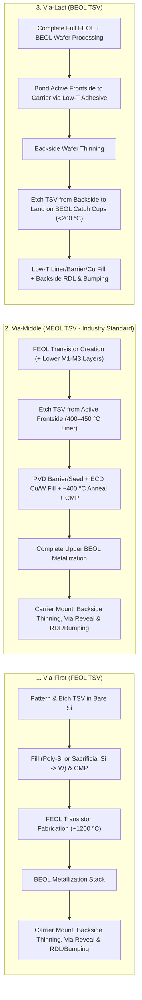

#### 2.4.2 Comprehensive Comparison of Via-First, Via-Middle, and Via-Last Processes

| Process Dimension | Via-First (FEOL Process) | Via-Middle (MEOL Process) | Via-Last (BEOL Process — Backside or Frontside) |
| :--- | :--- | :--- | :--- |
| **Insertion Point in Fab Flow** | Before FEOL CMOS transistor fabrication | After FEOL transistors (and lower metal layers), before upper BEOL | After full FEOL and BEOL completion (during wafer post-processing) |
| **Processing Thermal Budget** | Must survive **$\sim 1200\text{ }^\circ\text{C}$** CMOS dopant activation/oxidation | **$400\text{--}450\text{ }^\circ\text{C}$** (compatible with standard BEOL dielectric/anneal steps) | **$<200\text{ }^\circ\text{C}$** (constrained by polymeric wafer bond/debond carrier adhesive) |
| **Permissible TSV Conductor Materials** | **Doped Polysilicon** or sacrificial Si replaced by **Tungsten (W)** (Cu prohibited due to rapid diffusion into Si at $1200\text{ }^\circ\text{C}$, poisoning FEOL devices) | **Copper (Cu)** (low resistivity) or **Tungsten (W)** | **Copper (Cu)** |
| **Thermo-Mechanical Stress in Si** | Highest thermal excursion ($\Delta T \sim 1200\text{ }^\circ\text{C}$), mitigated only if Poly-Si/W is used | Moderate ($\Delta T \sim 400\text{ }^\circ\text{C}$); requires pre-CMP anneal at $\sim 400\text{ }^\circ\text{C}$ to prevent Cu pumping into upper BEOL | **Lowest** ($\Delta T < 200\text{ }^\circ\text{C}$) |
| **Key Advantages** | TSVs can be inspected/tested before committing expensive FEOL/BEOL processing; high via density | Industry mainstream (HBM, active interposers); uses low-resistance Cu while avoiding $1200\text{ }^\circ\text{C}$ FEOL and avoiding backside catch-cup punch-through | Lowest thermal stress; can be outsourced to OSATs after standard foundry wafer completion |
| **Key Limitations & Risks** | High resistivity of Poly-Si; extreme CMOS contamination constraints | Requires foundry integration mid-line; Cu pumping control required | Requires large BEOL **Catch Cups** (landing pads) with strict alignment to prevent etching punch-through; any TSV yield loss scraps a **100% finished, high-value CMOS wafer** |

#### 2.4.3 Published Literature TSV Dimensions & Aspect Ratios (Table 2.1 Synthesis)
Across commercial and pathfinding literature (Table 2.1, Refs. [53–67]), TSV geometries span specific functional regimes:

| Application / Integration Class | Typical TSV Diameter ($D_{\text{TSV}}$) | Typical TSV Depth / Wafer Thickness ($H_{\text{TSV}}$) | Aspect Ratio ($\text{AR} = H/D$) | Typical TSV Pitch ($P_{\text{TSV}}$) | Representative Process & Material |
| :--- | :--- | :--- | :--- | :--- | :--- |
| **High-Density FEOL / SOI-CMOS Stacking** (IBM / CEA-Leti [27, 57–59]) | $1\text{--}3\text{ }\mu\text{m}$ | $10\text{--}30\text{ }\mu\text{m}$ | $5:1\text{ to }15:1$ | $2\text{--}6\text{ }\mu\text{m}$ | Via-First / Via-Middle; W or Cu fill |
| **Advanced Logic / 20 nm–10 nm MEOL Active Interposers** [60–65] | $3\text{--}6\text{ }\mu\text{m}$ | $30\text{--}60\text{ }\mu\text{m}$ | $8:1\text{ to }12:1$ | $6\text{--}20\text{ }\mu\text{m}$ | Via-Middle; PECVD $\text{SiO}_2$ liner, PVD Ta/Cu, ECD Cu |
| **3D DRAM Stacks (DDR3 / Wide-IO / HBM2)** [35, 53] | $5\text{--}10\text{ }\mu\text{m}$ | $40\text{--}80\text{ }\mu\text{m}$ | $6:1\text{ to }10:1$ | $15\text{--}40\text{ }\mu\text{m}$ | Via-Middle; ECD Cu + SnAg $\mu\text{bumps}$ |
| **2.5D Passive Silicon Interposers** [13, 21, 66] | $10\text{--}20\text{ }\mu\text{m}$ | $100\text{--}150\text{ }\mu\text{m}$ | $5:1\text{ to }12:1$ | $30\text{--}50\text{ }\mu\text{m}$ | Via-Middle / Via-Last; ECD Cu |
| **Backside Via-Last / MEMS / 3D WLP** [67] | $15\text{--}50\text{ }\mu\text{m}$ | $100\text{--}300\text{ }\mu\text{m}$ | $3:1\text{ to }10:1$ | $50\text{--}100\text{ }\mu\text{m}$ | Via-Last; Low-$T$ PECVD/Polymer liner + Cu |

---

### 2.5 3D Assembly Process Flows: W2W, D2W, and D2D Comparison

```mermaid
flowchart TD
    subgraph W2W["Wafer-to-Wafer (W2W) Flow (Fig. 2.13)"]
        W1["Mount Top Wafer on Carrier; Thin & Reveal TSVs/Bumps"] --> W2["Align & Bond Entire Top Wafer to Bottom Wafer (F2F or B2F)"]
        W2 --> W3["Debond Carrier (Can Repeat for Multi-Wafer B2F Stack)"]
        W3 --> W4["Wafer-Level Underfill & Dicing into Individual 3D Stacks"]
    end

    subgraph D2W["Die-to-Wafer (D2W) Flow (Fig. 2.14)"]
        D1["Sort & Singulate Known Good Top Dies (KGD)"] --> D2["Mount Base TSV Wafer on Carrier"]
        D2 --> D3["Sequentially Pick, Align & Bond Top Dies (or HBM Stacks) onto Base Wafer"]
        D3 --> D4["Underfill (Pre-Applied NCF/NCP or Post-Dispense), Thin/Reveal Base & Singulate"]
    end

    subgraph D2D["Die-to-Die (D2D) Flow (Fig. 2.15)"]
        DD1["Assemble Bottom TSV Die onto Organic Package Substrate"] --> DD2["Perform Full Functional Test of Packaged Bottom Die (KGD)"]
        DD2 --> DD3["Align & Bond Top KGD Die (or Stack) onto Packaged Bottom Die via TCB"]
        DD3 --> DD4["Dispense & Cure Underfill; Final Package Functional Test"]
    end
```

| Assembly Attribute | Wafer-to-Wafer (W2W) | Die-to-Wafer (D2W) | Die-to-Die (D2D) |
| :--- | :--- | :--- | :--- |
| **Bonding Granularity** | Batch (whole wafer to whole wafer) | Semi-sequential (individual dies onto base wafer) | Fully sequential (individual die onto packaged base die) |
| **Alignment & Pitch Scaling** | **Best ($<3\text{ }\mu\text{m}$ across 300 mm wafer)** because both wafers are ultra-flat; enables $<5\text{ }\mu\text{m}$ hybrid bonding | **Excellent** (flat base wafer mounted on rigid carrier) | **Challenging**; bottom die is already attached to an organic laminate substrate and exhibits CTE-induced **warpage** |
| **Die Size Constraints** | **Strict**: Top and bottom dies must have **identical footprint dimensions** and wafer stepping grids | **Flexible ($A_{\text{top}} \le A_{\text{bottom}}$)**: Top dies can be equal to or smaller than bottom base die; allows heterogeneous chiplets | **Most Flexible ($A_{\text{top}} \lessgtr A_{\text{bottom}}$)**: Top die can even be **larger** than the bottom die |
| **Known Good Die (KGD) Screening** | **None**: Bad dies on Wafer 1 are inevitably bonded to good dies on Wafer 2, compounding yield loss ($Y_{\text{stack}} = Y_1 \cdot Y_2 \cdots Y_n$) | **Pre-bond Wafer Sort KGD**: Only pre-tested KGD top dies are placed onto good sites of the base wafer | **Highest KGD Assurance**: Bottom die can be **fully functionally tested on-package** before committing the top KGD die |
| **Manufacturing Throughput (UPH)** | **Highest** (single batch bond bonds thousands of dies simultaneously) | **Moderate to Low** (sequential pick-and-place + TCB per die) | **Lowest** (sequential unit-by-unit TCB assembly) |
| **Underfill Challenges** | Requires complex **wafer-level underfill** (or bumpless oxide hybrid bond requiring no underfill) | Liquid capillary dispense risks **bleed-out** onto adjacent unbonded wafer sites; **pre-applied film (NCF)** preferred, but risks inorganic **filler entrapment** in solder joints | Standard capillary underfill dispense or pre-applied underfill; narrow gap ($\le 55\text{ }\mu\text{m}$ pitch) requires fine-filler control |

---

### 2.6 Compound Manufacturing Yield Loss Model & 3D Test Architecture

#### 2.6.1 Analytical Formulation of Multi-Die Assembly Scrap Cost
Consider a multi-die SiP module integrating $n$ individual dies, where each die has unit cost $a$, mounted on a single package substrate of cost $b$ (Sect. 2.5, Fig. 2.16). Assuming each die attach step has an independent process yield $z \in (0,1)$:
* **Composite Module Assembly Yield ($Y_{\text{module}}$)**:
  $$Y_{\text{module}} = \prod_{i=1}^{n} z_i = z^n$$
* **Fractional Yield Loss ($L_{\text{yield}}$)**:
  $$L_{\text{yield}}(n, z) = 1 - z^n$$
* **Expected Scrap Cost per Manufactured Module ($C_{\text{scrap}}$)**:
  $$C_{\text{scrap}}(n, z) = (n a + b)\left(1 - z^n\right)$$

| Individual Step Yield ($z$) | $n = 2\text{ Dies}$ Yield Loss ($1-z^2$) | $n = 4\text{ Dies}$ Yield Loss ($1-z^4$) | $n = 8\text{ Dies}$ (e.g., HBM Stack) Yield Loss ($1-z^8$) |
| :--- | :--- | :--- | :--- |
| **$z = 0.90$ ($90\%$)** | $19.0\%$ | $34.4\%$ | **$57.0\%$** (Over half of all modules scrapped!) |
| **$z = 0.95$ ($95\%$)** | $9.75\%$ | $18.5\%$ | **$33.7\%$** |
| **$z = 0.99$ ($99\%$)** | $1.99\%$ | $3.94\%$ | **$7.73\%$** |
| **$z = 0.995$ ($99.5\%$)** | $1.00\%$ | $1.99\%$ | **$3.93\%$** |

Three engineering levers minimize $C_{\text{scrap}}$:
1. **Maximizing Individual Step Yield ($z \rightarrow 1$)**: Optimizing TCB force/temperature profiles, flux chemistry, and warpage control.
2. **Enforcing Known Good Die (KGD) & Known Good Stacked Die (KGSD)**: Pre-testing every component before commitment so incoming die defects do not masquerade as assembly fallout.
3. **Adding TSV / Micro-Bump Interconnect Redundancy**: Incorporating spare TSVs and muxed bypass circuits so defective vertical links can be rerouted post-bond without scrapping the stack (balancing redundant silicon area overhead against yield recovery).

#### 2.6.2 Four-Stage Test Hierarchy & 3D TSV Stack Probing Constraints (Fig. 2.17 & Fig. 2.18)

```
[Wafer Fab] ---> (1. E-Test) ---> [Wafer Thin/Bump] ---> (2. Wafer Sort / Probe) ---> [Singulation & 3D Stack Assembly]
                                                                |                              |
                                                        (Identifies KGD)                       v
[Customer Ship] <--- (4. Package Functional Test / Speed Binning) <--- (3. Burn-In: High V, High T Infant Mortality Screen)
```

1. **E-Test (Electrical Parametric Test)**: Performed in the wafer fab on scribe-line test structures to verify transistor/interconnect parametrics. Does not directly alter SiP assembly yield, but wafer fallout increases base die cost $a$.
2. **Wafer-Level Sort / Probe**: Multi-die probe cards contact active-side pads to functionally screen and map **Known Good Die (KGD)** into a wafer map database.
3. **Burn-In (BI)**: Accelerates **latent defects** (infant mortality on the bathtub reliability curve) via elevated voltage and temperature over minutes to hours so marginal units fail before reaching the customer.
4. **Package-Level Functional Test (ATE)**: Final comprehensive structural, functional, and speed-binning verification.

##### Unique 3D TSV Stack Testing Bottlenecks (Fig. 2.18)
* **Pre-Thinning Active-Side-Only Probing**: At Wafer Sort, Chips 1 and 2 are probed **before** wafer thinning and TSV reveal (in FEOL/MEOL flows) or before TSV formation (in BEOL Via-Last). Only the **active frontside** is probed; the backside TSV tips/bumps cannot be easily probed without risking mechanical damage to ultra-thin ($50\text{ }\mu\text{m}$) wafers or fine micro-bumps.
* **Indirect Functional Verification of Upper Stacked Dies**: In a stacked configuration (Chip 2 stacked atop Chip 1), **full functional testing of Chip 2 after assembly can only be executed through the vertical connectivity of Chip 1**.
* **Thermal Runaway / Setpoint Drift During Stacked ATE Testing**: Because Chip 2 blocks the primary heat dissipation path of Chip 1, maintaining precise junction temperature control on Chip 1 during high-power at-speed functional test and Burn-In is drastically harder than in a 2D side-by-side package.

---
---

---

### Chapter 2 — Complete Unabridged Textbook Text, Figures (29) & Tables (0) [pp. 17–47]

3D Three Dimensional 2D Two Dimensional SBS Side by Side SIP System in Package SOC System on Chip IP Intellectual Property MCP Multi Chip Package MCM Multi Chip Module MPM Multi Package Module EMIB Embedded Multi-Die Interconnect Bridge TSV Through Silicon Via W2W Wafer to Wafer D2W Die to Wafer D2D Die to Die BI Burn-In Tx Transmitter Rx Receiver TDP Thermal Design Power

R. Mahajan (B) Intel Fellow, High Density Interconnect Pathfinding, Assembly Technology, Intel Corporation, MS CH5-157, 5000 West Chandler Blvd, Chandler, AZ 85226, USA e-mail: ravi.v.mahajan@intel.com

B. Sankman Retired Intel Fellow, High Density Interconnect Pathfinding, Assembly Technology, Intel Corporation, MS CH5-157, 5000 West Chandler Blvd, Chandler, AZ 85226, USA e-mail: jnjdad1@gmail.com

TIM Thermal Interface Material KOZ Keep Out Zone CMP Chemical Mechanical Polishing ECD Electro Chemical Deposition PECVD Plasma Enhanced Chemical Vapor Deposition PVD Plasma Vapor Deposition FEOL Front End of Line MEOL Middle End of Line BEOL Back End of Line KGD Known Good Die PCH Peripheral Controller Hub


### 2.1 Introduction

Increasing transistor density as predicted by Moore’s Law [5, 6] has led to increasingly powerful, pervasive interconnected computer systems that enable multiple consumer and business applications (Fig. 2.1). These computers and associated networks utilize a wide variety of computing and communication functions that are implemented within digital circuits (e.g. Microprocessors, Field Programmable Gate Arrays), memory circuits (e.g. SRAM, DRAM), and analog circuits (e.g. power supplies, clocks, RF front end modules, amplifiers, SERDES, USB, PCIe, DDR). Different computing and communication functions can be homogeneously integrated on a monolithic silicon chip (typically referred to as System on Chip or SOC integration) or heterogeneously on a package (typically referred to as System in Package (SIP)1). Integration on chip has the advantages of improved signal transmission fidelity due to reduced interconnect lengths, lower system power due to efficient on-chip connections between IP2 blocks, and overall reduced silicon area as a result of Moore’s Law scaling. Thus, on-chip integration is usually preferred when:

1. The integrated functions can easily be implemented on the same silicon fabrication process. For example, digital logic and SRAM can be built using compatible silicon processes. Conversely, high performance digital logic and DRAM are rarely fabricated on similar silicon manufacturing processes, and hence are not commonly included in the same chip.

1Heterogeneous Integration refers to the integration of separately manufactured components (e.g. individual die, MEMS device, passive component, pre-packaged devices etc.) into a higher level assembly (SiP) that, in the aggregate, provides enhanced functionality and improved operating characteristics [7]. SIP is considered to be sub-set of the broader concept of System on Package (SOP) [8] where an entire computer system is built on a package. 2An IP (Intellectual Property) block is reusable circuit block that performs a certain specialized functions and serves as a building block for constructing the SOC.


> **Fig. 2.1 Market Drivers for the Digital Society. Source Status of the Advanced Packaging Industry report, Yole Développement, 2019**


2. The IP blocks desired for the SOC are available in the same silicon fabrication process and the resulting chip meets the cost target required to make the product economically viable.

SIP is preferred for the integration of heterogeneous functions, to improve yield resiliency, facilitate more comprehensive test coverage, and to help bring products to market quicker when technical and/or business reasons prevent timely SOC integration. SIPs today are widely used in the electronics industry primarily in mobile applications (Fig. 2.2). SIP architectures can be broadly classed in three categories (see Fig. 2.3a–e for some representative configurations and recent product implementations):

1. Planar configurations where two or more die or packages are placed side by side and connected to each other through lateral interconnects in a multilayer laminate substrate [9]. 2. Stacked configurations where two or more die, or packages, are stacked one on top of the others and connected through a combination of both lateral and vertical interconnects [1–3, 10]. 3. Hybrid Configurations that combine both the planar and stacked configurations [7, 11–16].


> **Fig. 2.2 2018 SIP market by device type. Source TechSearch International**

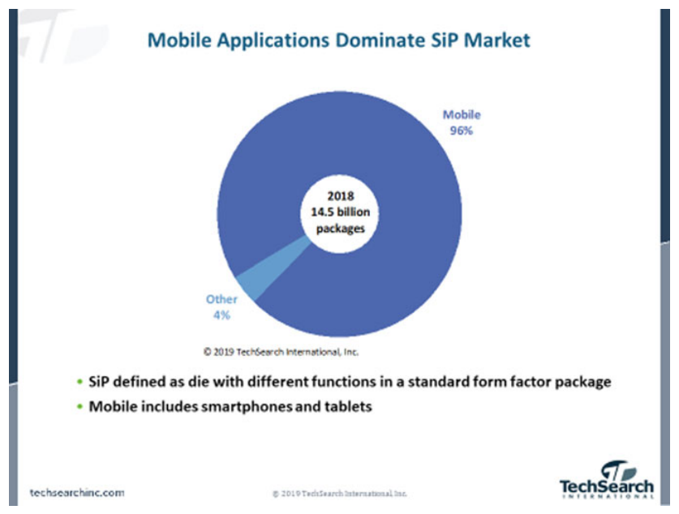

(i) 2 die MCP where a CPU is integrated on the package with a Controller chip (Peripheral Controller Hub).  Image shows the 10th Generation Intel® Core™ Mobile Processor

(ii) Schematic of a 2 die MCP.  The red lines in the schematic drawing indicate that the two or more die are electrically connected using lateral on-package interconnects routed in multiple package layers a

(i) FPGA based Multi-Chip Module showing multiple single die and stacked companion die.  Image shows Intel’s 10nm based Agilex™ FPGA.

(ii) MCP Schematic illustrating high density bridge based on-package lateral connections (illustrated by the red lines) between single and stacked die. b


> **Fig. 2.3 (a) Multi-chip module (MCP)—2 or more die are attached in a planar configuration to a package substrate. (b). EMIB Based Multi-Chip Module (MCP)—Many die, including a HBM stack are connected through localized high density bridges. (c). Silicon Interposer based SIP Module— A Silicon Interposer is used to for fine feature interconnects between the different chips or chip stacks. The interposer has TSV’s to connect the chips to the package substrate. See [73] for product implementations. (d) 3D Module where multiple die are stacked using TSV based interconnects. Image above shows an HMC memory Stack from Micron. (e) 3D Stack architecture where a 3D stack is created where two die on different silicon processes are bonded face to face. This Intel 3D stack technology is called Foveros**

![Fig. 2.3 (a) Multi-chip module (MCP)—2 or more die are attached in a planar configuration to a package substrate. (b). EMIB Based Multi-Chip Module (MCP)—Many die, including a HBM stack are connected through localized high density bridges. (c). Silicon Interposer based SIP Module— A Silicon Interposer is used to for fine feature interconnects between the different chips or chip stacks. The interposer has TSV’s to connect the chips to the package substrate. See (73) for product implementations. (d) 3D Module where multiple die are stacked using TSV based interconnects. Image above shows an HMC memory Stack from Micron. (e) 3D Stack architecture where a 3D stack is created where two die on different silicon processes are bonded face to face. This Intel 3D stack technology is called Foveros](figures/fig_2_3.png)

(i) 3D Stack where die from two different silicon process nodes are stacked together in a face to face connection and a POP configuration is used to connect pre-packaged memory.  Image shows Intel’s Lakefield Processor.

(ii) Schematic illustrating a 3D architecture.  The base die is colored differently to highlight that it has active circuitry e


> **Fig. 2.3 (continued)**

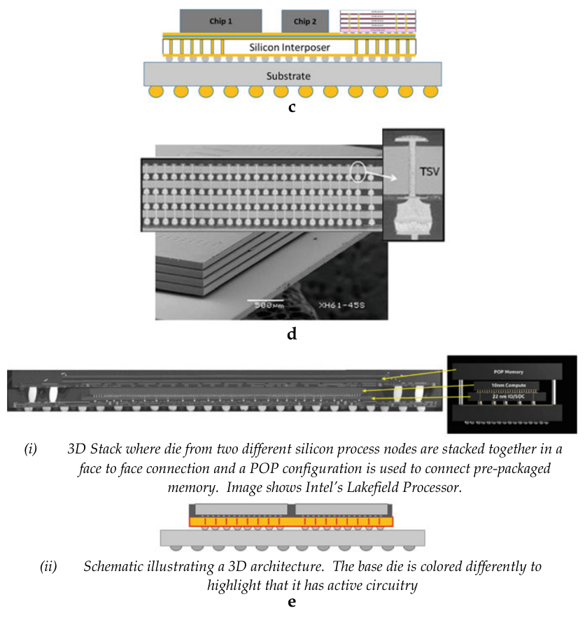

There are a number of innovative ways to construct SIP architectures using planar and stacked structures. One class of SIP configurations that involves the most significant technology changes are those incorporating through silicon vias (TSV). This chapter focuses on 3D die stacks that are enabled by TSV technology. TSV based SIPs have been the subject of considerable research for more than two decades and numerous papers have explored applications, architecture and design opportunities, as well as process, material and equipment complexities [17–22]. The value of implementingdiestackinginaproductdesign,andthusleveragingtheverticaldimensionin a package and taking advantage of reduced interconnect lengths,3 has been discussed in detail [18–20]. Since it is difficult to comprehensively discuss all these aspects

3Physical and electrical interconnect characteristics have a significant impact on chip performance [18–20].


> **Fig. 2.4 Cross-section of HBM2 stack. Acknowledgment system plus consulting**

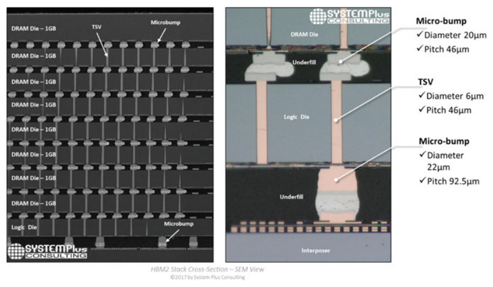

in a general overview, this chapter will attempt to provide a broad perspective of the architectural and process opportunities and complexities. The process of TSV formation has been previously discussed in depth in Chap. 3 and will not be repeated here, except for a brief reference in Sect. 2.3. The most commonly used interconnect between stacked die for currently available (ca. 2019–2020) products with TSV’s is solder based (Fig. 2.4) with interconnect pitches as low as 40 µm. Solder based interconnects have an advantage of being compliant and hence they are more tolerant to slight misalignment and/or a lack of co-planarity between bonded surfaces during assembly.4 However with decreasing interconnect pitches for future 3D stacks, as the joints become increasingly small, the available solder volume will be reduced and a greater proportion of the solder joints will become intermetallic compounds, thus decreasing their compliance [24]. Additionally, with shrinking interconnect pitch, there is an increasing risk of solder bridging between adjacent interconnects during the assembly process since the joints are closer to each other. Dispensing and flowing a protective epoxy underfill also becomes an increasing challenge with reduced chip gaps. Various research groups have suggested the need for alternate chip-to-chip interconnects for reduced dimensions, the most common among these are Cu–Cu bonding [25–30], a subject covered in detail in Chap. 8.

4In most applications Thermo-compression Bonding (TCB), is used to create the fine pitch interconnect typically needed between two stacked die, because of its superior alignment capability over reflow based flip-chip bonding [23].


### 2.2 3D TSV Based Architectures: Advantages and Limitations

In the past few decades there has been considerable interest in 3D TSV based SIP architectures [31–36], because of their compact construction and electrical advantages. In 2019, there are three types of commercially widely available products with TSV’s. These are DRAM memory stacks, image sensors, and processors [1, 2, 10, 37–40]. The electrical advantages include reduced signal latency, and lower signaling power dissipation due to reduced interconnect lengths. Figure 2.5 shows the energy consumption and dissipation during a 0 →1 & a 1 →0 bit transition based on a simple capacitance model. Assuming the same Tx and Rx capacitance, energy draw and dissipation is directly proportional to the capacitance of the interconnect and this is where TSV’s have an advantage over traditional planar wire connections. Since TSV’s are short length interconnects with significantly small capture pads than standard substrates, they can exhibit a significantly lower (typically 4–20 times lower [41]) interconnect capacitance compared to a side by side or planar interconnect. In Fig. 2.6a, a memory is connected to the processor through a planar on-package interconnect and in Fig. 2.6b the connection uses TSV’s. A comprehensive calculation [42] shows that the interconnect power efficiency (mW/Gbps) dropped from 15.65 mW/Gbps (for a bounding case where a DDR memory in a DIMM slot was accessed by the CPU) to 0.55 mW/Gbps when the


> **Fig. 2.5 Simple capacitance model describing the energy consumption in a Tx (Transmitter)—Rx (Receiver) interconnect link**

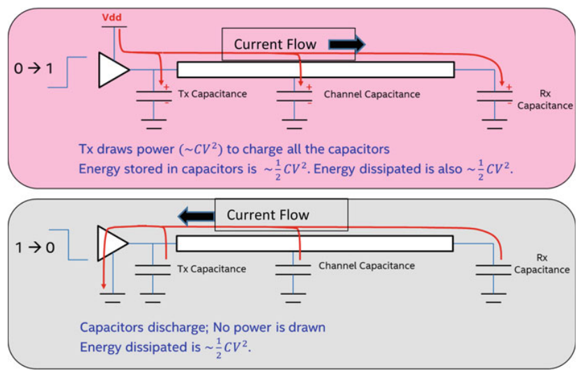


> **Fig. 2.6 (a) Schematic illustrating a side-by-side Processor-DRAM interconnect. (b) Schematic illustrating a stacked Processor-DRAM interconnect**

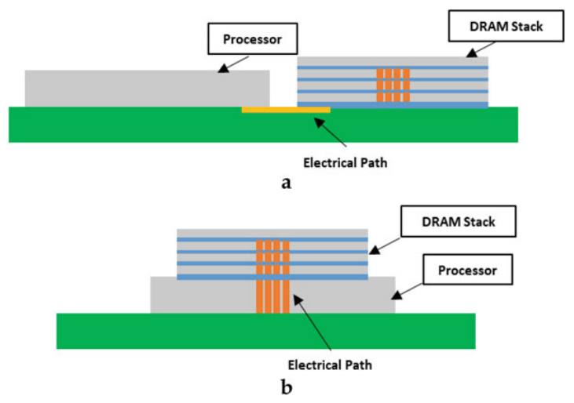

CPU accessed a WIO5 memory through TSV’s). This is more than a 28× improvement.6 This power efficiency, multiplied by the number of wires in the interface, and combined with reduced data latency due to reduced interconnect lengths is what has motivated designers to consider TSV based architectures. Another more relevant and constrained comparison [45]7 that restricts its scope to 2.5D8 and 3D architectures (Fig. 2.6a, b) shows that the 3D TSV case (Fig. 2.6b) has significantly reduced interconnect capacitance partly due to reduced interconnect length and partly due to a different structure. As a result the 3D case has lower latency (15.7%) and requires lower energy (32.2%) compared to the best known 2.5D case. The power efficiency advantage is appealing across the application spectrum from handheld and mobile devices where longer usage times between battery recharging can be enabled, to servers where lower energy costs makes 3D TSV stacks attractive. While energy efficiency and latency are the significant advantages for 3D TSV based architectures a key limitation is that the maximum Thermal Design Power (TDP) can be significantly lower than with comparable 2D configurations. This is

5WIO i.e. Wide IO is a JEDEC standard memory where the memory die are connected by TSVs [43]. 6Power efficiency quoted for the ESD case. See [44] for a detailed review of power and performance differences between LPDDR and Wide-IO. 7It is relevant to note that [45] also includes the case of monolithic 3-D ICs where multiple devices levels are stacked within the wafer. This case is truly a bounding case of 3D integration but beyond the scope of the current chapter. References [46, 47] covers this subject in more detail. 8The 2.5D nomenclature is used here to maintain consistency with literature published before 2019 HIR [7].


> **Fig. 2.7 Schematic showing heat paths in a 2D versus 3D stack**

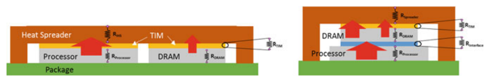


> **Fig. 2.8 TDP impact of 3D stacking**

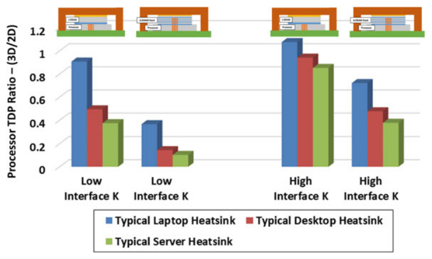

due to the thermal resistances in a 3D stack which are in series and hence additive (Fig. 2.7). Consider the case where a DRAM memory is stacked on top of a logic processor. The Processor-DRAM interface, the bulk DRAM silicon, and in the case of multiple DRAM die, the DRAM-DRAM interfaces all add thermal resistances to the heat flow. This compares to a planar case where heat from the processor has to only flow through the silicon of a single chip and a Thermal Interface Material (TIM) before reaching a Heat Spreader or the base of a heatsink.9 Thus, the thermal impact of stacking is that it reduces the total Thermal Design Power (TDP) available for the system designer to utilize for the processor. This is quantitatively shown in Fig. 2.8 using a simple case study comparing TDP between the 3D case (where 1 and 4 DRAMs are stacked on top of a processor) and the 2D case where 1 DRAM or a 4 DRAM stack is placed side-by-side to the processor. In this case study, the following assumptions are made

1. The processor and DRAM silicon are both 100 µm thick 2. Processor power is uniform across the processor die and is time independent 3. Junction temperature limits for both the processor and DRAM are 105 °C

9In reality, there will be thermal cross-talk through the heat spreader and this will affect the TDP envelope.

4. 3 different system cooling10 solutions are considered i.e.

(a) High thermal resistance cooling solutions which depend mainly on conduction (Typically encountered in laptop environments where active airflow is not possible) (b) Medium thermal resistance cooling solutions which use both conductive and convective heat transfer (Typically encountered in desktop environments that use cost-performance optimized cooling solutions) (c) Low thermal resistance cooling solutions which use both conductive and convective heat transfer (Typically encountered in server environments that use performance optimized solutions to manage high TDP envelopes)

5. The Processor-DRAM and DRAM-DRAM interfaces, comprised of metallic interconnects and protective underfill, are key interfaces that limit heat transport since the effective thermal conductivity (K) across that interface tends to be in the approximate range (0.3–3.0 W/m °C), which is significantly lower than the thermal conductivity of silicon (110 W/m °C) or Cu (390 W/m °C). Two different interface conditions are considered for the analysis including a low interface with K = 0.3 W/m °C and high interface with K = 3.0 W/m °C.

In cases where the system thermal resistance (i.e. the fully constructed final product) is high relative to the package resistances, the impact of changes in package resistance have a lesser influence on the overall TDP. In these cases, a system designer can increase memory capacity and still take advantage of improved memory capacity and power savings. As the performance of the system thermal cooling solution improves, increasing package resistance (with increasing number of stacks) will have a greater influence on the product’s TDP capability. In this scenario, the TDP degradation and increasing the number of stacks is more significant. It can be seen from Fig. 2.8 that since the bulk of the heat transfer in the package is conduction based. For this case, improvements in the effective thermal conductivity of the interfaces between the stacked silicon chips are critical to improving the overall TDP capability. The effective thermal conductivity of the interface can be improved by increasing the number of micro-bumps between the die, and by increasing the effective thermal conductivity of the underfill, or polymeric encapsulants, used to increase the reliability of the micro-bumps. Additionally there is a need to improve the quality of system thermal solutions. Chapter 13 summarizes the various thermal solution strategies developed to address the thermal management problem in 3D stacking. In addition to Chap. 13, the chapter on thermal management in the Heterogeneous Integration Roadmap (Chap. 20 in Ref. [7]) analyzes a series of canonical cases, identifies limiting cases and describes thermal capability differences for different architectures and points to potential solution paths. It should also be noted that an assumption of uniform power distribution in the processor is simplistic. In almost all cases a processor’s power distribution is non-uniform. The presence of the additional thermal interfaces, and hence higher

10System cooling refers to the cooling solution attached to the SIP.


> **Fig. 2.9 Stresses in silicon due to TSV integration**

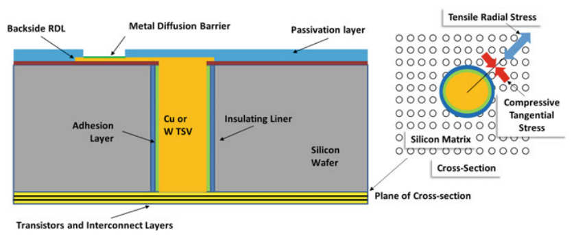

thermal resistance, from the DRAM stack will exacerbate the hot spots compared to a side by side configuration. Analyses of various design concepts that minimize the thermal burden on the package have been shown to be capable of achieving thermal equivalence with 2D configurations [48]. Another key consideration is the impact of TSVs on the stress state in silicon. Cu and W are typical materials used for TSV’s, and polysilicon TSV’s have also been mentioned in literature [49]. TSV’s are typically lined and filled using Physical Vapor Deposition (PVD) and Electro-Chemical Deposition (ECD) at temperatures greater than 200 °C.11 The ECD temperatures are significantly higher than the typical operation temperature of a processor or a memory device which tend to be in the (90–110 °C) range. At the deposition temperature, the TSV is in an equilibrium (i.e. stress-free) state with the surrounding silicon, however at idle or operating temperatures, the TSV induces radially tensile and tangentially compressive stresses in the surrounding silicon (see Fig. 2.9 for a schematic illustration) resulting from the CTE differential between the Cu/W fill and the surrounding silicon. These stresses have an impact on the electron and hole mobility in the transistors and hence an impact on transistor performance and reliability [50–52]. Keep out zones (KOZ) (i.e. regions in the silicon surrounding the TSV’s where transistors cannot be placed) are specified for silicon designers so that performance and reliability impact is reduced to an acceptable level. The consequence is that there is a silicon area increase due to both the TSV and its associated KOZ. In summary, the power efficiency advantage due to short TSV interconnects must be balanced against the disadvantages in TDP reduction and the potential for increased chip area due to the TSV integration. A designer must ensure that the disadvantages don’t adversely affect the overall performance or value of the product being designed.

11200 °C quoted as a typical lower temperature bound. A number of FEOL and MEOL processes have deposition temperatures significantly higher than 200 °C.


> **Fig. 2.10 Schematic showing the structure of a TSV in the Silicon back-end interconnect stack**

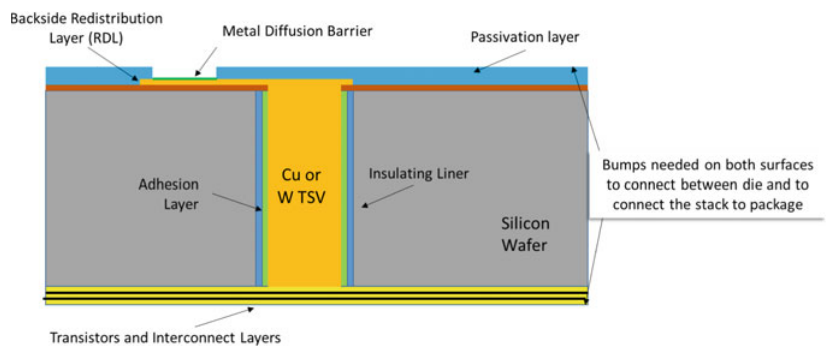


### 2.3 Methods of Fabrication and Other TSV Attributes

The structure and location of a TSV with reference to the transistors and back-end interconnect stack in a typical wafer is shown schematically in Fig. 2.10. TSV’s are typically created using a process with the following steps

• A photo-resist is coated on the silicon wafer and lithographic exposure is used to define the TSV locations • The silicon is etched, typically using the Bosch process [53–56], which uses multiple sequences of etch and coat to create the via holes • The photo-resist is then stripped and the wafer surface is cleaned • The inner walls of the TSV are coated with a dielectric liner (typically SiO2 though Si3N4 has also been reported [57] using thermal oxidation or PECVD (Plasma Enhanced Chemical Vapor Deposition). The liner electrically isolates the TSV from the bulk silicon • Next an adhesion layer, typically Ti or Ta, is added on the inner lining of the TSV using PVD (Physical Vapor Deposition) • A thin conductive seed layer is deposited in the via hole next and the vias are then ready for deposition of the TSV metal • Electro-Chemical Deposition (ECD) (i.e. plating) is used to fill the via holes with Cu or W • Vias are annealed to stabilize the TSV microstructure and to relieve stresses within the TSV • Finally, Chemical Mechanical Polish (CMP) is used to planarize the wafer and remove undesired materials.

12Descriptions in Fig. 2.11 show high level conceptual flows and specifics can vary e.g. in a Via Middle process partial metallization can precede TSV formation.


> **Fig. 2.11 High level process flow for the 3 processes of creating TSVs**

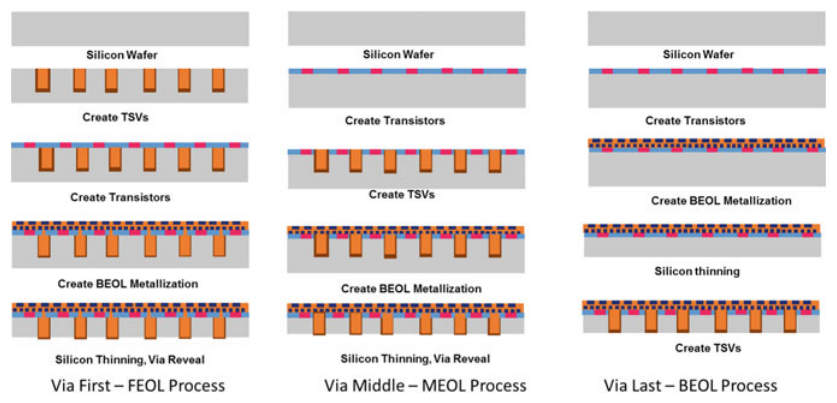

1. Via First Process (Also referred to as the Front-End of Line (FEOL) Via Process): In this process, the TSVs are created before the transistors [58, 59]. Key steps in this process are

(a) The wafer surface is patterned and TSVs are etched and filled on the transistor side (front or active side) of the wafer. (b) After the TSV formation, the wafer is planarized and readied for transistor creation. (c) Transistor creation is followed by the Back End Of Line (BEOL) process which creates the multiple metal/insulator layers on the silicon wafer. (d) Finally the wafer backside is thinned to reveal the vias and create a Redistribution Layer (RDL) (Fig. 2.12).

An important advantage of the Via First approach is that since the vias are created before transistor creation, the wafers can be inspected and tested, and only known good wafers with defect-free TSVs will be used for subsequent steps. Additionally, some authors [58] have claimed that the Via first process allows for a fewer design


> **Fig. 2.12 Bumping process flow post TSV formation, shown for the MEOL/FEOL TSV process**

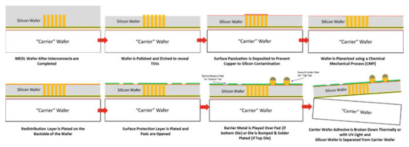

constraints and a higher density of vias compared to the Via Middle and Via last processes.13 AkeylimitationoftheViaFirstapproachisthatalltheTSVmaterialsand processes need to be compatible with CMOS processes and temperatures (~1200 °C). Polysilicon vias are mostly used in the Via First process [59]. Bauer et al. [57] discuss a process where high density vias are created in a Via First process using a silicon as a sacrificial material during the initial via formation step. The silicon is replaced with W after the transistor formation processes are completed.

2. Via Middle (Also referred to as Mid-End of Line (MEOL) Via Process: In this process TSV formation is after front-end device creation and before the creation of all the back-end metal layers [60–66]. Key steps in this process are

(a) Front-end devices are fabricated including transistors and several lower metal layers. (b) Next, TSVs are created from the active device side typically at temperatures in the 400–450 °C. (c) The TSV is then plated with Cu or W. (d) The wafer is then annealed at ~400 °C to relieve stresses in the TSV and to stabilize the TSV metal structure. (e) Next the wafer is planarized with a typical damascene process and is readied for the remaining BEOL metallization. (f) After BEOL metallization is complete, the wafer is mounted on a carrier and thinned to reveal the TSV’s on the inactive (backside) of the wafer. Via reveal is usually (optionally) followed by creation of a Re-Distribution Layer (RDL) and backside bump formation processes that is a critical structure for die stacking (see Fig. 2.12).

In addition to the use of Cu based vias, an advantage of the Via Middle process is that subsequent chip fabrication processing temperatures are lower than for the Via First process, and hence the thermal stresses induced in silicon due to the CTE mismatch between the silicon and TSV metal are lower.

3. Via Last (Also referred to as Back-End of Line (BEOL) Via Process: In this process, TSVs are created after the transistors and interconnects are created [67]. Key steps in this process are

(a) The transistors and the entire BEOL process is first completed. (b) The wafer is then temporarily attached to a carrier using an adhesive (usually referred to as a wafer bond/debond adhesive) on the active (front side). (c) The wafer is thinned and the TSVs are formed using a similar process to the Via Mid described earlier. This is followed by manufacturing of the RDL and backside bumping. The backside RDL and bumping process are essentially the same as described in Fig. 2.12.

13While this statement seems intuitively feasible, the authors are not aware of an authoritative study that establishes the design advantages of the Via First process over the Via Middle or Via Last options.

In the Via Last process, TSV processing temperatures are typically lower than 200 °C. This is important since the fully formed wafer is mounted on a carrier using a low temperature adhesive. An advantage of this approach is that the thermal stress issues are lower than with the Via First and Via Middle process options. However, there are two significant concerns with the Via Last process. First since TSVs are created after the BEOL, the TSVs need to land at the right metal layer in the chip metal wiring. Special landing surfaces, also called catch cups, are included in silicon metal layers to precisely locate the TSVs. Special care needs to be taken that the TSVs land on catch cups and don’t accidentally punch through them. Integration of catch cups requires careful design and restricts the placement of the TSVs. Secondly since the TSVs are formed after complete wafer processing, yield loss due to TSV formation could result in loss of valuable silicon. Some of the key design attributes of TSVs are their diameter, pitch, aspect ratio (i.e. the ratio of TSV diameter to its depth), electrical characteristics (including resistivity of both the TSV and adjacent silicon, inductance, and frequency dependent capacitance) and stress related KOZ’s. TSV aspect ratios are influenced by a few key parameters such as the ability to get good insulation coverage as a function of via depth and the ability to get void-free via filling. Table 2.1 shows some of the published data on TSV diameters and depth. Electrical and stress characteristics are determined by the TSV materials choices (including via metal, liner, adhesion materials, wafer silicon doping) and process choices (deposition and anneal temperatures).


> **Table 2.1 Some recent TSV dimensions reported in the literature**

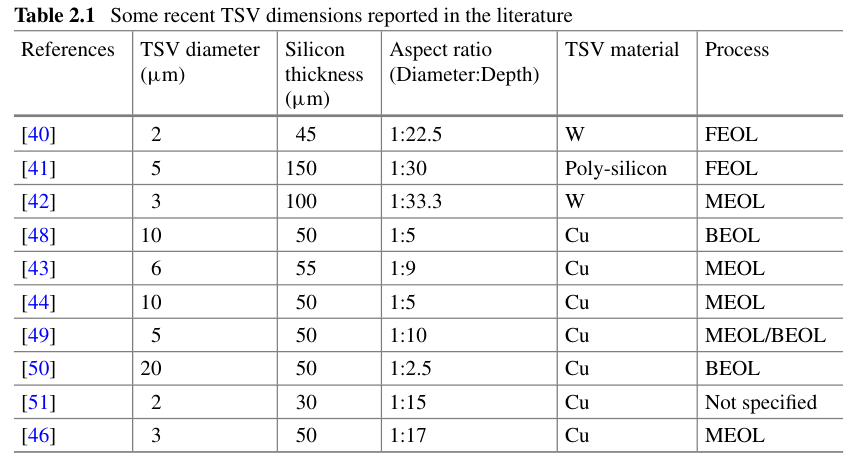

References TSV diameter (µm)

[40] 2 45 1:22.5 W FEOL

[41] 5 150 1:30 Poly-silicon FEOL

[42] 3 100 1:33.3 W MEOL

[48] 10 50 1:5 Cu BEOL

[43] 6 55 1:9 Cu MEOL

[44] 10 50 1:5 Cu MEOL

[49] 5 50 1:10 Cu MEOL/BEOL

[50] 20 50 1:2.5 Cu BEOL

[51] 2 30 1:15 Cu Not specified

[46] 3 50 1:17 Cu MEOL


### 2.4 Assembly Process Flows

3D stacks can be assembled using 3 different approaches. They are commonly referred to as Wafer-to-Wafer (W2W) attach [68, 69], Die-to-Wafer (D2W) attach [70–72] or Die-to-Die (D2D) attach.

In this process, entire wafers are aligned and then bonded, followed by the singulation of individual die stacks. Two W2W flows are schematically illustrated in Fig. 2.13.

• Back-to-Face Flow: where the inactive side (back) of the top wafer is bonded to the active (front) side of the bottom wafer. This approach can enable multiple wafers with TSV’s to be bonded one after the other, while retaining the back-to-face connectivity between the die. • Face-to-Face Flow: where the active side of the top wafer is attached to the active side of the bottom wafer. This approach is less valued for stacking more than 2 wafers because of asymmetry.

A significant advantage of a W2W process is that both bonding surfaces are extremelyflat,andthustherecanbeexcellentwafertowaferalignment(<3µmacross the wafer) and hence very fine interconnect pitches can be achieved. In the case of solder based interconnects, pitch scaling in W2W attach is limited by solder bridging between interconnects and the implications of intermetallic compound formation. Another advantage of the W2W process is that it is a batch process with high manufacturing throughput. Key limitations of the wafer W2W process include: (1) all the die have to be of the same size; (2) the process precludes the ability to bond known


> **Fig. 2.13 Schematic describing the key steps in a W2W attach process**

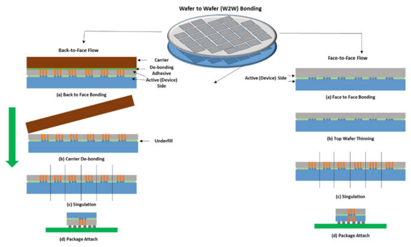

good die together; (3) yield loss due to misalignment during this process can be significantly expensive, especially in the case where multiple wafers are stacked. It should be noted that addition of underfill in W2W is significantly more challenging and requires a wafer level underfilling process.

In this process, individual die14 (with or without TSVs) are bonded on a base wafer incorporating TSVs mounted on a carrier (Fig. 2.14). This process has similar advantages of alignment as the W2W process and it is not limited by the requirement for the die to be the same size. The top stacked die used in successive stacking steps can be the same size or smaller than the corresponding die below it. If only known good die are stacked, better yields than the W2W process can be expected. Additionally, various top die with different functionality than the bottom die can be stacked, allowing for increased heterogeneous integration. Unlike the W2W flow, D2W is a sequential process which will have considerably slower process throughput times, and thus lower assembly equipment utilization.

In this process flow, the bottom die is first assembled to a package substrate and subsequently other die or die stacks are then stacked on the die connected to an assembled package (Fig. 2.15). This process resolves the die size limitations of the W2W and D2W flows through careful alignment methods. In this way, die larger than the bottom die can be stacked on top. Since the bottom die can be fully tested prior to committing the top die, this process has best chance among the three process of creating known good stacks. However, a key disadvantage of this process is that since the bottom die is fully assembled to a package substrate (typically to an organic package), it can become quite warped because of the CTE mismatch with an organic laminate package. Hence during attach of the top die to the bottom package, the die to package yield can be compromised due to the alignment challenges that are created. In general, the 3D stacking process is an exercise in precise tolerance and process control, and requires very good characterization of the surfaces being assembled as a function of temperature. Some of this is schematically illustrated in Fig. 2.16. An important consideration in all three attach processes is the ability to successfully underfill the die-die interconnects with an epoxy-based compound which is especially challenging at very fine pitches. Underfill is needed to improve the reliability of the die to die and die to package interconnects. Since the die-die interconnect pitches are significantly lower (typically ≤55 µm) compared to typical die-package interconnect pitches (typically ≥100 µm) the gaps or empty space between bumps become smaller for die-die interconnects. This creates another disadvantage of the D2W process. Since it is a sequential stacking process, a dispensed liquid underfill process is possible, but underfill bleed-out and unintentional cure in adjacent unattached chip area is a concern. Dispense of underfill after all the die are attached

14Note that die stacks can also be attached to the wafer and HBM stacks are a good example of this case.


> **Fig. 2.14 Schematic describing the key steps in a D2W attach process**

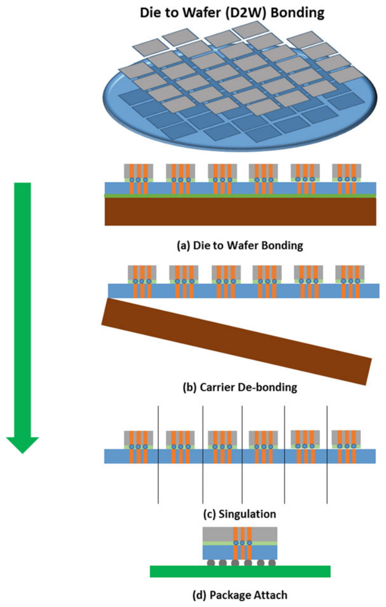


> **Fig. 2.15 Schematic describing the key steps in a D2D attach process**

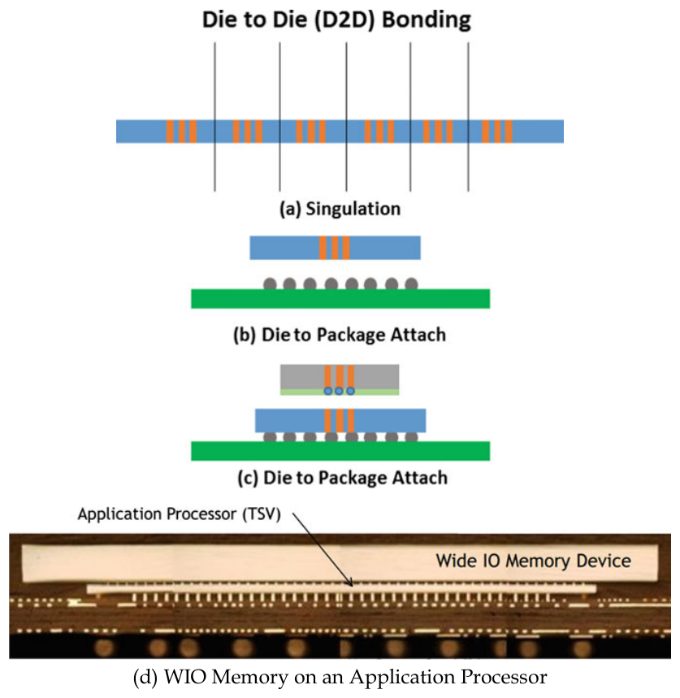

is a possibility that needs to be carefully planned ahead to ensure there is a sufficient gap between the die for adequate underfill flow between the solder based bump interconnects. Pre-applied film underfills are a better choice for D2W stacking, however if underfills loaded with inorganic fillers are used to deliver the improved thermal performance (Sect. 2.2), filler entrapment in the solder joints during chip attach becomes an important concern.


### 2.5 Manufacturing Yields and the Role of Test

One of the key goals in manufacturing multi-die modules is to maximize manufacturing yields. Minimizing the number of good die scrapped in modules that fail


> **Fig. 2.16 Yield loss in SIPs as a function of individual process step yields**

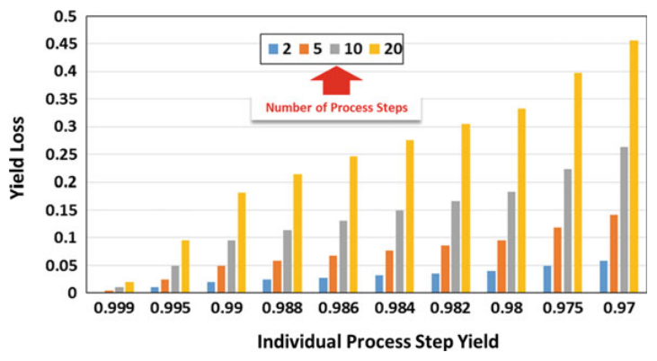

when tested, has a large impact on average product cost. This proposition can be quantified using a simple example. Consider a module that has n number of die, each of which costs a, and is attached to a single package substrate that costs b. For simplicity assume that each die is individually attached to the package in a single process activity (i.e. the entire assembly process is a single integrated step), hence the overall SIP assembly process has n steps—one step for each die. If the yield in each individual chip attach step is z, then the yield after n steps is zn; the yield loss is (1 −zn). The yield loss is plotted as a function of number of steps and individual process step yield in Fig. 2.16.15 The cost due to scrapped modules that fail due to a flaw in the assembly process is (na + b) x (1 −zn). There are three primary ways of reducing the cost of scrapped units.

1. Increasing individual step yield Increasing yield of each individual step in the assembly process is the main focus of packaging technology development. Process, materials and design parameters for each assembly step, and the impact to upstream and downstream steps of the process are carefully studied and optimized for maximal yield. 2. Ensuring each key component “Known Good” If only known good components are assembled, the chances that the overall module will perform as intended is significantly increased. Components and sub-assemblies need to be fully tested prior to assembly to ensure that they are known good16 and cause no yield loss when modules are tested. Designing an efficient test flow that maximizes quantity of known good components while minimizing any added test cost is a key focus area.

15It should be pointed out that this model while illustrative is simplistic in a number of ways. In real life situations, the number of process steps is higher than n; individual process step yields vary and are not always independent of each other. 16In industry parlance, the acronym KGD (Known Good Die) is used to describe working die, pre-tested before package assembly.


> **Fig. 2.17 Key steps in a package assembly process**

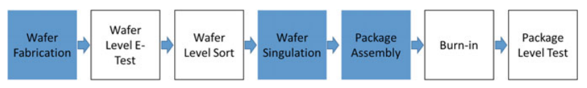

3. Adding interconnect redundancy to chip circuit design Since there is always some yield loss during the interconnection formation, it is good practice to build in some interconnect redundancy i.e. more than required interconnectssothatevenifsomeoftheinterconnectsaredefective,theredundant interconnects can be used to ensure that the circuits work bypassing the defective interconnects. Designing for redundancy can potentially add cost by increasing circuit area and must be designed to balance competing concerns of improved yields versus increased circuit area.

Before discussing the challenges involved in testing SIP modules with 3D TSV stacks,itisnecessarytounderstandthedifferentstepsinvolved.Ahighlevelassembly process flow for a single component is illustrated in Fig. 2.17 to show the typical points in the flow where the wafer, die and assembled package are tested to check for manufacturing quality or performance. Key steps involved in testing products include:

1. E-Test (or Electrical-Test)—This test step is a process characterization step used in the wafer fab to check the manufacturing quality and device parametric values. E-Test can be used after an intermediate process step to check the quality of that step and/or at the end of wafer processing to assess overall quality. Note that this test step does not influence the SiP Module yield, but can affect Module costs indirectly as lower wafer yields will translate into higher die cost. 2. Wafer Level Sort or Probe—This is a wafer level test where each individual die is probed and functionally tested to see if it is fully functional, and how it will be classified for assembly.17 Contact is accomplished using a probe card that has individual probes to make electrical contact with the interconnect pads on the die. Typically a probe card can contact several die simultaneously with each one individually tested. The test results are stored in a database that tracks each wafer and die, indexed by the die’s position on the wafer. For SiP Modules, Sort is expected to identify Known Good Die, or die with very little post-assembly test fallout. 3 Burn-in—The function of burn-in is to accelerate the failure of latent defects (such as fab and/or assembly process induced defects, or silicon design marginalities) in an assembled SiP unit which then becomes detectable on assembly production test equipment (ATE). The Burn-In step helps remove Modules that

17Determining viability for assembly requires a careful optimization of cost (i.e. cost of probing die on a wafer needs to be balanced against the cost of package waste and need for additional test steps later in the flow) and test coverage (while checking a greater degree of die functionality before packaging is financially viable it can also require more sophisticated Sort technology).


> **Fig. 2.18 Test Considerations for a 3D stack with TSVs**

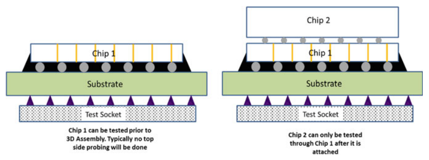

would have contributed to early customer failures typically called “Infant Mortality”. By removing these units, product failures observed by customers are limited to “wear-out” mechanisms which occur far in the future. Acceleration of latent failures is accomplished by subjecting the units to higher voltages and temperatures then they would experience in the field for stress times, usually in the range of many minutes to many hours.18 The goal of Burn-in is to ensure high quality products are delivered to customers. As manufacturing processes mature, Burn-in times typically are reduced. 4. Package Level Functional Test—This step is the most comprehensive of all test steps and is used to ensure that the assembled units are defect free, meet performance requirements, and to grade the performance level of the assembled units. Since this is the final and most comprehensive of the Test steps, the level of Test coverage (i.e. how much of the product functionality is evaluated) and the precise control of test parameters are critically monitored.

Now that the key test steps have been described, specific challenges related to the testing of 3D TSV stacks can be discussed with reference to Fig. 2.18 which shows a 2 chip stack although the conclusions can be extended to higher number stacks. Chips 1 and 2 will be tested at Sort before the wafer thinning and TSV reveal process steps for both the FEOL and MEOL flows, and before TSV formation in the BEOL flow. Only the active side of the die are probed at Sort, and the die backside is ignored. In the W2W and D2W flows, each chip is similarly sorted before TSV and RDL formation. The chips go through the assembly process and package stacks are created. After the entire die stack is mounted on a package, it is functionally tested. The advantage of the D2D flow is that Chip 1 can be tested for full functionality before Chip 2 is attached. Thus, only known good packaged Chip 1 die will be used for assembly. Full functionality of Chip 2 can only be verified through connectivity through Chip 1. This constraint would not exist if the two die were assembled side-by-side in a

18One of the key considerations in manufacturing costs is the time it takes to test units. Greater the amount of time, lower the through-put and hence higher the costs. The goal in E-Test, Sort, and Package Level Test steps is to focus on test time minimization without impacting quality. Burn-in processes on the other hand are designed to run longer so that latent defects are screened out.

package. Additionally, since the heat path for Chip 1 is impeded by Chip 2, precise temperature control of Chip 1 during full functional test is more challenging than in the corresponding side-by-side case. Both of these constraints imply that there are more challenges with stacked die testing versus side-by-side, and the potential for higher compound yield loss is greater too.


### 2.6 Challenges with 3D TSV Architectures

It should be clear from the discussion so far that that TSV based architectures, while attractive from a performance and power efficiency perspective, can limit product performance from a thermal perspective. Increasing the thermal envelope of 3D stacks is an important challenge. Considerable research in enhancing conduction and convection modes of heat transfer are described in Chap. 13. 3D TSV stacks break existing paradigms and require new design tools that accommodate the area and stress impacts on transistor performance while taking advantage of the newly available vertical TSV interconnects. From a manufacturing perspective, TSV manufacturing processes create greater overlap between backend silicon fabrication and assembly technologies. Additionally, it requires considerable investment in new equipment such as deep via etchers, high aspect ratio Cu plating, ultra-thin wafer handling, and stacked die assembly. Stacked die assembly drives the need for new materials such as fluxes that work in narrow chip gaps with minimal residue, and high thermal conductivity underfills that are compatible with different assembly flows, as well as incorporation of novel Cu–Cu bonding technologies. 3D stacks drive new Test paradigms including fine pitch test and a very detailed understanding of KGD and KGSD.


### 2.7 Summary

TSV based 3D stacking has generated considerable interest in the past two decades and the considerable research and development effort in architecture and manufacturing has resulted in a detailed understanding of multiple aspects of the technology. In this chapter a broad overview of the value and importance of SIP packages has been provided along with motivation for TSV based 3D architectures.

Acknowledgements The authors would like to acknowledge Prismark Partners LLC, TechSearch International Inc, and Yole Développement for their generous permission to use their pictures. Thanks are due to Dr. Zhiguo Qian (Intel Corporation) for his help on the section on IO power dissipation, Dr. Chandra Mohan Jha (Intel Corporation) for help with thermal analysis, Professor Paul Franzon (North Carolina State University) for help getting updated latency and energy comparisons Debendra Mallik for help on the figures, Sriram Srinivasan for thorough review of the chapter and Tom DeBonis for his help in facilitating information collection. Guidance from Chris Nelson (Intel

Corporation) on test processes is also gratefully acknowledged. The editors would like to thank Zhiheng Huang from Sun Yat-sen University for his critical review of this chapter.


### References

1. https://www.anandtech.com/tag/hbm2 2. https://newsroom.intel.com/wp-content/uploads/sites/11/2019/08/Intel-Lakefield-HotChipspresentation.pdf 3. D. Ingerly, S. Amin, L. Aryasomayajula, A. Balankutty, D. Borst, A. Chandra, K. Cheemalapati, C.S. Cook, R. Criss, K. Enamul, W. Gomes, D. Jones, K.C. Kolluri, A. Kandas, G.-S. Kim, H. Ma, D. Pantuso, C.F. Petersburg, M. Phen-Givoni, A.M. Pallai, A. Sairam, P. Shekhar, P. Sinha. P. Stover, A. Telang, Z. Zell, Foveros: 3D integration and the use of face to face stacking for logic devices, in IEDM 2019 4. A.A. Elsherbini, S.M. Liff, J.M. Swan, Heterogeneous integration using omni-directional interconnect packaging, in IEDM 2019 5. G. Moore, Cramming more components onto integrated circuits. Electronics 38(8), 114 (1965) 6. R. Thakur, 50 Years of Moore’s law. Solid State Technol. 58(4), 41 (2015) 7. https://eps.ieee.org/technology/heterogeneous-integration-roadmap/2019-edition.html 8. R. Tummala, System On Package: Miniaturization of the Entire System (The McGraw-Hill Companies Inc., 2008) 9. https://www.anandtech.com/show/6911/intels-return-to-the-dram-business-haswell-gt3e-tointegrate-128mb-edram 10. http://www.hybridmemorycube.org/ 11. https://www.intel.com/content/www/us/en/products/programmable/fpga/agilex.html? wapkw=agilex 12. R. Mahajan, R. Sankman, N. Patel, D.-W. Kim, K. Aygun, Z. Qian, Y. Mekonnen, I. Salama, S. Sharan, D. Iyengar, D. Mallik, Embedded multi-die interconnect bridge (EMIB)—A high density, high bandwidth packaging interconnect, in Paper presented at the 66th Electronic Components and Technology Conference, Las Vegas, Nevada 557–565, June 2016 13. M. Sunohara, et al., Silicon interposer with TSVs (through silicon vias) and fine multilayer wiring, in Proceedings of IEEE Electronic Components and Technology Conference (ECTC), Lake Buena Vista, FL, May 27–30, 2008, pp. 847–852 14. K. Oi, et al., Development of new 2.5D package with novel integrated organic interposer substrate with ultra-fine wiring and high density bumps, in Proceedings of the 2014 IEEE 64th Electronic Components and Technology Conference, Orlando, pp. 348–353 15. S. Miki, H. Taneda, N. Kobayashi, K. Oi, K. Nagai, T. Koyama, Development of 2.3D high density organic package using low temperature bonding process with Sn–Bi solder, in Proceedings of the 2019 IEEE 69th Electronic Components and Technology Conference, Las Vegas, pp. 1599–1604 16. X. Zhang, P.K. Jo, M. Zia, G.S. May, M.S. Bakir, Heterogeneous interconnect stitching technology with compressible microinterconnects for dense multi-die integration. IEEE Electron Device Lett. 38(2) (2017) 17. W.R. Davis, J. Wilson, J. Xu, L. Luo, H. Hua, A. Sule, C.A. Mineo, M.B. Steer, P.D. Franzon, Demystifying 3D ICs: the pros and cons of going vertical, design and test of computers, IEEE 22(6), 498–510 (2005) 18. J.D. Meindl, Interconnect opportunities for gigascale integration. IEEE Micro 28–35 (2003) 19. J.D. Meindl, Beyond Moore’s law: the interconnect era. Comput. Sci. Eng. 20–24 (2003) 20. R.S. Patti, Three-dimensional integrated circuits and the future of system-on-chip designs. Proc. IEEE 94(6), 1214–1224 (2006)

21. F. Mukta, S.S. Iyer, 3D integration review. Sci. China Inf. Serv. 54(5), 1012–1025 (2011) 22. L. England, I. Arsovski, Advanced packaging saves the day!—How TSV technology will enable continued scaling, IEDM 2017 23. A. Eitan, K.-Y. Hung, Thermo-compression bonding for fine-pitch copper-pillar flip-chip interconnect—tool features as enablers of unique technology, in Proceedings IEEE 65th Electronic Components and Technology Conference (ECTC), May 2015 pp. 460–464 24. G. Vakanas, O. Minho, B. Dimcic, K. Vanstreels, B. Vandecasteele, I. De Preter, J. Derakhshandeh, K. Rebibis, M. Kajihara, I. De Wolf, Formation, processing and characterization of Co-Sn intermetallic compounds for potential integration in 3D interconnects. Microelectron. Eng. 140, 72–80 (2015) 25. A. Klumpp, R. Merkel, P. Ramm, J. Weber, R. Weiland, Vertical system integration by using inter-chip vias and solid-liquid interdiffusion bonding. Jpn. J. Appl. Phys. 43(7A), L829–L830 (2004) 26. P.R. Morrow, C.-M. Park, S. Ramanathan, M.J. Kobrinsky, M. Harmes, Three-dimensional wafer stacking via Cu–Cu bonding integrated with 65-nm strained Si/low-k CMOS technology. IEEE Electron. Device Lett. 27(5) (2006) 27. P. Batra, S. Skordas, D. LaTulipe, K. Winstel, C. Kothandaraman, B. Himmel, G. Maier, B. He, D.W. Gamage, J. Golz, W. Lin, T. Vo, D. Priyadarshini, A. Hubbard, K. Cauffman, B. Peethala, J. Barth, T. Kirihata, T. Graves-Abe, N. Robson, S. Iyer, Three-dimensonal wafer stacking using Cu TSV integrated with 45 nm high performance SOI-CMOS embedded DRAM technology. J. Low Power Electron. Appl. 4, 77–89 (2014). https://doi.org/10.3390/jlpea4020077 28. K. Takahashi, M. Umemoto, N. Tanaka, K. Tanida, Y. Nemoto, Y. Tomita, M. Tago, M. Bonkohara, Ultra-high-density interconnection technology of three-dimensional packaging. Microelectron. Reliab. 43, 1267–1279 (2003) 29. C.S. Tan, G.Y. Chong, High throughput Cu–Cu bonding by non-thermo-compression method, in Paper presented at the 63rd Electronic Components and Technology Conference, Las Vegas, Nevada (2013), pp. 1158–1164 30. P. Guegen, C. Ventosa, L. Di Cioccio, H. Moriceau, F. Grossi, M. Rivoire, P. Leduc, L. Clavelier, Physics of direct bonding: applications to 3D heterogeneous or monolithic integration, Microelectron. Eng. 87, 477–484 (2010) 31. B. Black, M. Annavaram, N. Brekelbaum, J. DeVale, L. Jiang, G.H. Loh, D. McCauley, P. Morrow, D. W. Nelson, D. Pantuso, P. Reed, J. Rupley, S. Shankar, J. Shen, C. Webb, Die stacking (3D) microarchitecture, in Paper presented at the 39th Annual IEEE/ACM International Symposium on Microarchitecture (MICRO’06) (2006) 32. J.M. Stern, V.H. Ozguz, 3D system architectures, in Intelligent Integrated Microsystems, ed. by R.A. Athale, J. C. Wolper, Proc. SPIE 6232, 6232K (2006). https://doi.org/10.1117/12.667381 33. P. Jacob, O. Erdogan, A. Zia, P.M. Belemjian, R.P. Kraft, J.F. McDonald, Predicting the performance of a 3D processor-memory chip stack. IEEE Des. Test Comput. 540–547 (2005) 34. P. Franzon, E. Rotenberg, J. Tuck, W.R. Davis, H. Zhou, J. Schabel, Z. Zhang, J.B. Dwiel, E. Forbes, J. Huh, S. Lipa, Computing in 3D, in Presented at the 2015 Custom Integrated Circuits Conference (CICC), 2015, 28–30 Sept 2015, pp. 1–6 35. U. Kang, H.-J. Chnug, S. Heo, D.-H. Park, H. Lee, J.H. Kim, S.-H. Ahn, S.-H. Cha, J. Ahn, D. Kwan, J.-W. Lee, H.-S. Joo, W.-S. Kim, D.H. Jang, N.S. Kim, J.-H. Choi, T.-G. Chung, J.-H. Yoo, J.S. Choi, C. Kim, Y.-H. Jun, 8 Gb 3-D DDR3 DRAM using through-silicon-via technology. IEEE J. Solid-State Circ. 45(1), 111–119 (2010) 36. J.B. Park, W.R. Davis, P.D. Franzon, 3-D-DATE: a circuit-level three-dimensional DRAM area, timing, and energy model. IEEE Trans. Circ. Syst.-I, Reg. Pap. 66(2), 756–768 (2019) 37. S. Lhostis, A. Farcy, E. Deloffre, F. Lorut, S. Mermoz, Y. Henrion, L. Bethier, F. Bailly, D, Scevola, F. Gyuader, F. Gigon, C. Besset, S. Pellssier, L. Gay, N. Hetellier, M. Arnoux, A.-L. Le Berrigo, S. Moreau, V. Balan, F. Fournel, A. Jouce, S. Cheramy, B. Rebhan, G. Maier, L. Chitu, Reliable 300 mm wafer level hybrid bonding for 3D stacked CMOS image sensors, in Paper presented at the 66th Electronic Components and Technology Conference, Las Vegas, Nevada, June 2016, pp. 869–876

38. V.C. Venezia. C. Shih, W.Z. Yang, B. Zhang, H. Rhodes, Stack chip technology: a new direction for CMOS imagers, in Presented at the IISW Conference (2015) 39. R. Fontaine, The state-of-the-art of mainstream CMOS image sensors, in Presented at the IISW Conference (2015) 40. D/3D TSV & Wafer-Level Stacking Technology & Market Updates 2019. Yole Développement 41. K. Chandrashekar, W. Weis, B. Akesson, N. When, K. Goossens, System and circuit level power modeling of energy-efficient 3D-stacked wide I/O DRAMs, in Presented at the 2013 DATE Conference, pp. 236–241 42. M.A. Karim, P.D. Franzon, A. Kumar, Power comparison of 2D, 3D and 2.5D interconnect solutions and power optimization of interposer interconnects, in ECTC 2013, pp. 860–866 43. https://www.jedec.org/standards-documents/docs/jesd229–2 44. M.H. Hajkazemi, M.K. Tavana, H. Homayoun, Wide I/O or LPDDR? Exploration and analysis of performance, power and temperature trade-offs of emerging DRAM technologies in embedded MPSoCs, in Paper presented at the 33rd IEEE International Conference on Computer Design (2015), pp. 70–77 45. Y. Zhang, X. Zhang, M. Bakir, Benchmarking digital Die-to-Die channels, in 2.5-D and 3-D heterogeneous integration platforms. IEEE Trans. Electron Dev. 65(12) (2018), 5460–5467 46. S. Panth, K. Samadi, Y. Du, S.K. Lim, High density integration of functional modules using monolithic 3D-IC technology, in Proceedings IEEE Asia South Pacific Design Automation Conference, January 2013, pp. 681–686 47. T. Srimani, G. Hills, C. Lau, M. Shulaker, Monolithic three-dimensional imaging system: carbon nanotube computing circuitry integrated directly over silicon imager, in 2019 Symposium on VLSI Technology Digest of Technical Papers, pp. T24–T25 48. M.Saeidi,K.Samadi,A.Mittal,R.Mittal,Thermalimplicationsofmobile3D-ICs,inPresented at the 2014 3D Systems Integration Conference (3DIC) in Kinsdale, pp. 1–7. https://doi.org/ 10.1109/3dic.2014.7152160 49. M. Koyanagi, H. Kurino, K.W. Lee, K. Sakuma, N. Miyakawa, H. Itani, Future system-onsilicon LSI chips. IEEE Micro 18(4), 17–22 (1998) 50. A. Mercha, G. Van der Plas, V. Moroz, I. De Wolf, P. Asimakopoulos, N. Minas, S. Domae, D. Perry, M. Choi, A. Redolifi, C. Okoro, Y. Yang, J. Van Olmen, S. Thangaraju, D. Sabuncuoglu Tezcan, P. Soussan, J.H. Cho, A. Yakovlev, P. Marchal, Y. Travaly, E. Beyne, S. Biesemans, B. Swinnen, Comprehensive Analysis of the impact of single and arrays of through silicon vias induced stress on high-K/metal gate CMOS performance, in IEDM (2010), pp. 2.2.1–2.2.4 51. W. Guo, G. Van der Plas, A. Ivankovic, V. Cherman, G. Eneman, B. De Wachter, M. Togo, A. Redolfi,S.Kubicek,Y.Civale,T.Chiarella,B.Vandevelde,K.Croes,I.DeWolf,I.Debusschere, A. Mercha, A. Thean, G. Beyer, B. Swinnen, E. Beyne. Impact of through silicon via induced mechanical stress on fully depleted bulk finFET technology, IEDM (2012), pp. 18.4.1–18.4.4 52. T. Kauerauf, A. Branka, K. Croes, A. Redolfi, Y. Civale, C. Torregiani, G. Groeseneken, E. Beyne. Effect of TSV presence on FEOL yield and reliability (2013), pp. 5C.6.1–5C.6.4 53. M. Tanaka, M. Sekine, I. Sakai, Y. Kusuda, T. Nonaka, O. Ysuji, K. Kondo, TSV Processes. Three Dimensional Integration of Semiconductors (2015), pp. 43–96. http://rd.springer.com/ chapter/10.1007/978-3-18675-7_3/fulltext.html 54. S. Spiesshoefer, L. Schaper, IC stacking technology using fine pitch, nanoscale through silicon vias, in Proceedings of IEEE 53rd Electronic Components and Technology Conference (ECTC), May 2003, pp. 631–633 55. S. Spiesshoefer, L. Schaper, S. Burkett, G. Vangara, Z. Rahman, P. Arunasalam, Z-Axis interconnects using fine pitch, nanoscale through-silicon vias: process development, in Proceedings of IEEE 54th Electronic Components and Technology Conference (ECTC), June 2004, pp. 466–471 56. N. Ranganathan, K. Prasad, N. Balasubramanian, Z. Qiaoer, S.C. Hwee, High aspect ratio through-wafer interconnect for three dimensional integrated circuits, in Proceedings of IEEE 55th Electronic Components and Technology Conference (ECTC), (2005), pp. 343–348

57. T.M. Bauer, S.L. Shinde, J.E. Massad, D.L. Hetherington, Front end of line integration of high density, electrically isolated, metallized through silicon vias, in Proceedings of the 58th Electronic Components and Technology Conference (ECTC), May 2009, pp. 1165–1169 58. M. Puech, J.M. Thevenoud, J.M. Gruffat, N. Launay, N. Arnal, P. Godinat, Fabrication of 3D packaging TSV using DRIE, design, test, integration and packaging of MEMS/MOEMS, 2008, in Symposium on MEMS/MOEMS 2008, pp. 109–114. http://doi.org/10.1109/DTIP.2008.475 2963 59. G. Pares, N. Bresson, S. Minoret, V. Lapras, P. Brianceau, J.F. Lugand, R. Anciant, N. Sillon, Through silicon via technology using tungsten metallization, in 2011 IEEE International Conference on IC Design & Technology (2011), pp. 1–4. https://doi.org/10.1109/icicdt.2011. 5783204 60. R. Agarwal, D. Hiner, S. Kannan, K. Lee, D. Kim, J. Paek, S. Kang, Y. Song, S. Dej, D. Smith, S. Thangaraju, J. Paul, TSV integration on 20 nm logic: 3D assembly and reliability results, in Proceedings of the 64th Electronic Components and Technology Conference (ECTC), May 2014, pp. 590–595 61. D.J. Na, K.O. Aung, W.K. Choi, T. Kida, T. Ochiai, T. Hashimoto, M. Kimura, K. Kata, S.W. Yoon, A.C.B. Yong, TSV MEOL (mid end of line) and packaging technology of mobile 3DIC stacking, in Proceedings of the 64th Electronic *Components and Technology Conference (ECTC), May 2014, pp. 596–600 62. N. Kumar, S. Ramaswami, J. Dukovic, J. Tseng, R. Ding, N, Rajagopalan, B. Eaton, R. Mishra, R.Yalamanchili,Z.Wang,S,Xia,K,Sapre,J,Hua,A.Chan,G.Mori,B.Linke,RobustTSVviamiddle and via-reveal process integration accomplished through characterization and management of sources of variation, in 2012 IEEE 62nd Electronic Components and Technology Conference, pp, 787–793. https://doi.org/10.1109/ectc.2012.6248922 63. E. Beyne, Reliable via-middle copper through-silicon via technology for 3-D integration. IEEE Trans. Compon. Pack. Manuf. Technol. 6(7), 983–992 (2016). https://doi.org/10.1109/tcpmt. 2015.2495166 64. S.W. Yoon, D.J. Na, K.T. Kang, W.K. Choi, C.B. Yong, Y.C. Kim, P.C. Marimuthu, TSV MEOL (mid-end-of-line) and its assembly/packaging technology for 3D/2.5D solutions, in ICEP-IAAC 2012 Proceedings, pp. 1–5 65. K.-W. Lee, H. Hashimoto, M. Onishi, Y. Sato, M. Murugesan, J.-C. Bea, T. Fukushima, T. Tananka, M. Koyanagi, A resilient 3D stacked multicore processor fabricated using die-level 3D integration and backside TSV technologies, in Proceedings of the 64th Electronic Components and Technology Conference (ECTC), May 2014 pp. 304–308 66. M.-J. Tsai, Overview of ITRI’s TSV technology, in 7th Annual SEMATECH Symposium Japan, June 2011. http://www.sematech.org/meetings/archives/symposia/9237/Session% 205%203D%20interconnect/1%20MJ_Tsai_ITRI.pdf 67. H. Ikeda, Heterogeneous 3D stacking technology developments in ASET, in CPMT Symposium Japan, 2012 2nd IEEE, pp. 1–4. https://doi.org/10.1109/icsj.2012.6523453 68. P. Lindner, V. Dragoi, T. Glinsner, C. Schaefer, R. Islam, 3D interconnect through aligned wafer level bonding, in Proceedings of the 52nd Electronic Components and Technology Conference (ECTC), May 2002, pp. 1439–1443 69. T. Ohba, Wafer level three-dimensional integration (#DI) using bumpless TSV interconnects for tera-scale generation, in 2013 IEEE, pp. 1–4 70. Q. Chen, D. Zhang, Z. Wang, L. Liu, J.J.-Q. Lu, Chip-to-wafer (C2W) 3D integration with wellcontrolled template alignment and wafer-level bonding, in Proceedings of the 61st Electronic Components and Technology Conference (ECTC), May 2011, pp. 1–6 71. W.K. Choi, C.S. Premchandran, L. Xie, S.C. Ong, J.H. He, G.J. Yap, A. Yu, A novel die to wafer (D2W) collective bonding method for MEMs and electronics a heterogeneous 3D integration, in Proceedings of the 60th Electronic Components and Technology Conference (ECTC), May 2010, pp. 829–833

72. K. Sakuma, P.S. Andy, C.K. Tsang, S.L. Wright, B. Dang, C.S. Patel, B.C. Webb, J. Maria, E.J. Sprogis, S.K. Kang, R.J. Polastre, R.R. Horton, J.U. Knockerbocker, 3D chip-stacking technology with through-silicon vias and low-volume lead-free interconnections. IBM J. Res. Dev. 52(6), 611–622 (2008) 73. http://ewh.ieee.org/soc/cpmt/presentations/cpmt1801.pdf

---


<!-- ===================================================================== -->
<!-- CHAPTER 03: MATERIALS AND PROCESSING OF THROUGH-SILICON VIAS -->
<!-- ===================================================================== -->

## Chapter 3 — Materials and Processing of Through-Silicon Vias (TSVs): Analytical Deep-Dive

### 3.1 TSV Structural Anatomy & The 9 Process-Integration Algorithms

A TSV assembly is a high-aspect-ratio ($\text{AR} = H/D \in [1, 50]$, typical diameter $1\text{--}10\text{ }\mu\text{m}$, depth $10\text{--}150\text{ }\mu\text{m}$) metal-insulator-semiconductor coaxial structure traversing thinned silicon (Fig. 3.1a):

```
         Silicon Wafer Frontside (Active FEOL + BEOL Stack)
   ==============================================================
   |               |  |  |                |  |  |               |
   |               |  |  |  <-- Cu Core   |  |  |               |
   |   Bulk Si     |  |  |      (ECD)     |  |  |   Bulk Si     |
   |   Substrate   |  |  +----------------+  |  |   Substrate   |
   |               |  |     Cu Seed (10-40nm)|  |               |
   |               |  +----------------------+  |               |
   |               |   Barrier/Adhesion (Ta/TaN,|               |
   |               |   Ti/TiN, tens of nm)   |  |               |
   |               +-------------------------+  |               |
   |                Dielectric Liner (SiO2/SiNx |               |
   |                50-200nm, or Polymer 1-5um) |               |
   |              /                             \               |
   |             /  85°–88° Sidewall Taper       \              |
   ==============================================================
         Wafer Backside (Thinned, Revealed, Passivated + RDL)
```

* **Combinatorial Process Taxonomy (9 Fundamental Algorithms, Sect. 3.4)**:
  $$\left\{\text{Via-First}, \text{Via-Middle}, \text{Via-Last}\right\} \times \left\{\text{Wafer-to-Wafer (W2W)}, \text{Die-to-Wafer (D2W)}, \text{Die-to-Die (D2D)}\right\} = 9\text{ Core Process Flows}$$
  Further differentiated by secondary axes:
  1. **Bonding Orientation**: **Face-to-Face (F2F)**, **Back-to-Back (B2B)**, or **Face-to-Back (F2B)** (Fig. 3.13a–c);
  2. **Via-Last Etch Direction**: Frontside (etching through the BEOL dielectric stack) vs. Backside (etching through thinned Si to land on BEOL catch cups);
  3. **Carrier Wafer Debonding Sequence**: Before vs. after 3D bonding.

---

### 3.2 Via Hole Formation in Silicon: Bosch DRIE vs. Laser, PBM, and Wet Etching

To achieve conformal, void-free lining and metal filling without severe stress concentration at sharp corners, the ideal TSV hole requires a **smooth sidewall** with a slight **positive taper angle of $\theta = 85^\circ\text{--}88^\circ$** ($2^\circ\text{--}5^\circ$ off vertical) [16–18].

#### 3.2.1 Comparative Evaluation of Via Drilling Technologies

| Via Formation Method | Physical Removal Mechanism | Typical Diameter & Aspect Ratio (AR) | Throughput & Geometry | Critical Defects & Limitations |
| :--- | :--- | :--- | :--- | :--- |
| **Laser Drilling** (UV / Ultra-fast Picosecond-Femtosecond Laser) | Focused high-energy laser beam ($10\text{--}20\text{ }\mu\text{m}$ spot) locally melts and vaporizes Si; DI water coolant jet flushes debris. | $D = 8\text{--}80\text{ }\mu\text{m}$<br/>$H \sim 70\text{ }\mu\text{m}$<br/>Inherently tapered blind holes | **Extremely High ($>2000\text{ holes/s}$)** using multi-beam optics | **Heat-Affected Zone (HAZ)**: Thermal shock generates crystal dislocations, residual stress, and **polycrystallization** of single-crystal Si, degrading FEOL carrier mobility. |
| **Powder Blast Micromachining (PBM) / Abrasive Jet (AJM)** | High-velocity ($\sim 100\text{ m/s}$) $\text{Al}_2\text{O}_3$ microparticles ($10\text{--}20\text{ }\mu\text{m}$) blasted through air nozzle against brittle Si patterned with ductile mask (Cu, SU-8 photoresist). | $D > 30\text{--}50\text{ }\mu\text{m}$<br/>**Low AR ($<5:1$)** | Fast mechanical erosion; conical/sloped walls | Severe mechanical impact stress, corner chipping, mask erosion, and subsurface lattice damage/polycrystallization. Unsuitable for fine-pitch TSVs. |
| **Anisotropic Wet Chemical Etching** ($\text{KOH}, \text{TMAH}, \text{EDP}$, Amine Gallate) | Crystallographic orientation-dependent alkaline dissolution of Si into soluble $\text{SiO}_2(\text{OH})_2^{2-}$ complex:$$\text{Si} + 2\text{OH}^- + 2\text{H}_2\text{O} \rightarrow \text{SiO}_2(\text{OH})_2^{2-} + 2\text{H}_2\uparrow$$ | $\text{KOH}$ etches $\{110\}$ **$600\times$ faster** than $\{111\}$ ($\text{AR}$ up to $600$ in $\{110\}$ grooves); $\text{TMAH/EDP}$ etch $\{100\}$ **$30\times$ faster** than $\{111\}$; amine gallate **$50\text{--}100\times$**. | Batch immersion; atomically smooth $\{111\}$ facets ($54.74^\circ$ in $(100)$ Si) | Restricted by crystal symmetry to **rectangular/pyramidal grooves** or V-trenches; cannot drill arbitrary cylindrical vertical vias in standard $(100)$ CMOS wafers. |
| **Cryogenic DRIE** | Unidirectional plasma ion bombardment on wafer cooled below **$-110\text{ }^\circ\text{C}$** ($\text{LN}_2/\text{LHe}$); cryogenic temperature freezes isotropic chemical sidewall reactions. | $D = 1\text{--}20\text{ }\mu\text{m}$<br/>High AR ($>20:1$) | Smooth, non-scalloped vertical sidewalls | Requires hard mask ($\text{SiO}_2$) resistant to ion milling; extreme thermal shock at $<-110\text{ }^\circ\text{C}$ induces **wafer/corner cracking** and contaminates standard fab tools. |
| **Bosch Process DRIE** (Time-Multiplexed Alternating Plasma Etch) | Synchronous cyclic alternation (a few seconds/step) between **$\text{SF}_6$ isotropic plasma etch** and **$\text{C}_4\text{F}_8$ fluorocarbon polymer passivation** at $<5\text{ }^\circ\text{C}$. | $D = 1\text{--}50\text{ }\mu\text{m}$<br/>$\text{AR} = 1\text{ to }50:1$<br/>Etch rate $\sim 10\text{ }\mu\text{m/min}$ ($0.5\text{--}5\text{ }\mu\text{m/cycle}$) | **Industry Standard** for commercial TSVs; compatible with photoresist masks | Periodic sidewall undercutting creates **scallops** (peak-to-valley roughness $R_t$); aspect-ratio-dependent etch rate (ARDE) requires voltage ramping with depth. |

#### 3.2.2 Deep-Dive: Cyclic Chemistry & Scallop Physics of the Bosch DRIE Process
In the Bosch process (Fig. 3.6 & Fig. 3.7), each time-multiplexed cycle consists of three distinct plasma phases:

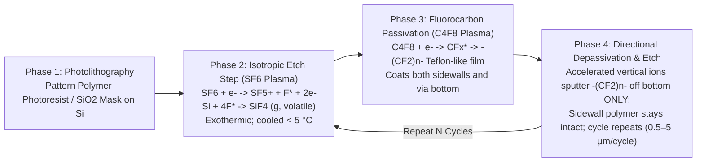

1. **Plasma Dissociation & Exothermic Silicon Etching ($\text{SF}_6$ Phase)**:
   $$\text{SF}_6 + e^- \longrightarrow \text{SF}_5^+ + \text{F}^* + 2e^-$$
   $$\text{Si (s)} + 4\text{F}^* \longrightarrow \text{SiF}_4\text{ (g)} \uparrow \quad (\Delta H < 0,\text{ strongly exothermic } \implies T_{\text{wafer}} < 5\text{ }^\circ\text{C})$$
2. **Fluorocarbon Polymer Deposition ($\text{C}_4\text{F}_8$ Passivation Phase)**:
   $$\text{C}_4\text{F}_8\text{ (Octafluorocyclobutane)} + e^- \longrightarrow n\text{CF}_2^* \longrightarrow -\left[\text{CF}_2-\text{CF}_2\right]_n-\text{ (PTFE-like sidewall film)}$$
3. **Directional Bottom Depassivation, Scallop Formation & Mitigation**:
   * During the subsequent $\text{SF}_6$ cycle, vertically accelerated positive ions ($\text{SF}_x^+$) bombard the horizontal via floor head-on, sputtering away the bottom $-\text{CF}_2-$ film while leaving the vertical sidewall polymer largely intact.
   * However, partial lateral ion scattering erodes polymer near the bottom corners, and neutral $\text{F}^*$ radicals undercut the newly exposed silicon isotropically during each cycle, creating periodic **scallops** (Fig. 3.7a,c).
   * **Depth-Dependent Ion Attenuation**: As via depth increases, plasma ion velocity at the floor drops; consequently, **accelerating bias voltage must be ramped up progressively with depth** [34].
   * **Five Proven Engineering Methods to Minimize Scallop Roughness**:
     1. **Shorter Etch/Passivation Cycle Times**: Decreases vertical bite per cycle ($<0.5\text{ }\mu\text{m}$), shrinking scallop peak-to-trough depth below **$<50\text{ nm}$** (at the expense of net etch rate) [21].
     2. **High RF Power-to-Pressure Ratio**: Increases ion directionality and suppresses lateral undercutting [36].
     3. **Post-DRIE Wet Smoothing Etch ($\text{KOH} + \text{Isopropyl Alcohol [IPA]}$)**: Polishing wet etch after Bosch DRIE reduces sidewall roughness from $\sim 50\text{ nm}$ down to **$6\text{ nm}$** [37].
     4. **Multiplexed $\text{O}_2$ or $\text{O}_2/\text{Ar}$ Plasma Intermediate Steps / $\text{SF}_6\text{–HBr–O}_2$ Chemistry**: Modifies sidewall passivation stoichiometry to yield smooth, tapered profiles (Fig. 3.7b) [35, 38, 39].
     5. **Hybrid Two-Stage Etch**: Executing a single-step continuous anisotropic etch for the upper mouth of the via (where Bosch scallops are largest) followed by cyclic Bosch multiplexing at greater depth [21].

---

### 3.3 Sequential Conformal Via Filling: Liner, Barrier, Seed, and Bottom-Up Cu ECD

#### 3.3.1 Overview of TSV Layer Stack Materials & Processes (Table 3.1 Synthesis)

| TSV Functional Layer | Candidate Materials | Primary Deposition Methods | Typical Thickness | Key Physical Role & Trade-Offs |
| :--- | :--- | :--- | :--- | :--- |
| **1. Dielectric Isolation Liner** | $\text{SiO}_2, \text{Si}_3\text{N}_4, \text{SiO}_x\text{N}_y$, TEOS oxide | Thermal Oxidation, **PECVD**, SACVD, ALD | **$50\text{--}200\text{ nm}$** | Electrically insulates TSV from Si substrate; sets TSV parasitic capacitance $C_{\text{TSV}}$ and breakdown voltage $V_{\text{bd}}$. Must respect thermal budget ($<450\text{ }^\circ\text{C}$ in MEOL, $<200\text{ }^\circ\text{C}$ in Via-Last). |
| **1b. Polymeric Stress-Buffer Liner** | Parylene (poly-p-xylene), Epoxy (8023-10), Polyimide, BCB | Vapor deposition (Parylene) or **Spin-on into concentric etched annular trench** + cure, followed by core Si etch (Fig. 3.8) | **$1\text{--}5\text{ }\mu\text{m}$** | Low-$T$ processing; low Young's modulus acts as a **compliant mechanical buffer** absorbing $\text{Cu–Si}$ differential thermal strain during cycling [40, 41]. |
| **2. Diffusion Barrier & Adhesion Layer** | **$\text{Ta}, \text{TaN}, \text{TaN/Ta}$ bilayer** (for Cu); **$\text{Ti}, \text{TiN}$** (for W/Cu); $\text{TiW}, \text{Re}, \text{Mn}_4\text{N}$; $\text{NiB}$ | Ionized **PVD (iPVD)**, **MOCVD / CVD**, **ALD**, Electroless Deposition (ELD for $\text{NiB}$) | **$10\text{--}50\text{ nm}$** (tens of nm) | Blocks rapid $\text{Cu}^+$ diffusion into $\text{SiO}_2/\text{Si}$ and promotes adhesion. **ALD** provides the most conformal, pinhole-free step coverage at minimum thickness. $\text{TaN/Ta}$ combines barrier ($\text{TaN}$) + Cu wettability ($\text{Ta}$). |
| **3. Conductive Seed Layer** | **$\text{Cu}$** (or direct plating on conducting $\text{Ru}/\text{Re}$ barrier) | **PVD** + **Electrochemical Seed-Layer Enhancement (SLE)**, MOCVD, ALD, Electroless | **$10\text{--}40\text{ nm}$** | Provides low-resistance cathode path for ECD. Poor PVD step coverage near high-AR via bottoms causes discontinuities $\rightarrow$ **bottom voiding**. **SLE** alkaline/complexed wet plating repairs PVD gaps on exposed barrier without corroding thin PVD Cu (Fig. 3.9) [46]. Controls final Cu grain texture [47]. |
| **4. Conductive Core Filler** | **$\text{Cu}$** (mainstream), **$\text{W}$**, **Doped Poly-Si**, Solder alloys (LMF/IMS), Conductive Polymer/Ag paste, **CNTs** | **Bottom-Up Acidic ECD** ($\text{Cu}$), **CVD** ($\text{W}$), **LPCVD** (Poly-Si), Paste printing | Fills $1\text{--}50\text{ }\mu\text{m}$ core diameter | **Cu**: highest $\sigma_{\text{el}}$, high CTE mismatch ($\alpha \approx 16.5\text{ ppm/K}$). **W**: lower $\sigma_{\text{el}}$, closer CTE ($\alpha \approx 4.5\text{ ppm/K}$), great CVD fill in narrow vias. **Poly-Si**: FEOL compatible, zero CTE mismatch, high resistance. |

---

#### 3.3.2 Electrochemistry of Superconformal Bottom-Up Cu Electrodeposition (ECD)
Isotropic (conformal) electroplating inside a high-aspect-ratio TSV pinches off the top via mouth prematurely, trapping electrolyte and creating a catastrophic **center seam or keyhole void**. Void-free **"bottom-up" (superconformal) superfilling** (Fig. 3.10a) is achieved using an acidic copper sulfate electrolyte bath enhanced with a **three-component organic additive system** + halide promoter [49, 50, 52]:

* **Base Inorganic Electrolyte**: $0.88\text{--}1.0\text{ M }\text{CuSO}_4$ (copper ion source) + $0.50\text{--}0.54\text{ M }\text{H}_2\text{SO}_4$ (high ionic conductivity) + $60\text{ ppm }\text{Cl}^-$ ($\sim 0.001\text{ M }\text{NaCl}$, bridging co-adsorbate).
* **Cathodic Reduction Reaction**:
  $$\text{Cu}^{2+}\text{ (aq)} + 2e^- \xrightarrow{\text{Seed Cathode}} \text{Cu}^0\text{ (s)}$$

##### Synergistic Mechanism of the Three Organic Additives
```
        Via Mouth (High Mass Transport)                     Via Bottom (Diffusion-Limited)
   =========================================           =========================================
   [Leveler: JGB+] + [Suppressor: PEG-Cl-]             [Accelerator: SPS / MPS (-SO3- & Thiol)]
   Strongly adsorbs at top corners/field;              Displaces bulky PEG at via floor; as bottom
   passivates Cu2+ reduction (J_top << J_bot)          surface area shrinks, SPS concentrates!
   =========================================           =========================================

      t = t1 (Initiation)              t = t2 (Bottom-Up Rise)            t = t3 (Complete Fill + Overburden)
      |  |           |  |              |  |           |  |                ===================  <-- Overburden
      |  | PEG-Cl-   |  |              |  |           |  |                | |             | |
      |  | inhibits  |  |              |  |  SPS      |  |                | |  Void-Free  | |
      |  | sidewalls |  |              |  |  crowding |  |                | |  Cu Core    | |
      |  |  \     /  |  |              |  +-----------+  |                | |             | |
      |  |   \___/   |  |              |  |XXXXXXXXXXX|  |                | |             | |
      |  +-----------+  |              |  |XXXXXXXXXXX|  |                | |             | |
      |  |SPS bottom |  |              |  |XXXXXXXXXXX|  |                | |             | |
      +-----------------+              +-----------------+                +-----------------+
```

| Additive Class | Representative Molecules | Diffusivity & Molecular Weight | Electrochemical Role in Bottom-Up Superfilling |
| :--- | :--- | :--- | :--- |
| **1. Suppressor** (Carrier / Inhibitor) | **Polyethylene Glycol (PEG)**, Poloxamine (Tetronic 701), Polypropylene Glycol (PPG) | High MW ($\sim 2000\text{--}10000\text{ g/mol}$), **Low Diffusivity** | Forms a monolayer barrier complex with adsorbed chloride ions ($\text{Cu}^+\text{–Cl}^-\text{–PEG}$) across the top field and upper sidewalls, **polarizing the cathode and strongly inhibiting $\text{Cu}^{2+}$ reduction**. Because of its large molecular size and slow diffusion, PEG is depleted near the deep via floor. |
| **2. Accelerator** (Brightener / Catalyst) | **SPS** (bis-(3-sulfopropyl) disulfide), **MPS** (3-mercapto-1-propanesulfonate), **TBPS** | Low MW ($\sim 150\text{--}350\text{ g/mol}$), **High Diffusivity** | Diffuses into the via bottom and adsorbs strongly via thiol/disulfide ($\text{–SH / –S–S–}$) groups, **displacing the $\text{PEG–Cl}^-$ suppressor** and locally depolarizing/accelerating $\text{Cu}^{2+}$ reduction. **Curvature-Enhanced Accelerator Coverage (CEAC)**: As the concave bottom fill front rises and its surface area shrinks, adsorbed SPS molecules remain surface-bound and crowd together, creating a positive-feedback surge in bottom plating current density ($J_{\text{bottom}} \gg J_{\text{sidewall}}$) [52]. |
| **3. Leveler** | **Janus Green B (JGB)**, Diazine Black, Alcian Blue (quaternary amine dyes) | Intermediate MW, **Convection/Diffusion Controlled** | Positively charged nitrogen-bearing dye molecules migrate preferentially to high-current-density protrusions and the **upper via mouth corners** where mass-transport boundary layers are thinnest, **preventing premature pinch-off at the via opening** and reducing overburden surface roughness [50]. |

* **Defect Mechanisms When Additive Balance Fails**:
  * *Pinch-Off / Keyhole Void*: Insufficient suppressor/leveler at the via mouth or excessive total current density causes upper sidewall closure before bottom-up fill completes.
  * *Bottom Voiding*: Discontinuous PVD Cu seed layer near the via base (unrepaired by SLE) or trapped gas bubbles prevent nucleation at the floor.
  * *Center Seam*: Conformal sidewall growth meeting at the central axis without bottom-up CEAC dominance.

---

### 3.4 Post-Plating Thermal Annealing, CMP Planarization & Backside TSV Reveal

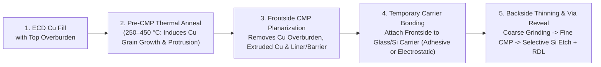

1. **Overburden & Pre-CMP Thermal Annealing (Preventing Cu Pumping, Sect. 3.3.3)**:
   * Electroplating intentionally leaves an excess **Cu overburden** layer atop the wafer surface (Fig. 3.11a) to prevent via-mouth recession/shrinkage voids.
   * Because $\alpha_{\text{Cu}} \approx 16.5\text{ ppm/}^\circ\text{C} \gg \alpha_{\text{Si}} \approx 2.6\text{ ppm/}^\circ\text{C}$, subsequent high-temperature steps ($250\text{--}450\text{ }^\circ\text{C}$ during BEOL dielectric deposition, RDL curing, or TCB soldering) cause axial plastic extrusion of the copper out of the via—known as **Cu Pumping (Via Protrusion)**—which fractures overlying BEOL dielectric/metal layers [54, 57, 58].
   * **Engineering Solution**: Immediately *after* ECD filling and *before* CMP, the wafer is subjected to a **pre-CMP stabilization anneal** at a temperature slightly *higher* than any subsequent process step ($\sim 400\text{--}450\text{ }^\circ\text{C}$). This intentionally drives irreversible grain growth, stress relaxation, and plastic Cu extrusion into the sacrificial overburden, which is then polished flat during **Chemical-Mechanical Planarization (CMP)** (Fig. 3.11b), stabilizing the microstructure against future Cu pumping during service [58, 59].
2. **Temporary Wafer Bonding & Backside Thinning / Via Reveal (Fig. 3.11c & Sect. 3.4.2)**:
   * To thin a $750\text{ }\mu\text{m}$ wafer down to $<50\text{--}100\text{ }\mu\text{m}$ without wafer breakage or extreme warpage, the active frontside is temporarily mounted onto a rigid **Silicon or CTE-matched Glass Carrier Wafer** using either:
     * *Curable Polymeric Adhesives / Epoxies* (require $<200\text{ }^\circ\text{C}$ downstream thermal budget), or
     * *Electrostatic Bonding* (capable of $>300\text{ }^\circ\text{C}$ processing, but requires $<10\text{ nm}$ surface roughness and CTE-matched borosilicate glass).
   * Backside thinning is executed from the inactive side via coarse mechanical back-grinding followed by stress-relief CMP ($<1\text{ }\mu\text{m}$ surface finish) and selective wet/dry silicon recess etching to **reveal the TSV tips** without simultaneously smearing ductile Cu across brittle Si (which would cause electrical shorts and Si micro-cracks).
   * Finally, a backside dielectric passivation layer, **Redistribution Layer (RDL)** (Cu traces in polyimide or BCB dielectric, Fig. 3.13d, which relaxes pad-alignment tolerances and lowers high-frequency insertion loss [60]), and solder micro-bumps are fabricated prior to carrier debonding and 3D die integration (F2F, B2B, or F2B).

---

### Chapter 3 — Complete Unabridged Textbook Text, Figures (17) & Tables (1) [pp. 49–77]

Praveen Kumar, Indranath Dutta, Zhiheng Huang, and Paul Conway


### 3.1 Introduction

With the evolution of electronics towards increasingly energy-efficient, mobile and higher performance platforms, the requirements for packages with smaller formfactor, lighter weight and lower power, along with higher bandwidth and memory capacity, has been accelerating. This has led to increasing use of 3-dimensional (3-D) packaging of microelectronic devices, which can result in substantial reduction of energy consumption per bit of information processed, due to a dramatic reduction of package parasitics. Of the different types of stacked-die packages, area-array dies interconnected with through-silicon vias (TSVs) has emerged as probably the best 3D-package architecture. In a typical 3-D package, multiple chips, each performing a well-defined and independent task, are stacked in a vertical column. The vertically stacked chips are then connected through solder micro-bumps, and communicate with each other through metal-filled through-silicon vias, which are fabricated in the

P. Kumar Department of Materials Engineering, Indian Institute of Science, Bangalore 560012, India e-mail: praveenk@materials.iisc.ernet.in

I. Dutta (B) School of Mechanical and Materials Engineering, Washington State University, Pullma, WA 99164, USA e-mail: idutta@wsu.edu

Z. Huang School of Materials Science and Engineering, Sun Yat-sen University, 135 West Xingang Road, Guangzhou 510275, China e-mail: hzh29@mail.sysu.edu.cn

P. Conway Electrical and Manufacturing Engineering, The Wolfson School of Mechanical, Loughborough University, Loughborough, Leicestershire LE11 3TU, UK e-mail: p.p.conway@lboro.ac.uk

thinned silicon dies. This circumvents the need for horizontal integration and reduces communication bus-lengths, thereby improving performance while simultaneously reducing the energy footprint of the package. In this chapter, we focus on the materials and critical steps associated with fabricating TSVs and the flow process to fabricate TSV-enabled 3-D integration of silicon dies. In the following chapter, we will introduce the microstructural and reliability issues of TSVs.


### 3.2 Overview of TSV Materials and Processes

A TSV is composed of a conductor, passing through the Si substrate of the stacked dies. The conductor is electrically insulated from the substrate by a dielectric layer, i.e., the TSV liner, and interconnects the metal wires of the stacked dies. The TSV liner also determines the TSV parasitic capacitance. In order to avoid diffusion of metal from the TSV into the Si substrate, a barrier layer is used between the liner and the TSV metal [1, 2]. The geometry of the TSV conductor may vary depending on the 3-D stacking technology. The area crossed by current may have different shapes, e.g. square, rectangular, circular, elliptical and polygonal [3, 4]. In addition, the lateral surface of the conductor can be cylindrical or conical [2]. The 3-D interconnection technology based on TSVs basically consists of three main process modules: (1) The TSV module itself, (2) wafer thinning and backside processing, and (3) the die or wafer stacking process (permanent bonding and/or temporary bonding) [1]. The sequence of these process modules may vary and different process flows may be characterized by the following four key differentiating characteristics [1]:

1. The order of the TSV process with respect to the device wafer fabrication process. So we have Via-first, Via-middle and Via-last processes, c.f. Sect. 3.4.1. 2. The order of the TSV processing and 3D bonding. 3. The order of wafer thinning and 3D bonding. 4. The method of 3D bonding. We have Wafer-to-wafer (W2W) bonding, Die-towafer (D2W) bonding, and Die-to-die (D2D) bonding.

In addition to these four main characteristics, three secondary characteristics are identified [1]:

1. Face-to-face (F2F) or back-to-face (B2F) bonding (the face or top surface of the wafer being the side with the active devices and back-end interconnect layers), c.f. Sect. 3.4.2.

2. In case of a Via-last approach, the TSV may be realised starting from the wafer frontside or from the wafer backside. Starting from the frontside of the wafer requires etching through the back end of line (BEOL) stack. 3. Removal of the carrier-wafer before or after bonding (i.e., temporary bonding and permanent bonding).


> **Table 3.1 provides an overview of the TSV materials and associated processes.**

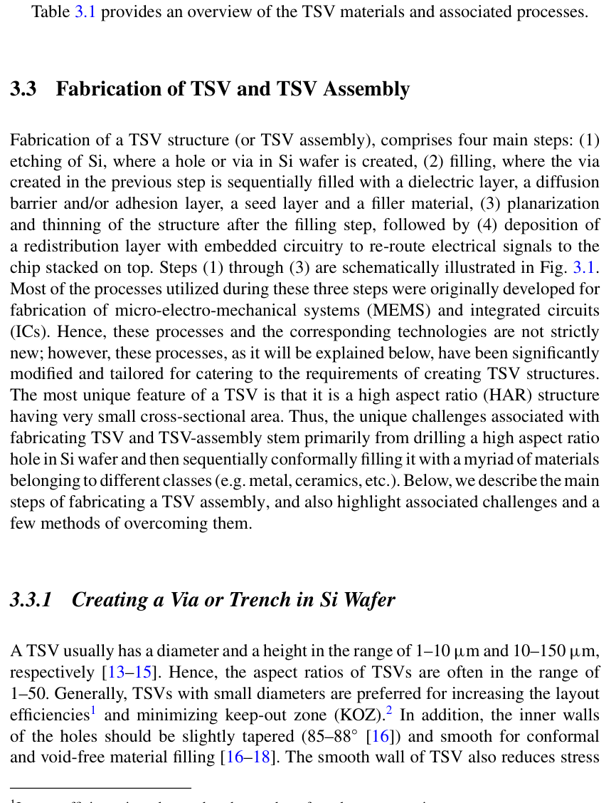


### 3.3 Fabrication of TSV and TSV Assembly

Fabrication of a TSV structure (or TSV assembly), comprises four main steps: (1) etching of Si, where a hole or via in Si wafer is created, (2) filling, where the via created in the previous step is sequentially filled with a dielectric layer, a diffusion barrier and/or adhesion layer, a seed layer and a filler material, (3) planarization and thinning of the structure after the filling step, followed by (4) deposition of a redistribution layer with embedded circuitry to re-route electrical signals to the chip stacked on top. Steps (1) through (3) are schematically illustrated in Fig. 3.1. Most of the processes utilized during these three steps were originally developed for fabrication of micro-electro-mechanical systems (MEMS) and integrated circuits (ICs). Hence, these processes and the corresponding technologies are not strictly new; however, these processes, as it will be explained below, have been significantly modified and tailored for catering to the requirements of creating TSV structures. The most unique feature of a TSV is that it is a high aspect ratio (HAR) structure having very small cross-sectional area. Thus, the unique challenges associated with fabricating TSV and TSV-assembly stem primarily from drilling a high aspect ratio hole in Si wafer and then sequentially conformally filling it with a myriad of materials belongingtodifferentclasses(e.g.metal,ceramics,etc.).Below,wedescribethemain steps of fabricating a TSV assembly, and also highlight associated challenges and a few methods of overcoming them.


#### 3.3.1 Creating a Via or Trench in Si Wafer

A TSV usually has a diameter and a height in the range of 1–10 µm and 10–150 µm, respectively [13–15]. Hence, the aspect ratios of TSVs are often in the range of 1–50. Generally, TSVs with small diameters are preferred for increasing the layout efficiencies1 and minimizing keep-out zone (KOZ).2 In addition, the inner walls of the holes should be slightly tapered (85–88◦[16]) and smooth for conformal and void-free material filling [16–18]. The smooth wall of TSV also reduces stress

1Layout efficiency is understood as the number of conductors per unit area. 2KOZ is the region where functional properties of Si are significantly affected by the stress field of the TSV.


> **Table 3.1 An overview of TSVa**

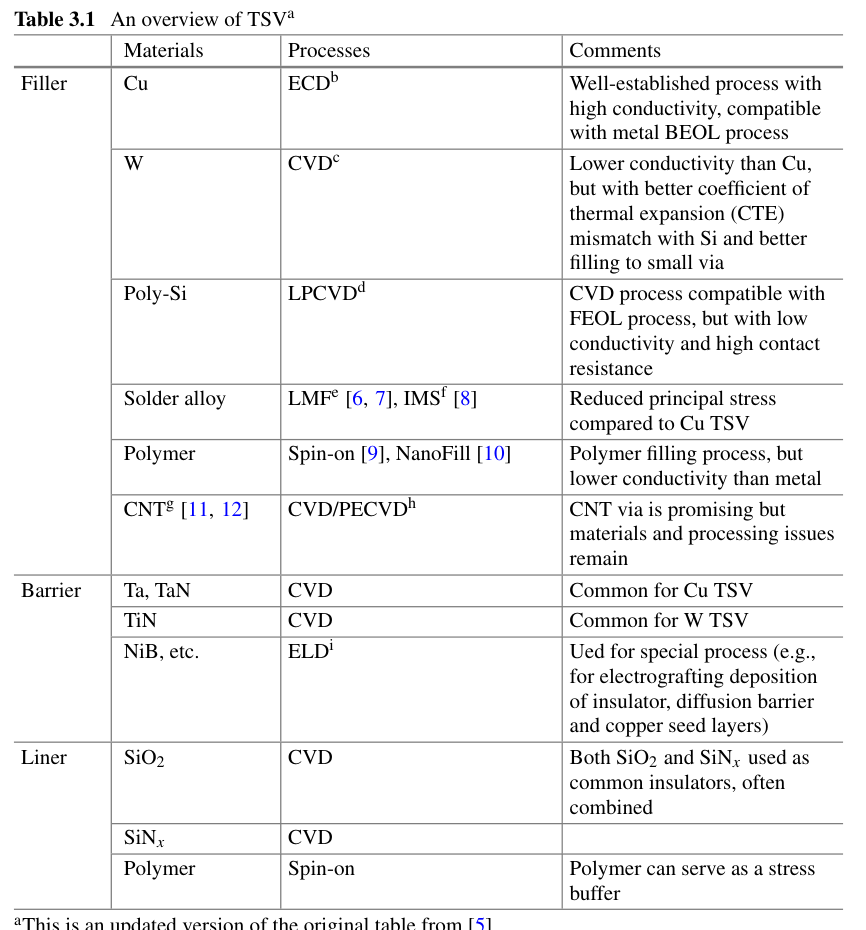

Filler Cu ECDb Well-established process with high conductivity, compatible with metal BEOL process W CVDc Lower conductivity than Cu, but with better coefficient of thermal expansion (CTE) mismatch with Si and better filling to small via Poly-Si LPCVDd CVD process compatible with FEOL process, but with low conductivity and high contact resistance Solder alloy LMFe [6, 7], IMSf [8] Reduced principal stress compared to Cu TSV Polymer Spin-on [9], NanoFill [10] Polymer filling process, but lower conductivity than metal CNTg [11, 12] CVD/PECVDh CNT via is promising but materials and processing issues remain Barrier Ta, TaN CVD Common for Cu TSV TiN CVD Common for W TSV NiB, etc. ELDi Ued for special process (e.g., for electrografting deposition of insulator, diffusion barrier and copper seed layers) Liner SiO2 CVD Both SiO2 and SiNx used as common insulators, often combined SiNx CVD Polymer Spin-on Polymer can serve as a stress buffer

aThis is an updated version of the original table from [5] b Electrochemical deposition cChemical vapor deposition dLow-pressure CVD eLiquid metal filling fInjection molded soldering gCarbon nanotube hPlasma-enhanced CVD iElectroless deposition


> **Fig. 3.1 Schematic illustration of (a) a TSV assembly or TSV structure comprising of TSV, dielec- tric layer, barrier layer, seed layer and the filler, and (b) three major steps required for fabricating a TSV assembly**

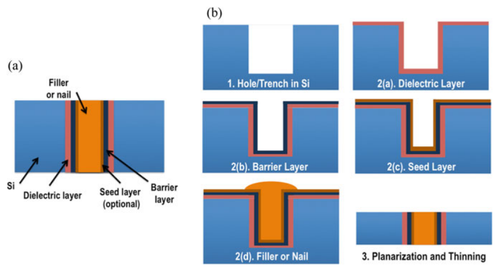

concentrations; this is particularly useful as the TSV assembly usually has high residual stresses and it is often exposed to large thermal stresses during fabrication of transistors, etc., as well as during service [19, 20]. Therefore, fabrication of TSV requires drilling small sized, slightly tapered, smooth holes of high aspect ratios in Si wafer. For this purpose, laser drilling, powder blast micromachining, anisotropic wet etching and plasma etch have been explored. However, as explained below, the plasma-etching based Bosch-process type deep reactive ion etching (DRIE) method is the most widely-used commercial method for creating holes or trenches in Si for fabricating TSVs [21].

Laser drilling for fabricating TSVs is a process, where a hole or trench in Si is created by focusing a high-powered laser beam at a desired location on a Si wafer. Due to the excessive heating, Si below the laser beam melts and vaporizes, thus creating a vertical trench with small diameter [22]. The typical diameter of the laser beam used in this process is 10–20 µm [22, 23]. To confine the spread of the heat-affected zone and remove the machined debris, a jet of coolant (e.g. deionized water) may also be splashed onto Si wafer near the laser spot. As shown in Fig. 3.2, this process has been successfully employed to drill blind holes of high aspect ratios and having diameters in range of 10–80 µm in Si [24]. As multiple laser beams can be simultaneously used, this process can be used to simultaneously drill multiple holes (see Fig. 3.2b) and hence may also have very high throughput (>2000 holes/s [23]).


> **Fig. 3.2 A few example of blind holes drilled by laser: (a) scanning electron micrograph of the top and the profile view of a blind hole in Si having a diameter of ∼8 µm [25], and (b) a regular array of holes in Si of ∼10 µm diameter and ∼70 µm depth [22]. Note The tapered nature of drilled holes**


Nevertheless, this process involves heating, although locally but excessively, of Si wafer that can damage Si wafer near the hole. This is particularly a problem if the Si wafer is single crystalline, as such heating may generate defects and also, induce polycrystallization, thus leading to a deterioration of functional properties of Si wafer [23]. In addition, excessive heating may also affect front-end and back-end structures, if they are already fabricated on the wafer. A laser pulse of very short durations (i.e., ultra-fast lasers) may be used to minimize the extent of heat affected zone and residual stresses (or strains) in Si [23]. Due to this inherent existence of heataffected zone, this process has so far found only limited application in creating TSVs.

Powder blast micromachining (PBM) or abrasive jet machining (AJM) is a drilling method that works on the mechanical removal of material from precise locations. In this process, very fine hard powders are bombarded through high-pressure air nozzle onthebrittleSiwafer.Asthehardpowdersmovingatveryhighspeed(∼100m/s[26]) collide with Si, it abrasively removes bulk Si, thus creating a trench or hole in Si [26].


> **Fig. 3.3 (a) A schematic representation of the setup for powder blast micromachining. (b) A few examples of blind holes of different diameters created in Si wafer using high-resolution powder blast micromachining [27]. The mask used in (b) was SU-8**

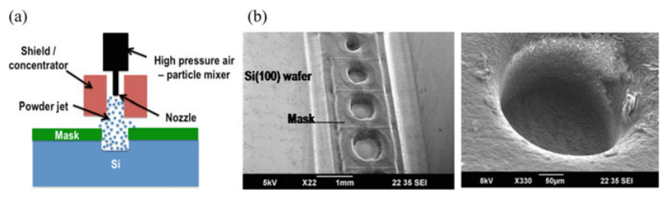

Al2O3 powders of sizes in the range of 10–20 µm can be used for creating trenches in Si wafer [26, 27]. In this process, a mask of a ductile material, such as electroplated Cu, polymer photoresists, etc., can be placed on top of Si wafer to protect the region from getting abrasively removed. Usage of such a mask decreases the aspect ratio of the trench [27]. As shown in Fig. 3.3, PBM has been successfully used to drill holes in Si. However, this process has not been able to drill holes of very high aspect ratios (usually aspect ratio is less than 5 [26]). Furthermore, this process imposes large mechanical stresses on Si wafers, resulting in significant residual stresses, chipping of the corners, generation of defects and polycrystallization. Therefore, this process is still not popular for producing TSVs.

A widely used method for fabricating trenches in Si wafer is anisotropic wet etching of Si using hydroxides, e.g., KOH, NaOH, CeOH, RbOH, NH4OH, (CH3)4NOH (i.e., tetra methyl ammonium hydroxide or TMAH), etc. Reaction of hydroxides with Si produces a water soluble Si-oxide complex (i.e., SiO2(OH)−2 2 , which is then flushed out, leaving a trench in Si. Since KOH etches the {110} family of planes almost 600 times faster than {111} planes, proper masking and exposing Si wafers of appropriate orientations to KOH can lead to anisotropic etching along one direction, resulting in high aspect ratio trenches (see Fig. 3.4a). Furthermore, since the kinetics of oxidation of {110}-planes is significantly slower as compared to {111}-planes, addition of an oxidizing agent in KOH may further suppress etching rate of {111}-planes as compared to {110}-planes [21]. This may further enhance the anisotropic etching, resulting in holes with an aspect ratio as high as 600 [28]. Similarly, ethylene diamine pyrocatechol (EDP) and TMAH etch 100-planes ∼30 times faster than {111}-planes, and can, thus also be used to etch holes in {100}-oriented single crystals of Si [29]. In the context of wet chemical etching, amine gallate can also be used to anisotropically etch {100}-planes as compared to {111}-planes—the latter planes are etched at rates that are 50–100 times slower than {100}-planes. As shown in Fig. 3.4b, anisotropic wet etching of Si can be used to fabricate high aspect ratio TSVs. Although this


> **Fig. 3.4 (a) Schematic illustration of the workings of anisotropic wet etching of Si wafer. (b) A trench prepared in (100)-oriented Si wafer using etching with 9 M KOH at 60–65 ◦C [30]. In (b), a hard mask of SiO2 on top of Si wafer was used**

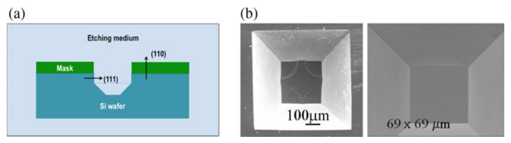

process is easy to use and can produce structures with very high aspect ratios, this is limited mostly to produce rectangular grooves and is not popularly used for creating TSV structures with vertical walls [21].

The most common method for creating holes or trenches in Si for fabricating TSVs with almost vertical walls is based on anisotropic etching of Si using fast moving and colliding plasma; this method is termed as ’deep reactive ion etching’ or DRIE [21]. There are two main DRIE processes suitable for etching vertical holes in Si: (1) cryogenic DRIE and (2) Bosch process. In cryogenic plasma etching, the Si wafer is cooled to a very low temperature, often below −110 ◦C, using liquid nitrogen or liquid helium cells [21] and then unidirectionally bombarded with etchant plasma. Due to the low temperatures, the chemical etching of Si due to the reactive ions (which may be isotropic) is reduced dramatically and the Si wafer is primarily etched mechanically at a particular location in the vertical direction due to the bombardment of the highly energetic plasma [21]. Thus, as shown in Fig. 3.5, cryogenic DRIE produces holes or trenches of very high aspect ratios with almost vertical walls [30]. The major issues with the cryogenic process are (1) the need of a hard mask which does not etch away under plasma-bombardment and (2) cracking of Si, especially near the corners, due to the extremely low temperature [21]. Due to these reasons, this process is not widely used commercially. The Bosch process, which is another DRIE process used for etching high aspect ratio holes or trenches in Si, falls in the general category of time-multiplexed alternating process [21]. As the name suggests, in a time-multiplexed alternation process, multiple processes occur in a synchronous fashion. For example, in the Bosch process, etching and passivation processes are performed separately in a synchronous fashion, where etching is followed by passivation, and vice versa [32, 33]. Such an alternating, synchronous process becomes effective in making very deep trenches or holes in Si, as it is often very difficult to achieve anisotropic etching from sheer bombardment of the plasma. The passivation layer is applied especially on the sidewalls

of the hole, so that the diameter of the hole does not increase as the depth of the hole is increased. With the help of schematic shown in Fig. 3.6, we describe different steps of this process below:

1. The top layer of the Si wafer is patterned using standard photolithography (see Fig. 3.6a). The plasma assisted etching process, as described in (b), does not etch the polymeric photo-resist coated over the Si wafer. A SiO2 layer may or may not be grown on top of Si wafer. 2. The Si wafer is etched by highly energetic plasma of a suitable gas, e.g., SF6, CF4, NF3, Cl2, etc. (see Fig. 3.6b) [21]. The gas creates a plasma consisting of electrons and neutral species as well as positively charged species. The positively charged species, which accelerate under an applied electric field, impinge on the Si surface normal to its motion path at high speed, removes any passivation layer or debris from there, and then reacts with Si [21]. Interestingly, due to the high momentum of the plasma, it also removes the formed chemical compound from the end of the hole in Si. The most common etching gas (and also the gas originally suggested in the Bosch process) is sulfur hexafluoride, SF6 [32]. The following chemical reaction occurs between SF6 and Si:

Since all reaction products in above equations are gaseous, i.e., volatile, Si atoms are gradually removed from the wafer as the above process continues. The above reactions are highly exothermic and hence Bosch process is often performed at low temperatures (<5 ◦C). In addition, a good and uniform etch rate is achieved if the temperature is uniformly maintained. 3. Following the above etching process, another gas, for example C4F8, C4F6, etc., is passed over Si for depositing a thin layer of passivation polymer layer on the walls


> **Fig. 3.5 A high aspect ratio blind hole etched in Si wafer by cryogenic plasma etching process [31]**

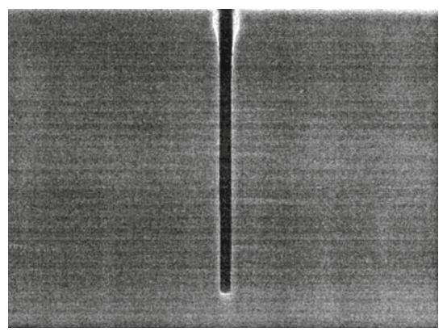


> **Fig. 3.6 Schematic illustration of different stages of Bosch process for etching holes or trenches in Si: (a) placement of a polymer mask on Si surface, (b) flow of etchant plasma on exposed surface of Si and subsequent etching of Si, (c) flowing passivation gases and subsequent formation of passivation layer on walls of Si, and (d) erosion of polymer layer from the bottom of the Si hole (depassivation) and subsequent further etching of Si at the bottom of the hole**


and the bottom of the hole (see Fig. 3.6c) [33]. The most common passivation gas is octa-fluoro-cyclo-butane, C4F8, which breaks down and produces the repeating unit -[CF2]- of a Teflon type polymer in presence of the plasma created in the etching process. The polymer then gets deposited on the walls of Si hole [21]. 4. In the next sequence of etching (i.e., step 1), the fast moving plasma impinges on the bottom of the hole and abrasively erodes the polymer layer from there; this step is called depassivation (see Fig. 3.6d). This exposes Si at the bottom of the hole to the etchant and hence the depth of the hole further increases. On the other hand, the passivation of the vertical sidewalls remains intact (as they are parallel to the flow of plasma and do not collide head-on with plasma) and hence the Si walls remain protected from the etchants. However, the plasma removes some polymer layer from sidewalls also, especially near the bottom of the hole. This leads to sideways etching or undercutting of the Si walls, leading to a scallopy structure (see Fig. 3.7). Minimization of the scallopy features or surface roughness is a challenge in Bosch process, giving rise to several innovative technologies, as will be explained below.


> **Fig. 3.7 A few representative Si blind holes prepared by Bosch process using: (a) SF6/C4F8 [17] and (b) SF6/HBr/O2 [35] gas chemistries. The inset in (a) shows a magnified view of the wall of the hole, clearly revealing formation of scallops. A higher magnification image of the rough, scallopy structure of the sidewall is shown in (c)**


Using the Bosch process, holes in Si of various diameters and aspect ratios have been successfully prepared (see Fig. 3.7 for a few examples). It should be noted that the polymer removal rate from the bottom reduces with the increase in depth of the hole (as the velocity of the plasma is reduced). Hence, a strategy of gradually increasing accelerating voltage with the depth of the Si hole is often used for attaining very high aspect ratio holes [34]. It is also important to know that a one-step etchingpassivation process can also be used in Bosch process. However, the etch-rate in the one-step process is very low as compared to the two-step cyclic Bosch process, and hence the latter is more widely used. In the cyclic Bosch process, the two steps of etching and passivation may last for a few seconds each. In a cyclic etch-passivation step, the depth of the Si-hole may increase by 0.5–5 µm. The original Bosch process involving the SF6/C4F8 sequence results in an etch rate of 10 µm/min, which can be further improved by manipulating the gas chemistry [21]. A cycle with longer time increases the etching rate, but also increases the roughness of the Si sidewall [21]. As mentioned above and shown in Fig. 3.7a, the Si holes produced by the Bosch process are generally very scallopy. It has been reported that power to pressure ratio is an important process parameter affecting the surface roughness, where a higher ratio produces smoother walls [36]. When the Bosch process is well controlled, the

maximum distance between the hill and trough is less than 50 nm. Furthermore, it has been reported that adding postetch wet-etching process using KOH and isopropyl alcohol can reduce the surface roughness to 6 nm [37]. It has also been reported that adding new steps in the above time multiplex alternate process by including flow of either oxygen plasma or oxygen and argon plasmas [38, 39] can also reduce the surface roughness as well as increase the overall depth of the Si holes. Another strategy for reducing surface roughness is to perform a single step anisotropic etching at the beginning of the etching process, followed by the usual time multiplexing alternating method [21]. This method stems from the observation that the roughness of Si walls created by the Bosch process deceases with an increase in the depth of the hole [21].


#### 3.3.2 Sequential Filling of Si Via

Once a blind hole is etched in Si, it is conformally filled with different classes of materials. Of all of the material filling processes, the two most critical criteria are: (1) step coverage and (2) void-free filling. For ensuring step coverage, it is desired to have some taper in the Si via [16, 17]. Often a taper of 2◦–5◦(i.e., TSV-sidewall inclination of 85◦–88◦relative to the Si-surface) is optimum for conformal coating [16]. Below, with help of Fig. 3.1b, we describe the filling processes in detail:

1. Dielectric Layer: A thin layer of low-dielectric, i.e., a dielectric with high breakdown voltage, is placed over the walls of the Si hole to establish electrical isolation between the current-carrying TSV-filler and the rest of the die. The most common dielectric materials are SiO2, silicon nitrides, silicon oxynitride, tetra-ethyl orthosilicate (TEOS), etc. Most of these dielectrics are deposited by plasma enhanced chemical vapor deposition (PE-CVD) technique, whereas SiO2 can also be grown using dry etching process. It is important to maintain a low thermal budget during this process, especially when the TSVs are prepared after fabricating transistors, etc. Polymers are another class of dielectric materials, which can be coated at low temperatures and are suitable for low power applications. A common polymer dielectric material is parylene or poly(p-xylene) [40]. Another advantage of using a soft and compliant polymer dielectric layer is that during thermal cycling, it can accommodate the differential thermal strains produced between Si and the metal filler (e.g., Cu) during thermal excursions, and hence minimize stresses produced in the TSV assembly [41]. As shown in Fig. 3.8a, one of the ways to coat polymers on Si is by first etching an annular trench concentric to the final via and then filling it by spin-on polymer, followed by curing of the polymer [41]. Following coating of the polymer in the Si annular trench, the solid Si inside the trench is etched, resulting in a blind hole with walls coated with polymers (see Fig. 3.8a). As shown in Fig. 3.8b, this method allows conformal coating of Si walls with the dielectric layer without voids. The thicknesses of oxide-based and polymer-based dielectrics are 50–200 nm and 1–5 µm, respectively [41].


> **Fig. 3.8 (a) Schematic illustration of polymer filling strategy. (b) Scanning electron micrograph of a Cu filled TSV with polymer (Epoxy 8023-10) dielectric layer [41]**

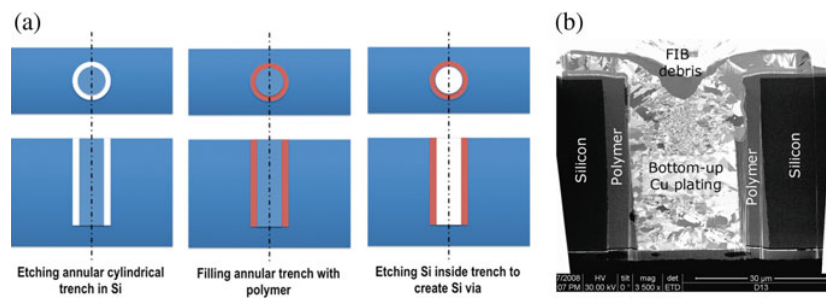

2. BarrierandAdhesionLayers:Followingtheplacementofanappropriatedielectric layer on Si walls, a thin barrier layer is placed on the dielectric layer for inhibiting diffusion of the conducting filler material into the dielectric layer and, eventually, into Si. Selection of the barrier layer is specific to the filler material. For example, Ta, TaN, TaN/Ta bilayer, Re, Ti and TiN may be used as the barrier layer for Cu [42]. An additional adhesion layer may be deposited on the barrier layer for improving attachment of the seed layer on top of the barrier layer [43, 44]. A thin layer of TiW, Ti and Ta may be used as adhesion layer for Cu [44, 45]. It is interesting to note that a few materials, such as TaN, Ti, Mn4N, etc., may act as both the barrier and the adhesion layers [44, 45]. In the particular case of TaN, often a thin layer of Ta is placed on top of it to further improve the adhesion. The barrier layer can be deposited using ionized pressure vapor deposition (PVD), atomic layer deposition (ALD) and chemical vapor deposition (CVD) processes. ALD usually gives the most conformal and continuous coating with minimum thickness of the barrier layer. The usual thickness of the barrier layers is a few tens of nanometers. 3. Seed Layer: Since the resistivity of the barrier layer is very high, it cannot be used directly as a substrate (i.e., the cathode) for electroplating metal filler. Thus, a thin seed layer of the filler metal is deposited on the barrier layer for enabling electroplating of the metal filler. Hence, the seed layer may not be needed if either a paste of conducting material is squeeze-filled into the hole, or a moderately conducting barrier layer (e.g., Re), etc., is used. Often PVD is used for depositing the seed layer of metal filler. However, it is challenging to achieve conformal and continuous coating of uniform thickness of high aspect ratio holes through PVD. This leads to porous filling of material in the hole, resulting in a wellknown phenomenon of bottom voiding [46]. CVD may produce a better conformal coating of the Cu seed layer; however, the adhesion of the Cu CVD layer and the barrier layer remains an issue [46]. Thus, electrochemical seed-layer enhancement (SLE) technologies based on wet coatings may be used for repairing the seed layer by filling the discontinuities in the PVD seed layer [46]. This process is also an


> **Fig. 3.9 Scanning electron micrographs showing the effect of SLE process on seed layer of Cu deposited in trenches with 0.15 µm openings: (a) 15 nm thick seed layer deposited by PVD process, and (b) an additional 40 nm thick layer deposited through SLE process [46]**


electroplating process (which, as will be discussed below, is used to fill the hole by a metallic filler) and hence the same setup as of standard electroplating can be used for this process also. However, SLE uses different bath chemistry so that metal plating can be take place on both seed layer and the barrier layer, without corroding the existing seed layer [46]. Figure 3.9 shows a pair of scanning electron micrographs showing the effect of SLE process on a PVD-grown seed layer. As shown in Fig. 3.9, the usual thickness of seed layers is 10–40 nm. Since the grain size, grain shape and grain orientation of the metal filler depends on the microstructure of the seed layer [47], it is a very critical step and is a subject of constant innovation. 4. Filler: Once the Si hole has been filled with the dielectric layer, barrier layer and seed layer, it is then filled with the conducting filler, which occupies most of the volume of an etched hole. Figure 3.10 shows a few micrographs of a Cu filled TSV, also revealing different layers. The most common method for depositing filler material is electroplating. This is due to the fact that metals, especially Cu, are the most widely used fillers for TSV assemblies. Besides electroplating, squeezing-in a conducting paste (called paste printing) and CVD can also be used to fill the hole [48]. A filling process should result in a void-free and stress-free filler material; however, these two critical requirements are not easily fulfilled. Hence, in practice, the goal becomes their minimization. Cu, W and other metals are electroplated, whereas heavily doped poly-silicon is filled by low pressure CVD [49], and metal-polymer (e.g., Ag/Polypyrrole) composites are often paste printed [48]. One of the common commercial electrolytes for Cu electroplating is an acidic bath comprising 0.88 M CuSO4, 0.54 M H2SO4 and 60 ppm Cl−

(NaCl) [49]. Since most often the strategy for filling the via is bottom-up (i.e., directional and not isotropic), a suppressor, an accelerator and a leveler are also added to the electrolytic bath for efficient via filling [50]. Suppressors interact with


> **Fig. 3.10 Micrographs showing cross-sectional view of Cu filled TSVs: (a) Time lapse images at low magnification showing the fill front during bottom-up electroplating [52], and (b) at high magnification TEM micrograph showing different material layers [53]. Cu electroplating in (a) was performed at an applied potential of 0.600 V using electrolytic bath comprising of 1.0 mol/L CuSO4, 0.5 mol/L H2SO4, 0.001 mol/L NaCl and 10 µ mol/L poloxamine (Tetronic 701) [52]**


chloride ions to inhibit Cu deposition. An accelerator is adsorbed on the electrode surface, where it gradually replaces the suppressor, thus allowing electroplating of Cu to take place. Furthermore, coverage of an accelerator moves upwards, thus enabling Cu filling to take place in a directional fashion from the bottom to the top [50]. Levelers are used to improve filling performance, decrease the surface roughness and prevent Cu deposition at the opening of the via [50]. Most of the suppressors are polymers (e.g., polyethylene glycol (PEG), etc.) whereas common accelerators and levelers for Cu plating are 3-mercapto-1-propanesulfonate (MPS), (3-sulfopropyl) disulfide (SPS), 3,3-thiobis (1-propanesulfonate) (TBPS), etc., and Janus Green B (JGB), Diazine Black, Alcian Blue, etc., respectively [50]. As mentioned above, Cu is the most widely used filler for its very high electrical conductivity and compatibility with the backend structures, although in some applications, W fillers are also used [51]. On the other hand, poly-silicon is compatible with the front-end structures (i.e., transistors) and its thermal expansion coefficient is also similar to that of Si.


#### 3.3.3 Planarization and Die-Thinning

As shown in Figs. 3.1b and 3.11a, after filling the metal in the Si via, there is some excess metal or paste that is leftover on top of the wafer; this feature is called overburden. There is a need for extra filling so that voids inside the filler can be minimized. Also, due to the Cu-pumping phenomenon [54] (which will be discussed in next chapter), Cu metal can protrude relative to the Si. In addition, if the metal is not filled with proper overburden, the filler may shrink inside the Si via, leaving a filler gap near its mouth. Therefore, there is a need for planarization of Si wafer on


> **Fig. 3.11 The sequence of events showing cross-section of a TSV after (a) metal filling [52] (b) planarization of Si wafer on the surface having via mouth or opening (left and right picture shows top and profile views, respectively) (redrawn from [55]), and (c) thinning of Si wafer from the back-side [56]**


the side with the TSV-mouth or opening (i.e., from the side where TSV was created and filled). In addition, the Si wafer may also need to be thinned down to the desired thickness. It is convenient to thin down the Si wafer from the backside, where TSV processing was not performed, primarily to avoid polishing the ductile metal and brittle Si at the same time. Figure 3.11 shows the process flow of these two processes and their impact on the TSV assembly. As mentioned above, Cu pumping, which manifests itself in protrusion of Cu relative to Si [54, 57, 58], may take place during high temperature processing of front-end and back-end structures, and deposition of redistribution layers (RDL). Since FEOL and BEOL processes, as well as soldering and die stacking steps typically require heating the device to temperatures in the range of 250–450 ◦C, the as-deposited Cu TSV structures are often annealed at temperatures moderately higher than that used in subsequent fabrication steps, after filling process and before chemical-mechanical planarization (CMP) [58]. Such pre-CMP annealing reduces the adverse effects of Cu-pumping during subsequent service, and also improves the adhesion of the viametal to the via-walls, and stabilizes the microstructure of the metal filler [59]. Mechanical grinding and chemo-mechanical polishing (CMP) are subsequently used to planarize the Si-die or wafer at the via-opening side, as well as to thin the Si-wafer. Following planarization and thinning, the Si surfaces possess a smooth finish (typically better than 1 µm), as well as small residual stresses in TSV. For performing mechanical grinding and CMP, the Si wafer containing TSV assembly can be temporarily bonded with a glass sheet or another thick wafer using epoxy, etc.


### 3.4 Flow Process for Fabricating TSVs and Integration of Dies

A 3-D architectured microelectronic package comprising TSVs can be fabricated using one of 9 different algorithms: three of these relate to the sequence in which a TSV assembly is fabricated in the process-flow, whereas for each of these three possibilities, there are three possible configurations in which the TSV containing die can be integrated with other dies. In any of these algorithms, the basic steps for fabricating TSV assemblies, consisting of etching Si, filling, and planarization and thinning, remain the same as described in Sect. 3.3.


#### 3.4.1 Sequence of Flow-Process

Based on the sequence of the process-flow, TSVs can be fabricated first, last or in the middle, relative to the front end of line (FEOL) processes and the fabrication of back end of line (BEOL) structures. Accordingly these are called via-first, via-last and via-middle sequences, respectively [13]. As the names of these sequences suggest and as shown in Fig. 3.12, in the via-first and the via-last process sequences, the TSV structures are fabricated before FEOL and after BEOL processes, respectively, whereas the TSV structures are fabricated after FEOL and before BEOL in the via-middle process. In addition and as shown in Fig. 3.12, the Si wafer is etched from the top (where the FEOL and BEOL structures reside) and thinned from the bottom, after fabrication of TSV structures in the via-first and via-middle process sequences. In contrast, in the via-last process, the Si wafer is thinned before fabrication of TSV structures, following which the via is etched from the bottom of the wafer [33]. Therefore, maintaining proper alignment between the TSV and the BEOL is challenging in the via-last process. Another important aspect that affects the selection of the via-processing sequence is the thermal budget during FEOL and BEOL processes. FEOL processing involves oxidation and etching of Si and hence it is often conducted at high temperatures (>400 ◦C). BEOL processes, which comprise placing dielectrics, metal interconnects, etc., are generally conducted at relatively low temperatures (<400 ◦C), althoughdielectricdepositiontemperaturescansometimesreach425–450 ◦C.Hence, selecting the sequence in which TSVs should be fabricated is important, and has to be often optimized on a case-by-case basis. For example, fabricating TSV assemblies in the via-first sequence is the easiest of all process sequences, as it allows working on a pristine Si wafer with no other structure. However, since there may be considerable difference between the CTE of the metal filler and Si, the FEOL processing may lead to the build up of significant thermal stresses in the structure, resulting in metal pumping, interfacial sliding, fracture, and other reliability issues. In addition, certain filler metals, for example Cu, are difficult to use in the via-first process sequence due to their very fast diffusivity into Si at high temperatures. This limits


> **Fig. 3.12 Flow-process sequence for fabricating TSV assembly with respect to the fabrication of FEOL and BEOL structures: (a) via-first, (b) via-middle and (c) via-last. It should be noted that some of the sequences may interchange depending on the process optimization, for example, BEOL structures may be formed before thinning the Si wafer in the via-first process sequence, etc**


the choices for materials to be used as fillers, e.g., W and highly doped poly-silicon, which have CTEs close to that of Si. On the other hand, the via-last process sequence may avoid such thermal loading of TSV assemblies. Nevertheless, in addition to the alignment issue, the via-last process also affords less process-flexibility due to the presence of a large number of pre-formed structures (i.e., BEOL and FEOL) on the Si wafer. Hence, fabricating vias with very small diameter (<5 µm) and very high aspect ratios (>50) is relatively more difficult in via-last process sequence. Due to the above limitations of the via-first and via-last processes, the via-middle process sequence is often deemed to be advantageous and suitable for several applications.


#### 3.4.2 Integration of Dies Comprising TSVs

Once a die comprising TSV structures is fabricated, it can then be integrated with another die in the microelectronic device. As schematically shown in Fig. 3.13a–c, one of the following three strategies can be used for integration [15]: (1) face-to-face (F2F), where the front side, i.e., the side of the Si wafer which has the FEOL and BEOL structures, of both dies face each other, (2) back-to-back (B2B), where the back side of both dies face each other, and (3) face-to-back (F2B), where the front side of one of the dies faces the back side of another die. In each of these integration strategies, a joint between the properly aligned vias may be formed using solder micro-bumps, often utilizing a bond-pad or copper pillar attached to the end of the TSV. To minimize challenges associated with perfect alignment, and to fan out and/or enlarge the inter-chip joints, a redistribution layer (RDL), comprising metal circuitry (e.g., Cu) embedded in a dielectric layer (e.g., polyimide or benzocyclobutene), is often utilized to re-route the electrical connections from the TSV to larger bond-pads,


> **Fig. 3.13 Schematic of integration strategies via die-stacking and connecting with solder- microbumps: (a) face-to-face, (b) back-to-back, and (c) face-to-back. (d) A redistribution layer (RDL) is often utilized to connect dies, allowing TSVs to be placed at different locations from the bond-pads**


as illustrated in Fig. 3.13d. In addition to relaxing constraints associated with joint spacing and size, multi-layered RDLs can reduce TSV-insertion losses, while also improving signal transmission and reliability [60]. This strategy also obviates the need for perfect alignment of pads connected to TSVs, allowing more flexibility in soldering with very thin joints. Figure 3.14 shows cross-section of a device employing face-to-back integration technique. Two key challenges during integration of two dies are the handling of very thin wafers (<100 µm) and minimizing warpage during assembly, respectively. To minimize these complications, the thinned Si wafer is often temporarily attached to a glass or a thick wafer using curable epoxy, high temperature adhesives or sometimes, by using electrostatic bonding. However, for electrostatic bonding, the surfaces of the glass plate and the Si wafer need to be be very smooth (<10 nm roughness) and clean. In addition, since electrostatic bonding is performed at moderately high temperatures (>300 ◦C), a glass with CTE similar to that of Si should be used.


> **Fig. 3.14 Cross-section of a device employing face-to-back strategy of integration [61]**

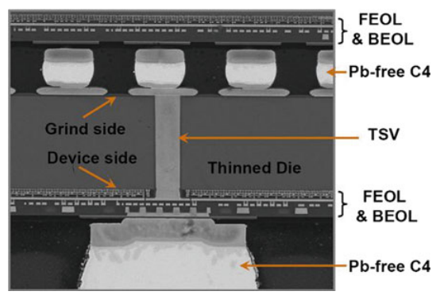


### 3.5 Summary

Through-silicon vias are a critical feature of vertically stacked area-array dies, and therefore constitute a very important enabling feature of 3D packages. In this chapter, the approaches for the fabrication of TSVs in dies have been presented. Briefly, fabrication processes comprise four steps, including drilling of via-holes in silicon, sequential via-filling (with a dielectric, a diffusion barrier, an adhesion layer, a seed layer, and a metal filler), chemical-mechanical planarization and thinning of the silicon, and finally, deposition of a re-distribution layer on the surface of the silicon. These processes and associated materials have been described in some detail. Processing challenges as well as methods to overcoming them are highlighted and discussed.

Acknowledgements The editors would like to thank Purushotham Kaushik Muthur Srinath and Shengquan E Ou from Intel Corporation for their critical review of this chapter. The authors (PK & ID) acknowledge financial support for some of the reported work by the National Science Foundation (DMR-0513874 and DMR-1309843), Cisco Research Council and the Semiconductor Research Corporation. The contributions of, and collaborations with several colleagues (Dr. Lutz Meinshausen, formerly of Washington State University, and currently at Global Foundries, Dresden, Germany; Dr. Tae-Kyu Lee, formerly of Cisco Systems, and currently at Portland State University; Dr. Ravi Mahajan of Intel Corporation; Dr. Vijay Sarihan of Freescale Semiconductor, and Professor Muhannad Bakir of Georgia Tech) are gratefully acknowledged. The assistance of current and former colleagues (Dr. Hanry Yang of Washington State University, and Dr. Zhe Huang, formerly of Washington State University, and currently at Seagate Technologies) with the literature survey is also gratefully acknowledged. The author (ZH) acknowledges financial support for his research by the the Pearl River Science and Technology Nova Program of Guangzhou under grant no. 2012J2200074, the National Natural Science Foundation of China (NSFC) under grant no. 51004118, and Guangdong Natural Science Foundation under grant no. 2015A030312011.


### References

1. E. Beyne, Through-silicon via technology for 3D IC, in Ultra-Thin Chip Technology and Applications, ed. by J.N. Burghartz (Springer, New York, 2011) 2. M. Stucchi, G. Katti, D. Velenis, TSV characterization and modeling, in Three Dimensional System Integration: IC Stacking Process and Design, ed. by A. Papanikolaou, D. Soudris, R. Radojcic (Springer, New York, 2011) 3. P.S. Andry, C.K. Tsang, B.C. Webb, E.J. Sprogis, S.L. Wright, B. Dang, D.G. Manzer, Fabrication and characterization of robust through-silicon vias for silicon-carrier applications. IBM J. Res. Dev. 52, 571–581 (2008) 4. Z. Xu, J.Q. Lu, High-speed design and broadband modeling of through-strata-vias (TSVs) in 3D integration. IEEE Trans. Compon. Pack. Manuf. Technol. 1, 154–162 (2011) 5. J.Q. Lu, Advances in materials and processes for 3D-TSV integration. ECS Trans. 45, 119–129 (2012) 6. A. Tsukada, R. Sato, S. Sekine, R. Kimura, K. Kishi, Y. Sato, Y. Iwata, H. Murata, Study on TSV with new filling method and alloy for advanced 3D-SiP, in ECTC: Electronic Components and Technology Conference, 31 May–3 June 2011 (IEEE, Lake Buena Vista, FL, 2011), p. 1981 7. R. Sato, A. Tsukada, Y. Sato, Y. Iwata, H. Murata, S. Sekine, R. Kimura, K. Kishi, Study on high performance and productivity of TSV’s with new filling method and alloy for advanced 3D-SiP, in 3DIC: International 3D Systems Integration Conference, 31 Jan–2 Feb 2012 (IEEE, Osaka, 2012), p. 1 8. A. Horibe, K. Sueoka, T. Aoki, K. Toriyama, K. Okamoto, S. Kohara, H. Mori, Y. Orii, Through silicon via process for effective multi-wafer integration, in ECTC: Electronic Components and Technology Conference, 26–29 May 2015 (IEEE, San Diego, CA, 2015), p. 1808 9. M. Bouchoucha, L.L. Chapelon, P. Chausse, S. Moreau, N. Sillon, Through silicon via polymer filling for 3D-WLP applications, in ESTC: Electronic System-Integration Technology Conference, 13–16 Sept 2010 (IEEE, Berlin, 2010), p. 1 10. A. Peic, Lithography process innovations for 2.5/3D Part 1: alleviating TSV stress (2014). http://www.3dincites.com/2014/08/lithography-process-innovations-for-2-53d-part1-alleviating-tsv-stress/. Accessed 21 June 2016 11. L. Zhu, D.W. Hess, C.P. Wong, Carbon nanotube electrical and thermal properties and applications for interconnects, in Integrated Interconnect Technologies for 3D Nanoelectronic Systems, ed. by M.S. Bakir, J.D. Meindl (Artech House, Norwood, MA, 2009) 12. D. Jiang, W. Mu, S. Chen, Y. Fu, K. Jeppson, J. Liu, Vertically stacked carbon nanotube-based interconnects for through silicon via application. IEEE Electron. Dev. Lett. 36, 499–501 (2015) 13. J.U. Knickerbocker, P.S. Andry, B. Dang et al., Three dimensional silicon integration. IBM J. Res. Dev. 52, 553–569 (2008) 14. J.Q. Lu, 3-D hyperintegration and packaging technologies for micro-nano systems. Proc. IEEE 97, 18–30 (2009) 15. M. Koyanagi, T. Fkushima, T. Tanaka, High-density through silicon vias for 3-D LSIs. Proc. IEEE 97, 49–59 (2009) 16. S. Spiesshoefer, Z. Rahman, G. Vangara, S. Polamreddy, S. Burkett, L. Schaper, Process integration for through-silicon vias. J. Vac. Sci. Technol. A 23, 824–829 (2005) 17. R. Nagarajan, K. Prasad, L. Ebin, B. Narayanan, Development of dual-etch via tapering process for through-silicon interconnection. Sens. Actuat. A 139, 323–329 (2007) 18. R. Li, Y. Lamy, W.F.A. Besling, F. Roozeboom, P.M. Sarro, Continuous deep reactive ion etching of tapered via holes for three-dimensional integration. J. Micromech. Microeng. 18, 125023 (2008) 19. C. Okoro, K. Vanstreels, R. Labie, O. Luhn, B. Vandevelde, B. Verlinden, D. Vandepitte, Influence of annealing conditions on the mechanical and microstructural behavior of electroplated Cu-TSV. J. Micromech. Microeng. 20, 045032 (2010) 20. N. Ranganathan, L. Ebin, L. Linn, L.W.S. Vincent, O.K. Navas, V. Kripesh, N. Balasubramanian, Integration of high aspect ratio tapered silicon via for silicon carrier fabrication. IEEE Trans. Adv. Pack. 32, 62–71 (2009)

21. B. Wu, A. Kumar, S. Pamarthy, High aspect ratio silicon etch: a review. J. Appl. Phys. 108, 051101 (2010) 22. D. Gerke, NASA 2009 Body of Knowledge (BoK): Through-Silicon Via Technology (JPL Publication 09-28, Jet Propulsion Laboratory, Pasadena, CA, 2009) 23. R. Landgraf, R. Rieske, A.N. Danilewsky, K.J. Wolter, Laser drilled through silicon vias: crystal defect analysis by synchrotron X-ray topography, in ESTC: 2nd Electronics System-Integration Technology Conference, Greenwich, UK, 1–4 Sept 2008 (IEEE, 2008), p. 1023 24. Industrial laser application note: laser drilling of through silicon vias (TSV). http://www. spectra-physics.com/applications/application-notes/laser-drilling-of-through-silicon-viastsv. Accessed 21 June 2016 25. Y.H. Lee, K.J. Choi, Analysis of silicon via hole drilling for wafer level chip stacking by UV laser. Int. J. Precis. Eng. Manuf. 11, 501–507 (2010) 26. A. Polyakov, T. Grob, R.A. Hovenkamp, H.J. Kettelarij, I. Eidner, M.A. de Samber, M. Bartek, J.N. Burghartz, Comparison of via-fabrication techniques for through-wafer electrical interconnect applications, in ECTC: Electronic Components and Technology Conference, 1–4 June 2004 (IEEE, 2004), p. 1466 27. S.P. Lee, H.-W. Kang, S.-J. Lee, I.H. Lee, T.J. Ko, D.-W. Cho, Development of rapid mask fabrication technology for micro-abrasive jet machining. J Mech. Sci. Technol. 22, 2190–2196 (2008) 28. S.H. Kim et al., (110) Silicon etching for high aspect ratio comb structures, in ETFA’97: Proceedings of Emerging Technologies and Fatory Automation, 9–12 Sept 1997 (Los Angeles, IEEE, CA, 1997), p. 248 29. G.T.A. Kovacs, N.I. Maluf, K.E. Petersen, Bulk micromachining of silicon. Proc. IEEE 86, 1536–1551 (1998) 30. M.J. Archer, F.S. Ligler, Fabrication and characterization of silicon micro-funnels and tapered micro-channels for stochastic sensing applications. Sensors 8, 3848–3872 (2008) 31. S. Aachboun, P. Ranson, Deep anisotropic etching of silicon. J. Vac. Sci. Technol. A 17, 2270– 2273 (1999) 32. F. Laermer, A. Schilp, Method of anisotropically etching silicon. US Patent US5501893 A (1996) 33. M.J. Madou, Fundamentals of Microfabrication: The Science of Miniaturization, 2nd edn. (CRC Press, Boca Raton, 2002) 34. S.-B. Jo, M.-W. Lee, S.-G. Lee, E.-H. Lee, S.-G. Park, O B.-H., Characterization of a modified Bosch-type process for silicon mold fabrication. J. Vac. Sci. Technol. A 23, 905–910 (2005) 35. P. Nallan, A. Khan, S. Pamarthy, S.T. Hsu, A. Kumar, Advanced deep silicon etching for deep trench isolation, optical components and micro-machining applications, in ET Conference Proceedings (Applied Materials Internal Publication, 2001) 36. M.J. Walker, Comparison of Bosch and cryogenic processes for patterning high aspect ratio features in silicon. Proc. SPIE 4407, 89–99 (2001) 37. I.R.Johnston,H.Ashraf,J.K.Bhardwaj,J.Hopkins,A.M.Hynes,G.Nicholls,S.A.McAuley,S. Hall,L.Atabo,G.R.Bogart,A.Kornblit,A.E.Novembre,Etching200-mmdiameterSCALPEL masks with the ASE process. Proc. SPIE 3997, 184–193 (2000) 38. R. Nagarajan, L. Ebin, D. Lee, C.S. Soh, K. Prasad, N. Balasubramanian, Development of a novel deep silicon tapered via etch process for through-silicon interconnection in 3-D integrated systems, in ECTC: Electronic Components and Technology Conference, 30 May–2 June 2006 (IEEE, San Diego, CA, 2006), p. 383 39. J.-H. Lai, H.S. Yang, H. Chen, C.R. King, J. Zaveri, R. Ravindran, M.S. Bakir, A ‘mesh’ seed layer for improved through-silicon-via fabrication. J. Micromech. Microeng. 20, 025016 (2010) 40. M. Miao, Y. Zhu, M. Ji, J. Ma, X. Sun, Y. Jin, Bottom-up filling of through silicon via (TSV) with Parylene as sidewall protection layer, in EPTC’09: Electronics Packaging Technology Conference, 9–11 Dec 2009 (IEEE, Singapore, 2009), p. 442 41. D.S. Tezcan, F. Duval, H. Philipsen, O. Luhn, P. Soussan, B. Swinnen, Scalable through silicon via with polymer deep trench isolation for 3D wafer level packaging, in ECTC: Electronic

Components and Technology Conference, 26–29 May 2009 (IEEE, San Diego, CA, 2009), p. 1159 42. P. Shi, J. Enloe, R. van den Boom, B. Sapp, Direct copper electrodeposition on a chemical vapordeposited Ruthenium seed layer for through-silicon vias, in IITC: International Interconnect Technology Conference, 4–6 June 2012 (IEEE, San Jose, CA, 2012), p. 1 43. M.J. Wolf, T. Dretschkow, B. Wunderle, N. Jurgensen, G. Engelmann, O. Ehrmann, A. Uhlig, B. Michel, H. Reichl, High aspect ratio TSV copper filling with different seed layers, in ECTC: Electronic Components and Technology Conference, 27–30 May 2008 (IEEE, Lake Buena Vista, FL, 2008), p. 563 44. V.S. Rao, S.W. Ho, W.S.V. Lee, H.Y. Li, E. Liao, R. Nagarajan, T.C. Chai, X. Zhang, P. Damaruganath, TSV interposer fabrication for 3D IC packaging, in EPTC’09: Electronics Packaging Technology Conference, 9–11 Dec 2009 (IEEE, Singapore, 2009). p. 431 45. Y. Au, Q.M. Wang, H. Li, J.S.M. Lehn, D.V. Shenai, R.G. Gordon, Vapor deposition of highly conformal copper seed layers for plating through-silicon vias (TSVs). J. Electrochem. Soc. 159, D382–D385 (2012) 46. P.H. Haumesser, L.A. Roule, S. Maitrejean, G. Passemard, Seed enhancement: a bridging technology. Future Fab. Int. 19, 81–83 (2005) 47. K.J. Ganesh, A.D. Darbal, S. Rajasekhara, Effect of downscaling nano-copper interconnects on the microstructure revealed by high resolution TEM-orientation-mapping. Nanotechnology 23, 135702 (2012) 48. B. Horvath, J. Kawakita, T. Chikyow, Through silicon via filling methods with metal/polymer composite for three-dimensional LSI. Jpn. J. Appl. Phys. 53, 06JH01 (2014) 49. P. Dixit, T. Vehmas, S. Vahanen, P. Monnoyer, K. Henttinen, Fabrication and electrical characterization of high aspect ratio poly-silicon filled through-silicon vias. J. Micromech. Microeng. 22, 055021 (2012) 50. C.-F. Hsu, W.-P. Dow, H.-C. Chang, W.-Y. Chiu, Optimization of the copper plating process using the Taguchi experimental design method: I. Microvia filling by copper plating using dual leverlers. J. Electrochem. Soc. 162, D525–D530 (2015) 51. G. Pares, N. Bresson, S. Minoret, V. Lapras, P. Brianceau, J.F. Lugand, R. Anciant, N. Sillon, Through silicon via technology using tungsten metallization, in Conference IC Design & Technology, 2–4 May 2011 (IEEE, Kaohsiung, 2011), p. 1 52. T.P. Moffat, D. Josell, Extreme bottom-up superfilling of through-silicon-vias by damascene processing: suppressor disruption, positive feedback and Turing patterns. J. Electrochem. Soc. 159, D208–D216 (2012) 53. J. Dukovic, S. Ramaswami, S. Pamarthy, R. Yalamanchili, N. Rajagopalan, K. Sapre, Z. Cao, T. Ritzdorf, Y. Wang, B. Eaton, R. Ding, M. Hernandez, M. Naik, D. Mao, J. Tseng, D. Cui, G. Mori, P. Fulmer, K. Sirajuddin, J. Hua, S. Xia, D. Erickson, R. Beica, E. Young, P. Kusler, R. Kulzer, S. Oemardani, H. Dai, X. Xu, M. Okazaki, K. Dotan, C. Yu, C. Lazik, J. Tran, L. Luo, L, Through-silicon-via technology for 3D integration, in IEEE International Memory Workshop, 16–19 May 2010 (IEEE, Seoul, 2010), p 1 54. D. Smith, S. Singh, Y. Ramnath, M. Rabie, D. Zhang, L. England, TSV residual Cu step height analysis by white light interferometry for 3D integration, in ECTC: Electronic Components and Technology Conference, 26–29 May 2015 (IEEE, San Diego, CA, 2015), p. 578 55. R.L. Rhoades, Overview of CMP for TSV applications (2013). http://www.entrepix.com/docs/ papers-and-presentations/Rhoades-CMP-for-TSV-AVS-June2013-shareable.pdf. Accessed 21 June 2016 56. S.W. Yoon, D.J. Na, K.T. Kang, W.K. Choi, C.B. Yong, Y.C. Kim, P.C. Marimuthu, TSV MEOL (Mid-End-Of-Line) and its assembly/packaging technology for 3D/2.5D solutions, in ICEP-IAAC: Joint Conference of International Conference on Electronics Packaging and IMAPS All Asia Conference, 17–20 April 2012, Tokyo, Japan (2012). http://www.statschippac.com/~/media/Files/DocLibrary/whitepapers/2012/ STATSChipPAC_ICEP2012_TSV_MEOL_and_Pkg.ashx. Accessed 21 June 2016 57. A. Heryanto, W.N. Putra, A. Trigg, S. Gao, W.S. Kwon, F.X. Che, X.F. Ang, J. Wei, R.I. Made, C.L. Gan, K.L. Pey, Effect of copper TSV annealing on via protrusion for TSV wafer fabrication. J. Electron. Mater. 41, 2533–2542 (2012)

58. T. Jiang, S.-K. Ryu, Q. Zhao, J. Im, R. Huang, P.S. Ho, Measurement and analysis of thermal stresses in 3D integrated structures containing through-silicon-vias. Microelectron. Reliab. 53, 53–62 (2013) 59. K. Ohta, A. Hirate, Y. Miyachi, T. Shimizu, S. Shingubara, All-wet TSV filling with highly adhesive displacement plated Cu seed layer, in 3DIC: International 3D Systems Integration Conference, 31 Aug–2 Sept 2015 (IEEE, Sendai, 2015), p. TS8.4.1 60. Q. Cui, X. Sun, Y. Zhu, S. Ma, J. Chen, M. Miao, Y. Jin, Design and optimization of redistribution layer (RDL) on TSV interposer for high frequency applications, in ICEPT-HDP: International Conference on Electronic Packaging Technology and High Density Packaging, 8–11 Aug 2011 (IEEE, Shanghai, 2011), p. 1 61. IBM 3D Semiconductor & Packaging Technology for Systems http://researcher.ibm.com/ researcher/view_group.php?id=4436. Accessed 21 June 2016

---


<!-- ===================================================================== -->
<!-- CHAPTER 04: CHARACTERIZATION AND MODELING OF LOCALIZED MECHANICAL STRESS IN 3D MICROELECTRONIC PACKAGING -->
<!-- ===================================================================== -->

## Chapter 4 — Characterization and Modeling of Localized Mechanical Stress in 3D Microelectronic Packaging (Executive Technical Synthesis)

## Micro Raman Spectroscopy for Stress Characterization

Micro Raman Spectroscopy is a non-destructive optical technique widely utilized for stress characterization in semiconductor microelectronic packaging. In standard packaging stress analysis, the measurement is typically conducted in a backscatter configuration to resolve the longitudinal vibrational mode (mode 3) of the silicon crystal lattice. This allows researchers to directly compute the sum of the two in-plane principal stresses ($\sigma_{xx} + \sigma_{yy}$). 

When high numerical aperture optics (NA $> 0.4$) are employed, the excitation light collects sufficient off-axis scattering to resolve all three principal modes of vibration. This enables the complete determination of the tri-axial tensorial stress field within microscopic semiconductor structures.

```
                  Raman Peak Shift vs. Mechanical Stress
 ─────────────────────────────────────────────────────────────────────────
  Backward Shift (cm⁻¹) ◄── [Tensile Stress] ── 0 ── [Compressive Stress] ──► Forward Shift (cm⁻¹)
                               (Directly Proportional: 1 cm⁻¹ ≈ 434 MPa)
```

Compressive and tensile stresses in the silicon substrate induce measurable forward and backward spectral shifts in the Raman peak, respectively. In monocrystalline silicon, a Raman shift of $1\text{ cm}^{-1}$ corresponds linearly to an in-plane stress magnitude of approximately $434\text{ MPa}$.

Because the optical penetration depth in the backscatter configuration is very shallow, Raman spectroscopy primarily captures stress information from near-surface regions. However, the stress field surrounding 3D packaging features—such as Through-Silicon Vias (TSVs)—is inherently tri-axial and extends deep into the bulk substrate. Consequently, empirical near-surface Raman spectroscopy is routinely coupled with Finite Element Analysis (FEA) modeling to reconstruct accurate 3D stress distributions throughout the silicon wafer.

---

## Stresses in Through-Silicon Vias (TSVs)

### Origin and Physical Mechanisms of TSV Stresses

Mechanical stresses in Through-Silicon Via (TSV) structures arise from two primary physical mechanisms:

1. **Growth Stresses**: Originate during the via-filling process by electrodeposition. Copper grows radially inward from the seed layer on the via sidewalls and abuts at the center axis. This growth front often leaves a central seam or thin line of microvoids along the TSV axis. During post-deposition annealing and room-temperature self-annealing, electroplated copper undergoes grain growth and grain boundary elimination, resulting in volumetric shrinkage. Under hydrostatic stress gradients within the TSV, lattice vacancy diffusion toward pre-existing defects causes microvoid growth, threatening mechanical and electrical reliability.

2. **Thermo-Mechanical Stresses**: Induced by the large Coefficient of Thermal Expansion (CTE) mismatch between the electroplated copper filler ($\alpha_{\text{Cu}} \approx 16.5 \times 10^{-6}/\text{K}$) and the surrounding silicon substrate ($\alpha_{\text{Si}} \approx 2.6 \times 10^{-6}/\text{K}$). Operational thermal cycling from fluctuating Joule heating continually cycles these differential stresses over the device lifespan.

```
                      TSV Stress & Voiding Mechanisms
 ─────────────────────────────────────────────────────────────────────────
   [Si Substrate]  │  ◄── Radial Tensile Stress Peak at Si-Cu Interface
  ─────────────────┼──────────────────────────────────────────────────────
   [Cu TSV Filler] │  • Electroplated Cu seam / void growth during annealing
                   │  • Volumetric shrinkage via grain boundary elimination
                   │  • Hydrostatic stress gradients drive vacancy migration
  ─────────────────┼──────────────────────────────────────────────────────
   [Si Substrate]  │  ◄── High CTE Mismatch (α_Cu = 16.5 vs α_Si = 2.6 ppm/K)
```

At ambient temperature, electroplated Cu inside Si vias is under residual tension. During thermal ramp-up, tension is elastically relieved before compressive stress builds up. As temperature rises further, the yield strength and creep resistance of Cu decrease, resulting in stress relief through plastic yielding and creep. 

Thermal cycling leads to the accumulation of hydrostatic stress within the Cu TSV filler, with higher impurity levels correlating to elevated residual stresses. Severe tensile radial stresses concentrate at the Cu-Si interface, making it susceptible to delamination. Radial stress at the interface generally increases with TSV length for a given diameter, whereas hydrostatic stress dependence on TSV diameter is non-monotonic.

---

### Keep-Out Zone (KOZ) and Microstructure Analysis

Near-surface stresses in silicon surrounding Cu TSVs alter the local energy band structure, inducing **piezoresistivity** that degrades electron and hole mobility in nearby active transistors. To prevent circuit performance degradation, a **Keep-Out Zone (KOZ)**—typically several micrometers wide—must be maintained around each TSV where no active devices can be placed. The required KOZ area scales with the square of the TSV diameter and increases for high-aspect-ratio TSVs, imposing a real-estate overhead on high-density 3D IC layouts.

Direct measurement of stress states in Cu-TSVs using X-ray micro-diffraction reveals a significant hydrostatic tensile stress ($\sim 234\text{ MPa}$) at room temperature, which shifts into compression ($-196\text{ MPa}$) during annealing at $200\ ^\circ\text{C}$, and cools back to a lower tensile residual stress ($\sim 167\text{ MPa}$). The initial high tensile stress stems from grain boundary elimination during room-temperature self-annealing. Subsequent thermal annealing lowers residual tensile stress via high-temperature plastic relaxation and creep.

Linear elastic FEA modeling incorporating realistic Cu grain microstructures reveals that stress distribution inside the TSV is highly heterogeneous due to grain anisotropy.

- **Fig. 4.11 — von Mises Stress Distribution in a Cu-TSV Structure**:

  ```mermaid
  graph TD
      subgraph Stress_Distribution["von Mises Stress Field in Cu-TSV (FEA Model)"]
          S1["TSV Corners & Si Interface Extremities<br/><b>Peak Stress: ~350 MPa</b>"]
          S2["Interior Copper Grains<br/><b>Heterogeneous Stress: 50–125 MPa</b>"]
          S3["Cu Grain Boundaries<br/><b>Localized Stress Concentration</b>"]
          S4["Flanking Silicon Regions<br/><b>Low Stress: 0–25 MPa</b>"]
      end
  ```

  ```
  Von Mises Stress Distribution (Cu-TSV Cross-Section)
  ─────────────────────────────────────────────────────
  Y (µm)
   80 ┤ ░░░░░ [Cu TSV - grain boundaries visible] ░░░░░
   70 ┤ ▓▓▓▓▓ [heterogeneous stress field across    ▓▓▓▓▓
   60 ┤ ▓▓▓▓▓  individual grains — stress peaks     ▓▓▓▓▓
   50 ┤ ▓▓▓▓▓  at grain boundaries and near         ▓▓▓▓▓
   40 ┤ ▓▓▓▓▓  TSV-Si interface]                    ▓▓▓▓▓
   30 ┤ ▓▓▓▓▓                                       ▓▓▓▓▓
   20 ┤ ▓▓▓▓▓ [High stress ~350 MPa at corners]     ▓▓▓▓▓
   10 ┤ ░░░░░ [Si regions flanking TSV]             ░░░░░
    0 └────────────────────────────────────────────────
      0       10      20      30      40      50   X (µm)

  Stress scale (MPa):
  ████ ~350   ████ ~125   ████ ~100   ████ ~75
  ████ ~50    ████ ~25    ████ ~0
  ```

  As shown in Fig. 4.11, the highest von Mises stress ($\sim 350\text{ MPa}$) localizes at the TSV corners and Cu-Si interface extremities. Interior Cu grains display a heterogeneous stress field ($50\text{--}125\text{ MPa}$), with localized stress peaking along internal grain boundaries.

---

### Metal Pumping: Extrusion and Intrusion Mechanisms

During thermal cycling, CTE mismatch generates severe shear stress near via extremities. When induced stresses exceed the yield strength of copper, filler plastic deformation occurs. Differential thermal expansion between Cu and Si is accommodated by interfacial sliding, leading to top-surface **extrusion** (or intrusion) of Cu relative to Si. Extrusion typically occurs at via ends and is enhanced by elevated creep rates and grain boundary sliding.

Because copper shrinks significantly relative to silicon during cooling, interfacial sliding produces vertical steps at the via mouth. The rate of via protrusion/intrusion per thermal cycle decreases with increasing cycle count as metal filler stress saturates due to strain hardening.

The majority of Cu pumping manifests as uniform global extrusion ($\sim 10\text{--}30\text{ nm}$), with localized single-grain extrusion occurring in isolated TSVs after high-temperature annealing. Via pitch has minimal effect on pumping height, whereas larger via diameters yield larger average protrusion.

- **Fig. 4.23 — Heating Rate and Temperature Dependence of Copper Pumping**:

  ```mermaid
  graph TD
      subgraph Regime1["High Heating Rate / Small Excursion"]
          R1["Rate-Independent Plasticity Dominates"] --> R1_Res["Smooth Curved Dome Profile at TSV Top"]
      end
      subgraph Regime2["Rapid Heating / Moderate Excursion"]
          R2["GB Sliding & Creep Deformation"] --> R2_Res["Extrusion of Individual Grains"]
      end
      subgraph Regime3["Slow Heating / High Temperature"]
          R3["Interfacial Sliding Dominates"] --> R3_Res["Uniform Vertical Step Protrusion at Interface"]
      end
  ```

  ```
  Heating Rate vs. Thermal Cycling Temperature Range (TSV Protrusion Mechanisms)
  ─────────────────────────────────────────────────────────────────────────────
  ▲ Heating Rate
  │
  │  ┌─────────────────────────┐         ┌─────────────────────────┐
  │  │ High Heating Rate /     │ ───►    │ Rapid Heating & Mod.    │
  │  │ Small Thermal Excursion │         │ Large Temp. Excursions  │
  │  └─────────────────────────┘         └─────────────────────────┘
  │  • Rate-independent                  • Stress relief restricted
  │    plasticity dominates              • High temp allows diffusion
  │  • Smooth overall curvature          • Grain boundary sliding &
  │    at TSV top surface                  creep deformation dominate
  │                                      • Individual grain extrusion
  │
  │                                      ┌─────────────────────────┐
  │                                ───►  │ Slow Heating Rate &     │
  │                                      │ High Temperatures       │
  │                                      └─────────────────────────┘
  │                                      • Interfacial sliding only
  │                                        becomes dominant here
  │                                      • Uniform vertical step
  │                                        protrusion at interface
  │
  └─────────────────────────────────────────────────────────────────────────────►
                       Thermal Cycling Temperature Range

  Visual Diagrams & SEM Profiles (Fig. 4.23):

  [1] High Heating Rate (Small Excursion)   [2] Rapid Heating (Mod. Excursion)   [3] Slow Heating (High Temp)
      ┌───────────┐                            ┌─┬─┬───┬─┐                           ┌───────────┐
      │  ╭─────╮  │                            │ █ │ █ █ │ █ │                           │ │       │ │
   ───┴──┴─────┴──┴───                      ───┴─┴─┴───┴─┴─┴───                       ───┴─┴───────┴─┴───
       [Si] [Cu] [Si]                           [Si] [Cu] [Si]                            [Si] [Cu] [Si]
   • Overall curved dome                    • Extruded individual grains             • Uniform interfacial step
   • Plasticity-dominated                   • Grain boundary sliding                 • Interfacial sliding-dominated
  ```

---

### Electromigration (EM) and Interfacial Reliability

While TSVs have large cross-sectional areas that lower average current density, current crowding and stress gradients at junction interfaces with Back-End-of-Line (BEOL) and Redistribution Layer (RDL) metallizations create severe electromigration (EM) risks. Atomic Flux Divergence (AFD) peaks where top/bottom metallizations meet the TSV, driven predominantly by Joule-heating-induced stress gradients rather than electric potential gradients.

Experimental testing reveals no EM void formation inside the TSV bulk regardless of electron flow direction. Instead, voids form downstream of electron flow at the intersection between the TSV end and the RDL metal layer.

```
                      EM Void Nucleation Mechanism
 ─────────────────────────────────────────────────────────────────────────
   [RDL Cu Line]  ──► Cu atoms migrate freely outward
  ─────────────────────────────────────────────────────────────────────────
   [TiN Barrier]  ──► Blocks Cu replenishment from TSV bulk into RDL
  ─────────────────────────────────────────────────────────────────────────
   [TSV Cu Bulk]  ──► TiN barrier causes localized vacancy accumulation &
                      void nucleation at electron exit interface
```

The TiN diffusion barrier layer blocks Cu replenishment from the TSV into the void region while Cu migration outward into RDL lines continues. Thus, the TiN barrier layer becomes the primary driver of EM void nucleation. In thin Cu lines, voids span the entire line thickness. In thick Cu lines, current crowding concentrates voiding at the TiN/Cu-line interface.

- **Fig. 4.27 — EM Damage and Sn Migration under Extreme Conditions ($1.5 \times 10^5\text{ A/cm}^2$, $200\ ^\circ\text{C}$, 20 Days)**:

  ```mermaid
  graph TD
      subgraph EM_Damage["Extreme EM Failure Modes (Fig. 4.27)"]
          D1["M1 Layer Voiding<br/><b>90° Electron Turn & Current Crowding</b>"]
          D2["Sn Interfacial Electromigration<br/><b>Migration from Solder Ball along TSV-Si Interface</b>"]
      end
  ```

  ```
  Fig. 4.27 — EM Damage & Sn Migration near TSV Top / BEOL Interface
  ─────────────────────────────────────────────────────────────────────────────
  (a) FIB Cross-Sectional Diagram & Voiding in M1 Layer:

        BEOL Layers  [ M3 / M2 Interconnects ]
       ═════════════════════════════════════════════
        M1 Layer     ┌─────┐   [Void ⚡] ◄── Red Arrow (M1 Voiding)
       ──────────────┴─┐   └───┬─────────
                       │   e⁻  │  ◄── 90° Electron Turn (Current Crowding)
                       │   ▲   │
                       │   │   │  ◄── Upward Electron Flow through TSV
                       │  TSV  │
                       │  Cu   │
                       │Filler │
       ────────────────┴───────┴───────────────── [Si Substrate]
                       (5 µm Scale)

  (b) Sn Kα EDS X-Ray Map (Sn Migration Path):

                       ┌───────┐
                       │  M1   │
                       └─┬───┬─┘
                         │ █ │ ◄── Sn Concentration in Dark Ion Features
                         │ █ │
                         │ █ │ ◄── Sn Electromigrated from Bottom Solder
                         │ █ │     Ball along TSV-Si Interface into Filler
                         └───┘
  ```

Under extreme EM exposure, two primary damage mechanisms occur: Metal-1 (M1) voiding due to current crowding at $90^\circ$ electron turns upon exiting the TSV, and Sn electromigration from bottom solder balls along the TSV-Si interface into the TSV bulk.

---

---

### Chapter 4 — Complete Unabridged Textbook Text, Figures (23) & Tables (2) [pp. 79–111]

Praveen Kumar, Tae-Kyu Lee, Indranath Dutta, Zhiheng Huang, and Paul Conway


### 4.1 Introduction

Following Chap. 3 on materials, processing and assembly, this chapter discusses the microstructural and reliability issues of TSVs. This chapter begins with microstructural characterization and stress measurement; it then discusses detailed reliability issues associated with TSVs; finally it presents promising techniques towards atomistically-informed reliability modeling of TSVs.

P. Kumar Department of Materials Engineering, Indian Institute of Science, Bangalore 560012, India e-mail: praveenk@materials.iisc.ernet.in

T.-K. Lee Department of Mechanical and Materials Engineering, Portland State University, Portland, OR 97207, USA e-mail: taeklee@pdx.edu

I. Dutta (B) School of Mechanical and Materials Engineering, Washington State University, Pullman, WA 99164, USA e-mail: idutta@wsu.edu

Z. Huang School of Materials Science and Engineering, Sun Yat-sen University, 135 West Xingang Road, Guangzhou 510275, China e-mail: hzh29@mail.sysu.edu.cn

P. Conway The Wolfson School of Mechanical, Electrical and Manufacturing Engineering, Loughborough University, Loughborough, Leicestershire LE11 3TU, UK e-mail: p.p.conway@lboro.ac.uk


### 4.2 Microstructural Characterization and Stress Measurement


#### 4.2.1 Microstructural Characterization

The microstructure of TSV can be characterized at four levels, i.e., crystal structure, phase structure, grain structure and defect structure. Bunge introduced a function

and mathematical methods to quantitatively describe microstructure [1, 2]. For experimental characterization, standard metallographic techniques can also be applied to TSV structures. However, preparing TSV samples for microstructural characterization to investigate precise locations through the TSV sample structures using standard metallographic polishing is tedious and unpredictable due to the small size of TSVs and presence of soft materials (e.g., Cu, Ag paste, etc.) adjacent to hard and brittle Si. Focused ion beam (FIB) milling, which allows precise machining at small length scales, is widely used for preparing TSV samples for microstructural characterization. FIB can also be used to prepare ultra-thin samples, suitable for observation under transmission electron microscope (TEM). Machining samples using FIB is both a slow and an expensive process. Emerging Xe+ plasma FIB systems, with optimized control over milling parameters, promise faster removal rates [3]. Another method for characterization of the microstructure of filler material is by via revealing: in this process, Si is wet-etched using hydroxides, which do not affect metal fillers, thus revealing the pillar [4, 5]. However, this is also a slow process and it does not allow observation of the Si-filler interface. Therefore, sample preparation, especially over the entire height of the TSV, for microstructural characterization is often very slow. The important microstructural features of TSV assemblies that are often characterized and quantified are the size and shape of filler grains, micro-texture and grain orientation, the presence of twin boundaries in Cu fillers, shapes and sizes of voids or cavities in the filler, micro-cracks, interfacial structure, etc. Grain size, which can be measured using scanning electron microscope (SEM) and TEM, is important for the estimation of the strength of the metal filler (generally, the smallerthegrainsize,thegreaterthestrengthofthematerial).Thehardnessandhence strength of the TSV fillers can be measured using nano-indentation. Interestingly, as shown in Fig. 4.1, nano-indentation studies have shown that TSV fillers with smaller grain size may not always show an enhanced strength. Furthermore, as also shown in Fig. 4.1, the strength versus grain size behavior often does not follow the Hall-Petch relationship; in other words, the increase in the strength is not strictly proportional to the inverse of the square root of the grain size [6, 7]. These deviations can be attributed to the fact that TSV fillers contain relatively few grains across the via-diameter, as


> **Fig. 4.1 Variation of (a) average hardness and (b) yield strength of filler material with average grain size of Cu. The broken line shows the best curve fit using Hall-Petch type of relationship between hardness in a and yield strength in b and the inverse of the square root of grain size. The data for (a) and (b) are taken from Refs. [6, 7], respectively**


shown in Fig. 4.2, and hence do not display generalized polycrystalline behavior. It has been shown that electrolytes with impurities can enhance the yield strength of the fillers [15]. Therefore, attention should be paid to the methods used to estimate the mechanical behavior of TSVs [8, 9]. In addition, the conventional parameter of an average grain size may not be sufficient to characterize the grain structure of TSV fillers. In the current materials genome initiative [10], new methods that consider


> **Fig. 4.2 (a) Electron back scatter diffraction (EBSD) patterns showing inverse pole figure (IPF) maps of cross-section of Cu fillers: (i) as-deposited and (ii) after annealing at 420 °C for 20 min followed by annealing at 300 °C for additional 15 min [6]. (b) FIB micrographs showing grain structure of Cu filler: (i) as-deposited and (ii) after annealing at 400 °C for 1 h [13]**


more parameters including phase morphology and distribution have been proposed for quantification of microstructure [11, 12]. Figure 4.2 shows that the grain size of the Cu via-filler increases significantly upon annealing at elevated temperatures [6]; for example, annealing at 450 °C for 30 min leads to an increase in the grain size from 0.84 to 1.26 µm [14]. However, as shown in Fig. 4.2b, the grain growth during annealing is often inhomogeneous [13]. Furthermore, impurities in the filler material slow down the grain growth during annealing [15]. Electroplating at lower current density may lead to fillers with large grain size; for instance, plating current densities of 1 and 9 A/cm2 resulted in Cu fillers with average grain sizes of 2.57 and 0.88 µm, respectively [7]. Annealing has also been noted to induce twinning in Cu fillers [6, 16]. The micro-texture of TSV fillers is often measured by electron back-scattered diffraction (EBSD) conducted in SEM (see Fig. 4.2a). However, if the filler grains are very small, as found in the seed layer, diffraction-scanning transmission electron microscope (D-STEM) can also be used to map the micro-texture [17]. It has been noted that although annealing increases the grain size, it does not have any other noticeable effect on the texture of the filler material [6]. The micro-texture of filler materials appears to depend on the orientation of the seed layer, electroplating conditions, e.g., current density, bath chemistry, bath temperature, etc., impurity concentration, etc. [17]. However, to date, the dependence of the crystallographic texture of the via-filler on various process and geometrical parameters has not been unambiguously determined. The general microstructural characterization techniques, such as STEM, energy dispersive X-ray spectroscopy (EDXS), electron probe microanalysis (EPMA), etc., can be used to identify the chemical species in TSVs and map their concentration profile. Time-of-flight secondary ion mass spectrometry (TOF-SIMS) may also be used to study the chemical species in TSVs [15]. X-ray diffraction (XRD) can also be used to identify the phases present in the TSV structures [18].


#### 4.2.2 Measurement of Stress State

Substantial stresses are produced in the TSV assemblies, as a result of processing and during thermal cycling. The sources and implications are discussed in Sect. 4.3. These stresses affect the overall reliability of microelectronic packages comprising these TSV structures, and therefore various approaches have been utilized to understand the nature of these stresses. Three main techniques that been used to measure the stress state in TSVs are briefly discussed below.

If a layered assembly of two or more materials having different coefficient of thermal expansion (CTE) are joined together and then heated, the assembly bends with a


> **Fig. 4.3 (a) Representative Raman spectrum of Si wafer using lasers with wavelengths of 457.9, 488.0, and 514.5 nm, showing correlation between shift and stress [24]. (b) Measured stress profiles at different depths of the Si wafer near Cu-TSVs, using two different wavelengths of laser beams [25]**


curvature proportional to the in-plane stresses generated in the individual components [19]. Although TSV assemblies are more complex, they also bend due to generation/relief of residual stresses during thermal excursions [15, 20–22], and measurement of the curvature of the wafer can be used to determine stresses in the TSVs. However, the stress state in TSV structures is more complex than simple filmsubstrate systems, and as such, stress analysis based on the curvature method has usually been supplemented by FEA [21]. Although this method is meant to provide only an overall or average stress (as only one curvature is measured), FEA may be used regressively to predict the 3-D state of stress. Moreover, this method can be easily adapted for in situ measurement of stress (e.g., during thermal cycling).

Since Si is Raman-active, the stress in the Si wafer can be measured using microRaman spectroscopy (μRS) [20, 23–25]. The most common case involving usage of μRS in backscatter mode resolves the longitudinal vibrational mode (i.e., mode 3), which can then be used to determine the sum of the two in-plane principle stresses [23, 25]. However, if a high numerical aperture (NA) (say, ≥0.4 [23]) is used, then it is possible to resolve all three modes of vibration and hence tensorial nature of the stresses in TSV structures [23]. As shown in Fig. 4.3a, compressive and tensile stresses in Si lead to forward and backward shifts in the Raman signal (e.g., a shift by a wavenumber of 1 cm−1 corresponds to a stress of ∼434 MPa1), the shift being directly proportional to the stress in Si [24]. Since a laser beam with long wavelength can penetrate deeper in Si, it can provide information from a deeper depth than a beam with a longer wavelength, and thus, depth-sensitive information can be obtained.

1It should be noted that the exact value of the stress for a wavenumber shift may depend on the materials properties used in secular equation (i.e., set of equations in the reference axes which may be different than that of materials crystallographic reference system). It can lie in the range of 430–520 MPa [25].

Nevertheless, the penetration depth of μRS in the backscatter configuration is still very small and hence this method can be used to obtain stress information from near surface regions only. As shown in Fig. 4.3b, the stress in Si around a TSV strongly depends on the distance from the via-end: at very near the surface (as measured using short wavelength laser), the stress becomes less tensile away from the via end, whereas at slightly below depth (as measured using long wavelength laser), the stress transitions from being compressive to tensile as one moves away from the via end. Since the stress-state in the Si wafer is generally tri-axial, it is challenging to measure all stress-components via Raman spectroscopy. Nevertheless, by combining with FEA, μRS has been utilized to yield good estimates of the three-dimensional stress state in the wafer [23–25]. It should be noted that metals are not Raman-active and therefore the stress state of Cu cannot be measured using this technique and has to be derived indirectly from measurements on Si.

4.2.2.3 X-Ray Diffraction (XRD) Based Techniques

To directly measure the localized strain, and hence the stress-field in Cu TSVs, X-ray diffraction, used in conjunction with a cross-section TEM or a synchrotron radiation source, may be used to determine stress-induced changes in unit cell parameter from the equilibrium [26–28]. This can also be used to measure stress in Si nondestructively with very high resolution. Although XRD typically yields only average stress values, by focusing high energy X-rays in a synchrotron to a small beam size and rastering it on the sample, full strain and stress tensors from submicrometer sample volumes in the TSV structures may be obtained [26, 29–31]. Figure 4.4 shows an example of spatially resolved stress variation in a TSV assembly, determined using high energy X-rays.


> **Fig. 4.4 Stress distribution on a plane as determined using synchrotron x-ray micro-diffraction: (a) the deviatoric σ xx and (b) von-Mises stress [26]. The dotted vertical lines represent the effective size of the Cu TSV whereas the grey shaded region represent “non-indexable” region where the diffracted intensities from Cu are comparable with that from Si**


Although the synchrotron X-ray micro-diffraction is by far the most powerful technique for stress analysis, it is the most expensive and requires access to a synchrotron radiation source [28]. None of these aforementioned techniques can directly measure stress in Si or Cu. In Raman spectroscopy phonon frequency shifts are converted into stress values [28]; in diffraction-based techniques strain tensors are mathematically converted to stress tensor using linear elastic properties of bulk single crystalline samples [28]. Although μRS can provide stress profiles in the depth direction, the penetration depth is within a submicrometer range. Therefore, the complete picture of the stress distribution in TSVs is still unavailable. How- ever, this information is critical to elucidate the root cause for the metal pumping phenomenon as discussed in Sect. 4.3.1.3. The modeling techniques discussed in Sect. 4.4 may provide a solution towards this direction.


### 4.3 Reliability Issues Associated with TSVs

Reliability complications in TSVs typically arise either from stress-related or electrical sources, and are often convoluted with microstructural effects. In the following, we discuss the cause and effects of each of these reliability issues, along with potential approaches to circumvent or minimize these.


#### 4.3.1 Stresses in TSVs

Stresses in TSVs, and therefore in the neighboring Si, arise from two sources: (i) growth stresses, that arise as a result of via-filling by electroplating, and (ii) thermomechanical stresses that arise due to thermal expansion mismatch between Cu in the via and the surrounding Si. Growth stresses arise when the electrodeposited Cu grows radially inwards on the Cu-seed layer from the via side-walls, and abut itself, often resulting in a seam along the TSV axis. Such a seam may leave a thin void-line along the TSV axis (Fig. 4.5), which can grow during post-deposition annealing, and result in mechanical and electrical performance loss. Electroplated copper undergoes significant grain growth by self-annealing at room temperature, which results in volume shrinkage of the Cu TSVs by elimination of grain boundaries [32]. This may allow any existing void to grow during both self-annealing, as well as during the pre-CMP (chemicalmechanical polishing) annealing step. During annealing, hydrostatic stress gradients generated around pre-existing defects in the Cu may be relieved by diffusion of lattice vacancies towards the existing void near the axis, causing the void to grow [33].


> **Fig. 4.5 SEM images of TSVs showing centerline void after annealing at 150 °C (a) and 300 °C (b) [33]**

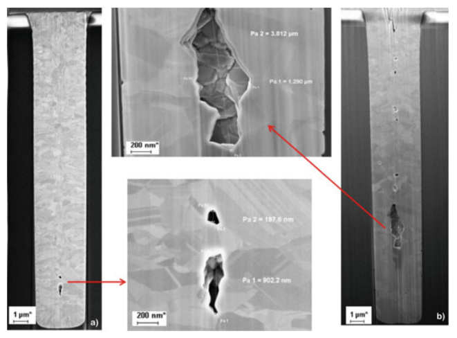

Thermo-mechanical stresses arise because of differential thermal expansion or contraction of Cu and Si during heating or cooling of the device as a result of their large difference in the CTE (αSi = 2.8 × 10−6/K, αCu = 17 × 10−6/K). Thermal cycling resulting from fluctuating Joule heating occurs continually during the service life of electronic devices, and 3D devices are no exception. Typically, electroplated Cu deposited on Si is under residual tension to begin with (at ambient temperature). During heating, the tension is first elastically relieved, following which a compressive stress builds up. As temperature increases, the yield strength and creep resistance of Cu decrease, resulting in stress relief by plastic yielding and creep, such that at the highest temperature, there is little stress remaining (Fig. 4.6). During subsequent cooling, a tensile stress builds up, result- ing in stresses in the neighborhood of 200– 500 MPa (biaxial for thin films and hydrostatic for TSVs). Further cycling repeats the same behavior, although because of substantial plasticity during the first cycle, the yielding and stress-relaxation start at a higher temperature, and are therefore lower. This is shown for a Cu film on Si, measured by wafer curvature testing, in Fig. 4.6 [34]. The details of this behavior depend on the temperature range and rate of thermal cycling, but the overall behavior is qualitatively replicated in TSVs. In contrast to thin films, however, the TSV stress-state is triaxial, and the TSV is typically in triaxial (i.e., hydrostatic) tension at ambient temperature. As noted earlier, the stress state in Cu-TSVs may be studied either by measuring the stress in Si via Raman spectroscopy, or that in Si or Cu by X-ray microdiffraction. Depth-sensitive Raman measurements, using various excitation wavelengths of an Ar+ laser, show that Si surrounded by TSVs has a compression hydrostatic stress at ambient temperature, with the stress varying significantly along the length of the TSV [24, 25]. The hydrostatic stress in Si becomes less negative nearer the ends


> **Fig. 4.6 Evolution of equibiaxial stress in a blanket Cu film deposited on Si during thermal cycling [34]**

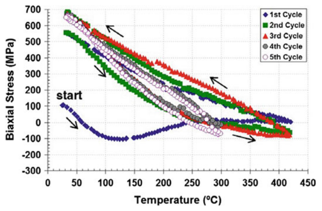

of the TSV. Assuming that the radial and circumferential stresses (σ rr, σ θθ) in the Si surrounding the TSVs are either weakly or not dependent on the axial position relative to the TSVs, one may infer that at ambient temperature, the axial stress σ zz in Si is negative (i.e., σ zz is positive in Cu) near the middle of the TSV, and becomes ∼0 at the surface. It was also noted that the stress-variation along the depth is larger for smaller TSV diameters (i.e., larger TSV aspect ratios). Furthermore, the stress in Si surrounded by an array of TSVs is typically larger than that outside of TSVarrays, and these stresses change from tensile immediately after Cu electrodeposition (where the stress is due to growth and self-annealing), to increasingly compressive when annealed at increasing temperatures [35]. Raman peak-shift measurements near the surface of the chip next to TSV-ends show that the biaxial hydrostatic stress state (i.e., [σr + σθ]/3, since σz ∼0) is negative at the TSV-chip interface, and rises sharply and becomes positive mid-way between TSVs (Fig. 4.7). After annealing, the hydrostatic stress in Si becomes even more compressive at the interface due to


> **Fig. 4.7 Plot of the stress state in Si near the ends of TSVs. Three TSVs are shown, each as a vertical band with intervening Si [20]**

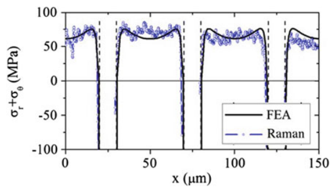

Cu volume expansion, and more tensile away from the interface [20]. Conversely, in addition to increasing the grain size, annealing lowers the compressive stresses in the Cu. Thermal cycling also leads to accumulation of hydrostatic stress in Cu TSV or filler [27]. In addition, TSVs with high impurity levels appear to lead to high residual stresses [15]. It has been reported that large tensile radial stresses exist at the Si–Cu interface [25]; this may make these sites prone to failure in TSV assemblies. The radial stress at the Cu-filler/Si interface generally increases with the length of the TSV for a given diameter [25]. The TSV diameter also seems to affect the stress state in the TSV assembly, although the dependence of the hydrostatic stress on TSV diameter is not monotonic [36]. The stresses induced near the surface of Si next to the Cu-filled TSVs have an adverse impact on the electrical performance of devices in the immediate neighborhood of the TSVs due to induced piezoresistivity, which results in degradation of carrier mobility [37, 38]. This necessitates a keep-out zone (KOZ) in the Si, typically a few micrometers in width, in the immediate vicinity of each TSV, where active devices cannot be placed. The KOZ, which scales with the square of the TSV diameter, is also greater for high aspect-ratio TSVs, and places a significant overhead on the area available in the chip for active devices, particularly with the increasing density of TSVs in chips. Based on FEA of the stress-state in Si next to TSVs, it has been inferred that Cu microstructures with smaller yield strengths reduce the KOZ size, which increases with increasing yield strength until the via yields plastically, and then remains stable [39]. FEA of TSVs in free-standing chips shows that after both heating and cooling, maximum von Mises stress, and hence plastic deformation of the copper occurs near the interface close to TSV-ends, which is a root cause of copper-pumping [40]. It is furtherobservedthatthemaximumprincipalstress(tensile)isintheradialdirectionat the interface near the middle of the TSV, and in the circumferential dielectric layer surrounding the TSV [41]. Evidence of dielectric cracking at the circumferential Cu–SiO2–Si interface, as well as roughening (due to voiding) of the metal-line at the top of the TSV has been noted after thermal cycling, as shown in Fig. 4.8 [42].


> **Fig. 4.8 TSV (a) prior to cycling, and after (b) 500 and (c) 2000 cycles between 30 and 150 °C, showing development of dielectric cracks and top-line roughening [42]**

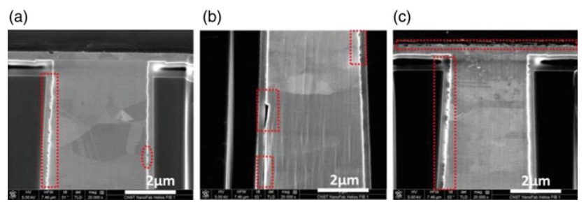

However, FE analysis of a stacked-die package shows that each die undergoes convex curvature when the package is cooled from the stress-free temperature (150 °C), whichfundamentallyaltersthestressesanddisplacementsrelativetothefreestanding die [41]. The convex curvature alters the radial interfacial stress to compressive, reducing the proclivity towards interfacial fracture as well as dielectric cracking, and shifting the critical failure location to the copper-pillar near the solder-microbump interface in 3D packages [41]. In fact, the failure probability near the silicon–Cu pillar-microbump junction (as indicated by the maximum equivalent strain), as well as the required KOZ diameter, increase with increasing diameters of both the TSV and the copper-pillar in a 3D package [43]. In addition to producing defects (e.g. voids) in TSVs, including complications in electrical performance and potentially causing interfacial and or dielectric fracture, induced stresses also give rise to a plasticity-related phenomenon commonly referred to as copper-pumping, which can have serious reliability implications. Because of the pervasiveness of this phenomenon, it is discussed separately in Sect. 4.3.1.3.

Direct measurement of stresses in Cu-TSVs with X-ray micro-diffraction reveal a significant tensile hydrostatic stress (∼234 MPa) at room temperature, which goes to compression (−196 MPa) during annealing at 200 °C, and becomes a smaller tensile stress when the sample is cooled to the ambient (167 MPa). The large initial tensile stress is caused by grain boundary elimination during self-annealing and device fabrication, and as noted previously, is undesirable from the reliability perspective, since this causes large stresses in Si. A subsequent annealing treatment lowers the tensile hydrostatic stress in Cu, even though the zone of initially larger grains expands during annealing, as shown in Fig. 4.9 [29], possibly because of relaxation associated with plasticity and creep at the high temperature. EBSD studies have shown that during annealing, large grains remain stable when there is a preponderance of 3 twin boundaries, but grains without twins and smaller grains grow rapidly [44]. It has also been noted that the Cu-TSV has random texture both before and after annealing. However, microvoids or small cracks have been noted to form during annealing, thereby reducing stress, as shown in Fig. 4.10. This is possibly because of vacancy diffusion to pre-existing defects under hydrostatic stress gradients within the TSV during annealing, as noted in the discussion associated with Fig. 4.5. FEA based modeling work has also reported the linkage between the microstructure of copper grains and the stress in Cu-TSVs. The results from a linear elastic mechanical model clearly demonstrate that the stress distribution is rather heterogeneous inside the TSV filler, as show in Fig. 4.11, considering the anisotropy of the elasticcompliancetensorofcopper.Dependingonthetexture,morphologyanddistribution of the copper grains, stress concentrations may occur at the grain boundaries [45]. Elastoplastic models have also been conducted directly on copper grain structures with the aim of explaining the formation of copper-pumping [46, 47]. However,


> **Fig. 4.9 Cross sections of Cu-filled TSVs in: (a) the as- received state, showing a zone of large grains in the center surrounded by smaller grains; and (b) after annealing, showing an expanded central zone with large grains [29]**

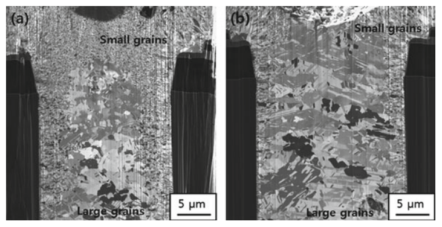

the drawbacks of this kind of model is clear. First, although the mechanical analysis is conducted directly on copper microstructure, the microstructure is assumed to remain unchanged during the mechanical loading process. Second, the plastic deformation mechanisms at the atomic scale, e.g. the motion of dislocations, have not been considered. However, the dislocation involved processes such as recovery, recrystallization and grain growth have been reported to occur in electrodeposited copper and can significantly influence its mechanical properties [48]. Recrystallization has also been suspected to account for the copper-pumping phenomenon [15, 36, 49]. Considering the limitation of the current modeling techniques, more robust simulation methodologies that take into account the polycrystalline nature of Cu TSVs and their complex deformation and stress relaxation mechanisms are needed [36]. Section 4.4 will introduce atomistically-informed modeling techniques to address this limitation.

4.3.1.3 Metal Pumping: Extrusion or Intrusion of TSVs

During service and consequent thermal cycling, the CTE mismatch between Cu and Si results in residual stresses in each material (σ Cu, σ Si), as well as significant interfacial shear stresses (T i) near the extremities of the via. The induced stresses, if high enough, may cause plastic deformation of the filler [39, 47, 50, 51] with the differential straining between Cu and Si sometimes accommodated by interfacial sliding [52–54]. This results in extrusion (and sometimes, intrusion) of Cu relative to the Si. Generally, the extrusion of the Cu occurs due to plastic deformation of the metal near the via-ends (typically, towards the top or mouth of the via), and can be enhanced by creep and grain boundary sliding. Two examples of this phenomenon are illustrated in Fig. 4.12.


> **Fig. 4.10 (a) Voids and cracks form at various locations in a TSV after annealing (red circles). (b) Voids near the top of the TSV, and (c) grain boundary cracks near one of the side-walls [44]**


When heated up relatively rapidly and kept at a constant elevated temperature for a period, the protrusion observed is generally associated with plastic deformation of the copper, with no relative displacement observed at the interface between Cu and Si, as observed in Fig. 4.12. Generally, the extrusion increases with increasing temperature, and occurs during any pre or post-CMP annealing, as well as heating associated with dielectric-deposition for fabricating the back end of line (BEOL) or redistribution layer (RDL). FEA shows that following heating to a high annealing/fabrication temperature (425 °C) and cooling down, the Von Mises stress exceeds the yield strength over the entire upper part of the TSV, resulting in yielding of the top part of the via (Fig. 4.13a). As a result, inelastic (plastic and creep) strains accrue in the top


> **Fig. 4.11 Distribution of the von Mises stress in a Cu-TSV structure from a linear elastic mechanical model with Cu grain microstructure [45]**


> **Fig. 4.12 Examples of Cu pumping. (a) Uniform pumping, showing a cross-sectional image dis- playing curvature of the top of a TSV, resulting in deformation of the RDL structure above [50]; (b) non-uniform pumping showing a few Cu grains protruding out of the Si surface [54]. The sample in (a) was annealed at 400 °C for 60 min, and the sample in (b) was annealed at 425 °C for 90 min**


part of the via, with strain concentrations adjacent to the interface near the TSV-end (Fig. 4.13b, c). This accrual of plastic and creep strain at the top of the TSV leads to copper pumping, or protrusion of the Cu from the top. This is particularly acute for blind vias, where any expansion of the Cu must necessarily occur at the open end of the via. EBSD studies show that Cu grains in a TSV typically have random grain boundary misorientations, and the via has little crystallographic texture, and no correlation between orientation and extruded grains has been noted [44]. This is evident from Fig. 4.14, which clearly shows a random texture in the TSV. It has been suggested that the protrusion observed is uniform when the grain size near the TSV ends is


> **Fig. 4.13 Von Mises stress in MPa (a), and equivalent plastic (b) and creep strains (c) in a Cu-TSV following fabrication at 425 °C and cooling to −25 °C (prior to thermal cycling). The figures show one quadrant of the TSV, with the interface at the right, the axis of the TSV at the left, and TSV mid-plane at the bottom. Although the plastic strain plot highlights only the strain concentration near the interface, most of upper part of the TSV, where Von Mises stress > ∼250 MPa, has yielded**


> **Fig. 4.14 EBSD orientation map of a TSV, showing a random grain texture [44]. This is typical of most TSV structures reported in the literature**


> **Fig. 4.15 Evidence of relative displacement between Cu and Si at the interface. (a) SEM image of Cu protrusion in an 80 μm diameter via, and (b) scanning white light interferometry image of Cu protrusion in a 10 µm diameter via. In both, the majority of protrusion occurs at the interface [54]**


large, but non-uniform when there are smaller grains near the TSV ends [47]. In general, it is noted that the extent of protrusion is larger when there are high angle grain boundaries at the TSV ends that promote creep processes, but not when there are coherent twin boundaries [55]. It is useful to note that for adherent Cu–Si interfaces, when TSVs undergo uniform protrusion, the top of the Cu typically attains a convex curvature, as shown in Fig. 4.12a, with minimal or no relative displacement between the Cu and Si (or the barrier layer) at the interface. This is particularly true when the die is either cycled rapidly, or held at a constant temperature. On the other hand, when the die is cycled slowly, shear stresses are repeatedly generated and relieved at the interface near the ends of the TSV, allowing sufficient time to drive diffusionally accommodated interfacial sliding, which results in a significant, step-like interfacial displacement [52–54], as illustrated in Fig. 4.15. Diffusionally accommodated interfacial sliding at hetero-interfaces (i.e., interfaces between dissimilar materials) is akin to grain boundary sliding, and may be driven by interfacial shear stresses (T i) that occur at the extremities of a TSV. In addition, it may be enhanced or mitigated by an electric current flowing through the TSV due to associated electromigration along the interface. The resultant displacement rate is given by [57–59]:

where Ω is the atomic volume, h is the roughness of the topographically periodic interface, k and T are the Boltzaman constant and temperature, respectively, Di is the interfacial diffusion coefficient, δi is the thickness of the interfacial region, and Z* and e are the effective charge number of the diffusing ion and the charge of an electron, respectively. Thus, ˙U depends linearly on both T i and the electric field E (which equals j, where ρ = resistivity of the filler and j is the current density), the relative signs of which determining whether they augment or mitigate each others

contributions. In Eq. 4.2, the first term gives the effect of shear stress, while the second term gives the impact of superimposed electromigration (EM). Since Z* is negative, the second term (due to EM) acts against the first term (due to stress-driven creep) whenbothdrivingforces(T i andE)arepositive,andthusreducetheinterfacialsliding rate. Conversely, if T i and E have opposite signs, the two terms in Eq. 4.2 augment each other and increase the interfacial sliding kinetics. Figure 4.15 shows the effect of interfacial sliding due to T i only (i.e., when E = 0), and Fig. 4.16 schematically shows the origin of T i in through and blind vias after a thermal excursion. The impact of superimposed current on interfacial sliding is discussed separately, in conjunction with electromigration in Sect. 4.3.2. In through-vias, the interfacial shear stress generated after cooling from the fabrication temperature is symmetric about the length of the via and is concentrated at both ends. As a result, the interfacial sliding, and hence copper-extrusion, would also be symmetric at the two ends for straight (i.e. untapered) vias. For blind-vias, the interfacial shear stress rises from the blind end towards the open end, and therefore, the resultant protrusion at the open end is greater. It should be noted that interfacial sliding, which occurs due to interfacial diffusion under the applied shear stress, is a mechanism that accommodates differential deformation of the Cu and Si at the


> **Fig. 4.16 Schematics showing shear stress distribution at the TSV-Si interface in a through-via, and b blind-via. The interfacial shear stress (dashed line) is symmetric about the length of the TSV for the through-via (a), and is non-zero only near the TSV-ends. Ti is zero at the blind-end of the via in (b), and rises monotonically towards the open end**


> **Fig. 4.17 The end of a TSV intruding into the Si, follow- ing 5 thermal cycles from −25 to 150 °C at 0.1 °C/min. Prior to cycling, the TSV end protruded out by ∼30 nm from the Si surface**


interface and therefore a thermal excursion as well as a high enough temperature and sufficient time to make diffusional processes active are needed. This is why, under rapid cycling conditions, Cu pumping typically occurs uniformly due to inelastic deformation of Cu without significant contribution from interfacial sliding, whereas when cycled slowly over a larger temperature range, steps emerge due to sliding at the interface. Since CTE of Cu is much larger than that of Si, when cooled from an elevated temperature, significant relative shrinkage of Cu can occur, which can also be accommodated at the interface by sliding. In this case, instead of protrusion, the ends of Cu vias may intrude into the Si with a sharp step at the interface, as illustrated in the SEM image in Fig. 4.17. Again, the shrinkage is due to deformation of the Cu, but the interfacial step is due to diffusionally accommodated interfacial sliding. It should be noted, however, that the rate of protrusion or intrusion of the via-ends during thermal cycling decreases with increasing number of cycles, as the stresses generated in the metal filler reach saturation due to progressive strain hardening. Therefore, after several cycles, protrusion/intrusion due to Cu pumping levels off [52–54]. Since the ends of a TSV are typically connected to a RDL or BEOL layer, protrusion or intrusion of the Cu via poses a significant risk to the integrity of these layers. Distortion of the RDL/BEOL structures, as shown in Fig. 4.12a, or delamination of a capping layer at the end of the TSV, as shown in Fig. 4.18 due to stresses associated by even a small protrusion of the via ends, can pose serious reliability challenges. Because of the potentially serious reliability complications, the role of Cu pumping has been widely studied, and the effects of various process parameters such as TSV spacing, diameter, Cu overburden after electroplating, and annealing conditions have been noted [50]. Generally, a majority of Cu-pumping is noted to be uniform or global (∼10–30 nm protrusion), with relatively few TSVs showing extrusion of individual grains after a high temperature anneal. Spacing appears to


> **Fig. 4.18 SEM micrograph showing delamination of the capping layer at the top of a row of TSVs following thermal excursions**


have little if any effect, but the pumping is greater on average for larger via diameters [50, 56]. However, although the average protrusion of an array of TSVs is larger for larger TSVs, the maximum copper pumping appears to be independent of the TSV diameter, which suggests that TSV diameter has little effect on BEOL reliability [56]. Copper overburden typically has no effect, but a higher pre-CMP annealing temperature (∼430 °C) reduces pumping. Finally, an additional annealing step, following pre-CMP anneal, reduces pumping significantly [50]. Recent work has demonstrated that the surface relief that is often seen on the endsurface of the TSVs after thermal cycling (e.g., Figure 4.12b), is associated with grain boundary sliding along incoherent 3 boundaries of the copper [60]. As noted earlier, EBSD typically reveals no strong preferred orientation (texture) in the Cu-TSV, along withthepresenceofnumeroushighanglegrainboundaries.Inparticular,thepresence of 3 boundaries (both coherent and incoherent) are particularly prolific in the electroplated Cu TSVs. However, the incoherent 3 boundaries with misorientations of ~59o (e.g., the boundaries between B and C, C and D, and D and E in Fig. 4.19) are the ones susceptible to sliding because of their high interfacial energy [60]. The coherent 3 boundaries, which have much lower energy, do not slide. This implies that if the electroplating process for TSVs can be controlled to yield only coherent 3 boundaries near the top surface, copper-pumping due to boundary sliding can be largely eliminated.

4.3.1.4 Heating Rate Dependence of Copper Pumping

The extent and mechanisms of copper-pumping during thermal cycling depend on the heating/cooling rate, as well as the range of temperatures over which the package is thermally cycled. The influence of heating rate during in situ heating has been reported [60] on dies with 200 µm pitch TSV arrays, where the samples were rapidly heated at a rate of 0.1 °C/sec to 300 °C, and then heated further to 425 °C at various heating rates. No change in the TSV surface occurs up to 300 °C, but during holding at 425 °C for 90 min, the existing surface features start protruding. As shown in Figs. 4.20 and 4.21, little change occurs during holding at 425 °C following heating at 0.02 °C/sec;


> **Fig. 4.19 Grain orientation map of the cross-section in the vicinity of the top surface of a TSV, and the corresponding SEM image (inset), showing a distinct surface step. The EBSD image of the region of the step is also shown, with the red lines marking the incoherent 3 boundaries, and the green line representing a coherent 3 boundaries (twin plane)**


> **Fig. 4.20 Interposer surface single Cu-TSV SEM in situ observation during holding at 425 °C. TSV sample thermal cycling heating rate is 0.02 °C/sec [60]**


> **Fig. 4.21 Interposer surface single Cu-TSV SEM in situ observation during holding at 425 °C. TSV sample thermal cycling heating rate is 0.05 °C/sec [60]**


but at a higher heating rate (0.05 °C/sec), grains protrude along both the edges and at the center of the TSV due to grain boundary sliding. These features continue to become exaggerated as time progresses. It is to be noted that multiple mechanisms (including grain boundary sliding, interfacial sliding, and plasticity/creep) operate at all heating rates, although the dominant mechanism(s) are different at different rates and over different temperatures ranges. The heating rate dependence is attributable to the fact that grain boundary sliding, interfacial sliding and creep are all rate dependent (i.e., diffusion dependent) processes. Because of this diffusion-dependence, as well as the dependence on the stress state of the TSV and the interface (i.e., the driving forces for these processes) at any instant, the relative kinetics of these mechanisms depend on both the temperature, as well as the heating rate. Figure 4.22a, b show the top of two representative TSVs following five thermal cycles from room temperature to 300 °C and 425 °C, respectively, at a heating rate of 0.01 °C/sec [60]. It is clear that even at the same heating rate, the temperature range of thermal cycling has significant impact on the predominant mechanism of copperpumping (grain boundary sliding for 300 °C, and interfacial sliding for 425 °C). At this slow heating rate, the creep mechanisms (i.e., grain boundary sliding and interfacial sliding) dominate, with the former dominant at lower temperatures, and the latter at the higher temperatures. Based on this, Fig. 4.23 schematically shows a summary of the regions of dominance of the various mechanisms, in the heating rate vs. thermal-cycling temperature range plot. As noted in the figure, rate-independent plastic deformation of the TSV dominates when the heating rate is high and the temperature range, and in particular, the maximum temperature is low. At intermediate heating rate and intermediate


> **Fig. 4.22 TSV top after five thermal cycles between room temperature and a 300 °C and b 425 °C, both with a heating rate of 0.01 °C/sec**


At rapid heating to moderately large thermal excursions, stress relief is restricted, and the large temperatures allow diffusion. This promotes grain boundary sliding as well as creep deformation of the TSV. With smaller thermal excursions and high heating rate, rate independent plasticity dominates, and an overall curvature is observed at the TSV top surface.


> **Fig. 4.23 Schematically shown TSV protrusion mechanisms correlated to heating rate and thermal cycling temperature range**


temperature range, where there is sufficient thermal activation and time for diffusion, and the stresses in the TSV are high enough, grain boundary sliding is the dominant mechanism, leading to significant surface relief of the TSV-top surface. At high maximum temperature and slow heating rate, the stresses in the TSV are substantially lower (because of stress relief by dislocation or diffusional creep), and interfacial sliding dominates. This interplay between the stress state, heating rate and maximum temperature of the thermal excursion typically results in a superposition of all three of the effects shown in Fig. 4.23, although the effect of one or two of these mechanisms is predominant.


#### 4.3.2 Electromigration Related Effects

Although electromigration (EM) is a significant reliability issue in metallic interconnects in electronics, particularly in BEOL structures, TSVs are generally less susceptible to EM induced failures. This is primarily due to their relatively large cross-sections, which reduces the current density. However, the combination of electric current and complicated stress states above and below the TSV, where it joins the BEOL or RDL structures, can cause substantial diffusional effects, and give rise to EM-related void growth. FEA of the effects of stress-gradient, potential gradient and temperature gradient on the atomic flux divergence (AFD), which correlates with diffusional flow and hence electromigration, has noted AFDs are typically high where the top and bottom metallizations meet the TSV [61]. A large proportion of the AFD is due to the stress gradient generated due to Joule heating, with relatively little due to the potential gradient. Still EM damage and void growth can occur. Generally, strategies to reduce stress gradients will reduce void growth. EM experiments on devices with thin as well as thick metal layers at the top and bottom of TSVs generally show no void formation due to EM within the TSVs, irrespective of the current flow direction [62, 63]. However, voids form downstream of the direction of electron flow, at the intersection of TSV-end and the metal layer in the RDL. It has been hypothesized that these voids nucleate because migration of Cu atoms from the TSV to the void is prevented by the TiN barrier layer, but migration out of the void region can occur into the Cu lines at the end of the TSV. Thus, the layer of TiN, by being effective as a diffusion barrier, actually becomes the root cause behind EM void nucleation. In thin Cu lines, voids occupy the entire thickness of the line (between the TiN barrier and SiN capping layer). Current crowding at the location where the electron current exits the TSV is greater for the thicker lines, and therefore, thicker lines do not mitigate voiding. In thick lines, the voids are at the interface between TiN and the Cu-line. Experimental electromigration studies [64] have also shown voiding in backside Cu lines below the TSV downstream of the electron flow direction, but at the SiN-Cu interface, as opposed to at the TiN-Cu interface seen in Fig. 4.24. However, small voids present prior to EM experiments inside the TSV remained unaltered. Thus, even though the TSVs themselves are


> **Fig. 4.24 (a) Chip showing a TSV with metal lines at top and bottom. Voids form due to EM at 300 °C at exits of electron flow at top and bottom for thin metal-lines (b) and (c) and thick metal lines (d) and (e) [62]**


not susceptible to EM damage, the BEOL and RDL structures in the device can be significantly affected by EM. A different type of complication is posed by interfacial sliding under electromigration conditions, as indicated in Sect. 4.3.1.3. As evident from Eq. 4.2, an applied electric current may enhance, or mitigate the kinetics of interfacial sliding due to the interfacial shear stress, depending on the direction of the applied field. Even when there is little or no shear stress at the interface, EM can drive interfacial sliding along the TSV-Si (actually, TSV-barrier layer) interface. Evidence of this is shown in Figs. 4.25 and 4.26, where the end of a TSV is seen to protrude in the direction of electron flow, and intrude opposite to electron flow for samples under EM with thermal cycling conditions, and at a constant temperature under a constant current. Under applied current, diffusional flow of Cu occurs along the interface in the direction of electron flow, and this can result in a time-dependent shift of the position of the Cu-filler relative to Si [52–54]. Since EM induced interfacial sliding is nonsymmetric (i.e., it causes protrusion of the via downstream of the direction of electron


> **Fig. 4.25 (a) Schematic of experimental arrangement for electromigration cum thermal cycling (25–425 °C) experiments. (b)TSV edge showing protrusion due to 3 thermal cycles + EM due to a current density of 5.2 × 104 A/cm2, with upward electron flow through Cu. (c) The same TSV following a reverse current density of −5.2 × 104 A/cm2, showing that the Cu now intrudes into Si [52, 53]**


> **Fig. 4.26 Scanning white light interferometry (SWLI) images of the end of a TSV before and after EM experiments, showing protrusion in the direction of electron flow. A current was passed through Cu thin films deposited on the top and bottom of the chip through several TSVs simultaneously, for 62 h at 170 °C. The current density through each TSV was 5 × 105 A/cm2 [54]**


flow and intrusion at the opposite end), and unlike under thermal cycling conditions, it accrues continuously [52–54], it may pose a potentially serious reliability challenge, particularly as the current density through the vias increases with decreasing TSV diameter. It is noted that while this via-migration under EM conditions is noted in experiments conducted on samples with through-vias with no RDL layer, the presence of an RDL or BEOL dielectric can constrain such migration and therefore mitigate it. However, because of the low elastic modulus of the RDL/BEOL dielectric, the effect of any imposed constraint may be limited, and therefore, the effect of this phenomenon on the stability of the RDL or BEOL layer needs further study. Recent studies of several TSVs in a Si interposer with metal layers on top of a TSV have shown two dominant damage mechanisms due to electromigration (EM) [65]. Generally, protrusion/intrusion of the TSV was suppressed due to the presence of the back end interconnect structure (BEIS) at the top, and the redistribution layer (RDL), copper bond-pad and the solder joint at the bottom. However, when subjected to extreme EM conditions (TSV current density of 1.5 × 105 A/cm2 at 200 °C for 20 days), voids were observed in the metal-1 (M1) layer, where the electron current crowds following leaving the much larger cross-section TSV, and then leaves after fanning out again. Such a void is indicated with an arrow in Fig. 4.27a. These types of EM voids because of current crowding are consistent with routinely noted voids that form in high density interconnect structures at high current densities. A second type of damage that was noted under the extreme EM exposure was the concentration of Sn within the TSV, as shown in the Sn Ka x-ray map (from energy dispersive spectroscopy) in Fig. 4.27b. It is apparent that Sn has electromigrated in the direction of electron flow from the Sn-based solder ball, through the metallization below the TSV,alongtheTSV-Siinterface,andintotheTSV.SuchalloyingofCuwithelements from the solder under very high current densities can cause significant deterioration of the electrical properties of the device, as well as mechanical instability due to volume change due to alloying. As noted above, the experimental conditions in


> **Fig. 4.27 (a) Focused ion beam (FIB) image of the cross-section of the region near the top of a TSV subjected to a current density of 1.5 × 105 A/cm2 at 200 °C for 20 days. The electrons flow upwards through the TSV into the metal-1 (M1) layer, and turn 90o to leave the plane of the micrograph. (b) Sn Ka x-ray map of the same TSV, showing Sn concentrations at the dark features of the ion image**


these experiments were much more severe than those TSV-containing packages are subjected to, but suggest the types of damage to which 3D packages may be subjected with rising current densities and temperatures (ambient or due to Joule heating).


### 4.4 Towards Atomistically-Informed Reliability Modeling of TSVs

As discussed in Sects. 4.2.2.4 and 4.3.1.2, more robust modeling techniques are needed to complement the FEA and advanced experimental characterization in order to provide a complete picture of the microstructure and stress inside the TSVs. This section introduces two methods, i.e., the crystal plasticity FEA (CPFEA) and the phase field crystal (PFC) method, and discusses their capabilities for atomisticallyinformed reliability modeling of TSVs.


#### 4.4.1 The CPFE Method

The challenge of managing mechanical stress is not new, and a number of simulators do exist and have a long track record of use in the electronics industry. Most of the proven simulators are based on FEA, or derivatives of that class of modeling technique. The established FEA stress simulators have typically been used for addressing the traditional chip-package interactions, and have therefore mostly modeled physical deformations, such as cracking, delaminating, or fracturing [66]. In this class of analyses Si dies and TSV fillers are typically modeled as monolithic bricks and

isotropic material models based on empirical equations are used, even though it has been known since 1934 that crystalline materials deform plastically by the slip of dislocations on discrete slip systems [67–69]. However, a physically based CPFE method is relevant in order to address the polycrystalline nature of Cu TSVs and their complex deformation and stress relaxation mechanisms. EarlyCPFEmodelsusedphenomenologicalconstitutiveequationsandconsidered dislocation slip as the only deformation mechanism [67]. In a phenomenological constitutive model, a critical resolved shear stress, T α c , is used as a state variable for each slip system α. The shear rate, ˙γα, is formulated as a function of the resolved shear stress and the critical resolved shear stress:

The evolution of the material state is then formulated as a function of the total shear, γ, and the shear rate, ˙γ α:

The first CPFE simulations were performed in 1982 using a simplified setup of two symmetric slip systems to study the tensile behavior of a single crystal [70]. The technique was later extended to a polycrystalline scenario using a 2D setup with two or three slip systems [71, 72]. Simulations on a face-centered cubic (FCC) crystal with 12 slip systems was reported in 1991 [73]. Applying the aforementioned phenomenological constitutive laws to small-scale deformation, interface mechanics, and twinning and/or deformation-induced phase transformations are often found inadequate [65]. To address size effects, strain gradient theories [74] can be introduced into the CPFE framework. As strain gradients can be associated with geometrically necessary dislocations (GNDs), new internal-variable constitutive formulations were developed to incorporate dislocation densities as physically-based state variables replacing the strain variables. This latter class of constitutive models also allows the flexibility to incorporate additional metallurgical mechanisms such as grain boundary mechanics or damage initiation into the model [67]. To deal with additional deformation mechanisms such as occurring in TWIP (twinning-induced plasticity) or TRIP (transformation-induced plasticity) steels, the CPFE framework was further extended [75]. The result from a unidirectional compression on a copper single crystal using the CPFE method is shown in Fig. 4.28 [76]. The simulation was implemented in the Du¨sseldorf Advanced Material Simulation Kit (DAMASK) framework [77]. Although the mechanical boundary conditions and the material are both different from the real Cu-TSV structures, the result highlights the usefulness of the CPFE method in capturing atomistically-informed deformation and deformation induced crystallographic orientation evolution. The body centered cubic (BCC) tungsten single crystal subjected to uniaxial loading has also been recently studied using the DAMASK framework [78].


> **Fig. 4.28 Evolution of crystallographic orientation and geometry of a Cu single crystal pillar with a diameter-to-length ratio of 0.29 under compression with a strain (an engineering thickness reduction) of (a) 0.05, (b) 0.15 and (c) 0.25. Color coding represents accumulated plastic shear ranging from blue (low) to yellow (large). Starting single crystal orientation: [1 1 12] compression axis (unstable) [76]**


#### 4.4.2 The PFC Method

The phase field (PF) methodology is an atomically diffuse interface method for modeling of complex microstructures in solidification, precipitation, and straininduced phase transformations [79, 80]. The PF may be seen as describing the degree of crystallinity or atomic order/disorder in a phase [80]. More recently, a new class of PF models has been developed, called the PFC models, which describes the thermodynamics and dynamics of phase transformations through an atomically varying order parameter field that is loosely connected to the atomic density field [8, 81, 82]. PFC models naturally capture most of the salient physics of nucleation, polycrystalline solidification, grain boundaries [8, 83], and solidification in multicomponent and multiphase systems [84, 85]. In addition, PFC models also capture, in the context of a single order parameter, elasticity and plasticity phenomena relevant to solid-state processes such as dislocation source creation, dislocation stability [86, 87], and creep [88]. The original PFC model was predominately used for the study of 2D triangular and 3D BCC crystal symmetries [8, 81]. Later models introduced multipeaked two-point correlation kernels in the nonlocal part of the free energy that allowed for a simple yet robust approach to simulate most of the common metallic crystal structures (2D square, BCC, FCC, HCP) in phase transformations [87, 88]. These so-called structural PFC (XPFC) models were later generalized to binary and multicomponent and multiphase alloys [85, 89]. Figure 4.29 illustrates a 2D PFC simulation of grain formation in TSVs with different geometries. To study the copper pumping phenomenon, mechanical loads have to be applied on such samples with corresponding grain structures. Since the PFC method does not model a solid-vacuum interface, traction boundary conditions in the PFC model using a penalty term are introduced. In deformation simulations, dislocation creation and annihilation are emergent characters of the PFC model. Therefore, applying the PFC model to TSV filler allows the investigation of the dislocation dynamics responsible for the metal extrusion or intrusion problem. The recordeddislocationdynamicscanalsobeusedtoformulatedislocation-basedconstitutive laws for the CPFE method. In addition, progress has been made to couple the


> **Fig. 4.29 Simulations on atomistic scale microstructural formation in (a) hourglass, (b) rectangle, and (c) trapezoid shaped TSVs using the phase field crystal model**


atomic-scale PFC density field to order parameters that describe ferromagnetic and ferroelectric ordering [90]. As such, the PFC models can be used to study the role of external magnetic or electric fields on the evolution of atomic scale defect structures on diffusion time scales. This provides an opportunity to study electromigration related reliability issues of TSVs using the PFC models.


### 4.5 Summary

Some of the key reliability issues related to TSVs are discussed, starting with the origin and nature of stresses in TSVs, their effects on microstructure development and evolution, and their role on device performance and BEOL or RDL reliability. The main reliability complications are (i) void growth to relieve internal stress gradients during pre or post-CMP annealing, (ii) copper pumping during processing or service due to differential thermal expansion mismatch and associated inelastic deformation of the copper that may be accommodated by sliding at the interface, and associated distortion of the BEOL/RDL structure, (iii) piezoresistive effects that lead to device performance loss and require a keep-out zone adjacent to TSVs, and (iv) electromigration induced void growth downstream of the electron flow direction in the interconnect lines outside the TSV. These effects have been reviewed in the context of the associated physical mechanisms. Finally, two promising methods, i.e., the CPFEA and the PFC method, to enable atomistically-informed reliability modeling of TSVs are introduced.

Acknowledgements The authors (PK & ID) acknowledge financial support for some of the reported work by the National Science Foundation (DMR-0513874 and DMR-1309843), Cisco Research Council and the Semiconductor Research Corporation. The contributions of, and collaborations with several colleagues (Dr. Lutz Meinshausen, formerly of Washington State University, and currently at Global Foundries, Dresden, Germany; Dr. Tae-Kyu Lee, formerly of Cisco Systems, and currently at Portland State University; Dr. Ravi Mahajan of Intel Corporation; Dr. Vijay Sarihan of Freescale Semiconductor, and Professor Muhannad Bakir of Georgia Tech) are gratefully acknowledged. The assistance of current and former colleagues (Dr. Hanry Yang of Washington State University, and Dr. Zhe Huang, formerly of Washington State University, and currently at Seagate Technologies) with the literature survey is also gratefully acknowledged. The author (ZH) acknowledges financial support for his research by the Pearl River Science and Technology Nova Program of Guangzhou under grant no. 2012J2200074, the National Natural Science Foundation of China (NSFC) under grant no. 51004118, and Guangdong Natural Science Foundation under grant no. 2015A030312011. The author (ZH) also acknowledges useful discussions with Dr. F. Roters of Max Planck Institute for Iron Research on the CPFE method and Prof. N. Provatas of McGill University on phase crystal models. The editors would like to thank George Vakanas from Intel Corporation for his critical review of this Chapter.


### References

1. H.J. Bunge, R.A. Schwarzer, Orientation stereology—a new branch in texture research. Adv. Eng. Mater. 3, 25–39 (2001) 2. H.J. Bunge, Texture Analysis in Materials Science—Mathematical Methods (Butterworth & Co, London, 1982) 3. T. Hrncir, J. Dluhos, L. Hladik, E. Moyal, Advances in FIB-SEM analysis of TSV and solder bumps—approaching higher precision, throughput and comprehensiveness, in IST-FA 2014: Proceedings of the 40th International Symposium for Testing and Failure Analysis (Houston, Texas, USA, November 2014) 4. B. Wu, A. Kumar, S. Pamarthy, High aspect ratio silicon etch: a review. J. App. Phys. 108, 051101 (2010) 5. L.B. Mauer, J. Taddei, R. Yousself, Wet silicon etch process for TSV reveal, in Electronic Components and Technology Conference, IEEE, p. 878 (2014) 6. C. Okoro, K. Vanstreels, R. Labie, O. Luhn, B. Vandevelde, B. Verlinden, D. Vandepitte, Influence of annealing condition on the mechanical and microstructural behavior of electroplated Cu-TSV. J. Micromech. Microeng. 20, 045032 (2010) 7. H. Wang, P. Cheng, H. Wang, R. Liu, L. Sun, Q. Rao, Z. Wang, T. Gu, G. Ding, Effect of current density on microstructure and mechanical property of Cu micro-cylinders electrode-posited in through silicon vias. Mater. Charact. 109, 164–172 (2015) 8. K.E. Elder, M. Grant, Modeling elastic and plastic deformations in nonequilibrium processing using phase field crystals. Phys. Rev. E 70, 051605 (2004) 9. P. Stefanovic, M. Haataja, N. Provatas, Phase field crystal study of deformation and plasticity in nanocrystalline materials. Phys. Rev. E 80, 046107 (2009) 10. Natinoal Science and Technology Council, Materials genome initiative for global competitiveness. National Science and Technology Council, Washington, D.C. (2011). http://www. mgi.gov. Accessed 21 June 2016 11. S.R. Kalidindi, M. De Graef, Materials data science: current status and future outlook. Annu. Rev. Mater. Res. 45, 171–193 (2015)

12. H. Xiong, Z. Huang, P. Conway, A method for quantification of the effects of size and geometry on the microstructure of miniature interconnects. J. Electron. Mater. 43, 618–629 (2014) 13. M. Krause, et al., Characterization and failure analysis of TSV interconnects: from nondestructive defect localization to material analysis with nanometer resolution, in Electronic Components and Technology Conference, IEEE, p. 1452 (2011) 14. A. Heryanto, W.N. Putra, A. Trigg, S. Gao, W.S. Kwon, F.X. Che, X.F. Ang, J. Wei, R.I. Made, C.L. Gan, K.L. Pey, Effect of copper TSV annealing on via protrusion for TSV Wafer Fabrication. J. Electron. Mater. 41, 2533–2542 (2012) 15. C. Okoro, R. Labie, K. Vanstreels, A. Franquet, M. Gonzalez, B. Vandevelde, E. Beyne, D. Vandepitte, B. Verlinden, Impact of the electrodeposition chemistry used for TSV filling on the microstructural and thermo-mechanical response of Cu. J. Mater. Sci. 46, 3868–3882 (2011) 16. X. Feng, T. Huang, M. Li, The influence of annealing on characteristics of copper in TSV. ECS J. Solid State Sci. Technol. 4, P451–P455 (2015) 17. K.J. Ganesh, A.D. Darbal, S. Rajasekhara, G.S. Rohrer, K. Barmak, P.J. Ferreira, Effect of downscaling nano-copper interconnects on the microstructure revealed by high resolution TEM-orientation-mapping. Nanotechnology 23, 135702 (2012) 18. M. Faheem, R.R. Giridharan, Y. Liang, P. van Der Heide, Micro-XRD characterization of a single copper filled through-silicon via. Mater. Lett. 161, 391–394 (2015) 19. G.G. Stoney, The tension of metallic films deposited by electrolysis. Proc. R. Soc. Lond. A 82, 172–175 (1909) 20. T. Jiang, S.-K. Ryu, Q. Zhao, J. Im, R. Huang, P.S. Ho, Measurement and analysis of thermal stresses in 3D integrated structures containing through-silicon-vias. Microelectron. Reliab. 53, 53–62 (2013) 21. S.K. Ryu, T. Jiang, K.H. Lu, J. Im, H.-Y. Son, K.-Y. Byun, R. Huang, P.S. Ho, Characterization of thermal stresses in through-silicon vias for three-dimensional interconnects by bending beam technique. Appl. Phys. Lett. 100, 041901 (2012) 22. K.H. Lu, S.K. Ryu, Q. Zhao, K. Hummler, J. Im, R. Huang, P.S. Ho, Temperature-dependent thermal stress determination for through-silicon-vias (TSVs) by combining bending beam technique with finite element analysis, in Electronic Components and Technology Conference, IEEE, p. 1475 (2011) 23. Q. Zhao, J. Im, R. Huang, P.S. Ho, Extension of micro-Raman spectroscopy for fullcomponentstresscharacterizationofTSVstructures,inElectronicComponentsandTechnology Conference, IEEE, p. 397 (2013) 24. A.D. Trigg, L.H. Yu, C.K. Cheng, R. Kumar, D.L. Kwong, T. Ueda, T. Ishigaki, K. Kang, W.S. Yoo, Three dimensional stress mapping of silicon surrounded by copper filled through silicon vias using polychromator-based multi-wavelength micro Raman spectroscopy. Appl. Phys. Exp. 3, 086601 (2010) 25. I. De Wolf, V. Simons, V. Cherman, R. Labie, B. Vandevelde, E. Beyne, In-depth Raman spectroscopy analysis of various parameters affecting the mechanical stress near the surface and bulk of Cu-TSVs, in Electronic Components and Technology Conference, IEEE, p. 331 (2012) 26. M. Song, K.R. Mundboth, J.A. Szpunar, L. Chen, R. Feng, Characterization of local strain/stress in copper through-silicon via structures using synchrotron x-ray microdiffraction, electron backscattered diffraction and nonlinear thermomechanical model. J. Micromech. Microeng. 25, 085002 (2015) 27. C. Okoro, L.E. Levine, R. Xu, K. Hummler, Y. Obeng, X-ray micro-beam diffraction measurement of the effect of thermal cycling on stress in Cu TSV: a comparative study, in Electronic Components and Technology Conference, IEEE, p. 1648 (2014) 28. V.H. Vartanian, R.A. Allen, L. Smith, K. Hummler, S. Olson, B.C. Sapp, Metrology needs for through-silicon via fabrication. J. Micro/Nanolith MEMS MOEMS 13, 011206 (2014)

29. A.S. Budiman, H.-A.-S. Shin, B.-J. Kim, B.-J. Kim, S.-H. Hwang, H.-Y. Son, M.-S. Suh, Q.-H. Chung, K.-Y. Byun, N. Tamura, M. Kunz, Y.-C. Joo, Measurement of stresses in Cu and Si around through-silicon via by synchrotron X-ray microdiffraction for 3-dimensional integrated circuits. Microelectron. Reliab. 52, 530–533 (2012) 30. T. Tian, Shin H. Morusupalli, H.-Y. Son, K.-Y. Byun, Y.-C. Joo, R. Caramto, L. Smith, Y.-L. Shen, M. Kunz, N. Tamura, A.S. Budiman, On the mechanical stresses of Cu through-silicon via (TSV) samples fabricated by SK Hynix vs. SEMATECH Enabling robust and reliable 3-D interconnect/integrated circuit (IC) technology. Procedia Eng. 139, 101–111 (2016) 31. L.E. Levine, C. Okoro, R. Xu, Full elastic strain and stress tensor measurements from individual dislocation cells in copper through-Si vias. IUCrJ 2, 635–642 (2015) 32. J.M.E. Harper, C. Cabral Jr., P.C. Andricacos, L. Gignac, I.C. Noyan, K.P. Rodbell, C.K. Hu, Mechanisms for microstructure evolution in electroplated copper thin films near room temperature. J. Appl. Phys. 86, 2516–2525 (1999) 33. L.W. Kong, J.R. LIoyd, K.B. Yeap, E. Zschech, A. Rudack, M. Liehr, A. Diebold, Applying x-ray microscopy and finite element modeling to identify the mechanism of stress-assisted void growth in through-silicon vias. J. Appl. Phys. 110, 053502 (2011) 34. I. De Wolf, K. Croes, O. Varela Pedreira, R. Labie, A. Redolfi, M. Van De Peer, K. Vanstreels, C. Okoro, B. Vandevelde, E. Beyne, Cu pumping in TSVs: effect of pre-CMP thermal budget. Microelectron. Reliab. 51, 1856–1859 (2011) 35. C. McDonough, B. Backes, W. Wang, R. Caramto, R.E. Gree, Thermal and spatial dependence of TSV-induced stress in Si, in Interconnect Technology Conference and 2011 Materials for Advanced Metallization (IITC/MAM) (Dresden, May 2011) 36. C. Okoro, L.E. Levine, R. Xu, Y.S. Obeng, Experimentally, how does Cu TSV diameter influence its stress state? in Electronic Components and Technology Conference, IEEE, p. 54 (2015) 37. K. Athikulwongse, A. Chakraborty, J.S. Yang, D.Z. Pan, S.K. Lim, Stress-driven 3D-IC placement with TSV keep-out zone and regularity study, in International Conference on Computer-Aided Design (ICCAD) (San Jose, CA, November 2010), IEEE/ACM, p. 669 38. P.S. Ho, S.K. Ryu, K.H. Lu, Q. Zhao, J. Im, R. Huang, Reliability challenges for 3D interconnects: a material and design perspective. Presentation at the 3D Sematech Workshop (Burlingame, 17, March 2011) 39. T. Jiang, S.K. Ryu, J. Im, H.Y. Son, N.S. Kim, R. Huang, P.S. Ho, Impact of material and microstructure on thermal stresses and reliability of through-silicon via (TSV) structures, in IITC: IEEE International Interconnect Technology Conference (Kyoto, June 2013) 40. E.J. Cheng, Y.L. Shen, Thermal expansion behavior of through-silicon-via structures in threedimensional microelectronic packaging. Microelectron. Reliab. 52, 534–540 (2012) 41. X. Liu, Q. Chen, V. Sundaram, M. Simmons-Matthews, K.P. Wachtler, R.R. Tummla, S.K. Sitaraman, Thermo-mechanical behavior of through silicon vias in a 3D integrated package with inter-chip microbumps, in Electronic Components and Technology Conference, IEEE, p. 1190 (2011) 42. C. Okoro, J.W. La, F. Golshany, K. Hummler, Y.S. Obeng, A detailed failure analysis examination of the effect of thermal cycling on Cu TSV reliability. IEEE Trans. Electron. Dev. 61, 15–22 (2014) 43. S.-H. Hwang, B.-J. Kim, H.-Y. Lee, Y.-C. Joo, Electrical and mechanical properties of throughsilicon vias and bonding layers in stacked wafers for 3D integrated circuits. J. Electron. Mater. 41, 232–240 (2012) 44. H.-A.-S. Shin, B.-J. Kim, J.-H. Kim, S.-H. Hwang, A.S. Budiman, H.-Y. Son, K.-Y. Byun, N. Tamura, M. Kunz, D.-I. Kim, Y.-C. Joo, Microstructure evolution and defect formation in Cu through-silicon vias (TSVs) during thermal annealing. J. Electron. Mater. 41, 712–719 (2012) 45. Z. Wu, Z. Huang, Y. Ma, H. Xiong, P.P. Conway, Effects of the microstructure of copper through-silicon vias on their thermally induced linear elastic mechanical behavior. Electron. Mater. Lett. 10, 281–292 (2014)

46. N.Nabiollahi,N.Moelans,M.Gonzalez,J.DeMessemaeker,C.J.Wilson,K.Croes,E.Beyne,I. De Wolf, Microstructure simulation of grain growth in Cu through silicon vias using phase-field modeling. Microelectron. Reliab. 55, 765–770 (2015) 47. T. Jiang, C. Wu, J. Im, R. Huang, P.S. Ho, Effect of microstructure on via extrusion profile and reliability implication for copper through-silicon vias (TSVs) structures, in IITC/AMC: International Interconnect Technology Conference/Advanced Metallization Conference, IEEE (San Jose, CA, May 2014), p. 377 48. H.D. Merchant, Thermal response of electrodeposited copper. J. Electron. Mater. 24, 919–925 (1995) 49. P. Bayat, D. Vogel, R.D. Rodriguez, E. Sheremet, D.R.T. Zahn, S. Rzepka, B. Michel, Thermomechanical characterization of copper through-silicon vias (Cu-TSVs) using micro-Raman spectroscopy and atomic force microscopy. Microelectron. Eng. 137, 101–104 (2015) 50. D. Smith, S. Singh, Y. Ramnath, M. Rabie, D. Zhang, L. England, TSV residual Cu step height analysis by white light interferometry for 3D integration, in Electronic Components and Technology Conference, IEEE, p. 578 (2015) 51. C. Okoro, C. Huyghebaert, J. Van Olmen, R. Labie, K. Lambrinou, B. Vandevelde, E. Beyne, Van- depitte D, Elimination of the axial deformation problem of Cu TSV in 3D integration. AIP Conf. Proc. 1300, 214 (2010) 52. I. Dutta, P. Kumar, M.S. Bakir, Interface-related reliability challenges in 3-D interconnect systems with through-silicon vias. JOM 63, 70–77 (2011) 53. P. Kumar, I. Dutta, M.S. Bakir, Interfacial effects during thermal cycling of Cu-filled throughsilicon vias (TSV). J. Electron. Mater. 41, 322–335 (2012) 54. L. Meinshausen, M. Liu, T.K. Lee, I. Dutta, L. Li, Reliability implications of thermomechanically and electrically induced interfacial sliding of through-silicon vias in 3D packages, in ASME 2015 International Technical Conference and Exhibition on Packaging and Integration of Electronic and Photonic Microsystems (San Francisco, CA, July 2015) 55. J. De Messemaeker, O.V. Pereira, H. Philipsen, E. Beyne, I. De Wolf, T. Van der Donck, K. Croes,CorrelationbetweenCumicrostructure andTSVCupumping,inElectronic Components and Technology Conference, IEEE, p. 613 (2014) 56. J. De Messemaeker, O.V. Pereira, B. Vandevelde, H. Philipsen, I. De Wolf, E. Beyne, K. Croes, Impact of post-plating anneal and through-silicon via dimensions on Cu pumping, in Electronic Components and Technology Conference, IEEE, p. 586 (2013) 57. P. Kumar, I. Dutta, Influence of electric current on diffusionally accommodated sliding at hetero-interfaces. Acta Mater. 59, 2096–2108 (2011) 58. P. Kumar, I. Dutta, Effect of substrate surface on electromigration-induced sliding at heterointerfaces. J. Phys. D 46, 155303 (2013) 59. K.A. Peterson, I. Dutta, M.W. Chen, Diffusionally accommodated interfacial sliding in metalsilicon systems. Acta Mater. 51, 2831–2846 (2003) 60. H. Yang, T.K. Lee, L. Meinshausen, I. Dutta, J. Electronic. Mater. 48, 159–169 (2019) 61. Y.C. Tan, C.M. Tan, X.W. Zhang, T.C. Chai, D.Q. Yu, Electromigration performance of through silicon via (TSV)—a modeling approach. Microelectron. Reliab. 50, 1336–1340 (2010) 62. T. Frank, S. Moreau, C. Chappaz, L. Arnaud, P. Leduc, A. Thuaire, L. Anghel, Electromigration behavior of 3D-IC TSV interconnects, in Electronic Components and Technology Conference, IEEE, p. 326 (2012) 63. T. Frank, S. Moreau, C. Chappaz, P. Leduc, L. Arnaud, A. Thuaire, E. Chery, F. Lorut, L. Anghel, G. Poupon, Reliability of TSV interconnects: electromigration, thermal cycling, and impact on above metal level dielectric. Microelectron. Reliab. 53, 17–29 (2013) 64. H.J. Choi, S.M. Choi, M.S. Yeo, S.D. Cho, D.C. Baek, J. Park, An experimental study on the TSV reliability: electromigration (EM) and time dependant dielectric breakdown (TDDB), in IITC: IEEE International Interconnect Technology Conference. San Jose, CA (June, 2012) 65. T.K. Lee, I. Dutta, Unpublished Research

66. R.Radojcic,M.Nowak,M.Nakamoto,TechTuning:stressmanagementfor3Dthrough-siliconvia stacking technologies. AIP Conf. Proc. 1378, 5–20 (2011) 67. F. Roters, Advanced material models for the crystal plasticity finite element method: development of a general CPFEM framework. Habilitation Thesis, RWTH Aachen University (2011) 68. G.I. Taylor, The mechanism of plastic deformation of crystals. Part I. Theor. Proc. R. Soc. Lond. A 145, 362–387 (1934) 69. G.I. Taylor, The mechanism of plastic deformation of crystals. Part II. Comparison with observations. Proc. R. Soc. Lond. A 145, 388–404 (1934) 70. D. Peirce, R.J. Asaro, A. Needleman, An analysis of nonuniform and localized deformation in ductile single crystals. Acta Metall. 30, 1087–1119 (1982) 71. S.V. Harren, H.E. Deve, R.J. Asaro (1988) Shear band formation in plane strain compression. Acta Metall. 36, 2435–2480 (1988) 72. S.V. Harren, R.J. Asaro, Nonuniform deformations in polycrystals and aspects of the validity of the Taylor model. J. Mech. Phys. Solids 37, 191–232 (1989) 73. R. Becker, J.F. Butler, H. Hu, L.A. Lalli, Analysis of an aluminum single crystal with unstable initial orientation (001) [110] in channel die compression. Metall. Trans. A 22, 45–48 (1991) 74. W.D. Nix, J.R. Greer, G. Feng, E.T. Lilleodden, Deformation at the nanometer and micrometer length scales: effects of strain gradients and dislocation starvation. Thin Solid Films 515, 3152–3157 (2007) 75. S.R. Kalidindi, Incorporation of deformation twinning in crystal plasticity models. J. Mech. Phys. Solids 46, 267–290 (1998) 76. D. Raabe, D. Ma, F. Roters, Effects of initial orientation, sample geometry and friction on anisotropy and crystallographic orientation changes in single crystal microcompression deformation: a crystal plasticity finite element study. Acta Mater. 55, 4567–4583 (2007) 77. F. Roters, P. Eisenlohr, C. Kords, D.D. Tjahjanto, M. Diehl, D. Raabe, DAMASK: the Du¨sseldorf advanced material simulation kit for studying crystal plasticity using an FE based or a spectral numerical solver. Procedia IUTAM 3, 3–10 (2012) 78. D. Cereceda, M. Diehl, F. Roters, D. Raabe, J.M. Perlado, J. Marian, Unraveling the temperature dependence of the yield strength in single-crystal tungsten using atomistically-informed crystal plasticity calculations. Int. J. Plasticity 78, 242–265 (2016) 79. L.Q. Chen, Phase-field models for microstructure evolution. Ann. Rev. Mater. Res. 32, 113–140 (2002) 80. N. Provatas, K. Elder, Phase-Field Methods in Material Science and Engineering (Wiley-VCH, Weinheim, 2010) 81. K.R. Elder, M. Katakowski, M. Haataja, M. Grant, Modeling elasticity in crystal growth. Phys. Rev. Lett. 88, 245701 (2002) 82. M. Seymour, N. Provatas, Structural phase field crystal approach for modeling graphene and other two-dimensional structures. Phys Rev B 93, 035447 (2016) 83. L. Granasy, F. Podmaniczky, G.I. Toth, G. Tegze, T. Pusztai, Heterogeneous nucleation of/on nanoparticles: a density functional study using the phase-field crystal model. Chem. Soc. Rev. 43, 2159–2173 (2014) 84. K.R. Elder, N. Provatas, J. Berry, P. Stefanovic, M. Grant, Phase-field crystal modeling and classical density functional theory of freezing. Phys. Rev. B 75, 064107 (2007) 85. N. Ofori-Opoku, V. Fallah, M. Greenwood, S. Esmaeili, N. Provatas, Multicomponent phasefield crystal model for structural transformations in metal alloys. Phys. Rev. B 87, 134105 (2013) 86. J. Berry, N. Provatas, J. Rottler, C.W. Sinclair, Defect stability in phase-field crystal models: Stacking faults and partial dislocations. Phys. Rev. B 86, 224112 (2012) 87. J. Berry, N. Provatas, J. Rottler, C.W. Sinclair, Phase field crystal modeling as a unified atomistic approach to defect dynamics. Phys. Rev. B 89, 214117 (2014) 88. J. Berry, J. Rottler, C.W. Sinclair, N. Provatas, Atomistic study of diffusion-mediated plasticity and creep using phase field crystal methods. Phys. Rev. B 92, 134103 (2015)

89. M. Greenwood, N. Ofori-Opoku, J. Rottler, N. Provatas, Modeling structural transformations in binary alloys with phase field crystals. Phys. Rev. B 84, 064104 (2011) 90. M. Seymour, F. Sanches, K. Elder, N. Provatas, Phase-field crystal approach for modeling the role of microstructure in multiferroic composite materials. Phys. Rev. B 92, 184109 (2015)

---


<!-- ===================================================================== -->
<!-- CHAPTER 05: PHASE-FIELD-CRYSTAL MODEL: A TOOL FOR PROBING ATOMS IN TSV -->
<!-- ===================================================================== -->

## Chapter 5 — Phase-Field-Crystal (PFC) Model: A Tool for Probing Atoms in TSV (Executive Technical Synthesis & Atomistic Deep-Dive)

> **Authors**: Jinxin Liu, Zhiheng Huang (Sun Yat-sen University), Paul Conway (Loughborough University), and Yang Liu (Sun Yat-sen University)
> **Source**: *3D Microelectronic Packaging: From Fundamentals to Applications*, Chapter 5 (DOI: `10.1007/978-981-15-7090-2_5`)

---

### Executive Technical Synthesis: Bridging the Spatiotemporal Gap in TSV Atomistics

In 3D IC interconnects and Through-Silicon Vias (TSVs), critical reliability failures—such as grain boundary (GB) migration during post-plating annealing, vacancy clustering and atomic-scale void nucleation under electromigration (EM), stress-induced dislocation glide/climb, and via extrusion—originate at **atomic length scales ($\text{\AA} \text{ to nm}$)** but evolve over **diffusive time scales ($\mu\text{s} \text{ to hours}$)**.

A fundamental computational bottleneck exists between traditional simulation paradigms:
1. **Molecular Dynamics (MD)** resolves individual atomic trajectories and vibrational phonons ($\sim 10^{13}\ \text{Hz}$), restricting integration time steps to $\Delta t \sim 1\ \text{fs}$ and total simulation windows to picoseconds or nanoseconds ($\text{ps–ns}$). Consequently, MD requires unphysically high strain rates ($10^7\text{–}10^9\ \text{s}^{-1}$) or extreme over-temperatures to force microstructural evolution.
2. **Continuum Finite Element Analysis (FEA) & Traditional Phase-Field (PF) Models** operate on diffusive time scales ($\mu\text{s–s}$) and micron-to-millimeter length scales, but spatially average out the discrete periodic crystal lattice, losing natural crystal anisotropy, dislocation core structures, elastic-plastic defect interactions, and orientation-dependent grain boundary energies.

The **Phase-Field-Crystal (PFC)** method—pioneered by Elder, Grant, Provatas, and coworkers—bridges this spatiotemporal gap by formulating a conserved, spatially periodic time-averaged atomic number density field $\rho(\mathbf{r})$ derived from **Classical Density Functional Theory (CDFT)**. Because thermal phonon vibrations ($\text{fs–ps}$) are integrated out into the time-averaged probability density peaks while retaining **atomic-scale spatial resolution ($\text{\AA}$)**, the PFC free-energy functional $\mathcal{F}[\psi]$ evolves over **diffusive time scales ($\mu\text{s–s}$)** via conservative Cahn-Hilliard-type dynamics.


```
                 SPATIOTEMPORAL ACCESSIBILITY OF TSV SIMULATION PARADIGMS
   Time Scale
    (log t)
     10^2 s  +---------------------------------------------------+
             |                     |      PHASE-FIELD / FEA      |
     10^-3 s |                     |   (Continuum Mechanics,     |
             |   PHASE-FIELD-      |    No Atomic Lattice)       |
     10^-6 s |   CRYSTAL (PFC)     +-----------------------------+
             | (Atomic Resolution  |
     10^-9 s |  at Diffusive Time) |----------------------------+
             +---------------------+   MOLECULAR DYNAMICS (MD)  |
    10^-12 s |  AB INITIO / DFT    | (Vibrational Phonon Limit) |
    10^-15 s +---------------------+----------------------------+
            10^-10 m (1 A)       10^-7 m (100 nm)             10^-3 m (1 mm)
                                                             Length Scale (log L)
```

| Simulation Paradigm | Fundamental Field / Degrees of Freedom | Spatial Resolution | Accessible Time Scale | Natural Incorporation of Crystal Lattice & Defects | Primary TSV Application Domain |
| :--- | :--- | :--- | :--- | :--- | :--- |
| **Ab Initio (DFT)** | Electronic wavefunctions $\Psi(\mathbf{r}_e)$ | $0.1\text{–}2\ \text{nm}$ ($<10^3$ atoms) | $10^{-15}\text{–}10^{-12}\ \text{s}$ ($\text{fs–ps}$) | Exact quantum bonding | Cohesive energy, diffusion barriers, impurity segregation energy |
| **Molecular Dynamics (MD)** | Discrete atomic coordinates $\{\mathbf{r}_i(t), \mathbf{p}_i(t)\}$ | $1\text{–}100\ \text{nm}$ ($10^3\text{–}10^8$ atoms) | $10^{-12}\text{–}10^{-8}\ \text{s}$ ($\text{ps–ns}$) | Explicit via empirical potentials (EAM, MEAM) | High-strain-rate dislocation nucleation, shock, local interfacial shear |
| **Phase-Field-Crystal (PFC)** | Continuous periodic atomic density field $n(\mathbf{r}, t)$ | **$0.1\text{–}1000\ \text{nm}$ (Atomic peaks resolved)** | **$10^{-6}\text{–}10^{2}\ \text{s}$ ($\mu\text{s–s}$, diffusive)** | **Intrinsic via $\hat{C}_2(\mathbf{k})$ & $\hat{C}_3(\mathbf{k})$ (elasticity, dislocations, GBs)** | **TSV grain growth, EM voiding at triple junctions, dislocation climb/glide, Graphene TSVs** |
| **Traditional Phase-Field (PF)** | Spatially uniform order parameters $\phi_i(\mathbf{r}, t)$ | $0.1\text{–}100\ \mu\text{m}$ | $10^{-3}\text{–}10^{6}\ \text{s}$ | Ad-hoc gradient penalties ($\kappa |\nabla\phi|^2$); requires explicit elasticity coupling | Mesoscale microstructure evolution, IMC growth in microbumps |
| **Continuum FEA** | Displacement $\mathbf{u}(\mathbf{r}, t)$, stress $\boldsymbol{\sigma}$, strain $\boldsymbol{\varepsilon}$ | $1\ \mu\text{m–}100\ \text{mm}$ | $10^{-3}\ \text{s–years}$ | None (requires homogenized constitutive laws) | Die/package warpage, KOZ piezoresistivity, TSV thermal extrusion bounds |

---

### 5.1 & 5.2 PFC Model Basics: From Classical Density Functional Theory (CDFT) to 8th-Order Fitting

#### 5.2.1 Classical Density Functional Theory (CDFT) and Direct Correlation Functions

Following the foundational freezing theory of Ramakrishnan and Yussouff [1], Singh [2], and Oxtoby [3], the Helmholtz free energy $\mathcal{F}$ of a material system is a functional of its spatially varying time-averaged atomic number density $\rho(\mathbf{r})$, denoted $\mathcal{F}[\rho(\mathbf{r})]$ or $\mathcal{F}[\rho]$.

For an ordinary multivariable function $f(x_1, x_2, \dots, x_N)$, the Taylor expansion about a reference point $\mathbf{x}_0 = (x_1^0, x_2^0, \dots, x_N^0)$ is:

$$f(x_1, x_2, \dots, x_N) = f(x_1^0, \dots, x_N^0) + \sum_{i=1}^{N} \left.\frac{\partial f}{\partial x_i}\right|_{\mathbf{x}_0} (x_i - x_i^0) + \frac{1}{2!} \sum_{i,j=1}^{N} \left.\frac{\partial^2 f}{\partial x_i \partial x_j}\right|_{\mathbf{x}_0} (x_i - x_i^0)(x_j - x_j^0) + \dots \quad (5.1\text{–}5.2)$$

Passing to the continuum limit where discrete indices $i$ become continuous spatial position vectors $\mathbf{r}$, sums become volume integrals $\int d\mathbf{r}$, and partial derivatives become functional derivatives $\frac{\delta^n \mathcal{F}}{\delta \rho(\mathbf{r}_1)\cdots\delta \rho(\mathbf{r}_n)}$, the functional Taylor expansion of $\mathcal{F}[\rho]$ around a reference liquid state density $\rho_0(\mathbf{r}) = \rho_l$ is:

$$\mathcal{F}[\rho(\mathbf{r})] = \mathcal{F}[\rho_0(\mathbf{r})] + \int d\mathbf{r} \left.\frac{\delta \mathcal{F}}{\delta \rho(\mathbf{r})}\right|_{\rho_0} \Delta\rho(\mathbf{r}) + \frac{1}{2!} \iint d\mathbf{r}_1\, d\mathbf{r}_2 \left.\frac{\delta^2 \mathcal{F}}{\delta \rho(\mathbf{r}_1)\delta \rho(\mathbf{r}_2)}\right|_{\rho_0} \Delta\rho(\mathbf{r}_1)\Delta\rho(\mathbf{r}_2) + \frac{1}{3!} \iiint d\mathbf{r}_1\, d\mathbf{r}_2\, d\mathbf{r}_3 \left.\frac{\delta^3 \mathcal{F}}{\delta \rho(\mathbf{r}_1)\delta \rho(\mathbf{r}_2)\delta \rho(\mathbf{r}_3)}\right|_{\rho_0} \Delta\rho(\mathbf{r}_1)\Delta\rho(\mathbf{r}_2)\Delta\rho(\mathbf{r}_3) + \dots \quad (5.3)$$

where $\Delta\rho(\mathbf{r}) = \rho(\mathbf{r}) - \rho_0(\mathbf{r})$. In CDFT, the free energy splits into two fundamental physical contributions:
1. **Ideal Gas Contribution ($\mathcal{F}_{\text{id}}$)**: The entropic free energy of a non-interacting system, driving the density field toward a uniform state:

$$\Delta\mathcal{F}_{\text{id}}[\rho] = k_B T \int d\mathbf{r} \left[ \rho(\mathbf{r}) \ln\left(\frac{\rho(\mathbf{r})}{\rho_l}\right) - \Delta\rho(\mathbf{r}) \right] \quad (5.4)$$

2. **Excess Free Energy ($\mathcal{F}_{\text{ex}}$)**: Arising from interatomic pair and multi-body interaction potentials, responsible for spontaneous symmetry breaking and the stabilization of periodic crystalline lattices [5, 6]. The $n$-point direct correlation function $C_n(\mathbf{r}_1, \mathbf{r}_2, \dots, \mathbf{r}_n)$ is formally defined via the $n$-th functional derivative of $\mathcal{F}_{\text{ex}}$ [7, 8]:

$$C_n(\mathbf{r}_1, \mathbf{r}_2, \dots, \mathbf{r}_n) = -\frac{1}{k_B T} \frac{\delta^n \mathcal{F}_{\text{ex}}[\rho]}{\delta \rho(\mathbf{r}_1) \delta \rho(\mathbf{r}_2) \cdots \delta \rho(\mathbf{r}_n)} \quad (5.5)$$

Specifically, truncating $\mathcal{F}_{\text{ex}}$ at second order defines the **2-point direct correlation function**:

$$C_2(\mathbf{r}_1, \mathbf{r}_2) = -\frac{1}{k_B T} \left.\frac{\delta^2 \mathcal{F}_{\text{ex}}}{\delta \rho(\mathbf{r}_1) \delta \rho(\mathbf{r}_2)}\right|_{\rho_l} = C_2(|\mathbf{r}_1 - \mathbf{r}_2|) \quad (5.6)$$

Assuming isotropic translational invariance in the reference liquid state, $C_2(\mathbf{r}, \mathbf{r}') = C_2(|\mathbf{r} - \mathbf{r}'|)$ depends only on the interatomic separation distance $|\mathbf{r} - \mathbf{r}'|$ and quantifies the conditional probability amplitude that if an atom resides at $\mathbf{r}$, another atom simultaneously resides at $\mathbf{r}'$. Combining Eqs. (5.3)–(5.6) yields the truncated CDFT free-energy functional:

$$\mathcal{F}[\rho] = \mathcal{F}[\rho_l] + k_B T \int d\mathbf{r} \left[ \rho(\mathbf{r}) \ln\left(\frac{\rho(\mathbf{r})}{\rho_l}\right) - \Delta\rho(\mathbf{r}) \right] - \frac{k_B T}{2} \iint d\mathbf{r}_1\, d\mathbf{r}_2\, \Delta\rho(\mathbf{r}_1) C_2(|\mathbf{r}_1 - \mathbf{r}_2|) \Delta\rho(\mathbf{r}_2) \quad (5.7)$$

By the **Convolution Theorem**, the real-space nonlocal integral $(C_2 * \Delta\rho)(\mathbf{r}) = \int d\mathbf{r}'\, C_2(|\mathbf{r} - \mathbf{r}'|)\Delta\rho(\mathbf{r}')$ transforms in Fourier space into simple algebraic multiplication by the Fourier-transformed 2-point correlation function $\hat{C}_2(\mathbf{k})$:

$$\mathfrak{F}\left\{ (g * f)(\mathbf{x}) \right\} = \mathfrak{F}\{g(\mathbf{x})\} \cdot \mathfrak{F}\{f(\mathbf{x})\} \implies \mathfrak{F}\left\{ \int d\mathbf{r}'\, C_2(|\mathbf{r} - \mathbf{r}'|)\Delta\rho(\mathbf{r}') \right\} = \hat{C}_2(\mathbf{k}) \Delta\hat{\rho}(\mathbf{k})$$

where $\hat{C}_2(k)$ is directly related to the experimental liquid structure factor $S(k) = \frac{1}{1 - \bar{\rho}\hat{C}_2(k)}$ measured via neutron or X-ray diffraction (such as liquid Cu at $1393\ \text{K}$, shown in Fig. 5.1) [9, 10].

> **Fig. 5.1 The solid line plots 2-point direct correlation function of Cu at 1393 K. The dots mark out the data points from neutron diffraction experiment [9, 10]. The blue and red dash lines plot the one-mode and two-mode approximations of $\hat{C}_2(k)$ in Fourier space: one-mode approximate the $\hat{C}_2(k)$ in a form of the polynomial of $k$ up to $k^4$, $\hat{C}_2(k) = 0.225 + 2k^2 - k^4$, i.e. Eq. (5.14); and up to $k^8$, $\hat{C}_2(k) = -10.5 + 30.2k^2 - 26.3k^4 + 8.8k^6 - k^8$ for the two-mode approximation**


---

#### 5.2.2 Model Approximation: Dimensionless Order Parameter, Swift-Hohenberg Expansion, and 8th-Order ($E8$) Fitting

To formulate a computationally tractable PDE in real space, a dimensionless atomic density order parameter $n(\mathbf{r})$ (often written as $\psi(\mathbf{r})$ in standard PFC literature) is defined relative to the constant reference liquid density $\bar{\rho}$:

$$n(\mathbf{r}) = \frac{\rho(\mathbf{r}) - \bar{\rho}}{\bar{\rho}} \implies \rho(\mathbf{r}) = \bar{\rho}\big(1 + n(\mathbf{r})\big) \quad (5.8)$$

Evaluating the CDFT functional $\mathcal{F}[\rho]$ relative to $\mathcal{F}[\bar{\rho}]$ ( Eqs. 5.9–5.11) and expanding the logarithmic ideal-gas integrand $\ln(1 + n)$ as a Taylor series around $n = 0$ up to fourth order:

$$\ln(1 + n) = n - \frac{n^2}{2} + \frac{n^3}{3} - \frac{n^4}{4} + \mathcal{O}(n^5) \quad (5.12)$$

yields the dimensionless excess free energy functional (scaled by $\bar{\rho} k_B T$, with third-order coefficient $a = 1/2$ and fourth-order coefficient $b = 1/3$ adjusted for phenomenological fitting):

$$\frac{\Delta\mathcal{F}[n]}{\bar{\rho} k_B T} = \int d\mathbf{r} \left[ \frac{n^2}{2} - a\frac{n^3}{6} + b\frac{n^4}{12} \right] - \frac{\bar{\rho}}{2} \iint d\mathbf{r}_1\, d\mathbf{r}_2\, n(\mathbf{r}_1) C_2(|\mathbf{r}_1 - \mathbf{r}_2|) n(\mathbf{r}_2) \quad (5.13)$$

##### One-Mode ($k^4$, Swift-Hohenberg) vs. Two-Mode ($k^8$, $E8$) Polynomial Approximations of $\hat{C}_2(k)$

Greenwood et al. [6] demonstrated that **$\sim 92\%$ of the excess free energy of a BCC crystal is stored in the first peak of $\hat{C}_2(k)$**, whereas **the excess free energy of an FCC crystal (such as Cu in TSVs) is split approximately $70\%\text{–}30\%$ between its first two reciprocal-lattice peaks** ($\{111\}$ and $\{200\}$ reflections).

1. **One-Mode Approximation (4th-Order / Swift-Hohenberg Type)**:
   Expanding $\hat{C}_2(k)$ in even powers of $k$ up to $k^4$ fits the primary first peak of $\hat{C}_2(k)$ (blue dashed curve in Fig. 5.1), stabilizing **3D BCC** and **2D Triangular** lattices:

$$\hat{C}_2(k) \approx -\hat{c}_0 + \hat{c}_2 k^2 - \hat{c}_4 k^4 \quad (\text{e.g., } \hat{C}_2(k) = 0.225 + 2k^2 - k^4 \text{ for Cu in Fig. 5.1}) \quad (5.14)$$

   Using the inverse Fourier transform identity where multiplication by $k^{2m}$ in reciprocal space maps to the $(-1)^m \nabla^{2m}$ Laplacian operator in real space:

$$\nabla^2 C(\mathbf{r}) = \nabla^2 \int \hat{C}(\mathbf{k}) e^{i\mathbf{k}\cdot\mathbf{r}}\, d\mathbf{k} = -\int k^2 \hat{C}(\mathbf{k}) e^{i\mathbf{k}\cdot\mathbf{r}}\, d\mathbf{k} \iff k^2 \leftrightarrow -\nabla^2, \quad k^4 \leftrightarrow \nabla^4$$

   Substituting Eq. (5.14) into Eq. (5.13) gives the canonical **One-Mode PFC Free-Energy Functional**:

$$\frac{\Delta\mathcal{F}[n]}{\bar{\rho} k_B T} = \int d\mathbf{r} \left[ \frac{n}{2} \left( B_l + B_x (R^2 \nabla^2 + 1)^2 \right) n - a\frac{n^3}{6} + b\frac{n^4}{12} \right] \quad (5.15\text{–}5.16)$$

   where the bulk liquid compressibility modulus $B_l$, crystalline elastic modulus $B_x$, and length scale $R$ are defined as:

$$B_l \equiv 1 + \bar{\rho}\hat{c}_0 - \frac{\bar{\rho}\hat{c}_2^2}{4\hat{c}_4}, \qquad B_x \equiv \frac{\bar{\rho}\hat{c}_2^2}{4\hat{c}_4}, \qquad R \equiv \left(\frac{2\hat{c}_4}{\hat{c}_2}\right)^{1/2}$$

2. **Two-Mode Approximation (8th-Order Fitting / $E8$ Model)**:
   Expanding $\hat{C}_2(k)$ as an eighth-order polynomial in $k$ (up to $k^8$, red dashed curve in Fig. 5.1: $\hat{C}_2(k) = -10.5 + 30.2k^2 - 26.3k^4 + 8.8k^6 - k^8$) simultaneously resolves two reciprocal wavevector shells $k_1$ and $k_2$, stabilizing **3D FCC** (e.g., Cu, Al interconnects) and **2D Square** lattices [12, 38]:

$$\mathcal{F}_{\text{2-mode}}[n] = \int d\mathbf{r} \left\{ \frac{n}{2} \left[ r + B_x (\nabla^2 + 1)^2 (\nabla^2 + Q^2)^2 \right] n - a\frac{n^3}{6} + \frac{n^4}{12} \right\}$$

##### 3D BCC & FCC Lattice Parameterizations and Energy Minima

- **BCC Lattice (One-Mode Approximation)**:
  In a 3D BCC crystal, the reciprocal lattice vectors lie in the $\langle 110 \rangle$ directions, yielding the single-mode periodic density expansion:

$$n_{\text{BCC}}(x,y,z) = n_0 + \varphi \big[ \cos(qx)\cos(qy) + \cos(qy)\cos(qz) + \cos(qz)\cos(qx) \big] \quad (5.17)$$

  Integrating Eq. (5.16) over a unit cell $[- \pi/q, \pi/q]^3$ and minimizing with respect to wave number $q$, average density $n_0$, and amplitude $\varphi$:

$$\frac{\partial F}{\partial q} = 0 \implies q_{\text{eq}} = \frac{1}{\sqrt{2}R} \quad (5.18)$$

$$F_{\text{BCC}}(n_0, \varphi) = \frac{1}{2}(B_l + B_x)n_0^2 - \frac{a}{6}n_0^3 + \frac{b}{12}n_0^4 + \left(\frac{3}{8}B_l - \frac{3a}{8}n_0 + \frac{3b}{8}n_0^2\right)\varphi^2 + \left(\frac{3b}{16}n_0 - \frac{a}{8}\right)\varphi^3 + \frac{45b}{512}\varphi^4 \quad (5.19)$$

  As shown in Figs. 5.2 and 5.3 (for $B_l = 1$, $B_x = 0.925$), $F(n_0, \varphi)$ exhibits two distinct local minima: the homogeneous liquid state at $(n_0, \varphi) = (0, 0)$ and the ordered BCC crystal state at $(n_0, \varphi) = (0.03811, 0.3870)$ [7].

> **Fig. 5.2 3D visualizations of $n$ in Eq. (5.17): (a), (b) slice plots showing the positions of the atoms in the BCC crystal structure, and (c)–(e) isosurfaces of $n = 0.4$, $n = 0.45$ and $n = 0.5$, respectively. Note that the volume of the visualizations is $(4\pi)^3$, larger than the volume of a unit cell, $(a_{lc})^3 = (2\sqrt{2}\pi)^3$**


> **Fig. 5.3 Contour plot of the free energy $F$ as a function of $n_0$ and $\varphi$ with $B_l = 1$ and $B_x = 0.925$. The white dots mark out two local minima of the free energy**


- **FCC Lattice (Two-Mode Approximation)**:
  For 3D FCC metals (Cu, Al), the density field superimposes $\{111\}$ principal reciprocal lattice vectors (amplitude $A$) and $\{200\}$ second-shell reciprocal lattice vectors (amplitude $B$) [13]:

$$n_{\text{FCC}}(x,y,z) = n_0 + 8A \cos(qx)\cos(qy)\cos(qz) + 2B\big[\cos(2qx) + \cos(2qy) + \cos(2qz)\big] \quad (5.20)$$

  where $q = 1/\sqrt{3}$, $n_0 = 0.073$, $A = 0.014$, and $B = 0.010$ [13], visualized in 3D in Fig. 5.4.

> **Fig. 5.4 3D visualizations of $n$ for the FCC lattice: (a), (b) slice plots showing the positions of the atoms in the FCC crystal structure, and (c)–(e) isosurfaces of $n = 0.1$, $n = 0.15$ and $n = 0.2$, respectively. Note that the volume of the visualizations is $(5\pi)^3$, larger than the volume of a unit cell, $(a_{lc})^3 = (2\sqrt{3}\pi)^3$**


---

#### 5.2.3 Model Parameterization: Structural PFC (XPFC) & Debye-Waller Factor

In the **Structural PFC (XPFC)** methodology developed by Greenwood et al. [5, 6], the 2-point correlation kernel $\hat{C}_2(k)$ is constructed directly in Fourier space from Gaussian envelopes centered at each crystallographic reciprocal plane family $i$ with wave number $k_i$:

$$\hat{C}_{2,i}(k) = \exp\left(-\frac{\sigma^2 k_i^2}{2 \rho_i \beta_i}\right) \exp\left(-\frac{(k - k_i)^2}{2\alpha_i^2}\right), \qquad \hat{C}_2(k) = \max_i \big\{\hat{C}_{2,i}(k)\big\} \text{ or } \sum_i \hat{C}_{2,i}(k) \quad (5.21\text{–}5.22)$$

where:
- $\alpha_i$: Gaussian peak width controlling the crystalline **elastic constants** and interfacial width,
- $\rho_i$: Planar atomic density of the $i$-th lattice family (for FCC: $\rho_{111} = \frac{4}{\sqrt{3}}$, $\rho_{200} = 1$),
- $\beta_i$: Multiplicity (number of equivalent planes in family $i$: $\beta_{111} = 8$ or $4$ pairs, $\beta_{200} = 6$ or $4$ in 2D/3D projection),
- $\sigma$: **Debye-Waller thermal decay factor**, accounting for thermal phonon attenuation of Bragg-peak intensities [14]:

$$\sigma^2(T) = \frac{4\hbar}{m\omega} J(T), \qquad J(T) = 2 f_{-2}\left(\frac{T}{T_m}\right) + \frac{1}{6}\left(\frac{T}{T_m}\right) - \frac{f_2}{360}\left(\frac{T}{T_m}\right)^3 \quad (5.23\text{–}5.24)$$

For Copper ($a = 0.361\ \text{nm}$, $m = 63.546 \times 10^{-3}/N_A\ \text{kg}$, $\nu = 7.29 \times 10^{12}\ \text{Hz}$, $T_m = 350\ \text{K}$ Debye scale, $f_{-2} = 3.737$, $f_2 = 0.479$), the chapter provides complete **Mathematica Code `Ch5MC1`** to match the $\{111\}$ ($k_{111} = \sqrt{2}\cdot 2\pi/a$) and $\{200\}$ ($k_{200} = 2\pi/a$) XPFC Gaussian peaks to the 8th-order Wu two-mode polynomial $C_{\text{Wu}}(k)$ at $T = 1073\ \text{K}$ ($800\ ^\circ\text{C}$).

---

#### 5.2.4 Dynamical Governing Equations: Conserved Diffusive vs. Modified Elastic-Wave PFC

Because the dimensionless atomic density $n(\mathbf{r}, t)$ is a **conserved order parameter** (total mass conservation $\int n(\mathbf{r},t)\,d\mathbf{r} = \text{const}$), its microstructural evolution obeys dissipative **Model B (Cahn-Hilliard-type)** conservative dynamics driven by the divergence of the chemical potential gradient $\nabla \mu = \nabla \left(\frac{\delta \mathcal{F}}{\delta n}\right)$ [7, 8, 16]:

$$\frac{\partial n}{\partial t} = M \nabla^2 \frac{\delta \mathcal{F}[n]}{\delta n} + \eta(\mathbf{r}, t) \quad (5.25)$$

where $M$ is the atomic mobility (frequently scaled into dimensionless time $t$) and $\eta(\mathbf{r},t)$ is a conserved Gaussian thermal noise term satisfying the fluctuation-dissipation theorem.

- **Modified PFC (MPFC) for Two-Time-Scale Elastic-Plastic Dynamics**:
  Purely diffusive dynamics in Eq. (5.25) relax elastic strains at the slow vacancy-diffusion rate rather than the acoustic wave speed. Stefanovic et al. [17, 18] introduced the **Modified PFC (MPFC)** wave-diffusion equation by incorporating an effective inertial mass term $\beta \frac{\partial^2 n}{\partial t^2}$:

$$\beta \frac{\partial^2 n}{\partial t^2} + \alpha \frac{\partial n}{\partial t} = \nabla^2 \frac{\delta \mathcal{F}[n]}{\delta n} \quad (5.26)$$

  This generates dynamics on two distinct time scales: a fast **propagating acoustic/elastic mode** that rapidly equilibrates long-wavelength mechanical stresses around moving dislocations, and a slow **diffusional mode** governing vacancy migration and grain boundary climb. Alternatively, Heinonen et al. [19] formulated a two-stage operator splitting scheme that enforces instantaneous mechanical equilibrium ($\nabla \cdot \boldsymbol{\sigma} = \mathbf{0}$) at every diffusive time step.

---

#### 5.2.5 Extension to Multi-Component and Multi-Phase Systems

To simulate binary alloys (e.g., $\text{Cu–Sn}$, $\text{Al–Cu}$, or $\text{graphene–h-BN}$ heterostructures) composed of species $A$ and $B$, Elder et al. [8] and Greenwood et al. [20] decomposed the free energy functional into pure-species terms plus an $A\text{–}B$ cross-correlation kernel $C_{AB}$:

$$\mathcal{F}[\rho_A, \rho_B] = \mathcal{F}_{\text{id}}[\rho_A] + \mathcal{F}_{\text{id}}[\rho_B] - \frac{k_B T}{2} \iint d\mathbf{r}_1\, d\mathbf{r}_2 \sum_{i,j \in \{A,B\}} \Delta\rho_i(\mathbf{r}_1) C_{ij}(|\mathbf{r}_1 - \mathbf{r}_2|) \Delta\rho_j(\mathbf{r}_2) \quad (5.27)$$

Defining the total number density $\rho \equiv \rho_A + \rho_B$, solute concentration $c \equiv \rho_A / \rho$, dimensionless total density $n = (\rho - \rho_l)/\rho_l$, and dimensionless concentration field $\psi = 2c - 1$, the binary alloy PFC functional takes the form [7, 8]:

$$\frac{\mathcal{F}[n, \psi]}{\rho_l k_B T} = \int d\mathbf{r} \left\{ \frac{n}{2} \left[ B_l + B_x (R^2 \nabla^2 + 1)^2 \right] n - \frac{t}{3} n^3 + \frac{v}{4} n^4 + \gamma \psi + \frac{w}{2} \psi^2 + \frac{u}{4} \psi^4 + \frac{L^2}{2} |\nabla\psi|^2 \right\} \quad (5.28\text{–}5.29)$$

where coefficients $B_l(\psi), B_x(\psi), R(\psi)$ depend on the local composition $\psi$. From individual species conservation $\frac{\partial \rho_{A,B}}{\partial t} = M_{A,B} \nabla^2 \frac{\delta \mathcal{F}}{\delta \rho_{A,B}}$ (Eq. 5.30), the coupled dynamical governing equations for $n$ and $\psi$ become:

$$\frac{\partial n}{\partial t} = \mathcal{M}_1 \nabla^2 \frac{\delta \mathcal{F}}{\delta n} + \mathcal{M}_2 \nabla^2 \frac{\delta \mathcal{F}}{\delta \psi}, \qquad \frac{\partial \psi}{\partial t} = \mathcal{M}_2 \nabla^2 \frac{\delta \mathcal{F}}{\delta n} + \mathcal{M}_1 \nabla^2 \frac{\delta \mathcal{F}}{\delta \psi} \quad (5.31)$$

where $\mathcal{M}_1 \equiv (M_A + M_B)/\rho_l^2$ and $\mathcal{M}_2 \equiv (M_A - M_B)/\rho_l^2$. Figure 5.5 illustrates a bicrystalline 2D heterostructure of **graphene–h-BN–graphene** simulated via multi-component PFC [25].

> **Fig. 5.5 Heterostructure of graphene-hBN-graphene [25]**


---

#### 5.2.6 Coupling with External Physical Fields (Mechanical, Magnetic, and Electromigration)

In operational 3D TSVs, the metallic conductor experiences intense multi-physics loading: thermo-mechanical shear/triaxial stress, electromagnetic fields, and high-density electrical currents ($J > 10^4\ \text{A/cm}^2$). In PFC, external fields are coupled by augmenting the total free energy functional:

$$\mathcal{F}' = \mathcal{F}_{\text{PFC}} + \mathcal{F}_{\text{ext}} \quad (5.32)$$

##### 1. Mechanical Strain Field Coupling (Penalty-Term Traction Method)
Three primary methods exist to apply mechanical deformation in PFC: (i) the **penalty-term traction method** (Stefanovic et al. [17, 18]), (ii) computational grid-size scaling (Hirouchi et al. [26]), and (iii) phase modulation in Amplitude PFC (APFC, Chan & Goldenfeld [27]; Salvalaglio et al. [28]). In the widely used **penalty-term approach**, an external traction/displacement boundary condition is enforced within a gripping zone via a spatial mask $M(\mathbf{r})$ ($M(\mathbf{r}) \neq 0$ inside the loading Grip region, $M(\mathbf{r}) = 0$ in the interior):

$$\mathcal{F}_{\text{ext}}^{\text{strain}} = \int d\mathbf{r}\, M(\mathbf{r}) \big(n(\mathbf{r}, t) - n_s(\mathbf{r} - \mathbf{v}t)\big)^2 \quad (5.33)$$

where $n_s(\mathbf{r} - \mathbf{v}t)$ is a template lattice density displaced at velocity $\mathbf{v}$, rotated for polycrystalline grains via coordinate transformation $(x', y', z')^T = \mathbf{R}_m (x, y, z)^T$ [31] (Fig. 5.6).

> **Fig. 5.6 The model configuration of a crystal under a shear strain**


##### 2. Magnetic Field Coupling (Magnetocrystalline PFC)
Faghihi et al. [32–34] coupled the number density $n(\mathbf{r})$, magnetization vector $\mathbf{m}(\mathbf{r})$, and total magnetic induction $\mathbf{B} = \mathbf{B}_{\text{ind}} + \mathbf{B}_{\text{ext}}$ (with $\mathbf{B}_{\text{ind}} = \nabla \times \mathbf{A}$ and $\nabla^2 \mathbf{A} = -\nabla \times \mathbf{m}$):

$$\mathcal{F}'[n, \mathbf{m}, \mathbf{B}] = \mathcal{F}_{\text{PFC}}[n] + \int d\mathbf{r} \left[ \omega_B \left( \frac{r_m}{2}|\mathbf{m}|^2 + \frac{\gamma_m}{4}|\mathbf{m}|^4 + \frac{c_m}{2}|\nabla\mathbf{m}|^2 \right) - \alpha_2 n^2 |\mathbf{m}|^2 + \frac{\alpha_4}{2}(\mathbf{m}\cdot\nabla n)^2 - \mathbf{m}\cdot\mathbf{B} + \frac{|\mathbf{B}_{\text{ind}}|^2}{2} \right] \quad (5.34)$$

The density $n$ evolves via conserved dynamics while magnetization components $m_i$ ($i=x,y,z$) obey non-conserved Allen-Cahn dynamics (Eq. 5.35):

$$\frac{\partial n}{\partial t} = M_n \nabla^2 \frac{\delta \mathcal{F}'}{\delta n}, \qquad \frac{\partial m_i}{\partial t} = -M_m \frac{\delta \mathcal{F}'}{\delta m_i} \quad (5.35)$$

As shown in Fig. 5.7 [33], applying an external magnetic field $\mathbf{H}$ at $t = 100,000$ triggers a magneto-structural phase transition from an undercooled uniform liquid into an ordered square crystalline island.

> **Fig. 5.7 An example of magnetic field induced phase transition: (a) $t = 0$, (b) $t = 100,000$, (c) $t = 103,000$, and (d) $t = 200,000$ [33]. An external field $H$ is applied after $t = 100,000$**


##### 3. Electrical Field & Electromigration (EM) Coupling in TSV Interconnects
Wang, Bevan, and Provatas [35] formulated an **Electromigration PFC model** by introducing an electron-wind potential energy functional $\mathcal{F}_{\text{EM}}$ coupled to the local electrostatic potential $V(\mathbf{r})$:

$$\mathcal{F}_{\text{EM}}[n, V] = A_0 Z^* \Omega e \int d\mathbf{r}\, n_{\text{mf}}(\mathbf{r}) V(\mathbf{r}) \quad (5.36)$$

where $A_0$ is a coupling constant, $Z^*$ is the effective electromigration charge number, $\Omega$ is the atomic volume, $e$ is the elementary charge, and $n_{\text{mf}}(\mathbf{r}) = \int d\mathbf{r}' \exp\left[-\frac{|\mathbf{r}-\mathbf{r}'|^2}{2\lambda_{\text{mf}}^2}\right] n(\mathbf{r}')$ is the coarse-grained local average density (filtering out sub-lattice oscillations to detect voids and defects). Because electron relaxation is instantaneous compared to atomic diffusion, the electric potential $V(\mathbf{r})$ satisfies the quasi-static current continuity (Laplace/Poisson) equation with local density-dependent conductivity $\sigma(n_{\text{mf}}) = \sigma_0 (1 + \kappa n_{\text{mf}})$:

$$\frac{\partial n}{\partial t} = \nabla^2 \left( \frac{\delta \mathcal{F}_{\text{PFC}}}{\delta n} + \frac{\delta \mathcal{F}_{\text{EM}}}{\delta n} \right), \qquad \nabla \cdot \big[ \sigma(n_{\text{mf}}) \nabla V(\mathbf{r}) \big] = 0 \quad (5.37\text{–}5.38)$$

Figure 5.8 demonstrates **atomic-scale void nucleation and growth at a polycrystalline triple junction** under an electromigration current drive [35], directly capturing current crowding, vacancy flux divergence at GBs, and subsequent interconnect failure.

> **Fig. 5.8 Nucleation of void near a triple junction in an electromigration process [35]**


---

### 5.3 PFC Modeling of TSV Atomic Structures: Triangular, Square, and Graphene-Based TSVs

#### 5.3.1 2D Triangular Lattice TSV Model (One-Mode PFC)

In 2D projections (corresponding to $\{111\}$ close-packed planes of FCC Cu or BCC $\{110\}$ planes), the one-mode PFC model (Elder et al. [36, 37]) yields a **hexagonal/triangular lattice** with three reciprocal lattice vectors separated by $120^\circ$:

$$n_{\text{tri}}(x,y) = n_0 + \varphi \left[ \cos(qx)\cos\left(\frac{qy}{\sqrt{3}}\right) - \frac{1}{2}\cos\left(\frac{2qy}{\sqrt{3}}\right) \right], \qquad q_{\text{eq}} = \frac{\sqrt{3}}{2} \quad (5.39)$$

Integrating the dimensionless one-mode functional $F_{\text{tri}} = \int d\mathbf{r} \left[ \frac{n}{2}\big(r + (\nabla^2 + 1)^2\big)n + \frac{n^4}{4} \right]$ over a unit cell and minimizing with respect to $\varphi$ yields the equilibrium amplitude and free energy density for the solid triangular phase versus the homogeneous liquid phase ($\varphi = 0$) [7]:

$$\varphi_{\text{eq}} = -\frac{4}{5}\left( n_0 + \frac{1}{3}\sqrt{-15r - 36n_0^2} \right) \quad (5.41)$$

$$f_{\text{tri}}(n_0, \varphi) = \frac{1}{2}(r + 1)n_0^2 + \frac{1}{4}n_0^4 + \frac{3}{16}(r + 3n_0^2)\varphi^2 - \frac{3}{16}n_0\varphi^3 + \frac{45}{512}\varphi^4, \qquad f_{\text{liq}}(n_0) = \frac{1}{2}(r + 1)n_0^2 + \frac{1}{4}n_0^4 \quad (5.40,\ 5.42)$$

Applying the common-tangent (Maxwell equal-area) construction between $f_{\text{tri}}(n_0)$ and $f_{\text{liq}}(n_0)$ generates the **solid–liquid coexistence phase diagram** in $(n_0, r)$ space (Fig. 5.9). Confining this periodic field within rectangular TSV sidewall boundaries produces realistic **polycrystalline TSV grain morphologies** with self-assembled dislocations along tilt/twist grain boundaries (Fig. 5.10a).

> **Fig. 5.9 Sample phase diagram of the coexistence of triangle lattice and liquid phase. T&L denotes the coexistence of two phases**


> **Fig. 5.10 Polycrystalline structure in a rectangle TSV: (a) triangle lattice and (b) square lattice**


---

#### 5.3.2 2D Square Lattice TSV Model (Two-Mode PFC)

To capture $\{100\}$ projections of FCC Cu and Al TSVs, Wu's **Two-Mode PFC model** [12, 38] superimposes two sets of density waves with wave vectors $\mathbf{K}_1 = \langle 1, 0 \rangle$ (amplitude $A_1$) and $\mathbf{K}_2 = \langle 1, 1 \rangle$ (amplitude $A_2$), where the wavevector ratio is $Q_1 = |\mathbf{K}_2|/|\mathbf{K}_1| = \sqrt{2}$:

$$n_{\text{sq}}(x,y) = n_0 + 2A_1\big(\cos qx + \cos qy\big) + 4A_2 \cos qx \cos qy, \qquad q = \frac{2\pi}{a} \quad (5.43)$$

The corresponding eighth-order ($E8$) two-mode free energy functional is:

$$\mathcal{F}_{\text{sq}}[n] = \int d\mathbf{r} \left\{ \frac{n}{2} \left[ -\varepsilon + \big(\nabla^2 + 1\big)^2 \big(\nabla^2 + 2\big)^2 \right] n + \frac{n^4}{4} \right\} = \int d\mathbf{r} \left\{ \frac{n}{2}(-\varepsilon + 4)n + \frac{n}{2}\big(12\nabla^2 + 13\nabla^4 + 6\nabla^6 + \nabla^8\big)n + \frac{n^4}{4} \right\} \quad (5.44)$$

where $r \equiv -\varepsilon \propto (T - T_m)/T_m$ is the scaled undercooling temperature. The chapter provides **Mathematica Code `Ch5MC2`** to analytically expand the 8th-order Laplacian operators $\nabla^2, \nabla^4, \nabla^6, \nabla^8$ and solve $\frac{\partial f_s}{\partial A_1} = 0, \frac{\partial f_s}{\partial A_2} = 0$ for the equilibrium square-lattice TSV grain structure (shown in Fig. 5.10b).

---

#### 5.3.3 Graphene-Based TSVs: Three-Point Correlation Function ($C_3$) Formulation

Graphene and multilayer graphene nanoribbons (MLGNRs) are emerging as next-generation TSV filler/liner materials due to their superior ampacity, ballistic electron transport, low RC delay, and ultra-high thermal conductivity compared to Cu [39–42]. However, because the honeycomb graphene lattice is non-Bravais (two-atom basis with $120^\circ$ $sp^2$ bond angles), isotropic 2-point correlation functions $C_2(|\mathbf{r} - \mathbf{r}'|)$ alone often struggle to robustly separate the honeycomb phase from triangular or stripe phases across wide parameter ranges.

Following **Seymour and Provatas [43]** (and Hirvonen et al. [44], Smirman et al. [45]), stabilizing directional covalent bond angles in graphene requires retaining the **3-point direct correlation function $C_3(\mathbf{r}_1, \mathbf{r}_2, \mathbf{r}_3)$** in the CDFT expansion:

$$\mathcal{F}_{\text{graphene}}[n] = \int d\mathbf{r} \left[ \frac{n^2}{2} - \frac{a}{6}n^3 + \frac{n^4}{12} \right] - \frac{1}{2} \iint d\mathbf{r}_1\, d\mathbf{r}_2\, n(\mathbf{r}_1) C_2(|\mathbf{r}_1 - \mathbf{r}_2|) n(\mathbf{r}_2) - \frac{1}{3} \int d\mathbf{r}\, n(\mathbf{r}) \sum_{i=1}^{2} \left[ \int d\mathbf{r}'\, C_s^{(i)}(\mathbf{r} - \mathbf{r}') n(\mathbf{r}') \right]^2 \quad (5.45)$$

Here:
1. The **2-point isotropic repulsion kernel** $C_2$ in Fourier space suppresses long-wavelength modes using a step-like polynomial filter (with $R = 6$ and $r_0 = 1.22604$ for graphene):

$$\hat{C}_2(k) = -r_0 - \frac{1}{(1 + k^2)^R} \quad (5.46)$$

2. The **3-point bond-angle correlation kernel** $C_s^{(i)}(r, \theta)$ is factored into a radial shell delta function $C_r(r)$ at nearest-neighbor bond length $a_0$ and three-fold angular harmonics $C_\theta^{(i)}(\theta)$ ($m = 3$ for $120^\circ$ trigonal planar $sp^2$ carbon bonding):

$$C_s^{(i)}(r, \theta) = C_r(r) C_\theta^{(i)}(\theta), \qquad C_r(r) = \frac{X}{2\pi a_0}\delta(r - a_0) \quad (5.47)$$

$$C_\theta^{(1)}(\theta) = \cos(3\theta), \qquad C_\theta^{(2)}(\theta) = \sin(3\theta) \quad (5.48)$$

Figure 5.11 shows the resulting PFC simulation of **coexistence between ordered honeycomb graphene and disordered phase** [43], enabling direct atomistic investigation of Stone-Wales (5–7) topological defects, grain boundary impedance, and misorientation Moiré patterns in graphene-based TSVs.

> **Fig. 5.11 The coexistence between the ordered and disordered phases of graphene [43]**


---

#### Summary Comparison of PFC Formulations for TSV Interconnects

| PFC Model Variant | Correlation Kernel $\hat{C}_2(k)$ / $\hat{C}_3$ Order | Differential Operator Order | Target Crystal Lattices | Key TSV Materials & Physical Phenomena Modeled |
| :--- | :--- | :--- | :--- | :--- |
| **One-Mode PFC** (Elder et al. [36, 37]) | Single peak in $\hat{C}_2(k)$, polynomial up to $k^4$ | 4th-order PDE ($\nabla^2, \nabla^4$) in free energy; 6th-order in $\partial_t n$ | 3D BCC, 2D Triangular / Hexagonal | Tungsten (W) TSVs, $\{111\}$ 2D planar Cu grain growth, dislocation glide/climb |
| **Two-Mode PFC ($E8$)** (Wu et al. [12, 38]) | Two peaks ($k_1, k_2$) in $\hat{C}_2(k)$, polynomial up to $k^8$ | 8th-order PDE ($\nabla^2 \dots \nabla^8$) in free energy; 10th-order in $\partial_t n$ | 3D FCC, 2D Square | Copper (Cu) & Aluminum (Al) TSVs, $\{100\}$/$\{111\}$ anisotropy, stacking faults |
| **Structural PFC (XPFC)** (Greenwood et al. [5, 6]) | Multi-Gaussian envelopes in Fourier space + Debye-Waller $\sigma(T)$ | Pseudo-spectral FFT evaluation in $k$-space | BCC, FCC, HCP, Binary/Ternary Alloys | Temperature-dependent Cu elastic constants, binary $\text{Cu–Sn}$ IMC nucleation |
| **Structural 3-Point PFC** (Seymour & Provatas [43]) | $\hat{C}_2(k)$ + 3-point angular harmonics $\cos(3\theta), \sin(3\theta)$ | Pseudo-spectral FFT convolution | 2D Honeycomb Graphene, h-BN | Graphene-filled TSVs, 5–7 grain boundary defects, graphene–h-BN heterostructures |
| **Electromigration PFC** (Wang et al. [35]) | PFC + Electrostatic wind potential $\mathcal{F}_{\text{EM}} = A_0 Z^* \Omega e \int n_{\text{mf}} V d\mathbf{r}$ | Coupled $\partial_t n$ + $\nabla\cdot[\sigma(n_{\text{mf}})\nabla V] = 0$ | Polycrystalline 2D/3D interconnects | Current-crowding-induced vacancy accumulation and void nucleation at triple junctions |

---
---

---

### Chapter 5 — Complete Unabridged Textbook Text, Figures (8) & Tables (0) [pp. 113–130]

Jinxin Liu, Zhiheng Huang, Paul Conway, and Yang Liu


### 5.1 Introduction

Following Chap. 4 on atomistically-informed reliability modeling of TSVs, the PFC model will be derived in detail in this chapter. The basis for the PFC model, i.e., approximations from the classic density functional theory (CDFT) is reviewed first. The derivation of model parameters, the governing equation for microstructural evolution, recent progress on the extension of PFC model to multi-component and multiphase material systems and coupling with external fields in PFC models are then introduced in detail. Finally, the development and exploration of PFC models for potential applications in TSVs. are discussed.

Electronic supplementary material The online version of this chapter (https://doi.org/10.1007/978-981-15-7090-2_5) contains supplementary material, which is available to authorized users.

J. Liu · Z. Huang (B) School of Materials Science and Engineering, Sun Yat-sen University, 135 West Xingang Road, Guangzhou 510275, China e-mail: hzh29@mail.sysu.edu.cn

P. Conway Electrical and Manufacturing Engineering, The Wolfson School of Mechanical, Loughborough University, Loughborough, Leicestershire LE11 3TU, UK

Y. Liu School of Electronics and Information Technology, Sun Yat-sen University, Xiaoguwei Island, Panyu District, Guangzhou 510006, China


### 5.2 PFC Model Basics


#### 5.2.1 Classic Density Functional Theory

In this section, a brief review of CDFT will be given. More detailed derivation of the CDFT were proposed by Ramakrishnan and Yussouff [1] and reviewed by Singh [2]. In addition, the lecture note of Oxtoby [3] provided another good introduction on this subject. In general, the free energy F of a material system depending on its density ρ can be written as a function F(ρ). Because the density can vary with space and itself a function of the position vector r, i.e., ρ(r), the free energy of such density becomes a functional, represented by F[ρ(r)]. Note that the dependent variable r is frequently omitted and the free energy functional is written as F[ρ] in this chapter. Usually, a function f (x) can be expressed as a Taylor expansion about a point x0 in the form of:

Now, consider a functional F[ρ(r)], which can be thought of a continuous version ofEq.(5.2)withinfinitevariables.Therefore,thesumsshouldbereplacedbyintegrals over r. Analogously, the Taylor expansion of F[ρ] for the number density ρ(r), i.e., atom number per unit volume, near the density ρ0(r) is written:

in which δF/δρ(r) is the first order functional derivative, or the first variation. According to Ramakrishan and Yussouff [1], the second term of Eq. (5.3) is the “ideal gas” contribution, driving the system to a stable uniform field. This ideal free energy can be obtained from an non-interacting system, i.e., without accounting for interaction potential energy, and therefore the integrand in this term can be written

In addition, the third term of Eq. (5.3) is an excess energy over the “ideal gas” contribution, responsible for the formation of structured phases, i.e., crystal lattices [5, 6]. The general form of the n-point correlation function is defined as [7, 8]:

Therefore, the second order functional derivative of F with respect to the density ρ is defined as the 2-point direct correlation function:

The 2-point direct correlation function C2(r, r′) measures correlation between two densities ρ(r) and ρ(r′) at various positions in space. It gives a measure of the probability that if an atom exists at position r and at the same time another atom exists at position r′ [7]. It is usually assumed that C2 is only dependent on the distance between the two points, i.e., C2(r, r′) = C2(|r −r′|) [7, 8]. The term  dr′C2(|r −r′|)  ρ(r′) −ρl(r′)  is a convolution,1 mimicking the symmetry of the crystalline lattice in Fourier space. As an example, Fig. 5.1 plots the ˆC2(k) of Cu at 1393 K, with data from neutron diffraction experiment [9, 10]. Therefore, Eq. (5.3) becomes:

This is the starting point for the derivation of PFC models in the next section.

1 Convolution of two functions g(x) and f (x) is defined as:

According to convolution theorem, multiplying the spectrum F[g(x)] · F[f (x)] in Fourier space equals F[(g ∗f )(x)], i.e., F[g(x)] · F[f (x)] = F[(g ∗f )(x)].

Therefore, the convolution  dr′C2(|r −r′|)ρ(r′) is equivalent to use ˆC2(k) to modify the crystal structures in Fourier space.


> **Fig. 5.1 The solid line plots 2-point direct correlation function of Cu at 1393 K. The dots mark out the data points from neutron diffraction experiment [9, 10]. The blue and red dash lines plot the one-mode and two-mode approximations of ˆC2(k) in Fourier space: one-mode approximate the ˆC2(k) in a form of the polynomial of k up to k4, ˆC2(k) = 0.225 + 2k2 −k4, i.e. Eq. (5.14); and up to k8, ˆC2(k) = −10.5 + 30.2k2 −26.3k4 + 8.8k6 −k8 for the two-mode approximation**


#### 5.2.2 Model Approximation

In this section, further simplifications of Eq. (5.7) are developed. It should be noted that the simplification is crude, and the goal is not to reproduce CDFT but to motive a scheme that incorporates the “essential physics” [7]. To simplify the derivation, a dimensionless order parameter, n, is defined as:

in which ¯ρ is the constant reference density. The free energy functional F[ρ] at constant density ¯ρ is represented by using the Eq. (5.7):

Analogously, the free energy functional for an arbitrary density ρ becomes:

where ρ = n ¯ρ + ¯ρ from Eq. (5.8) is used in the second equation. Since ρ1 and ρ2 are only distinguishable on positions, the reference densities are the same, i.e., ¯ρ1 = ¯ρ2 = ¯ρ, and subtracting Eq. (5.9) from Eq. (5.10) reads:

in which F[ρ0] −F[ ¯ρ0] = 0 because the reference density is constant everywhere, i.e., ρ0 = ¯ρ0 [7]. Using the relationship

Next, further simplifications of the second term in (5.13) are made. As mentioned above, the convolution  dr2C2n2 is equivalent to use ˆC2(k) to modulate the crystal structures in Fourier space. Greenwood et al. showed that about 92% of the BCC excess energy is stored in the first peak of ˆC2(k), while the excess free energy of the FCC structure is split about 70%-30% between its first two peaks [6]. In addition, it is convenient to approximate the ˆC2(k) in a form of the polynomial of k. Expanding ˆC2(k) up to k4 can fit the first peak, i.e.,

and gives the one-mode PFC model, and up to k8 can approximate the first two peaks in ˆC2(k) and leads to the two-mode PFC model. To illustrate this, Fig. 5.1 plots the ˆC2(k) in the form of polynomial of k for one-mode and two-mode approximations, respectively. The one-mode PFC model can describe the BCC lattice and 2D triangle

lattice, while the two-mode PFC model describes the FCC lattice and 2D square lattice. Detailed derivation of the one-mode PFC will be derived below, and the two-mode PFC model can be derived following the same process. Transforming the ˆC2(k) back into real space, it should be noted that multiplying by a quadratic term of k in Fourier space is equivalent to a Laplacian in real space.2

where Bl ≡1 + ¯ρˆc0, Bx ≡¯ρ(ˆc2)2/4ˆc4, and R ≡ 

2 ˆc4  /ˆc2. This is the general form of free energy functional in the one-mode PFC model [7, 8]. As mentioned earlier, the periodic crystal structure described by one-mode PFC model is BCC lattice, which can be written as:

3D visualizations of n are provided in Fig. 5.2. Substituting Eq. (5.17) expression into Eq. (5.16) and integrate over a unit cell, i.e., −π/q ⩽x, y, z ⩽π/q, a function F (q, n0, φ) with respect to q, n0 and φ is given. To find the stable structures is to determine the minima of function F . The corresponding expression with respect to q is: dF

2 for the BCC lattice. The results for n0 and φ are more complicated:

2Write the inverse Fourier transform of C(k) and take second order differentials:


> **Fig. 5.2 3D visualizations of n in Eq. (5.17): (a), (b) slice plots showing the positions of the atoms in the BCC crystal structure, and (c)–(e) isosurfaces of n = 0.4, n = 0.45 and n = 0.5, respectively. Note that the volume of the visulizations is (4π)3, larger than the volume of a unit cell, (alc)3 = (2 √**


An alternative approach to find the local minima of F is by numerical methods, such as steepest descent and conjugate gradient method [11]. The free energy in Eq. (5.19) is plotted as a function of n0 and φ in Fig. 5.3. The free energy has two minima, one corresponding to liquid at (n0, φ) = (0, 0) and one for a crystal at (n0, φ) = (0.03811, 0.3870) [7].


> **Fig. 5.3 Contour plot of the free energy F as a function of n0 and φ with Bl = 1 and Bx = 0.925. The white dots mark out two local minima of the free energy**


(5.20) where q = 1/ √

3, n0 = 0.073, A = 0.014 and B = 0.010 [13]. 3D visualizations of n are shown in Fig. 5.4.


#### 5.2.3 Model Parameter

As shown above, the PFC models are derived from CDFT with approximations. To find out the model parameters in the PFC models, the approximation of correlation function ˆC2(k) proposed by Greenwood et al. [5, 6] is adopted. This approach is referred to structural PFC (XPFC) model, and provide a general framework for simulating different crystal lattices such as BCC, FCC, and HCP. ˆC2(k) in the XPFC model is constructed in Fourier space:

where i denotes a family of lattice planes at wave number ki. The constants αi, ρi, and βi set the elastic constants, planar atomic density, and number of lattice planes, respectively. σ is Debye-Waller decay factor, which describes the effect of the lattice vibrations on Bragg-peak intensities. The expression for Debye-Waller factor can be found through neutron inelastic-scattering measurement [14]. A form for σ had been proposed:


> **Fig. 5.4 3D visualizations of n for the FCC lattice: (a), (b) slice plots showing the positions of the atoms in the FCC crystal structure, and (c)–(e) isosurfaces of n = 0.1, n = 0.15 and n = 0.2, respectively. Note that the volume of the visualizations is (5π)3, larger than the volume of a unit cell, (alc)3 = (2 √**


A detailed derivation of the XPFC model for copper in Mathematica, i.e., code Ch5MC1, is presented as following. Note that this type of correlation function is comparable with that in the so-called two-mode PFC model developed by Wu et al. [12]. More detailed discussion on different types of correlation functions was given by Berry et al. [15].

(*Define the parameters*) (*constants*) h = 6.62606896*10ˆ(-34)/(2 Pi); \[Nu] = 7.29*10ˆ12; (* unit:Hz *) \[Omega] = \[Nu]*2 Pi; Tm = 350;(* unit:K *) Subscript[f, -2] = 3.737; Subscript[f, -1] = 1.699; Subscript[f, 2] = 0.479; m = 63.546/(6.02*10ˆ23)*10ˆ(-3);(* unit:Kg *) a = 0.361*10ˆ(-9);(* unit:m *)

(*parameters*) Subscript[\[Alpha], 200] = 0.175; Subscript[\[Alpha], 111] = Sqrt[3]/2*Subscript[\[Alpha], 200]; Subscript[\[Beta], 111] = 4; Subscript[\[Beta], 200] = 4; Subscript[\[Rho], 111] = (3/2 + 3/6)/(Sqrt[6]/2*Sqrt[2]/2*1ˆ2); Subscript[\[Rho], 200] = 1/1; Subscript[k, 111] = Sqrt[2]*2 Pi/a; Subscript[k, 200] = 2 Pi/a;

(*Debye-Waller factor*) J[T_] := 2 Subscript[f, -2] (T/Tm) + 1/6 (T/Tm) - Subscript[f, 2]/360*(T/Tm)ˆ3; Subscript[\[Sigma], 111] = 4 h/(m*\[Omega])*J[273 + 800]; Subscript[\[Sigma], 200] = 4 h/(m*\[Omega])*J[273 + 800];

(**correlation function**) k0 = 1; k1 = Sqrt[2] k0; k2 = k0; Subscript[C, 2 _ 111] = Exp[-Subscript[\[Sigma], 111] Subscript[k, 111]ˆ2/(2 Subscript[\[Rho], 111] Subscript[\[Beta], 111])] Exp[-(k - k1)ˆ2/(2 Subscript[\[Alpha], 111]ˆ2)]; Subscript[C, 2 _ 200] = Exp[-Subscript[\[Sigma], 200] Subscript[k, 200]ˆ2/(2 Subscript[\[Rho], 200] Subscript[\[Beta], 200])] Exp[-(k - k2)ˆ2/(2 Subscript[\[Alpha], 200]ˆ2)]; Subscript[C, 2] = Subscript[C, 2 _ 111] + Subscript[C, 2 _ 200];

p1 = Plot[Subscript[C, 2 _ 111], {k, 0, 3}, PlotRange -> 1.5, PlotStyle -> Blue]; p2 = Plot[Subscript[C, 2 _ 200], {k, 0, 3}, PlotRange -> 1.5, PlotStyle -> Blue]; p3 = Plot[Subscript[C, 2], {k, 0, 3}, PlotRange -> 1.5, PlotStyle -> Red];

c111fm = FindMaximum[Subscript[C, 2 _ 111], k] c111m = c111fm[[1]]; c111mp = k /. c111fm[[2]]; c200fm = FindMaximum[Subscript[C, 2 _ 200], k] c200m = c200fm[[1]]; c200mp = k /. c200fm[[2]]; c111cp = Max[k /. Solve[Subscript[C, 2 _ 111] == c111m/1.5, k]];

(*Model parameter for two-mode PFC*) fsol = NSolve[ Cwu[c111mp] == c111m && Cwu[c111cp] == c111m/1.5 && Cwu[c200mp] == c200m, {r, Bx, R1}] p4 = Plot[Cwu[k] /. fsol[[1]], {k, 0, 3}, PlotRange -> 1.5, PlotStyle -> Red]; Show[p1, p2, p4] Expand[Cwu[k] /. fsol[[1]]]


#### 5.2.4 Governing Equation

The governing equation of the dimensionless order parameter n, is to minimize the free energy functional F . Note that n is a conserved field. Therefore, the governing equation can be expected to obey the following form [8]:

A more detailed derivation of this conserved equation is discussed by Provatas and Elder [7], Chaiken and Lubinsky [8] and Khachaturyan [16]. Another version of the governing equation, i.e., modified PFC (MPFC), was proposed by Stefanovic et al. [17]. This approach extended Eq. (5.25) by generating dynamics on two time scales, i.e., one diffusional and the other corresponding to a propagating elastic mode [17, 18]:

Heinonen et al. also proposed a method to isolate the time evolution of the elastic excitations from the diffusive dynamics in the PFC models, because the diffusively driven process are often orders of magnitude slower than the dynamics of the elastic excitations [19]. They derived and set up a two-stage process, in which elastic excitations are equilibrated separately, and this ensures mechanical equilibrium at all times.


#### 5.2.5 Extension to Multi-component and Multi-phase Systems

The first PFC model of binary alloys was introduced by Elder et al. [8]. After that, the developmentsweretheextensionofXPFCmodeltobinaryalloysbyGreenwoodetal. [20] and to multi-component alloys by Ofori-Opoku et al. [21]. Multi-components, multi-phases (solid, liquid, and different crystal lattices) and corresponding transformation could coexist in their models. Another achievement was to extend full spectrum of solid-liquid-vapor phase within the PFC framework. Two approaches were proposed by Schwalbach et al. [22] and Kocher and Provatas [23], respectively. Based on these developments, multi-component and multi-phase systems were studied, such as eutectic growth [20], solute clustering in Al–Cu–Mg alloys [21], grain boundary (GB) structures and dynamics in 2D h-BN [24], and also 2D heterostructures of graphene and h-BN [25]. For a binary alloy made up of A and B atoms, the free energy functional can be written as sum of the free energy functional for two pure systems plus a coupling term [8]:

where ρA = ρA −ρl A, ρB = ρB −ρl B, and CAB is the 2-point correlation function between atoms A and B. The common method is to introduce a total density field ρ ≡ρA + ρB and concentration field c ≡ρA/ρ, then Eq. (5.27) is rewritten as:

To further simplify the expression, two dimensionless order parameters are defined: n = (ρ −ρl)/ρl and ψ = 2c −1. The derivation procedure is tedious and can found elsewhere [7, 8]. The following only gives the final result:

The dynamics of ρA and ρB is assumed to minimize the free energy F :


> **Fig. 5.5 Heterostructure of graphehe-hBN-graphene [25]**


where MA and MB are the mobilities of each atomic species. Therefore, the governing equations for the dimensionless order parameters n and ψ are rewritten as:

where 
1 ≡(MA + MB)/ρ2 l and 
1 ≡(MA −MB)/ρ2 l . Figure 5.5 shows a bicrystalline heterostructure of graphene-hBN-graphene, where perfect honeycomb graphene structures are on both sides [25].


#### 5.2.6 Coupling with Physical Field

The general form of the free energy functional coupling with an external field can be written as: F ′ = F + Fext (5.32)

where the energy Fext is related to an external source potential.

There are three approaches for the application of strain field: the “penalty term” approach developed by Stefanovic et al. [17, 18]; deforming the system by controlling computational grid sizes proposed by Hirouchi et al. [26]; and including a


> **Fig. 5.6 The model configuration of a crystal under a shear strain**


deformation field in the amplitude order parameter in the APFC models [27, 28]. The “penalty term” approach is the most intuitive and simplest, which has the form similar to Eq. (5.32). Hence in this section, we will focus on the “penalty term” approach to apply the strain field in the PFC models. The “penalty term” applied in the PFC models serves as traction boundary conditions. It is the square of the difference of the density field n and the imposed density field ns [17, 18, 29, 30], i.e.,

Note that the “penalty term” is modulated by a function M (r), i.e., M (r) = 0 outside the region where the traction is being applied. For the application of “penalty term” for polycrystalline, ns needs to be adjusted to accommodate the various grain orientations, which has the similar form of Eq. (5.17). Different grain orientations of n is given by the rotation of the coordinates (x, y, z) to a new coordinates (x′, y′, z′), i.e., (x′, y′, z′)T = Rm(x, y, z)T [31]. Rm is the rotation matrix and T denotes the transposition of a matrix. Figure 5.6 illustrates a PFC model with the application of a shear strain.

To couple the magnetic field in the PFC models, a dimensionless free energy F ′ that couples three fields, i.e., the number density n(r), the magnetization vector m(r), and the magnetic field B, is constructed [32–34]:

Note that the magnetic field is described by an external and a self-induced magnetic field, i.e., B = Bind + Bext. In addition, the induced magnetic field is related to the magnetization vector m(r) as: Bind = ∇× A and ∇2A = −∇× m. The details of this model can be found in [32]. The governing equation for m is nonconserved dynamics and for n is conserved dynamics:

where i = x, y, z and mi are the components of m. An example of how the magnetic field induces a phase transition is shown in Fig. 5.7 [33]. The system is equilibrated to the uniform state after 105 time-steps as shown in Fig. 5.7b. Then an external magnetic field H is applied and it induced the growth of the square lattice in Fig. 5.7c, d.

A PFC model that describes the electromigration in metals was developed by Wang, Bevan, and Provatas [35]. A new term FEM is introduced for the electromigration driving force:

whereA0 is acouplingconstant,Z∗is theeffectiveelectromigrationchargeparameter,  is the atomic volume, nmf =  dr′ exp[−(r −r′)2/(2λmf )]n(r′) is local average density, e is the electron charge, and V (r) is the local electric potential. The governing equations are:


> **Fig. 5.7 An example of magnetic field induced phase transition: (a) t = 0, (b) t = 100,000, (c) t = 103,000, and (d) t = 200,000 [33]. An external field H is applied after t = 100,000**


where σ0 is conductivity and the electric field evolution is assumed to follow the electrostatic condition because the electromigration-driven atom migration is a rather slow process. Figure 5.8 shows an atomic-scale void nucleation near a triple junction in an electromigration process that occur during interconnect failure [35].


> **Fig. 5.8 Nucleation of void near a triple junction in an electromigration process [35]**


### 5.3 PFC Model for TSV


#### 5.3.1 Triangle Lattice

In general, the one-mode PFC model can describe the BCC lattice, e.g., W, and 2D triangle lattice. The first PFC model was put forward by Elder et al. [36, 37], and this model was also called the original PFC model. For a triangle lattice in 2D case, the order parameter n has the form:

3/2 minimizing the free energy. Then, the free energy functional Ftri can be written as:

In addition, minimizing the free energy functional Ftri with respect to φ and n0 gives [7]:

As for liquid phase, φ = 0, therefore the free energy functional for liquid phase is:

A phase diagram of the coexistence of triangle lattice and liquid phase is obtained by comparing Ftri and Fliq. An example of such a phase diagram is shown in Fig. 5.9. In addition, a triangle lattice of a rectangle TSV are shown in Fig. 5.10a.


> **Fig. 5.9 Sample phase diagram of the coexistence of triangle lattice and liquid phase. T&L denotes the coexistence of two phases**


> **Fig. 5.10 Polycrystalline structure in a rectangle TSV: (a) triangle lattice and (b) square lattice**


#### 5.3.2 Square Lattice

The two-mode PFC model was first developed by Wu [12, 38]. This model can describe the FCC lattice, e.g. Cu and Al, and 2D square lattice. The square lattice in 2D has an order parameter:

where A1 and A2 are the amplitudes of two sets of density waves with wave vectors K1 = ⟨1, 0⟩and K2 = ⟨1, 1⟩, respectively. q = 2π/a is a parameter related to the lattice constant a. The corresponding free energy functional is:

2 is the ratio of the magnitude of the two wave vectors. In addition, r ∝(T −Tm)/Tm is the scaling temperature, where T is the absolute temperature with unit of Kelvin and Tm is the melting temperature. The parameters in this case are more complicated than that in the one-mode PFC model, and a Mathematica code Ch5MC2 is given instead:

(*free energy functional for square lattice*) n = n0 + A*(Exp[I*q*{1, 0}.{x, y}] + Exp[I*q*{-1, 0}.{x, y}] + Exp[I*q*{0, 1}.{x, y}] + Exp[I*q*{0, -1}.{x, y}]) + B*(Exp[I*q*{1, 1}.{x, y}] + Exp[I*q*{-1, 1}.{x, y}] + Exp[I*q*{1, -1}.{x, y}] + Exp[I*q*{-1, -1}.{x, y}]); n = Collect[TrigExpand[ExpToTrig[n]], 2*A, Simplify] Ln2 = Laplacian[n, {x, y}]; Ln4 = Laplacian[Ln2, {x, y}]; Ln6 = Laplacian[Ln4, {x, y}]; Ln8 = Laplacian[Ln6, {x, y}]; f = n/2*(-epsilon + 4)*n + n/2*(12*Ln2 + 13*Ln4 + 6*Ln6 + Ln8) + nˆ4/4;

intef1 = Integrate[ Collect[f, {A, B}, Simplify], {x, -2 Pi/q, 2 Pi/q}, {y, -2 Pi/q, 2 Pi/q}]/(4 Pi/q)ˆ2; intef = Expand[intef1] Solve[D[intef, q] == 0, q]

(*parameters A and B*) q = 1; fs = intef fl = -(epsilon - 4) nlˆ2/2 + nlˆ4/4 dfsA = D[fs, A]; dfsB = D[fs, B]; Solve[{dfsA == 0, dfsB == 0}, {A, B}];

Running Ch5MC2 can find the expression of A and B for the order parameter and the free energy functional. An example of square lattice in shown in Fig. 5.10b and more examples can be found in the next chapter.


#### 5.3.3 Graphene-Based TSV

Graphene has been considered as a promising filler material in TSVs, since it has shown improved electrical, thermal, and mechanical properties compared with Cu. As the interconnects, graphene exhibits improved performance in terms of delay, power dissipation, and bandwidth compared to Cu [39–41], which would open a

new domain for filler materials in the near future [42]. In this section, simulating the graphene structure through the PFC models will be presented in brief. To simulate solid phases with more complex structures, higher order of correlation functions, i.e., 3-point correlation function, are needed [43–45]. The free energy functional now changes to:

where C(i) s are components of the 3-point correlation function. The C2 term now are chosen to be the form:

where R = 6 and r0 = 1.22604 for graphene. For the 3-point correlation function, it is convenient to split into a radial and an angular part, i.e., C(i) s (r, θ) →Cr(r)C(i) θ (θ), where Cr(r) = X 2πa0 δ(r −a0) (5.47)

and C(1) θ (θ) = cos(3θ) C(2) θ (θ) = sin(3θ) (5.48)

Further investigation of properties of this model is referred to the work by Seymour and Provatas [43]. An example of the coexistence between the ordered and disordered phases of graphene is presented in Fig. 5.11 [43].


> **Fig. 5.11 The coexistence between the ordered and disordered phases of graphene [43]**


### 5.4 Summary

In this chapter, the derivations and recent progress of PFC models are presented. To describe different crystal structures, e.g. BCC and FCC, the correlation functions in the free energy functional are approximated with polynomials of different orders, i.e. one-mode and two-mode approximations. In addition, PFC models can deal with multi-component and multi-phase material systems and couple with external strain, magnetic and electric fields. Exemplar PFC models for TSV-based applications are presented and the underlying theoretical background provides the basis for Chap. 6.

Acknowledgements The authors acknowledge financial support from the National Natural Science Foundation of China (NSFC) under grant 51832002 and the Guangdong Natural Science Foundation under grant 2015A030312011. Last but no least, we thank V. Attari from the Texas A&M University for his detailed review and some useful comments to further improve the quality of this chapter.


### References

1. T. Ramakrishan, M. Yussouff, First-principles order-parameter theory of freezing. Phys. Rev. B 19, 2775 (1979) 2. Y. Singh, Density-functional theory of freezing and properties of the ordered phase. Phys. Rep. 207, 351–444 (1991) 3. D.Oxtoby,Crystallizationofliquids:adensityfunctionalapproach,in Liquids,Freezingandthe Glass Transition, ed. by J. Hansen, D. Levesque, J. Zinn-Justin (Elsevier Science & Technology, Oxford, Uk, 1991)

4. R. Evans, The nature of the liquid-vapour interface and other topics in the statistical mechanics of non-uniform, classical fluids. Adv. Phys. 28, 143–200 (1979) 5. M. Greenwood, N. Provatas, J. Rottler, Free energy functionals for efficient phase field crystal modeling of structural phase transformations. Phys. Rev. Lett. 105, 045702 (2010) 6. M. Greenwood, J. Rottler, N. Provatas, Phase-field-crystal methodology for modeling of structural transformations. Phys. Rev. E 83, 031601 (2011) 7. N. Provatas, K. Elder, Phase-Field Methods in Material Science and Engineering (WILEYVCH Verlag GmbH & Co, KGaA, Germany, 2010) 8. P. Chaikin, T. Lubensky, Principles of condensed matter physics. Cambridge University Press, Cambridge, Great Britain (1995) 9. O. Eder, E. Erdpresser, B. Kunscht et al., The structure factor of liquid copper at 1393 K and 1833 K. J Phys. F: Metal Phys. 10, 183–195 (1980) 10. D. Belashchenko, Y. Zhuravlev, Application of the embedded-atom method to liquid copper. Inorg. Mater. 44, 939–945 (2008) 11. G. Strang, Computational Science and Engineering (Wellesley-Cambridge Press, USA, 2007) 12. K. Wu, A. Adland, A. Karma, Phase-field-crystal model for fcc ordering. Phys. Rev. E 81, 061601 (2010) 13. E. Asadi, M.A. Zaeem, Quantitative phase-field crystal modeling of solid-liquid interfaces for FCC metals. Comput. Mater. Sci 127, 236–243 (2017) 14. V. Sears, S. Shelley, Debye-Waller factor for elemental crystals. Acta Cryst. 47, 441–446 (1991) 15. J. Berry, N. Provatas, J. Rottler et al., Defect stability in phase-field crystal models: stacking faults and partial dislocations. Phys. Rev. B 86, 224112 (2012) 16. Y.M. Jin, A.G. Khachaturyan, Atomic density function theory and modeling of microstructure evolution at the atomic scale. J. Appl. Phys. 100, 013519 (2006) 17. P. Stefanovic, M. Haataja, N. Provatas et al., Phase-field crystals with elastic interactions. Phys. Rev. Lett. 96, 225504 (2006) 18. P. Stefanovic, M. Haataja, N. Provatas et al., Phase field crystal study of deformation and plasticity in nanocrystalline materials. Phys. Rev. E 80, 046107 (2009) 19. V. Heinonen, C. Achim, K. Elder et al., Phase-field-crystal models and mechanical equilibrium. Phys. Rev. E 89, 032411 (2014) 20. M. Greenwood, N. Ofori-Opoku, J. Rottler et al., Modeling structural transformations in binary alloys with phase field crystals. Phys. Rev. B 84, 064104 (2011) 21. N. Ofori-Opoku, V. Fallah, M. Greenwood et al., Multicomponent phase-field crystal model for structural transformations in metal alloys. Phys. Rev. B 87, 134105 (2013) 22. E. Schwalbach, J. Warren, K. Wu et al., Phase-field crystal model with a vapor phase. Phys. Rev. E 88, 023306 (2013) 23. G. Kocher, N. Provatas, New density functional approach for solid-liquid-vapor transitions in pure materials. Phys. Rev. Lett. 114, 155501 (2015) 24. D. Taha, S. Mkhonta, K. Elder et al., Grain boundary structures and collective dynamics of inversion domains in binary two-dimensional materials. Phys. Rev. Lett. 118, 255501 (2017) 25. P. Hirvonen, V. Heinonen, H. Dong et al., Phase field crystal model for heterostructures. Phys. Rev. B 100, 165412 (2019) 26. T. Hirouchi, T. Takaki, Y. Tomita, Development of numerical scheme for phase field crystal deformation simulation. Comput. Mater. Sci. 44, 1192–1197 (2009) 27. P. Chan, N. Goldenfeld, Nonlinear elasticity of the phase-field crystal model from the renormalization group. Phys. Rev. E 80, 065105 (2009) 28. M. Salvalaglio, A. Voigt, K. Elder, Closing the gap between atomic-scale lattice deformations and continuum elasticity. NPJ Comput. Mater. 5, 48 (2019) 29. J. Berry, M. Grant, K. Elder, Diffusive atomistic dynamics of edge dislocations in two dimensions. Phys. Rev. E 73, 031609 (2006) 30. P. Chan, G. Tsekenis, J. Dantzig et al., Plasticity and dislocation dynamics in a phase field crystal model. Phys. Rev. Lett 105, 015502 (2010) 31. J. Nye, Physical Properties of Crystals Their Representation by Sensors and Matrices (Oxford University Press Inc., New York, 2006)

32. N. Faghihi, N. Provatas, K. Elder et al., Phase-field-crystal model for magnetocrystalline interactions in isotropic ferromagnetic solids. Phys. Rev. E 88, 032407 (2013) 33. N. Faghihi, S. Mkhonta, K. Elder et al., Magnetic islands modelled by a phase-field-crystal approach. Eur. Phys. J. B 91, 55 (2018) 34. N. Faghihi, S. Mkhonta, K. Elder et al., Phase-field crystal for an antiferromagnet with elastic interactions. Phys. Rev. E 100, 022128 (2019) 35. N. Wang, K. Bevan, N. Provatas, Phase-field-crystal model for electromigration in metal interconnects. Phys. Rev. Lett. 117, 155901 (2016) 36. K. Elder, M. Katakowski, M. Haataja et al., Modeling elasticity in crystal growth. Phys. Rev. Lett. 88, 245701 (2002) 37. K. Elder, M. Grant, Modeling elastic and plastic deformations in nonequilibrium processing using phase field crystals. Phys. Rev. E 70, 051605 (2004) 38. K. Wu, Order-Parameter Models of Microstructural Evolution (Northeastern University, Boston, MA, 2006) 39. V. Kumar, M. Majumder, B. Kaushik, Graphene based onchip interconnects and TSVsprospects and challenges. IEEE Nanotechnol. Mag. 8, 14–20 (2014) 40. V. Kumar, M. Majumder, N. Kukkam et al., Time and frequency domain analysis of MLGNR interconnects. IEEE Trans. Nanotechnol. 14, 484–492 (2015) 41. V. Kumar, M. Majumder, A. Alam et al., Stability and delay analysis of multi-layered GNR and multi-walled CNT interconnects. J Comput. Electron. 14, 611–618 (2015) 42. B. Kaushik, V. Kumar, M. Majumder et al., Through Silicon Vias: Materials, Models, Design, and Performance (CRC Press, Boca Raton, FL, 2017) 43. M. Seymour, N. Provatas, Structural phase field crystal approach for modeling graphene and other two-dimensional structures. Phys. Rev. B. 93, 035447 (2016) 44. P. Hirvonen, M. Ervasti, Z. Fan, Multiscale modeling of polycrystalline graphene: a comparison of structure and defect energies of realistic samples from phase field crystal models. Phys. Rev. B 94, 035414 (2016) 45. M. Smirman, D. Taha, A. Singh, Influence of misorientation on graphene Moire patterns. Phys. Rev. B 95, 085407 (2017)

---


<!-- ===================================================================== -->
<!-- CHAPTER 06: THROUGH-SILICON VIA PROTRUSION IN 3D PACKAGE -->
<!-- ===================================================================== -->

## Chapter 6 — TSV Protrusion: Wait-Time, Thermal Dependence, Microstructure & Reliability Criteria (Executive Technical Synthesis)

### Thermal Dependence of TSV Protrusion

When TSVs are subjected to thermal excursions, protrusion height increases non-linearly with temperature. Deformations follow two distinct temperature regimes:

1. **Low-Temperature Regime ($T < 260\ ^\circ\text{C}$)**: Lower rate of protrusion increase, dominated by dislocation motion within Cu grains.
2. **High-Temperature Regime ($T > 320\ ^\circ\text{C}$)**: Higher rate of protrusion increase, dominated by **diffusional creep**—combining grain boundary diffusion (**Coble creep**) and lattice diffusion (**Nabarro-Herring creep**)—alongside dislocation creep.

Coble creep initiates at lower temperatures, transitioning to Nabarro-Herring creep as temperature rises. The combined activation of diffusional and dislocation creep leads to accelerated protrusion above $320\ ^\circ\text{C}$.

- **Fig. 6.16 — Mean Protrusion vs. Temperature & Homologous Temperature ($T/T_m$)**:

  ```mermaid
  graph TD
      subgraph LowTemp["Low Temperature Regime (T < 260 °C)"]
          A1["Dislocation Motion"] --> A2["Grain Deformation"]
          A2 --> A3["Lower Protrusion Rate"]
      end
      subgraph HighTemp["High Temperature Regime (T > 320 °C)"]
          B1["Coble Creep<br/>(Grain Boundary Diffusion)"]
          B2["Nabarro-Herring Creep<br/>(Lattice Diffusion)"]
          B3["Dislocation Creep"]
          B1 & B2 & B3 --> B4["Accelerated Protrusion Rate"]
      end
      LowTemp -->|"Temperature Increase (>320 °C)"| HighTemp
  ```

  ```
  Fig. 6.16 — Mean Protrusion vs. Temperature (Regime Transition)
  ─────────────────────────────────────────────────────────────────────────────
  Homologous Temp (T/Tm) ──►  0.28    0.35    0.42    0.50    0.57    0.64
                             ┌───────────────────────────────────────────┐
                         8 ┤ │                                        ■  │
                           │ │                                      /    │
                         7 ┤ │                                    ■      │
  Mean Protrusion (a)      │ │                                  /        │
                         6 ┤ │                                ■          │
                           │ │                              /            │
                         5 ┤ │                          ■                │
                           │ │                        /                  │
                         4 ┤ │                    ■ ----- (Diffusional   │
                           │ │                  ■ - - - -  Creep Regime) │
                         3 ┤ │              ■ - -                        │
                           │ │          ■   / (Dislocation Motion)       │
                         2 ┤ │      ■   ■                                │
                           │ │    ■                                      │
                         1 ┤ │  ■                                        │
                             └─┴──────┴──────┴──────┴──────┴──────┴──────┘
                               0     100    200    300    400    500    600
                                             Temperature (°C)
  ```

---

### Geometric and Sidewall Roughness Effects on Protrusion

TSV cross-sectional geometry significantly influences defect diffusion rates. Tracking the number of mobile defect atoms (DAs) shows that rectangular TSVs contain the highest DA count (fastest defect diffusion), followed by trapezoidal and hourglass geometries.

This behavior is governed by the perimeter-to-cross-sectional-area ratio ($P/A$):
- **Rectangle**: $P/A = 0.008$ (lowest ratio $\to$ fewest boundary sink sites $\to$ highest mobile DA count $\to$ fastest diffusion).
- **Trapezoid**: $P/A = 0.011$
- **Hourglass**: $P/A = 0.014$ (highest ratio $\to$ dense boundary sink sites $\to$ defects cluster and become immobile $\to$ lowest protrusion).

- **Fig. 6.17 — Mobile Defect Atoms (DAs) Decay vs. Time Step by TSV Geometry**:

  ```mermaid
  graph LR
      subgraph Rect["Rectangle TSV (P/A = 0.008)"]
          R1["Lowest Perimeter/Area Ratio"] --> R2["Fewer Immobile Boundary Sites"]
          R2 --> R3["Highest Mobile Defect Atoms (DAs ~60-90)"]
          R3 --> R4["Fastest Defect Diffusion Rate"]
      end
      subgraph Trap["Trapezoid TSV (P/A = 0.011)"]
          T1["Intermediate P/A Ratio"] --> T2["Moderate Boundary Clustering"]
          T2 --> T3["Medium Mobile Defect Atoms (DAs ~30-50)"]
      end
      subgraph Hour["Hourglass TSV (P/A = 0.014)"]
          H1["Highest Perimeter/Area Ratio"] --> H2["Dense Boundary Defect Clustering"]
          H2 --> H3["Defects Become Immobile"]
          H3 --> H4["Lowest Mobile Defect Atoms (DAs ~10-30)"]
          H4 --> H5["Lowest Protrusion Height"]
      end
  ```

  ```
  Fig. 6.17 — Mobile Defect Atoms (DAs) Decay vs. Time Step by TSV Geometry
  ─────────────────────────────────────────────────────────────────────────────
  The Number of DAs
    400 ┤ ■ [Rectangle] (P/A = 0.008)
        │ ● [Trapezoid] (P/A = 0.011)
    300 ┤ ▲ [Hourglass] (P/A = 0.014)
        │  \   \   \
    200 ┤   \   \   \
        │    ■   \   \
    100 ┤    ●─■──■───────■───■─────■───■──── [Rectangle: Highest DAs ~60-90]
        │    ▲─●──●───────●───●─────●───●──── [Trapezoid: Medium DAs ~30-50]
      0 └────▲─▲──▲───────▲───▲─────▲───▲──── [Hourglass: Lowest DAs ~10-30]
          500  3000   6000   9000  12000  15000
                        Time step

  TSV Geometries (Cross-sections):
    ┌────────┐          ┌──────┐          ┌────────┐
    │        │          │  \/  │          │ \    / │
    │        │          │  /\  │          │  \  /  │
    └────────┘          └──────┘          └────────┘
    Rectangle          Hourglass          Trapezoid
   (P/A = 0.008)      (P/A = 0.014)      (P/A = 0.011)
  [Fastest Diffusion] [Immobile Clustering] [Intermediate]
  ```

During TSV drilling, via sidewalls develop **sidewall scalloping roughness**, generating localized tensile stresses up to $340\text{ MPa}$ at groove roots. This roughness increases leakage current and alters TSV capacitance ($C$), resistance ($R$), and inductance ($L$). Larger roughness amplitudes ($R_a$) physically impede upward Cu atom movement, reducing mean protrusion height.

- **Table 6.2 — Roughness Parameters ($R_a$, $\lambda_a$) vs. Protrusion Heights (Models MSR1–MSR7)**:

  | Model No. | Roughness Amplitude $R_a$ | Wavelength $\lambda_a$ | Mean Protrusion ($a$) | Maximum Protrusion ($a$) |
  | :--- | :--- | :--- | :--- | :--- |
  | **MSR1** | 10 | $40\pi$ | 4.7 | 7.6 |
  | **MSR2** | 20 | $40\pi$ | 4.5 | 7.6 |
  | **MSR3** | 30 | $40\pi$ | 4.3 | 8.2 |
  | **MSR4** | 40 | $40\pi$ | 3.8 | 7.4 |
  | **MSR5** | 20 | $30\pi$ | 3.0 | 4.6 |
  | **MSR6** | 20 | $20\pi$ | 4.2 | 7.3 |
  | **MSR7** | 20 | $10\pi$ | 5.0 | 9.3 |

---

### Protrusion Profile Prediction Criteria

Predicting TSV protrusion profiles requires evaluating four key factor categories:

1. **Loading Conditions**: Protrusion occurs under compressive normal strains ($\varepsilon_x, \varepsilon_y$) or shear strain ($\gamma_{xy}$); TSVs under pure shear strain ($\gamma_{yx}$) exhibit **no protrusion**. Compressive $\varepsilon_x$ causes bumping near top surface edges (flat center), whereas tensile $\varepsilon_y$ causes center bumping. Symmetric loading and larger strain magnitudes near the top end yield larger protrusions.
2. **Cu Grain Microstructure**: Top-end grains contribute significantly more to protrusion than deeper grains. Smaller vertical grain size ($y$-direction) increases protrusion. Larger horizontal grain size ($x$-direction) increases protrusion under $\varepsilon_x, \gamma_{xy}$, but decreases protrusion under tensile $\varepsilon_y$.
3. **Temperature**: Higher thermal exposure increases protrusion height due to enhanced plasticity and diffusional creep.
4. **Geometry & Sidewall Roughness**: TSVs with smaller roughness amplitude $R_a$ and smaller scalloping wavelength $\lambda_a$ exhibit larger protrusions.

---

---

### Chapter 6 — Complete Unabridged Textbook Text, Figures (28) & Tables (1) [pp. 131–160]

Jinxin Liu, Zhiheng Huang, Paul Conway, and Yang Liu


### 6.1 Introduction

As discussed in Chap.4, the microstructure of polycrystalline Cu is an important factor to fully understand the statistical behavior of TSV protrusion. Due to the random nature of polycrystalline Cu, it is difficult to find a direct relationship between grain structures and protrusions. Recently, statistical correlation between the microstructure and the protrusion was experimentally characterized by Spinella et al. [1] and Messemaeker et al. [2]. Following Chap.5, we provide a review on recent PFC modeling work [3–5] on TSV protrusion from the atomic scale in this chapter. The 2D two-mode PFC model that is used to reproduce the protrusion behavior lists below,

Electronic supplementary material The online version of this chapter (https://doi.org/10.1007/978-981-15-7090-2_6) contains supplementary material, which is available to authorized users.

J. Liu · Z. Huang (B) School of Materials Science and Engineering, Sun Yat-sen University, 135 West Xingang Road, Guangzhou 510275, China e-mail: hzh29@mail.sysu.edu.cn

P. Conway The Wolfson School of Mechanical, Electrical and Manufacturing Engineering, Loughborough University, Loughborough, Leicestershire LE11 3TU, UK

Y. Liu School of Electronics and Information Technology, Sun Yat-sen University, Xiaoguwei Island, Panyu District, Guangzhou 510006, China

The above equations and parameters are referred to Chap.5, Sects.5.2.6.1 and 5.3.2. The remainder of this chapter is organized as following. First, an example demonstrating the salient features of the model and the protrusion process is given. Then the protrusion behavior under different external applied mechanical loading, as well as effects from grain structure, temperature and geometry are discussed. Finally, general perspectives on TSV protrusion and an outlook for future work are presented.


### 6.2 Model Setting and an Example of TSV Protrusion

Figure6.1 illustrates the model configuration of a TSV structure with loading applied. Note that a trapezoidal TSV is chosen because of the tapered nature of a drilled via [6]. The initial atomic-scale microstructure is generated by placing crystal nuclei inside the TSV and then initiating solidification. The microstructure is further equilibrated after solidification until it remains unchanged [3]. External layers of solid phase on the left and right sides are manually added to surround the TSVs for application of strains, which can be controlled by the boundary condition of the PFC model, i.e. the “penalty term" in Eq.6.3. The orientations of the grains in the external layers are set according to their neighbouring grains in the TSV, as highlighted in Fig.6.1. During the loading stage, the atoms in these external layers are motivated to move, simulating the application of loading to the TSV. As for the external layer on top of the TSV, it consists of a single grain with a horizontal orientation, providing with a cover of solid-phase. The parameters used in the PFC model in this section are set as follows: (r, n0, A, B, q, |v|) = (−1, 0.59, −0.31, −0.14, 1.0, 1.0 × 10−4). The parameter v defines the speed and direction of the motion of atoms in the external layers. Such a model setting has limitations that in real TSV structures, the cover layer is TiN and the TSV is surrounded by a diffusion barrier (e.g. Ta, TaN), a dielectric layer (e.g. SiO2) and Si. Recent progress on extension of the PFC models to multi-component and multi-phase systems offers the opportunity to study such heterogeneous interfaces in TSVs. The model parameter r = −1 fixes the system temperature to be approximately 700 ◦C, as discussed in [3]: the parameter r is systematically varied and the corresponding glide velocities of dislocations are recorded, then the temperature is determined by the relationship between the gliding velocity and temperature, i.e. u = u0e−G/kBT , as shown in Fig.6.2. In experimental work, Cu-TSVs are usually annealed at 400∼450 ◦C, leading to Cu protrusion [2, 7–9]. In our simulation, the


> **Fig. 6.1 The schematic of a TSV structure with applied loading. The orientations of the grains are highlighted by different colors. Different types of loadings are marked out by colored arrows. The insert illustrates the strain state of a material point in the TSV**


temperature is intentionally increased to accelerate the protrusion process. Despite an increase of temperature in the PFC simulation, the mechanism of Cu protrusion remains unchanged [3], as molecular dynamics simulations indicate that diffusional creep is the dominant mechanism in the temperature range between 327 ◦C and 827 ◦C in nanocrystalline Cu [10, 11]. Note that the symbol a = 0.25 nm is defined hereinafter as the lattice constant of the Cu. The protrusion process of the sample TSV is demonstrated in Fig.6.3 and six grains in the TSV are labelled with numbers from 1 to 6. Regarding the actual strain applied in this example, it can be estimated as following: multiplying the speed |v| by time t, and then divided by the original length, e.g. the strain is found to be approximately 0.01 at t = 30000. The atoms near the grain boundaries (GBs) and dislocations are defined as defect atoms, as highlighted by the yellow dots. Under a compressive strain, it is observed that the grains begin to deform and the GBs turn out to be curved. The white curves sketch the profiles of protrusion at different time steps. With the applied strain, grains 1 and 2 are pushed into the cover layer of the TSV sample and thus directly lead to protrusion. In addition, it is observed that the maximum protrusion caused by grain 2 is higher than grain 1, as shown in Fig.6.3c. An animation of this process can be found in the supplemental material Ch6AN1.


> **Fig. 6.2 Plot of the gliding velocity of dislocation versus −1 r/λ+1, where r = λ T −Tm**


The value of λ is calculated through the relationship u = u0 · exp ti −G kBTm(r/λ+1)  , with G = 1.0eV [14], Boltzmann constant kB, and the melting temperature of Cu Tm = 1357.77K. Therefore, r = −1 is determined to be approximately 700 ◦C

(a) (b) (c)


> **Fig. 6.3 Model configuration and the protrusion process of a TSV sample at the snapshot of (a) t = 0, (b) t = 10000, and (c) t = 30000. The protrusion profile is sketched by the white dotted curve. Defect atoms in the TSV are highlighted by the yellow dots. The arrows denote the applied compressive strain**


### 6.3 Protrusion Under Different Mechanical Loading Conditions

The stress and strain states in TSVs are complex and closely related to the random structuresofCugrains[12, 13].Meanwhile,experimentallycharacterizationisfacing difficulties in the microscale TSVs considering all the loading conditions combining all possible microstructural configurations. In this section, the protrusion behavior of Cu-TSVs under different loading conditions is investigated. Note that the loading is firstly assumed to be uniformly distributed along the edges of the TSV for simplicity and inhomogeneous loading distribution will be discussed in Sect.6.3.4. The effect of grain structure will be discussed in the next section.


#### 6.3.1 Shear Strain γyx

When the TSV is under pure shear strain γyx, no protrusion is observed. Following the shear direction, the atoms diffuse in the x-direction and the dislocations move to the left or right edges of the TSV. As an example, the coordinates of the trajectory of a dislocation under the shear strain is recorded in Fig.6.4. The direction of the shear loading is switched at t = 5000 and t = 10000 and this results in the dislocation moving in the opposite x-direction. It is observed that the dislocation does not immediately respond the direction switch of the shear loading, instead after a lag in time, the dislocation then moves following the shear direction. Note that the dislocation also moves along the positive y-direction, but the displacement along y-direction is much smaller than that along x-direction during t = 0 −5000. In addition, the TSV is of a high aspect ratio structure, which means that the dislocations are likely to reach the left and right edges under the shear strain γyx, instead of to the top surface and resulting in the protrsuion. Furthermore, the atoms near the top end are observed to move along the x-direction, motivated by the “penalty term" in Eq. 6.3. Consequently, the pure shear strain γyx does not contribute to the TSV protrusion and will not be discussed further in the following sections.


#### 6.3.2 Normal Strain εx and Shear Strain γxy

Various combinations of strains εx and γxy that could occur on the left and right edges of TSV are studied by controlling the direction of loading θ, as shown in Fig.6.5c. As an example, the loading with θ = 180◦indicates a pure compressive strain εx, while θ = 150◦represents a mixture of a compressive strain εx and a shear strain γxy. The relationship between the TSV protrusion and loading direction θ is plotted in Fig.6.6, wherein θ varies systematically from 0 to 360◦. The result shows that


> **Fig. 6.4 Plot of the coordinates of trajectory of a dislocation under the shear strain γyx. Note that the direction of the shear loading is switched at t = 5000 and t = 10000**


the mean protrusion generally increases and then decreases as θ increases, and the maximal mean protrusion occurs at θ = 150◦. For θ ⩽90◦and θ ⩾270◦, the TSV is subjected to a tensile strain εx and shear strain γxy. When the TSV is subjected to a pure tensile strain, i.e., θ = 0◦in Fig.6.5a, few protrusion is produced. Driven by the tensile strain εx, the atoms are forced to move along the x-direction to the edges of

(a) (b) (c)


> **Fig. 6.5 Microstructures in TSVs under different strains: (a) θ = 0◦, (b) θ = 60◦and (c) θ = 150◦. The white arrows indicate the loading direction and the black dotted ellipses outline GB1 and GB2**


> **Fig. 6.6 Plot of mean protrusion versus loading direction θ [5]**


the TSV and the GB network in the TSV thickens, especially along the y-direction, e.g. GB1 is thicker than GB2. Similar behavior can also be observed for θ = 60◦

as illustrated in Fig.6.5b. Under a compressive strain εx and shear strain γxy with 90◦< θ < 270◦, e.g., θ = 150◦in Fig.6.5c, the atoms near the left and right edges tend to diffuse inwards to the center of the TSV, where the diffusing atoms can not be accommodated and thus being forced to diffuse vertically along the y-direction and finally leading to protrusion. Accompanying animations on the microstructural evolution for Figs.6.5a, c are provided in the supplemental materials Ch6AN2 and Ch6AN3, respectively.


#### 6.3.3 Normal Strain εy

When TSVs are subjected to normal strain εy, two situations are considered here: pushing the grains at the bottom upwards or pulling the grains in the top end along the positive y-direction, as illustrated in Figs.6.7 and 6.8, respectively. Firstly, the compressive strain εy is applied at the bottom by adding an external layer below the TSV, as shown in Fig.6.7. Note that the top surface, the left and right edges of TSV are allowed to deform freely. The protrusion is found to be negligible. Note that there are three layers of grains stacked along the y-direction in the TSV. With the εy is applied, dislocations are found to emit from the bottom end due to local deformation, but then annihilate with each other or are absorbed by the GBs, which act as sinks of dislocations. The deformations of the grains in the bottom therefore rapidly reach an equilibrium state once again through small adjustments of the grains in the middle layer. As a result, the deformations of the grains in the bottom hardly exert any influence on protrusion. On the other hand, if the tensile strain εy is applied directly to the top end of the TSV, large bumps will be generated on the top surface as shown in Fig.6.8b,


> **Fig. 6.7 A loading applied at the bottom edge of the TSV results in a negligible protrusion [5]**


(a) (b) (c)


> **Fig. 6.8 Different mechanical loadings, as indicated by the white arrows: (a) loading applied at the left and right edges of the TSV producing a two-peak profile of protrusion, (b) loading applied at both the edges and the top end of TSV resulting in a three-peak profile, and (c) loading applied at both the edges and the top end of TSV leading to a four-peak profile**


comparing with the case without εy in Fig.6.8a. Under the tensile strain εy, the atoms near the top end are driven to move in the positive y-direction, and directly lead to the protrusion. Note that three-peak and four-peak profiles are observed in Fig.6.8b, c, respectively. In the latter case, the protrusion is relatively uniform because the peaks are too close to recognize individually. These simulation results suggest that the protrusion profile is closely related to the grains near the top end. An experimental study by Jiang et al. also reported the protrusion profile was contoured with the local grain structures near the top end [8, 15]. Figure6.9 shows the experimental result that three grains near the top end produces a three-peak profile of protrusion, which is similar to the case shown in Fig.6.8b. Accompanying animations for Figs.6.7 and 6.8b are provided in the supplemental materials Ch6AN4 and Ch6AN5.


#### 6.3.4 Loading Distribution

As mentioned earlier, the applied loading in the above subsections is assumed to be uniform along the edges of the TSVs. However, the results from the finite element method (FEM) simulation and experimental work show that the strains in the TSVs


> **Fig. 6.9 The protrusion profile is contoured with the local grain structures in the top end [15]. The TSV shown on the right side is a blind via with the dimension of 5.5 × 50 µm**


exhibit nonlinear distributions with higher strains occurs near the top ends of TSVs [13, 16]. Figure6.10 plots the distributions of stress mappings in the TSV. In particular, Fig.6.10d shows that higher level of von Mises stress occurs near the top and bottom end of TSVs. To further investigate the effect of loading distribution on protrusion behavior, nonuniform loading distributions are controlled by the speed |v| in different regions along the TSV edges. Three speed |v| are used: 1 × 10−4, 5 × 10−4 and 10 × 10−4, as illustrated in Fig.6.11. Four TSV samples are labelled as MLD1-4. An examination on MLD1 and MLD3 shows that the loading applied near the top end of the TSV has a great effect on protrusion: the larger the loading applied near the top end, the larger the protrusion produced. Comparing MLD2 with MLD3, the protrusion is almost the same for the two TSVs, which indicates that the loading variation in the bottom region has little influence on protrusion. This finding suggests that the loading applied near the top end of the TSV has a greater effect on protrusion. Experimental works by Jiang et al. also proposed that the local strain near the top end of a TSV may be responsible for the protrusion [1, 8], where the authors observed that higher strains did occur near the top end in TSVs with higher protrusions. Another type of loading distribution is applied on the left and right edges of the TSV. Different loading conditions can exist on the two edges, arising from the interaction between two neighboring TSVs. This effect had been observed in an square TSV array by FEM simulation [17]. Seven TSVs with different loading distributions on the left and right edges are labelled as MLA1-7 and detailed model configurations are summarized in Table6.1. The corresponding protrusion heights are shown in Fig.6.12a. It is observed that the protrusion is higher when the applied strain is symmetric. Under a symmetrical loading, the atoms are found to diffuse faster along the y-direction and slower rate along the x-direction, and thus leading to a higher protrusion. As for an unsymmetrical loading, a higher rate of atom diffusion along x-direction is needed to accommodate nonuniform deformation of the grains in the


> **Fig. 6.10 Stress mapping in TSV from FEM simulation without consideration of microstructure: (a) the normal stress σxx, (b) the shear stress σxy, (c) the von Mises stress and (d) distribution of the von Mises stress along the edge of TSV. Note that the stress distribution is exactly the same along both the left and right edges due to symmetry**


left and right halves of the TSV. As a result, a slower diffusion rate along y-direction and a lower protrusion are resulted.


> **Fig. 6.11 TSVs with different loading distributions along the edges [5]: a MLD1, b MLD2, c MLD3, and d MLD4. The arrows sketch the mechanical loading in different regions. The white dashed curves sketch the protrusion profiles**


> **Table 6.1 Loading distributions on the left and right edges**


Model no. Left edge Right edge

MLA1 θ = 120◦ Zero stain MLA2 θ = 120◦ θ = 135◦

MLA3 θ = 120◦ θ = 150◦

MLA4 θ = 120◦ θ = 120◦

MLA5 θ = 135◦ θ = 120◦

MLA6 θ = 150◦ θ = 120◦

MLA7 Zero strain θ = 120◦


### 6.4 Effect of Grain Structures

This section focuses on the effect of grain structures and the corresponding loading condition is referred to Fig.6.1, i.e., a mixture of normal strain εx and shear strain γxy, unless otherwise specified.


#### 6.4.1 Grain Distribution

According to Messemaeker et al., the protrusion height shows a statistical correlation to the grains near the TSV top end [2, 9]. It was reported that a greater number of grains in the top end led to a higher protrusion, which contributed more to both the protrusion profile and height than the grains below. In this subsection, the PFC model simulations considering the effect of the grains in the top end will provide an evidence supporting the experimental finding. The protrusion behavior of twenty TSV samples with random initial grain structures are studied, among which ten contain the same two grains in the top layer, while the rest contain three grains. The data of mean protrusion are calculated and plotted by the solid circles in Fig.6.13. It is observed that the protrusion height scatters around the same level when the grains in the top layer remain the same, independent of the random grain structures below. The simulation result agrees well with the experimental result of Messemaeker et al.[2, 9]: the protrusion behavior is more closely related to the grains in the top end than other grains below. In addition, the protrusion profiles exhibit similar characteristics as long as the grains in the top layer remain unchanged.


> **Fig. 6.12 (a) The mean protrusions of models with different loading conditions on the left and right edges. (b) The mean velocity of the atom along the x- and y- directions**


> **Fig. 6.13 Mean protrusion statistics of the TSV samples. The solid circles are referred to TSV samples applied only with the εx and γxy (θ = 150◦). The open circles are the TSV samples with εx, γxy and εy applied. The three lines denote the corresponding mean protrusions of three groups of samples**


> **Fig. 6.14 Plot of mean protrusion versus the size of grains 1 and 2 in Fig.6.5c along the y-direction**


#### 6.4.2 Grain Size

Following Sect.6.4.1, we now focus on the grains near the top end of the TSV. In particular, the two grains near the top end shown in Fig.6.5c are referred as grains 1 and 2 hereinafter. Figure6.14 plots the mean protrusion height versus the grain size along the y-direction. A smaller grain size along the y-direction in the top end of TSV leads to a higher protrusion. To study the effect of grain size along the x-direction on protrusion, TSVs containing two and three grains are considered, as shown in Fig.6.13: lower protrusion is found in TSVs whose top end contain more grains, i.e. a smaller grain size along the x-direction. However, the experimental study by Messemaeker et al. showed that more grains led to higher protrusions [9]. This seems to contradict to our simulation results. In fact, the protrusion behavior is influenced not only by the grain size but also by the loading condition. In the preceding twenty simulated TSV samples, the loading at θ = 150◦considers only εx and γxy, e.g., loading condition in Fig.6.8a where few protrsuion is observed in the middel of top surface. In the case where εy is also considered, i.e., loading condition in Fig.6.8b, the results are updated and plotted by the open circles in Fig.6.13. These simulation results agree with that experimental results by Messemaeker et al. [9]. The protrusion height also scatters around the same level when the grains in the top end remain the same and more grains result in a higher protrusion.


#### 6.4.3 Grain Orientation

In addition to the grain size, the grain orientation in the top layer also influences the TSV protrusion behavior. The orientations of grains 1 and 2, shown in Fig.6.5c, are systemically varied from 10◦to 80◦at intervals of 10◦. Figure6.15 plots the


> **Fig. 6.15 Relationship between the mean TSV protrusion and the misorientation between grains 1 and 2 [5]**


relationship between the misorientation η between grains 1 and 2, i.e., η = |α −β|, and the corresponding protrusion height. It is observed that the protrusion tends to be larger when the misorientation is larger in the range η < 60◦. This phenomenon occurs because the mobility of the GB decreases as the misorientation between the grains increases [18]. A lower GB mobility means that it is more difficult for the GB to migrate and thus impeding the atom from diffusion insides the TSV. As a result, the atoms need to diffuse outwards the TSV under the applied loading and the grains in the top end are directly pushed out of the TSV surface, thereby resulting in substantial protrusion. In addition, a misorientation of approximately 60◦is found to produce the greatest protrusion. This special GB is referred to as a twin boundary, and it has been shown that a twin boundary in nano-Cu has a higher creep resistance than other GBs and exhibits the highest stability and lowest mobility [19]. Further work on the effects of twin boundaries and their interactions on TSV protrusion is currently undergoing.


### 6.5 Effect of Temperature

When the TSVs are subjected to different temperatures, both the protrusion behavior and the deformation mechanisms are different. The plot of protrusion height versus temperature is shown in Fig.6.16. The protrusion height increases with increasing temperature. It is observed that different rates of increase exist in different temperature regimes, i.e., a lower rate for T < 260 ◦C and a higher rate for T > 320 ◦C. This is because that different deformation mechanisms dominate in different temperature regimes. In the lower temperature range, it is the dislocation motion that causes the grains to deform. With an increase in temperature to 320 ◦C and above, diffusional creep dominates, including both GB diffusion, i.e., Coble creep, and lattice diffusion, i.e., Nabarro-Herring creep. Coble creep initiates at relatively lower temperatures,


> **Fig. 6.16 Plot of the mean protrusion versus temperature. The grain structure and loading condition are defined in Fig.6.5c**


and a transition to Nabarro-Herring creep occurs as the temperature increases [20, 21]. Both the diffusional creep and dislocation creep contribute to the protrusion and lead to a larger protrusion at temperatures higher than 320 ◦C.


### 6.6 Effect of Geometry


#### 6.6.1 TSV Shape

In this section, the effects of TSV shape on defect motion are discussed. The TSV shapes considered include a rectangle, a trapezoid, and an hourglass, as illustrated in Fig.6.17. Why such geometries exist are referred to [22]. Note that irrespective of the geometry, all the models are set with the same initial condition, although some of the grains may be truncated by the constraint from a specific geometry. To investigate the effect of TSV geometry on defect motion, the number of mobile defect atoms are recorded, which is referred to as DAs hereinafter. The larger the number DAs is, the faster the defects diffuse. Figure6.17 plots the number of DAs versus time in the three kinds of TSVs. As time goes on, the mobile defects either diffuse to the edges of the TSVs and become immobile, or are absorbed by the GBs. Figure6.17 clearly shows that DAs in the rectangle TSV is the largest among the three geometries, which suggests that the defects diffuse with the fastest rate in the rectangle TSV. A possible explanation is that the ratio of the perimeter over the area of the TSV, is what influences the diffusion rate of the defects. It is calculated that the ratio of perimeter to area is 0.008, 0.011, and 0.014 for rectangle, trapezoid, and hourglass TSVs, respectively. The larger the ratio is, the higher the density of defects are clustering at boundaries, where mobile defects become immobile. It can


> **Fig. 6.17 The plots of the number of DAs versus time in TSVs with three different geometries, i.e., a rectangle, a trapezoid, and an hourglass TSV**


be inferred that with more defects becoming immobile, the corresponding protrusion will be lower.


#### 6.6.2 Sidewall Roughness

In TSV fabrication, the surface of the drilled via cannot be controlled to be perfectly flat, and therefore, sidewall scalloping roughness exists [23]. Ehsan et al. emphasized that the sidewall roughness is a paramount factor that governs the electrical performance, and can lead to a significant amount of leakage current, therefore impacting the capacitance, resistance and inductance of the TSVs [24]. Nakamura et al. reported that a tensile stress as high as 340 MPa is generated at the groove points on a rough sidewall [25]. The stress concentration at these locations may influence the protrusion behavior. To investigate the effect of the sidewall roughness, we use a simple sinusoidal function, i.e., y = A · sin( x

N ), to describe the sidewall surface of TSVs, as shown in Fig.6.18a. Here, the roughness height is Ra = 2 · A and the average wavelength is λa = 2π · N. Detailed model configurations and protrusion statistics are summarized in Table6.2. An example of TSV with sidewall roughness is illustrated in Fig.6.18b. When considering the effect of Ra in MSR1-4, a higher Ra will lead to a lower mean protrusion height because a higher Ra means larger grooves in the sidewall. Therefore, the atoms and defects are impeded in their upward movement by the grooves, and a lower mean protrusion height can be expected. An examination of MSR5-7 suggests that the mean protrusion height is larger with a smaller λa. Despite smaller λa of the sidewall indicating more grooves and impeding more atoms from moving, the effect of λa has been reported to be smaller than that of Ra: the roughness wavelength is only of secondary importance compared to the average roughness height [26]. On the other hand, dislocations are emitted from the groove points of the sidewall because of the stress concentration at these locations under the applied


> **Fig. 6.18 (a) Schematics of the parameters Ri and λa characterizing the TSV sidewall roughness. The average roughness height Ra is obtained through the relationship Ra = 1**


L  L 0 |Ri(y)|dy. (b) An example of TSV, MSR3: Ra = 30 and λa = 40π

loading [25]. As a result, more dislocations may be emitted with more groove points. When reaching the top surface, these emitted dislocations positively contribute to protrusion.


### 6.7 General Perspectives of TSV Protrusion


#### 6.7.1 Atomic Mechanisms

The deformation of material under diffusional creep always results from the diffusion of atoms or vacancies and is described by the following equation [27, 28]:

where ˙ε is the strain rate, C is a constant related to the stress and d is the average diameter of the grains. p is a power index associated with the diffusional creep mechanism, e.g., p = 2 for Nabarro-Herring creep and p = 3 for Coble creep. For the TSV protrusion, the strain rate ˙ε is referred to the rate of protrusion. To investigate the relationship between the protrusion rate and grain size, the average grain size in the TSV was changed systematically from approximately 20a to 40a and the corresponding protrusion rate were calculated. As shown in Fig.6.19,


> **Table 6.2 A list of Ra and λa for models MSR1-MSR7 and protrusion data.**


Model no. Ra λa Mean protrusion (a)

MSR1 10 40π 4.7 7.6 MSR2 20 40π 4.5 7.6 MSR3 30 40π 4.3 8.2 MSR4 40 40π 3.8 7.4 MSR5 20 30π 3.0 4.6 MSR6 20 20π 4.2 7.3 MSR7 20 10π 5.0 9.3


> **Fig. 6.19 A plot of the relationship between ln ˙ε and ln(d−1) [3]. Three types of loadings with different θ are applied to the TSV, i.e., 180◦**


the relationship between ln ˙ε and ln(d−1) is approximately linear. Loadings along different directions, i.e., θ = 180◦, 150◦and 120◦, were applied to the TSV. The corresponding fitted slopes of the relationship between ln ˙ε and ln(d−1), i.e., the power indices p, are 2.35, 1.78 and 2.37, respectively. The obtained power index suggests that the creep mechanism leading to protrusion may involve Nabarro-Herring creep and Coble creep. Furthermore, the contribution from lattice diffusion here is larger than GB diffusion.


#### 6.7.2 Prediction Criteria of Protrusion Profile

As discussed above, to predict the TSV protrusion, the effect of loading condition, grain structure, temperature and geometry need to be considered. Note that the protrusion is produced only when a matching loading is applied. The following prediction criteria can serve as guiding principles:

• Protrusion can be observed when the TSVs are subjected to a compressive strain εx, γxy and εy. TSVs under pure shear strain γyx exhibit no protrusion. • Under a compressive strain εx, the protrusion profile generally bumps up near both edges and remains almost flat in the middle of the top surface. The application of a tensile strain εy results in bumping up in the middle of the top surface. • A larger strain applied near the top end of TSV, a larger protrusion is resulted. • A symmetric mechanical loading leads to a larger protrusion.

2. Under the same applied loading that produces protrusion, i.e. θ = 150◦, the copper grain microstructure in a TSV controls the protrusion behavior:

• The grains in the top end contribute more to protrusion than the grains below. • A smaller grain size along the y-direction leads to a higher level of protrusion. • Under the mechanical loading of εx, γxy, a larger grain size along the xdirection results in a higher protrusion. • With the application of εy, a larger grain size along the x-direction produces a lower level of protrusion.

3. A higher temperature results in a larger TSV protrusion. 4. TSVs with smaller sidewall roughness Ra and wavelength λa exhibit larger protrusions.


#### 6.7.3 A Viewpoint from Plastic Flow

A different viewpoint from plastic flow [29] can provide a visual guide to understand the protrusion behavior. By connecting the initial and final positions of the atoms, the flow field can be plotted as shown in Figs.6.20b, e. With the loading θ = 150◦, the flow field can be considered as two components: one component moves the atoms upwards/downwards and leads to protrusion/intrusion, and the other component rotates the atoms and results in local deformation. The magnitude of “disordered" in the flow field can be characterized by vorticity, i.e., curl of the velocity ∇× u. Figure6.20c, f plot the magnitude of vorticity |∇× u|. Larger “disordered" region with substantial vorticity is found in Fig.6.20f. Heterogeneous local deformation occurs in the “disordered" region by means of GB migration or dislocation motion. Larger local deformation produced in the TSV meant that fewer atoms moved upwards and results in a lower protrusion, as shown in Fig.6.20a, d.

(a) (b) (c)

(d) (e) (f)


> **Fig.6.20 TheviewpointfromplasticflowprovidesavisualguidetothebehaviorofTSVprotrusion. (a) and (d): The protrusion/intrusion of TSVs with different grain structures. (b) and (e): The corresponding flow fields of the atoms. (c) and (f): The magnitude of vorticity |∇× u|**


### 6.8 Future Work

As discussed above, the PFC model can provide abundant microstructural information complementary to experimental results and can be considered as a useful microstructural modeling tool for the 3D TSV-based integration. However, future work on the following aspects can be considered. Grain boundary engineering (GBE) [30] is the first direction worthy of further studies. GBE has been applied to improve the bulk properties and performance of polycrystalline materials. As an example, Lu et al. proposed to optimize strength and ductility of Cu by identifying the structural characteristics for GBs, i.e., generating coherent boundaries through control of pulsed electrodeposition processing parameters [31, 32]. Motivated by the experimental studies of nano-Cu by Lu et al. [32], including coherent GBs, e.g., twin boundaries, in the PFC model can control the mechanical properties of Cu filler in TSV. Through this approach, an optimized structure may be found to alleviate the dilemma of TSV protrusion. Secondly, more detailed and rigorous analysis on the PFC simulation results are needed, in particular, quantitative descriptions of the microstructural evolution. Quantitative rather than qualitative descriptions are desirable, including GB mobility, diffusion-controlled creep, grain growth mechanisms and triple junction motion as discussed by Gottstein [33]. Quantitative and in-depth analysis on the result of the atomic scale simulations can help to further clarify the origin of the TSV protrusion. Thirdly, the complex-amplitude expansion of PFC models (APFC) developed by Goldenfeld et al. can be used to simulate materials processing and behavior at larger scales [34, 35]. The method is based on a renormalization group theory to express the atomic density function, i.e., order parameter in the PFC models, providing coarse graining in both time and space in a single framework. APFC model focuses on the amplitudes of the atomic probability density which vary on a larger length scale than the atomic spacing, which makes the using of adaptive meshes possible. It is reported that the largest system of the APFC model can deal with ∼8 × 106 atoms, with a mean volume of ∼(45 nm)3 for Cu [36]. In addition, the coarse-grain APFC model are shown to govern the elastic and plastic deformation of crystal by the introduction of a deformation field in the complex amplitude [37, 38]. This may be another way to introduce loading besides the “penalty term" approach used in this chapter. Finally, using the so-called structural PFC (XPFC) model can deal with multicomponents and multi-phases systems. For example, Greenwood et al. used XPFC model to study the solute segregation in a two-component alloy with structurally different phases, including 2D triangle lattice and square lattice [39]. In TSV applications, interfaces, e.g., Cu/TiN, Cu/Ta, Cu/TaN, and Cu/SiO2, are important for mechanical reliability. On the other hand, controlling the additives in electrode position Cu in TSV can mitigate the protrusion behavior [40] and this effect can be studied using the XPFC model as well.

Acknowledgements The authors acknowledge financial support from the National Natural Science Foundation of China (NSFC) under grant 51832002 and the Guangdong Natural Science Foundation

under grant 2015A030312011. Last but no least, we thank V. Attari from the Texas A&M University for his detailed review and some useful comments to further improve the quality of this chapter.


### References

1. L. Spinella, T. Jiang, N. Tamura et al., Synchrotron x-ray microdiffraction investigation of scaling effects on reliability for through-silicon vias for 3D integration. IEEE Trans. Device. Mater. Reliab. 19, 568–571 (2019) 2. J.D. Messemaeker, R.J. Roussel, O.V. Pedreira et al., Statistical distribution of through-silicon via Cu pumping. IEEE Trans. Device Mater. Reliab. 17, 549–559 (2017) 3. J. Liu, Z. Huang, Y. Zhang et al., Mechanisms of copper protrusion in through-silicon-via structures at the nanoscale. Jpn. J. Appl. Phys. 58, 016502 (2018) 4. J. Liu, Z. Huang, P. Conway et al., Processing-structure-protrusion relationship of 3D Cu TSVs: control at the atomic scale. IEEE J. Electron. Devices. Soc. (2019). https://doi.org/10.1109/ JEDS.2019.2947246 5. J. Liu, Z. Huang, P. Conway et al., Microstructural evolution and protrusion simulationsof Cu-TSVs under different loading conditions. J. Electron. Packag. 10(1115/1), 4044648 (2019) 6. S. Spiesshoefer, Z. Rahman, G. Vangara et al., Process integration for through-silicon vias. J. Vac. Sci. Technol. A 23, 824–829 (2005) 7. A. Heryanto, W.N. Putra, A. Trigg et al., Effect of copper TSV annealing on via protrusion for TSV wafer fabrication. J. Electron. Mater. 41, 2533–2542 (2012) 8. T. Jiang, C. Wu, L. Spinella et al., Plasticity mechanism for copper extrusion in through-silicon vias for three-dimensional interconnects. Appl. Phys. Lett. 103, 211906 (2013) 9. J.D. Messemaeker, O.V. Pedreira, H. Philipsen et al.: Correlation between Cu microstructure and TSV Cu pumping, in Electronic Components & Technology Conference. (IEEE, 2014), p. 613 10. Y. Wang, A. Ishii, S. Ogata, Transition of creep mechanism in nanocrystalline metals. Phys. Rev. B 84, 224102 (2011) 11. Y. Wang, F.J. Gao, S. Ogata, Atomistic understanding of diffusion kinetics in nanocrystals from molecular dynamics simulations. Phys. Rev. B 88, 115413 (2013) 12. M. Song, L. Chen, J. Szpunar, Thermomechanical characteristics of copper through-silicon via structures. IEEE Trans. Compon. Packag. Manuf. Technol. 5, 225–231 (2015) 13. T. Tian, R. Morusupalli, H. Shin et al., On the mechanical stresses of Cu through-silicon via (TSV) samples fabricated by SK Hynix vs. SEMATECH-enabling robust and reliable 3-D interconnect/integrated circuit (IC) technology. Procedia. Eng. 139, 101–111 (2016) 14. K. Kamada, I. Yoshizawa, H. Naramoto, Temperature dependence of total free energy of activation for dislocation motion. I. Copper crystals after electron irradiation. Phys. Status Solidi A 29, 231–239 (1975) 15. T. Jiang, L. Spinella, J.H. Im et al., Processing effect on via extrusion for through-silicon vias (TSVs) in 3D interconnects: a comparative study. IEEE Trans. Device Mater. Reliab. 16, 465–469 (2016) 16. F.X. Che, W.N. Putra, A. Heryanto et al., Study on Cu protrusion of through-silicon via. IEEE Trans. Compon. Packag. Manuf. Technol. 3, 732–739 (2013) 17. K.H. Lu, X. Zhang, S. Ryu et al., Thermo-mechanical reliability of 3-D ICs containing through silicon vias. in Electronic Components and Technology Conference (IEEE, 2009), p. 630 18. G. Gottstein, Physical foundations of materials science (Springer, Berlin, 2013) 19. X. Yang, Y. Wang, H. Zhai et al., Time-, stress-, and temperature-dependent deformation in nanostructured copper: creep tests and simulations. J. Mech. Phys. Solids 94, 191–206 (2016) 20. H. Chokshi, An analysis of creep deformation in nanocrystalline materials. Scr. Mater. 34, 1905–1910 (1996)

21. M. Kawasaki, T.G. Langdon, The many facets of deformation mechanism mapping and the application to nanostructured materials. J. Mater. Res. 28, 1827–1834 (2013) 22. Z. Huang, J. Liu, P. Conway et al., An atomistic study of copper extrusion in through-siliconvia using phase field crystal models, in Electronic System-Integration Technology Conference. (IEEE, 2016), p. 7764700 23. W. Shen, K. Chen, Three-dimensional integrated circuit (3D IC) key technology: throughsilicon via (TSV). Nanoscale Res. Lett. 1, 56 (2017) 24. M. Ehsan, Z. Zhou, L. Liu et al., An analytical through silicon via (TSV) surface roughness model applied to a millimeter wave 3-D IC. IEEE Trans. Electromagn. Compat. 57, 815–826 (2015) 25. T. Nakamura, H. Kitada, Y. Mizushima et al., Comparative study of side-wall roughness effects on leakage currents in through-silicon via interconnects, in International 3D Systems Integration Conference (IEEE, 2011), pp. 1–4 26. L. Chan, M. MacDonald, D. Chung et al., A systematic investigation of roughness height and wavelength in turbulent pipe flow in the transitionally rough regime. J. Fluid. Mech. 771, 743–777 (2015) 27. B. Wilshire, A.J. Battenbough, Creep and creep fracture of polycrystalline copper. Mater. Sci. Eng. A 443, 156–166 (2007) 28. J. Berry, J. Rotter, C.W. Sinclair et al., Atomistic study of diffusion-mediated plasticity and creep using phase field crystal methods. Phys. Rev. B 92, 134103 (2015) 29. S. Biswas, M. Grant, I. Samajdar et al., Micromechanics of emergent patterns in plastic flows. Sci. Rep. 3, 2728 (2013) 30. T. Watanabe, Grain boundary engineering: historical perspective and future prospects. J. Mater. Sci. 46, 4095–4115 (2011) 31. K. Lu, L. Lu, S. Suresh, Strengthening materials by engineering coherent internal boundaries at the nanoscale. Science 324, 349–352 (2009) 32. K. Lu, Stabilizing nanostructures in metals using grain and twin boundary architectures. Nat. Rev. Mater. 1, 16019 (2016) 33. G. Gottstein, L.S. Shvindlerman, Grain Boundary Migration in Metals: Thermodynamics, Kinetics, Applications, 2nd edn. (CRC Press, Boca Raton, FL, 2009) 34. N. Goldenfeld, B.P. Athreya, J.A. Dantzig et al., Renormalization group approach to multiscale simulation of polycrystalline materials using the phase field crystal model. Phys. Rev. E. 72, 020601 (2005) 35. B.P. Athreya, N. Goldenfeld, J.A. Dantzig, Renormalization-group theory for the phase-field crystal equation. Phys. Rev. E 74, 011601 (2006) 36. S. Praetorius, M. Salvalaglio, A. Voigt, An efficient numerical framework for the amplitude expansion of the phase-field crystal model. Modell. Simul. Mater. Sci. Eng. 27, 044004 (2019) 37. P.Y. Chan, N. Goldenfeld, Nonlinear elasticity of the phase-field crystal model from the renormalization group. Phys. Rev. E 80, 065105 (2009) 38. A. Skaugen, L. Angheluta, J. Vinals, Separation of elastic and plastic timescales in a phase field crystal model. Phys. Rev. Lett. 121, 255501 (2018) 39. M. Greenwood, N. Ofori-Opoku, J. Rottler et al., Modeling structural transformations in binary alloys with phase field crystals. Phys. Rev. B 84, 064104 (2011) 40. M. Sung, A. Lee, T. Kim et al., Sulfur-containing additives for mitigating Cu protrusion in through silicon via (TSV). J. Electrochem. Soc. 166, D514–D520 (2019)

---


<!-- ===================================================================== -->
<!-- CHAPTER 07: FUNDAMENTALS AND FAILURES IN DIE PREPARATION FOR 3D PACKAGING -->
<!-- ===================================================================== -->

## Chapter 7 — Fundamentals and Failures in Die Preparation for 3D Packaging (Executive Technical Synthesis & Fracture Mechanics Deep-Dive)

> **Authors**: Huan Ma (Intel Corp., Hillsboro, OR), Hualiang Shi, and Erasenthiran Poonjolai (Intel Corp., Chandler, AZ)
> **Source**: *3D Microelectronic Packaging: From Fundamentals to Applications*, Chapter 7

---

### Executive Technical Synthesis: The Ultra-Thin Wafer Fragility & Die Preparation Chain

As 3D packaging with Through-Silicon Vias (TSVs) scales to ultra-thin silicon dies (**$25\text{–}100\ \mu\text{m}$**, and frequently **$<50\ \mu\text{m}$** to minimize TSV aspect ratios, RC delay, and package form factor), the flexural rigidity $D = \frac{E h_S^3}{12(1-\nu^2)}$ of the silicon device wafer plummets cubically with thickness $h_S$. At $h_S < 50\ \mu\text{m}$, a standalone 300 mm silicon wafer behaves like a flexible membrane susceptible to catastrophic fracture, severe warpage, global buckling/wrinkling, and localized die-level rippling.

Furthermore, every downstream unit process in the **Die Preparation and Assembly Chain**—from **Temporary Wafer Bonding (TWB)** and **Backside Thinning/TSV Reveal**, to **Wafer Debonding & Solvent Cleaning**, **Laser Scribing/Grooving of fragile porous low-$k$ BEOL stacks**, **Mechanical Diamond Blade Sawing**, **Die Ejection (Pick-and-Place)**, **Chip Attach (MR/TCB/LAB)**, and **Capillary Underfill**—interacts mechanically and thermally with its predecessors. Micro-defects introduced early (e.g., grinding damage, Bosch etch scallops, laser heat-affected zone microcracks, or backside saw chipping) act as stress concentrators ($K_I \ge K_{IC}$) that trigger catastrophic die cracking or electrical open/short yield loss during pick-and-place or thermal reflow.


---

### 7.1 & 7.2 Overview of Thin TSV Wafer Fabrication and Via-Last Failure Modes

#### 1. Via-First, Via-Middle, and Via-Last Process Comparison
TSV integration is categorized by when the vertical via is formed relative to Front-End-of-Line (FEOL) transistors and Back-End-of-Line (BEOL) metallization:
- **Via-First**: TSVs fabricated *before* FEOL CMOS devices (requires polysilicon or tungsten doping/thermal budget compatibility $>1000\ ^\circ\text{C}$).
- **Via-Middle**: TSVs fabricated *after* FEOL transistors but *before* BEOL Cu/low-$k$ interconnects. Allows high-temperature post-plating Cu annealing ($\sim 400\ ^\circ\text{C}$) prior to BEOL deposition to stabilize Cu grain structure and suppress Cu pumping/extrusion.
- **Via-Last**: TSVs fabricated *after* BEOL completion (either from the frontside or backside post-wafer-thinning). Chapters 7 focuses on the **Backside Via-Last** flow (Fig. 7.1) and subsequent **Singulation** flows (Fig. 7.2) to highlight the full spectrum of thin-wafer handling and die preparation failures.

> **Fig. 7.1 The typical temporary bonding process flow [12]. (Color figure online)**


> **Fig. 7.2 Typical wafer singulation process flow (a) without laser scribing or grooving and (b) with laser scribing or grooving. (Color figure online)**


> **Fig. 7.3 Schematic drawing of wafer bonding [1]. (Color figure online)**


#### 2. Key Unit Steps and Failure Mechanisms in Backside Via-Last TSV Fabrication
1. **Wafer Edge Trimming**: Performed post-C4 bumping prior to temporary bonding to eliminate bevel overhang where adhesive coverage is poor, preventing catastrophic wafer edge cracking, chipping, and delamination during backgrinding [8].
2. **Coarse Grinding, Fine Grinding, and Stress Relief**:
   - Diamond-wheel coarse grinding removes bulk silicon rapidly but leaves deep subsurface microcracks, scratches, and an amorphous/polycrystalline damage layer that drastically reduces silicon fracture toughness and induces wafer bow.
   - Fine grinding reduces the damage depth, followed by **stress relief** via **CMP** (polyurethane pad + abrasive alkaline slurry), **dry polishing**, **isotropic plasma dry etch** ($\text{CF}_4, \text{SF}_6, \text{O}_2$), or **wet acid etch** ($\text{HF}/\text{HNO}_3$) to strip the damaged layer and restore pristine silicon fracture strength [14–19].
3. **IR Backside Alignment & Bosch Deep Reactive Ion Etching (DRIE)**:
   - Because silicon is optically transparent to infrared ($\lambda > 1.1\ \mu\text{m}$), an IR camera images frontside BEOL metal fiducials through the thinned bulk silicon [20, 21]. Wafer buckling or die-level rippling severely distorts IR overlay registration.
   - High-aspect-ratio TSV cavities are etched via the **Bosch process**, alternating isotropic $\text{SF}_6$ silicon etching and $\text{C}_4\text{F}_8$ fluorocarbon polymer sidewall passivation.
   - **Plasma Altered Layer & Sputtering Yield Models (Shi et al. [22–24])**: In the low-energy chemical regime, radical diffusion, reaction, and recombination concentrate damage near the pore/via entrance; in the high-energy physical regime, the sputtering yield scales with the square root of the DC bias voltage ($\propto \sqrt{V_{\text{DC}}}$), material density, and ion incidence angle.
   - **Bosch Sidewall Scalloping & ICP Radial Non-Uniformity**: Periodic Bosch cycles create sub-micron **sidewall scallops**, leading to discontinuous PVD barrier/liner coverage and local metal-to-silicon contact (**diode-like TSV leakage/shorts**, localized via Depth-Resolved Photoemission Microscopy, IR-OBIRCH, Lock-In Thermography [LIT], and EBAC [25–29]). Furthermore, Inductively Coupled Plasma (ICP) radial density non-uniformity creates a center-to-edge trade-off: optimizing etch depth at the wafer center leaves unetched silicon at the wafer edge (**TSV open failure**), whereas optimizing for the wafer edge causes over-etching at the center (**TSV short/leakage failure**).
4. **Dielectric Liner Deposition, Parasitic Capacitance, and Breakthrough Etch**:
   - Because temporary bonding adhesives restrict thermal budgets ($<250\text{–}300\ ^\circ\text{C}$), the insulation liner ($\text{SiO}_2, \text{SiN}_x$, or polymer) must be deposited via low-temperature PECVD/CVD.
   - **High-Frequency TSV Capacitance Model (Fig. 7.4)**: Total TSV capacitance is the series combination of the **oxide insulator capacitance ($C_{\text{TSV}}^{\text{ox}}$)** and the **silicon depletion-layer capacitance ($C_{\text{TSV}}^{\text{dep}}$)** [30]:
     - $C_{\text{TSV}}^{\text{ox}} = \frac{2\pi \varepsilon_{\text{ox}} L}{\ln\left(\frac{r + t_{\text{ox}}}{r}\right)}$: Increases with TSV radius $r$, TSV length $L$, and liner permittivity $\varepsilon_{\text{ox}}$; **decreases** with increasing liner thickness $t_{\text{ox}}$.
     - $C_{\text{TSV}}^{\text{dep}}$: Increases with TSV radius $r$, length $L$, liner thickness $t_{\text{ox}}$, and temperature $T$; **decreases** with higher bulk Si resistivity (lower acceptor doping $N_a$).
   - **Bottom Liner Breakthrough Etch ($\text{CHF}_3/\text{SF}_6$)**: Under-etch leaves residual dielectric at the TSV bottom (**TSV open**); over-etch punches through the thin BEOL landing pad (**BEOL interconnect destruction & leakage**).
5. **Barrier/Seed PVD, Cu Electroplating, and Overburden CMP**:
   - $\text{Ta/TaN}$ or $\text{Ti}$ barrier and Cu seed layers are deposited via PVD (or electroless plating [32]), followed by bottom-up Cu electroplating. Unlike Via-Middle, Via-Last Cu cannot undergo $400\ ^\circ\text{C}$ BEOL annealing while bonded to a polymer adhesive, elevating the risk of Cu voids and thermal extrusion [31]. Finally, overburden CMP can act like a mechanical indenter, inducing delamination or cracking in the fragile low-$k$ ILD directly beneath the TSV.

> **Fig. 7.4 Schematic drawing of TSV capacitance. (Color figure online)**


> **Fig. 7.5 Illustration of thermal slide-off, mechanical, and laser debonding [34]. (Color figure online)**


> **Fig. 7.6 Chipping and delamination of low-$k$ ILD layers caused by diamond dicing saw blade (a) topside chipping, (b) backside chipping, (c) SEM photo of die edge after removal from tape. (Color figure online)**


> **Fig. 7.7 Effective die singulation speeds for mechanical saws, lasers, and plasma singulation method versus wafer thickness. (Color figure online)**


---

### 7.3 Temporary Wafer Bonding (TWB): Adhesives, Carriers, Buckling, and Die-Level Rippling

In Temporary Wafer Bonding (Fig. 7.8), a polymeric adhesive layer (thicker than the C4 bump height to encapsulate topography without voids) joins the edge-trimmed device wafer to a rigid carrier wafer [1, 36].

> **Fig. 7.8 The schematic of an edge trimmed device wafer bonded to a carrier wafer with adhesive. (Color figure online)**


#### 1. Silicon vs. Glass Carrier Wafers & Temporary Adhesive Classes

| Carrier / Adhesive Category | Material Options | Key Technical Advantages | Key Process Limitations & Equipment Requirements |
| :--- | :--- | :--- | :--- |
| **Silicon Carrier Wafer** | Blanket monocrystalline Si wafer | Exact CTE match to Si device wafer ($2.6\ \text{ppm/}^\circ\text{C}$); high Young's modulus ($130\text{–}169\ \text{GPa}$) for warpage control; high thermal conductivity ($\sim 150\ \text{W/m}\cdot\text{K}$) for wafer burn-in; compatible with standard monopolar **Electrostatic Chucks (ESC)**; $>52\%$ transparent to **IR lasers ($\lambda > 1.2\ \mu\text{m}$)** [36, 39]. | Opaque to visible light and UV lasers ($\lambda = 308/355\ \text{nm}$); precludes direct optical inspection of bonding voids through the carrier. |
| **Glass / Quartz / Sapphire Carrier** | Borofloat glass, fused silica, sapphire | Transparent to **UV lasers ($308/355\ \text{nm}$)** for photochemical laser debonding; enables real-time optical inspection of adhesive voids, streaks, and wafer cracks [37, 38]. | Electrical insulator—requires specialized **interdigitated/bipolar ESC chucks** in etch/CVD tools [36]; lower thermal conductivity and higher fragility than Si; CTE must be tailored to match Si. |
| **Thermoplastic Adhesives** | PMMA, PEEK, cyclic olefin copolymers, Brewer BSi5150 | Reversible thermal softening above $T_g$; dissolves cleanly in non-polar/polar solvents via chain disentanglement; compatible with thermal slide-off debonding ($\eta \le 3000\ \text{Pa}\cdot\text{s}$ at $150\text{–}250\ ^\circ\text{C}$). | Susceptible to viscous creep and **die-level rippling** during high-temperature post-bond PECVD ($>200\ ^\circ\text{C}$) if softening point $T_g$ is too low. |
| **Thermoset / Elastomeric / UV-Curable Adhesives** | Epoxies, polyimides, PDMS elastomers, photoresists | Crosslinked 3D network maintains high shear modulus and dimensional stability at elevated PECVD/metallization temperatures ($250\text{–}350\ ^\circ\text{C}$); suppresses die rippling. | Cannot be thermally slid off; requires mechanical peel-off or UV/IR laser release layer; solvent cleaning requires reactive chemical cleavage of crosslinks [62]. |

#### 2. Spin Coating Physics, Soft Bake, and Vacuum Compression Bonding
Interfacial adhesion relies on covalent and van der Waals bonding requiring atomic contact within **$0.3\text{–}0.5\ \text{nm}$** [1].
1. **Surface Preparation**: Cleaning, dehydration pre-baking (to remove sub-nanometer trapped moisture), and adhesion promoter/release coating. Surface particles impede radial fluid flow during spin coating, creating **comet and streak defects** [40, 41].
2. **Four-Stage Spin Coating (Fig. 7.9)**: (a) Fluid dispensation, (b) Spin acceleration, (c) **Flow-dominated thinning** (centrifugal force vs. viscous shear resistance), and (d) **Evaporation-dominated thinning** [40, 43]. Surface tension at the wafer periphery produces an **edge bead** [44], increasing Total Thickness Variation (TTV).
3. **Soft Bake & Vacuum Compression Bonding**: Soft baking drives off residual solvents to prevent high-temperature outgassing/bubbling [45]. Wafers are then joined in a vacuum chamber under uniform compression at $T > T_g$ (e.g., $275\ ^\circ\text{C}$ for Brewer BSi5150), which lowers adhesive viscosity, flattens edge-bead TTV, and increases adherence energy via polymer chain rearrangement and chemical bond formation [46].

> **Fig. 7.9 The different "stages" of spin coating. (a) Dispensation (not modeled). (b) Acceleration (not modeled). (c) Flow dominated. (d) Evaporation dominated. (Color figure online) [39]**


#### 3. Mechanics of Thin-Wafer Wrinkling, Buckle-Delamination, and Die-Level Rippling
After thinning the device wafer down to $h_f < 50\ \mu\text{m}$, the stack behaves as a **thin elastic film (device wafer) supported on a compliant/viscoelastic substrate (temporary polymer adhesive)** (Mei & Huang [48–52]). Residual compressive stress $\sigma_f$ in the device wafer (from FEOL/BEOL dielectric/metal films and grinding damage) drives two distinct elastic instability modes:
- **Wrinkling (Fig. 7.10)**: Occurs without interfacial debonding when the compressive stress exceeds the critical wrinkling stress $\sigma_c^{\text{wrinkle}}$. As shown in Fig. 7.10:
  - $\sigma_c^{\text{wrinkle}}$ **increases** with the substrate-to-film stiffness ratio ($E_{\text{adh}}/E_{\text{Si}}$), **increases** with device wafer thickness ($h_f$), and **decreases** with adhesive layer thickness ($H_{\text{adh}}$).
  - Wrinkle amplitude increases with compressive film strain and decreases with adhesive modulus; wrinkle wavelength increases with stiffness ratio.
- **Buckle-Delamination (Fig. 7.11)**: Occurs when an interfacial flaw/crack of initial length $2a$ exists between the wafer and adhesive. The critical stress $\sigma_c^{\text{buckle}}$ **increases** with stiffness ratio and **decreases** with initial flaw size.
- **Four Engineering Solutions to Prevent Wafer Buckling/Wrinkling**:
  1. Reduce compressive residual stress $\sigma_f$ in the device wafer (optimize BEOL PECVD/plating stress and post-grinding stress relief),
  2. Increase the elastic modulus $E_{\text{adh}}$ of the temporary bonding adhesive,
  3. Reduce the thickness $H_{\text{adh}}$ of the temporary bonding adhesive,
  4. Increase the target thickness $h_f$ of the thinned device wafer.

> **Fig. 7.10 The critical compressive stress for wrinkling [52]. (Color figure online)**


> **Fig. 7.11 The critical compressive stress for buckle-delamination. (Color figure online) [52]**


- **Die-Level "Rippling" at Kerf Boundaries (Fig. 7.12)**:
  Because BEOL metal and passivation layers terminate at the dicing street (kerf) boundary—often reinforced by a rigid peripheral crack-stop/seal ring—there is a sharp structural discontinuity between the active die interior and the bare-silicon street. During high-temperature backside processes (e.g., PECVD liner deposition at $250\ ^\circ\text{C}$), local bending moments cause the softened adhesive underneath the kerf to flow viscoelastically, freezing in **up to $13\ \mu\text{m}$ of vertical out-of-plane "rippling" ($z$-deflection)** across a $15\ \text{mm}$ die [51]. **Solution**: Formulating adhesives with a higher softening temperature ($T_g$ above the PECVD temperature) eliminates viscous flow and suppresses die-level rippling.

> **Fig. 7.12 Topography measurement of die-level "rippling" at the kerf boundary between adjacent thin die. (Color figure online)**


---

### 7.4 Wafer Debonding and Post-Debond Cleaning: Analytical Models & Failure Matrix

#### 1. Closed-Form Analytical Kinetics of Thermal Slide-Off Debonding (Shi Model [53])

In **Thermal Slide-Off Debonding** (Fig. 7.13), the bonded wafer pair is heated on dual vacuum chucks to $150\text{–}250\ ^\circ\text{C}$ until the thermoplastic adhesive softens to a Newtonian/quasi-Newtonian viscosity $\eta$ ($\lesssim 3000\ \text{Pa}\cdot\text{s}$). Wafer 1 (radius $r$) is held fixed while Wafer 2 is sheared laterally by slide distance $x(t)$ at velocity $v = dx/dt$ under lateral shear force $F$ across adhesive thickness $H$.

> **Fig. 7.13 Schematic drawing of thermal sliding debonding process. (Color figure online)**


From the fundamental definition of dynamic viscosity $\eta$:

$$F = \eta A(x) \frac{v}{H} \quad (7.1)$$

where $A(x)$ is the instantaneous lens-shaped overlapping contact area of the two circular wafers of radius $r$ separated by center-to-center slide distance $x$:

$$A(x) = 2r^2 \theta - x r \sin\theta = 2r^2 \arccos\left(\frac{x}{2r}\right) - \frac{x}{2}\sqrt{4r^2 - x^2}, \qquad x = 2r\cos\theta \quad (7.2\text{–}7.3)$$

Using the kinematic identity $v = \frac{dx}{dt} = -2r\sin\theta \frac{d\theta}{dt}$ (Eq. 7.4), substituting into Eq. (7.1) yields the general differential equation for thermal sliding:

$$F\, dt = -\frac{2\eta r^3}{H} \big(2\theta - \sin 2\theta\big)\sin\theta\, d\theta \quad (7.5)$$

1. **Constant-Force Control Mode ($F = \text{const}$)**:
   Integrating Eq. (7.5) subject to the initial condition $t = 0$ at $x = 0$ ($\theta = \pi/2$) yields $\theta(t)$ (Eqs. 7.6–7.7) and the exact closed-form **debonding time $t$ as a function of slide position $x$**:

$$t(x) = \frac{4\eta r^3}{9 F H} \left\{ 1 + 9\left[ \frac{x}{4r}\arccos\left(\frac{x}{2r}\right) - \frac{1}{6}\left(1 - \frac{x^2}{4r^2}\right)^{3/2} - \frac{1}{18}\left(1 - \frac{x^2}{4r^2}\right)^{1/2}\left(2 + \frac{x^2}{4r^2}\right) \right] \right\} \quad (7.8)$$

   Setting $x = 2r$ ($\theta = 0$, complete wafer separation) gives the **total thermal slide-off debonding time**:

$$t_{\text{total}} = \frac{4\eta r^3}{9 F H}$$

   This proves that total debonding throughput time is **directly proportional to adhesive viscosity $\eta$ and wafer radius cubed $r^3$**, and **inversely proportional to applied shear force $F$ and adhesive thickness $H$**.

2. **Constant-Velocity Control Mode ($v = \text{const}$)**:
   When slid at constant velocity $v = x/t$, the required instantaneous shear force $F(t)$ decays monotonically with time $t$ as overlap area shrinks:

$$F(t) = \frac{\eta v}{H} \left[ 2r^2 \arccos\left(\frac{vt}{2r}\right) - \frac{vt}{2}\sqrt{4r^2 - v^2 t^2} \right] \quad (7.9\text{–}7.10)$$

##### Three Critical Failure Modes in Thermal Slide-Off Debonding:
1. **Narrow Thermal/Rheological Window**: The adhesive must resist voiding/delamination during high-temperature PECVD, yet drop below $\eta \sim 3000\ \text{Pa}\cdot\text{s}$ at a debond temperature **strictly below the Sn solder melting point ($232\ ^\circ\text{C}$)** to prevent solder remelting and intermetallic diffusion [37, 38, 54].
2. **Solder Bump Flattening by Vacuum Chuck (Fig. 7.14)**: Because the exposed bumpy surface of the device wafer is gripped directly by a rigid heated vacuum chuck near $200\ ^\circ\text{C}$, the softened hemispherical C4/microbump solder caps get **mechanically flattened** (Fig. 7.14), leading to non-contact open defects during subsequent die attach.
3. **Post-Debond Thin Wafer Warpage / Bow (Stoney Equation, Fig. 7.15)**: Before solvent cleaning, residual adhesive and unbalanced frontside BEOL vs. backside RDL stresses warp the freestanding thin wafer. From circular arc geometry and **Stoney's Equation**:

$$R^2 = (R - H_{\text{bow}})^2 + \text{DNP}^2 \implies H_{\text{bow}} \approx \frac{\text{DNP}^2}{2R} \quad (7.11)$$

$$\sigma_f = \frac{E_S h_S^2}{6(1 - \nu_S) h_f R} = \frac{B_S h_S^2}{6 h_f R} \implies H_{\text{bow}} = \frac{3\, \text{DNP}^2\, h_f\, \sigma_f}{B_S h_S^2} \quad (7.12\text{–}7.13)$$

   where $B_S = E_S/(1-\nu_S)$ is the silicon biaxial modulus, $h_S$ is silicon thickness, $h_f$ is film/adhesive thickness, and $\text{DNP}$ is distance to neutral point (wafer radius). Because $H_{\text{bow}} \propto 1/h_S^2$, thinning $h_S$ by $10\times$ amplifies wafer bow by $100\times$!

> **Fig. 7.14 Post reflow solder on bump, showing minor flattened (left) and more severely flattened (right) during thermal slide-off process**


> **Fig. 7.15 Schematic drawing of wafer warpage. (Color figure online)**


---

#### 2. Room-Temperature Debonding: Mechanical Peel-Off vs. Laser Ablation Release

To eliminate high-temperature chuck contact and freestanding thin-wafer handling, the bonded pair can be **mounted directly onto a dicing frame/tape at room temperature prior to debonding**:
- **Mechanical Peel-Off Debonding**: Initiated from a razor/wedge at the wafer edge, propagating a peel front perpendicular to the wafer diameter while the thin device wafer is held flat on a vacuum chuck via dicing tape [34, 55]. Requires a **tightly controlled interfacial adherence energy window of $G_c = 0.4\text{–}1.2\ \text{J/m}^2$** [56]: if $G_c < 0.4\ \text{J/m}^2$, premature delamination occurs during backgrinding; if $G_c > 1.2\ \text{J/m}^2$ (or exceeds dicing tape adhesion), the wafer delaminates from the dicing tape and shatters during peeling.
- **Laser Ablation Debonding (UV Photochemical vs. IR Photothermal)**:
  A thin laser-absorbing release layer is coated at the carrier-to-adhesive interface.
  1. **UV Laser Debonding ($\lambda = 308\ \text{nm}$ XeCl excimer or $355\ \text{nm}$ Nd:YAG through Glass Carrier)**: Dominated by **photochemical ablation**, where high-energy UV photons directly cleave polymer backbone bonds with minimal carbonization or thermal heating of the device wafer. Under the photochemical threshold model (Torrisi et al. [59]), ablation occurs when the absorbed photon density exceeds the atomic density $n_{\text{at}}$ and photon energy $h\nu$ exceeds bond energy:

$$F_{\text{thr}}^{\text{UV}} = \frac{h\nu\, n_{\text{at}}}{\alpha} \quad (7.14)$$

     where $\alpha$ is the linear optical absorption coefficient at wavelength $\lambda$.
  2. **IR Laser Debonding ($\lambda > 1.2\ \mu\text{m}$ through Silicon Carrier)**: Because silicon exhibits $>52\%$ optical transmittance above $\lambda = 1.2\ \mu\text{m}$ (sub-bandgap, $h\nu < 1.12\ \text{eV}$), an IR laser can pass through a standard **Si carrier wafer** [39]. Dominated by **photothermal ablation**, where the threshold fluence $F_{\text{thr}}^{\text{IR}}$ must supply sensible heat, latent heat of fusion, and latent heat of vaporization/sublimation to evaporate the release layer.

#### 3. Post-Debond Solvent Cleaning & Polymer Dissolution Kinetics
Residual adhesive is removed via a **4-step wet spin-clean process**: (1) **Puddle creation** (low-speed spin dispense), (2) **Puddling** (static soak for polymer dissolution), (3) **High-speed spin rinse**, and (4) **High-speed spin dry** (often preceded by a volatile low-boiling-point secondary solvent rinse).
- As shown in **Fig. 7.16** (Miller-Chou & Koenig [61]), during puddling of a non-crosslinked thermoplastic, solvent molecules diffuse into the polymer matrix across an induction time, forming a graded **6-layer interfacial boundary structure**:
  $$\text{Pure Polymer} \longrightarrow \text{Infiltration Layer} \longrightarrow \text{Solid Swollen Layer (Glassy)} \longrightarrow \text{Gel Layer (Rubbery)} \longrightarrow \text{Liquid Layer (Disentangled Chains)} \longrightarrow \text{Pure Solvent}$$
- **Flory-Huggins Solvent-Polymer Interaction Parameter ($\chi_{sp}$)**:

$$\chi_{sp}(T) = \chi_0 + \frac{V_s (\delta_s - \delta_p)^2}{R T} \quad (7.15)$$

  where $V_s$ is the solvent molar volume, $R$ is the universal gas constant, and $\delta_s, \delta_p$ are the Hildebrand solubility parameters of the solvent and polymer. Matching $\delta_s \approx \delta_p$ and **elevating temperature $T$** lowers $\chi_{sp}$ and accelerates solvent diffusivity, drastically shortening puddling time and solvent consumption.

> **Fig. 7.16 Schematic picture of composition of the surface layer Adapted from [61]**


#### 4. Comprehensive Comparison Matrix of Wafer Debonding Technologies

| Debonding Method | Carrier Wafer | Operating Temp. | Release Mechanism & Governing Physics | Key Process Advantages | Primary Failure Modes & Yield Risks |
| :--- | :--- | :--- | :--- | :--- | :--- |
| **Thermal Slide-Off** | Silicon or Glass | $150\text{–}250\ ^\circ\text{C}$ (must be $<232\ ^\circ\text{C}$ for Sn solder) | Viscous shear flow ($\eta \le 3000\ \text{Pa}\cdot\text{s}$): $t_{\text{total}} = \frac{4\eta r^3}{9FH}$ | Compatible with Si carriers and standard ESC chucks; low consumable cost. | **Solder bump top flattening** by heated chuck (Fig. 7.14); high freestanding thin-wafer bow ($H_{\text{bow}} \propto 1/h_S^2$); limited to thermoplastics; lower throughput. |
| **Mechanical Peel-Off** | Silicon or Glass | Room Temp. ($\sim 25\ ^\circ\text{C}$) | Mode-I/II interfacial fracture peel wave from wafer edge ($G_c = 0.4\text{–}1.2\ \text{J/m}^2$). | Room-temp operation on dicing tape; no direct chuck contact with bumps; low capital cost. | **Extremely narrow adhesion window** ($0.4\text{–}1.2\ \text{J/m}^2$); bump density/topography alters local peel force, risking **wafer breakage** or tape lift-off. |
| **UV Laser Release** | Glass / Quartz ($\lambda = 308/355\ \text{nm}$) | Room Temp. ($\sim 25\ ^\circ\text{C}$) | Photochemical bond scission in release layer: $F_{\text{thr}} = \frac{h\nu n_{\text{at}}}{\alpha}$. | Near-zero mechanical separation force; wide thermal stability window during fab; mounted on dicing tape. | Requires expensive **glass carrier** and bipolar ESC chucks; potential carbonized soot residue if fluence is miscalibrated. |
| **IR Laser Release** | Silicon ($\lambda > 1.2\ \mu\text{m}$, $>52\%$ trans.) | Room Temp. ($\sim 25\ ^\circ\text{C}$) | Photothermal vaporization/sublimation of IR-absorbing release layer. | Combines **Si carrier compatibility** (monopolar ESC, CTE match) with near-zero force laser release on tape. | Higher photothermal heat transfer to device wafer—requires low-threshold release layer to prevent thermal damage. |

---

### 7.5 Wafer Laser Scribing and Grooving: Low-$k$ Ablation & Ultrafast Laser Physics

When wafer thickness drops below $100\ \mu\text{m}$ (Fig. 7.17) and the BEOL stack incorporates mechanically fragile **porous low-$k$ / ultra-low-$k$ (ULK) inter-layer dielectrics (ILD)** alongside dense copper test pads (ETEST) and alignment targets in the dicing street, direct mechanical blade sawing induces severe **low-$k$ delamination, peeling, and backside chipping (BSC)** [63–66]. Moreover, as shown in Fig. 7.7, below $150\ \mu\text{m}$ wafer thickness, full laser through-cutting achieves faster effective singulation speeds than mechanical sawing while supporting narrow streets and non-Cartesian die layouts.

> **Fig. 7.17 Backside chipping of thin wafers resulting from mechanically sawing process (a) in a 25 um wafer, (b) in a 40 um wafer. (Color figure online)**


#### 1. Hybrid Laser-Scribe + Mechanical-Saw Process Architectures (Figs. 7.18 & 7.19)
To protect the active die without paying the throughput penalty of full laser through-cutting on thicker wafers, industry deploys a **Hybrid Laser-Saw Process** (preceded by a water-soluble protective **wafer coat** to prevent ablated Si/ILD slag debris from bonding to C4 pads):
- **Dual-Edge Trench Grooving (Fig. 7.18a, c)**: Two narrow laser trenches are scribed along both edges of the street, physically isolating the active die's low-$k$ ILD and crack-stop seal ring from the central street before the diamond saw blade cuts down the middle.
- **Wide Center Groove Ablation (Fig. 7.18b & Fig. 7.19)**: A wide multi-pass laser groove ablates the entire BEOL low-$k$/metal stack across the center of the street down into bulk silicon, after which a narrower mechanical saw blade cuts cleanly through the remaining bare silicon with minimal blade loading.

> **Fig. 7.18 Hybrid laser-saw process for wafers with advanced low-$k$ dielectric and complex street structures (a) two grooves scribed by laser at edges of street prior to saw dicing, (b) grooves scribed by laser in the center of street and saw cuts through the ablated region and (c) optical image shows the two grooves scribed. (Color figure online)**


> **Fig. 7.19 Laser ablation and saw mechanism. (Color figure online)**


#### 2. Nanosecond Photothermal Explosive Boiling vs. Picosecond/Femtosecond Non-Equilibrium Ablation
The governing physics of laser-material interaction depends critically on the pulse duration $\tau_p$ relative to the **electron-phonon thermal relaxation time** ($\tau_{\text{e-ph}} \sim 1\text{–}10\ \text{ps}$):
- **Nanosecond Regime ($\tau_p \sim \text{ns} \gg \tau_{\text{e-ph}}$, e.g., $355\ \text{nm}$ UV ns laser)**:
  Electrons and the crystal lattice reach local thermal equilibrium instantaneously during the pulse, governed by classical **Fourier heat conduction** [70–72]:

$$C \frac{\partial T}{\partial t} = -\nabla \cdot \mathbf{q}'' + S(\mathbf{r}, t), \qquad \mathbf{q}'' = -k \nabla T \implies \rho c_p \frac{\partial T}{\partial t} = \nabla \cdot (k \nabla T) + S(\mathbf{r}, t) \quad (7.16\text{–}7.18)$$

  When irradiance exceeds $10^9\ \text{W/cm}^2$, a superheated molten silicon layer reaches $\sim 0.9\, T_{\text{tc}}$ (thermodynamic critical temperature), triggering **homogeneous vapor bubble nucleation and phase explosion (explosive boiling)** [74–79]. This ejects molten droplets/slag and leaves a substantial **Heat-Affected Zone (HAZ)**, recast layer, and thermal microcracks along the groove sidewall.
- **Ultrafast Picosecond / Femtosecond Regime ($\tau_p \le \text{ps} \lesssim \tau_{\text{e-ph}}$)**:
  Laser energy is absorbed via nonlinear multiphoton ionization within tens of nanometers in a time shorter than lattice heat conduction ($\tau_p < \tau_{\text{e-ph}}$) [73, 80]. The material undergoes direct **non-equilibrium "cold" ablation / Coulomb explosion** with negligible heat diffusion into the surrounding low-$k$ stack, virtually eliminating the HAZ, molten recast slag, and sidewall microcracking.

---

### 7.6 Mechanical Blade Wafer Sawing: Step-Cut Mechanics, Blade Deflection, and Chipping Models

In mechanical wafer dicing (Fig. 7.20), a high-speed rotating circular blade ($20,000\text{–}60,000\ \text{RPM}$) containing **diamond abrasive grits embedded in a metallic/phenolic/resinoid bond matrix** grinds through the wafer street [48, 81–83].
- **Single-Blade Through-Cut (Fig. 7.20b)** vs. **Dual-Blade Step-Cut (Fig. 7.20a, c)**: Step-cutting uses a wider bevel/flat blade **$Z_1$** to cut through the delicate topside BEOL/ILD and partial Si depth (minimizing **Frontside Chipping, FSC**), followed by a thinner blade **$Z_2$** to sever the remaining silicon and Die Attach Film (DAF) / dicing tape (minimizing **Backside Chipping, BSC**).

> **Fig. 7.20 Typical saw dicing process (a) step-cut, (b) single through cut and (c) step-cut with DAF material. (Color figure online)**


#### 1. Analytical Mechanics of Saw Blade Deflection and Die Edge Bending Stress (Vagues Model [48])
During cutting, asymmetric lateral side-thrust force $F = q l$ (where $q$ is force per unit contact length $l$) deflects the thin cantilevered diamond blade of exposure length $l$, thickness $e$, and Young's modulus $E$ (Fig. 7.21):

$$\delta_{\text{blade}} = \frac{3 F l^3}{2 E e^3} = \frac{3 q l^4}{2 E e^3} \quad (7.19)$$

Notice the **inverse cubic dependence on blade thickness ($\delta_{\text{blade}} \propto 1/e^3$)**: an overly thin blade wobbles and deflects laterally, whereas an overly thick blade generates excessive normal cutting force. As the deflected blade pushes against the thinned silicon die edge of thickness $b$ over contact depth $h$ (Fig. 7.22), it induces a **maximum tensile bending stress $\sigma_{\max}$ at the die root** that drives **Backside Chipping (BSC)** and sidewall fracture:

$$\sigma_{\max} = \frac{6 M_{\max}}{b^2} = \frac{6 q h}{b^2} \quad (7.20)$$

Because $\sigma_{\max} \propto 1/b^2$, thinning a wafer from $200\ \mu\text{m}$ to $25\ \mu\text{m}$ increases the blade-induced bending stress at the die edge by **$64\times$**! Furthermore, dicing force increases monotonically with workpiece feed rate (Fig. 7.23).

> **Fig. 7.21 Saw blade deflection during saw process. (Color figure online)**


> **Fig. 7.22 Blade force on dies during saw process. (Color figure online)**


> **Fig. 7.23 Blade force versus feed rate. (Color figure online)**


#### 2. Closed-Form Undeformed Chip Thickness & Diamond Grit Scaling (Malkin & Zhang [86–89])
The maximum undeformed chip thickness (grit penetration depth $h_m$, which directly governs subsurface microcrack depth and chipping size) for a blade of diameter $d_s$ rotating at peripheral speed $v_s$, cutting a wafer advancing at feed speed $v_w$ with depth of cut $a$, is:

$$h_m = \left[ \frac{4}{C \tan\theta} \left(\frac{v_w}{v_s}\right) \left(\frac{a}{d_s}\right)^{1/2} \right]^{1/2} \quad (7.21)$$

where $\theta$ is the semi-included angle of the active diamond grit tip, and $C$ is the **active diamond grain surface density** on the blade rim, related to the diamond volume fraction $f$, equivalent grit diameter $d_g$, and standard **Mesh size $M$**:

$$C = \frac{4 f}{d_g^2 \left(\frac{4\pi}{3f}\right)^{2/3}}, \qquad d_g (\text{in mm}) \approx \frac{15.2}{M} \quad (7.22\text{–}7.23)$$

- **Process Optimization Takeaways (Fig. 7.24)**:
  - **Higher Mesh $M$ (finer diamond grit $d_g$) & Higher Diamond Concentration $f$** $\implies$ increases active grit density $C$, reducing force per grit ($h_m \propto C^{-1/2}$) and suppressing BSC on ultra-thin wafers ($<200\ \mu\text{m}$) [84].
  - **Softer Bond Matrix** $\implies$ promotes continuous **self-sharpening** (shedding dulled grits to prevent blade loading/glazing when cutting ductile Cu street structures), at the trade-off of faster blade wear.
  - **Lower Feed Rate $v_w$ & Higher Spindle Speed $v_s$** $\implies$ reduces $h_m$ and lateral thrust force $q$.

> **Fig. 7.24 Key process parameters for wafer dicing process. (Color figure online)**


---

### 7.7 Wafer Die Ejector (Pick-and-Place): Peeling Fracture Mechanics & Pinless Ejection

After singulation, each thin die must be detached from the pressure-sensitive (or UV-curable) dicing tape by an upward **die ejector mechanism** below the tape synchronized with a **vacuum pickup collet** above the die (Fig. 7.25) [90–93].

> **Fig. 7.25 Die pick and place process. (Color figure online)**


#### 1. Peeling Energy Release Rate Paradox & Die Cracking in Needle Ejection (Figs. 7.26–7.28)
During upward pin ejection, tape detachment initiates at the **outer die corners/edges** (where vertical displacement relative to the stretched tape is largest, Fig. 7.28) and propagates inward toward the ejector pins last [90, 92].
- **Single-Needle vs. Multi-Needle Ejection (Fig. 7.26)**:
  - As die thickness $h_S$ decreases below $100\ \mu\text{m}$ and die area increases, the thin silicon die bends compliantly with the rising pin instead of acting as a rigid plate. Consequently, the **interfacial peeling energy release rate $G$ drops drastically** [91], causing the tape to remain stuck while the localized piercing force and flexural bending moment directly above the needle exceed the fracture strength of silicon ($\sigma_{\text{Von Mises}} > \sigma_{\text{fracture}}$, Fig. 7.26d & Fig. 7.27).
  - **Multi-Needle Matrix Ejection (Fig. 7.26c)**: Distributes the upward ejection load across an array of pins, lowering peak piercing stress and improving peel initiation.
  - **Pinless / Slider / Step-Piston Ejectors (Mandatory for $h_S < 75\ \mu\text{m}$)**: Replaces sharp needles with concentric stepped vacuum rings, flat receding sliders, or pneumatic diaphragms that peel the dicing tape progressively from the die periphery without point-load indentation, complemented by strict **ESD neutralization** to prevent gate/TSV oxide breakdown during tape separation.

> **Fig. 7.26 Schematic drawing of die pick (a) single needle, (b) potential die bending, (c) multi needle assembly with more even ejection and (d) shows the die crack due to die bending. (Color figure online)**


> **Fig. 7.27 Von Mises stress contour for the IC chip. (Color figure online) [92]**


> **Fig. 7.28 Displacement contour for the IC chip. (Color figure online) [92]**


---

### 7.8 & 7.9 Chip Attach (MR, TCB, LAB) and Capillary Underfill / KOZ Dewetting Physics

#### 7.8 Chip Attach: Mass Reflow (MR), Thermo-Compression Bonding (TCB), and Laser-Assisted Bonding (LAB)

Table 7.1 compares the three primary flip-chip soldering technologies for Chip-to-Substrate (C2S) and Chip-to-Wafer (C2W) assembly [94–100]:

> **Table 7.1 Comparison with soldering methods**


| Bonding Method | Process Sequence | Heating & Force Mechanism | Key Process Control Parameters | 3D Packaging Advantages & Limitations |
| :--- | :--- | :--- | :--- | :--- |
| **Mass Reflow (MR)** | Flux dip/jet $\to$ Flip-chip placement $\to$ $\text{N}_2$ Convection Reflow Oven $\to$ Deflux clean | Global thermal convection ($1\text{–}3\ \text{min}$ above liquidus); self-alignment via molten solder surface tension. | Flux weight/pattern, ramp rate, peak temp ($245\text{–}260\ ^\circ\text{C}$), dwell time, $\text{O}_2$ ppm in $\text{N}_2$. | High throughput; **severe thermal warpage** of thin dies/substrates during slow global heating causes solder bridging or non-wet opens. |
| **Thermo-Compression Bonding (TCB)** | Flux dip/jet (or NCF/NCP) $\to$ Heated Bond Head + Pedestal alignment & force/thermal pulse | Localized rapid conduction from heated bond head ($>100\ ^\circ\text{C/s}$) while holding chip flat via vacuum & controlled force/gap. | Bond head/pedestal coplanarity, vacuum level, force/displacement profile, peak temp & dwell. | Actively flattens thin-die warpage during solder solidification; required for fine-pitch Cu-pillar microbumps; **low throughput** ($1\text{–}5\ \text{s/die}$). |
| **Laser-Assisted Bonding (LAB)** | Flux dip/jet $\to$ Flip-chip placement $\to$ Homogenized Near-IR Laser Pulse ($\lambda \approx 980\ \text{nm}$) | Selective optical heating ($<1\ \text{s}$) via rectangular homogenized NIR beam slightly larger than die area [98–100]. | Laser wavelength, power density, beam homogenization, irradiation dwell time, IR pyrometer calibration. | Ultra-fast localized heating minimizes substrate warpage and thermal stress while achieving near-MR throughput; sensitive to bump array asymmetry (die tilt). |

##### Optical Physics of Laser-Assisted Bonding (LAB) in Thin Silicon Dies:
When the homogenized NIR laser beam ($\lambda \approx 980\ \text{nm}$) strikes the top silicon surface of refractive index $n_2$ from ambient air/$\text{N}_2$ ($n_1 \approx 1$), normal-incidence **Fresnel reflectance $R$** and **Beer-Lambert attenuation $I(x)$** govern energy deposition:

$$R = \left(\frac{n_1 - n_2}{n_1 + n_2}\right)^2, \qquad I(x) = I_0 (1 - R) e^{-\alpha x} \quad (7.24\text{–}7.25)$$

where $\alpha(\lambda, T)$ is the silicon optical absorption coefficient (modulated by surface roughness and free-carrier doping). In **ultra-thin TSV dies ($x < 50\ \mu\text{m}$)**, the NIR beam is only partially absorbed during its first pass through bulk Si; the transmitted fraction strikes the backside BEOL metal interconnects, reflects back into the silicon, and undergoes **multiple internal reflections and absorption** until solder melting occurs (monitored via the latent-heat phase-change plateau on an emissivity-calibrated IR camera).

---

#### 7.9 Capillary Underfill Flow and Epoxy Keep-Out-Zone (KOZ) Dewetting Model

##### 1. Washburn-Schwiebert Capillary Underfill Flow Kinetics (Fig. 7.29)
In capillary underfill (CUF) dispensing post-chip-attach, the laminar viscous flow of liquid epoxy (viscosity $\mu$, surface tension $\gamma$, wetting contact angle $\theta$) between parallel plates separated by gap height $h$ over flow distance $L$ obeys the **Schwiebert & Leong equation** [102]:

$$t_{\text{flow}} = \frac{3 \mu L^2}{h \gamma \cos\theta} \quad (7.26)$$

> **Fig. 7.29 Capillary flow between parallel plates. (Color figure online) [102]**


##### 2. Thermodynamic Epoxy-Dewetting Model for Keep-Out-Zone (KOZ) Control (Shi Model [103], Fig. 7.30)
To shrink package footprint, outward epoxy bleed/wetting away from the die edge—the **Epoxy Keep-Out-Zone (KOZ)**—must be minimized. Shi [103] formulated an analytical thermodynamic model for placing a **low-surface-energy barrier strip of width $W$** alongside the die dispense edge (Fig. 7.30).
- **Step 1 (As-Dispensed State)**: Epoxy dispensed over the barrier strip forms a circular/cylindrical segment spanning substrate chord $X$ (with substrate contact angle $\theta$) and barrier strip width $W$ (with high barrier contact angle $\beta$) and liquid-vapor arc length $l$.
- **Step 2 (Post-Dewetting State)**: The epoxy spontaneously dewets off the low-surface-energy barrier strip of width $W$, contracting to chord $X_1$ and arc length $l_1$ on the substrate while pushing fluid into the under-chip gap.

> **Fig. 7.30 2D epoxy dewetting model. (Color figure online) [103]**


Neglecting gravity, the change in **2D Gibbs surface free energy $\Delta G$** before and after dewetting off the barrier strip is:

$$\Delta G = \gamma_{LV}^E (l_1 - l) + (X_1 - X + W)\left(\gamma_{SL}^{ES} - \gamma_{SV}^S\right) + W\left(\gamma_{SV}^B - \gamma_{SL}^{EB}\right) \quad (7.27)$$

Applying **Young's Equation** on both the substrate ($\gamma_{SV}^S - \gamma_{SL}^{ES} = \gamma_{LV}^E \cos\theta$) and the barrier strip ($\gamma_{SV}^B - \gamma_{SL}^{EB} = \gamma_{LV}^E \cos\beta$) simplifies $\Delta G$ to:

$$\Delta G = \gamma_{LV}^E \big[ (l_1 - l) - (X_1 - X + W)\cos\theta + W\cos\beta \big] \quad (7.28)$$

By free-energy minimization ($\Delta G < 0$), spontaneous epoxy dewetting from the barrier strip occurs when:

$$(l_1 - l) - (X_1 - X + W)\cos\theta + W\cos\beta < 0 \quad (7.29)$$

Extending the circular segment to a **3D horizontal cylindrical dispense bead** of length $L$, dispensed epoxy mass $M$, and density $\rho$ (Eq. 7.30) yields the exact **3D Critical Dewetting Criterion**:

$$\sqrt{\frac{M}{\rho L (\theta - \sin\theta\cos\theta)}} \big[2\theta - (2\sin\theta + 1)\cos\theta\big] + W\cos\beta < \left(\frac{l}{\sin\theta} - X\right)\cos\theta + l \quad (7.31)$$

- **Design Rules to Maximize Epoxy Dewetting and Minimize Epoxy KOZ**:
  1. **Maximize the barrier contact angle $\beta$** ($\beta > 90^\circ$ so $\cos\beta < 0$) by selecting fluoropolymer/low-surface-energy barrier coatings,
  2. **Increase the barrier line width $W$**,
  3. **Minimize the dispensed epoxy mass per pass $M$** (use multi-pass micro-dispensing),
  4. **Minimize the substrate wetting contact angle $\theta$** (via plasma/UV substrate pre-treatment).

---

### Chapter 7 — Complete Unabridged Textbook Text, Figures (20) & Tables (1) [pp. 161–185]

Huan Ma, Hualiang Shi, and Erasenthiran Poonjolai


### 7.1 Introduction

Over the past several decades, semiconductor industry has been following Moore’s law to improve chip performance. Currently, major semiconductor companies such as Taiwan Semiconductor Manufacturing Company (TSMC) and Intel Corporation are developing the 7 nm technology node for mass production. However, with reaching the physical limit, the further scaling of Silicon Front-End-of-Line (FEOL) becomes more and more challenging. Alternatively, some novel packaging approaches such as Package-on-Package(POP) and3DpackagingwithThrough-Silicon-Via(TSV) have been proposed to further reduce the package form factor, decrease power consumption and improve interconnect speed. This has generated extensive research interests in the field of new material, process, and equipment. This chapter is focused on the fundamentals and failures in die preparation for 3D package with TSV. Because several review articles have already summarized the TSV wafer fabrication processes [1–5], including temporary adhesive wafer bonding, high aspect ratio silicon etch, wafer singulation, etc., this chapter starts with a brief overview of general TSV wafer fabrication and singulation processes. Then, several key process issues, which have not been discussed in previous review articles, are investigated. First, the temporary wafer bonding process fundamentals, and the mechanisms and potential solutions of device wafer buckling or wrinkling, as well as die-level rippling post wafer bonding and thinning are discussed in detail. Second, the fundamentals and challenges of three main types of wafer debonding

H. Ma Intel Corporation, 2501 NE Century Blvd, Hillsboro, OR 97124, USA

H. Shi (B) · E. Poonjolai Intel Corporation, 5000 W. Chandler Blvd, Chandler, AZ 85226, USA e-mail: shi@gmail.com

process, along with post debond cleaning, are investigated. Based on the simple viscosity definition and wafer geometry, a close-form analytical solution is proposed for the thermal slide-off wafer debonding process, which can be used for process control and throughput optimization. The next two processes discussed are laser scribe and saw dicing, which impact die chipping and delamination. A closed-form solution of chipping induced by saw dicing is also investigated. In addition, the challenges and solution options for die eject and attach are discussed. Last but not least, key factors affecting epoxy flow time are studied, and options to reduce the epoxy keep-out-zone (KOZ) are proposed.


### 7.2 Brief Overview of TSV Wafer Fabrication Processes

Different TSV wafer fabrication approaches have been reported [6, 7], including Via First, Via Middle, and Via Last. In Via First, TSV is fabricated before Front-End-ofLine process. In Via Middle, TSV is fabricated after Front-End-of-Line process and before Back-End-of-Line process. In Via Last, TSV is fabricated after Back-End-ofLine process. Please refer to Chap. 3 for details. The advantages and disadvantages of different TSV fabrication approaches have been reviewed by several groups and are beyond the scope of this chapter. In the following, Via Last approach is used as case study to highlight some key process issues and failure modes. The typical temporary bonding process flow is shown in Fig. 7.1, and post debond, the typical singulation process flow is shown in Fig. 7.2. Post C4 bumping process, device wafer gets edge trimming first to avoid yield loss due to defects such as wafer edge crack, chipping, and delamination, especially in the region with adhesive coverage issue [8]. Then, as indicated in Fig. 7.3, device wafer is attached to carrier wafer by using temporary bonding adhesive [1, 2, 9]. Carrier wafer can be silicon wafer or optically transparent wafer such as glass, sapphire, and quartz. Temporary adhesive can be thermal setting polymers, such as epoxies, polyimides, and photoresists, or thermal plastic polymers, such as polydimethylsiloxane (PDMS), polymethylmethacrylate (PMMA), and polyetherketone (PEEK) [1]. The material properties of bonding adhesive need to be optimized to improve process yield and bonding quality [10–13]. The bonding adhesive should have good thermal resistance and chemical resistance to withstand acid, alkalis, and solvents used at elevated temperature during different downstream processes, have good adhesion with both device wafer and carrier wafer to survive downstream processes, and be easy to clean post debonding process. In the beginning of wafer bonding, both carrier wafer and device wafer need to be cleaned and dried to remove particles, contaminants, and moisture, which might induce wafer crack, adhesive bubbling or voiding and delamination later. Liquid or semi-liquid adhesive is applied by spin coating approach to cover the wafer surface topography such as C4 bumps. Soft baking is employed to remove solvents and volatile substances, which might induce adhesive bubbling or voiding later. Inside a vacuum chamber, device wafer and carrier


> **Fig. 7.1 The typical temporary bonding process flow [12]. (Color figure online)**


> **Fig. 7.2 Typical wafer singulation process flow (a) without laser scribing or grooving and (b) with laser scribing or grooving. (Color figure online)**


> **Fig. 7.3 Schematic drawing of wafer bonding [1]. (Color figure online)**


wafer are bonded together under controlled bonding pressure and elevated temperature. Bonding pressure deform adhesive and bring device wafer and carrier wafer in contact. Bonding temperature and ramping profile as well as chamber pressure need to be tuned to reduce the adhesive bubbling or voiding and delamination. The total thickness variation (TTV) of adhesive also needs to be minimized, impacting the uniformity of wafer thinning. Post temporary adhesive bonding process, coarse grinding, fine grinding, and stress releasing steps are applied sequentially to thin down device wafer from bare siliconside[14–19].Grindingprocessisbasedongrindingwheelcontainingdiamond particles and might generate various defects, such as scratch, crack, chipping, and amorphous or polycrystalline surface damage layer. These defects reduce the silicon fracture toughness and increase wafer bow. Coarse grinding removes bulk silicon while fine grinding reduces the extent of damage induced by coarse grinding. By

removing the grinding induced damage layer, different types of stress relieving approaches have been applied to increase the silicon strength, including Chemical Mechanical Polishing (CMP), dry polishing, wet etch, and dry etch. Both CMP and dry polishing use polyurethane-based polish pad. CMP also needs slurry, which is a mixture of abrasive particle, water, and base. Dry etch uses fluorine and oxygen based plasmas (i.e. CF4, SF6, O2, etc.) to etch silicon. Wet etch uses acid (such as hydrofluoric, nitric acid, etc.) to etch silicon. If the thickness and mechanical modulus of temporary bonding adhesive are not optimized and the residual compressive stress inside FEOL and BEOL is too high, buckling or wrinkling of device wafer might occur,causingchallengesinthedownstreamprocesses.Themechanismandsolutions for this issue will be discussed in details in the following. Once target silicon thickness is achieved, photolithography process is used for TSV patterning. Because silicon is transparent to infrared (IR) wavelengths, IR camera is used to detect the metal fiducial marks at Back-End-of-Line through bulk silicon. Different types of alignment keys have been proposed to improve the overlay placement resolution [20, 21]. If device wafer has buckling or wrinkling issue, this TSV patterning process might be challenging. Post TSV patterning, TSV silicon etch or removal is done by either plasma dry etch or laser drilling [3–5]. Among various high aspect ratio silicon etching processes, Bosch process is a common method adopted for TSV silicon etch, which alternates etching (SF6) and passivation (C4F8). By considering the kinetics of plasma radical diffusion, reaction and recombination inside pore, via, and trench, Shi et al. proposed a Plasma Altered Layer model to investigate the chemical effect of plasma interaction with porous low-k dielectrics in the low plasma energy region [22, 23]. Based on this Plasma Altered Layer model, there are more reactions at the outer edge or top surface of pore, via and trench. Shi et al. also introduced Sputtering Yield model to evaluate the physical effect of plasma interaction with porous low-k dielectrics in the high plasma energy region [24]. Based on this Sputtering Yield model, the sputtering yield is proportional to the square root of DC bias voltage and also depends on the material density and ion incident angle. Similar concepts can be extended to study TSV silicon etching. One issue related to Bosch process is the TSV sidewall scallop, which caused challenges in the downstream processes. By using Depth Resolved Photoemission Microscopy, IR-Optical-Beam-Induced Resistance Change, Lock-In Thermography (LIT), and Electron Beam Absorbed Current (EBAC), the diode-like TSV leakage or short issue has been investigated by several groups [25–29]. Transmission Electron Microscopy (TEM) revealed local contact between TSV metal filling and bulk silicon. By optimizing the TSV etch process, the sidewall roughness was reduced and TSV leakage failure decreased. Another issue related to Bosch process is the silicon etching uniformity across wafer. Inductive Coupled Plasma (ICP) is usually used to generate plasma. However, the intrinsic non-uniformity issue of plasma density distribution might induce TSV open and short yield loss. If the TSV etching process is targeting at perfect etching in the center of wafer, there might be remaining silicon at the edge of wafer, causing TSV open failure there; if the TSV etching process is targeting at perfect etching at the edge of wafer, there might be over-etching in the center of wafer, causing TSV leakage or short failure there.


> **Fig. 7.4 Schematic drawing of TSV capacitance. (Color figure online)**


Post TSV silicon etch, a dielectric liner layer needs to be deposited to serve as insulation layer between bulk silicon and TSV metal filling. Similar to Si FEOL and BEOL, the RC delay of TSV interconnect might impact device performance, which has generated extensive research interests on the investigation of TSV capacitance [30]. As indicated in Fig. 7.4, high frequency TSV capacitance consists of insulator capacitance (CT SV ox ) and depletion capacitance (CT SV dep ). The TSV insulator capacitance (CT SV ox ) increases with TSV radius (r), TSV length (L) and liner dielectric constant (εox) and decreases with the increase of liner thickness (tox). TSV depletion capacitance (CT SV dep ) increases with TSV radius (r), TSV length (L), liner thickness (tox), and temperature (T), and decreases with the increase of Si resistivity. εS is silicon permittivity, Na is amount of acceptor, ni is intrinsic carrier concentration, k is Boltzmann constant, and q is electron charge. Due the limitation of temporary bonding adhesive, the deposition temperature of dielectric liner layer should be low. Different types of dielectric liner have been reported, including silicon oxide, silicon nitride, and polymers. Several types of deposition method have been utilized, including Chemical Vapor Deposition (CVD) and Plasma Enhanced Chemical Vapor Deposition (PECVD). The process parameters such as precursor chemistry and ratio as well as temperature impacts liner permittivity. Some groups also reported that the micro-crack inside the dielectric liner might contribute to the TSV leakage failure too [27, 28]. Finite Element Analysis (FEA) revealed high stress at groove point in liner and barrier at TSV corner due to the coefficient of thermal expansion (CTE) mismatch of TSV metal, dielectric liner, metal barrier, and bulk Si. Post dielectric liner deposition, a plasma breakthrough etch process such as CHF3/SF6 is applied to remove the dielectric material at the bottom of TSV cavity. If this dielectric breakthrough etch is not enough, there is remaining dielectric at the bottom of TSV, causing TSV open yield loss; if this dielectric break through etch is too aggressive, the local interconnect inside BEOL might be destroyed, causing TSV leakage or short yield loss. After cleaning process, a metal barrier layer such as Ta/TaN or Ti is deposited by Physical Vapor Deposition (PVD) to prevent the TSV metal diffusion into bulk silicon. Usually, copper is used as TSV metal filling material. Similar to traditional Back-End-of-Line (BEOL) process, copper deposition process includes copper

seed layer deposition by PVD and copper electroplating. The plating chemistry and process need to be optimized to reduce the risk of TSV copper void and extrusion [31]. Compared with Via Last, the TSV copper in Via Middle can go through the high temperature BEOL copper annealing process, which reduces the risk of TSV copper extrusion. Some groups also developed electroless barrier layer deposition process to save cost [32]. Once TSV copper deposition process is done, Chemical Mechanical Polish (CMP) process is employed to remove the TSV copper overburden. Similar as indentation effect, low-k dielectric delamination or crack underneath TSV might occur during the CMP process. After CMP process, similar as traditional BEOL process and C4 bumping process, redistribution layer and micro bump can be formed. Then, the thinned device wafer can be debonded from carrier wafer by thermal slideoff, mechanical release, and laser release [10–13, 33, 34], which is illustrated in Fig. 7.5 and discussed in detail in Sect. 5.4. In thermal slide-off, heat and mechanical force are used to slide off device wafer relative to carrier wafer. In mechanical release, the separation is initiated from wafer edge and the carrier wafer is lifted off in a perpendicular direction, while wafer is mounted on dicing tape. In laser release, laser penetrates the optically transparent wafer and ablate or react with the release layer before carrier wafer lift-off. Wafer singulation is one of the key assembly steps. In order to meet throughput, yield, and reliability targets, efficient process is required. Generation after generation, the requirement becomes more challenging due to the enhancement in package design, such as package form factor reduction and complex low-k inter-layer dielectric (ILD)materials. In the case of 3D interconnect, the material properties, ILD stack-up and metal density in the wafer street region makes the singulation process extremely challenging. Typical process flows for wafer singulation are shown in Fig. 7.2. As indicated in Fig. 7.2a, post wafer debond process, the thin device wafer is mounted at the top of dicing tape. The wafer is then singulated using a diamond saw blade. The blade cut through the wafer street center region to separate active dies. Figure 7.6 shows typical defects induced by mechanical saw dicing process [35]. The optimization of saw blade type and process condition are crucial in reducing these defects. Last, die ejector is employed to pick the chips from dicing tape and place them into tape and reel or direct chip attach. The ejector pin or blade design and configuration, and process conditions need to be optimized to reduce the die chipping and crack risks. The sensitivity of these factors are critical especially for thin die pick and place as can lead to severe die crack. Figure 7.2b has extra wafer coat and laser scribe processes before diamond saw cutting process. Further scaling of technology node and new low-k ILD materials introduced, singulation with saw blade becomes challenging. Due to the weak mechanical property, these low-k ILD materials have crack and delamination risks during the mechanical saw dicing process. In this scenario laser scribe is applied to remove the low-k ILD and ETEST structures in the street area such that the saw blade interact with ILD layer near active die during mechanical saw dicing. During laser scribe process, Si and ILD debris might be generated and re-deposited on the wafer surface, which can induce non-wet or non-contact open yield loss during chip attach process. This also may lead to epoxy


> **Fig. 7.5 Illustration of thermal slide-off, mechanical, and laser debonding [34]. (Color figure online)**


> **Fig. 7.6 Chipping and delamination of low-k ILD layers caused by diamond dicing saw blade (a) topside chipping, (b) backside chipping, (c) SEM photo of die edge after removal from tape. (Color figure online)**


delamination and solder joint crack reliability failures. Wafer coat is applied before laser scribe to protect the wafer surface and will be cleaned during saw dicing. The laser scribe process and the die ejection process requirement depends on the complexity of silicon stack-up (ILD layers, scribe structures, and crack stop or guard ring design), yield requirement, reliability issues and cost consideration. Figure 7.7 shows a comparison of cutting speed between saw dicing and laser through cut (singulated by laser) which shows that die thickness below 150 um can achieve faster processing speed than saw. Laser through cut also being used depending on die thickness and stack complexity. The key advantage of laser through


> **Fig. 7.7 Effective die singulation speeds for mechanical saws, lasers, and plasma singulation method versus wafer thickness. (Color figure online)**


cut is elimination of front side and back side chipping. The laser scribe and saw dicing process will be discussed in details.


### 7.3 Temporary Wafer Bonding

In a temporary wafer bonding system, the bonding between the device wafer and carrier wafer is achieved through a polymeric adhesive layer in between. Figure 7.8 shows the schematic of an edge trimmed device wafer bonded to a carrier wafer with adhesive. In case of device wafer with bump topography, the adhesive layer needs to be thicker than the bump height to encapsulate the bumps without voids. Blanket silicon and glass wafers are widely used as carrier wafers for temporary bond debond application [36]. To provide mechanical support to the device wafer throughpostbondprocesses,Siwaferisthepreferredoptionduetoitshighermechanical strength for wafer warpage control and higher thermal conductivity for heat


> **Fig. 7.8 The schematic of an edge trimmed device wafer bonded to a carrier wafer with adhesive. (Color figure online)**


dissipation during wafer-level test and burn-in. In addition, the conventional Electrostatic Chucking (ESC) technology [36] prevalently deployed in various microfabrication equipment (e.g. plasma diffusion, dry etching, thin film deposition, and etc.) is based on electrostatic force, and could only handle conductive or semiconductor (e.g. Silicon) wafers. Glass wafers as an insulator require a different interdigitated or “bipolar” type of ESC chuck [36], which drives dedicated equipment configuration. However, the need for glass wafer arise with growth of laser debond technology due to its transparency to Ultraviolet (UV) laser [37, 38]. Glass wafer also enables visual or optical inspection through glass for process defects, such as adhesive void and device wafer crack. More recently, laser debond using Infrared (IR) laser has been successfully demonstrated, where Si wafer could be used instead of glass [38, 39]. The bonding process [1] starts from the preparation of both wafer surfaces. Surface contamination or condensed moisture trapped in the nanometer scale or sub-nanometer scale troughs on wafer surface would negatively impact the wetting of fluid on bonding surface and lead to poor bonding quality. Large surface particles, which impede normal fluid flow during the spin coating process, could cause comets and streaks in the coating [40, 41]. Surface cleaning [42] pre-baking to remove moisture and organic volatiles, or applying adhesion promoter coating on the surface [42] are typical methods for surface preparation. In some cases, additional release layer or adhesion promoter is needed on either the device wafer side or carrier wafer side to control of the adhesion at the interface. After surface preparation, adhesive precursor in solvent solution is coated onto one of the wafer surfaces. The adhesion at the adhesive to wafer interface is achieved primarily through covalent bonds and van der Waals bonds, which requires the atoms of the two surfaces to be brought to less than 0.3–0.5 nm apart [1]. Because of the surface roughness and topography of the wafers, an effective way is to apply the adhesive in a liquid form to wet the surface before solidified, so that the polymeric adhesive would fit the surface profile of the wafer and achieve bonds at the interface. To apply a viscous liquid to a wafer surface, a spin coating process is often selected due to the excellent control over thickness and uniformity across the whole wafer, in comparison to alternatives such as spray coating [1]. The key stages of a typical spin coating process, as shown in Fig. 7.9, consists of fluid deposition, spin acceleration, and fluid thinning at a constant spin rate [40, 43]. The film thickness gradually reduces with longer spin time, until the final film thickness is reached. The final film thickness depends on the fine balance between the centrifugal force that makes fluid flow from center to edge, controlled by spin speed, and the viscous force of the fluid to resist flow, controlled by the evaporation rate. The adhesive thickness tends to be thicker at wafer edge due to surface tension effect [40, 44], resulting in increased bond line thickness variation. Then, the wafer will go through a soft bake process. The main purpose is to bake all solventandvolatilecontentoutoftheadhesivelayer,topreventvoidanddelamination [45]. Thermoplastic adhesive may undergo partial or full polymerization at this stage, and still can be remelted during bond step; while thermoset adhesive should be left with no cure or partial cure at this stage to enable bonding.


> **Fig. 7.9 The different “stages” of spin coating. (a) Dispensation (not modeled). (b) Acceleration (not modeled). (c) Flow dominated. (d) Evaporation dominated. (Color figure online) [39]**


After that, the joining of the wafers occur at a vacuum chamber with a compression pressure applied to top and bottom side of the wafer pair to ensure atoms at the newly joined interface achieve close contact through surface plastic or elastic deformation. At this step, a slightly elevated temperature, lower than the curing onset temperature in case of thermoset adhesive, is often selected to reduce the viscosity and modulus of the adhesive. For thermoplastic adhesive, the bonding temperature needs to be above the glass-transition temperature Tg of the adhesive, but not too high to cause thermal degradation of the adhesive. A higher bonding temperature (e.g. 275 °C for Brewer Bsi5150 adhesive) is found to help obtain a lower TTV, by reducing the viscosity of the adhesive and decreasing the edge bead impact on the TTV. The adherence energy also increase with bonding temperature, as stronger types of chemical bonds form and polymer rearrangement happens [46]. In the end, the wafer pair will go through final bake, either in the bonding chamber under bond pressure or on a separate bake plate. At this stage, thermoset adhesive would be fully cured; thermoplastic adhesive, which was partially polymerized in the pre bond bake step, would complete polymerization. During bonding and post bond processes, the wafer would be subjected to thermal cycles for multiple times. For a wafer stack, the coefficients of thermal expansion (CTE) differences between layers lead to stresses in the wafer stack during cooling, and could result in wafer warpage, increased TTV, delamination, and even wafer crack [1, 47]. The CTE, thickness, modulus, and inherent stress of each layer in the wafer stack, including device wafer, adhesive, and carrier wafer, work collectively to control wafer stack warpage.

Mei and Huang have investigated the wrinkling and buckle-delamination of elastic thin films on elastic substrate, compliant substrate, and viscoelastic substrate [48– 50]. As indicated in Fig. 7.10, the critical compressive stress for wrinkling increases with stiffness ratio between substrate and film, increases with film thickness, and decreases with substrate thickness; the wrinkle amplitude increases with film strain and decreases with substrate modulus; the wrinkle wavelength increases with stiffness ratio. As indicated in Fig. 7.11, the critical compressive stress for buckledelamination increase with stiffness ratio and decreases with initial crack length; the transition of buckling modes depends on stiffness ratio and initial crack length. Post TSV device wafer thinning, the stack-up of device wafer, temporary adhesive and carrier wafer can be simplified as elastic film (device wafer) and viscoelastic substrate (temporary adhesive). During FEOL and BEOL and wafer thinning process, a residual stress exists on device wafer. Depending on the dielectric deposition condition, metal plating condition, and wafer thinning condition, the residual stress can be compression or tension. Different metrologies including synchrotron X-ray radiation, micro-Raman, and bending beam have been employed to check the wafer residual stress. Based on Figs. 7.10 and 7.11, in order to reduce the risk of wafer buckling or wrinkling, different approaches can be applied, including (1) reducing compressive stress on device wafer by optimizing Si BEOL design and process and wafer thinning process, (2) increasing the modulus of temporary adhesive, (3) reducing the thickness of temporary adhesive, and (4) increasing device wafer thickness. In addition to wafer level bow, die-level rippling is another effect often exhibit on bonded device wafers post thinning and high temperature processes, which pose a major challenge to backside processing steps afterwards. This is because of the different stack composition of die region versus the street region. The metal and passivation layers end at the kerf boundary, usually with additional crack-stop features around the die edge. As reported by Tamura et al. (Figure 7.12), up to 13 um rippling in z was observed on a die size of 15 mm, after Plasma-enhanced chemical vapor deposition (PECVD) at 250 °C [51]. By increasing the softening temperature of the bonding adhesive, the magnitude of the rippling is significantly reduced.


### 7.4 Wafer Debonding and Clean

In the past decade, many different types of debonding systems were explored and the most studied are thermal slide-off, mechanical release, and laser release. Thermal slide-off debond requires heating the stacked wafer until the adhesive softens, and then the two wafers are sheared apart. Inside the debonding chamber, device wafer and carrier wafer are held by two heated vacuum chucks. After the device wafer and the carrier wafer are heated up uniformly to debonding temperature, sliding shear force is applied and device wafer is slid off relative to carrier wafer. Based on viscosity definition and wafer geometry, Privett et al. investigated the kinetics of thermal sliding debonding [52]. In the following, Shi further extended their approach to derive a kinetic model for thermal sliding debonding process and


> **Fig. 7.10 The critical compressive stress for wrinkling [52]. (Color figure online)**


> **Fig. 7.11 The critical compressive stress for buckle-delamination. (Color figure online) [52]**


material control [53]. The side view and top view of thermal sliding process was given in Fig. 7.13. Wafer 1 is at fixed position. Wafer 2 is moving at velocity v under load F. The viscosity of the adhesive at the thermoslide temperature is η, and the thickness of the adhesive is H. Based on viscosity definition, we have


> **Fig. 7.12 Topography measurement of die-level “rippling” at the kerf boundary between adjacent thin die. (Color figure online)**


A is the effective contact area of adhesive overlapped by two wafers, and x is the distance between Wafer 1 center position and Wafer 2 center position in the slide direction, which is the debond distance. Based on geometry relationship, we have

where r is the radius of the wafer and θ is the angle as illustrated in Fig. 7.13 top view. Based on velocity definition, we have


> **Fig. 7.13 Schematic drawing of thermal sliding debonding process. (Color figure online)**


Thermal sliding debonding process can be force control, velocity control, or mixture of force control and velocity control. During force control debonding process, a constant force is applied. During velocity control debonding process, a constant velocity is applied. If debonding process starts as force control at time zero, by solving Eq. (7.5) and use initial condition

By combining Eqs. (7.3) and (7.7), we can get the equation governing the relationship between thermal sliding debonding time (t) and debonding position (x)

When debonding distance (x) is equal to wafer diameter, t is the total debonding time. As indicated by Eq. (7.8), with the decrease of adhesive viscosity or with the increase of debond force or adhesive thickness, debonding time decreases. If debonding process starts with velocity control at time zero, by using Eqs. (7.1) and (7.4), we can have

The close-form solution, Eqs. (7.8) and (7.10) can be used to control thermal sliding process and material. For example, debond force (F) is directly proportional to adhesive viscosity (η) and inversely proportional to adhesive thickness (H), while keeping all other parameters constant. This could help define the working range of adhesive thickness and viscosity to enable debonding at the target force range. The three key challenges for thermal slide-off debond are discussed below. The firstchallengeistoidentifyanadhesivematerialthatcouldprovidesufficientmechanical support through high temperature post bond processes without void and delamination, and still within the debond temperature and force process window. When heated to the debonding temperature range (150–250 °C), the thermoplastic adhesive needs to achieve a shear modules in the order of ~3000 Pa•s or below in order to debondsuccessfully[37,38].Forwaferspostsolderplatingandreflow,thedebonding temperature is further limited to well below solder melting temperature (232 °C for Sn). Solder diffusion into underlying metal layers is a growing problem with the scaling down of the solder volume [54]. Secondly, the exposed side of the device wafer is in direct contact with chuck surface during thermal slide-off debond. The wafer surface normally has various levels of topography, which posed significant challenge to maintain holding force during debond. With the presence of solder, at temperature close to solder melting point, the round solder top post reflow is flattened by the hard chuck material (Fig. 7.14), and could cause non-contact open during the die attach process. After debond, handling thin wafer with high bow is also quiet challenging. Compared with traditional wafer, TSV wafer has interconnect structures on both sides. If the residual stresses on both sides are unbalanced, wafer bow might occur.


> **Fig. 7.14 Post reflow solder on bump, showing minor flattened (left) and more severely flattened (right) during thermal slide-off process**


> **Fig. 7.15 Schematic drawing of wafer warpage. (Color figure online)**


Before solvent clean, residue adhesive film on wafer also significantly increases wafer warpage due to the CTE mismatch with Si. This problem can be simulated by using Stoney equation. As indicated in Fig. 7.15, based on geometry, we can have

where R is the radius of wafer curvature, H is wafer bow, and DNP is the distance to neutral point. Stoney equation is

where σ f is residue stress, BS is substrate Young’s modulus (~silicon),hS is substrate thickness, h f is film thickness (~BEOL at C4 side and redistribution layer (RDL) at the opposite of C4 side, adhesive), and R is the radius of wafer curvature. By combining Eqs. (7.11) and (7.12), wafer bow is

In order to reduce the wafer bow (H), we need to reduce the residual stress (σ f ) from the two sides of wafers or increase wafer thickness (hS). Challenges in thermoslide debond as discussed above are driving the industry to investigate more on room temperature debond options, such as mechanical debond and laser debond. These processes are compatible with a larger range of thermoplastic and thermoset adhesives, even when the shear modulus is beyond which thermal slide-off debond could process. Thanks to the room temperature process, wafers can be mounted before mechanical or laser debond, eliminating the need to directly contact the exposed device wafer surface, and handle a standalone thin warped wafer. The dicing tape needs to be compatible to the chemical cleaning post debond. The remaining challenge for dicing tape mounting is to mount on a wafer with surface topography, survive through debond, clean, and singulation processes without delamination and seepage, and finally can still release the die from the dicing tape with high yield at die pick and place. In case of mechanical debond [34, 55], the separation is initiated from one side of the wafer pair, and gradually progress through the diameter of the wafer, with the debond line perpendicular to the debond direction. The carrier wafer is either tilted or wrapped up, and the device wafer is held flat by dicing tape on a vacuum chuck. The bond strength needs to be lower than the dicing tape adhesion strength, to avoid separation at the device wafer to dicing tape interface causing wafer loss. On the other hand, the bond strength also needs to be high enough sustain the wafer through post bond fabrication processes without delamination, wafer crack, or chipping. This defines the narrow adherence energy process window of 0.4–1.2 J/m2 for material selection [56]. For device wafers with bumps encapsulated in the adhesive, the bond strength is also a function of bump critical dimensions and density, as well as passivation layer surface property, which further increases the challenge to find a single solution for all products. The process window is enlarged when a laser release layer is added to either the adhesive to device wafer interface or to the adhesive to carrier wafer interface. In case of laser debond, a carrier wafer transparent to the laser is used and a release layer with strong laser absorption is added between the carrier and adhesive layer [38, 57, 58]. The release layer needs to demonstrate good adhesion between the carrier wafer surface and the bonding adhesive, thermally stable to sustain through bond and post bond fabrication processes, and have high laser absorbance at the wavelength of debond. After laser ablation, the adhesion to glass carrier is significantly reduced to enable the subsequent mechanical separation with minimal force, thus minimal stress on wafer. Laser ablation is a combined photochemical effect and photothermal effect, depending on the properties of the irradiated material and on the irradiation conditions, such as wavelength and pulse energy [59]. In the UV wavelength range, the photochemical effect is predominant, which is referring to the direct bond breaking by UV photons. UV laser, e.g. 308 or 355 nm, is more often selected for laser debond applications to ablate the polymeric release layer, for its effective fragmentation of the polymer chains, low carbonization of ablated material, and low thermal effect to the surrounding adhesive layer and device wafer. The laser fluence must be above the

ablation threshold to provide sufficient energy for bond breaking. Under the photochemical model, ablation happens when the absorbed photon density in the irradiated material volume is higher than the material atomic density, and the photon energy is higher than the atomic bonding energy. The threshold fluence Fthr..can be written as [59].

where h is the Planck constant, v is the photon frequency, nat. is the material atomic density, and α is the material absorption coefficient at the laser wavelength. In the IR and visible wavelength range, the photothermal effect is predominant, which is a result of laser heating of material. IR laser debond provide a unique opportunity to use Si as the carrier wafer, as Si wafer demonstrates over 52% transmittance tolaserwavelengthabove1.2um[39].Underthethermalmodel,thethresholdfluence represents the energy density necessary to evaporate in vacuum the irradiated mass of the target, including the heating energy, fusion energy, and the evaporation energy (sublimation) of the irradiated mass [59]. To minimize the thermal impact to device wafer, it is critical to select a release layer material with lower laser release energy density [39]. After debond, the adhesive material on device wafer needs to be cleaned. The most common way to remove the remaining adhesive is through a wet cleaning process. Mechanical peel of adhesive prior to solvent clean is needed in some two layer systems, where the release layer shows poor dissolution in the same solvent as adhesive layer. Besides, it could also be utilized as a way to reduce the solvent consumption and cleaning time [60]. A typical solvent clean process would include 4 key steps: puddle creation, puddling, spin rinse, and spin dry. In the first step, a solvent is dispensed onto wafer while the wafer spins at low speed to create a puddle of solvent on wafer fully covering the wafer surface. Then, the wafer would sit for a certain period of time to let solvent interact with adhesive. After that, solvent is dispensed while the wafer spins at a fast speed to rinse the wafer surface. Lastly, solvent dispense stop and wafer continue to spin at high speed to dry. When a high boiling point solvent is used in the cleaning, a secondary rinse using a low boiling point solvent is typically required to allow quick evaporation in spin dry. The dissolution of an adhesive into a solvent mainly happens in the puddling step. For a non-crosslinked thermoplastic adhesive polymer, dissolution starts with the diffusion of solvent molecules into the polymer matrix. After the induction time, the solvent concentration in polymer exceeds a critical value, then true dissolution occurs with chain disentanglement [61]. During dissolution, the surface layer structure at the adhesive to solvent interface is shown in Fig. 7.16. The polymer-solvent system gradually transition from pure polymer to a glassy state in infiltration layer and solid swollen layer, further to a rubber like state in gel layer, and finally to a liquid state in liquid layer, which connects to pure solvent. From pure polymer layer to


> **Fig. 7.16 Schematic picture of composition of the surface layer Adapted from [61]**


pure solvent layer, polymer concentration gradually reduces and the free volume between polymer chains increases. The dissolution rate can be measured by laser interferometry, ellipsometry, and gravimetry, e.g. using a quartz crystal microbalance (QCM) [61]. This data is critical to help determine the puddling time. The mechanism for cleaning crosslinked thermoset adhesive involves organic reactive reagents based chemistry to break down the polymer matrix before dissolution can be achieved [62]. To reduce solvent consumption and process time, the solvent and wafer can be heated slightly above room temperature to assist cleaning, taking advantage of the increased dissolution rate at elevated temperature. The solvent-polymer interaction parameter (χsp) is a function of temperature (T) [61].

Vs is the molar volume of the solvent, R is the gas constant, and δs and δp are the solubility parameter of solvent and polymer respectively. Higher temperature decreases the interaction parameter χsp between adhesive polymer and solvent molecules, and also allow solvent molecules penetrate into adhesive polymer matrix at higher rate, therefore the solvent swells and dissolves the adhesive faster.


### 7.5 Wafer Laser Scribe

With the scaling of Si technology, the incorporation of advanced materials, and the growth of small handheld electronics business, assembly technologies are being developed to enable small form factor packages with advanced capabilities [63]. This poses significant challenges in current manufacturing technology and requires novel ideas. Lasers have made major contributions to modern manufacturing technology in heavy industries, medical applications and space and military systems since the early 1970s. Laser dicing and scribing have been in focus for silicon technology, especially for MEMS, MOEMS and other micro-scale devices [48]. However, the use of lasers is still in early stage for most semiconductor applications, especially in high volume packaging manufacturing. This is mainly due to the fact that advanced laser process is relatively slow above certain chip thickness and still not fully mature to meet the cost target. Moreover, optics technology is still growing with continuous advancement ongoing in the optoelectronics field to meet high volume manufacturing

reliability and cost demand. The immediate potential applications of laser include laser dicing for thin wafer, and laser scribe or grooving for wafer with complex or challenging ILD stack before mechanical saw dicing. The key and fundamental advantages of laser process include [64]:

1. Laser cuts smaller street width due to narrow beam diameter and hence can enable narrow street width which can increase number of chips per wafer. 2. Laser singulation can enable non-Cartesian street. This can enable multi chip size vehicle and harvest various chip sizes from same wafer. 3. Laser through cut for thin wafer reduces or eliminates die edge defects and cracks. 4. Laser dicing or scribe is a “dry” process in contrast with saw process and hence potentially eliminates any corrosion and moisture related issue. This advantage may be limited due to wafer coat requirement and post laser singulation wash. However, the time used is significantly less compared to that during saw process.

Multiple publications reported that although saw technology continue to progress in semiconductor dicing, there are challenges and difficulty in meeting yield/reliability requirement when the die thickness are reduced below 100 um [63– 66]. In order to reduce backside chipping (see Fig. 7.17), saw speed needs to be reduced significantly lower or alternatively multi pass process. As wafer thickness decreases, the through cutting speed achievable with lasers increases [64] as shown in Fig. 7.6. In order to truly achieve higher run rate using laser through cut, higher laser power and potentially an ultrafast laser system are required to further improve the laser dicing quality. In the case of complex low-k ILD material and more test pads and alignment structures in street, laser and saw hybrid process are needed to ensure stress induced at die edge is reduced and hence the die defect is minimized. Typically, ILD stack with SiO2 are more appropriate with saw process compared to ILD stack with low-k materials [64]. Mechanical saw cut through metal layers and low-k dielectric material


> **Fig. 7.17 Backside chipping of thin wafers resulting from mechanically sawing process (a) in a 25 um wafer, (b) in a 40 um wafer. (Color figure online)**


causes high chipping due to blade loading and hence higher blade bending which can lead to die edge defects. A key solution for this issue is using laser scribe process to isolate the active die area prior to mechanical saw dicing process. As indicated in Fig. 7.18a, two tight grooves are made by laser at the edges of street; as shown in Fig. 7.18b, a wide groove is made by laser in the center of street [64]. Key laser scribe attributes are wavelength, laser power, and scribing technique. Multiple wavelength can be used for scribing which has its own advantages and disadvantages. A typical wavelength generally being used is 355 nm scribe in nanosecond region. Also a traditional laser scribe processing moves a pulsed laser beam across the substrate [64]. Figure 7.19 further interprets the fundamental mechanism behind laser and saw hybrid process. The remaining ILD stack in the center of street is dictated by laser scribe technology, beam width and number of laser passes. The idea of ILD stack


> **Fig. 7.18 Hybrid laser-saw process for wafers with advanced low-k dielectric and complex street structures (a) two grooves scribed by laser at edges of street prior to saw dicing, (b) grooves scribed by laser in the center of street and saw cuts through the ablated region and (c) optical image shows the two grooves scribed. (Color figure online)**


> **Fig. 7.19 Laser ablation and saw mechanism. (Color figure online)**


ablation is to remove most of metal stacks in the street to allow the saw blade to singulate the remaining Si. This technique will ensure blade loading is reduced during saw dicing. Typically the entire metal stack is ablated during the laser scribe process which is then followed by saw singulation which can be a 2-step or 1-step process [64]. The two-step process uses two blade widths to cut through remaining Si while the 1-step process uses only one blade width to cut through the Si. The distance between laser scribe edge and saw cut edge is dictated by street width, scribe width and saw blade width. This distance is one of the key process parameters because micro cracks that are generated during laser and saw process can propagate during reliability stress and causes reliability issue. There are multiple publications that discuss laser-solid interaction [67–69]. One of the key parameters to focus on in understanding laser-material interactions is the characteristics time for electrons and lattice to reach thermal equilibrium [70]. In nano-second scale, the energy transport can be described by the Fourier conduction model [71, 72]. In this case, the deposition of laser energy is instantaneous compared to pico or femtosecond laser regime. In the latter case, the electrons and material lattice do not attain thermal equilibrium [70]. A typical heat conduction equation is valid for any spatial and temporal scales as in Eq. (7.16):

where C is the heat capacity (J/m3 K), q′′ is the heat flux vector, and S is the internal heat source (W/m3) that can be caused by volumetric heating or coupling between electron. The heat capacity is C = ρcp and the heat flux is related to the temperature gradient by the Fourier’s law in Eq. (7.17):

Substituting Eqs. (7.17) into (7.16) results in the following heat conduction equation:

Further information on ultrafast laser such as pico and femto second laser are well explained by a few researchers particularly by Zhang [73]. When laser irradiance exceeds 109 W/cm2 for a nanosecond laser pulse, the temperature near the surface of a solid target can exceed the boiling point, thus a superheated liquid layer is formed [74]. It was suggested that explosive boiling takes place where homogeneous vapor bubble nucleation occurs when the target material reaches ~ 0.9T tc (T tc is the thermodynamic critical temperature) [74]. As a consequence, the target material makes an abrupt transformation from superheated

liquid into a mixture of liquid droplets and vapor which are then ejected from the target [75–79]. It is important to consider the ILD stack layers, material properties and thickness priortoselectingtherightlasersystems(wavelength,pulsedurationandfrequency)to ensure scribe and singulation quality is acceptable for reliability and yield. Although historically, UV nanosecond laser is used for scribing and singulation, it can become a challenge to maintain similar yield and reliability standard of processing future advance low-k and stack complexity. This may require shorter pulse duration or ultrafast laser system or any other novel technology such as stealth dicing, plasma singulation or laser water jet. The interaction of ultrafast laser pulses with a target material happens at a small time scale (picosecond or less) and a small spatial scale along the laser beam irradiation direction (tens of nanometers), accompanied with strong nonlinear, non-equilibrium, optically, thermally, and mechanically coupled processes [80]. Since the ablation mechanism is non-linear, the energy coupling during ablation of a multi stack low-k layers is highly efficient compared to nanosecond laser.


### 7.6 Wafer Saw Process

Wafer saw or dicing technology is a well-established process and being used generation after generation for dicing semiconductor materials. As indicated in Fig. 7.20, typical saw dicing process involves two blades in step-cut process and single blade in single through-cut process. The choice of saw dicing process depends on multiple parameters, including chip thickness, structures in the street, laser ablation, dicing tape and DAF material [48, 81–83]. In general, step-cut with two blades is preferred in most cases because it can control front side chipping (FSC) with first blade (Z1) and back side chipping (BSC) with second blade (Z2). The saw dicing is an abrasion process using abrasive particles embedded in a solid binder and cutting through the material [48]. In this case, the abrasive material used is diamond embedded in solid binder. A typical failure mode observed during saw dicing is frontside chipping (FSC) and backside chipping (BSC). The nature of chipping can be a single large chip or daisy chain of small or large chips. This is mainly due to the interaction of saw blade to the ILD stack material which forms FSC and the blade interaction with the dicing tape or die attach film (DAF) which can


> **Fig. 7.20 Typical saw dicing process (a) step-cut, (b) single through cut and (c) step-cut with DAF material. (Color figure online)**


form BSC. The FSC and BSC also heavily depends on street structures in a given wafer. High metal content streets can increase the blade loading and increase the number of chips formed in the street. It may also lead to micro cracks, originating from Si sidewall. The chipping size, occurrence and the die thickness and residual stress of the die can dictate the reliability risk. A typical failure in reliability is die crack due to assembly and test interaction. In some cases, it may lead to the crack of molding compound or epoxy fillet. One of the challenges for BSC detection is the DAF material in certain products as it prevents BSC to be monitored with typical measurement tools. In general, the BSC is acceptable in most cases as long as the chip depth is minimal and not extending towards the active area. Multiple papers discussed the factors impacting FSC or BSC [48, 81–84]. In summary, the key factors to be considered in eliminating or reducing the chipping are:

a. Grit size of a blade can impact the chipping size and frequency. If the grit size is increased, the cutting power increases [84] and hence reduces blade loading. However, the study also shows that the backside chipping increases if the grit is larger on wafer thickness less than 200 um [84]. b. Higher diamond concentration results less chipping due to smaller load on each grit. c. A softer bond material allows the blade for self-sharpening and hence reduces the chipping. However, the softer bond material can lead to faster blade wear and hence increases the frequency of blade change.

2. Blade thickness: is generally dictated by scribe width. However, this factor needs to be assessed carefully to determine the right size. Wider blade may cause higher force applied to the dies and higher backside chipping. On the other hand, the smaller blade can tend to wobble during dicing and can cause higher chipping. The wobbling can be associated to die thickness and also metal structure density in street. 3. Process conditions and factors such as pre-cut dressing conditions [81], coolant flow [85] and direction, blade setup and surfactant flow. It is important to monitor these parameters and setup condition to ensure friction on the blade is maintained during dicing. Blade torque can be monitored on-line to ensure process stability is maintained and meets current challenges of the dicing process [85].

As indicated in Fig. 7.21, in order to calculate the stress level on a chip, the blade deflection distance δ can be calculated [48] using Eq. (7.19):

F: total side thrust force in N which is equal to ql,


> **Fig. 7.21 Saw blade deflection during saw process. (Color figure online)**


e: blade thickness. As indicated in Fig. 7.22, the maximum bending stress can be defined as [48]:

q is loading per unit length due to side thrust force,

b is thickness of die A. As indicated in Fig. 7.23, the correlation between dicing force and feed rate was


> **Fig. 7.22 Blade force on dies during saw process. (Color figure online)**


> **Fig. 7.23 Blade force versus feed rate. (Color figure online)**


revealed [48]. A chip size can be calculated by the following equation [86–88]:

where C is the active grain number per unit area on the blade surface, θ is the cross-sectional semi-included angle of an un-deformed chip, vw is the velocity of workpiece, vs is the velocity of the blade, a is the feed rate of workpiece and ds is the diameter of the blade. C can be calculated as [18]


> **Fig. 7.24 Key process parameters for wafer dicing process. (Color figure online)**


where dg is the equivalent diameter of the diamond grits within the blade, f is the active fraction of the diamond grits in the blade [89].

where M is the mesh size of grains. Various publication discusses on critical parameters saw process improvement in order to minimize FSC, BSC and side wall defects as shown in Fig. 7.24 [48, 89].


### 7.7 Wafer Die Ejector

After saw dicing process, the singulated dies are adhered to the dicing tape. At the next operation, the dies will be picked and placed onto a substrate or another die for the die attach process. Most of the semiconductor industry uses the pick and place process at the die attach assembly operation. In some cases, dies are picked and placed in tape and reel and shipped to die attach assembly line for assembly packaging. The mechanism and theory for each case is very much similar. In this section, examples are used from die pick and place in the die attach assembly line, typically called as wafer die ejector. As indicated in Fig. 7.25, the die pick and place process uses the vacuum pick collect and die ejector mechanism [90]. The die ejector typically has ejector pins or blades under the tape. The vacuum collects pick the die and place on a substrate for the die attach process. The key process factors include chip thickness and size, tape adhesive modulus and stickiness, die ejector needle type and configuration, and die ejector parameters.


> **Fig. 7.25 Die pick and place process. (Color figure online)**


These factors are highly critical for thin die, especially below 100 um. An unoptimized settings and material selection can lead to die crack. Multiple publication discusses the fundamental and modelling on die pick and place to identify critical parameters and die stress sequence during die pick process [90–93]. The tape stress will act on the die edge first and move to the top of ejection needles last [90]. As indicated in Fig. 7.26, the impact of single-needle and multi-needle die ejector assembly process on die crack was studied [91]. In single-needle technology, the peeling energy release rate decreases as chips become thinner and larger, causing the die harder to peel off from the dicing tape [91]; in multi-needle technology, pickability was improved and the stress on die was reduced. Cheng et al. [92] discuss die failure mechanism by experimental and finite element model. Figures 7.27 and 7.28 show the contours of stress and displacement, respectively [92]. The key finding from the modeling data is the stress at the corner of the die is lower than the eject point due to piercing force; however, the displacement is higher at corner compared to the center of the die [92]. The die will start peeling off from the dicing tape from corner toward the center of the die. In summary, selecting the right die ejector (pin or needless) and pin configuration and process settings are crucial in minimizing stress on die. Typically, the needle-less die ejector is used for thin die (approximately less than 75 um). New die ejector designs and die pick mechanism need to be explored for stacked die and TSV pick-and-place process such as piston and slider ejector [90–92]. Other


> **Fig. 7.26 Schematic drawing of die pick (a) single needle, (b) potential die bending, (c) multi needle assembly with more even ejection and (d) shows the die crack due to die bending. (Color figure online)**


> **Fig. 7.27 Von Mises stress contour for the IC chip. (Color figure online) [92]**


> **Fig. 7.28 Displacement contour for the IC chip. (Color figure online) [92]**


crucial parameters that need to be considered while setting process conditions is the electrostatic discharge (ESD) as this will severely damage the TSV silicon.


### 7.8 Chip Attach

Chip attach is used to attach chip to substrate (C2S) or chip to wafer (C2W). In general, chip attach process flow includes flux jetting (or dipping), chip pick and place, reflow and cleaning (or deflux). During N2 reflow process, flux is activated to remove metal oxide; once reflow temperature reaches solder liquidus temperature, solder melts and wets metal pad. During cleaning process, flux residue will be removedbywaterorchemicalbecausefluxresiduemightinduceunderfillvoidingand pose reliability risk such as underfill delamination, solder joint short, electrochemical migration or corrosion. Table 7.1 summarized different flip chip soldering methods. Mass reflow (MR) and thermal compression bonding (TCB) have been discussed by many research groups and companies and won’t be repeated here [94–97]. Amkor Technology Inc. published several papers about the application of Laser Assisted Bonding (LAB) on chip attach [98, 99]. Junior et al. expanded the application of Laser-Assisted Bonding to 3D packaging [100]. Similar to MR, the process flow with LAB starts with flux dipping or jetting. Once chip attachment is completed, LAB process uses rectangular homogenized Near-Infrared laser beam (such as 980 nm) to heat up the chip and substrate. The size of laser beam should be relative larger than chip size. Once laser hits silicon surface, laser reflection and refraction will occur. Based


> **Table 7.1 Comparison with soldering methods**


Soldering methods Process details Pros Cons

Mass reflow Flux dipping or jetting (flux type, weight and pattern,) => Flip chip attach (alignment, bonding force) => MR (ramp rate, peak temperature, dwell time, N2)

Flux dipping or jetting(flux type, weight and pattern) => TCB (coplanarity between bond head/nozzle and pedestal, pedestal temperature and vacuum level, bond head force, displacement and thermal profile such as peak temperature, dwell time, uniformity, N2)

Laser assisted bonding Flux dipping or jetting(flux type, weight and pattern) => Flip chip attach (alignment, bonding force) => LAB (laser wavelength, power, beam size, dwell time,)

on Fresnel’s equation, the reflectance (R) is the function of frequency dependent refractive indexes (n1, n2) of two media across the reflection interface

In reality, the surface roughness and doping level of silicon might impact the reflectance. Once laser enters chip, the intensity of laser (I) will decay as function of incident depth (x), which is described by Beer-Lambert law

The absorption coefficient (α) is related to laser wavelength (or photon energy) and material property. Once laser is absorbed by silicon, chip is heated up. The thermal

ramp rate depends on the laser wavelength, power and irradiation time as well as the chip thickness and surrounding thermal resistances. For thick silicon, laser might be completely absorbed by silicon; for thin silicon, laser might exit silicon after laser absorption and enter chip BEOL. Once laser hits the metal lines inside chip BEOL, part of laser will be reflected back into bulk silicon. So multiple reflection/absorption might happen inside the chip. Once chip temperature reaches critical values, flux activation, oxide removal, solder melting and wetting occur. Current state-of-art LAB process uses IR camera to monitor the chip temperature. But this IR camera temperature readings need to be calibrated by using actual chip and instrumenting thermal couple between chip and substrate because emissivity is impacted by surface roughness. For a good LAB process, the temperature curve measured by IR camera should have a plateau region, which is related to phase change during solder melting. During chip design, designer should pay attention to the bump array. If bump array asymmetry is too big, chip tilt might occur during LAB process.


### 7.9 Underfill

Epoxy or underfill has been used for decades to fill the gap between chip and substrate or between chip and chip. Some epoxies are pre-applied before chip attach and based on squeezed flow while other epoxies are applied post chip attach and based on capillary flow. The pros and cons for each type of epoxy have been discussed by many groups in the past and won’t be repeated here [101]. As shown in Fig. 7.29 Schwiebert et al. investigated the capillary underfill flow between parallel plates [102]. The epoxy flow time (t) is inversely proportional to the cosine of epoxy wetting angle (θ), gap height between plates (h), and the surface tension of epoxy (γ) and proportional to the epoxy viscosity (μ) and plate length or flowdistance(L).Thisequationcanbeextendedtoactualchip/substrateandchip/chip combinations. Some parameters can be modified by optimizing material property such as epoxy filler size and density, and others can be modified by optimizing process conditions such as elevated chip, substrate, or epoxy nozzle temperature, plasma or UV pretreatment of substrate or chip surface. Besides the parameters mentioned above, the chip bump density, array and annular spacing between bumps also play a role.


> **Fig. 7.29 Capillary flow between parallel plates. (Color figure online) [102]**


With scaling of package form factor, it’s important to control epoxy keep-outzone (KOZ). When epoxy is dispensed along one edge of chip, some epoxy will enter the gap between chip and substrate, chip and chip, or chip and wafer due to capillary flow, other epoxy will flow in the opposite direction (away from chip) due to surface tension and wetting, increasing epoxy KOZ. Different approaches have been adapted to reduce the opposite flow and control epoxy KOZ. From epoxy dispensing point of view, the dispenser nozzle, seat, stroke length, and temperature, the substrate temperature, the number of epoxy dispensing, the dispensing length, and the epoxy weight per dispensing can be optimized; from epoxy material point of view, the surface energy of substrate and epoxy can be fine tuned through process and material design; from assembly process integration point of view, some barrier layer (either physical dam or low surface energy barrier) can be applied to substrate first and epoxy will be dispensed between these barriers and chip edge second. Due to the height or low surface energy of these barriers, epoxy is pushed into the gap between chip and substrate, chip and chip, and chip and wafer. In the following, Shi [103] introduced an epoxy-dewetting model for the material selection and process control of low surface energy barrier. As indicated in Fig. 7.30, a two-step epoxy-dewetting model was used to illustrate the effect of low surface energy barrier, which had a width (W). During step 1, epoxy was dispensed at the top of low surface energy barrier. Post dispensing, epoxy had circular segment shape with chord (X) and arc length (l), contact angle on substrate (θ), and contact angle on barrier (β). During step 2, epoxy dewetting occurred due to the low surface energy barrier. The epoxy post dewetting had chord (X1) and arc length (l1). The subscripts (L, S, V) for surface tensions (γ ) mean liquid, solid and vapor accordingly. The superscripts (E, S, B) for surface tensions (γ ) mean epoxy, substrate and barrier accordingly. By neglecting the gravity effect, the Gibbs free energy change (G) before and after epoxy dewetting was governed by


> **Fig. 7.30 2D epoxy dewetting model. (Color figure online) [103]**


the Gibbs free energy change can be simplified as

Based on energy minimization principle, dewetting occurs when the following relationship is satisfied.

This 2D epoxy dewetting model can be further expanded as 3D epoxy dewetting modelbyextendingthecircularsegmenttohorizontalcylindricalsegmentwithlength (L) and considering epoxy mass (M)

where ρ is epoxy density. Epoxy dewetting will occur once the following equation is satisfied.

To increase the epoxy dewetting or reduce the epoxy KOZ, the epoxy contact angle at surface energy barrier (β) and the line width of surface energy barrier (W)

should be increased while the epoxy weight (M) and epoxy contact angel at substrate (θ) should be reduced.


### 7.10 Conclusions

In summary, we briefly overviewed the general TSV wafer fabrication processes and dived into the fundamentals and failures of temporary wafer bonding and debonding, laser scribe, wafer saw dicing, die pick and place, chip attach and underfill processes. Understanding the temporary wafer bonding and debonding and die preparation process mechanisms and fundamentals is key to deliver a high yield and reliable process for 3D packaging.

Acknowledgements The authors would like to acknowledge Dr. Sairam Agraharam and Dr. Jay Cheng of Intel Corp. for valuable discussions. The authors also would like to acknowledge Angel Shi and Charlotte Shi for the proofreading and typo corrections. The editors would like to thank Guotao Wang of Intel Corp. for his critical review of this Chapter.


### References

1. F. Niklaus, G. Stemme, J.-Q. Lu, R. Gutmann, Adhesive wafer bonding. J. Appl. Phys. 99, 031101 (2006) 2. B. Yacobi, S. Martin, K. Davis, A. Hudson, M. Hubert, Adhesive bonding in microelectronics and photonics. J. Appl. Phys. 91, 6227 (2002) 3. B. Wu, A. Kumar, S. Pamarthy, High aspect ratio silicon etch: a review. J. Appl. Phys. 108, 051101 (2010) 4. J. Gambino, S. Adderly, J. Knickerbocker, An overview of through-silicon-via technology and manufacturing challenges. Microelectron. Eng. 135, 73–106 (2015) 5. V. Jansen, M.J. de Boer, S. Unnikrishnan, M.C. Louwerse, M.C. Elwenspoek, Black silicon method X: a review on high speed and selective plasma etching of silicon with profile control: an in-depth comparison between Bosch and cryostat DRIE processes as a roadmap to next generation equipment. J. Micromech. Microeng. 19, 033001 (2009) 6. D. Henry, F. Jacquet, M. Neyret, X. Bailin, T. Enot, V. Lapras, C. Brunet-Manquat, J. Charbonnier, B. Aventurier, N. Sillon, Through silicon vias technology for CMOS image sensor packaging, in Electronic Components and Technology Conference, pp. 556–562 (2008) 7. M. Puech, J.M. Thevenoud, J.M. Gruffat, N. Launay, N. Arnal, P. Godinat, Fabrication of 3D packaging TSV using DRIE, in Design, Test, Integration and Packaging of MEMS/MOEMS (2008) 8. D. Bai, X. Zhong, R. Puligadda, J. Burggraf, D. Burgstaller, C. Lypka, J. Verzosa, Edge protection of temporary bonded wafers during backgrinding. ECS Trans. 18, 757–762 (2009) 9. J. Lu, J. Mcmahon, R. Gutmann, 3D integration using adhesive, metal, and metal/adhesive as wafer bonding interfaces, in MRS Fall Meeting Symposium E, pp. 1112–E02–01 (2008) 10. R. Puligadda, S. Pillalamarri, W. Hong, C. Brubaker, M. Wimplinger, S. Pargfrieder, High performance temporary adhesive for wafer bonding applications. Mater. Res. Soc. Proc. 970, 0970–Y04–09 (2007)

11. M. Shungwu, D. Pang, S. Nathapong, P. Marimuthu, Temporary bonding of wafer to carrier for 3D-wafer level packaging, in Electronics Packaging Technologies Conference, pp. 405–411 (2008) 12. J. Charbonnier, S. Cheramy, D. Henry, A. Astier, J. Brun, N. Sillon, Integration of a temporary carrier in a TSV process flow, in Electronic Components and Technology Conference, pp. 865– 871 (2009) 13. S. Pargfrieder, J. Burggraf, D. Burgstaller, M. Privett, A. Jouve, D. Henry, N. Sillon, 3D integration with TSV: temporary bonding and debonding. Solid State Technol. 3, 38–43 (2009) 14. J. Gambino, Thin silicon wafer processing and strength characterization, in 20th IEEE International Symposium on the Physical and Failure Analysis of Integrated Circuits, pp. 199–207 (2013) 15. M. Grief, J. Steele Jr., Warpage and mechanical strength studies of ultra thin 150 mm wafers, in IEEE/CPMT Int’l Electronics Manufacturing Technology Symposium, pp. 190–194 (1996) 16. W. Kroninger, F. Mariani, Thinning and singulation of silicon: root causes of the damage in thin chips, in Electronic Components and Technology Conference, pp. 1317–1322 (2006) 17. S. Chen, I. Shih, Y. Chen, C. Tsai, J. Lin, E. Wu, How to improve chip strength to avoid die cracking in a package, in IEEE Inter Society Conference on Thermal Phenomena, pp. 268–273 (2004) 18. V. Sheng, N. Khan, D. Kripesh, Y. UK, Ultra thinning of wafer for embedded module, in IEEE Electronics Packaging Technology Conference, pp. 837–842 (2006) 19. L. Wetz, J. White, B. Keser, Improvement in WL-CSP reliability by wafer thinning, in Electronic Components and Technology Conference, pp. 853–856 (2003) 20. S. Farrens, Wafer and die bonding technologies for 3D integration, in MRS Fall 2008 Proceedings E 21. L. Marinier, W. Noort, R. Pellens, B. Sutedja, R. Dekker, H. Zeijl, Front- to back-side overlay optimization after wafer bonding for 3D integration. Microelectron. Eng. 83, 1229–1232 (2006) 22. H. Shi, H. Huang, J. Bao, J. Im, P. Ho, Y. Zhou, J. Pender, M. Armacost, D. Kyser, Plasma altered layer model for plasma damage characterization of porous OSG films, in IEEE Internationa Interconnect Technology Conference, pp. 78–80 (2009) 23. H. Shi, H. Huang, J. Im, P. Ho, Y. Zhou, J. Pender, M. Armacost, D. Kyser, Minimization of plasma ashing damage to OSG low-k dielectrics, in IEEE International Interconnect Technology Conference, pp. 1–3 (2010) 24. H. Shi, Mechanistic study of plasma damage to porous low-k: process development and dielectric recover, Ph.D. Dissertation, The University of Texas at Austin, 2010 25. C. Cassidy, F. Renz, J. Kraft, F. Schrank, Depth-resolved photoemission microscopy for localization of leakage currents in through Silicon Vias (TSVs), in 16th IEEE International Symposium on the Physical and Failure Analysis of Integrated Circuits, pp. 35–740 (2009) 26. Y. Mizushima, H. Kitada, K. Koshikawa, S. Suzuki, T. Nakamura, T. Ohba, Novel through silicon vias leakage current evaluation using infrared-optical beam irradiation. Jpn. J. Appl. Phys. 51(5S) (2012) 27. N. Ranganathan, D. Lee, L. Youhe, G. Lo, K. Prasad, K. Pey, N. Ranganathan, D. Lee, L. Youhe, G. Lo, K. Prasad, K. Pey, Influence of Bosch etch process on electrical isolation of TSV structures. IEEE Trans. Compon. Packag. Manuf. Technol. 1(10), 1497–1507 (2011) 28. T. Nakamura, H. Kitada, Y. Mizushima, N. Maeda, K. Fujimoto, T. Ohba, Comparative study of side-wall roughness effects on leakage currents in through-silicon via interconnects, in 2011 IEEE International 3D Systems Integration Conference (3DIC), pp. 1–4, (2012) 29. J. Lin, W. Chiou, K. Yang, H. Chang, Y. Lin, E. Liao, J. Hung, Y. Lin, P. Tsai, Y. Shih, T. Wu, W. Wu, F. Tsai, Y. Huang, T. Wang, C. Yu, C. Chang, M. Chen, S. Hou, C. Tung, S. Jeng, D. Yu, High density 3D integration using CMOS foundry technologies for 28 nm node and beyond, in IEEE International Electron Devices Meeting (IEDM), pp. 2.1.1–2.1.4 (2010) 30. T. Bandyopadhyay, R. Chatterjee, D. Chung, M. Swaminathan, R. Tummala, Electrical modeling of through silicon and package vias, in IEEE International Conference on 3D System Integration, pp. 1–8 (2009)

31. J. An, K. Moon, S. Lee, D. Lee, K. Yun, B. Park, H. Lee, J. Sue, Y. Park, G. Choi, H. Kang, C. Chung, Annealing process and structural considerations in controlling extrusion-type defects Cu TSV, in IEEE International Interconnect Technology Conference, pp. 1–3 (2012) 32. F. Inoue, T. Shimizu, R. Arima, H. Miyake, S. Shingubara, Electroless deposition of barrier and seed layers for via last Cu-TSV metalization, in IEEE International Meeting for Future of Electron Devices, Kansai (IMFEDK), pp. 1–3 (2012) 33. B. Dang, P. Andry, C. Tsang, J. Maria, R. Polastre, R. Trzcinski, A. Prabhakar, J. Knickerbocker, CMOS compatible thin wafer processing using temporary mechanical wafer, adhesive and laser release of thin chips/wafers for 3D integration, in Electronic Components and Technology Conference, pp. 1393–1398 (2010) 34. A. Phommahaxay, G. Potoms, G. Verbinnen, E. Sleeckx, G. Beyer, E. Beyne, A. Guerrero, D. Bai, X. Liu, K. Yess, K. Arnold, W. Spiess, T. Griesbach, T. Rapps, S. Lutter, Extremely low-force debonding of thinned CMOS substrate by laser release of a temporary bonding material, in IEEE 66th Electronic Components and Technology Conference, pp. 1685–1690 (2016) 35. M. Privett, F. Murauer, J. Burggraf, S. Pargfrieder, TSV thinned wafer debonding process optimization, in IWLPC (Wafer-Level Packaging) Conference Proceedings, pp. 144–148 (2008) 36. B. Dang, B. Webb, C. Tsang, P. Andry, J. Knickerbocker, Factors in the selection of temporary wafer handlers for 3D/2.5D integration, in 2014 IEEE 64th Electronic Components and Technology Conference (ECTC), pp. 576–581 (2014) 37. T. Mori, T. Yamaguchi, Y. Maruyama, K. Hasegawa, S. Kusumoto, Material Development for 3D wafer bond and de-bonding process, in 2015 Electronic Components and Technology Conference, pp. 899–905 (2015) 38. K. Hasegawa, T. Mori, H. Mizuno, H. Ishii, Y. Maruyama, K. Ohkita, Laser releasable temporary bond/de-bond materials for next 3D packages, in 2017 Pan Pacific Microelectronics Symposium (Pan Pacific), pp. 1–7 (2017) 39. B. Dang, T. Wassick, Y. Liu, Q. Chen, P. Andry, L. Hung, H. Zhang, J. Gelorme, J. Knickerbocker,Feasibilitystudyofsihandlerdebondingbylaserrelease,in2016IEEE66thElectronic Components and Technology Conference, pp. 1671–1677 (2016) 40. M. Tyona, A theoritical study on spin coating technique. Adv. Mater. Res. 2(4), 195–208 (2013) 41. S. Hellstrom, Published Course Work for Physics, vol. 210 (Stanford University, Autumn, 2007) 42. F. Niklaus, P. Enoksson, E. Kalvesten, G. Stemme, Void-free full wafer adhesive bonding, in Proceedings IEEE Thirteenth Annual International Conference on Micro Electro Mechanical Systems, pp. 247–252 (2000) 43. N. Sahu, B. Parija, S. Panigrahi, Fundamental understanding and modeling of spin coating process: a review. Indian J. Phys. 83(4), 493–502 (2009) 44. N. Atthi, O. Nimittrakoolchai, W. Jeamsaksiri, S. Supothina, Study of optimization condition for spin coating of the photoresist film on rectangular substrate by Taguchi design of an experiment. Songklanakarin J. Sci. Technol. 31(3), 25 (2009) 45. Q. Wang, D. Yu, F. Jiang, H. Liu, X. Jing, The effect of temporary bonding on post processing in TSV. Microsyst. Technol. 21, 749–755 (2015) 46. P. Montmeat, T. Enot, G. Louro De Oliveira, F. Fournel, Polymer bonding temperature impact on bonded stack morphology and adherence energy. Microsyst. Technol. 24, 793–799 (2018) 47. H. Ishida, S. Lutter, Permanent wafer bonding and temporary wafer bonding/de-bonding technologyusingtemperatureresistantpolymers.J.Photopolym.Sci.Technol.27(2),173–176 (2014) 48. M. Vagues, Analysing backside chipping issues of the die at wafer saw. Partial Fulfillment of MatE 234, 1–23 (2003) 49. H. Mei, R. Huang, J.Y. Chung, C.M. Stafford, H.-H. Yu, Buckling modes of elastic thin films on elastic substrates. Appl. Phys. Lett. 90, 151902 (2007)

50. R. Huang, Kinetic wrinkling of an elastic film on a viscoelastic substrate. J. Mech. Phys. Solids 53, 63–89 (2005) 51. K. Tamura, K. Nakada, N. Taneichi, P. Andry, J. Knickerbocker and C. Rosenthal, Novel adhesive development for CMOS-compatible thin wafer handling, in Proceedings of the 60th Electronic Components and Technology Conference (ECTC), pp. 1239–1244 (2010) 52. H. Mei, R. Huang, Concomitant wrinkling and buckle-delamination of elastic thin films on compliant substrates. Mech. Mater. 43, 627–642 (2011) 53. H. Shi, Fundamentals and Failures in die preparation for 3D packaging, in 3D Microelectronic Packaging: From Fundamentals to Applications (Springer, 2017), pp. 101–128 54. A. Phommahaxay, A. Jourdain, P. Bex, A. Van den Eede, B. Swinnen, G. Beyer, A. Miller, E. Beyne, Evolution of temporary wafer (de)bonding technology towards low temperature processes for enhanced 3D integration, in 2012 3rd IEEE International Workshop on Low Temperature Bonding for 3D Integration, pp. 229–233 (2012) 55. W. Bair, Temporary bonding and debonding—an update on materials, in Handbook of 3D Integration, Volume 3: 3D Process Technology (EBSCO Publishing, 2014), pp. 147–157 56. K. Abadie, P. Montméat, T. Enot, F. Fournel, M. Wimplinger, Application of temporary adherence to improve the manufacturing of 3D thin silicon wafers. Int. J. Adhes. Adhes. 91, 123–130 (2019) 57. B.C.A.P. Webb, Simulation of thermal pulse evolution during laser debonding, in 2015 Electronic Components and Technology Conference, pp. 1423–1429 (2015) 58. N. Bityurin, B.S. Luk’yanchuk, M.H. Hong, T.C. Chong, Models for laser ablation of polymers. Chem. Rev. 103, 519–552 (2003) 59. L. Torrisi, A. Borrielli, D. Margarone, Study on the ablation threshold induced by pulsed lasers at different wavelengths. Nucl. Instrum. Method. Phy. Res. B 255, 373–379 (2007) 60. A. Phommahaxay, A. Nakamura, A. Jourdain, G. Verbinnen, Y. Kamochi, I. Koyama, Y. Iwai, M. Sawano, S. Tan, A. Miller, G. Beyer, E. Sleeckx, E. Beyne, Demonstration of a novel low cost single material temporary bond solution for high topography substrates based on a mechanical wafer debonding and innovative adhesive removal, in Electronic Components & Technology Conference, pp. 1430–1435 (2015) 61. B.A. Miller-Chou, J.L. Koeni, A review of polymer dissolution. Prog. Polym. Sci. 28, 1223– 1270 (2003) 62. R. Dahiya, G. Gottardi, N. Laidani, PDMS residues-free micro/macrostructures on flexible substrates. Microelectron. Eng. 136, 57–62 (2015) 63. J. Li, H. Hwang, E.-C. Ahn, Q. Chen, P. Kim, T. Lee, M. Chung, T. Chung, Laser dicing and subsequent die strength enhancement technologies for ultra-thin wafer, in Electronics Components and Technology Conference, pp. 761–766 (2007) 64. C.M. Dunsky, Laser material processing in microelectronics manufacturing: status and near term-term opportunities, in Proceedings of SPIE 5713, Photon Processing in Microelectronics and Photonics IV, pp. 200–214 (2005) 65. S.Y. Luo, Z.W. Wang, Studies of chipping mechanisms for dicing silicon wafers. Int. J. Adv. Manuf. 35, 1206–1218 (2008) 66. K.W. Shi, K.Y. Yow, “The characteristics and factors of a wafer dicing blade and its optimized interactions required for singulation high metal stack LowK wafers, in IEEE 15th Electronics Packaging Technology Conference (EPTC), pp. 208–212 (2013) 67. E. Fogarassy, S. Lazare, Laser Ablation of Electronic Materials (North-Holland, 1992) 68. J.C. Miller, Laser Ablation (Springer, 1994) 69. R.E. Russo, X.L. Mao, O.V. Borisvo, Laser Ablation Sampling. Trac-Trends Anal. Chem. 17(8–9), 461–469 (1988) 70. S.S. Mao, Experimental and Theoretical Studies of Picosecond Laser Interactions with Electronic Materials-Laser Ablation (University of California, Berkeley, 2000) 71. J.R. Ho, C.P. Grigoropoulos, J.A.C. Humphrey, Computational study of heat transfer and gas dynamics in the pulsed laser evaporation of metals. J. Appl. Phys. 78, 4606–4709 (1995) 72. G. Callies, P. Berger, H. Hugel, Time-resolved observation of gas-dynamic discontinuities arising during excimer laser ablation and their interpretation. J. Phy. D, 794–806 (1995)

73. Y. Zhang, D.Y. Tzou, J.K. Chen, Micro- and nanoscale heat transfer in femtosecond laser processing of metals. Comput. Phy. 1–45 (2015) 74. A. Okano, K. Takayanagi, Laser-induced fluorescence from collisionally excited si atoms in laser ablation plume. J. Appl. Phys. 86, 3964–3972 (1999) 75. X. Zeng, X. Mao, R. Greif, R.E. Russo, Ultraviolet femtosecond and nanosecond laser ablation ofsilicon:ablationefficiencyandlaser-inducedplasmaexpansion.High-PowerLaserAblation V 5448, 1–9 (2004) 76. C. Pasquini, J. Cortez, L.M.C. Silva, F.B. Gonzaga, Laser induced breakdown spectroscopy. J. Braz. Chem. Soc. 18(3), 463–512 (2007) 77. L.J. Radziemski, D.A. Cremers, Handbook of Laser Induced Breakdown Spectroscopy (Wiley, New York) 78. G.M. Weyl, Physics of laser-induced breakdown: an update, in Laser-Induced Plasmas and Applications (Marcel Dekker, New York, 1989) 79. C.A. Sacchi, Laser-induced electric breakdown in water. J. Opt. Soc. Josa B 8(2), 337–345 (1991) 80. M.S. Amer, M.A. El-Ashry, L.R. Dosser, K.E. Hix, J.F. Maguire, I. Bryan, Femtosecond versus nanosecond laser machining: comparison of induced stresses and structural changes in silicon wafers. Appl. Surf. Sci. 242, 162–167 (2005) 81. A.T. Cheung, Dicing advanced materials for microelectronics, in International Symposium on Advanced Packaging Materials: Processes, Properties, and Interfaces, pp. 149–152 (2005) 82. K.W. Shi, Y.B. Kar, H. Misran, Y.K. Yun, L.W. Yew, T.C. Hui, Optimization of wafer singulation process on copper/low-k materials for semiconductor device assembly. Aust. J. Basic Appl. Sci. 8(22), 6–11 (2014) 83. S. Abdullah, S.M. Yusof, A. Jalar, M.F. Abdullah, Z.A. Aziz, R. Daud, Step cut for dicing laminated wafer in a QFN package. Solid State Sci. Technol. 16(2), 198–206 (2008) 84. The Cutting Edge: Technical Newsletter, No. 5, Disco Corporation (2002) 85. I. Weisshaus, D. Shi, U. Efrat, Wafer dicing, in Solid State Technology: Insight for Electronics Manufacturing 86. Z.Y. Zhang, F.W. Huo, Y. Wu, H. Huang, Grinding of silicon wafers using an ultrafine diamond wheel of a hybrid bond material. Int. J. Mach. Tools Manuf 51(1), 18–24 (2011) 87. Z. Zhang, Y. Wu, D. Guo, H. Huang, Phase Transformation of single crystal silicon induced by grinding with ultrafine diamond grits. Scripta Mater. 64(2), 177–180 (2011) 88. S. Malkin, C.S. Guo, Grinding Technology: Theory and Applications of Machining with Abrasives, 2nd edn. (Industrial Press, New York, 2008) 89. H. Zhou, S. Qiu, Y. Huo, N. Zhang, High-speed dicing of silicon wafers conducted using ultrathin blades. Int. J. Adv. Manuf. Technol. 66, 947–953 (2013) 90. P.J. Kim, Y.D. Ha, H.H. Park, J.H. Park, Development of die-bonder with multi and matrix picker and placer to increase production capacity. Proc. World Cong. Eng. Comput. Sci. 1, 978–988 (2012) 91. Z. Liu, Reliable peeling of ultrathin die with multineedle ejector. IEEE Trans. Compon. Packag. Manuf. Technol. 4(9), 2156–3950 (2014) 92. T.H. Cheng, C.C. Du, C.H. Tseng, Study in IC chip failure during pick-up process by using experimental and finite element methods. J. Mater. Process. Technol. 172, 407–416 (2006) 93. N. Saiki, K. Inaba, K. Kishimoto, H. Seno, K. Ebe, Study on peeling behavior in pick-up process of IC chip with adhesive tape. J. Solid Mech. Mater. Eng. 4(7), 1051–1060 (2010) 94. A. Eitan, K.-Y. Hung, Thermo-compression bonding for fine-pitch copper-pillar flip-chip interconnect—tool features as enablers of unique technology, in Electronic Components and Technology Conference, pp. 460–464 (2015) 95. D. Hiner, D.W. Kim, S.G. Ahn, K.S. Kim, H.K. Kim, M.J. Lee, D.B. Kang, M. Kelly, R. Huemoeller, R. Radojcjc, S. Gu, Multi-die chip on wafer thermo-compression bonding using non-conductive film, in Electronic Components and Technology Conference, pp. 17–21 (2015) 96. H. Pristauz, A. Attard, A. Mayr, Core capabilities of thermo compression bonding. Chip Scale Rev. 21(6), 29 (2017)

97. J.H. Lau, L. Ming, N. Fan, R. Tse, Thermocompression bonding for flip-chip technology. Chip Scale Rev. 19(5), 30–36 (2015) 98. Y. Jung, D. Ryu, M. Gim, C. Kim, Y. Song, J. Kim, J. Yoon and C. Lee, Development of next generation flip chip interconnection technology using homogenized laser-assisted bonding, in Electronic Components and Technology Conference, pp. 88–94, (2016) 99. C. Kim, Y. Jung, M. Kim, T. Yoon, Y. Song, S. Na, D. Park, B. Cho, D. Kang, K. Lim and J. Khim, Development of extremely thin profile flip chip CSP using laser assisted bonding technology, in 2017 IEEE CPMT Symposium Japan, pp. 45–49 (2017) 100. W.A. Braganca Jr., Y.-S. Eom, K.-S. Jang, S.H. Moon, H.-C. Bae, K.-S. Choi, Collective laser-assisted bonding process for 3D TSV integration with NCP. ETRI J. 396–407 (2019) 101. Z. Zhang, C.P. Wong, Recent advances in flip-chip underfill: materials, process, and reliability. IEEE Trans. Adv. Packag. 27(3), 515–524 (2004) 102. M.K. Schwiebert, W.H. Leong, Underfill flow as viscous flow between parallel plates driven by capillary action. IEEE Trans. Compon. Packag. Manuf. Technol. C 19(2), 133–137 (1996) 103. H. Shi, Epoxy Dewetting Model, Private Communication

---


<!-- ===================================================================== -->
<!-- CHAPTER 08: WAFER-LEVEL AND DIE-LEVEL BONDING TECHNOLOGIES FOR 3D INTEGRATION -->
<!-- ===================================================================== -->

## Chapter 8 — Wafer-Level and Die-Level Bonding & Interconnect Technologies: TCB, SAB, and Direct Cu-Cu Hybrid Bonding (Executive Technical Synthesis)

## Bonding & Interconnect Technologies

### Solder-Based vs. Direct Cu–Cu Bonding

Solder-based bonding is widespread in 3D interconnects, employing one-sided solder microbumps (e.g., Cu / barrier / SnAg) bonded to Cu pads. While soft solder provides process robustness by accommodating bump height non-uniformity and co-planarity variations, it suffers from time-consuming multi-layer processing, mechanical damage during handling, temperature limits set by solder melting points ($221\text{--}232\ ^\circ\text{C}$), brittle Intermetallic Compound (IMC) formation, and pitch scaling constraints.

Solid-Liquid Interdiffusion (**SLID**) and Solid-State Interdiffusion (**SSID**) consume all solder to form full-IMC joints. SSID operates below the solder melting point but requires high pressure ($50\text{--}150\text{ MPa}$).

- **Fig. 8.1 — Interconnect Bonding Structures Comparison**:

  ```mermaid
  graph TD
      subgraph Fig81A["(a) Conventional Soldering"]
          direction TB
          A1["Upper Substrate / Cu Pad"] --- A2["Intermetallic Compound (IMC) Layer"]
          A2 --- A3["Bulk Solder Microbump (SnAg / SnCu)"]
          A3 --- A4["Intermetallic Compound (IMC) Layer"]
          A4 --- A5["Lower Substrate / Cu Pad"]
      end
      subgraph Fig81B["(b) SLID / SSID Bonding"]
          direction TB
          B1["Upper Substrate / Cu Pad"] --- B2["Continuous Intermetallic (IMC) Joint<br/>(Solder Fully Consumed)"]
          B2 --- B3["Lower Substrate / Cu Pad"]
      end
      subgraph Fig81C["(c) Direct Cu–Cu Bonding"]
          direction TB
          C1["Upper Substrate / Cu Pad"] --- C2["Pristine Direct Cu–Cu Bond Interface<br/>(No Solder / No IMCs)"]
          C2 --- C3["Lower Substrate / Cu Pad"]
      end
  ```

  ```
  Fig. 8.1 — Interconnect Bonding Structures Comparison
  ─────────────────────────────────────────────────────────────────────────────
  (a) Conventional Soldering      (b) SLID / SSID Bonding       (c) Direct Cu–Cu Bonding
  ┌───────────────────────┐       ┌───────────────────────┐       ┌───────────────────────┐
  │    Upper Substrate    │       │    Upper Substrate    │       │    Upper Substrate    │
  ├───────────────────────┤       ├───────────────────────┤       ├───────────────────────┤
  │   Cu Metallization    │       │   Cu Metallization    │       │   Cu Metallization    │
  ├───────────────────────┤       ├───────────────────────┤       ├───────────────────────┤
  │     IMCs Layer        │       │   Intermetallic (IMC) │       │                       │
  ├───────────────────────┤       │      Full Layer       │       │    Direct Cu–Cu       │
  │     Solder Bulk       │       │  (Solder Consumed)    │       │      Interface        │
  ├───────────────────────┤       ├───────────────────────┤       │ (No Solder / No IMCs) │
  │     IMCs Layer        │       │   Cu Metallization    │       ├───────────────────────┤
  ├───────────────────────┤       ├───────────────────────┤       │   Cu Metallization    │
  │   Cu Metallization    │       │    Lower Substrate    │       ├───────────────────────┤
  ├───────────────────────┤       └───────────────────────┘       │    Lower Substrate    │
  │    Lower Substrate    │                                       └───────────────────────┘
  └───────────────────────┘
  ```

Direct Cu–Cu bonding eliminates solder and IMCs, offering higher electrical conductivity, lower power consumption, reduced RC delay, superior EM resistance, and excellent heat dissipation for high-temperature power electronics ($250\ ^\circ\text{C}$). The primary challenge is rapid surface oxidation ($\text{CuO}, \text{Cu}_2\text{O} > 10\text{ nm}$), which is non-self-limiting and inhibits bonding below $300\ ^\circ\text{C}$. Surface passivation and controlled atmospheres enable low-temperature bonding down to $100\text{--}150\ ^\circ\text{C}$.

---

### Thermo-Compression Bonding (TCB) & Crystal Plane Diffusivity

Cu–Cu Thermo-Compression Bonding (TCB) relies on inter-diffusion at elevated temperatures ($300\text{--}400\ ^\circ\text{C}$) under compression ($100\text{--}150\text{ MPa}$ for as-plated Cu; $< 2.5\text{ MPa}$ for CMP Cu). Temperatures $> 300\ ^\circ\text{C}$ risk thermal stress damage and interfacial voiding.

Surface diffusivity ($D_{\text{surface}}$) displays extreme anisotropy across Cu crystal planes:

- **Table 8.2 — Cu Surface Diffusion Coefficients ($D_{\text{surface}}$) across Crystal Planes**:

  | Temperature ($^\circ\text{C}$) | (111) Plane [$D_{\text{surface}}\ (\text{m}^2/\text{s})$] | (100) Plane [$D_{\text{surface}}\ (\text{m}^2/\text{s})$] | (110) Plane [$D_{\text{surface}}\ (\text{m}^2/\text{s})$] |
  | :--- | :--- | :--- | :--- |
  | **150** | $6.85 \times 10^{-10}$ | $2.15 \times 10^{-14}$ | $6.61 \times 10^{-16}$ |
  | **200** | $9.42 \times 10^{-10}$ | $1.19 \times 10^{-13}$ | $5.98 \times 10^{-15}$ |
  | **250** | $1.22 \times 10^{-9}$ | $4.74 \times 10^{-13}$ | $3.56 \times 10^{-14}$ |
  | **300** | $1.51 \times 10^{-9}$ | $1.48 \times 10^{-12}$ | $1.55 \times 10^{-13}$ |

As shown in Table 8.2, $D_{\text{surface}}(111)$ is $4\text{--}6$ orders of magnitude higher than $(100)$ and $(110)$ across $150\text{--}300\ ^\circ\text{C}$. Preferential $(111)$ surface orientation (e.g., highly oriented nanotwinned Cu) is essential for enabling ultra-low-temperature Cu–Cu diffusion bonding.

---

### Surface Activated Bonding (SAB) Processes

Surface Activated Bonding (SAB) achieves room-temperature direct bonding in Ultra-High Vacuum (UHV) by using Ar atom beam bombardment to sputter off native surface oxides and contaminants.

- **Fig. 8.9 — TEM Microstructure of SAB Cu–Cu Interface**:

  ```mermaid
  graph TD
      subgraph SAB_Tech["Surface Activated Bonding (SAB) in UHV"]
          P1["Ar Atom Beam Bombardment in UHV"] --> P2["Sputter-Clean Native Oxides & Organics"]
          P2 --> P3["Room-Temperature Contact"]
      end
      subgraph SAB_TEM["TEM Microstructure Characteristics (Fig. 8.9)"]
          T1["Direct Planar Metal-to-Metal Interface"]
          T2["Zero Interfacial Oxide / Amorphous Layer"]
          T3["No Significant Grain Growth / Interdiffusion"]
          T4["Eliminates CTE Mismatch & Thermal Stress"]
      end
      P3 --> SAB_TEM
  ```

  ```
  Fig. 8.9 — TEM Microstructure of Room-Temperature SAB Cu–Cu Interface
  ─────────────────────────────────────────────────────────────────────────────
  (a) Cross-Section of CMP-Cu Film           (b) High-Resolution Grain Boundary
      on SiO2 / Si Substrate                     across Bonded Interface

      ┌─────────────────────────┐                ┌─────────────────────────┐
      │      Si Substrate       │                │      CMP-Cu Film        │
      ├─────────────────────────┤                │    (Upper Substrate)    │
      │  SiO2 Barrier (500 nm)  │                │    /               \    │
      ├─────────────────────────┤                │   /  Grain Boundary \   │
      │   CMP-Cu Film (Bulk)    │                ├────═════════════════────┤ ◄── Bond Interface
      │ ▓▓▓▓▓▓▓▓▓▓▓▓▓▓▓▓▓▓▓▓▓▓▓ │                │   \  (Pristine, no  /   │     (No Oxides /
      ├─ ─ ─ ─ ─ ─ ─ ─ ─ ─ ─ ─ ─┤ ◄─ Interface   │    \   diff. voids) /   │      No Interlayers)
      │   CMP-Cu Film (Bulk)    │                │      CMP-Cu Film        │
      │ ▓▓▓▓▓▓▓▓▓▓▓▓▓▓▓▓▓▓▓▓▓▓▓ │                │    (Lower Substrate)    │
      ├─────────────────────────┤                └─────────────────────────┘
      │  SiO2 Barrier (500 nm)  │                       (100 nm Scale)
      ├─────────────────────────┤
      │      Si Substrate       │
      └─────────────────────────┘
            (500 nm Scale)
  ```

As illustrated in Fig. 8.9, SAB produces a planar interface with direct metal contact and no interfacial oxides. It bypasses thermal expansion mismatch and stress issues.

Standard SAB struggles on ionic materials (glass, $\text{SiO}_2$) due to ion-beam-induced surface polarization. **Modified SAB** sputter-cleans surfaces while co-depositing thin Fe/Si nanolayers to shield surface polarity, enabling room-temperature hermetic sealing of glass/polymer devices (OELDs).

---

### Cu/SiO2 Hybrid Bonding

$\text{Cu}/\text{SiO}_2$ hybrid bonding involves hydrophilic surface modification, room-temperature initial contact, and post-bonding annealing ($200\text{--}400\ ^\circ\text{C}$). Due to CMP dishing, initial contact occurs **exclusively via $\text{SiO}_2\text{--}\text{SiO}_2$ bonding**. Post-bonding annealing strengthens the dielectric interface and drives differential Cu thermal expansion to close dishing gaps, forming direct $\text{Cu}\text{--}\text{Cu}$ metallic bonds.

Commercial **Direct Bonding Interconnect (DBI)** (Ziptronix) terminates surfaces with reactive species ($\text{Si-OH}, \text{Si-NH}_2$) for ambient room-temperature bonding without compression ($\text{Si-O-Si}, \text{Si-N-N-Si}$ bonds), followed by thermal-expansion-driven $\text{Cu}\text{--}\text{Cu}$ bonding.


Electrodeposited Cu achieves as-bonded $\text{Cu}\text{--}\text{Cu}$ energy of $\sim 0.8\text{ J/m}^2$, rising to $\sim 2.8\text{ J/m}^2$ after 60 days. Interfacial water molecules can cause water stress corrosion, degrading bond strength. Combined SAB with Si-Ar beam irradiation and attach-detach processing in vacuum ($10^{-2}\text{ Pa}, 2.5\text{ MPa}, 200\ ^\circ\text{C}$) overcomes CMP dishing, roughness, and wafer bow.

---

### Cu/Adhesive Hybrid Bonding and Insertion Bonding

$\text{Cu}/\text{Adhesive}$ hybrid bonding replaces $\text{SiO}_2$ with polymer adhesives. 'Adhesive-First' bonding cures adhesive ($\sim 250\ ^\circ\text{C}$) before high-temperature $\text{Cu}\text{--}\text{Cu}$ TCB ($350\text{--}400\ ^\circ\text{C}$), risking thermal degradation. 'Cu-First' bonding performs low-temperature $\text{Cu}\text{--}\text{Cu}$ bonding ($200\text{--}250\ ^\circ\text{C}$) prior to adhesive curing, eliminating substrate alignment slip.


Formic Acid ($\text{HCOOH}$) vapor treatment cleans Cu oxides without sputtering Cu contaminants onto the adhesive (unlike Ar plasma), enabling strong $\text{Cu}\text{--}\text{Cu}$ bonds ($> 10\text{ MPa}$ shear strength) at $200\ ^\circ\text{C}$ in $5\text{ min}$.

**Alternative Cu–Cu Insertion Bonding**: Low-temperature TSV bonding scheme applying high shear stress via **sloped sidewall landing pads** to drive large local plastic deformation as TSV nails are forced into the sloped pads.

---

---

### Chapter 8 — Complete Unabridged Textbook Text, Figures (30) & Tables (5) [pp. 187–223]

Tadatomo Suga, Ran He, George Vakanas, and Antonio La Manna


### 8.1 Introduction

Reliable,high-throughput,low-cost,low-temperaturebondingprocesseshavealways been in high demand in industrial, electronics and semiconductor manufacturing. Multiple techniques and processes have been demonstrated in different domain applications, with distinct advantages and disadvantages that we will explore in this chapter. With the trend towards further device scaling and applications-driven roadmaps, three-dimensional (3D) integration has evolved with bandwidth, power, performance, and form factor advantages over planar, side-by-side, electronic packaging architecture. To enable 3D technology, high-density interconnects (sub-40 um pitch) and high-throughput and reliable stacking/bonding processes are required. Cu–Cu bonding is a promising candidate as a 3D interconnect method, since Cu is a well-studiedandwell-understoodmetallurgyforback-end-of-line(BEOL)layersand for through-silicon vias (TSVs). Cu also offers mechanical, electrical, and thermal advantages based on its material properties compared to aluminum, transition metals and noble metals. Comparing to solder-based pillar/bump processes with solder

reflow or thermo-compression bonding (TCB) in the temperature range of 250– 275 °C, the Cu–Cu bonding process should target lower temperature range (from room temperature to 250 °C).1

The study of Cu–Cu bonding as a method for interconnection started in universities around the world approximately in year 2000 [1, 2], soon after the announcement of Cu interconnects for integrated circuits by IBM in the late ‘90s. For high-density interconnects (HDI), Cu–Cu bonding has been demonstrated since 2006 by Morrow et al. [3] of Intel (with 5 × 5 μm2 Cu pads) and by Suga’s group [4] at the University of Tokyo (with ~3 μm diameter Cu pads) respectively. For 3D stacking in case of extremely thinned dies with 10 μm pitch TSVs, bonding has been demonstrated also in 2006 by Swinnen et al. at IMEC [5]. Cu–Cu bonding for 3D prototypes such as memories, sensors, processors, and memory/processor stacks has been demonstrated by Intel [3] and Tezzaron [6]. Cu/SiO2 hybrid bonding by Ziptronix2 has also been demonstrated in a 3D stacking configuration by Fermilab [7, 8], Sony [9], and Tezzaron/Novati. In summary, in this chapter, we introduce the pros and cons of Cu–Cu bonding and stacking/bonding schemes for different applications. We review various methods of Cu–Cu bonding: (a) thermo-compression bonding (an example of diffusion bonding), (b) Cu–Cu bonding with passivation capping layers, (c) surface activated bonding (SAB), and (d) alternative bonding methods (e.g. Cu/dielectric hybrid and Cu– Cu insertion bonding). We also discuss the effects of surface activation, surface microstructures, surface characteristics, and surface passivation for Cu–Cu bonding to understand how bonding behavior depends on Cu surface cleanness, diffusion, temperature, compression pressure, and bonding atmosphere. Lastly, we summarize the state-of-the-art and recommendations for future directions.


### 8.2 Solder-Based versus Solder-Less Bonding: Pros and Cons

Solder-based bonding is prevalent in 3D interconnects usually employing one-sided scheme of solder microbump (e.g. Cu/x/solder, where x would be a diffusion barrier like Ni (or no barrier at all) and solder would be SnAg, SnCu or other binary solder (e.g. typically electroplated) bonded on metal pad (e.g. Cu with a passivation layer or other capping layer, or pre-cleaned/pre-treated to prevent/remove oxidation). The key advantages of solder-based schemes are process robustness given that

1Process times targets depend on stacking process e.g. chip-on-chip (CoC), chip-on-wafer (CoW) or wafer-on-wafer (WoW) processes, equipment configuration and manufacturing embodiment and resulting throughput and Model of Record (MoR). For Cu–Cu process to be adopted in high-volume manufacturing (HVM), higher throughput and lower cost is required compared to established (and depreciated) solder-based processes. 2Acquired by Tessera, now consolidated in Xperi and TiVo merger end of 2019.


> **Fig. 8.1 Schematic diagram of the bonded structures using (a) soldering, (b) SLID/SSID bonding, and (c) Cu–Cu bonding methods**


solder is malleable and more forgiving in terms of bump height uniformity and coplanarity. However, a solder-based process is time-consuming, more costly, due to the additional material stack up (usually involving photoresist, lithographic exposure and development, plating, etch and clean/strip processes). Moreover, a solder-based process is more prone to mechanical damage of solder bumps (e.g. scratching due to lower hardness) in handling/friction/shipping situations. Also, the process temperatures for solder-based processes are driven by the melting point of the solder (for instance, 232 °C for 100% Sn and ~221 °C for eutectic SnAg). Solder-based bonding forms intermetallic compounds (IMC’s) and results in an IMC/solder/IMC structure, as shown in Fig. 8.1a. By controlling the thickness of the solder, bonding can be achieved through solid-liquid interdiffusion (SLID) bonding or solid-state interdiffusion (SSID) bonding reactions between Cu and solder, consuming all the solder and forming IMC’s at the bonding interface, as shown in Fig. 8.1b. Comparing to the conventional solder reflow and SLID bonding, SSID bonding is performed at lower temperatures (below the melting point of solder) but under higher bonding pressures (~50–150 MPa). Solder-based bonding limits the electrical conductivity, reliability (since cracks are prone to occur at solder-IMCs interface or inside IMCs), and the minimum pitch of interconnects. Direct Cu–Cu bonding without use of solder and formation of IMC’s at the bonding interface, as shown in Fig. 8.1c, has been developed to solve these concerns. Comparing to other direct metal bonding such as Al–Al bonding, Cu–Cu bonding interconnects exhibit higher electrical conductivity, lower power consumption, lower resistive-capacitive (RC) delay, and higher electromigration resistance. In addition, Cu interconnects also provide excellent heat dissipation and thermomechanical reliability, which meets requirements of a number of key applications such as power electronics with an operation temperature as high as 250 °C [10]. Thus, solder-less, Cu–Cu bonding technology has the prospects to simplify processing, lower costs, and result in higher reliability and performance than solderbased bonding. A main challenge of Cu–Cu bonding is that Cu surface is readily oxidized by O2 and H2O during exposure to air, and the resulting thick (>10 nm) Cu oxides (CuO and Cu2O) prevent bonding formation at below 300 °C. Unlike

Al oxide, Cu oxide growth is not self-limiting, hence grows thicker than traditional Aluminum oxide and requires cleaning treatment to generate pristine Cu surfaces suitable for bonding. Depending on the bonding environment (vacuum, inert, reducing, or ambient atmosphere), surface preparation and passivation, and handling of warpage and flatness, Cu–Cu bonding processes have been demonstrated at temperatures lower than the usual lead-free solder melting temperatures, down to 100–150 °C range with some demonstrations also down to room temperature. Variants of the Cu–Cu bonding processes include: thermo-compression bonding (an example of diffusion bonding), surface activated bonding (SAB), Cu–Cu bonding with assist processes (surface cleaning, treatment, and passivation with noble and non-noble capping layers), and hybrid bonding and insertion bonding. We will revisit such process conditions in more details in subsequent sections of this chapter.


### 8.3 Stacking and Bonding Schemes, Technologies and Applications

Stacking and bonding schemes and technologies are classified based on the form factor of bonding surfaces, the geometry and topology of the active electronic devices andpackagesandtargetapplications.Withrespecttoformfactor,processesaredistinguished as chip-on-chip (CoC), chip-on-wafer (CoW) or wafer-on-wafer (WoW). Benefits of the CoC and CoW bonding schemes include use of known-good-dies (KGD’s3) for high yield and integration of chips of different sizes with high flexibility. However, the disadvantages are low throughput (especially CoC) and low alignment accuracy. WoW enables high throughput and high alignment accuracy, however it suffers from yield loss (“fall out”) due to lack of KGD’s and inflexibility with different sizes of stacked layers. To solve these drawbacks, multi-CoW bonding has been developed for bonding of multiple chips temporary assembled on a carrier wafer (e.g., through liquid-assisted self-assembly [11]) onto a wafer. Bonding schemes can also be distinguished based on how the active surfaces (having devices) are brought into contact, e.g. face-to-face (F2F), and back-to-face (B2F) or face-to-back (F2B) and back-to-back (B2B). The face side refers to the front side of wafers where active devices are fabricated; backside refers to the opposite side of the face side and is usually obtained after thinning and insulation/metallization. In case of passive silicon interposer that has no active devices, the surface processed first is commonly termed as face side and the opposite as backside. F2F bonding uses Cu pads on the top metal layer above the active devices, and wafers are brought into contact between the face sides of both wafers, as illustrated in Fig. 8.2a. F2F bonding is widely used for two-layer 3D stacking. Morrow et al. [3] at Intel employed F2F bonding for 3D stacking of wafers having active devices such as 65-nm MOSFETs and 4-MB SRAMs using Cu bonding pads with size ranging between 5 μm × 5 μm and 6 μm × 40 μm. Subsequently, one of the F2F bonded wafers can be thinned

3Pre-tested and sorted chips, hence the nomenclature: “known good dies” (KGD’s)


> **Fig. 8.2 Stacking schemes: (a) F2F before wafer backside processing, (b) B2F for bonding of third layer, and (c) B2F with temporary bonding**


and processed for insulation/metallization from the backside for a follow-up bonding process through either B2F or B2B bonding schemes. The B2F bonding brings wafers into contact between the backside and face side of the two wafers, as illustrated in Fig. 8.2b; the B2B bonding brings wafers into contact between backsides. A wafer can also be thinned and backside processed with the help of temporary bonded carrier before B2F bonding, as illustrated in Fig. 8.2c, or B2B bonding. The B2F and B2B bonding is usually used for 3D stacking of more than two layers together with the F2F bonding.


### 8.4 Thermo-Compression Bonding (Example of Diffusion Bonding)—Material Fundamentals and Microstructure Effects

The basis of Cu–Cu thermo-compression bonding (TCB) is inter-diffusion and selfdiffusion at elevated temperatures and under an external compression, depending on the cleanness of the mating Cu surfaces and potentially additional passivation or capping layers. The compression pressure, which is mainly dependent on the surface topography and roughness, can be in order of 100–150 MPa for as-plated Cu films/pillars, and <2.5 MPa for thin smooth Cu films or CMP (Chemical-Mechanical Polishing) polished Cu films. Typically, Cu–Cu TCB is performed at 300–400 °C in vacuum or protecting/reducing gas environment (or preceded by plasma clean), followed by a post-bonding annealing at 300–400 °C to improve the bond strength [12]. However, such high process temperatures and high heating/cooling rates may cause large thermal expansion and stress, which degrade or even damage thermaland stress-sensitive materials and devices. Moreover, formation of interfacial voids were observed when bonding temperature is higher than 300 °C [13]. In order to lower the bonding temperature, surface treatments such as wet chemical cleaning and gas/vapor-phase thermal treatments have been researched and employed. For instance, forming gas (H2 + Ar or N2) treatment has been studied for Cu–Cu bonding at below 200 °C. After treatment at 175 °C for 30 min, wafers were bonded with thermo-compression at 175 °C for 30 min followed by 200 °C 1 h annealing [14, 15]. W. Yang et al. [16, 17] at the University of Tokyo studied Cu–Cu bonding by using formic acid (HCOOH) vapor treatment combined with Pt-catalyzed dehydrogenation for in situ generation of hydrogen (H) radicals/molecules. In this combined process, H radicals/molecules are generated by heating Pt foils exposed to HCOOH vapor through the following reaction.

The generation of H contained in the HCOOH vapor was confirmed by ex situ gas chromatography analysis [16]. The detected H2 peak area was almost the same as standard 0.1% H2 spectra. Compared to the forming gas, the H-containing HCOOH vapor appears to be more effective for Cu oxide reduction because of the presence of highly reactive H radicals, resulting in strong Cu–Cu bonding (shear strength of above 10 MPa) at 200 °C. As summarized in Table 8.1, comparing to the forming gas treatment, the HCOOH vapor treatment enables Cu–Cu bonding with very short treatment and bonding time and without the need of post-bonding annealing. Most of the existing studies on Cu–Cu TCB were based on diffusion between randomly oriented Cu films. Diffusion, as known from materials fundamentals, is not only temperature-dependent but also microstructure-dependent. Cu–Cu bonding by using Cu layers that have special microstructures, such as Cu nanorod array [18], Cu particles [19], and highly (111)-oriented nano-twinned Cu films [20], has also been investigated in order to lower the bonding temperatures. Table 8.2 summarizes


> **Table 8.1 Thermal budget of Cu–Cu bonding by forming gas and formic acid vapor surface treatments**


> **Table 8.2 Cu surface diffusion coefficients on 3 crystal planes as function of temperature [20]**


data of Cu surface diffusion coefficients, Dsurface [m2/s], on 3 crystal planes as a function of temperature in the range of 150–300 °C [20]. Because of the larger surface diffusivity on (111) plane than (100) and (110) planes, the Cu–Cu bonding temperatures can be reduced by using (111)-oriented Cu surfaces. Liu et al. [20] studied the Cu–Cu bonding of highly (111)-oriented nano-twinned Cu films and good bonding was obtained under thermo-compression at 150–250 °C for 10–60 min. Figure 8.3a presents TEM image of the cross-sectional Cu–Cu interface at 200 °C for 30 min, showing a void-free bonding interface. Figure 8.3b presents an electron backscattered diffraction (EBSD) orientation image of the bonding interface, showing all the Cu grains near the bonding interface were oriented in the < 111 > direction. The surface diffusion also occurs even at room temperature if the surfaces are free of oxides. Shimatsu et al. demonstrated Cu–Cu bonding between clean nanocrystalline Cu films in UHV (Ultra High Vacuum) immediately after sputtering deposition [21]. TEM result showed that the bonding interface become invisible, as shown in


> **Fig. 8.3 Bonding between two electroplated (111)-oriented Cu films at 200 °C for 30 min: a TEM cross-sectional image and b electron backscattered diffraction (EBSD) orientation image [20]**


> **Fig. 8.4 TEM cross-sectional image of nanocrystalline Cu films bonded at room temperature in UHV immediately after sputter deposition. The original interface is invisible owing to Cu self-diffusion, indicating seamless bonding [21]**


> **Fig. 8.4, which is attributed to the rapid Cu self-diffusion at room temperature. The Cu nanocrystalline thin films were also successfully bonded in air at temperature as low as 100 °C [22].**


### 8.5 Passivation with Capping Layers: Self-assembling Monolayers (SAM’s) and Metals

Since Cu is readily oxidized by O2 and H2O when exposed to air, Cu surface passivation with capping layers has been studied to protect Cu surfaces from oxidation and to improve the Cu–Cu bonding quality. Typical surface finishes such as electroless nickel/immersion gold (ENIG), immersion silver (ImAg), and immersion tin (ImSn), and organic solderability preservatives (OSP), were mainly developed for solder-based bonding. Researchers have also developed ENIG capping for solderless chip-to-substrate assembly by using thermo-compression at <200 °C and under ~300 MPa for 2.5D packaging [23]. This section will focus on emerging capping layers including organic self-assembled monolayers (SAM’s) and metals such as sputtered Ti or Pd and electroless Ni- or Co-based alloys, as summarized in Table 8.3. SAM’s have been used as temporary capping layers for Cu film surface passivation. Tan and coworkers studied SAM of alkane-thiol for Cu–Cu bonding at 250– 300 °C [24–27]. The wafers were immersed into the solution of 1-hexanethiol [CH3– (CH2)4–CH2–SH, C-chain length of 6C] after Cu film deposition. The thiol(−SH) head groups bind to Cu surface and form a densely packed SAM cap; the methyl (−CH3) tail groups make the Cu surface hydrophobic [27]. After 3–5 days of storage, the SAM was desorbed with annealing at 250 °C for 10 min in vacuum or N2 ambient toexposetheCusurfacesforbonding.TheexposedCusurfaceremainedhydrophobic and clean for strong bonding, with shear strength of ~60 MPa comparing to ~10 MPa without use of the SAM.


> **Table 8.3 Various capping layers used for Cu surface passivation and bonding temperatures**


SAM 250–300 °C Pre-bonding annealing is needed for SAMs desorption [24–28]

Ti 160–180 °C Ti diffuses away from the interface [29] Thickness of Ti is important for passivation, surface roughness, and TiOx content (optimal 3 nm) [30]

Pd 150 °C Pd diffuses away from the interface Lower contact resistance than Ti passivation [31]

Au 250 °C Poor bond strength and formation of IMC’s [25]

Researchers at IMEC applied thiol-based SAM’s as passivation of electroplated Cu pads/pillar/bumps in 3D interconnects. SAM types with different Carbon chains (length of 3, 10, and 18 Carbon) were studied in flat and 3D patterned/microbumped samples on silicon test vehicle (TV) at 50 μm bump pitch [28]. Cyclic voltammetry was used to compare oxidation resistance qualitatively on standalone samples. After chip-on-chip (CoC) stacking electrical probing was used to measure full daisy chain and sub-chain continuity and electrical resistance. C18-SAM (which was deposited in liquid phase ≤24 h of immersion on electro-deposited Cu) demonstrated better layer stability and lower oxidation compared to C10-SAM, which was in turn better than C3-SAM. C18-SAM passivation degrades fast in ambient at room temperature conditions regardless of immersion time (based on comparison of 1 day versus post1 week cyclic voltammetry). Thus, “sit times” of materials in the manufacturing process queue should be of the order of days, otherwise materials need to be stored in vacuum/inert atmosphere and “time critical loop” needs to be set up and controlled. C18-SAM samples yielded electrically ~20% higher in terms of connected daisy chains compared to C10 SAM (Fig. 8.5). Based on electrical probing of two-die stacks,C18-SAMpassivationresultedinlowerelectricalresistance~500ticompared to three times higher resistances for C10 SAM stacks with order-of-magnitude wider variance (Fig. 8.6). It was also found that microwave plasma cleaning prior to SAM deposition is more effective than citric acid cleaning, based on voltammetry on flat samples and electrical resistance and daisy chain continuity of two-die stacks. Unlike SAM’s which are desorbed during bonding (given their atomic layer thicknesses), metal capping layers are present and involved in interfacial reaction during the bonding. Huang et al. [29, 31] studied Cu–Cu bonding by using sputtered Ti and Pd capping layers. Due to lower activation energy at the surface, Cu has a tendency to diffuse toward the bonding interface. In contrast, Ti(TiOx) diffuse toward Si substrate [29]. This diffusion behavior results in a Ti(TiOx)/Cu–Cu/Ti(TiOx) bonded structure. Similar behavior was also found by using the Pd capping layer. Figure 8.7a presents the TEM images and EDX composition profiles of the bonded structure, showing the interface mainly contains Cu and the oxygen content using Pd capping is smaller than that using Ti capping. Electrical measurements also resulted in much lower contact resistance with Pd than Ti, as illustrated in Fig. 8.7b. Panigrahi et al.


> **Fig. 8.5 C18 SAM exhibited ~20% higher daisy chain continuity than C10 SAM samples [28]**


> **Fig. 8.6 Full-chain electrical resistance distribution of C18 SAM is much tighter and “statistically significantly different” than that C10 SAM’s [28]**


[30] also investigated the influence of the thickness of the Ti capping layers on passivation and bonding results. They demonstrated that 3 nm Ti capping layer is effective for passivation of Cu surface with small surface roughness and low TiOx content. The Au capping layer is not suitable for Cu–Cu bonding because of the poor bond strength, which may be owing to formation of IMCs in absence of barriers between Cu and Au layers [25].


> **Fig. 8.7 Results of Cu–Cu bonding with Ti (left) and Pd (right) capping layers: (a) TEM images and (b) EDX composition profiles [29, 31]**


Work at IMEC has demonstrated an approach to use non-noble capping layers (e.g. electroless NiB and CoB) to passivate Cu surfaces and enable better bonding [32]. The B in the non-noble capping layers fits into the spaces in the Ni or Co lattice and acts as an interstitial element thereby preventing oxidation of the Ni or Co present in the capping layer. As such, NiB or CoB alloy with an atomic concentration percentage of B from 10 to 50% behaves as a noble metal for surface passivation and at a lower cost (Fig. 8.8).


### 8.6 Surface Activated Bonding (SAB) Processes

The SAB method is a room-temperature bonding method which uses pre-bonding surface activation in ultra-high-vacuum (UHV). The origin of the SAB dates back to experiments on adhesion in the UHV conducted by NASA in the 1970s. Professor Suga’s group at the University of Tokyo made considerable progress in UHV bonding in the 1980s and the technique was extended to apply to homo-/heterogeneous bonding between metals, Si/III-V semiconductors, glasses and polymers. In addition to the diffusion and reactions at elevated temperatures, there are also always chemical interactions between atoms on the mated clean surfaces. The origin


> **Fig. 8.8 Electrical characteristics comparison of bonded Cu interconnects with Pd and Ti passivation under unbiased highly accelerated stress test (HAST) [31]**


of these interactions is the cohesive and adhesive energy of solids, which enables solid state bonding even if there is no high-temperature reaction. The SAB method removes surface oxides and contaminants by utilizing a pre-bonding surface activation by Ar atom beam bombardment in UHV, which prevents rapid re-oxidation and re-contamination of the surfaces prior to bonding. Therefore, the SAB in principle can enable bonding of various materials (metal-to-metal, metals-to-ceramics, metal-to-semiconductors and semiconductors-to-semiconductors) at room temperature, i.e., without either heating or post-bonding annealing [2, 33, 34]. Figure 8.9 shows the TEM images of Cu–Cu bonding interface prepared by using SAB at room temperature. The visible interface implies that no significant diffusion and Cu grain


> **Fig. 8.9 TEM images of the interface between Cu films bonded at room temperature [34]**


> **Fig. 8.10 Schematic representation of coplanar, bump-less direct bonding [35]**


growth occurred across the bonding interface. It is also indicated that the SAB is less dependent on the Cu diffusion and microstructures of the Cu grains. The SAB avoids the thermal-related issues such as thermal stress, thermal expansion, and expansion-induced bonding misalignment. Based on the SAB method, Suga proposed the concept of bump-less interconnect in 2000 [35, 36], which is defined as two layer structures bonded directly with metallic interconnections and insulating layer in a plane, as illustrated in Fig. 8.10. The layer structures represent either combinations of LSI chip and substrate, two different devices (RF, digital, analog, logic, memory, etc.) or wiring layer and device layer. Especially, this structure is expected to be applied to:

(1) Bonding of wiring layer for global interconnections and device layer on chip (2) Improvement of yield by dividing the wiring layer (3) Improvement of signal transmission rate by transmission line structure and shortening distance between devices (4) interconnecting two different device layers, such as separation of analog and digital devices, and (5) Bonding of optical device to Si substrate, and bonding for hetero-junction of semiconductors [35].

Bump-less Interconnect is a generalized concept and has evolved into “Cu/dielectric hybrid bonding” . The SAB method demonstrated chip-scale bump-less Cu–Cu bonding interconnects of 1,000,000 electrodes at 3 μm critical dimension and 6 μm pitch, as shown in Fig. 8.11 [4, 37]. To date, SAB has also enabled high-volume industrial applications for metal laminates and MEMS packaging. SAB was also modified (namely modified diffusion bonding [38] and vaporassisted SAB [39]) for Cu–Cu bonding in ambient air at 150 °C. Figure 8.12 shows the TEM images of Cu–Cu bonding interfaces obtained with the two processes: by using Ar beam irradiation followed by dry O2 and humid N2 exposure, respectively [40, 41]. Void-free bonding with O-containing interlayer of ~15 nm thickness was


> **Fig. 8.11 SEM cross-sectional image of bump-less Cu–Cu bonded structure with 6 μm pitch [37]**


> **Fig. 8.12 TEM images of the Cu–Cu bonding interface prepared by modified SAB processes at 150 °C: (a) modified diffusion bonding using dry O2 and (b) vapor-assisted SAB using humid N2 gas [40, 41]**


achieved by both methods. The bonded interconnects exhibit low resistances that are only slightly higher than that obtained by using conventional SAB in UHV, as compared in Fig. 8.13.


> **Fig. 8.13 Electrical resistivity of Cu–Cu bonding interconnects by using conventional SAB and modified SAB with dry O atmosphere (modified diffusion bonding [38]) and humid N2 atmosphere (vapor-assisted SAB [39]) after high-temperature storage testing at 150 °C**


SAB also comes with disadvantages, mainly its difficulty of bonding some ionic materials to each other, like glass and silicon dioxide (SiO2). The reason for this is still not clear but it is assumed that the surface of ionic materials is spontaneously polarized at different levels by ion beam bombardment, which is performed prior to bonding. To overcome the challenge of traditional SAB a modified method was developed. In this approach, the surfaces to be bonded are sputter cleaned by Ar beam and simultaneously deposited with Fe and subsequently Si layer. The metallic thin layer may shield the surface polarity of the ionic materials and enable room temperature bonding of SiO2, glass and various single crystalline wafers and polymer films at room temperature with high bond strength. Industrial application that were enabled by this modified SAB method are sealing of glass and polymer devices such as organic electro-luminescent display (OELD) or lightening devices since there is no other suitable method for good sealing agent against permeation of water and oxygen from the atmosphere into those devices.


### 8.7 Cu/Dielectric Hybrid Bonding

Bump-less interconnect promises high-density direct vertical electrical interconnects with very short length between 3D stacked chips or wafers [35, 36]. At the same time, the dielectric passivation area (e.g. oxide/nitride, polymer adhesives) should be bonded so as to enhance the bond strength, heat dissipation, and Cu corrosion protection with a seamless interface. Although such hybrid bonding of metals and dielectric materials has been investigated by, for instance, Au/adhesive, Au/SiO2,

and Cu–Sn/adhesive combinations, Cu/SiO2 and Cu/adhesive hybrid bonding are the most promising options for high electrical performance. The methods used for Cu/SiO2 and Cu/adhesive hybrid bonding are different because of the different mechanisms of SiO2–SiO2 bonding and polymer adhesive bonding. The SiO2–SiO2 bonding is typically based on the hydrophilic bonding mechanism, which requires hydrophilic surface modification prior to bonding; the adhesive bonding usually uses thermosetting polymer adhesives, for instance, benzocyclobutene (BCB), polyimide (PI), and polybenzoxazole (PBO), and the bonding is based on TCB.


#### 8.7.1 Cu/SiO2 Hybrid Bonding

Cu/SiO2 hybrid bonding can be done through hydrophilic surface modification of the chips or the wafers followed by bonding and then post-bonding annealing. Because of possible CMP dishing of the Cu surface, chips or wafers can be initially bonded only through the SiO2–SiO2 bonding at room temperature, as shown in Fig. 8.14a–i. Post-bonding annealing (typically at 200–400 °C) is required to enhance the SiO2– SiO2 bonding and to induce thermal expansion of Cu for Cu–Cu bonding, as shown in Fig. 8.14a–ii. The as-bonded SiO2–SiO2 strength must be sufficiently high to sustain the stress induced by Cu thermal expansion. Cu/SiO2 hybrid bonding can be also


> **Fig. 8.14 Cu/SiO2 hybrid bonding (a) without and (b) with external compression**


conducted with TCB, in which the external compression is applied on both the Cu– Cu and SiO2–SiO2 interfaces during bonding (Fig. 8.14b–i), before post-bonding annealing to further enhance bonding (Fig. 8.14b–ii). Table 8.4 compares some methods that have been investigated for Cu/SiO2 hybrid bonding. The efficiency of plasma activation for SiO2–SiO2 and Cu–Cu bonding is still questionable, although it has been shown to be very effective for hydrophilic Si–SiO2 bonding. By using the plasma activation, the bond strength of the SiO2–SiO2 pairs is significantly lower than the Si–SiO2 pairs [42, 43]. For metal bonding, the plasma activation has been developed for low-temperature bonding of solder [44], Au films [45], and Au particles [46]. However, the benefit still remains unclear for Cu–Cu bonding at below 300 °C. The residual H2O and O2 in the plasma chamber, whose pressure is typically in range of 0.1–100 Pa, could oxidize the Cu surfaces even though the Ar or N2 plasma can be used. M. Park et al. reported formation of Cu2O and increase in the electrical sheet resistance after Cu surface treatment by Ar plasma [47]. Their bonding results also showed poor bonding quality with obvious


> **Table 8.4 Comparison of bonding methods for Cu/SiO2 hybrid bonding**


Methods SiO2–SiO2 Cu–Cu

Plasma activation bonding (1) Significantly lower bond strength than Si–SiO2 and Si–Si bonding at <300 °C (2) Difficult to remove interfacial H2O

(1) Cu oxide [47] and nitride [14, 48] formation (2) Surface roughening [47] (3) Sheet resistance increase [47] (4) Post-activation storage decreases the bond strength [48]

(1) Low bond strength at < 300 °C; (2) Difficult to remove interfacial H2O (3) Bond strength at low temperature depends on the film deposition process [56]

(1) Ultra-smooth surface is essential (2) Bond strength at room temperature depends on the Cu film deposition method [57] (3) Post-activation storage (e.g. more than 2 h) decreases the Cu–Cu bond strength [58]

Combined SAB [60, 61] (1) Bonding in vacuum to reduce interfacial H2O (2) High bond strength at 200 °C


> **Fig. 8.15 Micrographs of DBI bonded interfaces for different pitches and temperature [63]**


large voids with bonding at 300 °C after the Ar plasma activation [47]. Furthermore, some other influences of the plasma treatment on Cu surface, such as pimples and delamination induced by N2 plasma treatment [14], needs further investigation. The Direct Bond Interconnect (DBI®) is an industry-reputable hybrid bonding technique utilizing Cu/SiO2 (or SiNx) developed by researchers at Ziptronix, Inc. (acquired by Tessera Technologies, Inc. in 2015) [49, 50]. In this technique, after surface plasma activation and chemical treatments for bonding species (e.g., Si–OH and Si–NH2 groups) termination, wafers are bonded in ambient at room temperature without external compression (resulting in considerably high SiO2–SiO2 strength through interfacial Si–O–Si and Si–N–N–Si bonds) [51, 52, 62], followed by postbonding annealing at elevated temperatures (125–400 °C [63]) for Cu–Cu bonding facilitated by internal compression induced by Cu thermal expansion [49]. By using fluorinated oxide, the oxide-oxide strength can be further improved because of the improved absorption of interfacial H2O by the fluorinated oxide. Fermilab and Sony, respectively, have applied this process in 3D stacked image sensors in recent years [7–9]. An eight-layer wafer stack, containing 8 layers of transistors and 80 layers of interconnect, bonded by the DBI® technique was demonstrated by Tezzaron Semiconductor and Novati Technologies in the 2015 IEEE 3DIC conference. Examples of hybrid bonded structures are shown in Fig. 8.15. Researchers at CEA-Leti4 developed a direct bonding method for Cu/SiO2 hybrid bonding by making Cu and SiO2 surfaces ultra-smooth and hydrophilic using optimized CMP [53–55]. The bonding is conducted in air at room temperature and without external compression. Figure 8.16 shows the interface of the Cu/SiO2 hybrid bonded structure reported by researchers of CEA-Leti. The bonding behaviors were studied in detail by Cu–Cu and SiO2–SiO2 bonding experiments using blanket films. For Cu–Cu bonding, bond-strengthening behavior at low temperatures was found depending on the Cu film deposition method [57]. Using Cu films electrodeposited on Si wafers, the Cu–Cu bonding energy is around 0.8 J/m2 as-bonded and increases to around 2.8 J/m2 after 60 days of storage; Using physical vapor deposited Cu films, the Cu–Cu bonding energy is around 0.5 J/m2 as-bonded and slightly increases to

4http://www.leti-cea.com/cea-tech/leti/english/Pages/Welcome.aspx.


> **Fig. 8.16 TEM image of the Cu–Cu bonded interface obtained by CMP treatment [53]**


0.7 J/m2 after 120 days of storage [57, 64]. The SiO2–SiO2 bonding energy is around 0.2 J/m2 at room temperature. Typically, post-bonding annealing at 200–400 °C is employed to improve the bonding energy and to close the gaps between CMP-dished Cu surfaces [54], which is the same as the DBI concept. After 200 °C annealing, the SiO2–SiO2 bonding energy is comparable to that by using plasma activation bonding but still lower than the Si bulk fracture energy [65]. Literatures suggest the SiO2–SiO2 bonding quality can be limited by the presence of excess interfacial H2O molecules. It has been reported that voids are generated owing to the excess H2O at the SiO2–SiO2 bonding interface [56, 66]. Furthermore, Fournel et al. [67] reported that the SiO2– SiO2 bond strength can be decreased by the water stress corrosion effect induced by the interfacial H2O, which is difficult to remove at temperatures below 400 °C. In case of annealing at 400 °C, the strength of the Cu/SiO2 hybrid bonded wafer is significantly improved [54], however voids are generated at the Cu–Cu bonding interface and in the Cu films [68, 69]. This technique has been demonstrated in a 3D stacked image sensor on a logic die [70]. It is also feasible to realize hybrid bonding by using the vapor-assisted SAB and combined SAB methods. Although the conventional SAB methods is effective for Cu–Cu bonding at room temperature, it was shown to be ineffective for the SiO2– SiO2 bonding [71]. The vapor-assisted SAB method was developed not only for low-temperature Cu–Cu bonding in ambient atmosphere, but also for hybrid bonding with material combinations of Cu, SiO2 and polyimide [38, 39, 59]. However, this method also faces the concern of low SiO2–SiO2 bonding quality due to the water stress corrosion effect and generation of voids owing to trapping of excess H2O. The combined SAB method was recently proposed to improve the SiO2–SiO2 bonding quality for Cu/SiO2 hybrid bonding, based on bonding in vacuum for pre-bonding removal of excess H2O molecules adsorbed on the wafers and for prevention of gas trapping [60, 61]. The combined SAB involves a combination of surface irradiation using a Si-containing Ar beam and pre-bonding attach-detach process prior to bonding in vacuum. The Si atoms added in the Ar beam are expected to increase


> **Fig. 8.17 Results of the combined SAB method for (a) bond strength of various blanket films at 200 °C and (b) TEM image of the Cu–Cu bonded interface [60]**


the number of reactive Si sites on SiO2 surface, while the pre-bonding attach-detach process is used to enhance the OH adsorption and to remove excess H2O prior to bonding in vacuum. As a result of the combined procedure, high Cu–Cu, SiO2–SiO2, and SiO2–SiNx bond strength has been realized by bonding in vacuum of 10−2 Pa under an external compression of 2.5 MPa at 200 °C for 30 min followed by 200 °C annealing in ambient for 2 h [61]. The external compression is applied to ensure the wafers are tightly contacted even in the presence of large surface roughness, Cu dishing, and wafer warp and bow. Figure 8.17a shows the bond strength of various blanket bonded pairs, which is close to the Si bulk fracture strength of 2.5 J/m2. Figure 8.17b shows the microstructure of the Cu–Cu bonding interface, containing low-O interface, ultrathin CuOx interlayer and several small voids. Since it is also demonstrated that high SiO2–SiO2 bond strength can be obtained with bonding at room temperature followed by 200 °C annealing without thermocompression [61], it can be interesting to optimize the combined SAB for Cu/SiO2 hybrid bonding without compression. Based on Suga’s group experience, strong Cu– Cu bonding can also be achieved at 200 °C by combining Ar plasma activation (in low vacuum of ~60 Pa) with pre-bonding attach-detach process. Since the plasma activation has been widely studied for SiO2–SiO2 bonding, this combined approach holds promise for development of Cu/SiO2 hybrid bonding without the use of high vacuum. In summary, Cu/SiO2 hybrid bonding is more complex than Cu–Cu bonding due to the need for simultaneous surface activation of Cu and SiO2, more complex bonding conditions and risk mitigation of Cu dishing. Further research is needed to increase the bond strength obtained at <250 °C, to better understand and control Cu dishing (due to wafer warp and bow and planarization process) in order to ensure high yield of low-resistance bonded interconnects.


> **Fig. 8.18 Cu/adhesive hybrid bonded structures of (a) IBM [72], (b) RPI [73] and c ASET [74]**


#### 8.7.2 Cu/Adhesive Hybrid Bonding

Besides Cu/SiO2 hybrid bonding, Cu/adhesive hybrid bonding using polymer adhesives instead of SiO2 has also been investigated for 3D integration. Figure 8.18 shows the micrographs of Cu/adhesive hybrid bonded structures using adhesives of polyimide (PI), benzocyclobutene (BCB), and polybenzoxazole (PBO). Researchers at IBM developed Cu/adhesive (PI) hybrid bonding by using lock-and-key bonding structures [72]. Researchers at RPI (USA) [73] and ASET (Japan) [74] developed Cu/adhesive hybrid bonding with BCB and PBO adhesives prepared by CMP, respectively. Cu/adhesive hybrid bonding is typically performed through an “adhesive-first” bonding approach, as shown in Fig. 8.19a, in which the adhesive is thermocompression bonded (TCB) and cured at a lower temperature (material-dependent e.g. ~250 °C for 1 h for BCB) before Cu–Cu TCB at a higher temperature (350– 400 °C) [75, 76]. This two-step bonding sequence is employed because the high Cu–Cu bonding temperature may damage the adhesive if it is not fully cured beforehand. The “adhesive-first” hybrid bonding approach is challenging due to limited choice of adhesive materials (having high thermal stability during high-T Cu–Cu bonding), low throughput (long-duration TCB) and high thermal stress due to high Cu–Cubondingtemperature.Inaddition,relativeslipbetweenupper/lowersubstrates during adhesive bonding/curing may cause misalignment of the final bonded structure [77]. To address such issues, it is highly desired to develop a “Cu-first” hybrid bonding approach, in which Cu–Cu bonding is performed at low temperature (lower than the adhesive bonding/curing temperature (<200 °C < T <250 °C) and with shorter duration (e.g. ≤10 min) prior to the longer-duration adhesive curing step, as shown in Fig. 8.19b.


> **Fig. 8.19 Cu/adhesive hybrid bonding: (a) “adhesive-first” hybrid bonding process and (b) “Cu- first” hybrid bonding process**


Effective surface activation methods for low-temperature (<250 °C) Cu/adhesive hybrid bonding are still rarely studied, although various physical and chemical surface activation methods have been studied for Cu–Cu bonding, as described above in this chapter. The presence of adhesive in the Cu/adhesive hybrid bonding requires the surface activation to be adhesive-compatible, i.e., introducing acceptable chemical/thermal damages and Cu contaminants to the adhesive materials. For instance, Ar atom beam and Ar plasma irradiation are considered to be unfriendly for Cu/adhesive surface activation, mainly because they may induce Cu impurities on the adhesive owing to adsorption of physically sputtered Cu atoms onto the adhesive surface [78]. It seems promising to reduce the thermal budget for the Cu/adhesive hybrid bonding and to avoid the sputtering induced Cu impurities on adhesives by using H-containing HCOOH vapor treatment. The H-containing HCOOH vapor treatment enables strong Cu–Cu bonding (shear strength of >10 MPa) at 200 °C with considerably short pre-bonding treatment time (≤10 min) and thermo-compression time ~5 min [16]. Since several adhesives are capable of sustaining 200 °C heating for a certain time duration, it should be possible to realize the “Cu-first” hybrid bonding through optimization of the H-containing HCOOH vapor treatment by controlling temperature and time for Cu/adhesive surface treatment. More experimental demonstrations are needed in this area.


### 8.8 Alternative Cu–Cu Bonding Techniques: Insertion Bonding

Cu–Cu insertion is a bonding process approach for low-temperature bonding and has been applied to Cu-TSVs bonding schemes. The method relies on applying high shear stresses to yield large local plastic deformation of the Cu–Cu bonding surfaces [79]. The high shear stress is achieved by design of a sloped sidewall landing pad (instead of the usual flat pad) and by applying force/pressure on TSV nails inserted into the sloped pads (refer to Fig. 8.20). To enable the insertion process, the landing pads have sloped sidewalls plated with Cu. This can be realized either by modifying the back-end-of-line (BEOL) passivation process, or by additional passivation steps. The latter approach can offer more flexibility at the price of additional lithography and etching steps. Figure 8.21 indicates images of the landing pads after key processing steps like lithography, etch and final Cu CMP.


> **Fig. 8.20 Cu–Cu Insertion bonding (Cu-TSV scheme)**


> **Fig. 8.21 Cu–Cu Insertion bonding: landing pad processing steps**


> **Fig. 8.22 Cu–Cu Insertion bonding: Schematic (left) and Top die prior to stacking (right)**


The processing of the top die is based on a temporary bonding system, with the wafer bonded on a temporary carrier while TSV’s are exposed from backside. The wafer backside is standardly passivated with a SiN layer, this is necessary to avoid any possible Cu diffusion from exposed TSV. A polymer layer is than applied and developed in order to expose TSVs and act as filling layer between top and bottom dies during the stacking step (refer to Fig. 8.22). A process with bonding temperature of 100 °C was demonstrated at IMEC/Belgium with a seamless bond interface [79], while at room temperature the bonding interface was visible. Figure 8.23 shows some stacking images based on Cu–Cu insertion bonding where both dies have TSVs. Potential process improvements include Cu–Cu insertion bonding variant processes in the presence of cleaning agent, optimization of sidewall angle, and microstructure considerations. This approach can be used for different stacking schemes (die-to-wafer, die-to-die) and can also be extended to multi die stacking.


> **Fig. 8.23 Cu–Cu Insertion bonding: X-section after stacking of two dies with TSV’s**


### 8.9 Cu–Cu Bonding—Equipment Landscape and State of the Art

In terms of high-volume manufacturing (HVM) there is a limited number of 300 mm WoW bonding equipment, while the supply chain grows more with CoW and definitely further for CoC thermo-compression bonding (TCB) equipment. Key equipment suppliers for 300 mm wafer-level Cu–Cu bonding equipment suppliers are: EVG (Austria) and Suss Microtech (Germany). Mitsubishi Heavy Industries Group (Japan) developed standard SAB equipment and Bondtech (Japan) developed and integrated SAB equipment with plasma cleaning/activation, alignment and prebonding, bonding and heating chambers, both for 300 mm wafer bonding. For CoC or CoW, a number of flip chip bonder equipment suppliers have adopted prior toolsets or designed new TCB tools to accommodate faster heat ramp times, improved alignment and handling of multiple input materials (wafers, substrates/sub-panels/strips in metal carriers or trays. Key TCB bonder suppliers/toolsets are: Toray (Japan), ASM (Singapore), BeSi/Datacon (Austria) and K&S (USA), however this is not a comprehensive list. In terms of applications and commercialization, surface activated bonding (SAB) has been applied in volume production in metal laminates, MEMS packaging, and OELD devices to ensure hermetic sealing against permeation of water and oxygen from the atmosphere into these devices. Cu/SiO2 hybrid bonding (DBI®) has been applied by Sony for 3D stacked back-illuminated image sensors (IMX260 used in Samsung Galaxy S7 Edge) [9], while new applications have been reported for hybrid bonding for 3D stacked hybrid pixel detectors for X-rays at Fermilab [80–82].


### 8.10 Chapter Summary and Recommendations for Future Research

In this chapter, we reviewed various Cu–Cu bonding methods and fundamental material and surface characteristics aspects of bonding mechanisms. The effects of Cu surface activation, diffusion, microstructure and surface passivation by capping layers (e.g. metal, passivation and SAM’s) were discussed. Surface activation is of great importance in obtaining seamless Cu–Cu bonding at below 250 °C or even at room temperature. Cu/dielectric hybrid bonding using DBI®, CMP and combined SAB methods was also discussed. We introduced insertion bonding for Cu-TSV’s leveraging high compression due to the “Cu nail-in-cavity” shape and configuration resulting in Cu plastic deformation and seamless bonding. Equipment for Cu–Cu bonding for HVM has been briefly introduced. Scaling to large surface area chips, wafers or panels with higher warpage and high-density interconnects remains a challenge especially in meeting lower compression pressure, lower process times and thermal requirements. In the near term, for higher Cu–Cu bonding adoption, more effort is needed to drive lower process times, seamless bonding quality and reliability

meeting requirements for various interconnect domains (e.g. sensors, memory-onlogic and higher-IO density logic-on-logic) and applications (automotive, mobile, client, server). Adoption of new technology is not solely a technical challenge but also a business challenge which involves new equipment investments and timely introduction to enable adequate product volumes for high volume manufacturing (HVM). Eliminating solders and solder intermetallic compounds (IMC’s) seems promising, however Cu-only interconnects are also prone to electromigration. Cu alloying and doping evolving from SAB methods, new protective layers and novel processing [83] and Cobalt demonstrations have been researched [84] and in special cases also deployed [85]. In the long term, advanced materials (e.g. 2D/nanomaterials) may be introduced as auxiliary materials for Cu–Cu enabling or even as key interconnect materials with potential to replace Cu altogether [86]. As Prof. Feynman once said: “There is plenty of room at the bottom.”

Acknowledgements The editors would like to thank Hualiang Shi and Debendra Mallik of Intel Corporation for their critical review of this Chapter.


### References

1. A. Fan, A. Rahman, R. Reif, Copper wafer bonding. Electrochem. Solid-State Lett. 2, 534–536 (1999). https://doi.org/10.1149/1.1390894 2. A. Shigetou, N. Hosoda, T. Itoh, T. Suga, Room-temperature direct bonding of CMP-Cu film for bumpless interconnection, in 2001 51st Electron Electronic Components and Technology Conference (Orlando, FL, 2001), pp 755–760 3. P.R. Morrow, C.-M. Park, S. Ramanathan, M.J. Kobrinsky, M. Harmes, Three-dimensional wafer stacking via Cu–Cu bonding integrated with 65-nm strained-Si/low-k CMOS technology. IEEE Electron Device Lett. 27, 335–337 (2006). https://doi.org/10.1109/LED.2006.873424 4. A. Shigetou, T. Itoh, M. Matsuo, N. Hayasaka, K. Okumura, T. Suga, Bumpless interconnect through ultrafine Cu electrodes by means of surface-activated bonding (SAB) method. IEEE Trans. Adv. Packag. 29, 218–226 (2006). https://doi.org/10.1109/TADVP.2006.873138 5. B. Swinnen, W. Ruythooren, P. De Moor, L. Bogaerts, L. Carbonell, K. De Munck, B. Eyckens, S. Stoukatch, D.S. Tezcan, Z. Tokei, J. Vaes, 3D integration by Cu–Cu thermo-compression bonding of extremely thinned bulk-Si die containing 10 μm pitch through-Si vias, in 2006 International Electron Devices Meeting (IEEE, 2006), pp. 1–4 6. TezzaronCompanyHistory.http://www.tezzaron.com/about-us/company-history.Accessed18 Jun 2016 7. G.W. Deptuch, M. Demarteau, J.R. Hoff, R. Lipton, A. Shenai, M. Trimpl, R. Yarema, T. Zimmerman, Vertically integrated circuits at Fermilab. IEEE Trans. Nucl. Sci. 57, 2178–2186 (2010). https://doi.org/10.1109/TNS.2010.2049659 8. R. Yarema, G. Deptuch, J. Hoff, F. Khalid, R. Lipton, A. Shenai, M. Trimpl, T. Zimmerman, Vertically integrated circuit development at Fermilab for detectors. J. Instrum. 8, C01052 (2013). https://doi.org/10.1088/1748-0221/8/01/C01052 9. Chipworks, Samsung Galaxy S7 Edge Teardown Report, 2016 10. M. Higashiwaki, K. Sasaki, T. Kamimura, M.H. Wong, D. Krishnamurthy, A. Kuramata, T. Masui, S. Yamakoshi, Depletion-mode Ga2O3 metal-oxide-semiconductor field-effect transistors on β-Ga2O3 (010) substrates and temperature dependence of their device characteristics. Appl. Phys. Lett. 103, 123511 (2013). https://doi.org/10.1063/1.4821858

11. T. Fukushima, Y. Yamada, H. Kikuchi, M. Koyanagi, New three-dimensional integration technology using self-assembly technique, in IEEE International Electron Devices Meeting, 2005. IEDM Technical Digest. (IEEE, 2005), pp. 348–351 12. Y.-S. Tang, Y.-J. Chang, K.-N. Chen, Wafer-level Cu–Cu bonding technology. Microelectron. Reliab. 52, 312–320 (2012). https://doi.org/10.1016/j.microrel.2011.04.016 13. C.S. Tan, R. Reif, N.D. Theodore, S. Pozder, Observation of interfacial void formation in bonded copper layers. Appl. Phys. Lett. 87, 201909 (2005). https://doi.org/10.1063/1.2130534 14. B. Rebhan, T. Plach, S. Tollabimazraehno, V. Dragoi, M. Kawano, Cu–Cu wafer bonding: An enabling technology for three-dimensional integration. In: 2014 International Conference on Electronics Packaging (ICEP) (IEEE, 2014). pp 475–479 15. B. Rebhan, S. Tollabimazraehno, G. Hesser, V. Dragoi, Analytical methods used for low temperature Cu–Cu wafer bonding process evaluation. Microsyst. Technol. 21, 1003–1013 (2015). https://doi.org/10.1007/s00542-015-2446-2 16. W. Yang, M. Akaike, M. Fujino, T. Suga, A combined process of formic acid pretreatment for low-temperature bonding of copper electrodes. ECS J. Solid State Sci. Technol. 2, P271–P274 (2013). https://doi.org/10.1149/2.010306jss 17. W. Yang, M. Akaike, T. Suga, Effect of formic acid vapor in situ treatment process on Cu low-temperature bonding. IEEE Trans. Compon. Packag. Manuf. Technol. 4, 951–956 (2014). https://doi.org/10.1109/TCPMT.2014.2315761 18. P.-I.Wang,S.H.Lee,T.C.Parker,M.D.Frey,T.Karabacak,J.-Q.Lu,T.-M.Lu,Lowtemperature wafer bonding by Copper Nanorod Array. Electrochem. Solid-State Lett. 12, H138–H141 (2009). https://doi.org/10.1149/1.3075900 19. T. Ishizaki, R. Watanabe, A new one-pot method for the synthesis of Cu nanoparticles for low temperature bonding. J. Mater. Chem. 22, 25198–25206 (2012). https://doi.org/10.1039/C2J M34954J 20. C.-M. Liu, H.-W. Lin, Y.-S. Huang, Y.-C. Chu, C. Chen, D.-R. Lyu, K.-N. Chen, K.-N. Tu, Low-temperature direct copper-to-copper bonding enabled by creep on (111) surfaces of nanotwinned Cu. Sci. Rep. 5, 9734 (2015). https://doi.org/10.1038/srep09734 21. T. Shimatsu, M. Uomoto, Atomic diffusion bonding of wafers with thin nanocrystalline metal films. J. Vac. Sci. Technol., B 28, 706–714 (2010). https://doi.org/10.1116/1.3437515 22. T. Shimatsu, M. Uomoto, Room temperature bonding of wafers with thin nanocrystalline metal films. ECS Trans. 33, 61–72 (2010). https://doi.org/10.1149/1.3483494 23. V. Smet, M. Kobayashi, T. Wang, P.M. Raj, R. Tummala, A new era in manufacturable, lowtemperature and ultra-fine pitch Cu interconnections and assembly without solders, in 2014 IEEE 64th Electronic Components and Technology Conference (ECTC) (IEEE, 2014), pp. 484– 489 24. C.S. Tan, D.F. Lim, S.G. Singh, S.K. Goulet, M. Bergkvist, Cu–Cu diffusion bonding enhancement at low temperature by surface passivation using self-assembled monolayer of alkane-thiol. Appl. Phys. Lett. 95, 192108 (2009). https://doi.org/10.1063/1.3263154 25. D.F. Lim, J. Wei, K.C. Leong, C.S. Tan, Surface passivation of Cu for low temperature 3D wafer bonding. ECS Solid State Lett. 1, P11–P14 (2012) 26. D.F. Lim, J. Wei, K.C. Leong, C.S. Tan, Cu passivation for enhanced low temperature (⩽300 °C) bonding in 3D integration. Microelectron. Eng. 106, 144–148 (2013). https://doi.org/10.1016/ j.mee.2013.01.032 27. L. Peng, L. Zhang, J. Fan, H.Y. Li, D.F. Lim, C.S. Tan, Ultrafine pitch (6 μm) of recessed and bonded Cu–Cu interconnects by three-dimensional wafer stacking. IEEE Electron. Device Lett. 33, 1747–1749 (2012). https://doi.org/10.1109/LED.2012.2218273 28. S. Armini, Y. Vandelaer, A. Lesniewska, V. Cherman, I. De Preter, F. Inoue, J. Derakhshandeh, G. Vakanas, E. Beyne, Thiol-based self-assembled monolayers (SAMs) as an alternative surface finish for 3D Cu microbumps, in TMS 2015 Proceedings Supplements, (Wiley, London, 2015), pp. 1355–1360 29. Y.-P. Huang, Y.-S. Chien, R.-N. Tzeng, M.-S. Shy, T.-H. Lin, K.-H. Chen, C.-T. Chiu, J.-C. Chiou, C.-T. Chuang, W. Hwang, H.-M. Tong, K.-N. Chen, Novel Cu-to-Cu bonding With Ti passivation at 180 °C in 3-D integration. IEEE Electron. Device Lett. 34, 1551–1553 (2013). https://doi.org/10.1109/LED.2013.2285702

30. A.K. Panigrahi, S. Bonam, T. Ghosh, S.G. Singh, S.R.K. Vanjari, Ultra-thin Ti passivation mediated breakthrough in high quality Cu–Cu bonding at low temperature and pressure. Mater. Lett. 169, 269–272 (2016). https://doi.org/10.1016/j.matlet.2016.01.126 31. Y.-P. Huang, Y.-S. Chien, R.-N. Tzeng, K.-N. Chen, Demonstration and electrical performance of Cu–Cu bonding at 150 °C with pd passivation. IEEE Trans. Electron Devices 62, 2587–2592 (2015). https://doi.org/10.1109/TED.2015.2446507 32. E. Beyne, V.J. De, J. Derakhshandeh, L. England, G. Vakanas, Thin Nib or Cob capping layer for non-noble metallic bonding landing pads (2015) 33. T.H. Kim, M.M.R. Howlader, T. Itoh, T. Suga, Room temperature Cu–Cu direct bonding using surface activated bonding method. J. Vac. Sci. Technol., A 21, 449–453 (2003). https://doi.org/ 10.1116/1.1537716 34. A. Shigetou, T. Itoh, T. Suga, Direct bonding of CMP-Cu films by surface activated bonding (SAB) method. J. Mater. Sci. 40, 3149–3154 (2005). https://doi.org/10.1007/s10853-0052677-1 35. T. Suga, Feasibility of surface activated bonding for ultra-fine pitch interconnection-a new concept of bump-less direct bonding for system level packaging, in 2000 Proceedings. 50th Electronic Components and Technology Conference (Cat. No. 00CH37070) (IEEE, 2000), pp. 702–705 36. T. Suga, K. Otsuka, Bump-less interconnect for next generation system packaging. in 2001 Proceedings. 51st Electronic Components and Technology Conference (Cat. No. 01CH37220), (IEEE, 2001), pp. 1003–1008 37. A. Shigetou, T. Itoh, K. Sawada, T. Suga, Bumpless Interconnect of 6-μm-Pitch Cu Electrodes at Room Temperature. IEEE Trans. Adv. Packag. 31, 473–478 (2008). https://doi.org/10.1109/ TADVP.2008.920644 38. A. Shigetou, T. Suga, Modified diffusion bonding of chemical mechanical polishing Cu at 150 °C at ambient pressure. Appl. Phys. Express 2, 056501 (2009). https://doi.org/10.1143/ APEX.2.056501 39. A. Shigetou, T. Suga, Vapor-assisted surface activation method for homo- and heterogeneous bonding of Cu, SiO2, and polyimide at 150 °C and atmospheric pressure. J. Electron. Mater. 41, 2274–2280 (2012). https://doi.org/10.1007/s11664-012-2091-9 40. Shigetou, A. and Suga, T., Modified diffusion bond process for chemical mechanical polishing (CMP)-Cu at 150 °C in ambient air, in 2009 59th Electronic Components and Technology Conference (IEEE, San Diego, CA, 2009) pp. 365–369 41. A. Shigetou, T. Suga, Homo/heterogeneous bonding of Cu, SiO2, and polyimide by low temperature vapor-assisted surface activation method, in 2011 IEEE 61st Electronic Components and Technology Conference (ECTC) (IEEE, Lake Buena Vista, 2011), pp. 32–36 42. T. Plach, K. Hingerl, S. Tollabimazraehno, G. Hesser, V. Dragoi, M. Wimplinger, Mechanisms for room temperature direct wafer bonding. J. Appl. Phys. 113, 094905 (2013). https://doi.org/ 10.1063/1.4794319 43. T. Suni, K. Henttinen, I. Suni, J. Mäkinen, Effects of plasma activation on hydrophilic bonding of Si and SiO2. J. Electrochem. Soc. 149, G348–G351 (2002). https://doi.org/10.1149/1.147 7209 44. Y.-H. Wang, K. Nishida, M. Hutter, T. Kimura, T. Suga, Low-temperature process of fine-pitch Au–Sn bump bonding in ambient air. Jpn. J. Appl. Phys. 46, 1961 (2007). https://doi.org/10. 1143/JJAP.46.1961 45. K. Okumura, E. Higurashi, T. Suga, K. Hagiwara, Influence of air exposure time on bonding strength in Au-Au surface activated wafer bonding, in 2015 International Conference on Electronics Packaging and iMAPS All Asia Conference (ICEP-IAAC) (IEEE, 2015), pp. 448–451 46. H. Ishida, T. Ogashiwa, Y. Kanehira, S. Ito, T. Yazaki, J. Mizuno, Low-temperature, surfacecompliant wafer bonding using sub-micron gold particles for wafer-level MEMS packaging, in 2012 IEEE 62nd Electronic Components and Technology Conference (IEEE, 2012), pp. 1140– 1145

47. M. Park, S. Baek, S. Kim, S.E. Kim, Argon plasma treatment on Cu surface for Cu bonding in 3D integration and their characteristics. Appl. Surf. Sci. 324, 168–173 (2015). https://doi.org/ 10.1016/j.apsusc.2014.10.098 48. S.L. Chua, G.Y. Chong, Y.H. Lee, C.S. Tan, Direct copper-copper wafer bonding with Ar/N2 plasma activation, in 2015 IEEE International Conference on Electron Devices and Solid-State Circuits (EDSSC) (IEEE, 2015), pp. 134–137 49. P. Enquist, G. Fountain, C. Petteway, A. Hollingsworth, H. Grady, Low cost of ownership scalable copper direct bond interconnect 3D IC technology for three dimensional integrated circuit applications, in 2009 IEEE International Conference on 3D System Integration (IEEE, 2009), pp. 1–6 50. P. Enquist, Metal/silicon oxide hybrid bonding, in P. Ramm, J.J.-Q.Lu, M.M.V. Taklo, Handb. Wafer Bond eds by (Wiley, Weinheim, Germany, 2012), pp. 261–278 51. Y.-L. Chao, Q.-Y. Tong, T.-H. Lee, M. Reiche, R. Scholz, J.C.S. Woo, U. Gösele, Ammonium hydroxide effect on low-temperature wafer bonding energy enhancement. Electrochem. SolidState Lett. 8, G74–G77 (2005). https://doi.org/10.1149/1.1857671 52. Q.-Y. Tong, G. Fountain, P. Enquist, Room temperature SiO2/SiO2 covalent bonding. Appl. Phys. Lett. 89, 042110 (2006). https://doi.org/10.1063/1.2240232 53. L. Di Cioccio, S. Moreau, L. Sanchez, F. Baudin, P. Gueguen, S. Mermoz, Y. Beilliard, R. Taibi, Cu/SiO2 Hybrid Bonding, in P. Garrou, M. Koyanagi, P. Ramm, eds by Handb. 3D Integr (Wiley, KGaA, 2014), pp 295–312 54. L.D. Cioccio, P. Gueguen, R. Taibi, D. Landru, G. Gaudin, C. Chappaz, F. Rieutord, F. de Crecy, I.Radu,L.L.Chapelon,L.Clavelier,Anoverviewofpatternedmetal/dielectricsurfacebonding: mechanism, alignment and characterization. J. Electrochem. Soc. 158, P81–P86 (2011). https:// doi.org/10.1149/1.3577596 55. I. Radu, D. Landru, G. Gaudin, G. Riou, C. Tempesta, F. Letertre, L. Di Cioccio, P. Gueguen, T. Signamarcheix, C. Euvrard, J. Dechamp, Recent Developments of Cu-Cu non-thermo compression bonding for wafer-to-wafer 3D stacking, in 2010 IEEE International 3D Systems Integration Conference (3DIC) (IEEE, Munich, 2010), pp. 1–6 56. C. Sabbione, L.D. Cioccio, L. Vandroux, J.-P. Nieto, F. Rieutord, Low temperature direct bonding mechanisms of tetraethyl orthosilicate based silicon oxide films deposited by plasma enhanced chemical vapor deposition. J. Appl. Phys. 112, 063501 (2012). https://doi.org/10. 1063/1.4752258 57. P. Gondcharton, B. Imbert, L. Benaissa, V. Carron, M. Verdier, Kinetics of low temperature direct copper–copper bonding. Microsyst. Technol. 21, 995–1001 (2015). https://doi.org/10. 1007/s00542-015-2436-4 58. P. Gueguen, L. Di Cioccio, P. Gergaud, M. Rivoire, D. Scevola, M. Zussy, A.M. Charvet, L. Bally, D. Lafond, L. Clavelier, Copper direct-bonding characterization and its interests for 3D integration. J. Electrochem. Soc. 156, H772 (2009). https://doi.org/10.1149/1.3187271 59. A. Shigetou, T. Suga, Modified diffusion bonding for both Cu and SiO 2 at 150 °C in ambient air, in 2010 Proceedings 60th Electronic Components and Technology Conference (ECTC) (IEEE, Las Vegas, NV, USA, 2010), pp. 872–877 60. R. He, M. Fujino, A. Yamauchi, Y. Wang, T. Suga, Combined surface activated bonding technique for low-temperature cu/dielectric hybrid bonding. ECS J. Solid State Sci. Technol. 5, P419–P424 (2016). https://doi.org/10.1149/2.0201607jss 61. R. He, M. Fujino, A. Yamauchi, T. Suga, Combined surface-activated bonding technique for low-temperature hydrophilic direct wafer bonding. Jpn J Appl Phys 55:04EC02 (2016). https:// doi.org/10.7567/jjap.55.04ec02 62. Q.-Y. Tong, J.G.G. Fountain, P.M. Enquist, Method for low temperature bonding and bonded structure. US Patent 6,902,987, 2005 63. C. Sanders, Continued adoption of low temperature direct bond technology for high volume 3D commercial applications. 3D Architectures for Semiconductor Integration and Packaging (3D ASIP) (2012) 64. L.D. Cioccio, F. Baudin, P. Gergaud, V. Delaye, P.-H. Jouneau, F. Rieutord, T. Signamarcheix, Modeling and integration phenomena of metal-metal direct bonding technology. ECS Trans. 64, 339–355 (2014). https://doi.org/10.1149/06405.0339ecst

65. C. Rauer, H. Moriceau, F. Fournel, A.M. Charvet, C. Morales, N. Rochat, L. Vandroux, F. Rieutord, T. McCormick, I. Radu, Treatments of deposited SiOx surfaces enabling low temperature direct bonding. ECS J. Solid State Sci. Technol. 2, Q147–Q150 (2013). https://doi.org/10.1149/ 2.004309jss 66. C. Ventosa, C. Morales, L. Libralesso, F. Fournel, A.M. Papon, D. Lafond, H. Moriceau, J.D. Penot, F. Rieutord, Mechanism of thermal silicon oxide direct wafer bonding. Electrochem. Solid-State Lett. 12, H373–H375 (2009). https://doi.org/10.1149/1.3193533 67. F. Fournel, C. Martin-Cocher, D. Radisson, V. Larrey, E. Beche, C. Morales, P.A. Delean, F. Rieutord, H. Moriceau, Water stress corrosion in bonded structures. ECS J. Solid State Sci. Technol. 4, P124–P130 (2015). https://doi.org/10.1149/2.0031505jss 68. P. Gondcharton, B. Imbert, L. Benaissa, M. Verdier, Voiding phenomena in copper-copper bonded structures: role of creep. ECS J. Solid State Sci. Technol. 4, P77–P82 (2015). https:// doi.org/10.1149/2.0081503jss 69. P. Gondcharton, B. Imbert, L. Benaissa, F. Fournel, M. Verdier, Effect of copper-copper direct bonding on voiding in metal thin films. J. Electron. Mater. 44, 4128–4133 (2015). https://doi. org/10.1007/s11664-015-3992-1 70. S. Lhostis, A. Farcy, E. Deloffre, F. Lorut, S. Mermoz, Y. Henrion, L. Berthier, F. Bailly, D. Scevola, F. Guyader, F. Gigon, C. Besset, S. Pellissier, L. Gay, N. Hotellier, M. Arnoux, A.-L. Le Berrigo, S. Moreau, V. Balan, F. Fournel, A. Jouve, S. Chéramy, B. Rebhan, G.A. Maier, L. Chitu, Reliable 300 mm wafer level hybrid bonding for 3D stacked CMOS image sensors. In 2016 IEEE 66th Electronic Components and Technology Conference (ECTC) (IEEE, 2016), pp. 869–876 71. H. Takagi, J. Utsumi, M. Takahashi, R. Maeda, Room-temperature bonding of oxide wafers by Ar-beam surface activation. ECS Trans. 16, 531–537 (2008). https://doi.org/10.1149/1.298 2908 72. F. Liu, R.R. Yu, A.M. Young, J.P. Doyle, X. Wang, L. Shi, K.N. Chen, X. Li, D.A. Dipaola, D. Brown, C.T. Ryan, A 300-mm wafer-level three-dimensional integration scheme using tungsten through-silicon via and hybrid Cu-adhesive bonding, in 2008 IEEE International Electron Devices Meeting (IEEE, 2008), pp. 1–4 73. J.J. McMahon, E. Chan, S.H. Lee, R.J. Gutmann, J.Q. Lu, Bonding interfaces in wafer-level metal/adhesive bonded 3D integration, in 2008 58th Electronic Components and Technology Conference (IEEE, 2008), pp. 871–878 74. Hozawa K, Aoki M, Furuta F, Takeda K, Yanagisawa A, Kikuchi H, Mitsuhashi T, Kobayashi H (2013) 3D Integration Technology using Hybrid Wafer Bonding and its Electrical Characteristics. In: 13th Int. Symp. Electron. Packag. ICEP2013. Osaka, Japan, pp 118–122 75. J.J. McMahon, J.Q. Lu, R.J. Gutmann, Wafer bonding of damascene-patterned metal/adhesive redistribution layers for via-first three-dimensional (3D) interconnect, in 55th Proceedings Electronic Components and Technology, 2005. ECTC’05. (IEEE, 2005), pp. 331–336 76. Z.-C. Hsiao, C.-T. Ko, H.-H. Chang, H.-C. Fu, C.-W. Chiang, C.-K. Hsu, W.-W. Shen, W.-C. Lo, Cu/BCB Hybrid Bonding With TSV for 3D Integration by Using Fly-Cutting Technology (IEEE, Kyoto, Japan, 2015), pp. 834–837 77. T. Sakai, N. Imaizumi, S. Sakuyama, Hybrid bonding technology with Cu–Cu/adhesives for high density 2.5D/3D integration. (IEEE, Big Island, HI, 2016), pp 1–6 78. R. He, T. Suga, Effects of Ar plasma and Ar fast atom bombardment (FAB) treatments on Cu/polymer hybrid surface for wafer bonding, in 2014 International Conference on Electronics Packaging (ICEP) (IEEE, 2014), pp. 78–81 79. C. Okoro, R. Agarwal, P. Limaye, B. Vandevelde, D. Vandepitte, E. Beyne, Insertion bonding: a novel Cu-Cu bonding approach for 3D integration, in 2010 Proceedings 60th Electronic Components and Technology Conference (ECTC) (IEEE, 2010), pp. 1370–1375 80. G.W. Deptuch, G. Carini, P. Grybos, P. Kmon, P. Maj, M. Trimpl, D.P. Siddons, R. Szczygiel, R. Yarema, Design and tests of the vertically integrated photon imaging chip. IEEE Trans. Nucl. Sci. 61, 663–674 (2014). https://doi.org/10.1109/TNS.2013.2294673 81. G.W. Deptuch, G. Carini, T. Collier, P. Grybo´s, P. Kmon, R. Lipton, P. Maj, D.P. Siddons, R. Szczygieł, R. Yarema, Results of tests of three-dimensionally integrated chips bonded to

sensors. IEEE Trans. Nucl. Sci. 62, 349–358 (2015). https://doi.org/10.1109/TNS.2014.237 8784 82. G.W. Deptuch, G. Carini, P. Enquist, P. Grybo´s, S. Holm, R. Lipton, P. Maj, R. Patti, D.P. Siddons, R. Szczygieł, R. Yarema, Fully 3-D integrated pixel detectors for X-Rays. IEEE Trans. Electron Devices 63, 205–214 (2016). https://doi.org/10.1109/TED.2015.2448671 83. F. Inoue, J. Bertheau, S. Suhard, A. Phommahaxay, T. Ohashi, T. Kinoshita, Y. Kinoshita, E. Beyne, Protective layer for collective die to wafer hybrid bonding, in 2019 International 3D Systems Integration Conference (3DIC) (IEEE, 2019), pp. 1–4 84. G. Vakanas, O. Minho, B. Dimcic, K. Vanstreels, B. Vandecasteele, I. De Preter, J. Derakhshandeh, K. Rebibis, M. Kajihara, I. De Wolf, E. Beyne, Formation, processing and characterization of Co–Sn intermetallic compounds for potential integration in 3D interconnects. Microelectron. Eng. 1(140), 72–80 (2015) 85. SiP/Heterogeneous Integration Roadmap (HIR), Materials and Emerging Research (Chapter 15), 2019 edn. http://eps.ieee.org/hir 86. K. Banerjee et al., (UCSB), CMOS-compatible graphene, (IEEE IEDM (International Electron Devices Meeting), 2018)

---


<!-- ===================================================================== -->
<!-- CHAPTER 09: COPPER MICRO AND NANO PARTICLES MIXTURE FOR 3D INTERCONNECTION -->
<!-- ===================================================================== -->

## Chapter 9 — Copper Micro and Nano Particles Mixture for 3D Interconnection

### Motivation for Metallic Particle Bonding

Metallic particles are a promising solution for 3D interconnects since they offer a **low sintering temperature** — as the surface-to-volume ratio increases with smaller particle size, the particle can absorb more energy. Nano-materials have relatively larger surface area, giving them higher surface activation due to nano-scaling effects. This makes them easy to fuse together, which also ensures compactness in 3D IC applications. As a result, nano-particle approaches are expected to **reduce both bonding temperature and pressure** compared to bulk metal joining.

Due to the nano-scale effect, **nano-silver particles** (diameter $\sim 20\text{ nm}$) are able to be sintered at temperatures as low as $150\ ^\circ\text{C}$.

### Motivation for Mixed Cu Particle Bonding

A key limitation of **copper nano-particles** is that they are **readily oxidized in ambient** and unstable because of their large surface area. These surface oxides can degrade bonding characteristics. To ensure improvements over bulk copper paste, treatments such as **fluxing resin**, **thermal oxidation**, and **reduction techniques** are being studied.

These methods help increase the shear strength from **below 5 MPa to above 20 MPa** on average, under sintering conditions of $300\ ^\circ\text{C}$ for $60\text{ min}$. Usage of Cu micro-scale particle sintering with oxide removal methods demonstrates higher bond strength due to Cu surface modification in **formic acid bonding conditions**.

A notable problem associated with copper paste made from nano-particles is the **large amount of porosity and cracks**:
- **Uncontrolled agglomeration** of nano-particles results in inhomogeneity
- **Different evaporation rates** of dispersion solvents lead to particle shrinkage
- Residual stress from differential shrinkage makes the paste **prone to cracking**

### Cu Paste Formulation and Characterization

For metallic bonding, two important factors are:
1. **Lower sintering temperature**
2. **Higher electrical conductivity**

Solvents and additives used in copper particles should have a **low boiling point**. Pastes using common solvents such as $\alpha$-terpineol, ethanol, and hydrazine monohydrate & citric acid monohydrate have sintering temperatures at about $\sim 300\ ^\circ\text{C}$, which is considered **high for back-end interconnections** in 3D IC.

The **sintering profile** is critical to paste physical properties — temperature and time affect both bond strength and shear strength, which can vary from $0.5$ to $40\text{ MPa}$ and is influenced by the environment. When pastes are sintered in $\text{H}_2$, the oxide on the film surface can be removed. The sintering temperature is then decided by the solvents used during the synthesis process.

#### Experimental Details

| Component | Specification | Source |
|-----------|--------------|--------|
| Commercial micro-particles | $1\text{–}2\ \mu\text{m}$ diameter, 99% purity | American Elements |
| Cu nano-particles | $40\text{–}80\text{ nm}$ diameter, passivated with thin amine layer | Lockheed Martin Advanced Technology Center (Cuantumfuse solder materials) |
| **Optimal weight ratio (micro:nano)** | **6:1** | Calculated for best performance |

### In-Situ Resistance Characterization of 6:1 Mixed Paste

During temperature ramping of the 6:1 mixed paste:

1. **At $\sim 170\ ^\circ\text{C}$** — resistance has an obvious drop, suggesting most solvents evaporate at this temperature (resistance measured as high as $100\ \Omega$)
2. **At $230\ ^\circ\text{C}$** — resistance shows another obvious drop after $6\text{ min}$ of sintering
3. **Final stable resistance**: $2.79\ \Omega$

> **Fig. 9.10** — The resistance change in the 6:1 mixed paste during sintering. The dual-axis plot shows resistance (kΩ) dropping from $\sim 850\text{ k}\Omega$ to $2.79\ \Omega$ as temperature ramps to $230\ ^\circ\text{C}$ and holds steady, with the sharpest resistance decrease occurring between 2–6 minutes.


### Comparison: Micro-Particle vs Nano-Particle Paste Behaviour

The **paste transition temperature** is defined as the temperature when resistance decreases to $10\ \Omega$ (since there is no pronounced resistance change beyond that point):

| Paste Type | Transition Temperature | Final Resistance | Behaviour |
|-----------|----------------------|-----------------|-----------|
| Micro-particles | $150\ ^\circ\text{C}$ | $2.3\ \Omega$ | Stable — resistance decreases monotonically |
| Nano-particles | $\sim 220\ ^\circ\text{C}$ | Unstable — spikes to $50\text{ k}\Omega$ | Resistance first drops to $1.8\ \Omega$ then sudden irreversible increase |
| **6:1 Mixed paste** | **$\sim 170\ ^\circ\text{C}$** | **$2.79\ \Omega$** | **Stable — combines benefits of both** |

> **Fig. 9.11** — *In situ* resistance change of (a) micro-particle paste and (b) nano-particle paste. The micro-particle paste shows stable monotonic resistance reduction to $2.3\ \Omega$. The nano-particle paste exhibits an anomalous sudden resistance spike from $1.8\ \Omega$ to $\sim 50\text{ k}\Omega$ at $\sim 5\text{ min}$ (highlighted in red), attributed to crack formation during sintering.


### Analysis of Particle-Specific Behaviour

**Lower transition temperature of micro-particles paste** compared to nano-particles paste:
- Micro-particles were **washed to remove oxide** prior to paste formulation
- Pre-cleaning eliminates the oxide barrier that would otherwise delay sintering onset

**Advantages of the 6:1 mixed paste**:
- Micro and nano particles **mix well** in the mixture, reducing porosity
- The mixture is able to **fuse at lower temperature** due to **heat localization**
- Nano-particles **fill the interstitials** formed by micro-particles, creating better inter-particle connections — likely the reason for low final resistance after sintering

**Cause of nano-particle paste cracking**:
- The sudden irreversible resistance increase is observed at the **5th minute** during sintering
- Likely caused by **solvent evaporation** during sintering, which leads to **residual stress** in the paste due to different evaporation rates of the solvents
- Since the resistance change is **irreversible**, it confirms structural cracking rather than a reversible thermal effect


---

---

### Chapter 9 — Complete Unabridged Textbook Text, Figures (14) & Tables (1) [pp. 225–240]


### 9.1 Introduction

There are several types of commonly used wafer bonding technologies such as direct wafer bonding, eutectic bonding, anodic bonding, and direct metal bonding [1]. For metal bonding, the choice of a suitable material as interconnect is important. The desirable material should have high electrical conductivity. Table 9.1 shows the properties of some competitive candidates for comparison. Since silver has promising electrical conductivity, it is widely used as metal bonding layer [2–4]. Aluminium, copper, gold and their alloys are also listed as competitive interconnections [5–9]. Table 9.2 shows the eutectic temperature of some commonly used alloys. For power electronic devices, the electrical conductivity draws more attention. Thus, silver serves a popular material as interconnection. However, as the cost of silver is high, it is less attractive for industrial scale production. Alternatively, copper has a much lower cost than silver and gold, and displays a better electrical conductivity than aluminum. Hence, copper emerges as a promising metal of choice [14–16]. However, several challenges exist inthesinteringprocess sincecopper has arelatively high melting point.


#### 9.1.1 A Review of Metal Nano-Particles Bonding

Metallic particles are good solution since they offer a low sintering temperature. This is because the surface-volume ratio increases with smaller particle size such that it

Y. Dai · C. S. Tan (B) Nanyang Technological University, Singapore, Singapore e-mail: tancs@ntu.edu.sg


> **Table 9.1 Au, Al Ag and Cu property comparison [10–12]**


Properties Ag Cu Au Al

Electrical conductivity (S/m) at 20 °C 6.30 × 107 5.96 × 107 4.10 × 107 3.50 × 107

Melting point (°C) 961 1084 1064 660

Thermal Conductivity (W/m K) 407 368.7 315 214.6

Cost High Low High Low

Reliability High Medium High Low


> **Table 9.2 Eutectic temperature of some metals [13]**


can absorb more energy [17] Since nano-materials have relatively large surface area, its surface activation is higher with nano-scaling effect. Nano-particles are easy to fuse together which also ensures the compactness in 3D IC application. Hence, metallic nano-materials could be used and expected to reduce bonding temperature and pressure. Due to the nano-scale effect, nano-silver particles (with diameter c.a. 20 nm) are able to be sintered at temperature as low as 150 °C [18]. In recent years, various kinds of nano-silver paste sintering at low temperature are studied to satisfy power electronic device requirements such as IGBT (Insulated Gate Bipolar Translator) [19, 20]. However, silver nano-particles present much higher cost of ownership and it might not be suitable for high volume production. Copper, on the other hand, emerges as a promising alternative material [21, 22]. Copper paste with better performance could bring several advantages. Extensive research work has been conducted to prove that Cu or Cu/CuO flake particles mixture paste can improve the electrical conductivity [23, 24].


#### 9.1.2 Motivation of Mixed Cu Particles Bonding

The limitation of copper nano-particle is that they get oxidized readily in ambient and therefore unstable because of its large surface area. These oxide or surface condition can degrade the bonding characterization. To ensure its improvements over bulk copper paste, further treatments are needed, such as fluxing resin, thermal oxidization and reduction technique were developed [24–26]. These methods increase the shear

strength from below 5 Mpa to above 20 Mpa on average, under the sintering condition of 300 °C for 60 min. Using Cu microscale particles sintering with this oxidization removal methods demonstrated higher bond strength due to the Cu surface modification in formic acid bonding condition [27]. Some surface modification technology are also developed to lower the oxidation ratio e.g. Ag nano-particle precipitation assistance, which utilizes green amine treatment [28]. Other surfactant-free alternatives like syntheses methods enhancement also help to improve the conductivity [29]. Another problem seen by many researches is that copper paste made by nanoparticles has large amount of porosity and cracks [30]. One of the possible reasons is that the uncontrolled agglomerations of nano-particles results in inhomogeneity. Different evaporation rate of the dispersion solvents lead to particles shrinkage. Due to this residual stress, the paste is prone to cracking [31]. Hence, it is essential to mitigate the cracks generation and improve the packing density in the copper paste. Besides, one also needs to pay attention to the development of suitable industrial processes that are low cost and environmental-friendly. Based on these consideration, this chapter presents a method to use Cu micro— and nano—particles mixture to mitigate cracking and voiding concerns and to determine the optimal weight ratio for the mixture. It is also important to find a scalable preparation method for the mixed paste since low temperature sintering is desirable. Throughout this chapter, the development of Cu micro—and nano—particles mixture interconnects is discussed in the following sequence:

(1) Establish a model to calculate the best weight ratio between micro—and nano— particle to achieve the maximum packing density; (2) Develop copper paste preparation method for low temperature sintering; (3) Compare the mixed paste with the micro—and nano—paste in terms of thermal, electrical, and mechanical properties.


### 9.2 Packing Density Modeling


#### 9.2.1 Algorithm Design and Assumption

Theobjectiveofthispackingdensitymodelingistodeterminethebestvolume/weight mixture ratio between the Cu micro—and nano—particles. In the following model, since the micro-particle size is fixed, the aim of this model is to find the best nanoparticle size to mix with the micro-particle to achieve the maximum packing density. This model is mainly based on the Monte Carlo Method, which is used to randomly generatethenano-particlesintheinterstitials.Someassumptionsaremadetosimplify the computing:

• All the particles are perfect spherical, with 1 μm sized micro-particle and uniform sized nano-particle; • Micro-particles are arranged in a face-centered cubic (FCC) configuration;


> **Fig. 9.1 Compact spheres arrangement a in 2D b in 3D**


• When nano-particles are added to the micro-particles, they could fill in the interstice until the “jammed state” is reached.

The micro-particles are assumed to be arranged in the most compacted way, as shown in Fig. 9.1. It shows the most compact arrangement in 2D in Fig. 9.1a and 3D in Fig. 9.1b. Each row of spheres in the same layer is placed in the centre between two other spheres and arranged like a triangle in 2D. In 3D, the top layer sphere is placed above the centre point of the triangle and it forms a regular tetrahedron. Based on this structure, the shape of interstice formed by micro-particles can be modelled. The algorithm designed is divided into 4 modules, which are generating spheres, increasing radius, moving spheres and jammed state evaluation. A fixed number of nano-particles is first initialized. The objective is to find the best radius of these fixed number of nano-particles under the maximum packing density situation. At first, the radius of these initial spheres is very small so that these spheres could be randomly arranged in the interstices. Thereafter, the radius of the nano-particles is increased until a maximum radius is achieved. Otherwise, all the spheres are rearranged to new positions. After the rearrangement, evaluate if the spheres are arranged in the jammed state. If so, the radius at this time is the corresponding best size of these fixed number of the smaller spheres. This is the basic framework of the algorithm.


#### 9.2.2 3D Simulation Results

We first begin with 10 nano-particles in each interstice with radius of 100 nm. Figure 9.2 shows the 10 small spheres random positions in the interstice. These spheres are then moved in the interstice. Figure 9.3 shows the trace of the moving spheres. The algorithm will stop if the spheres do not have the freedom to move around. The packing density is calculated based on this dynamic equilibrium. Figure 9.4 shows that after a round of simulation the spheres are well arranged. The radius increases from initial value 100 to 110 nm. The results of the best radius with greater number of the initial nano-particles are shown in Fig. 9.5. It is seen that the best radius is large compared to the size of the nano-particles used in experiments. The radius of nano-particle for experimental use is in the range of 40–80 nm. To find the proper radius, it is necessary to increase the initial numbers


> **Fig. 9.2 10 spheres (a) arrangement after randomly generated, and (b) arrangement viewed in the interstice**


> **Fig. 9.3 Sphere moving traces of the initial 10 spheres**


> **Fig. 9.4 Final position of the 10 spheres**


> **Fig. 9.5 Spheres arrangements and corresponding best radius with (a) 11, (b) 12, (c) 13, and (d) 14 initial small spheres**


of the nano-particles in the interstice. More initial spheres have been attempted. We show 30, 60 and 90 spheres arrangement as examples and the corresponding best radius in Fig. 9.6. The results show that when the number of sphere increases from 60 to 90, the corresponding radius only varies for less than 10 nm. By analysing the


> **Fig. 9.6 Spheres arrangements and the corresponding best radius with (a) 30, (b) 60, and (c) 90 initial spheres**


packing density against the smaller sphere radius, it is found that the critical radius is 52 nm. This means that if the nano-particle radius selection ranges from x to 52 nm, x is the best value; if the radius ranges from 52 to 100 nm, then 53.59 nm is the best value according to our simulation results. Since the nano-particles used in our exeriments is ~40 nm on average, we select the smallest size that would most likely ensure maximum packing density.


#### 9.2.3 Conclusion

The modelling algorithm and 3D simulation based on Monte Carlo Method are introduced to find the best mixture volume ratio between micro—and nano—particles. It is found that the smaller particles size results in a larger packing density when nanoparticles size is below 52 nm. The reverse calculation is needed to find the weight ratio between the micro—and nano—particles. This simulation has several assumptions and limitations. It is assumed that the nano-particles fill in the interstice and change their arrangement until the maximum packing density is reached. Also, the bigger spheres which represent micro-particles have fixed position and size. Nevertheless, the simulation gives an overall impression of the ratio between micro—and nano—particles and it provides useful guidance for the subsequent experiment.


### 9.3 Cu Paste Formulation and Characterization

Copper paste formulation is an important step that could have direct consequences on the paste performance during the bonding process. For metallic bonding, lower sintering temperature and higher electrical conductivity are two important factors to be considered. The solvents and additives used in copper particles should have a low boiling point. Paste using some common solvents, such as α-terpineol [32], ethanol [33] and hydrazine monohydrate & citric acid monohydrate [34], have sintering temperature at about ~300 °C, which is considered high for the back-end interconnections in 3D IC. In this section, we first introduce the paste preparation method and investigate how the mixed paste can have improvement on both thermal and electrical performance than the mirco—and nano—particles paste. In situ temperature and resistance measurement, sheet resistance and SEM image analysis are utilized as the characterization techniques. Paste with different mixture ratios are also prepared and tested to find the optimum mixture ratio.


#### 9.3.1 Paste Formation and Sintering Profile

Sintering profile is critical to the paste physical property. Sintering temperature and time have an effect on the bond strength. The shear strength can vary from 0.5 to 40 Mpa [35]. The environment during bonding also has an influence on the bonding characteristics. Basically, when the pastes sinter in H2, the oxide on the film surface can be removed [36]. The sintering temperature is then decided by the solvents used during the synthesis process. Since it is complicated and costly to use H2 in industry, researchers are looking for solvents that can be removed in N2 or vacuum. Yue et al. found that using polyethylene glycol (PEG) as the removing oxidize solvent, paste sintering in N2 environment using a bonding pressure of 0.4 MPa at 350 °C has shear bond strength of 40 MPa, which is higher than that sintered in vacuum [37]. lAscorbic acid (AA, vitamin C) is then reported to be helpful to the Cu paste property sintered in N2 atmosphere and lower temperature [38]. To find a better sintering environment, different ambient include vacuum, N2 and H2, has been attempted in our experiment. Pastes sintering in H2 has a more uniform surface than the other two kinds of environment from the SEM and microscope images. However, to meet the reliability and cost requirements, N2 is used as the ambient and the solvents used to synthesize the paste was investigated to ensure it could be evaporated in N2 at a lower temperature. The particles used in the experiments are: (1) commercial micro-particles purchased from American Elements (1–2 μm in diameter, 99% purity); (2) Cu nano-particles (40–80 nm in diameter, passivated with a thin layer of amines) are CuantumFuseTM solder materials provided by Lockheed Martin Advanced Technology Center [39]. Before the experiments, TEM (Transmission Electron Microscope) was used to identify the nano-particle size. Taking the average size of 69 nm into the model, it is calculated that the best weight ratio between the micro- and nano-particles is ~6:1. The nano-particles were washed and centrifuged before adding the necessary additives to form a paste. The micro-particles were dispersed in the same solvents and additives used in formulating the nano-particles paste. These pastes were applied onto glass substrates via doctor blade technique before sintering. The mixed paste was first formulated with a weight ratio of 6:1 (wt%, micro-particles: nano-particles, the ratio mentioned below are in this sequence consistently). The three kinds of paste were first observed under wide-field microscope. Figure 9.7 shows the images of the micro-, nano- and mixed paste respectively. The micro-particle paste surface has more organic while the nano-particles paste has obvious cracks, which are likely due to the nano-particle agglomeration phenomenon mentioned in the introduction. This image proves the initial assessment and potential issues to be addressed. The microscope image of mixed paste seems to have no cracks, with a uniform and clear surface. Pastes with three different kinds of ratios were also made for comparison: 1:1, 6:1 and 15: 1 (micro: nano). The ratio gap is significant to ensure that any differences could be readily observed. These mixture paste were prepared using the same


> **Fig. 9.7 Wide-filed microscope images of (a) micro-particles paste (b) nano-particles paste (c) mixed paste**


> **Fig. 9.8 SEM images (top-view) (a) 1:1 paste (b) 6:1 paste (c) 15:1 paste after sintering**


procedure described above and then all sintered in the same conditions. The sintering temperature is 230 °C with 23 °C/min ramping rate. The sinter process at 230 °C lasts 10 min and then cooled down to the room temperature. This sinter conditions remain the same for the following experiments. SEM (Scanning Electron Microscope) is utilized to investigate the surface morphology after sintering. Figure 9.8 shows the SEM images of the three kinds of mixed pastes. The SEM images show that the 6:1 paste has a better particles fusion due to the formed necking and fewer interstices. It is noted that since copper is not a stable metal in ambient, it oxidizes readily in ambient conditions. If copper particles need to be used for long term, it needs special care for preservation that might not be cost efficient. Therefore, a washing procedure of the micro-copper particles is needed for further use.


#### 9.3.2 Thermal and Electrical Characteristics

In Situ Temperature and Resistance Measurement

The in situ measurement is firstly used to determine the paste transition temperature and electrical conductivity. This set-up can measure the real-time environmental temperature and paste resistance during sintering. Thus, through the resistance change against the temperature, the transition temperature can be determined.


> **Fig. 9.9 Equipment set-up for in situ temperature and resistance measurement**


By comparing the resistance during and after sintering, it is possible to compare the electrical conductivity among different pastes. The in situ resistance and temperature measurement equipment set-up is shown in Fig. 9.9. This equipment has an oven connected with a current generator as shown in Fig. 9.9a. In the tube furnace, the hot plate was connected with a thermocouple which is able to monitor the furnace temperature. The paste applied on the glass substrate was put on the hot plate for sintering. An area of 1 mm × 1 mm is chosen for measurement. Small testing area likely reduce the risk of cracking during sintering. The paste area is limited by the copper pad in transverse direction and by the nonconductive tip in longitudinal direction. The copper pads were connected with four metal probes which were used to measure the resistance. The schematic is shown in Fig. 9.9 (b) and (c). Figure 9.10 shows the relationship between the resistance and temperature of the 6:1 mixed paste. During temperature ramping, the resistance has an obvious drop at ~170 °C. This illustrates that most of the solvents evaporate at this temperature. However, the resistance at this moment is still as high as 100 ti. After reaching 230 °C, the resistance has an another obvious drop after 6 min of sintering at 230 °C and it is finally stable at 2.79 ti. The temperature profile and the resistance change of micro- and nano-particles paste are shown in Fig. 9.11a, b respectively. We define the paste transition temperature as the temperature when the resistance decreases to 10 ti, since there is no pronounced resistance change after that. The transition temperature of micro-particles paste is ~150 °C and that of nano-particles paste is ~220 °C. The final resistance of micro-particles paste is 2.3 ti after sintering. However, the nano-particles paste shows an interesting phenomenon that the resistance first decreases to 1.8 ti, then has a sudden increase to 50 kti. The inset image in Fig. 9.11b illustrates the resistance change. We speculate that cracks occur during sintering since the resistance change is irreversible. The 6:1 mixed paste seems have no obvious improvement on the resistance compared to the micro paste, though the resistance measured here is also dependent


> **Fig. 9.10 The resistance change in the 6:1 mixed paste**


> **Fig. 9.11 In situ resistance change of (a) micro-particles paste (b) nano-particles paste**


on the paste thickness. The 3:1 mixed paste was then made and tested. Figure 9.12 shows the resistance change of the 3:1 mixed paste. The resistance has a large decrement at ~100 °C and finally stabilized at only 1 ti. There is no reverse increase observed during sintering. The transition temperature is ~140 °C. Figure 9.13 makes a comparison of the resistance change between micro-, nanoand mixed paste. The mixed paste resistance drops first followed by the microparticles paste and nano-particles paste. Both micro- and mixed paste resistance do not show the sudden resistance increase. The resistance changes from 6th to 14th minute is rescaled and shown in Fig. 9.13b. The mixed paste has the lowest resistance that is only 1 ti after sintering. Table 9.3 lists the specific comparison of the three kinds of pastes.


> **Fig. 9.12 In situ resistance change of mixed paste (3:1)**


> **Fig. 9.13 (a) In-situ resistance change of micro-, nano- and mixed paste (b) resistance change between 6 to 14 min. Temperature ramps up from room temperature to 230 °C in the first 10 min and remains at 230 °C for sintering in the subsequent 10 min**


> **Table 9.3 In-situ resistance and temperature results comparison**


The reason for the lower transition temperature of micro-particles paste compared to the nano-particles paste is that the micro-particles were washed to remove the oxide prior to paste formulation. Since the micro—and nano—particle mixed well in the mixture, the porosity is reduced and the mixture is able to fuse at lower temperature due to the heat localization. Since the nano-particles fill in the interstitials formed by micro-particles, the connection between particles is well in mixed paste. This is likely the reason leading to a low resistance after sintering. Since the sudden resistance increase is observed in the nano-particles paste, the cracks are suspected to happen at the 5th minute during sintering. The solvents evaporation during sintering might result in residual stress in the paste due to the different evaporation rates. The nanoparticles are unable to overcome the stress because of agglomeration so the cracks occur. This is further investigated by the sheet resistance and SEM image analysis.

Sheet resistance is a better way to measure the paste electrical conductivity as it is independent of the paste thickness. Here, we tested 7 samples of each kind of paste with Sheet Resistance Measurement System (CMT-SR2000N). Results are shown in Fig. 9.14. The line in the box is resistance mean of all the samples. It shows that the sheet resistance value of nano-particles paste is out of the normal range. It is as high as 5 kti/sq. The micro- and mixed paste test results are shown in the inset figure. The average sheet resistance of the micro- and mixed paste are 3.1 and 0.25 ti/sq, respectively. The sheet resistance measurement illustrates that the mixed paste indeed has improved electrical conductivity as compared to the micro- and nano-particle pastes. The results are consistent with the in situ measurement. The reason for the high


> **Fig. 9.14 Sheet resistance of nano-, micro- and mixture paste (3:1)**


> **Fig. 9.15 Paste surface morphology after sintering (a) nano-particle paste, where macro brittle cracks are observed (b) micro-particles paste (c) mixed paste**


resistance of the nano-particles paste is the existence of a large number of brittle cracks on its surface, as shown in the inset (image of the paste surface) in Fig. 9.14. The paste surface was then observed as shown in Fig. 9.15. Figure 9.15a is the nano-particles paste which shows that macro cracks have occurred while the microparticles and mixed paste show uniform surface. The high conductivity of the mixed paste indicates an improved packing density. To further identify the difference of packing density among the three kinds of pastes, SEM and image processing software are utilized.

The image analysis software ImageJ is used to analyse the porosity of the paste. It identifies porosity through the grey scale of the image pixel. Figure 9.16 shows the SEM images of micro-, nano- and mixed pastes. Porosity is labelled at the bottom right corner of the images at 1 μm scale.


> **Fig. 9.16 SEM images of nano-, micro- and mixed paste in different scale**


The cracks on the nano-particles paste surface is obvious and the micro-particles and mixed paste do not display such large cracks. Although the nano-particles paste has less porosity than the mixed paste partially, the nano-particles paste may not be used as an ideal intermediate layer due to its macro brittle cracks. Compared to the micro-particles paste, the mixed paste consistently has lesser porosity as the nano-particles are able to fill the interstitials formed by the micro-particles. The results obtained from the packing density is consistent with the preceding results and the cracks in the nano-particles paste are verified. The mixed paste packing density is improved by mixing the nano—and micro—particles. To find the mixture ratio with the best performance, mixed paste with different ratios were then prepared and the sheet resistance test and SEM images analysis were conducted.

Mixed pastes with ration of 1:3, 1:1, 3:1, 6:1 and 9:1 (micro: nano) were formulated and tested. Figure 9.17 shows the sheet resistance of these pastes. It is shown that 1:3 mixed paste resistance value is still out of range similar to the nano-particles paste. This is possibly due to the fact that the micro-particles are not sufficient to fill in the cracks which occur in the nano-paste. All the other mixed paste have lower sheet resistance than that of micro-particles paste that is 3.1 ti/sq. The 9:1 mixed paste with an average value of 0.75 ti/sq displays the highest sheet resistance. Among all the mixture ratios, the 3:1 has the lowest sheet resistance of only 0.25 ti/sq. We then use SEM images to observe these mixture paste porosity. Figure 9.18 shows the SEM images of pastes with different ratios after sintering. As expected, the 1:3 mixed paste has small cracks on surface while this phenomenon is not seen in 1:1, 3:1, 6:1 and 9:1 pastes. However, the 9:1 paste has more porosity


> **Fig. 9.17 Sheet resistance of micro-particles paste and mixed paste with different ratios**


> **Fig. 9.18 SEM images (top-view) of micro-, nano- paste and mixed paste with different ratios**


that is similar to the micro-particles paste. The 3:1 mixed paste is most compact with only 13.6% porosity. The porosity results are consistent with those of the sheet resistance results. The nano-particles in the 9:1 paste is likely not sufficient to fill in the interstitials and this leads to high porosity and low packing density. The particles are not connected well with each other so the electrical conductivity is not as good as other mixed pastes. From the SEM images characterizations, it is concluded that the micro—and nano—particles should remain in a suitable range to ensure the microparticles can prohibit cracking in nano-paste and nano-particles are sufficient to fill the interstitials.


#### 9.3.3 Discussion on Simulation and Experiment Results

The experimental results reveal that the mixed paste with the 3:1 ratio provides improved properties compared to other mixing ratios. Although it is not consistent with the modelling results (which predicted a 6:1 ratio), the deviation could arise from several possible reasons list below.


> **Fig. 9.19 SEM image shows the micro—and nano—particles arrangement in mixed paste**


• Micro-particle arrangement: The micro-particles are assumed to be arranged in the FCC structure. However, the micro-particles could move around randomly during the paste preparing, mixing and sintering. Therefore, the actual interstitial space may not follow the shape assumed in the model; • Particle size: The micro-particle size is assumed to be fixed at 1 μm in the simulation. The size of the commercial copper micro-particles received is in a range of 1–2 μm and the nano-particles size is also in a range of 20–80 nm; • Particle agglomeration: It is assumed that all the particles shape are spherical but the particles shape may not be strictly spherical after washing processes to remove the oxide; • Temperaturevariation:Micro-particlesandnano-particlesaresubjectedtothermal dynamics during the sintering process. This is not considered in the simulation.

Those reasons may lead to the deviation between the simulation and experiment results. From the SEM images as shown in Fig. 9.19, it is seen that the nano-particles fill the spaces formed by the micro-particles clusters. This is a departure from the assumption. The micro particle are more likely to fuse with each other, so could the nano-particles. Since the nano-particles have smaller size, when the micro-particles form porosity during sintering, the nano-particles can fill in those spaces and connect each micro-particles cluster. That is the main reason for the observed improved performance.


#### 9.3.4 Summary

We prepared and tested the micro-, nano- and mixed pastes. The in situ resistance measurement is first used to determine the transition temperature and electrical conductivity. The mixed paste has the lowest transition temperature and resistance. There is no irreversible resistance increase in both micro-particles and mixed pastes

but this happens in the nano-particles paste. Sheet resistance measurement was then conducted to eliminate the thickness variation. The mixed paste has good conductivity than micro-particle and nano-particle paste. Also, the macro cracks formed in the nano-particles paste substantiates the resistance increase in the in situ measurement. This is again verified by the SEM image analysis. The porosity ratio shows that the mixed paste is more compact than the micro-particles paste. To find the optimum mixture ratio, the mixed paste with 1:3, 1:1, 3:1, 6:1, and 9:1 mixing ratios (micro: nano) were made. The results reveal that the 1:3 mixed paste exhibits small cracks and the 9:1 paste has more porosity than the other mixed pastes. All these experimental data illustrate that the mixed paste performs better than the micro-particles and nano-particles pastes and the 3:1 is the optimum mixture ratio.


### 9.4 Demonstration of Die to Wafer Bonding

Die to wafer bonding was conducted to study the interconnects mechanical property using micro-particles, nano-particles and mixed paste as an intermediate. After bonding, shear test and the fracture interfaces observation are used to analyse the paste bonding failure modes.


#### 9.4.1 Experimental Details

The entire process is shown in the schematic in Fig. 9.20. Silicon wafer is 150 mm and the dies are 5 mm × 5 mm in size. Firstly, the wafer and dies were deposited with metal layers of 50 nm Ti followed by 500 nm Cu. The pastes were then applied on both the wafer and dies once the metal deposition was completed. The die was manually placed face down, on the wafer without any pressure. The preliminary room temperature bonded dies were transferred to the wafer bonder for sintering/annealing


> **Fig. 9.20 Die-wafer bonding experimental process**


process. Bonding condition was set to 10 min in N2 atmosphere at 200 °C, with a ramping rate of 17 °C/min. After bonding, samples were allowed to cool down to room temperature for one hour. Shear test was used to measure the bonding strength provided by the various pastes. In total, 21 samples were tested with 7 samples of each types of pastes. Since the paste thickness could not be controlled readily, the amount of paste used in one sample was set to one drop (approximately 0.1 ml in volume) squeezed from a 5 ml syringe and then applied on the die and wafer surfaces.


#### 9.4.2 Shear Bond Strength

Figure 9.21 shows the shear strength results of micro-, nano- and mixed pastes. The chart shows that the mixed paste has a higher bond strength than that of micro—and nano—pastes. The mixed paste has a strength of 0.7 MPa on average while the microparticles paste only has 0.5 MPa. The nano-particles paste has an average bonding strength of 0.1 MPa and de-bonding is also observed. To analyse the bonding failure modes, the de-bonding interface of both wafer and dies were observed. Generally, there are three kinds of bonding failure: cohesion failure, adhesion failure and mixed failure [40]. Cohesion failure is a failure that occurs between the adhesive so both of the bonding substrates have adhesive left. The adhesion failure occurs on the substrate interface so only one of the substrates has adhesive left. The mixed mode is that the adhesion mode and cohesion mode occur at the same time.


> **Fig. 9.21 Shear bond strength of nano-, micro- and mixed paste**


> **Fig. 9.22 Fracture interface of micro-particle paste due to insufficient contact area**


> **Fig. 9.23 Fracture interface of mixed paste due to non-uniform particle layer**


The cohesion failure is mainly due to the poor properties of the adhesive itself, while the adhesion failure may be due to poor adhesion between the substrate and the adhesive.

The failure interface of die and wafer of micro-particles and mixed paste are shown in Figs. 9.22 and 9.23. The paste remains on both the die and wafer surface. Hence, the bonding failure is the result of the poor connection between the copper particles. All the micro-particles and mixed paste samples interfaces are in the same failure mode. The possible reasons for poor bonding performance are listed below:

• Insufficient contact area: In Fig. 9.22, it is seen that the interface always has ‘blank areas’ like the top right corner region. These uncontacted area might cause a weak adhesion that leads to low bond strength; • Thin particle layer: The copper particles are not able to cover the entire die and wafer contact surface upon sintering, due to non-uniformity in thickness; • Low viscosity: The paste contains a number of solvents and additives that are to evaporate during sintering. Unlike an open sintering process in air, the evaporation tends to generate trapped gases among the particles. Thus, low viscosity and concentration is likely to make the paste more porous, resulting in poor bonding.

The failure mode of nano-particles paste is different from that of micro-particles and mixed paste. Figure 9.24 shows the die and wafer interfaces after shear test. The die surface is clean without any paste on it. This indicates that the failure has occurred


> **Fig. 9.24 Fracture interface of nano-particles paste, the die surface has no paste left**


between the die and paste other than at the intermediate copper particles region. This is due to the existence of the macro cracks in the copper paste, thus leads to brittle fracture. It is noted that one of the nano-particles paste samples has a high bond strength which is about 1.2 MPa. This sample surface is then observed as shown in Fig. 9.25. There is a very uniform part remaining on the wafer that is circled in Fig. 9.25. The uniform part is further analysed and observed under the wide-field microscope and the images are shown in Fig. 9.26. Figure 9.26 presents the surface morphology of the uniform region that is circled in Fig. 9.25. It is seen that this region is dense and compact without any cracks.


> **Fig. 9.25 Surface observation of the nano-particles paste sample with highest shear strength**


> **Fig. 9.26 Wide-filed microscope image of the nano-particles paste sample with highest shear strength**


Hence, it is inferred that the cracks in the nano-particles paste may occur dependent on the paste thickness. The bond strength might increase as the thickness increases but cracks increase as well when the thickness is higher. Therefore, the nano-particles paste needs a very precise thickness control to ensure a high bond strength. Another possible reason for the higher bond strength could be the pressure applied during the doctor blading technique. Since the nano-particles paste has lesser solvents remain before sintering, it requires additional pressure to be applied on the die and wafer for spreading it to maintain the uniformity.


#### 9.4.3 Summary

The die to wafer bonding was conducted to verify the paste mechanical property and reliability. During bonding, no external pressure was applied. The bonding conditions are 10 min ramping and 10 min bonding in N2 atmosphere. Shear test is then used to test their bond strength. The results show that the mixed paste has the highest bond strength on average. After testing, the fracture mechanisms are analysed by observing the die and wafer interfaces. The mixed paste and micro-particles paste have adhesives on both die and wafer surfaces while the nano-particles paste only has adhesives on the die surface. Since the majority of the mixed paste is comprised of the micro-particles, it is reasonable that the failure mechanism of micro-particles and mixed paste are the same. The mixed paste and micro-particles paste failure is a result of the separation of the copper particle layrs whereas the nano-particles paste is a result of the bad adhesion between the adhesive and interface. As for the nano-particles paste that has the highest shear bond strength, the microscope image shows that there is a very uniform region without crack. It is speculated that the reliability of the nano-particles paste is related to the paste thickness and the bond strength might follow a Gaussian distribution. When the paste thickness reaches an optimum point, the bond strength is expected to be the highest. Some of the challenges such as paste viscosity, thickness uniformity and contact areas are not yet fully addressed during the die to wafer bonding experiment. Therefore, although the shear test results reveal that the mixed paste has high shear bond strength, the long term reliability still require careful and thorough study.


### 9.5 Summary and Outlook


#### 9.5.1 Summary

This chapter introduces a copper mixed paste consisting of copper micro-particles and copper nano-particles for 3D interconnections. This mixed paste is proposed to solve the low packing density issue of micro-particles paste and cracks in nanoparticles paste. The micro-particles are able to prevent the cracks in nano-particles paste and the nano-particles can fill the interstice of the micro-particles paste. To develop a mixed paste with maximum packing density, a model is first established to determine the optimal ratio between micro—and nano—particles based on the Monte Carlo Method. The simulation results show that the best ratio to be 6.3:1 (micro: nano) by weight. The additives and solvents used during paste preparation have low boiling points to lower the sinter temperature. The paste s surface morphologies are characterized by optical microscope and SEM. In situ resistance measurement is used to determine transition temperature and monitor the real-time resistance change. Sheet resistance is used to test the electrical conductivity. SEM images and ImageJ software are incorporated to observe the paste packing density. The main experimental results list as follows:

• The in situ resistance measurement shows that the mixed paste has the lowest transition temperature and lowest resistance after sintering. No irreversible resistance increase as nano-particles paste was observed; • The mixed paste has lowest sheet resistance; • SEM images show that the mixed paste has lowest porosity and the nano-particles paste indeed has large amount of cracks after sintering. The 3:1 paste has improved performance on both thermal and electrical among all the trial ratios; • Die-to-wafer bonding test shows that mixed paste having the highest bond strength of 0.7 MPa on average.

In conclusion, the experiment results could be a useful reference for future studies on copper particles for 3D interconnection and bonding. The copper micro—and nano—particles mixed paste have an obvious improvement compared to the microparticles and nano-particles pastes. Table 9.4 shows the specific comparison of different properties. This kind of mixed paste would also be beneficial for process scale up by significantly reducing the production cost. The mixed paste with the optimum ratio reported here can reduce the cost by at least ~4 times on an estimate, comparing to the nanoparticles paste. Specifically, the mixed paste can be used for LED die attachment, wafer stacking, alloy joints in power electronics devices and other low temperature 3D integration interconnection applications.


> **Table 9.4 Different properties comparison of micro-, nano-, and mixed paste (3:1)**


#### 9.5.2 Outlook

Although the paste recipe and mixing method have been optimized, there are still some aspects of the mixed paste that can be investigated further. The proposed future work and potential of the copper particles mixed paste are listed below.

• Thecracksinthenano-particlespasteisverycriticalforthenano-scaleapplication. To address the issue, more suitable additives, solvents to disperse nano-particles and appropriate sintering profile need to be developed; • The bond strength of the mixed paste needs to be further enhanced due to the incomplete coverage and poor viscosity. High concentration of the copper paste could result in a higher bond strength; • Thickness control: Since the nano-particles paste has strict requirements on thickness to achieve high reliability, it is necessary to develop a more precise method of spreading the paste with the required thickness.

Acknowledgements Authors are grateful to NTU-Lockheed Martin Joint Lab and Singapore Institute of Manufacturing Technology (SIMTech) for supporting the experimental work. This work is generously funded by a seed grant from Temasek Laboratories @ NTU. The editors would like to thank Xin Yan from Intel Corporation for his critical review of this Chapter.


### References

1. J.H. Lau, in Reliability of ROHS-compliant 2D and 3D IC Interconnects. (McGraw-Hill, New York, 2011) 2. C. Göbl, Faltenbacher, J., Low temperature sinter technology die attachment for power electronic applications. in 2010 6th International Conference on Integrated Power Electronics Systems. (IEEE, 2010) 3. S. Chua, K.S. Siow, Microstructural studies and bonding strength of pressureless sintered nanosilver joints on silver, direct bond copper (DBC) and copper substrates aged at 300 C. J. Alloy. Compd. 687, 486–498 (2016)

4. Y. Xie et al., Rapid sintering of nano-Ag paste at low current to bond large area (>100 mm2) power chips for electronics packaging. J. Mater. Process. Technol. 255, 644–649 (2018) 5. C. Luk, Y. Chan, K. Hung, Development of gold to gold interconnection flip chip bonding for chip on suspension assemblies. Microelectron. Reliab. 42(3), 381–389 (2002) 6. T.C. Wei, A.R. Daud, Mechanical and electrical properties of Au-Al and Cu-Al intermetallics layer at wire bonding interface. J. Electron. Packag. 125(4), 617–620 (2003) 7. J. Kim, C.C. Lee, Fluxless Sn–Ag bonding in vacuum using electroplated layers. Mater. Sci. Eng., A 448(1–2), 345–350 (2007) 8. C. Yun, et al., Al to Al wafer bonding for MEMS encapsulation and 3-D interconnect. in 2008 IEEE 21st International Conference on Micro Electro Mechanical Systems. (IEEE, 2008) 9. L. Zhang et al., Materials, processing and reliability of low temperature bonding in 3D chip stacking. J. Alloy. Compd. 750, 980–995 (2018) 10. P. Naik, in Principles of Physics. (PHI Learning Pvt. Ltd., 2012) 11. D.C. Giancoli, D.C. Giancoli, Physics for Scientists and Engineers with Modern Physics, vol. 130215171 (Prentice Hall, Upper Saddle River, NJ, 2000) 12. A.M. James, M.P. Lord, in Macmillan’s chemical and physical data. (Macmillan, 1992) 13. A. Damian, Low Temperature Wafer Bonding Based on Copper Nanoparticle Sintering for 3D Interconnect Fabrication (2013) 14. P. Gueguen et al., Copper direct-bonding characterization and its interests for 3D integration. J. Electrochem. Soc. 156(10), H772–H776 (2009) 15. C.M. Hong, S. Wagner, Inkjet printed copper source/drain metallization for amorphous silicon thin-film transistors. IEEE Electron Device Lett. 21(8), 384–386 (2000) 16. H.S. Chin, K.Y. Cheong, A.B. Ismail, A review on die attach materials for SiC-based hightemperature power devices. Metallur. Mater. Trans. B 41(4), 824–832 (2010) 17. C.D. Zou, et al., Nanoparticles of the lead-free solder alloy Sn-3.0 Ag-0.5 Cu with large melting temperature depression. J. Electron. Mater. 38(2), 351–355 (2009) 18. K.-S. Moon et al., Thermal behavior of silver nanoparticles for low-temperature interconnect applications. J. Electron. Mater. 34(2), 168–175 (2005) 19. R. Zhang et al., Preparation of highly conductive polymer nanocomposites by low temperature sintering of silver nanoparticles. J. Mater. Chem. 20(10), 2018–2023 (2010) 20. D. Wakuda, K.-S. Kim, K. Suganuma, Ag nanoparticle paste synthesis for room temperature bonding. IEEE Trans. Compon. Packag. Technol. 33(2), 437–442 (2009) 21. Y. Mou et al., Cu–Cu bonding enhancement at low temperature by using carboxylic acid surface-modified Cu nanoparticles. Mater. Lett. 227, 179–183 (2018) 22. J. Li et al., Low-temperature and low-pressure Cu–Cu bonding by highly sinterable Cu nanoparticle paste. Nanoscale Res. Lett. 12(1), 255 (2017) 23. S. Park, et al., Low-pressure sintering bonding with Cu and CuO flake paste for power devices. in 2014 IEEE 64th Electronic Components and Technology Conference (ECTC). (IEEE, 2014) 24. Y.S. Eom et al., Characterization of a hybrid Cu paste as an isotropic conductive adhesive. ETRI J. 33(6), 864–870 (2011) 25. Y.S. Eom et al., Electrical interconnection with a smart ACA composed of fluxing polymer and solder powder. ETRI J. 32(3), 414–421 (2010) 26. Y.-S. Eom et al., Electrical and mechanical characterization of an anisotropic conductive adhesive with a low melting point solder. Microelectron. Eng. 85(11), 2202–2206 (2008) 27. X. Liu, H. Nishikawa, Improved joint strength with sintering bonding using microscale Cu particles by an oxidation-reduction process. in 2016 IEEE 66th Electronic Components and Technology Conference (ECTC). (IEEE, 2016) 28. S. Park et al., Surface modification of Cu flakes through Ag precipitation for low-temperature pressureless sintering bonding. Mater. Lett. 151, 68–71 (2015) 29. L.-N. Ho, H. Nishikawa, Surfactant-free synthesis of copper particles for electrically conductive adhesive applications. J. Electron. Mater. 41(9), 2527–2532 (2012) 30. T. Ishizaki et al., Reliability of Cu nanoparticle joint for high temperature power electronics. Microelectron. Reliab. 54(9–10), 1867–1871 (2014)

31. G.V. Franks, F.F. Lange, Plastic-to-brittle transition of saturated, alumina powder compacts. J. Am. Ceram. Soc. 79(12), 3161–3168 (1996) 32. A. Yabuki, N. Arriffin, Electrical conductivity of copper nanoparticle thin films annealed at low temperature. Thin Solid Films 518(23), 7033–7037 (2010) 33. J. Kahler et al., Sintering of copper particles for die attach. IEEE Trans. Compon. Packag. Manuf. Technol. 2(10), 1587–1591 (2012) 34. T. Ishizaki et al., Thermal characterizations of Cu nanoparticle joints for power semiconductor devices. Microelectron. Reliab. 53(9–11), 1543–1547 (2013) 35. J.-W. Yoon, J.-H. Back, Effect of sintering conditions on the mechanical strength of Cu-sintered joints for high-power applications. Materials 11(11), 2105 (2018) 36. S. Jeong et al., Air-stable, surface-oxide free Cu nanoparticles for highly conductive Cu ink and their application to printed graphene transistors. J. Mater. Chem. C 1(15), 2704–2710 (2013) 37. Y. Gao et al., Die bonding performance using bimodal Cu particle paste under different sintering atmospheres. J. Electron. Mater. 46(7), 4575–4581 (2017) 38. Y. Gao et al., Novel copper particle paste with self-reduction and self-protection characteristics for die attachment of power semiconductor under a nitrogen atmosphere. Mater. Des. 160, 1265–1272 (2018) 39. A.A. Zinn, in Lead Solder-Free Electronics. (Google Patents, 2012) 40. M.J. Davis, A. McGregor, Assessing adhesive bond failures: mixed-mode bond failures explained. in ISASI Australian Safety Seminar, Canberra (2010)

---


<!-- ===================================================================== -->
<!-- CHAPTER 10: FUNDAMENTALS OF BONDING TECHNOLOGY AND PROCESS MATERIALS FOR 2.5/3D PACKAGES -->
<!-- ===================================================================== -->

## Chapter 10 — Fundamentals of Bonding Technology and Process Materials for 2.5/3D Packages

### Technical Challenges: Mass Reflow vs Thermo-Compression Bonding (TCB)

#### Traditional Flip Chip Assembly Process

The traditional flip chip assembly process starts with dipping the die into a flux reservoir or dispensing flux on a substrate, depending on the product. The die is then placed on the substrate, followed by reflowing both die and substrate to form the interconnections. Flux residues are removed from the bonded packages and underfill is applied in the gap between the die and substrate. The underfill curing process completes the traditional flip chip assembly process.

> There is a preference to use **flux dipping**, but logic manufacturers use **dispensing** because of the associated assembly cost with equipment price and throughput.

> **Fig. 10.5** — Traditional flip chip assembly process: (a) schematic of assembly process flow showing flux application → chip attach → mass reflow → deflux → underfill → underfill cure; (b) reflow profile plot showing ramp zone, soak zone, peak temperature, and time above liquidus.


**Mass reflow** can take several minutes. Temperature ranges and time duration at each zone can be optimized through a number of iterations, which must be compatible with solder alloy composition and process materials to achieve high, stable product yield.

#### TCB Process Advantages

In contrast, **TCB can complete bonding in 2–3 steps** of the assembly process. The typical failure signature of yield loss due to warpage would be **non-contact opens** that occur when the amount of dynamic warpage is greater than the solder collapse during solder reflow.

TCB prevents this via metallurgical interconnections by controlled forces and temperatures applied to both die and substrate under vacuum-constrained head and stage respectively — the vacuum forces **minimize warpage** of silicon die and substrate.

> **Fig. 10.6** — Schematics of TCB using epoxy flux: (1) Epoxy flux dispense onto substrate, (2) TCB process with controlled heat and force from TCB head, (3) Underfill cure completing the assembly in a single thermal step.


#### Placement Accuracy Comparison

| Parameter | Mass Reflow (Flip Chip) | TCB (3D Packages) |
|-----------|------------------------|-------------------|
| Self-alignment | Solder can recover misalignment if bumps placed on half of pad opening | No solder self-alignment — placement accuracy is critical |
| Typical pad size | $60\ \mu\text{m}$ | $\sim 20\ \mu\text{m}$ (current TSV products) |
| Max misalignment allowable | $\pm 15\ \mu\text{m}$ (half of 30 µm half-pad) | $\pm 5\ \mu\text{m}$ |
| HVM placement accuracy target | $\pm 15\ \mu\text{m}$ | $< \pm 2\ \mu\text{m}$ ($3\sigma$, per equipment suppliers) |

> **Note**: $\text{O}_2$ levels during the process are recommended to be maintained **below 100 ppm** in order to support solder wetting and produce less stringy flux residue.


---

### Process Materials — Thermal Analysis Techniques

#### Thermogravimetric Analysis (TGA)

**TGA** measures the amount and rate of change in the weight of a material as a function of increasing temperature (constant heating rate) or as a function of time (constant temperature). Primarily used to determine the **composition of materials** and predict their **thermal stability** — characterizes materials that exhibit weight loss or gain due to decomposition, oxidation, hydration, or dehydration. Provides information about the underlying physical and chemical phenomena by measuring the rate of change in weight.

#### Differential Scanning Calorimetry (DSC)

**DSC** measures the difference in heat flow required to increase the sample temperature versus a reference sample as a function of temperature or time. The basic principle allows identifying whether the process is **exothermic or endothermic** when the sample undergoes a physical transformation such as phase transitions.

#### Thermomechanical Analysis (TMA)

**TMA** measures the change in sample size as a function of temperature, time, and load using testing geometries similar to standard mechanical testing:

| Geometry | Application |
|----------|------------|
| **(a) Expansion** | Compression and CTE studies |
| **(b) Flexure** | 3-point bending |
| **(c) Extension** | Tensile testing |
| **(d) Penetration** | Hardness/softening point |
| **(e) Dilatometry** | Bulk dimensional change |

Used to identify the **glass transition temperature ($T_g$)** where an amorphous material shows a phase change from rigid to flexible/fluid. The $T_g$ is taken as the **intersection of the tangents** from the graphs above and below the transition.

#### Dynamic Mechanical Analysis (DMA)

**DMA** is widely used to characterize material properties as functions of temperature, time, frequency, stress, atmosphere, or combinations of these parameters. Typically used to determine the $T_g$ of **polymer-based materials** commonly found in the electronic packaging industry.

#### Table 10.2 — Thermal Analyzer Used for Standard Methods *(Source: PerkinElmer)*

| Problem | Properties | Analysis | Standard Method |
|---------|-----------|----------|----------------|
| **Delamination** | CTE | TMA | IPC TM-650 2.4.24.1 |
| | Decomposition temperature | TGA | ASTM D3850 |
| | Glass transition temperature | DSC / TMA / DMA | IPC TM-650 2.4.25C / IPC TM-650 2.4.24C / IPC TM-650 2.4.24.2 |
| **Through hole reliability** | CTE (Z-axis) | TMA | IPC TM-650 2.4.24.1 |
| **Bad thermal stability** | Glass transition temperature | DSC / DMA | IPC TM-650 2.4.25C |
| | Moisture content | TGA | IPC TM-650 2.4.24C |
| | Decomposition temperature | TGA | IPC TM-650 2.4.24.2 |
| | Modulus | DMA | IPC TM-650 2.4.24.4 |
| **Size stability** | CTE (XY-Axis) | TMA | IPC TM-650 2.4.24C |

---

### Principles of Materials Formulation

**Flux performance** is the most important factor within all assembly building blocks and process materials designed for TCB targeting the 3D stacking process. It requires the **right chemistry coupled with a proper heat cycle** to reduce surface oxides. The synergistic combination between chemistry and processing can promote a clean and solder-wettable metal surface — a prerequisite to achieve good metallurgical bonding.

#### Oxide Reduction Chemistry

> **Fig. 10.25** — Chemical equations for oxide reduction: (a) Sn/Pb oxide reduction by organic acids (RCOOH), (b) Cu oxide reduction by organic acids. The carboxylic acid reacts with metal oxides to form metal carboxylate salts and water.


**Sn/Pb Oxide Reduction (a):**

$$\text{SnO} + 2\text{RCOOH} \rightarrow \text{Sn(RCOO)}_2 + \text{H}_2\text{O}$$

$$\text{PbO} + 2\text{RCOOH} \rightarrow \text{Pb(RCOO)}_2 + \text{H}_2\text{O}$$

**Cu Oxide Reduction (b):**

$$\text{CuO} + 2\text{RCOOH} \rightarrow \text{Cu(RCOO)}_2 + \text{H}_2\text{O}$$

$$\text{Cu}_2\text{O} + 2\text{RCOOH} \rightarrow \text{Cu(RCOO)}_2 + \text{Cu} + \text{H}_2\text{O}$$

---

### Assembly Process Materials — Flux Types

#### Water-Soluble Flux

Based on **organic acids** to provide oxide reduction performance. These fluxes produce **corrosive residues** after solder reflow, necessitating a **pressurized water wash process** to eliminate flux residue.

Water-soluble flux can also be applied to TCB technology with no major changes in formulation. The flux comprises:

| Component | Function |
|-----------|----------|
| **Vehicle** | High-temperature tolerant chemicals (liquid or solid). Dissolves by-products from activator-oxide reactions and carries them away during wetting/spreading. Serves as **heat transfer media**. Solid-form vehicles are adopted from natural/modified rosins or natural/synthetic resins. |
| **Activators** | React with and reduce metal oxides |
| **Surfactants** | Help liquid flux spread and reduce surface tension of molten solder |
| **Thickening agents** | Control rheology |
| **Solvents** | Control viscosity for proper dispensing properties |

#### No-Clean Flux

"No-clean" does **not imply no flux residues remain** after solder reflow. These fluxes generally have the same aggressiveness as **Rosin Mildly Activated (RMA)** fluxes, but leave **fewer and less corrosive residues** compared to water-soluble flux.

Achieved by:
1. **Reducing the solid content** of the flux — typical no-clean flux has **< 15% solids**, compared with **30–50% in cleanable fluxes**
2. **Polymerizing residues** to minimize their corrosivity in the presence of moisture

---

### Capillary Underfill (CUF)

CUF is an important process material for building blocks with mass reflow processes using water-soluble or no-clean fluxes in 2.5/3D processes.

CUF flows within the **extremely thin $\sim 3\ \mu\text{m}$ gap**, which requires optimizing viscosity and filler size properties. Theoretically, CUF has no barrier in filling a gap as long as the gap is greater than the filler particle size.

> **Practical limitation**: CUF is limited to **$\geq 120\ \mu\text{m}$ pitch** flip chip applications due to the need to remove flux residues. Below $120\ \mu\text{m}$ pitch, the defluxing process cannot guarantee removal of all residues in HVM. Flux residues can impede CUF flow, resulting in **underfill voids and/or delamination**, which negatively affect interconnection reliability performance.

### Epoxy Flux (No-Flow Underfill / Non-Conductive Paste)

Epoxy flux materials allow TCB technology to complete **microbumped solder reflow and encapsulation in a single step**. The material performs the function of both the flux and epoxy-based underfill in the TCB process — hence the term "epoxy flux" — and can **skip the flux cleaning process**.


---

### Underfill Filler Concentration & Material Property Trade-Offs

#### Filler Concentration Effects

An increase in filler concentration typically **improves solder joint reliability**; however, excessive filler concentration increases the possibility of **filler entrapment between bumps and pads**, consequently resulting in an **electrical open failure** under temperature cycling conditions.

> **Key trade-off**: Higher filler content strengthens joints but risks filler-induced opens at fine pitch.

#### Low-k Dielectric Protection

The filler concentration may also need to **protect fragile low-k dielectric layers**. The demand on low-k protection is determined by package configuration including:

| Configuration | Gap/Clearance |
|--------------|---------------|
| **Die-to-die** | Silicon-to-silicon space |
| **Die-to-substrate** | Die-to-substrate gap |
| **Module-to-substrate** | Module-to-substrate clearance |

> **Fundamental conflict**: Solder joint reliability requires **stiff, rigid underfills** (high modulus) while more **compliant underfill properties** (low modulus) are better at protecting low-k layers.

#### Interdependent Material Properties

A successful candidate material must simultaneously address multiple interdependent properties:


- **CTE** and **modulus** are loosely correlated at temperatures less than $T_g$
- Both properties can be modified with **fillers and additives**
- All five properties — CTE, modulus, Poisson's ratio, toughness, and $T_g$ — are **interdependent upon one another**, making formulation optimization a multi-variable challenge

---

### Effects of Intermetallic Compound (IMC) Morphology on Electromigration (EM) Degradation

#### Substrate Interface Morphologies: Mass Reflow vs TCB

When comparing the morphologies of Intermetallic Compounds (IMCs) on the substrate side, the **reflow joint** shows uniformly structured IMCs that **entirely cover the ENIG surface**, whereas the **TCB joint** exhibits a significantly different interface where only certain regions are discerned with **rod-like $\text{Cu}_6\text{Sn}_5$ IMCs**.

> The difference in thickness of the IMC and its morphology affects the kinetics of Cu and Ni atom diffusion through the SAC 305 solder matrix.

There is a **faster out-diffusion of Cu and Ni** from the bond pad and ENIG surface finishes if the IMCs do not fully cover those areas, or if the IMC scallops have high-aspect-ratio structures.

> **Fig. 10.62** — Visual aid showing IMC morphology comparison between mass reflow and TCB joints, out-diffusion of Cu/Ni, and the resulting electromigration degradation mechanism under current stress.


#### EM Degradation & Premature Failure Mechanism in TCB Joints

In terms of EM effect on these samples:
1. **TCB joints** suffer from **premature failure** due to much faster Cu and Ni out-diffusion.
2. The depletion of Cu/Ni atoms leads to **void formation and propagation**, eventually **delaminating the interface** and shorting the interconnect.


#### Thermal History & Cooling Rate Impact

IMC morphology differences between solder joints reflowed by the two processes are primarily attributed to **cooling rates**:
- **Reflow-processed joints** endure a much **slower cooling rate** — molten solder has more time to wet and form/grow continuous IMCs before reaching its solidification temperature, depositing a protective continuous IMC layer at the substrate interface.
- **TCB joints** undergo **rapid thermal cycling and fast cooling**, leaving isolated, high-aspect-ratio rod-like IMCs with bare patches.

#### Thermomigration (TM) & Self-Heating

Self-heating was observed in TCB flip-chip test coupons under EM aging tests:
- The degree of self-heating in TCB flip-chip packages was **up to twice as high** compared to reflow-processed packages.
- Higher power generates local heating on TCB solder joints (**Joule heating effect**).
- **Thermomigration (Mass Transport)**: Atoms in hotter regions have a higher probability of dislocation due to temperature-related thermal activation, driving net diffusion of atoms **from hot to cold areas** (along the negative temperature gradient).
- Solder joints processed by TCB lack continuous IMCs at their interfaces and **cannot dissipate local Joule heating efficiently** compared to IMC-rich reflow solder joints.

> **EM Test Benchmark**: Reflow joints showed **no EM-induced failure** during the aging test period where TCB joints failed. In reflow joints, Cu/Ni diffusion was strongly impeded by the thick, continuous IMC scallop layer. Furthermore, $\text{Sn-Cu}$ compounds inherently possess **superior EM resistance** compared to eutectic SAC solders.

---

### The Deeper Controversy & Bulk $\beta$-Sn Anisotropy

Is IMC morphology the sole direct cause of EM failure? **Unlikely as a standalone cause.**

> A large volume of **$\beta$-Sn** occupies the middle of the solder joint, while $\text{Cu}_6\text{Sn}_5$ IMCs are located mainly at the interfaces. Therefore, the **crystallographic orientation of anisotropic $\beta$-Sn** must be taken into account for a holistic diagnosis of premature solder joint failures in TCB processes.

#### Anisotropic Diffusion Kinetics in $\beta$-Sn

| Atom Species | Diffusion Speed Along c-axis $[001]$ vs Orthogonal Axes | Test Temp |
|--------------|--------------------------------------------------------|-----------|
| **Copper (Cu)** | **$500\times$ faster** along c-axis | $25\ ^\circ\text{C}$ |
| **Nickel (Ni)** | **$\sim 7 \times 10^4\times$ faster** along c-axis | $120\ ^\circ\text{C}$ |

---

### Effects of Crystallographic Orientation of $\beta$-Sn on EM Degradation

#### Inverse Pole Figure (IPF) Orientation Mapping

Inverse Pole Figure (IPF) maps illustrate the crystallographic orientations of $\beta$-Sn grains across reflow and TCB joints.

> **Fig. 10.55** — Crystallographic orientation of $\beta$-Sn, anisotropic diffusion along the c-axis $[001]$, and Inverse Pole Figure (IPF) orientation maps relative to vertical electron flow direction.


#### Misorientation & Electron Flow Alignment

- Each pixel in an IPF map represents the crystal orientation corresponding to the **vertical direction** (the direction of electron flow).
- **$[001]$ Configuration**: A pixel corresponding to $[001]$ has its c-axis pointing **directly vertically** ($0^\circ$ misorientation between vertical electron flow and the c-axis).
- **Misorientation Impact**: When the misorientation angle is small ($0^\circ$, c-axis parallel to electron flow), Cu and Ni atoms diffuse at maximum rates ($500\times$ for Cu, $70,000\times$ for Ni). When the misorientation angle is near $90^\circ$ (c-axis perpendicular to electron flow), atomic diffusion is heavily suppressed.
- Comparing reflow vs TCB joints requires analyzing these misorientation value distributions alongside IMC coverage to predict overall EM reliability.

---

---

### Chapter 10 — Complete Unabridged Textbook Text, Figures (41) & Tables (13) [pp. 241–289]


### 10.1 Introduction

3D packaging has moved to the forefront of the electronic packaging industry as the demands toward higher performance, smaller form factor, and heterogeneous system integration continue to grow. As a result, recent consumer electronic devices have shown the adoption of 3-D packaging structures such as system in package (SIP), package on package (PoP), and multi-chip module. Wire bonding and Through Silicon Vias (TSVs) are interconnection technologies that are the most widely used for the aforementioned 3D packages. The wire bonding technology imposes limitation on the manufacturing throughput and number of I/O counts due to point-to-point bonding process. In contrast, the TSV interconnects theoretically can provide high throughput and fine pitch interconnections because thin TSV micro-bumped die will be stacked on top of each other in order to create 3D packages. However, TSV technology still requires a lot of research to exhibit technical maturity that is similar to flip chip technology in view of assembly throughput and reliability performance even after SK Hynix produced a high-performance 3D stacked DRAM, Bandwidth Memory (HBM), which was implemented on AMD Fiji GPU. The device manufacturers demonstrated the innovative TSV technology by adopting newly developed bonding technique, Thermal Compression Bonding (TCB), which controls force and heat applied to 3D packages. The in situ bonding technology can complete a bonding cycle even in several seconds. This thermal process cycle is singnificantly shorter than the traditional mass reflow process and the instantly changing thermal condition has pushed key process materials such as

S. Lee (B) Invensas Corporation, 3025 Orchard Parkway, San Jose, CA 95134, USA e-mail: salee@invensas.com

flux and underfill beyond its limits. To accommodate the rapid process cycle, revolutionary changes in material formulations are required for the flux and underfill materials, directly affecting assembly yield and reliability performance. The details of the TCB process are as follows: the bond head has an integrated heater that will compress a die to material dispensed on the bonding site or material pre-applied die to the bonding site, while simultaneously ramping the temperature of head up above solder melting point. Then the head cools down heater and bonded backage to a temperature, just below solder solidification point as fast as possible. Note that the ramp rate of the TCB head typically is 100 °C/s and the rate of mass reflow process is at most 2.0 °C/s. When reaching the a lower setting temperature, the bond head disengages from a package and a bonding cycle is complete. Even with consideration of TCB ramp rate only, the challenges are obvious for the packaging industry to demonstrate 3D packages technology including assembly processes, materials, andequipment. Duetotheaforementionedtechnical challenges, the placement accuracy requirement is coupled with a very rapidly changing thermal process, it is clear that TCB will be the most difficult process step out of 3D package assembly processes. Even though the TCB is a fast assembly process, the process will be a bottleneck restricting overall throughput because a unit will be processed individually. The resultant of low throughput would pose a cost disadvantage in 3D packages. Therefore, this chapter will review the TCB technique including process tolerances, principles of process materials, and assembly methods, where limited literature resources exist at the present time. In addition, the chapter would provide readers with insight of how to design process building blocks that are relevant to their products. Detailed discussion include how to select materials that are compatible with the chosen building block in terms of processability, reliability, and throughput. In other words, this chapter will explore engineering sciences and fundamentals required for an enabler of 3D electronic packaging [1–10].


### 10.2 Background

In the current semiconductor industry, 3D packaging implies interconnection technology using Through Silicon Vias (TSV) technology. The technology can shorten vertical interconnects, replacing the long electrical paths in 2D packaging, to improve electrical performance or to reduce timing delay. The TSV idea was firstly introduced in 1962 and products adopting the TSV technology appeared to electronic industry in 2014. Even now, the packaging industry still faces technical challenges such as substantially low throughput resulting from premature building blocks associated with process materials and electrical performance drop due to heat dissipation issues. A complicated supply chain in TSV industry amplifies these technical challenges. All building blocks currently under investigation for 2.5/3D packages have selected TCB technology to meet the placement accuracy requirements of fine pitch flip chip stacking of thin TSV micro-bumped die. The thin die (<100 μm) may

exhibit high warpage even at room temperature and the amount of warpage will exceed the limit of traditional mass reflow process. Due to the warpage challenge, Intel Corporation introduced TCB technology in 2014 for their high volume manufacturing process of 130 μm pitch and 22 nm nodes, flip chip architecture to be ready for all foreseen product configurations [11]. This session begins with an overview of the current 2.5/3D commercial products. Then, the discussion compares TCB technology with traditional flip chip bonding process using mass reflow. The comparison will address basic concepts of assembly process in relation to engineering sciences as well as consider process limitations associated with package design and equipment. Then fundamentals of process materials will be discussed in detail to understand key parameters of material selection and to compare the pros and cons of each material. Thus, background session will provide the essential fundamental science and engineering principles required to explore 2.5/3D packaging bonding technology, including a comprehension of its building blocks; the association between those building blocks and package configurations; and the selection of process materials relevant to package structure.


#### 10.2.1 Overview of 3D Package Configuration

Figure 10.1 shows a schematic of the typical 3D package, the Apple™A7, manufactured using package-on-package (PoP) stacking technology using area array solder ball interconnections. The LPDDR3 memory chip is stacked on top of microprocessor. This is the most traditional 3D electronic package with wirebond and flip chip used for interconnection methods. Recently, the term “3D packaging technology” has been extended to include interconnects using Through Silicon Vias (TSV). Figure 10.3 shows AMD Fiji GPU with SK Hynix High Bandwidth Memory (HBM). SK Hynix, the Korean memory chip manufacturer, announced its high bandwidth memory (HBM) product in early 2014, claiming it to be the world’s first 8 GB


> **Fig. 10.1 Apple A7 PoP processor: (a) the top view of the A7 processor with a schematic of side view of the A7 PoP and (b) a micrograph of sectional view of the A7 PoP [12]**


> **Fig. 10.2 Schematics of HBM size comparison. Source SK Hynix**


> **Fig. 10.3 AMD Fiji GPU with four SK Hynix HBM: (a) top view, (b) a schematic of side view, and (c) a SEM micrograph of AMD GPU [13]**


module adopting 2 GB, 20 nm node, DDR4 SDRAM. Introduction of the HBM modules to the supply chain took nearly a year after its announcement in 2014. Look at Fig. 10.2 comparing size of HBM with that of DDR3 and DDR4. The 1 GB HBM is 44 times smaller than DDR3 and even smaller than one tablet of aspirin. The HBM uses TSVs to connect the DRAM dies and base logic die together. This configuration is a new technology for DRAM stacking. It employs a base logic die as an interface between the four-DRAM die stack and an interposer that supports

both the HBM modules and the AMD GPU. The HBM can be a 3D package, while the laterally spaced layouts for the GPU and HBM modules on the interposer would give it a 2.5D package designation. Xilinx also released a 2.5D FPGA using TSV interconnections referred to as their Stacked Silicon Interconnect (SSI) technology. The SSI supports a new generation of FPGA for Xilinx in order to deliver the largest FPGA with the highest bandwidth for their customers with high volume production. Through the TSV technology, Xilinx SSI combines die stack-up with four FPGA SLRs, silicon interposer, and package substrate as shown in Fig. 10.4a. The interposer provides tens of thousands of dieto-die connections to enable ultra-high pin-coun tinterconnects. Scanned Electron


> **Fig. 10.4 2.5D Xilinx FPGA: (a) A schematic and (b) a SEM micrograph of side view of FPGA [14]**


Microscope (SEM) microgprah of the 2.5D Xilinx FPGA (Fig. 10.4b) depicts the details of the SSI technology. TCB is used to attach the micro-bumped FPGAs to a TSV interposer. The interposer, now with the four FPGA mounted to it, is assembled to the organic substrate using C4 soldering technology.


#### 10.2.2 Fundamentals of Thermal Compression Bonding (TCB) Technology

The purpose of this session is to provide insight into Thermal Compression Bonding (TCB) required for interconnections between substrates using TSV die stacking. The TCB bonding technology will be compared with traditional mass reflow in terms of process limitations and technical challenges. The details will be explored of the TCB process mechanism with emphasis on the functionality and configuration of TCB bonder. The technical insight shows how the TCB assembly process can be characterized and developed by controlling the key process parameters such as displacement, force, and temperature.

10.2.2.1 Technical Challenges of a Mass Reflow Process Compared with TCB

Figure 10.5a illustrates the traditional flip assembly process steps beginning with dipping a die into the flux reservoir or dispensing flux on a substrate, depending on products. Next, the die is placed on the substrate followed by reflowing the die and substrate to form the interconnections. Then, the flux residues are removed from the bonded package and underfill will be applied in the gap between die and substrate. Underfill curing process completes the traditional flip chip assembly process. In general, memory manufactures prefer to use flux dipping but logic manufactures use dispensing because of mostly assembly cost associated with equipment price and throughput. This book chapter will not focus on the technical details of the traditional flux application process; in fact, at least six process steps are necessary to produce a single package of flip chip. Rather, attention is given to the mass reflow process that establishes the metallurgical interconnects through a reflow profile as described in Fig. 10.5b. The mass reflow process can take several minutes. Temperature ranges and time durations at each zone can be optimized through a number of iterations, which is compatible with solder alloy composition and process materials in order to achieve high, stable product yield. More details can be found on the publications about traditional flip chip packaging assembly process [2, 3, 6]. In contrast, TCB can complete a bonding in two or three steps of assembly process as shown in Fig. 10.6. Figure 10.6 describes TCB process using epoxy flux that is also called as filled Non-conductive Paste (NCP) or no-flow underfill. The TCB process


> **Fig. 10.5 Traditional flip chip assembly process: (a) A schematic of assembly process flow and (b) reflow profile plot**


> **Fig. 10.6 Schematics of TCB using epoxy flux**


can accomplish metallurgical interconnects as well as cure the underfill at the same time. TCB offers apparently simpler set of process steps, but involves more complex development including process, material formulation, and equipment than that of conventional flip chip assembly process. The complexity results from simplifying or combining process steps that may be a compelling solution known to overcome

technical challenges related to warpage. The warpage issue is addressed in Fig. 10.7 will explain why Intel introduced TCB into mass production of flip chip products in 2014 even before the others consider expanding the TCB technology beyond 3D package interconnections to 2D boundary [15]. Dynamic warpage of silicon die and substrate during reflow process would not be a trivial issue any more as electronic packaging industry moves toward thinner die while reducing the pitch of first level interconnection in order to meet z-height


> **Fig. 10.7 (a) Schematics of dynamic warpage behavior of traditional solder collapse chip attach process with fine pitch and smaller solder bumps and (b) intel pitch road map for first level interconnection with respect to silicon node technology [15]**


> **Fig. 10.8 A schematic of placement accuracy regarding design and self-alignment**


requirements led by trend of consumer electronics. Suppose that die warpage is function of die diagonal length and thickness, a large die amplifies die thickness impact on assembly yield. A typical failure signature of yield loss due to warpage would be non-contact opens that occur when the amount of dynamic warpage is greater than that of solder collapse during solder reflow. To prevent open failures by warpage, TCB technology accomplishes metallurgical interconnections by controlled forces and temperatures that are applied to both die and substrate under vacuum-constrained head and stage respectively. The vacuum force minimizes warpage of the silicon die and substrate. The TCB technology will require a finer placement accuracy and the accuracy of placement typically aims below +/2 μm in high volume manufacturing. The accuracy requirement can be roughly determined by taking pad opening into account (see Fig. 10.8), similar to flip chip process. Assuming that solder self-alignment can recover misalignment from chip attach process as long as bumps are placed on the half of pad opening prior to mass reflow, maximum misalignment allowable for flip chip attach with 60 μm of pads will be 30 μm. Converting into a range with respect to middle of half of pad opening, the flip chip attachment needs less than ±15 μm of placement accuracy. With the similar logic, TCB designed for 3D packages may require less than ±5 μm of placement accuracy reflecting approximate 20 μm pads of current TSV products. Most of equipment suppliers claim that their TCB tool can achieve even less than ±2 μm accuracy with 3σ. Due to the finer placement accuracy requirement combined with in situ heating and cooling mechanism of TCB, assembly throughput will significantly decrease. The fastest flip chip bonder may complete a cycle in 0.5 s, converting to 7200UPH. On the other hand, TCB process even using ideal equipment and materials may take much longer than flip chip. Figure 10.9 plots assembly throughput regarding cycle time and the fastest TCB process ever reported by Intel and ASM was 5 s, converting into 720UPH [16]. The TCB technology has a number of areas that both academia and industry can investigate to optimize this technology in order to compete with traditional flip process in terms of cost and process stability.


> **Fig. 10.9 Throughput plot: units per hour versus cycle time**


10.2.2.2 Thermal Compression Bonding Tool

The TCB technique originally was developed for metal-to-metal diffusion bonding when two metals are brought into atomic contact by applying force and heat simultaneously. The bonding technology was recently reconfigured for application of TSV die stacking and next generation flip chip packages. Figure 10.10 shows schematics of the TCB tool recently introduced into the packaging industry. The bond head typically travels only in z-axis to guarantee its co-planarity to the bond stage, an


> **Fig. 10.10 Schematics of (a) TCB tool and (b) co-planarity adjustment**


> **Fig. 10.11 Micrographs of micro bump interconnection showing high accuracy of bond head in z-axis [16]**


important factor for assembly yield. The Intel and ASM TCB tool that has been used for high volume manufacturing can ensure the co-planarity of each bonding location using tip-tilt actuators (see Fig. 10.10b) even at high operational temperature range. The head is comprised of a nozzle, heater, and insulation block. All three components should be manufactured with a high dimensional tolerance to maintain a consistent thermal expansion of the head over temperature cyclic process. The Intel and ASM TCB tool achieved less than 30 ppm O2 level [16]. Heaters are implemented under the pedestal where substrate, wafer, or carrier will be located during the TCB process. The hardware configuration will vary depending on machine suppliers. Neverthell, all machine manufactures focus on five major attributes: position accuracy, co-planarity measurement and adjustment, die and substrate vacuum control, head rapid heating and cooling, and thermal management to demonstrate high, stable yield process at competitive manufacturing cost. The bond head placement accuracy robustness is determined by layout of the stationary bond head and moving bond stage and vibration isolation from both the environment and fast-moving subcomponents. All moving axes with have high resolution encoders and high performance bearings to reduce motion errors. In addition, high resolution cameras are integrated with temperature controller to enhance alignment accuracy. Z-axis position accuracy is required of the bond head over a wide temperature range. Figure 10.11 exemplifies the Z position accuracy of bond head within ±1 μm at 350 °C. This function is critical because it must compensate for variations of bump height and thermal expansion of the bond head in order to achieve a desired height of interconnections during local reflow process. Advanced thermal management is as important as placement accuracy. Figure 10.12 shows temperature gradient of bond head heater set at 400 °C and surface temperature of bond stage maintained at 200 °C. Figure 10.12 shows the effectiveness of the insulators at preventing heat transfer from heaters on head and stage. Heating and cooling rates are also critical parameters deciding the TCB bonding time. Intel and ASM describe a rapid heating and cooling heater designed for a large die up to 33 mm × 22 mm. The heater has demonstrated a temperature uniformity across the heater surface to within ±5 °C at Cpk 1.33. Maximum heating without a load has been reported at greater than 125 °C/s in the air, expected to offer 100 °C/s heating rate with a full load comprised of a nozzle and a die as in an actual process. Cooling rate, in the absence of a load, has been reported at greater


> **Fig. 10.12 Temperature gradient of bond head and bond stage [16]**


than −50 °C/s in free air. The expected cooling rate is approximately −50 °C/s with a full load. Constant vacuum pressure and real-time monitoring system should be employed into TCB tool to ensure that the die and substrate are held flat firmly during bonding process. The monitoring system can be considered as a process gauge because vacuum leakage can indicate the presence of foreign materials on the bonding stage or other anomalies during bonding process.

10.2.2.3 Thermal Compression Bonding Process

Figure 10.13 shows a typical process profile of temperature, force, and displacement for the TCB head in a bonding cycle. These three factors are most significant process


> **Fig. 10.13 (a) A typical TCB head profile including temperature, force and displacement: 1. contact, 2. solder melting, and 3. cooling, and (b) schematics of significant events triggering to ramp head temperature, to activate position control mode (melting detection), and to release bond head after a cycle of bonding**


input parameters affecting assembly yields. Conversely, force and displacement also could be response parameters in assembly process. On the plot of Fig. 10.13, the red, blue, and black curves indicate temperature, force, and displacement of a bond head respectively. Table 10.1 explains the details of each process parameter. The stage and head contact temperatures are identical and the temperature will be limited by the building blocks and process materials. Ideally, the higher temperature is for stage and bond head contact would allow for a shorter bonding process time. As soon as a bond head detects a contact force (see status 1 of Fig. 10.13), the head temperature will rise up to the peak temperature above the solder melting point. A typical peak temperature for the SAC 305 alloy (96.5% Sn, 3% Ag, and 0.5% Cu) is recommended as 300 °C because of the large temperature gradient that developes across the package as displayed in Fig. 10.14. The temperature gradient results from the extreme temperature difference between the head and the stage,


> **Table 10.1 Process parameters**


Process parameter Recipe parameter Comments


> **Fig. 10.14 TCB temperature delta across package between bond head and bond stage**


which are maintained at 300 °C and 160 °C respectively. Even though the temperature ofdiesurfaceadjacenttoheaterwillbecloseto300°C,solderbumpsontheoutermost may hardly reach solder melting point in case of large die packages due to the large thermal gradient. This is the reason that the heater temperature is set to be substantially higher than solder melting point in order to ensure melting of the solder bumps. The process time is estimated as follows: Assume that the bond head contacts the die at 200 °C. Upon contact, the temperature is ramped, increases its temperature with a ramp at a rate of 100 °C/s up to 300 °C. The hold time at the peak temperature in less than one second. Then, the head, and cools down to 200 °C with a cooling rate

of −50 °C/s. Therefore, the theoretical process time, excluding material handling time, is less than 4 s, as reported by Intel and ASM [11, 16]. The blue curve in Fig. 10.13 indicates that bond head will maintain a constant force until solder becomes molten. The resultant force on the head suddenly drops upon melting of the solder. Melting is typically defined when the bond head undergoes a 5 μm (see Table 10.1) displacement. Then, the TCB tool goes into a position control mode from the force control mode and holds the head position constant.. Note that bump height variation may be about 5 μm in flip chip bumping process, which can select a melting detection constant in the process recipe. In addition, the bond head may be required to travel further down to avoid non-contact open failures, depending on the device form factor. Then the bond head immediately decreases temperature below solder solidification point and disengages from the package. Remind that O2 level during process is recommended to maintain below 100 ppm in order to support solder wetting and produce less stingy flux residue [17]. The head temperature highlighted by red will rise up the peak temperature with controlled ramp rate as faster as heater can heat up after the bond head measures a certain reaction force, termed as a contact force determined by package configuration and process materials. As the blue curve shows, the reaction force will suddenly drop when solder reaches melting point and start to collapse. The force control mode also allows for compensation of the coefficients of thermal expansion (CTE) by itself and each layer of package. Having the aforementioned fundamentals about TCB tool and process, let review details of process signatures observed on parts assembled using TCB process. SEM micrographs (see Fig. 10.15) compare the results of the TCB process with those of a mass reflow process—the metrics are intermetallic compound(IMC) growth and the overall quality of solder interconnection. A continuous, uniform IMC layer was still formed on the unit assembled using TCB even though the thermal process is much shorter than mass reflow process. Recall that TCB process exposes the solder joint to several seconds of Time Above Liquidus (TAL) in contrast to a mass reflow process where the TAL can be upwards of sixty seconds. Furthermore, Fig. 10.16 compares TCB process with reflow process with respect to gap height to emphasize this characteristic of the TCB process. Both TCB and mass reflow processes were used to attach identical interposers to a BGA substrate. The gap height of the interposer attached using TCB was taller than that of the interposer assembled with reflow process because the TCB head displacement can be controlled with high accuracy. The gap heights were measured and plotted in Fig. 10.17. The graphs confirmed that TCB offers a very consistent gap height that was achieved because the TCB head can control the gap between die and substrate under vacuum support minimizing warpage on die and substreate. The gradient of temperature between head and stage during TCB process may pose limit on the process window; on the other hand, it can readily compensate for Coefficient of Thermal Expansion (CTE) mismatch between silicon interposer (~3 ppm) and substrate (~20 ppm) because the temperature of the bond stage, which has the substrate and its higher CTE value, can be made lower than the temperature of the bond head, thereby reducing the CTE displacement [11]. In


> **Fig. 10.15 SEM micrographs of intermetallic thickness measurement: (a) micro bump assembled using TCB [18] and (b) C4 bump assembled using mass reflow process [17]**


> **Fig. 10.16 Visual micrographs of micro-bump interconnection comparison for interposer attach- ment to organic substrate: (a) TCB and (b) mass reflow process [19]**


contrast, the mass reflowed unit exhibits about a 10 μm warpage due to the “stack-up” of CTE mismatch values across the package elements.


#### 10.2.3 Fundamentals of Process Materials

The TCB technology is an enabler for stacking microbumped 3D TSV dies in order to overcome the technical challenges of finer placement accuracy and minimize the


> **Fig. 10.17 Plot of measured gap height between interposer and BGA substrate [19]**


warpage associated with thinner die, substrates, etc. The warpage is recognized on even 2D flip chip assembly process according to package roadmap and it is becoming a greater challenge that is pushing the reflow process beyond its limits for the above reasons. Thus, Intel firstly announced TCB high volume production for its silicon devices with 22 nm nodes and 130 μm pitch flip chip in 2014 [11]. Because the TCB technology needs a completely different materials set, this session will describe the fundamental and engineering aspects of process materials with emphasis on flux and underfill. In general, the process materials, assembly building blocks, can utilize one of the water-soluble flux, no-clean flux, Non Conductive Film (NCF), Non Conductive Paste (NCP), or flux-plus-underfill hybrids termed as epoxy flux. Fluxing action is the most important functionality in all building blocks designed for TCB. Another importance is the amount of flux residues remains after the TCB process and its compatibility with process materials in following process steps. Regarding epoxy-based materials, void formation requires a comprehensive investigation that cannot be performed solely based upon analytical chemical metrology. This section reviews the analytical chemical metrology widely used to examine material properties that impact the thermal behavior of the material formulation. The discussion provides a systematic review of the fundamental studies using a simple structure of test vehicles to evaluate material performance with respect to voiding and wettability under thermal conditions that closely match the actual assembly process while isolating unexpected side effects of equipment and process conditions [1–10]. The technical methods to evaluate material candidates, which will be introduced in this section, are intended to help readers how to evaluate process materials performance and thus, a starting point at which to more effectively design preliminary process conditions.

Thermal analysis is necessary to characterize material formulation and the traditional techniques include Thermogravimetric Analysis (TGA), Differential Scanning Calorimetry (DSC), Dynamic Mechanical Analysis (DMA), and Thermomechanical analysis (TMA) (Table 10.2) [20–25]. The TGA method measures the amount and rate of change in the weight of a material as a function of increasing temperature with a constant heating rate, or as a function of time with a constant temperature. The measurement technique has been used primarily to determine the composition of materials and to predict their thermal stability. The technique can characterize materials that exhibit weight loss or gain due to decomposition, oxidation, hydration, or dehydration. The TGA provides information about the underlying physical and chemical phenomena responsible for these metrics by measuring rate of change in the weight. Figure 10.18 plots mass loss of fluxes with five different types of activators in a common solvent as a function of increasing temperature. Recall that the activators are chemicals that react with oxides to reduce the latter. A typical activators is carboxylic acid. In the plot, Act1 is a dry compound, as only 1.7% weight loss was observed at 150 °C. On the other hand, the slopes of the initial TGA curves of Act3-Act5 are comparable. Act3 and


> **Table 10.2 Thermal analyzer used for standard methods Source PerkinElmer**


> **Fig. 10.18 Thermogravimetric analysis [26]**


Act4 pose different weight loss historys in the graph, whereby they exhibited much slower decompositions over 150–350 °C temperature range. TGA curves for Act 1, 2 and 5 would be representative for no-clean flux while curves of Act 3 and 4 resemble those belonging to traditional water-soluble fluxes. The rate of mass loss will be influenced by base acid, solvent, and other additive that are used to optimize the wetting performance of flux. Unlike reflow process that can use TGA data directly to define preliminary process parameters, the TCB process cannot use the rate of mass loss from TGA for this purpose because actual solder reflow time in a TCB step will be less than few seconds. No metrology exists to investigate the behavior of material during thermal process occurring in few seconds. Therefore, follow-up wetting or voiding studies are necessary in order to understand materials’ capability under thermal condition similar to TCB process. TheDSCmeasuresthedifferenceforheatflowrequiredtoincreasesampletemperature versus a reference sample as a function of temperature or time. Figure 10.19 shows DSC plots of (a) heat flow at different heating rates and (b) different constant temperatures, The basic principle of this measurement technique allows identifying whether the process is exothermic or endothermic when the sample undergoes a physical transformation such as phase transitions (see Fig. 10.19c). Underfill curing generates heat; therefore, it is an exothermic reaction. On the other hand solder wetting extracts heat from surrounding; thus, it is an endothermic reaction. The DSC analysis can investigate the homogeneity of the flux to help to understand the thermal behavior of epoxy-based materials such as epoxy flux, non-contact paste or film, and no-flow underfill. The DSC is conducted with different heating rate and constant temperatures to characterize material formulations.


> **Fig. 10.19 DSC Plots: (a) heat flow of epoxy flux measured at different heating rates, (b) different constant temperatures, and (c) solder wetting with no solder wetting in epoxy flux [1, 27]**


> **Fig. 10.20 Comparison of Tg by CTE, flexure and penetration. Source PerkinElmer**


Thermomechanical Analysis (TMA) is a technique that measures changes in sample size as a function of temperature, time, and load using testing geometries similar to those used in standard mechanical testing: (a) expansion which is used for both compression and CTE studies, (b) flexure or three-point bending, (c) extension or tensile, (d) penetration and (e) dilatometry or bulk [28]. This measurement technique can be used to identify glass transition temperature, Tg where anamorphous material shows a phase change from rigid to flexible or fluid. The Tg is taken as the intersection of the tangents from the graphs above and below the transition (Fig. 10.20). General trends of Tg are shown in Fig. 10.20 for the different sample geometries. Dynamic Mechanical Analysis (DMA) is widely used to characterize the properties of materials as functions of temperature, time, frequency, stress, atmosphere or a combination of these parameters. DMA also typically is used to determine the Tg of polymerbased material that are commonly found in the electronic package industry. Figure 10.21 shows how DMA detects Tg which is seen as a large drop (a decade or more) in the storage modulus and that is also accompanied by a peak in the tan delta plot, which is also reported as the Tg. The value of Tg will vary, depending on the metric used to identify it: the onset of the E’ drop, the peak of the tan delta, or the peak of the E’ curve. The glass transition, Tg, is a range of behavior where a single temperature is accepted as the indicator per certain standards. Different industries have used different points from the same data set that can vary as much as 15 °C. DSC, TMA, and DMA measure different processes and therefore, the numbers vary a bit. The different instruments are sensitive to different properties and data that are used to predict how materials will respond when used in different temperature conditions. For example, DMA data is used to obtain modulus information while TMA gives


> **Fig. 10.21 DMA: The glass transition (Tg) temperature in storage modulus and tan delta. Source PerkinElmer**


coefficient of thermal expansion, or CTE. Both detect transitions, but DMA is much more sensitive.

Wetting capability firstly should be investigated on the process materials regardless of assembly building blocks in the TCB. This wetting study is designed to mimic the rapid heating of a TCB process in order to investigate actual wetting performance of materials because existing metrology techniques such as TGA, DSC, TMA, and DMA can not simulate thermal process that occur over less than few seconds. In addition, this experimentation removes the effects of equipment and test vehicle on wetting performance so that the wetting study only inspects material impact on solder wetting performance. To meet this objective, Fig. 10.22 shows a test vehicle (TV) consisting of process material, solders, and metal finished coupon. The TV will be


> **Fig. 10.22 A typical test vehicle in wetting study: schematics of (a) top view of test vehicle, (b) side view of test vehicle, and (c) visual micrograph of eutectic solders with epoxy flux on ENIG substrate**


> **Fig. 10.23 Solder wetting metric: (a) contact angle and (b) wetting area**


prepared through two steps; first, dispensing process materials such as flux or epoxy flux on metal finished coupon and secondly, placing solders on the material deposited TV. Electroless Nickel Immersion Gold (ENIG) finish is recommended because the gold finished surface is readily wettable and will prevent oxidation of the underlying Ni solderable layer [1–5]. The TV shown in Fig. 10.22 will be placed on a hotplate where temperature is set at above solder melting point under either air or nitrogen ambient. The instant exposure of the TV to a high temperature mimics solder wetting process undergoing the high ramp rate of the TCB process. The TV is then removed from the hotplate after a few seconds to quantify the wetting performance of material candidates. Figure 10.23 offers two wettability metrics: (a) is termed as contact angle representing wettability of solder associated with fluxing capability and (b) the solder wetting area ratio determined by dividing the final wetting area (1) by solder diameter at time zero (2). The data obtained from the wetting study provide preliminary process parameters as well as the downselection of best-performing materials. Those best-performing candidates can be subjected to mass production trials to optimize the process parameters compatible with assembly equipment and package configuration.

Two major memory companies, SK Hynix and Samsung who have released the commercial TSV products, HBM and 3D TSV DDR4 DRAM, using TCB technology with Non-Conductive Film (NCF). The assembly building block is similar to other epoxy based materials such as epoxy flux, no-flow underfill, and Non-Conductive Paste (NCP) in terms of basic material formulation. The material formulation is comprised primarily of epoxy, flux agent, curing agent, and fillers and therefore it is difficult to differentiate among epoxy flux, NCP, and no-flow underfill. Voiding characteristics of the epoxy-based building blocks is a significant aspect to be examined for material selection. Voids can result from chemical reactions between solder


> **Fig. 10.24 A typical test vehicle in void formation study: (a) Top view of schematic illustration of test vehicle, (b) side view of schematic illustration of test vehicle**


wetting and epoxy curing or volatile chemical components exceeding its boiling points when exposing to heat in assembly process [1–10]. This void formation study suggests a material prescreening method using the test vehicle as shown in Fig. 10.24 that can evaluate voiding characteristics as a function of temperature and time [2–6]. The TV is shown in Fig. 10.24 and is subject to reflow on a hotplate at a temperature close to the peak bond head temperature. In addition, the TV can be exposed to the bonding stage temperature over a time duration in order to identify its isothermal stability versus void formation and temperatures above, and below, the solder melting point. Investigation should be carried out with multiple dwell times at each temperature. A similar test vehicle can be used to explore the nature of flux residues, which can also be source of underfill voids in assembly building block, whether the flux is water-soluble or no-clean formulation. First, the wetting study is performed to produce flux residue. Next, underfill is dispensed on the same test vehicle after the solder reflow between and then a glass cover is attached. In case of water-soluble flux, deionized (DI) water should be applied to remove flux residue prior to dispensing underfill. Then the underfill deposited TV with a glass cover is cured and a visual inspection is conducted to investigate voids nucleation.


### 10.3 Principles of Materials Formulation

Flux performance is the most important factor within all assembly building blocks and process materials designed for TCB targeting the 3D stacking process. The fluxing mechanism requires the right chemistry coupled with a proper heat cycle to reduce surface oxides. A synergetic combination between chemistry and processing can promote a clean and solder-wettable metal surface that is a prerequisite to achieve a good metallurgical bonding. Of course, satisfactory fluxing performance is equally important for traditional mass reflow process. Namely, the fluxing capability is


> **Fig. 10.25 (a) Sn/Pb oxide and (b) Cu oxide reduction process**


a common criteria for both traditional mass reflow as well as TCB. In the both processes, the flux reduces oxides on the surfaces of the solder bumps and Cu pads (see Fig. 10.25) over a high temperature ranging 140–160 °C. Figure 10.25 describes how oxide can be removed from those surfaces in the case of carboxylic acid as the flux agent or activator to provide a good wetting condition [1, 9]. The TCB process does not require the same level of tackiness in the flux formula as isneededinmassreflowprocess.Thetackinessisanessentialcharacteristicoftheflux designed for mass reflow to hold the die in position on the substrate within allowable limits that will allow self-alignment by the molten solder. However, TCB does not allow self-alignment by moltel solder; therefore, the equipment must have a high placement accuracy in all three axis. Instead of the tackiness, materials are required to have greater thermal stability in terms of fluxing performance and mechanical properties due to the severe temperature conditions as illustrated in Fig. 10.26a. Figure 10.26b shows the need to accommodate tolerance of bumps heights on the die, and assist with heat transfer during the thermal process. Epoxy based building blocks with TCB need careful consideration on fillers in terms of size and concentration, affecting reliability performance and assembly yields. The materials should preserve lowest viscosity, expected to appear near Tg, when head and stage are at contact temperature prior to bonding a die to a bonding site during materials handling including die transfer and vision recognition. The viscosity, termed as isothermal viscosity, is a significant factor contributing to occurrence of filler entrapment that is a typical root cause of open failures in TCB with epoxy based materials.


> **Fig. 10.26 (a) Schematics of TCB head and pedestal(bonding stage), and (b) bump height variation**


This session reviews major assembly process materials compatible with TCB technology with emphasis on formulation, technical challenges, and advantages in order to provide guidance for optimal process design. With the fundamental understanding, readers are expected to select a building block compatible with package configuration and equipment, and to understand how material formulation can be evaluated to optimize assembly process.


#### 10.3.1 Water Soluble Flux

Water-soluble fluxes are based on organic acids to provide oxide reduction performance. These fluxes produce corrosive residues after solder reflow so that pressurized water wash process is necessary to eliminate the flux residuethe. As the water-soluble flux has been used for traditional flip chip assembly based on a mass reflow process, it can be used to attach the interposer to the substrate for 2.5D applications. The flux also can be applied to TCB technology with no major changes in the flux formulation [11]. The traditional water-soluble flux is comprised of vehicles, activators, surfactants, thickening agents, and solvents. The vehicle uses high-temperature tolerant chemicals in the form of liquid or solid. However, the flux material will be a liquid at the targeted solder melting point. The vehicle materials dissolve by-products from reaction between activators and oxides, and carry the chemical components away from the surface during wetting and spreading. Flux activators reduce oxides on metal surfaces to allow for a metallurgical bond to form between the solder and base material. Typical activators are carboxylic acids (see Table 10.3); but, there are other organic acids used as activators in fluxes that are shown in Fig. 10.25. In addition to supporting the oxide reduction, the flux vehicle serves as heat transfer media. The vehicle, a solid form material, is normally adopted from natural, modified rosins or natural, synthetic resins. Surfactants help the liquid flux to spread as well as to reduce the surface tension of molten solder. The solvents in organic acid fluxes control the latter’s viscosity to have the proper dispensing properties.


> **Table 10.3 Typical carboxylic acids as a flux agent**


#### 10.3.2 No-Clean Flux

No-clean flux does not imply that no flux residues remain after the solder reflow process. No-clean fluxes generally have the same aggressiveness as Rosin Mildly Activated (RMA) fluxes, but leave fewer and less corrosive residues when compared to water soluble flux. This property is achieved by (a) reducing the solids content of the flux and (b) polymerizing those residues to minimize their corrosivitiy in the presense of moisture. A solid content ratio refers to the ratio of solvent thinner to solid component in the flux. A typical no-clean flux has less than 15% solids, compared with 30–50% in cleanable fluxes. Unlike conventional solder reflows process, TCB technology for 3D package stacking can meet less than ±2.0 um placement accuracy without flux tackiness being necessary to maintain the position of the die attached on the substrate within allowable offset range. Moreover, the no tackiness requirement allows for a simpler no-clean flux formulation so that the latter can focus the low residue characteristic of the no-clean flux so as to s and consequently, eliminate the deflux process. Two goals should be met to eliminate the cleaning step: first, dispensing the least amount of flux only barely to cover area of pads or bumps on substrate and secondly, controlling the oxygen level during TCB much lower than 100 ppm. Then TCB will minimize the likelihood of corrosive residue. The TGA Fig. 10.27 shows two different types of mass loss plots as a function of temperature: (a) a typical mass loss of water-soluble flux and (b) an ideal trend of mass loss for no-clean flux designed frequently used for TCB technology. Achieving the weight loss observed in Fig. 10.27b while not losing wetting performance, the no-clean flux maximizes the solvent content and minimizes the amount of acid based activator. A portion of the solvent will evaporate as soon as the flux is dispensed, leaving a thin layer of acid on the surface of the solder bumps and pads to promote wettability and a metallurgical bond under an O2 concentration of less than 100 ppm. Another suggestion is to use non-corrosive solvent necessary to dispense activators. That is the way to can establish no-clean flux TCB with no deflux process by minimizing the inescapable corrosive flux residue.


> **Fig.10.27 Thermogravimetric analysis comparison: (a) water soluble flux and (b) no-clean flux**


#### 10.3.3 Capillary Underfill

Capillary Underfill (CUF) is still an important process material for the building block with mass reflow process using water-soluble or no-clean fluxes in 2.5/3D process. The building block can be applied to attach a 2.5D interposer to a substrate. The CUF flows within the extremely thin 3 um of gap as shown in Fig. 10.28, which requires optimizing the viscosity and filler size properties. Theoretically, the gap limit for a CUF has no barrier in filling a gap as long as the gap greater than the size of the filler particles. Practically speaking, the CUF is limited to 120 μm or larger pitch flip chip applications due to the need to remove flux residues. Below 120 μm pitch, defluxing process cannot guarantee the removal of all residues in high volume manufacturing process. Flux residues can impede CUF flow, resulting in underfill voids and/or its delamination. Such defects will negatively affect interconnection reliability performance. Therefore, industry has been developing both advanced cleaning process and no-clean flux in order to overcome this problem [29]. A continuous demand on the Keep Out Zone (KOZ) reduction in underfilling process due to smaller die-to-die spacing combined with thin die thickness (~50 μm) is another technical challenges for CUF so that Molded Underfill (MUF) was introduced as an alternative encapsulation technique for flip chip applications. Instead, TCB technology uses pre-applied epoxy materials or epoxy flux for 3D stacking to accomplish micro-bumps reflow and encapsulation with a single thermal process.


> **Fig. 10.28 Capillary underfill evaluation [29]**


#### 10.3.4 Epoxy Flux (No-Flow Underfill or Non-conductive Paste)

Epoxy flux is also referred to as no-flow underfill or non-conductive paste. These materials allow the TCB technology to complete the microbumped solder reflow and encapsulation in a single step. The material performs the function of both the flux and epoxy-based underfill in the TCB process, and thus it is termed as epoxy flux and can skip flux cleaning process. In general, the epoxy flux offers an ideal building block for TCB by achieving process simplicity and maximizing assembly throughput. On the other hand, the material formulation limits its application because of concerns about reliability performance and assembly yield arising the filler concentration and package configuration. An increase of filler concentration typically improves solder joints reliability performance. However, an excessive filler concentration will increase the possibility of filler entrapment between bumps and pads (see Fig. 10.29), consequently resulting in an electrical open failure under temperature cycling conditions. In addition to solder joint reliability, the filler concentration may need to protect fragile low-k dielectric layers. The demand on low-k protection is determined by package configuration including die-to-die (silicon to silicon) space, die-to-substrate gap, or module-to-substrate clearance. The technical challenges of die integration into the package are mostly observed for a large-die flip chip application because the CTE differences become more prounced between the package and die [30]. In general, solder joint reliability requires stiff and rigid underfills while more compliant underfill properties are better at protecting low-k layers. Identifying a successful material candidate must address CTE, modulus, Poison’s ratio, toughness, and Tg that are interdependent upon one-another. Underfill CTE and modulus are loosely correlated at temperatures less than Tg; but, both properties can be modified with fillers and additives (see Fig. 10.30). Higher Tg materials generally have higher


> **Fig. 10.29 (a) A visual micrograph of typical open failure due to filler entrapment and (b) plot of fatigue life with respect to weight percentage of filler [1]**


> **Fig. 10.30 Correlation between CTE (< Tg) and E (< Tg) [30]**


modulus and lower CTE over the operating temperature. Mechanical properties also affect other characteristics such as processability, reliability, and component coplanarity. The processability of a flip chip underfill is sensitive to viscosity and resin type while reliability and co-planarity are impacted by all mechanical properties. Aw, et al. demonstrated TCB assembly process using NCP for 30 μm pitch Cu pillar micro bumped die on organic substrate with Cu bond pads [31]. They also address the technical challenge, filler entrapment induced failure in their research. Figure 10.31 shows a typical failure, induced by filler entrapment, on micro bump interconnection. Jin-Ye, et al. investigated process conditions and TV design impacts on similar NCP entrapment in TCB assembly process (see Fig. 10.32) [32]. They investigated the interaction between bond force and bump design in order to minimize this defect. At first glance, the development of an epoxy flux process appears to be simple. However, significant challenges develop when scaling a prototype process to mass production. A solid understanding is necessary of polymer based material properties and TCB process technology to introduce an epoxy flux into an actual assembly process. Even when a high yield process is achieved, poor reliability performance can prohibit its use for certain package configuration.


> **Fig. 10.31 A SEM micrograph of typical open failure due to filler entrapment [31]**


> **Fig. 10.32 SEM micrographs of open failure due to filler entrapment in TCB [32]**


#### 10.3.5 Pre-applied Epoxy Based Materials (Non-conductive Film and B-Stage Material)

Non-conductive Film (NCF) and B-stage material also allows for eliminating the flux cleaning process because encapsulation happens on wafer. In addition, this preapplied material includes flux so that a separate flux application is unnecessary like epoxy flux. Pre-applying materials at the wafer level reduces assembly costs. Figure 10.33 shows different configurations of pre-applied epoxy that have been introduced into the packaging industry. Figure 10.33a–c are methods that were designed to avoid filler entrapment that can cause open failures during TCB process. Both TSV HBM and RDIMM selected configuration (d), NCF, for the building block of their TCB assembly architectures. The NCF will be bonded to the wafer through vacuum lamination process. The vacuum lamination process can produce voided NCF (see Fig. 10.34a) caused by improper process parameters or irrelevant material formulation. The pre-existing voiding can grow and form macro size voids during


> **Fig. 10.33 Schematics of NCF and pre-applied epoxy based materials: (a) filled and unfilled epoxy, (b) exposed bumps using cavity, (c) exposed bumps, and (d) typical NCF**


> **Fig. 10.34 Schematics of failures of NCF: (a) NCF voids in lamination process, (b) NCF overflow contamination in TCB, and (c) filler entrapment on interconnections**


TCB process. Poor process parameters also can easily generate NCF voids during th bonding process as other epoxy-based materials do exhibit. Figure 10.34b, c illustrate typical failures that occur in TCB mass production. Indeed, Fig. 10.34b shows a unique NCF process signature, overflow contamination or compressed fillet, that have been observed in the NCF building block for TCB technology. Assuming that epoxy flux is selected for the build block of memory packages or Application Processor (AP) products, the assembly process requires that the material to sustain at high temperatures and long time on the bonding stage because a unit will be bonded one by one to multiple sites on strip form substrate or wafer. Dispensing epoxy flux on each site right before bonding can be considered to demonstrate feasibility the build block with TCB. However, memory manufactures have not reported the introduction of epoxy flux in mass production yet.


### 10.4 Assembly Process Design


#### 10.4.1 Introduction

Figure 10.35 shows a typical schematic of 2.5/3D flip chip package comprising of vertically stacked High Bandwidth Memory (HBM) and an interposer with horizontally mounted HBM. The interposer is attached to the GPU using traditional flip chip assembly process via mass reflow. The TCB technology adopts NCF to construct the HBM by stacking a TSV microbumped flip chip. The stacking process also can adopt no-clean flux or epoxy flux for an alternative building block. The encapsulation material can be applied through wafer level packaging process or by dispensing epoxy flux on the substrate. Both are pre-applied application methods that can achieve encapsulation for less than 100 μm pitch interconnection. Table 10.4 describes the details of major encapsulation building blocks in terms of application, assembly process, and pitch limit.


> **Fig. 10.35 A schematic of 2.5/3D flip chip package**


> **Table 10.4 Major encapsulation building blocks and pitch limit**


Process step Pre applied Post chip attach

Assembly process TCB TCB Reflow or TCB

Pitch Limit >10 μm >10 μm >100 μm

This session explores major assembly building blocks compatible with TCB technology, and reviews assembly process and materials used for commercial 3D TSV products. With technical insight on the bonding technology with an emphasis on process materials, this section will provide process development procedures to share how to design assembly building blocks for a given package configuration and to optimize process parameters for the selected process materials.


#### 10.4.2 TCB Assembly Building Block

Figure 10.36 shows the assembly building block of water-soluble flux in the TCB technology. The process has four steps; flux dispensing, TCB, flux cleaning, and underfilling and curing. This block can be implemented into mass production with minior modifications. Even though water-soluble fluxes are applicable to TCB reflow process for the micro bump interconnections used with TSV stacking, this building block will not be adopted for micro bumps because the small pitch limits the efficacy of the flux cleaning and underfilling processes. Figure 10.37 shows the assembly building block using no-clean flux that requires


> **Fig. 10.36 A schematic of TCB building block: water soluble flux**


> **Fig. 10.37 A schematic of TCB building block: no-clean flux**


> **Fig. 10.38 A schematic of TCB building block: epoxy flux**


more development effort for it to be compatible with TCB process. A key technical challenge results from enabling no-clean flux, eliminating flux cleaning process before dispensing underfill. To overcome the challenge, two goals should be met in the process development effort: (a) generate the least amount of flux residue and (b) selecting an underfill that is compatible with the flux residue. The latter goal requires the underfill to dissolve the residue during its cross-linking process in order to avoid underfill delamination induced by flux residue. This building block is theoretically compatible with TSV interconnections. But, the packaging industry has not reported technical data showing a successful implementation of no-clean flux technology to 3D TSV stacking. Figure 10.38 shows the assembly building block using epoxy flux. In general, epoxy based building blocks are simpler than flux based process in terms of process steps. The assembly process is comprised of two steps: (a) epoxy flux dispensing and (b) the TCB reflow process. The process is simplified by having only two-steps. On the other hand, the epoxy flux is not amenable to the wide process window needed for highly stable, high yield mass production. Upon exposure to heat, epoxy flux starts to cure (see Fig. 10.39). However, after the epoxy curing process has been so activated, the material must maintain a low viscosity prior to TCB bonding. Such time requirement is termed as sit-time. The longer sit-time is provided, the wider process window can be achieved. The sittime with a bonding cycle time decides how many units can be placed on the hot stage together or when epoxy flux should be dispensed in the bonding cycle. This building block is theoretically compatible with TSV interconnections; but memory manufactures have not reported its implementation to 3D TSV stacking due to the complications of developing an acceptable process window. Figure 10.40 shows assembly building block using NCF that is plan of record (POR) process that two memory manufactures have used to release their products to the market. The NCF is attached to the wafer by means of a vacuum lamination process. The TCB head picks up an individual unit from the wafer and the NCF pre-applied die is bonded to top of another die or substrate. Because of the high viscousity of NCF materials, the bonding cycle time can be slower than that of other building blocks.


> **Fig. 10.39 A schematic of epoxy flux deposited substrate on TCB bonding stage**


> **Fig. 10.40 A schematic of TCB building block: NCF**


#### 10.4.3 TCB Assembly Building Block Design and Development

The flow chart (see Fig. 10.41) illustrates the procedure for process development of the 2.5/3D package, including material characterization and fundamental investigations.

Preliminary material properties meeting reliability and wetting performance →Tg, Viscosity, Modulus, Filler concentration, and etc.


> **Fig. 10.41 Flowchart of material formulation characterization**


First, simulation and historical data will define basic material properties such as Tg, viscosity, modulus, filler concentrations, etc. Note that the material properties are dependent so that compromises will be made to optimize them for the package configuration. According to the preliminary results, material formulation is designed to meet initial reliability and process requirements. Next, metrology techniques are usedtocharacterizethebehavior of thematerials under thermal conditions replicating an actual process. Then, fundamental investigations that are designed to examine wetting and voiding will provide baseline process parameters on TCB HVM. The preliminary process parameters are optimized to meet process requirements in terms of voids and process yield and the optimal process parameters are validated using a large number of test vehicles, which is equal to or greater than a statistically significant sample size. Reliability tests follow to confirm long-term performance. The forementioned systematic studies provide the most effective method to demonstrate a high volume, stable assembly process while also reducing the number of iterations towards that objective.

TheHighBandwidthMemory(HBM)willbethefirstcommerciallyavailableproduct using TCB. The data in Table 10.5 describes its specification. NCF is used with TCB in the current POR building block for mass production of top two DRAM manufactures, Samsung and SK Hynix who are producing the 3D TSV DRAM. The fine pitch I/O and low gap height prohibit the use of a traditional underfilling process for encapsulation of the 3D TSV DRAM (see Fig. 10.42). The gap height is too small to be assured of a flux cleaning process, which requires a gap greater than 100 μm, the limit of deflux process known to packing industry. Consequently, the underfilling process, combined with the limited efficacy of flux cleaning process, limits process downselections of two flux based materials among four major materials designed for TCB assembly building blocks. In addition, stacking die will expose interconnections to multiple times of solder reflow. If the TCB step for the second die applies the forces and temperatures to the first die when no encapsulation is present, the first bonded die is overcompressed to the bottom substrate. (see Fig. 10.43). Namely, stacking with no encapsulation can result in solder interconnections bridging during TCB process.


> **Table 10.5 Samsung 3D TSV DRAM specification Die size <6.0 × 6.25 mm Bump pitch ~60 μm**


> **Fig. 10.42 Flowchart of building block selection**


> **Fig. 10.43 A schematic of solder bridge during stacking due to multiple times of solder reflow**


As Fig. 10.42 indicates, TCB can utilize the epoxy flux or NCF for the stacking process of fine pitch thin die having micro bumps and TSVs. Introduction of epoxy flux technology will have technical challenges mostly in underfill process: (a) precisely dispensing epoxy flux of less than 2 mg mass; (b) optimizing the process sequence with respect to sit-time of material versus product throughput; and (c) finding an epoxy flux material to meet a long sit-time requirement in TCB process. Suppose that density of the epoxy is 1.6 cm/g3, the amount required is roughly 1.7 mg to fill the gap height between die and bonding site (Table 10.5) [10]. Dispensing such a small amount of epoxy flux with high repeatability and reproducibility, while not causing underfill overflow on thin die, is an extremely difficult task when compared to traditional underfill process for typical flip chip packages. Dispensing excessive flux will also damage the TCB head, which is most important component in TCB equipment. While the dispensing process must be optimized, fundamental investigations are also required to understand wetting and void formation of the material candidates as well as validating long term reliability of the interconnecitons. Material properties are used to begin defining the process parameters. First, a review is made of glass transition temperature (see Fig. 10.44a) to define the baseline stage temper-


> **Fig. 10.44 Material property plot: (a) modulus and CTE as a function of temperature and (b) viscosity of epoxy flux verse time found by Rheometer [21]**


> **Table 10.6 Recommended baseline process parameters**


Process parameter Recipe parameter Value

Force Contact force ~3 N recommended

Temperature Bond head contact temperature <160 °C

Time Dwell time at peak temperature of bond head

Displacement Melting detection setting ~5 μm recommended

ature range, which is typically greater than and equal to 120 °C. Next, the effect of sit-time on viscosity (Fig. 10.44b) can determine the stage temperature. Suppose that a bonding cycle takes 5 s and 10 bonding sites are to be made, then a total of 50 s of sit-time is required for the procedure, not taking into account additional time to allow the bonding stage to heat up to 160 °C. The stage temperature should be reevaluated on each TCB tool in order to optimize process parameters due to interactive machine configuration effects. NCF also can use the same method to determine temperature at bonding stage. Table 10.6 proposes baseline TCB process parameters of epoxy flux on the properties of material, described as Fig. 10.44. The parameters are optimized through series of Design of Experiment (DOE). The DOEs should be statistically designed to decouple thermal effects on bond force and z-height chase. That is, all mechanical events should occur sequentially to isolate interactive effects between thermal and mechanical parameters. For example, z-height chase, a compensational, downward head displacement, should not be made when a bond head expands according to CTE mismatch displacement of the bond head while the head ramps up to the peak temperate. The z-height chase is recommended to happen at constant temperatures. DOEs still count on typical process metrics: electrical continuity, voids, and solders joint integrity. The aforementioned procedure could be applied to NCF process development, as well. Figure 10.45 shows micrographs of a Samsung RDIMM that was assembled using TCB NCF. Recall that Samsung is one of two leading DRAM manufactures that have developed TSV products in mass volume process. Figure 10.45a shows a flat underfill fillet, which is not typically seen in traditional flip chip packages. That fillet shape is a unique signature of the TCB process using NCF to avoid NCF contamination of the top surface of 50 μm thick die. The highly viscous NCF will be squeezed out from the packages when the TCB head applies controlled heat and force to them. The overflow can be prevented by compressing the NCF extrusion using an oversized collet mounted on TCB head. Solder sweeping is observed on Fig. 10.45b,


> **Fig. 10.45 Visual micrographs of side view of Samsung TSV RDIMM: cross-sectioned (a) TSV module and (b) micro bump interconnection [11]**


which also confirms that the NCF flow is so viscous to push molten solders along with the NCF flow. Due to the high viscosity of NCF, a high bond force is expected to apply to packages during TCB bonding process in order to ensure good contact between micro bumps and pads when penetrating the NCF and at the same time, to avoid filler entrapment that can induce open failures. As a result, process cycle time takes much longer than the other building blocks.

10.4.3.2 Memory Module to Logic or Silicon Interposer Attachment

This section reviews another building block, TCB with no-clean flux, as a method to attach micro-bump die to Si interposers. Woychik et al. [18] demonstrated a noclean flux process with the 60 μm pitch periphery array of the micro-bump die being attached to interposers. See table for the details of the test vehicles used in their studies (Table 10.7).


> **Table 10.7 Configuration of test vehicles Die Dimensions (mm) 10 × 12 × 0.2**


Figure 10.46 shows an X-ray image of the solder bridges in the 60 μm pitch periphery array of the micro-bump die after assembly to the Si interposer. In the 3D stacking processes development that was developed with no-clean flux, Woychik et al. encountered solder bridges that are typically induced by the failure to decouple thermal and mechanical process parameters in TCB process. In order to achieve the final acceptable process window, they performed two different DOEs. The first DOE identified the significant thermal and mechanical process parameters that controlled solder bridging of the micro-bump die in order to design a high yield, stable assembly process and to validate stability of the assembly process with large number of builds. The first DOE was used to evaluate three variables: stage temperature, time at peak temperature, and cool down temperature (see Table 10.8) and the other parameters selected baseline process parameters used for parts showing solder bridges in


> **Fig. 10.46 X-ray image showing solder bridging of the micro-bump die after TCB to the Si interposer in the periphery array [18]**


> **Table 10.8 DOE1: thermal process parameters**


1 100 5 80 1 open in 1 die

2 130 5 80 1 open in 2 die

3a 130 1 80 2 opens on 1 die

3b 130 1 130 2 opens on 1 die


> **Fig. 10.47 Comparison of edge and center micro-bump die interconnect height using DOE1 bonding conditions [18]**


> **Fig. 10.46. For example, the peak temperature was 305 °C and melting detection was 5 μm. The results of this task shifted the failure mode to solder opens. Namely, this DOE, designed to decouple the thermal and mechanical parameters, accomplished the primary objective by finding the upper limit of the thermal process not resulting in solder bridges. Based on these findings, the second DOE investigated the primary mechanical parameter, displacement of bond head in z-axis to avoid open failures by travelling further deeper. For all four legs of the DOE there were solder opens as shown in Table 10.8, which implies that the thermal process window is stable enough not to result in short failures and mechanical process window is independent of thermal process parameters because no short failures were observed at even higher temperature and longer peak. From this build, cross sectioning of the micro-bump solder interconnects was done and it was found that there was a slight bow of the die as shown in Fig. 10.47. Figure 10.47 shows the edge micro-bump die solder joints having a height of 40 μm and the center die solder joints having a height of 42 μm. It is believed that this bow is due to a temperature gradient across the micro-bump die that results in an uneven gap height. DOE2 selected upper limits of the thermal process window identified in DOE1, which do not induce short failures, to guarantee stable solder interconnection. The mechanical process condition required solder melting detection, to eliminate solder opens are described in Table 10.9. In order to prevent total or insufficient collapse of the molten solders, there is a z-displacement setting on the TCB tool to control the amount of z-displacement of the head. Recall that this amount of controlled z- displacement after solder reflow terms the “melt detection.” This is a tool parameter, sensitive to yield and the parameter, mainly depends on equipment’s characteristics. Here the major variable was to control the melting detection height ranging from 6 to 10 μm. From this work, the electrical testing confirmed no solder opens and no shorts when using a melt setting height of 10 μm.**

![Fig. 10.46. For example, the peak temperature was 305 °C and melting detection was 5 μm. The results of this task shifted the failure mode to solder opens. Namely, this DOE, designed to decouple the thermal and mechanical parameters, accomplished the primary objective by finding the upper limit of the thermal process not resulting in solder bridges. Based on these findings, the second DOE investigated the primary mechanical parameter, displacement of bond head in z-axis to avoid open failures by travelling further deeper. For all four legs of the DOE there were solder opens as shown in Table 10.8, which implies that the thermal process window is stable enough not to result in short failures and mechanical process window is independent of thermal process parameters because no short failures were observed at even higher temperature and longer peak. From this build, cross sectioning of the micro-bump solder interconnects was done and it was found that there was a slight bow of the die as shown in Fig. 10.47. Figure 10.47 shows the edge micro-bump die solder joints having a height of 40 μm and the center die solder joints having a height of 42 μm. It is believed that this bow is due to a temperature gradient across the micro-bump die that results in an uneven gap height. DOE2 selected upper limits of the thermal process window identified in DOE1, which do not induce short failures, to guarantee stable solder interconnection. The mechanical process condition required solder melting detection, to eliminate solder opens are described in Table 10.9. In order to prevent total or insufficient collapse of the molten solders, there is a z-displacement setting on the TCB tool to control the amount of z-displacement of the head. Recall that this amount of controlled z- displacement after solder reflow terms the “melt detection.” This is a tool parameter, sensitive to yield and the parameter, mainly depends on equipment’s characteristics. Here the major variable was to control the melting detection height ranging from 6 to 10 μm. From this work, the electrical testing confirmed no solder opens and no shorts when using a melt setting height of 10 μm.](figures/fig_10_46_part2.png)


> **Table 10.9 DOE2: mechanical process parameters**


1 130 130 5 130 2.8 6 80 > (Open)

2 130 130 5 130 2.8 8 80 > (Open)

3 130 130 5 130 2.8 10 100


> **Fig. 10.48 Comparison of micro bump die nominal joint heights: (a) melting detection of 6 μm and (b) 10 μm using DOE2 [18]**


Only a melt detection setting of 10 μm yielded a nominal joint height of about 32 μm without any opens or bridges. Figure 10.14 shows a comparison of the nominal MBD interconnect heights when a melt setting was used of 6 um and 10 μm. For the 6 μm melt setting a nominal joint height of 42.6 μm was achieved, and for a 10 um melt setting a nominal joint height of 31.8 μm was achieved (Fig. 10.48).


### 10.5 Special Topic: Comprehensive Comparative Analysis of Microstructure of Sn–Ag–Cu (SAC) Solder Joints by Traditional Reflow and Thermo-Compression Bonding (TCB) Processes


#### 10.5.1 Introduction

“The adoption of 3D HBM modules continues to grow as there is an increasing demand for high-performance consumer electronic devices [33]. Therefore, the needs for these devices require modules for finer pitch, which brings an attention to the TCB-processed interconnects with copper-posts and copper-pillars. Currently, the


> **Fig. 10.49 Flip-chip bonding process pertaining to their thermal profiles of (a) traditional reflow, where the multiple packages are placed inside a conveyor oven that isothermally applies heat via convection and (b) TCB, where a package is placed on the bond stage within a TCB tool that directionally applies heat from the bond head via conduction**


TCB process is utilized as a micro-bump bonding technology to fabricate the 3D electronic packaging devices [34]. One of the major differences between the two bonding techniques is their process profiles, illustrated in Fig. 10.1. While the conventional reflow process (Fig. 10.49a) achieves the bonding via an in situ thermal process (isothermal environment), the TCB process (Fig. 10.49b) achieves the bonding both thermally and mechanically from the applied force by the preheated bond head, which accounts for a directional cooling. Moreover, the typical temperature ramp-up and cooling rates for the reflow process are only 2.0 °C/s and −2.0 °C/s, respectively, while those for the TCB process are much faster at 100 °C/s and −50 °C/s [34], respectively. The TCB process operates more rapidly, at least by an order of a magnitude, as its cycle finishes within a few seconds [35, 36]. Therefore, this feature for TCB process highlights its potential for high-throughput assembly yield of the modules with fine-pitch micro-bump joints [37, 38]. Nonetheless, and more importantly, the immense difference in thermal conditions between the two processes affect the quality and reliability performance of the TCB-processed modules [34]. Most current packages employing the TCB process also are integrated onto the main substrates together with other packages that need the conventional reflow process. Even though the bonding has been primarily achieved by the TCB process, the entire modules undergo another bonding process again by the reflow process. Therefore, the solder joints fabricated via TCB process are anyhow going through the reflow process again, which means that the solder melting and solidification processes occurs again during the reflow process. Hence, these solder joints are believed to be similar to those prepared by a single reflow process. Because of this notion, only few studies have been dedicated into the micro-solder joints fabricated by the TCB processes. However, for cases of some packages, in which their interconnects are formed by a one-step TCB process without an additional reflow process, it would be very important to understand the properties of micro-solder joint


> **Table 10.10 Summary of reflow and TCB Process Reflow TCB**


formed only by the TCB process. In short, a comparative study on microstructures of these solder joints formed by conventional reflow (multidirectional solder reflow and cooling) and TCB (directional reflow and cooling) processes is lacking, hence solder joint microstructures of reflow and TCB processed packages must be studied to understand their mechanical, electrical, and thermal reliability [33, 36, 39–42]. Table 10.10 decomposes major differences between the two processes. Earlier, we observed the critical difference in EM reliability between the joints made by TCB and reflow, respectively. EM-induced failure on the package is primarily due to a combination of (1) formation followed by propagation of voids on the cathode sides as seen in Fig. 10.50 [43] and (2) growth of IMCs that eventually leads to cracking at the solder joint interfaces, e.g. brittle IMC region [44]. Note that the depletion and diffusion of atoms from the surface finishes, Cu bond pad, and from under bump metallurgy (UBM) lead to a formation of voids [45, 46]. Such phenomena eventually leads to an open contact [43]. However, EM-induced failure largely depends on the solder joint composition and its microstructure, in which they provide an important role in understanding the diffusion behavior of Cu and Ni atoms that leads to depletion in these regions upon EM degradation. Understanding the microstructures of Pb-free solder was once a challenge [47]. due to the ban of using Pb in flip-chip technology and consumer electronics up to 2006 due to the toxic nature of Pb and the environmental concerns associated with the element [48]. Since then, along with the transition to Pb-free solder alloys, many


> **Fig. 10.50 Schematic of EM-aging test on flip-chip packages. Regions of void formation on the cathode sides are depicted as white ellipses, and its propagation is illustrated with black arrow. Current direction (electron flow) is illustrated with red arrow**


studies have been focusing on the properties of grain structure and characteristics of the grain boundaries due to recrystallization in Pb-free solder alloys joints [49– 52]. Of those studies, Wang et al. investigated the EM effect on a Sn-based Pb-free solder joint that went through single or multiple reflow processes and derived that having solder joints with a c-axis of a large β-Sn grain aligned to the current flow direction could lead to premature EM failure, and multigrain structured β-Sn, i.e. smaller grains, provides high-angle twin boundaries that increase the EM survival time [51]. In addition to the solder joint structure, formation and growth of IMC, i.e. the kinetics of IMC formation, are another factor that accounts for EM-induced failure in Sn-based solder joints [53]. It is suggested from Bashir and coworkers that a uniform IMC layer could delay EM-induced failure by slowing down the diffusion of Cu atoms into the SAC-305 solder matrix [54]. Furthermore, more extensive studies have been explored, mainly focusing on the influence of β-Sn grain orientation of Sn-based Pb-free solder joints, where the thermomechanical fatigue response and EM behavior strongly depend on the β-Sn grain orientation of the solder joints [46, 55–57]. In addition, the effect of the cooling rate on the microstructure and mechanical properties of solder alloys has been studied as well [58–60]. The Sn-based solder mainly consists of β-Sn crystals, widely known for its anisotropicity in the crystal structure. The β-Sn poses a body-centered tetragonal (BCT) structure and has the dimensions a = b = 5.83 Å and c = 3.18 Å. Due to this innate structure of β-Sn, mechanical, thermal, and electrical anisotropic behaviors are observed in widespread Sn network. The difference in lattice constants of Sn, as previously stated, results in much faster interstitial diffusion of Cu and Ni along the c axis than along the a and b axes [61, 62]. Furthermore, Lu et al. investigated the effect of β-Sn grain orientation on EM degradation mechanism in Sn-based solders and concluded that the failure of the solder joint was due to the highly anisotropic diffusion behaviors of Cu and Ni along the c-axis of the β-Sn matrix that led to a depletion of intermetallic compound (IMC) and under bump metallurgy (UBM) [46]. They also suggested that better EM performance of SAC solders compared to Sn–Cu (SC) solders is due to the presence of twin structures and stable Ag3Sn IMC network [46]. Because the c-axis orientation in Sn-based solder matrix is a key determining factor in the reliability of the flip-chip packages, the crystallographic orientations of solder balls are of great importance. Based upon many studies discussed in previous paragraphs, this paper explores the effect of different crystallographic textures and microstructures of β-Sn and IMC structures obtained by two different processes (reflow and TCB) on their reliability issues using EM degradation tests. One noticeable difference and the factor that accounts for micro-structural change between reflow and TCB process resides in their thermal profiles, such as cooling rates and directional cooling for TCB. From our finite element analysis (FEA) simulation, uniform temperature distribution within the reflow-processed solders and anisotropic temperature distribution within the TCB-processed solders were observed (Fig. 10.51).


> **Fig. 10.51 Temperature distribution of solder (a) TCB process at 3.5 s, (b) TCB process at 5.6 s, (c) reflow bonding process at 170 s, and (d) reflow bonding process at 220 s. TCB bonding process at 3.5 s is equivalent to the end of Stage 2, and that at 5.6 is equivalent to the end of Stage 3, cool down process. Reflow bonding process at 170 s is equivalent to the end of Stage 3, reflow process, and that at 220 s is equivalent to the end of Stage 4, cool down process. Refer to Fig. 10.51 for each bonding process for reflow and TCB**

![Fig. 10.51 Temperature distribution of solder (a) TCB process at 3.5 s, (b) TCB process at 5.6 s, (c) reflow bonding process at 170 s, and (d) reflow bonding process at 220 s. TCB bonding process at 3.5 s is equivalent to the end of Stage 2, and that at 5.6 is equivalent to the end of Stage 3, cool down process. Reflow bonding process at 170 s is equivalent to the end of Stage 3, reflow process, and that at 220 s is equivalent to the end of Stage 4, cool down process. Refer to Fig. 10.51 for each bonding process for reflow and TCB](figures/fig_10_51.png)

Therefore, we hypothesize that a much faster and directional cooling endured by TCB-processed flip-chip packages would lead to the combination of (1) smaller and more-oriented microstructure of the solder joints, (2) IMC morphologies of high-aspect ratio, and (3) highly-oriented crystallographic orientations of β-Sn, each responsible for their premature failure. In this study, we conducted a comparative study on SAC-305 solder joints’ microstructures fabricated via reflow and TCB process. Note that SAC-305 solder is widely used as a Sn-based Pb-free solder. Typically, in a conventional TCB process, Cu pillar-assisted solder cap is used to bond with the Cu pad on the printed circuit board (PCB) substrate as a test vehicle [33, 36, 40]. However, for the fair comparison, this study utilizes conventional flip-chip architecture without any pillars (only comprises of a relatively larger dimension SAC 305 solder attached to the UBM on the die) to effectively explore a comparative study between the two processes. We also investigated the anisotropicity of β-Sn crystals and anisotropic inter-diffusion of

heterogeneous atoms. Microstructures of solder joints are investigated and characterized using scanning electron microscopy (SEM). These SEM images are analyzed to determine the morphologies of brittle Cu6Sn5 IMCs, which is one of the factors that accounts for premature failure upon EM-aging test. The β-Sn grain size distributions and its crystal orientation are characterized using electron back-scatter diffraction (EBSD), and the established linkages between the process-structure and structure-property by Principle Component Analysis (PCA) are discussed. Lastly, EM degraded flip-chip samples are characterized using optical microscopy to verify our hypothesis stated in the previous paragraph. This study will help us elucidate the impact of TCB process on β-Sn microstructures on SAC-305 solder joint reliability. Also, the statistical analysis such as PCA would enhance the understanding of the differences between reflow and TCB processes, which can be used to model and optimize the bonding parameters and processes that can be utilized in high volume manufacturing.


#### 10.5.2 Experimental Section

10.5.2.1 Test Coupon and Process Materials

The flip-chip dies, 5.03 mm by 5.07 mm and 625 μm in thickness, PB8 (8 mil perimeter pitch) with the SAC 305 solder spheres was provided by Engent Inc. The flip-chips consisted of under bump metallurgy (UBM) layers consisting of sputtered layers of Al, NiV, and Cu, and the bump size and height were 130 μm in diameter and 107 μm, respectively. A standard high temperature FR4 PCB, 782 μm in thickness with a Tg greater than 170 °C was provided by Engent Inc. The PCB substrate bond pads, 85 μm by 85 μm, were surface finished with a standard electroless nickel immersion gold (ENIG) over the Cu bond pads, which are 12 to 20 microns in thickness. During the bonding of the flip-chip to the substrate, Indium NC510 flux was used, and after the bonding, H. B. Fuller FH8310 underfill material was used to remove flux residues. EpoxiCure 2 Resin, EpoxiCure 2 Hardener, and Conductive Filler (nickel powder) were purchased from Buehler, USA. MetaDi Supreme (1 μm diamond suspension) and MasterMet (0.05 μm colloidal silica suspension) were purchased from Buehler, USA.

During the reflow process, the thermal profile was monitored, and the temperature was measured at each zone in the conveyer from Zone 1 to Zone 9. There were four major steps at specific temperatures as shown in Fig. 10.52a. Between the second and third stage, just before solder reflow, degassing was observed and followed by collapse during solder reflow as the solder balls melted and formed interconnections.


> **Fig. 10.52 Flip-chip bonding profile of a reflow showing thermal profile, where stage 1 is for pre-heating and soaking at ~ 55 °C to depress any chance in occurrence of thermal shock, stage 2 is for flux activation at ~ 110 °C to remove any surface oxides, stage 3 represents solder reflow at ~ 240 °C, and stage 4 is cool down for solidification, and b TCB showing thermal, displacement, and force profiles, where stage 1 is when the bond head is in contract with the substrate, stage 2 is during melting of solder alloy, and stage 3 depicts a cooling procedure**

![Fig. 10.52 Flip-chip bonding profile of a reflow showing thermal profile, where stage 1 is for pre-heating and soaking at ~ 55 °C to depress any chance in occurrence of thermal shock, stage 2 is for flux activation at ~ 110 °C to remove any surface oxides, stage 3 represents solder reflow at ~ 240 °C, and stage 4 is cool down for solidification, and b TCB showing thermal, displacement, and force profiles, where stage 1 is when the bond head is in contract with the substrate, stage 2 is during melting of solder alloy, and stage 3 depicts a cooling procedure](figures/fig_10_52.png)

Lastly, flux was cleaned as flux residues can initiate corrosion on the package. The cooling rate was determined to be ~2.5 °C/s.

Prior to the TCB process, both bond head and substrate pads of the tool were preheated to 120 °C. Contact force of ~0.35 kg was applied by the bond head, and the bond head was raised to the peak temperature of 320 °C with a ramp up rate of ~100 °C/s. Before reaching the peak temperature, collapse was observed by the displacement plot from the profile, which triggered to seize the force applied by the bond head. Bond time was determined to be 1.4 s from this step, followed by complete wetting of the solders. The bond head was rapidly quenched to 180 °C with a cooling rate of ~60 °C/s. The total TCB process time was 5.6 s. This bonding profile is plotted and is illustrated in Fig. 10.52b.

10.5.2.4 Preparation of SEM and EBSD Samples

Both reflow and TCB-bonded flip-chips were as-prepared, and there were 11 available flip-chip packages on the FR4 PCB substrates. Using a drawing map file via AutoCAD and QC 7000 PCB Milling Machine, each FR4 PCB substrate were cut into one flip-chip packages in preparation for mounting. Individual flip-chip package was mounted using two-part epoxy resin and hardener, mixed into 1:0.23 (wt./wt.) ratio, and the epoxy mixture and nickel powder were mixed into 1:1 (wt./wt.) ratio. The mounted samples were grinded using series of different SiC papers up to 4000 grits and polished on PoliCloth (Buehler, IL, USA) using 1 μm diamond suspension


> **Fig. 10.53 Cross-section digital microscope images of flip-chip packages: (top) reflow-processed package and (bottom) TCB-processed package**


followed by polishing on Buehler VibroMet 2 using 0.05 μm colloidal silica suspension. Note that between each sequential step, samples were washed thoroughly with acetone and rinsed with isopropanol (IPA) to remove acetone residue and stains. Representative cross-sectioned image after polishing is illustrated in Fig. 10.53 in the Supporting Information.

10.5.2.5 SEM Imaging for Traditional Reflowed and TCB Samples

As-polished reflowed and TCB samples were characterized using scanning electron microscopy (SEM) for IMC morphology analyses. SEM images were obtained using Tescan Mira FE-SEM with an accelerating voltage of 10 kV and a beam intensity of 20.00 keV using a back-scattered electron (BSE) detector. All images were acquired at a working distance ~10.0 mm.

10.5.2.6 Orientation Imaging Microscopy and Analysis

A Tescan Mira XMH field emission scanning electron microscope with an EDAX Hikari EBSD detector was utilized for orientation imaging. Indexing of the generated diffraction patterns was performed using TSL OIM analysis. All scans were obtained using a 1 μm raster resolution in both vertical and horizontal directions. Further processing of the results was performed in the open source Matlab toolbox MTEX [63]. Texture and orientation analysis were performed using quantitative and statistical methods. A quantitative description of the crystallographic texture was obtained using a Generalized Spherical Harmonics (GSH) representation [64]. Similar treatments on metallic systems can be found in recent works [65–68]. GSH describes texture using a basis expansion of the orientation distribution function (ODF), f, stated in Eq. (10.1). Here, g is a vector containing the three Euler angles, Fi are the GSH coefficients, and Ti(g) the GSH basis functions.


> **Fig. 10.54 Cumulative explained variance of PC basis representation of GSH texture**


The GSH basis is particularly well suited for quantifying crystallographic texture because it preserves crystal symmetries. In this work the basis was truncated at ten terms which was found to be suitable for cubic crystal systems [66, 69]. The GSH representation allows for the crystallographic texture of reflowed and TCB chips to be described numerically simply using the coefficients, Fi, analogous to the Fourier representation of a signal. However, there are ten coefficients and furthermore each is a complex number. Therefore, the EBSD observations require 20 scalar values to describe the observed microstructure ODF. In order to alleviate the analysis and enable the visualization of the data, we utilized principle component analysis (PCA) to perform dimensionality reduction. PCA first numerically identifies efficient basis representations from the observed data. Each observation can then be described compactly simply by retaining a few important basis weights. A reduction to two-dimensional space was found to capture 70% of the variance present in the original data (Fig. 10.54). In addition to considering mean quantities (mean c-axis orientation, mean crystallographic texture) it is important to consider the spread, or dispersion, of these mean quantities in order to ensure that observations are not the result of chance occurrences (e.g. statistical significance). Consider that there is significant sampleto-sample microstructure variation in the imaged specimens, as seen in Figs. 10.55 and 10.56. Since the quantitative description of the microstructure is rather complex (PCA representation of GSH coefficients), we utilized a statistical bootstrapping method to obtain measures of mean dispersion [70]. The procedure is as follows: (1) for a particular flip-chip package class (reflow or TCB), the observed bumps are randomly reselected with replacement (2) within each of the resampled bumps EBSD pixels are resampled with replacement (3) from the resampled ensemble the GSH PCA coefficients (which encode the ODF) are computed and this represents a single bootstrapped sample (4) this procedure is repeated Nb times. The Nb values that constitute the bootstrapped sample quantify the uncertainty associated with microstructure


> **Fig. 10.55 (left) Bootstrapped mean misorientation density and (right) misorientation density for reflow and TCB samples. Included are both an angle probability density and the distribution of the mean c-axis orientation, obtained using bootstrapping**


> **Fig. 10.56 Cross-section digital microscope images of EM suffered flip-chip packages: (top) solder joints processed with reflow showing no obvious defects within the solder joint matrix and at the interfaces and (bottom) solder joints processed with TCB showing defects; from left: missing bond pad and ENIG surface finish, air pockets, and complete void**


texture. Uncertainties come from step (1), which captures sample-to-sample variation, and step (2) which captures uncertainty within each bump. For visualization, a finite number of suitably spread out points are selected from the bootstrapped sample using a conditional Maximin (cMm) design criteria [71]. Inverse pole figures (IPFs) generated at these points allow for visual interpretation of the mean texture dispersion. A similar procedure was used for computing the mean c-axis misorientation density shown in Fig. 10.57 in the Supporting Information. Figure 10.57. (left) Bootstrapped mean misorientation density and (right) misorientation density for Reflow and TCB samples. Included are both an angle probability density and the distribution of the mean c-axis orientation, obtained using bootstrapping.

10.5.2.7 Electro-Migration (EM) Aging Test

EM tests were performed for both reflowed and TCB solder joint on the hot plate set to 120 °C, in which ~3 × 104 A/cm2 of current density was applied to a pair of two solder balls in the flip-chip package at a time as illustrated in Fig. 10.50, in which electrons flowed from cathode (-) to anode (+). The duration of this test lasted for 14 min, which is the time at which a TCB solder joint failed, intuitively understood


> **Fig. 10.57 (left) Bootstrapped mean misorientation density and (right) misorientation density for Reflow and TCB samples. Included are both an angle probability density and the distribution of the mean c-axis orientation, obtained using bootstrapping**


as the contact resistance was overloaded. These packages were as polished using the same polishing methods described in previous section and were characterized using a Leica digital microscope.


#### 10.5.3 Results and Discussion

EM-Aging Test. Several individual solder joints after the EM-aging test are shown in Fig. 10.56. It is obvious from the illustration that TCB-processed joints were of solder joints with various types of defect. While any signs of defect and delamination were not visible for the both solder joints before EM-aging test (Fig. 10.53), missing Cu bump pad, air pockets, and complete loss of the SAC 305 solder were all observed for TCB-processed solder joints after the EM-failure under the applied current density of 3 × 104 A/cm2 at 120 °C. These defects in the solder joints of the TCB joint are responsible for the open circuit after the EM test. Meanwhile, no signs of visible defect within the solder matrix or delamination at the interfaces are observed for reflow-processed solder joints, except for some growth of brittle needle-like Cu6Sn5 IMCs. In addition, all 22 solder joints remained intact for reflow-joints upon the same EM test environment that TCB-joint suffered from. Therefore, it is now clearly justified that TCB-joints are relatively unstable and less reliable than those processed by conventional, convection reflow oven. Electromigration performance of the fine-pitch interconnects under high current density have been increasingly important due to strong demands for small foot print packages and ultra-fine pitch joints. In particular, it is important to evaluate the EM for the TCB process that has been considered as an excellent bonding technology for next-generation fine-pitch joints. Two packages used in this study were processed differently, one by multidirectional (conventional reflow) and another by directional (TCB) solder reflow and cooling; however, it was verified from the results of EM-aging test that solder


> **Fig. 10.58 Cross-section digital microscope images of EM suffered flip-chip packages: (top) solder joints processed with reflow showing no obvious defects within the solder joint matrix and at the interfaces and (bottom) solder joints processed with TCB showing defects; from left: missing bond pad and ENIG surface finish, air pockets, and complete void**


joints fabricated via TCB process were heavily degraded with plethora of defects (Fig. 10.58). Cooling rates directly affect the solidification process of the metals, which can control the grain size [55, 59, 72], IMC formations [73–75], and crystallographic orientation of SAC solders [55, 72]. Here, we discuss several factors that account for this phenomenon based upon the difference thermal profiles of two different bonding processes, reflow bonding and TCB. Effects of β-Sn Grain Size on EM Degradation. The grain size distributions shown in Fig. 10.60 illustrate that there is negligible difference in β-Sn grain size when comparing across the TCB and reflow joints. These distributions were generated by considering high resolution EBSD scans (raster size 200 nm) shown in Fig. 10.59. The effect of EM-aging test on the resistance values of the reflow- and TCBprocessed solder joints is studied (Table 10.11). The trend in Table 10.11 correlates to thetemperatureprofilesshownforthereflow-andTCB-processedflip-chippackages, discussed earlier in Fig. 10.64. Note that for this EM-aging test, temperature was increased from 120 °C (initial EM-aging test in Fig. 10.64) to 135 °C to accelerate the aging test condition. One can notice from Table 10.11 that the failure time for TCB-processed flip-chip package is higher, 28 min., whereas the initial EM-aging test was shorter, 14 min. Unlike the first EM-aging test at 120 °C, where the solder joints of the two packages were connected in serial mode and measured at a same time, the second EM-aging test at 135 °C was performed on the individual solder joint of each package at separate times. Therefore, a lower starting resistance of the solder joints of the second EM-aging test would result in a longer time for the packages to fail than for the packages to fail from the first EM-aging test even at a lower temperature of 120 °C. In both bonding processes, the mean grain size in the solder joints is ~5 μm. However, it can be noted from Fig. 10.60 that the higher frequency of grain size (in diameter) is dominated by TCB joints when the grain size in the solder joint is less


> **Fig. 10.59 High resolution EBSD scans of reflow and TCB solder joints. Regions where IMCs are prevalent displays the increased charging; therefore, poor quality diffraction patterns might have been scanned. These regions are unindexed and are shown as white in this figure. In addition, grain boundaries which intersect the boundaries of the image were not considered for generating the size statistics (Fig. 10.60)**


> **Fig. 10.60 β-Sn grain diameter histogram for reflow and TCB solder joint microstructures**


> **Fig. 10.61 SEM images of a single solder joint processed via (a) reflow bonding and (b) TCB. The view field of both images are 150 μm. Cu6Sn5 IMCs are depicted with red arrows in both images**


> **Fig. 10.62 Schematic representation of diffusion of Cu and Ni atoms through the IMC scallops into the SAC 305 solder matrix. Diffusion of Cu and Ni atoms from the (a) chip-side and (b) substrate side. Note that a thicker red arrow represents higher amounts of Cu and Ni atoms diffusing through the Sn matrix, and a shorter blue arrow represents faster diffusion of Cu and Ni atoms**


> **Fig. 10.63 Positive feedback loop showing acceleration of the growth of voids, in which void growth increases local current density that increases the temperature of flip-chip package due to Joule heating. The temperature increase in the package further accelerates the void growth**


than ~5 μm, and that is dominated by reflow joints when the grain size in the solder joint is higher than ~5 μm. In short, grain size in the solder joint is smaller when the flip-chip package was TCB-processed. It is, however, important that this difference is negligible when juxtaposing the cooling rates of two bonding processes: ~2.5 °C/s (reflow) versus ~60 °C/s (TCB).


> **Table 10.11 Resistance variation of reflow- and TCB-processed flip-chip packages upon EM-aging test at 135 °C under the applied current of 3 × 104 A/cm2**


Note that the initial resistance value for TCB solder joints, 0.667 ti, is higher than that for reflow solder joints, 0.600 ti


> **Fig. 10.64 Temperature profile of reflow- and TCB-processed flip-chip packages upon EM-aging test at 120 °C under the applied current of 3 × 104**


A/cm2. Temperature of the flip-chip package was measured on the die side of both samples with an infrared thermometer

We previously hypothesized that smaller grain sizes in TCB-prepared solder joints would also induce a faster diffusion of Cu and Ni atoms through the SAC 305 solders that adds to a reason for a premature EM failure. This hypothesis was based on the experimental study that the grain size of SAC 305 solders decreases with increasing the cooling rate [59]. In addition, a smaller grain size means more grains in the same solder volume, hence a larger fraction of grain boundaries and their paths available for diffusion of Cu and Ni atoms. It has also been known that polycrystalline lattice structures with a low grain-boundary density are potentially more robust to EM failure [76]. Despite the noticeable difference in cooling rates between the two bonding processes (~30-fold difference), Figs. 10.60 and 10.59 signify that the mean grain size and the grain morphology are both similar to one another, which does not correspond with the previously made assumption. This result can be explained from Mueller et al.’s findings that the influence of cooling rate on the solder microstructure (i.e. grain size and morphology) reduces as decreasing the solder diameter from

1100 μm down to 270 μm and becomes negligible when the solder diameter reaches to 130 μm [59]. In fact, our SAC 305 solder with ~130 μm diameter in size led to a conclusion that the difference in cooling rates between the two process does not yield a significant difference in solder grain size, therefore, a similar grain boundary density between the two samples. No difference in grain size between the two average grain sizes is explained by the degree of undercooling, in which smaller solder balls (i.e. ~130 μm in diameter) undercools more than the bigger solder balls [55, 59, 77, 78]. Consequently, grain boundary diffusion kinetics of Cu and Ni atoms would have been similar. Therefore, grain size is not a determining factor for the premature EM failure observed for TCB-joints. Rather, additional mechanism might have been involved that could explain for this phenomenon, such as the effect of IMC and β-Sn crystallographic orientation on susceptibility to EM failure.

Effects of IMC on EM Degradation. A representative solder joint microstructure before the EM-aging test are shown in Fig. 10.61. Note that from the top to bottom, silicon die, UBM, IMC, SAC 305, IMC, ENIG surface finish, Cu bond pad, and PCB substrate are structurally layered to form an interconnection. Note that before bonding processes, the IMCs on the chip-side with the solder joint had been already generated via the bumping process. On the chip-side, IMC thickness is similar for both samples; however, the low-aspect ratio Cu6Sn5 IMC scallops are present in reflow joints. This difference originates from the two bonding process difference, although the IMC morphologies are more obvious at the bond pad interface. When comparing the morphologies of IMCs on the substrate-side, the reflow joint shows are uniformly structured and entirely covers ENIG surface (Fig. 10.61a) while the TCB joint exhibits a significantly different interface, where only certain regions are discerned with rod-like Cu6Sn5 IMCs (Fig. 10.61b). The difference in thickness of the IMC and its morphology affects the kinetics of the Cu and Ni atom diffusion through the SAC 305 solder matrix. As suggested from Bashir’s study [54], there is a faster diffusion of Cu and Ni from the bond pad and ENIG surface finishes if the IMCs do not fully cover those areas or if the IMC scallops have high aspect ratio structures. To better visualize these phenomena, readers are aided with a schematic representation (Fig. 10.62). In terms of EM effect on these samples, it is likely that TCB joints would suffer from premature failure due to a much faster Cu and Ni diffusion. Eventually, the depletion of those atoms will lead to void formation and propagation, hence delaminating the interface that will short the interconnect. From our results, IMC morphology was shown to have the considerable difference between the solder joints reflowed by two different processes (Fig. 10.61). The difference in IMC morphology could have been attributed to the cooling rates between the two bonding processes. Because the reflow-processed joints endured a much slower cooling rate, molten solder has more time to wet and form/grow the IMCs before reaching its solidification temperature [59], in which its layer was eventually deposited at the substrate side of the solder joint interface. How the layers of IMCs are structured on the solder-Cu bond pad joint interfaces is vastly essential in understanding both the diffusion of Cu and Ni atoms and Joule Heating that eventually leads to premature failure upon EM-aging test.

As previously explained, the diffusion mechanism of Cu and Ni atoms occurs by a schematic illustrated in Fig. 10.62, where the IMC layer acts as a diffusion barrier [54], which can be illustrated by longer blue arrows and thinner red arrows in Fig. 10.62a and green arrows in Fig. 10.62b. Therefore, EM-induced failure was not observed for reflow-joints (Fig. 10.58) during the EM-aging test period that the TCB joint failed at as the diffusion of Cu and Ni atoms was highly blocked and impeded by a thick layer of IMC scallops, which left the solder joints intact at both interfaces and integral within the SAC 305 matrix. Sn–Cu compounds were verified to have better EM resistance than eutectic SAC solders [79]. EM-induced damages would result from the correlations of the growth of voids, increased current density, Joule heating and temperatures, which is explained by a positive feedback loop (Fig. 10.63) [76]. An initial high current density causes void growth and cross-sectional degradation, increasing the local current density that causes a rise in temperature owing to local Joule heating. This local Joule heating can be expressed as power, P, stated in Ohm’s law in Eq. (10.2). Local Joule heating occurs when the current, I, passes through a solder joint producing heat. The heat accelerates diffusion, which further stimulates the void growth.

Figure 10.64 shows the temperatures on the top surfaces of silicon dies of the reflow and TCB flip-chip packages. In addition to the temperature of the preheated hot plate at 120 °C, the temperature of both the silicon dies increased with time, but TCB joints exhibited the higher temperature increase than the reflow joints. Consequently, TCB joints failed upon EM-aging test as the package was observed with an open circuit, while the temperature of the reflow joints reached a plateau and was maintained. It was also observed from a similar EM-aging test that the initial resistance value for TCB solder joints is higher than that for reflow solder joints (in the Supporting Information). Also, the resistance profile in the Supporting Information also correlates to the temperature profile depicted in Fig. 10.64. The greater increase in temperature of the TCB joint than that of the reflow joint indicates that the growth of voids within TCB joint takes place more severely during the EM test, which was caused by the positive feedback, i.e. the increased local current density, then the joule heating and the temperature rise, resulting back in the growth of voids (Fig. 10.63). Besides, the positive temperature coefficient of resistance [80] of metal (solder joints) could further increase the joule heating, although this effect is not predominantly governing the temperature increase. Therefore, this higher power generates local heating on the TCB-processed solder joints, which is known as Joule Heating effect, that increases the temperature of the solder joints. This self-heating phenomenon was observed in TCB flip-chip test coupons under EM-aging test. The degree of self-heating between the two processed flip-chips was up to twice as higher for the TCB flip-chip packages (Fig. 10.64). This Joule Heating effect also generates temperature gradients, which fuels TM. Elevated temperatures cause an increase in the average speeds of atomic movements. Atoms in hotter regions have a greater probability of dislocation than in colder

regions due to their temperature-related activation. This causes a larger number of atoms diffusing from hot to cold areas than atoms in the opposite direction. The result is net diffusion (mass transport) in the direction of the negative temperature gradients. Solder joints processed by TCB lacks IMCs at their interfaces and are not able to handle the local Joule Heating efficiently compared to IMC rich solder joints processed by reflow bonding. Therefore, Joule Heating and TM could have much expedited the in situ diffusion kinetics of Cu and Ni atoms that eventually generates voids, depletion of Cu bond pads, and defects (Fig. 10.58), resulting in the premature failure of TCB-fabricated flip-chip packages. However, it is unlikely that the IMC morphology is a direct cause of the EM failure as there is a huge volume of β-Sn in the middle of the solder joint, and this Cu6Sn5 IMCs are located mainly at the interfaces. Rather, a crystallographic orientation of β-Sn should be taken into an account for a holistic diagnosis of a premature failure of solder joints fabricated by the TCB process. Understanding the crystallographic orientation of anisotropic β-Sn is important to fathom the bulk diffusion of Cu and Ni atoms through the Sn crystals. Because of its anisotropy, diffusivity of Cu atoms are 500 times faster along the c-axis than along the other two orthogonal directions (aand b-axis) at 25 °C [61]. In addition diffusivity of Ni atoms are ~7 × 104 times faster along the c-axis than along the other two orthogonal directions at 120 °C [62]. Note that the temperature of the two-processed flip-chip packages during EM-aging test is higher than both reported temperatures, 25 and 120 °C, hence the actual diffusion rate will be much higher, especially for Cu atoms.

Effects of Crystallographic Orientation of β-Sn on EM Degradation. Inverse pole figure (IPF) maps for all reflow- and TCB-joints are illustrated in Fig. 10.55. The crystallographic orientation corresponding to each pixel in these IPF maps is the orientation which corresponds to the vertical direction (direction of an electron flow). For example, a pixel corresponding to [001] configuration has its c-axis pointing directly vertically. Hence, in this [001] configuration, the misorientation between the vertical direction and the c-axis is 0°. This statement is confirmed by visually comparing against the misorientation maps presented in Fig. 10.56. Crystals with orientation close to the [001] configuration correspondingly have low misorientation angle values. Difference in misorientation values (spatial distribution of c-axis) between the two types of joints is important as there is a faster diffusion of Cu and Ni atoms when misorientation value is 90°. However, it is visually difficult to discriminate between reflow and TCB solder joints from Fig. 10.60. Quantitative measures of the c-axis orientation are shown in Fig. 10.61. Although there are some local differences in the angle probability density, there appears to be no significant differences. In addition, the mean value statistics are nearly identical across the two process conditions. Therefore, it may be concluded from these results that both bonding processes produce similar solder joint microstructures with respect to c-axis orientation. The c-axis orientation is only one measure of crystallographic orientation. Texture information,representedintheIPFmapsshowninFig.10.65,alsoincludesadditional information about the secondary crystal orientations.


> **Fig. 10.65 Reflow and TCB mean IPF orientation relative to sample vertical direction (direction of electron flow)**


> **Fig. 10.66 (left) Mean bootstrapped GSH representation samples of reflow and TCB crystallo- graphic texture in PC space, (right) smoothed kernel density map and IPF figures corresponding to the selected cMm design points (•)**


Therefore, although on average there is no c-axis misorientation difference between the two considered flip-chip configurations, there is a difference in crystallographic texture. To ensure that the difference in texture is statistically significant, and not simply a chance observation, a bootstrapping strategy is employed on the mean GSH PCA coefficients which is shown in Fig. 10.66. This figure contains 1000 random bootstrapped samples of the mean texture representation for reflow (red) and TCB (blue). Texture is represented numerically in twodimensional space using the reduced dimensional GSH representation as described in Orientation Imaging Microscopy and Analysis. Results indicate that there is a clear separation between the mean texture descriptors indicating that the crystallographic texture obtained via the two processes are statistically different. In order to interpret the dispersion in terms of more intuitive quantities, the IPFs corresponding to eight points from each chip configuration are shown on the right-hand portion of Fig. 10.66. These eight points are spread out uniformly in space using a cMm design from the bootstrapped sample pool. These IPF figures account for process variation and measurement uncertainty, therefore representing a confidence region of mean texture generated by the two considered processes. This subtle difference may have a considerable effect on the physics associated with the process. In this study, we found that the relative orientation between


> **Fig. 10.67 Schematic illustration of interstitial diffusion of Cu and Ni atoms (depicted as gray dot with black arrow) in a β-Sn lattice when a significant tilt boundary is introduced in a lattice structure**


crystal c-axis and the sample geometry was indistinguishable. However, the crystallographic texture, which includes additional information about the crystal orientations, is different across the reflow and TCB joints. The implications of this observation are illustrated schematically in Fig. 10.67. In Fig. 10.67, two-unit cubes are shown with identical relative orientations (left), and a planar defect is introduced in the form a tilt boundary, but the c-axis alignment remains (right). The tilt boundary restricts interstitial diffusion due to the mismatched lattice structure present at the boundary. In other words, higher lattice coherency was observed for TCB joints that allowed for a much quicker travel of Cu and Ni atoms through the Sn lattice that assisted much faster EM-induced failure for TCB solder joints. Therefore, in this schematic, it is clear that c-axis orientation alone is not sufficient for fully understanding and describing the underlying physics. In addition, grain boundary diffusion is neglected for our analysis, for not only the difference in grain boundary density was similar to one another, but also the diffusion of Cu and Ni atoms through the β-Sn solder matrix is dominated by a bulk diffusion at high temperature [81, 82], as the EM-aging tests were performed at a homologous temperature of 0.8 Tm.


#### 10.5.4 Conclusion

TCB-processed flip-chip packages have low reliability performance under EM tests that seemingly limit their potential to be recognized as a highly-reliable bonding technology. Despite TCB process is in need to fabricate packages with fine-pitch sized micro-joints for HBM modules and consumer electronics, it has been clarified from this study that much work is needed in improve its bonding technology. The EM performance of TCB and the reflow processed solder joints and the correlations to their microstructure of solder joints has been investigated. The grain morphology,sizes,orientationsandtheIMCsweresystematicallycharacterized.This work heightens our understanding on several factors that elucidate for a premature failure under the EM-aging test. SEM results revealed that the lack of IMC formations in TCB joints. EBSD and its statistically processed results showed that there is no difference in misorientation in respective to c-axis orientation; however, relatively homogenous β-Sn crystallographic textures were observed. Therefore, these factors could have expedited the failure at the interconnection of the TCB processed package upon EM-aging test. Further process engineering, such as modifying the process parameters in the TCB, will be needed to yield the TCB process-3D packages with improved reliability. The effect of TCB and reflow bonding on the temperature distribution of solders was estimated by the finite element analysis (FEA) conducted by Comsol Multiphysics. Unlike the conventional reflow process, TCB process is designed with two prime sources such as heat and pressure, which derive a coupled engineering analysis that is complicated and unpredictable. Thus, it is desirable to comprehend a general trend of the distribution based on the simulation. As depicted in Fig. 10.68, the packaging system includes a die, 3-layered UBM structure (Al, NiV, and Cu), SAC 305 bump, Cu bond pad with ENIG surface finish, and the substrate board. In this simulation, a symmetry boundary condition along x and y axis at the center and finer mesh at the solder joints were employed to reduce computational costs. As a boundary condition, a bottom face of the substrate board for both TCB and reflow


> **Fig. 10.68 Geometric dimensions of prime components of TCB**


processes was fixed. While the TCB process employed a pressure of 3.43 N and heat applied onto the die surface, reflow process was only controlled by the reflow oven operated as a heat source. Each temperature profile of TCB process and reflow process was used from the thermal profiles illustrated in Fig. 10.52. As stated in the introduction, temperature variations of the solder joints were estimated during the cooling phase (i.e. beginning and the end of the cool down stage), particularly at 3.5 and 5.6 s in TCB process and at 170 and 220 s in reflow process. As shown in Fig. 10.51a, b, TCB process led to a temperature difference of 1.39 °C at 3.5 s and 0.26 °C at 5.6 s; however, reflow process maintained an uniform temperature variation depicted in Fig. 10.51c, d. Such difference could be a factor that affects the solder microstructure, thus a poor EM-reliability for TCB-processed package. Therefore, based on these simulation results, it is concluded that the effect of TCB process on the temperature variation of the solders should be thoroughly examined” [83].


### 10.6 Summary and Discussion

This chapter reviewed the TCB technology designed for 3D TSV stacking by examining the associated process steps, equipment, and materials. An understanding of the fundamental properties and engineering sciences of TCB interconnections remains insufficient, despite two leading DRAM manufactures such as Samsung and SK Hynix have released TSV products into the consumer electronics market. Therefore, the discussion conpared the TCB process and the conventional reflow processes in terms of unique process signatures, which can be found on units only were assembled using the TCB process in order to emphasize process characteristics and technical challenges of 3D stacking process. Technical details, which are needed to build the engineering sciences knowledge base, are also limited because a few manufactures have the infrastructure to execute TSV process that needs TCB and such, research and development efforts are still too few. To minimize the technical gap between the leading manufactures and the others, this chapter explores four major building blocks, water-soluble flux, no-clean flux, epoxy flux, and NCF. Advantages and disadvantages were highlighted for each process materials category. The understanding on major assembly building blocks will improve assembly process quality in terms of throughput and cost, bringing the TCB process closer to the success of the traditional flip chip reflow process. Furthermore, an understanding of the proposed methodologies to develop a TCB assembly process is based upon a design having the building block that is most compatible with package configuration. Indeed, use of NCF is the building block that two leading DRAM manufactures selected for TSV 3D stacking technology. A primary drawback from TCB with NCF is poor throughput because of a long bonding cycle time induced by NCF material properties. Also, so that several multimillion dollar capital investment on the order of several millions of dollars is required to produce the desired production quantities at acceptable yields, thus increasing

Single head, high accuracy <+/-2μm Multi heads, low accuracy <+/-10μm


> **Fig. 10.69 Schematic of hybrid assembly process: a pre-alignment placement and b post TCB**


the overall cost of TCB technology. Specifically, an optimized high bond force is necessary for the micro-bumps on the die to penetrate the highly viscous NCF and contact the substrate or interposer pads, consequently guaranteeing good wetting and no fillers entrapment. An alternative approach for improving the throughput of TCB process, 3D stacking process TCB using epoxy flux can be considered as a good alternative building blocks. This chapter also reviewed 2.5/3D research using noclean flux with TCB to guide how to develop assembly process through systematic DOEs. Figure 10.69 illustrates a concept of hybrid process for attaching die using a high accuracy TCB tool in less than a second. This method would guarantee a high placement accuracy and save process time by reflowing of multiple, pre-aligned die usingaTCBblockhead.Thehybridassemblyprocesscouldovercomethethroughput challenge while still taking advantage of NCF [84]. Such a TCB assembly concept would help move the industry toward a process that can deliver advanced assemblies at a cost competitive position. In addition, this chapter highlighted the interactive effects between process, material, and equipment. A few leading companies that have driven both material and equipment for 3D packaging are conducting research and development (R/D) on the synergistic effects between materials, processes, and equipment to improve 3D TSV technology including TCB. Academia is recommended to investigate the fundamentals aspects of all three fields to answer technical challenges resulting from the intrinsic characteristics of TCB—e.g., the very fast heating and cooling rates. For example, academia could advise industry on methods to reduce temperature gradients within the package during TCB bonding, thus possibly lowering the peak temperature that would reduce the bonding cycle time. Comprehensive studies would examine orientation and size of solder grains under reflow condition given the uni-directional heat flux from head to stage as the special topic addresses in this chapter. This chapter described some of the fundamental aspects of materials technology and process for TCB technology to enable high-throughput, low-cost of 3D assembly processes as a stepping-stone from the conventional 2D technology.

Acknowledgements The editors would like to thank Paul Vianco from Sandia National Laboratory, Yonghao Xiu and Yuying Wei from Intel Corporation for their critical review of this Chapter.


### References

1. S. Lee, Fundamental study of underfill void formation in flip chip assembly (2009) 2. S. Lee, R. Master, D.F. Baldwin, Assembly Yields Characterization of High I/O Density, Fine Pitch Flip Chip in Package using No-Flow Underfill (Electronic Components and Technology Conference, 2007), p. 35 3. S. Lee, R. Master, D.F. Baldwin, Assembly yields characterization and failure analysis of flip chip in package using no-flow underfill. Int. Wafer Level Packag. Cong. 169–175 (2007) 4. S. Lee, R. Master, D.F. Baldwin, Void Formation Study of High I/O Density, Fine Pitch Flip Chip in Package Using No-Flow Underfill (Surface Mount Technology Association International, 2007), pp. 525–530 5. S. Lee et al., Void formation study of flip chip in package using no-flow underfill. IEEE Trans. Electron. Packag. Manuf. 31(4), 297–305 (2008) 6. S. Lee, et al., Assembly Yield Characterization and Void Formation Study on High I/O Density and Fine Pitch Flip Chip in Package Using No-Flow Underfill (Surface Mount Technology Association International, 2008), p. 673 7. S. Lee, M.J. Yim, D. Baldwin, Void formation mechanism of flip chip in package using no-flow underfill. J. Electron. Packag. 131, 0310141–0310145 (2009) 8. S. Lee et al., Near void-free assembly development of flip chip using no-flow underfill. IEEE Trans. Electron. Packag. Manuf. 32(2), 106–114 (2009) 9. S. Lee, D. Baldwin, Heterogeneous void nucleation study in flip chip assembly process using no-flow underfill. ASME J. Electron. Packag. (In publishing) (2010) 10. S. Lee, H.-M. Zhou, D. Baldwin, A numerical study of void nucleation and growth in flip chip assembly process. Model. Simul. Mater. Sci. Eng. 18(6), 065005–065025 (2010) 11. A. Eitan, K.Y. Hung, Thermo-Compression Bonding for fine-pitch copper-pillar flip-chip interconnect—tool features as enablers of unique technology. in 2015 IEEE 65th Electronic Components and Technology Conference (ECTC) (2015) 12. J.H. Lau, The future of interposer for semiconductor IC packaging. Chip Scale Rev. 18(1), 32–36 (2014) 13. Package Analysis of the SK-Hynix High Bandwidth Memory (HBM) (2015) 14. W.-S. Kwon, et al., Enabling a manufacturable 3D technologies and ecosystem using 28 nm FPGA with stack silicon interconnect technology. in International Symposium on Microelectronics (International Microelectronics Assembly and Packaging Society, 2013) 15. K. Ichikawa, Key Technology Challenges in Computing Package and Assembly (Assembly Technology Development Japan, Intel Corporation, 2014) 16. S. Lau, Thermo-compression bonding for fine-pitch copper pillar flip chip interconnect, in SEMICON Advanced Packaging Symposium (ASMPT, Taiwan, 2014) 17. Z. Li, et al. Sensitivity analysis of Pb free reflow profile parameters toward flip chip on silicon assembly yield, reliability and intermetallic compound characteristics. in 2010 Proceedings 60th Electronic Components and Technology Conference (ECTC) (IEEE, 2010) 18. C.G. Woychik, et al., New approaches to develop a scalable 3D IC assembly method. J. Microel. Electron. Packag. (2015) 19. D.S. Patterson, 2.5 D/3D Packaging enablement through copper pillar technology. Chip Scale Rev. 16(3), 20–26 (2012) 20. C. Wong, S.H. Shi, G. Jefferson, High performance no-flow underfills for low-cost flip-chip applications: material characterization. Compon. Packag. Manuf. Technol. Part A IEEE Trans. 21(3), 450–458 (1998) 21. C.P. Wong, et al., Characterization of a no-flow underfill encapsulant during the solder reflow process. in Electronic Components and Technology Conference, 1998. 48th IEEE (1998) 22. C.P. Wong, S.H. Shi, G. Jefferson, High performance no-flow underfills for low-cost flip-chip applications: materials characterization. IEEE Trans. Componen. Hybrids Manuf. Technol. 21, 450–458 (1998)

23. S. Shi, D. Lu, C.P. Wong, Study on the relationship between the surface composition of copper pads and no-flow underfill fluxing capability. IEEE Trans. Electron. Packag. Manuf. 22(4), 268–273 (1999) 24. C.P. Wong, S.H. Shi, No-flow underfill of epoxy resin, anhydride, fluxing agent and surfactant G.T.R. Corporation, Editor. U.S (2001) 25. H. Li, et al., Syntheses and characterizations of thermally degradable epoxy resins. III. J. Polym. Sci. Part A Polym. Chem. 40(11), 1796–1807 (2002) 26. Y. Shi, X. Wei, B. Tolla, Smart chemistry towards highly efficient soldering material formulation, in Proceedings of SMTA International, p. 436–443 27. Z. Zhang, E. Beatty, C. Wong, Study on the curing process and the gelation of epoxy/anhydride system for no-flow underfill for flip-chip applications. Macromol. Mater. Eng. 288(4), 365–371 (2003) 28. H. O’Neal et al., Comparison of Tg values for a graphite epoxy composite by differential scanning calorimetry (DSC), thermomechanical analysis (TMA), and dynamic mechanical analysis (DMA). J. Adv. Mater. 26(3), 49–54 (1995) 29. B. Schmaltz, Packaging materials for 2.5/3D technology. Int. Symp. Microelectron. 2013(1), 000276–000284 (2013) 30. A. Lucero, G. Xu, D. Huitink, Low-k-package integration challenges and options for reliability qualification. in Reliability Physics Symposium (IRPS), 2012 IEEE International (IEEE, 2012) 31. J.L. Aw, et al. Thermal compression bonding with non-conductive adhesive of 30 um pitch Cu pillar micro bumps on organic substrate with bare Cu bondpads, in 2014 IEEE 16th Electronics Packaging Technology Conference (EPTC) (2014) 32. J. Jing-Ye, et al., The development of high through-put micro-bump-bonded process with non-conductive paste (NCP), in Microsystems, Packaging, Assembly and Circuits Technology Conference (IMPACT), 2012 7th International (2012) 33. S.W. Yoon, et al., Fabrication and packaging of microbump interconnections for 3D TSV, in 2009 IEEE International Conference on 3D System Integration (2009) 34. S. Lee, Fundamentals of thermal compression bonding technology and process materials for 2.5/3D packages. 57, 157–203 (2017) 35. S.W. Lau, Thermo-compression bonding (TCB) for fine-pitch copper pillar flip chip interconnect, in Advanced Packaging Symposium (Taipei, Taiwan, 2014) 36. A. Eitan, K. Hung, Thermo-compression bonding for fine-pitch copper-pillar flip-chip interconnect—toolfeaturesasenablersofuniquetechnology.in2015IEEE65thElectronicComponents and Technology Conference (ECTC) (2015) 37. Y. Tomita, et al., Advanced packaging technologies on 3D stacked LSI utilizing the micro interconnections and the layered microthin encapsulation. in 2001 Proceedings. 51st Electronic Components and Technology Conference (Cat. No.01CH37220) (2001) 38. J. Jing-Ye, et al., The development of high through-put micro-bump-bonded process with nonconductive paste (NCP). in 2012 7th International Microsystems, Packaging, Assembly and Circuits Technology Conference (IMPACT) (2012) 39. D. Duffy, et al., 3D and 2.5D packaging assembly with highly silica filled One Step Chip Attach Materials for both thermal compression bonding and mass reflow processes, in 2014 IEEE 64th Electronic Components and Technology Conference (ECTC) (2014) 40. C.-L. Liang, K.-L. Lin, J.-W. Peng, Microstructural evolution of intermetallic compounds in TCNCP Cu pillar solder joints. 45 (2015) 41. K. Murayama, M. Aizawa, T. Kurihara. Low stress bonding for large size die application, in 2015 IEEE 65th Electronic Components and Technology Conference (ECTC) (2015) 42. K. Murayama, M. Aizawa, T. Kurihara, Study of crystal orientation and microstructure in Sn-Bi and Sn-Ag-Cu solder with thermal compression bonding and mass reflow. in 2016 IEEE 66th Electronic Components and Technology Conference (ECTC) (2016) 43. C. Chen, H.M. Tong, K.N. Tu, Electromigration and thermomigration in Pb-free flip-chip solder joints. Annu. Rev. Mater. Res. 40(1), 531–555 (2010) 44. B. Ebersberger, R. Bauer, L. Alexa, Reliability of lead-free SnAg solder bumps: influence of electromigration and temperature, in Proceedings Electronic Components and Technology, 2005. ECTC ‘05 (2005)

45. S. Härter, et al., Reliability study of lead-free flip-chips with solder bumps down to 30 μm diameter (2012) 46. M. Lu, et al., Effect of Sn grain orientation on electromigration degradation mechanism in high Sn-based Pb-free solders. 92, 211909–211909 (2008) 47. K.N. Tu, A. Gusak, M. Li, Physics and materials challenges for lead-free solders. 93, 1335–1353 (2003) 48. J. Cannis, Green IC packaging. Adv. Packag. 8, 33 (2001) 49. A.U. Telang, et al., Grain-boundary character and grain growth in bulk tin and bulk lead-free solder alloys. 33, 1412–1423 (2004) 50. S. Terashima, et al., Recrystallization of Sn grains due to thermal strain in Sn1.2Ag0.5Cu0.05Ni solder. 45, 1383–1390 (2004) 51. Y. Wang, et al., Effects of Sn grain structure on the electromigration of Sn-Ag solder joints. 27, 1131 (2012) 52. B. Zhou, et al., Characterization of recrystallization and microstructure evolution in lead-free solder joints using EBSD and 3D-XRD. 42 (2012) 53. B. Chao et al., Electromigration enhanced intermetallic growth and void formation in Pb-free solder joints. J. Appl. Phys. 100(8), 084909 (2006) 54. M.N. Bashir, A.S. Haseeb, Improving mechanical and electrical properties of Cu/SAC305/Cu solder joints under electromigration by using Ni nanoparticles doped flux (2017) 55. T.R. Bieler, et al., Influence of Sn grain size and orientation on the thermomechanical response and reliability of Pb-free solder joints. in 56th Electronic Components and Technology Conference 2006 (2006) 56. K. Murayama, et al., Electro-migration behavior in low temperature flip chip bonding, in 2012 IEEE 62nd Electronic Components and Technology Conference (2012) 57. N. Zhao, Y. Zhong, W. Dong, M.L. Huang, H.T. Ma, C.P. Wong, Formation of highly preferred orientation of β-Sn grains in solidified Cu/SnAgCu/Cu micro interconnects under temperature gradient effect. Appl. Phy. Lett. 110(9), 093504 (2017) 58. F. Ochoa, X. Deng, N. Chawla, Effects of cooling rate on creep behavior. J. Electron. Mater. 33(12), 1596–1607 (2004) 59. M. Mueller, et al., Effect of composition and cooling rate on the microstructure of SnAgCusolder joints, in 2007 Proceedings 57th Electronic Components and Technology Conference (2007) 60. H.T. Lee, K.C. Huang, Effects of cooling rate on the microstructure and morphology of Sn3.0Ag-0.5Cu solder. J. Electron. Mater. 45(1), 182–190 (2015) 61. B.F. Dyson, T.R. Anthony, D. Turnbull, Interstitial diffusion of copper in tin. J. Appl. Phys. 38(8), 3408 (1967) 62. D.C. Yeh, H.B. Huntington, Extreme fast-diffusion system: nickel in single-crystal tin. Phys. Rev. Lett. 53(15), 1469–1472 (1984) 63. F. Bachmann, R. Hielscher, H. Schaeben, in Texture Analysis with MTEX–Free and Open Source Software Toolbox, vol. 160 (2010) 64. H.J. Bunge, Texture Analysis in Materials Science: Mathematical Methods (Elsevier, Amsterdam, 2013) 65. Y.C. Yabansu, D.K. Patel, S.R. Kalidindi, Calibrated localization relationships for elastic response of polycrystalline aggregates. Acta Mater. 1(81), 151–160 (2014) 66. Y.C. Yabansu, S.R. Kalidindi, Representation and calibration of elastic localization kernels for a broad class of cubic polycrystals. Acta Mater. 1(94), 26–35 (2015) 67. N.H. Paulson et al., Reduced-order structure-property linkages for polycrystalline microstructures based on 2-point statistics. Acta Mater. 1(129), 428–438 (2017) 68. M.W. Priddy et al., Strategies for rapid parametric assessment of microstructure-sensitive fatigue for HCP polycrystals. Int. J. Fatigue 104, 231–242 (2017) 69. R. Liu et al., Machine learning approaches for elastic localization linkages in high-contrast composite materials. Integrating Mater. Manuf. Innovation 4(1), 13 (2015) 70. B. Efron, Bootstrap methods: another look at the Jackknife. Annal. Stat. 7(1), 1–26 (1979)

71. M.E. Johnson, L.M. Moore, D. Ylvisaker, Minimax and maximin distance designs. J. Stat. Plann. Infer. 26(2), 131–148 (1990) 72. P. Darbandi et al., The effect of cooling rate on grain orientation and misorientation microstructure of SAC105 solder joints before and after impact drop tests. J. Electron. Mater. 43(7), 2521–2529 (2014) 73. D.W. Henderson et al., Ag3Sn plate formation in the solidification of near ternary eutectic Sn–Ag–Cu alloys. J. Mater. Res. 17(11), 2775–2778 (2002) 74. S.K. Kang, et al., Formation of AgSn plates in Sn-Ag-Cu alloys and optimization of their alloy composition, in Proceedings of 53rd Electronic Components and Technology Conference, 2003. (2003) 75. S.K. Kang et al., Interfacial reactions of Sn-Ag-Cu solders modified by minor Zn alloying addition. J. Electron. Mater. 35(3), 479–485 (2006) 76. J. Lienig, M. Thiele, Fundamentals of Electromigration-Aware Integrated Circuit Design, 1st edn. (Springer, Berlin, 2018) 77. R. Kinyanjui et al., Effect of sample size on the solidification temperature and microstructure of SnAgCu near eutectic alloys. J. Mater. Res. 20(11), 2914–2918 (2005) 78. L.P. Lehman, et al., Microstructure and damage evolution in Sn-Ag-Cu solder joints, in Proceedings Electronic Components and Technology, 2005. ECTC ‘05 (2005) 79. C.C. Wei et al., Electromigration in Sn–Cu intermetallic compounds. J. Appl. Phy. 105(2), 023715 (2009) 80. S.O. Kasap, Electrical and thermal conduction in solids, Principles of Electronic Materials and Devices (McGraw-Hill Education, London, 2006), p. 126 81. J. Haimovich, A. Incorporated, Cu-Sn Intermetallic Compound Growth in Hot-Air-Leveled Tin at and below 100 °C. vol. 3 (1993) 82. R. Labie, W. Ruythooren, J. Van Humbeeck, Solid state diffusion in Cu–Sn and Ni–Sn diffusion couples with flip-chip scale dimensions. Intermetallics 15(3), 396–403 (2007) 83. J.Hahetal.,ComprehensivecomparativeanalysisofmicrostructureofSn–Ag–Cu(SAC)solder joints by traditional reflow and thermo-compression bonding (TCB) processes. Materialia 6, 100327 (2019) 84. D. Hiner, et al., Multi-die chip on wafer thermo-compression bonding using non-conductive film. in 2015 IEEE 65th Electronic Components and Technology Conference (ECTC) (2015)

---


<!-- ===================================================================== -->
<!-- CHAPTER 11: FUNDAMENTALS OF SOLDER ALLOYS IN 3D PACKAGING -->
<!-- ===================================================================== -->

## Chapter 11 — Fundamentals of Solder Alloys in 3D Packaging

### Solder Alloys in Microbumps

Microbumps in 3D packaging employ a wide variety of Cu/Sn-based solder alloy structures, formed by both **Reflow** and **Thermal Compression Bonding (TCB)** processes.

#### Table 11.1 — Solder Alloys and Structures for Microbumps

| Microbump Structure | Bonding Technology | References |
|---|---|---|
| 5.4 µm Cu / 3.6 µm Sn / 9.5 µm Cu | TCB 240, 260 °C | [3] |
| Cu/Sn/Cu | TCB | [4] |
| 20 µm Cu / SnAg / 3 µm Ni | Reflow | [5] |
| Cu/Ni/Sn2.5Ag/Ni/Cu | TCB | [6] |
| Cu/Ni/SnAg/Ni/Cu | Reflow | [7] |
| 300Å Cr / 500Å Cu / 35 µm Cu / 35 µm SAC405 | (not available) | [8] |
| Ti/Cu(seed)/Cu(wire)/3.0 µm Cu / 3.5 µm SnAg | TCB at 280 °C | [9] |
| Cu/Ni/Sn | TCB at <250 °C | [10] |
| Cu/Ni/SnAg | TCB | [11] |
| 30 µm Cu / 3 µm Ni / 25 µm SnAg | Reflow | [12] |
| 33 µm Cu / 25 µm SnAg | Reflow | [12] |
| 50 µm Cu / 20 µm SAC305 | TCB | [13] |
| 42 µm Cu / 3 µm Ni / 35 µm Solder | TCB | [14] |
| 28 µm Cu / 2 µm Ni / 15 µm SnAg | TCB | [15] |
| Cu/Ni/Sn 2.5Ag | TCB | [16] |
| 5 µm Cu / 2 µm Ni / 8 µm Sn57Bi | Reflow at 180 °C | [17] |
| 5 µm Cu / 2 µm Ni / 8 µm SAC305 | Reflow | [17] |
| Cu/Ni/Sn | (not available) | [18] |
| 100 nm Ti / 200 nm Cu / 12 or 8 µm Cu / 10 or 25 µm SAC305 | Reflow | [19] |
| 100 nm Ti / 200 nm Cu / 12 µm Cu / 2 µm Ni / 10 µm SAC305 | Reflow | [19] |
| NiFe/Pb-free solder (undefined) | Reflow | [20] |
| NiFe/Cu/Pb-free solder (undefined) | Reflow | [20] |
| 8 µm Cu/SnAg | Reflow | [21] |
| 8 µm Cu/Ni/SnAg | Reflow | [21] |
| 5 µm Cu / 3 µm Ni / 5 µm Sn 2.5Ag | TCB | [22] |
| 2 µm Cu / 5 µm Sn (on substrate) | TCB | [23] |
| Cu/Sn/Ni/Cu (TSV) | TCB | [24] |
| Cu/Ni/Sn/Ni/Cu (TSV) | TCB | [24] |
| Cu/Sn/Cu (TSV) | TCB | [25] |
| Cu/Sn/Au/Ni/Cu (TSV) | TCB | [25] |
| Cu/Ni/Sn/Au/Ni/Cu (TSV) | TCB | [25] |
| 50 nm Ti / 120 nm Cu / 3 µm Cu / 3 µm Sn | TCB 260 °C | [26] |
| 10 µm Cu / 10 µm SnAg | TCB 250 °C | [27] |
| Cu/Sn/Cu (TSV) | Reflow | [28] |
| Cu/Sn/Ni/Cu (TSV) | Reflow | [28] |
| Cu/Ni/Sn/Ni/Cu (TSV) | Reflow | [28] |

**Table 11.1 (continued)**

| Microbump Structure | Bonding Technology | References |
|---|---|---|
| 10 µm Cu / 10 µm SnAg | Reflow | [29] |
| 5 µm Cu / 3 µm Ni / 5 µm Sn2.5Ag | TCB 300 °C | [30] |
| 16 µm Cu / 10 µm SnAg/Cu | Reflow 240 °C | [31] |
| 2 µm Ni / 1 µm Cu / 4 µm Sn | Reflow 245 °C | [32] |
| 2 µm Cu / 5 µm Sn | TCB 300 °C, 350 °C | [33] |
| 25 µm Cu / 15 µm Sn58Bi | TCB 170 °C | [34] |
| 20 µm Cu / 12 µm Sn | TCB | [35] |

> **TCB**: Thermal Compression Bonding; **TSV**: Through Silicon Via; **SAC**: SnAgCu

---

### Formation of IMC in the As-Produced Microbump

#### Volume Effects — Why Microbumps Are Fundamentally Different

The interactions in the microbump system generally follow the same reactions as observed for BGA and C4 bumps, but **the solder volume in the microbump is dramatically reduced**.

> **Volume comparison**: An 80 µm C4 bump has ~**55× the volume** of a 25 µm diameter, 10 µm height microbump. Under identical reaction conditions (time and temperature), the **volume ratio of IMC in the microbump is proportionally far greater** than in C4 or BGA solder joints — making the IMC microstructure dominant in microbump reliability.

#### As-Produced Sn-Cap Microbump IMC Structure

A 95 µm Cu / 3.6 µm Sn microbump bonded on a Cu substrate will form a characteristic layered structure:

```
Cu Pillar
   │
   ├── Thin Cu₃Sn  (at Cu surface)
   ├── Large volume Cu₆Sn₅  (between Cu₃Sn and Sn)
   ├── Residual β-Sn  (at center)
   ├── Large volume Cu₆Sn₅
   ├── Thin Cu₃Sn  (at bottom Cu surface)
   │
Cu Trace / Substrate
```

> **Fig. 11.5** — Cross-section showing IMC regions in a Cu/Sn/Cu microbump at different reaction times and temperatures: (a) as-reflowed with residual Sn and early IMC formation, (b) after extended thermal aging showing porous $\text{Cu}_6\text{Sn}_5$ with Kirkendall voids as the $\text{Cu}_6\text{Sn}_5 \rightarrow \text{Cu}_3\text{Sn}$ transformation progresses.


#### Cu/Sn/Cu Joint Evolution During Thermal Aging

The IMC structure evolves progressively with time and temperature:

1. **Initial reflow**: $\text{Cu}_6\text{Sn}_5$ forms within the bulk Sn solder; $\text{Cu}_3\text{Sn}$ forms at the solder/Cu boundaries.
2. **Extended bonding / thermal aging**: $\text{Cu}_6\text{Sn}_5$ converts to $\text{Cu}_3\text{Sn}$ — this transformation **leaves behind pores** within the former $\text{Cu}_6\text{Sn}_5$ regions.
3. **High temperature storage**: Joints containing both IMC phases (formed at shorter reaction time or lower reaction temperature) undergo further $\text{Cu}_6\text{Sn}_5 \rightarrow \text{Cu}_3\text{Sn}$ transformation during storage.

> **Kirkendall Void Origin**: The pore volume formed corresponds to the **theoretical 40.9% volume shrinkage** accompanying the $\text{Cu}_6\text{Sn}_5 \rightarrow \text{Cu}_3\text{Sn}$ transformation.

#### Ni Diffusion Barrier Layer

Ni is the most common diffusion barrier layer used to reduce Cu–solder interaction during reflow and subsequent operation:

- Ni is typically deposited on **both Cu ends** of a SnAg microbump.
- After TCB, Ni forms **$\text{Ni}_3\text{Sn}_4$ IMC** at the Ni/solder interface.
- The growth of $\text{Ni}_3\text{Sn}_4$ through the TCB process has an **activation energy of 127.8 kJ/mol**, and its thickness grows **exponentially** with bonding time in the temperature range **250–300 °C**.
- Mechanical property note: $\text{Ni}_3\text{Sn}_4$ exhibits **elastic anisotropy**, with **much less elastic anisotropy in the a–c plane** than along other crystallographic directions.

#### Mixed (Cu,Ni) IMC Formation

Ni exhibits an **FCC structure** with similar atomic dimensions and **continuous solid solubility** with Cu. Solder joints with Ni or Cu metallization commonly form:

| Combination | Resulting IMC |
|---|---|
| Cu-dominant side | $(\text{Cu,Ni})_6\text{Sn}_5$ |
| Ni-dominant side | $(\text{Ni,Cu})_3\text{Sn}_4$ |

> **Fig. 11.6** — IMC formation at the microbump/Cu trace interface: **(a)** without Ni barrier on Cu pillar — $\text{Cu}_6\text{Sn}_5$ and $\text{Cu}_3\text{Sn}$ form on both interfaces; **(b)** with Ni barrier on Cu pillar — $(\text{Cu,Ni})_x\text{Sn}_y$ forms at the Ni-capped pillar side, while $\text{Cu}_6\text{Sn}_5$ forms on the bare Cu trace side. The Ni barrier retards Cu pillar consumption.


#### Phase Transformation & Microstructure Evolution During Thermal Aging

The phase transformation induced by **thermal aging** is particularly influential on final microbump microstructure due to the **small solder volume**:

- **Cu/Sn/Cu microbump after reflow** forms the structure:
  $$\text{Cu} / \text{Cu}_3\text{Sn} / \text{Cu}_6\text{Sn}_5 / \text{Sn} / \text{Cu}_6\text{Sn}_5 / \text{Cu}_3\text{Sn} / \text{Cu}$$
- Residual Sn is of **limiting volume** and may not exist in some joints.
- **Thermal aging at 240 °C** gradually converts $\text{Cu}_6\text{Sn}_5$ into $\text{Cu}_3\text{Sn}$.
- **Extended storage (3 h at 240 °C)** can produce a **$\text{Cu}_3\text{Sn}$-only joint**.

For Cu pillar bumps with Sn4Ag0.5Cu solder caps:
- As-fabricated: **scallop-shaped $\text{Cu}_6\text{Sn}_5$ IMC**
- After aging at **180 °C**: $\text{Cu}_6\text{Sn}_5$ transforms from **scallop to planar structure**; discontinuous $\text{Cu}_3\text{Sn}$ forms between $\text{Cu}_6\text{Sn}_5$ and Cu pillar
- **Voids form between $\text{Cu}_3\text{Sn}$ and Cu pillar** — fracture occurs here during shear testing

---

### Mechanical Properties & Thermal Fatigue Life

The high volume fraction of IMC in microbumps makes IMC properties **determinant for joint performance**.

#### IMC Type & Thermal Fatigue Life Ranking

Thermal fatigue life is **disproportional to the Young's Modulus of the IMC**, but the combined effect of **modulus and CTE** determines fatigue life. For high-IMC-volume microbumps:

$$\text{Fatigue Life: } \text{Ni}_3\text{Sn}_4 > \text{Cu}_6\text{Sn}_5 > \text{Cu}_3\text{Sn}$$

| IMC Phase | Young's Modulus (GPa) | CTE (ppm/°C) | Relative Fatigue Life |
|---|---|---|---|
| $\text{Ni}_3\text{Sn}_4$ | 136 | 13.7 | **Best** |
| $\text{Cu}_6\text{Sn}_5$ | 124 | 19.0 | Intermediate |
| $\text{Cu}_3\text{Sn}$ | 143 | 18.2 | **Worst** |

> **Note on sequencing**: $\text{Ni}_3\text{Sn}_4$ achieves the best fatigue life due to its **lower CTE** (13.7 ppm) minimising thermal mismatch strain, despite its moderate modulus. $\text{Cu}_3\text{Sn}$ performs worst due to its combination of the **highest modulus** (143 GPa) AND high CTE (18.2 ppm).

#### IMC Volume Fraction & Fatigue Life

- Increasing IMC thickness or volume fraction generally **increases thermal fatigue life** of the micro joint.
- However, the thermal fatigue life reaches a **minimum value at 42.8% volume fraction** of $\text{Ni}_3\text{Sn}_4$ IMC.

---

### Intrinsic Diffusion Coefficients — Governing IMC Kinetics

#### Table 11.2 — Intrinsic Diffusion Coefficients of Elements in Different Phases (at 170 °C)

| Phase | Element | D (m²/sec) at 170 °C | References |
|---|---|---|---|
| Cu | Cu | $1.07 \times 10^{-29}$, $3.46 \times 10^{-29}$ | [38] |
| Cu | Sn | $3.98 \times 10^{-26}$ | [39] |
| Sn | Cu | $1.06 \times 10^{-9}$ (//c), $3.04 \times 10^{-11}$ (⊥c) | [40] |
| Sn | Sn | $1.81 \times 10^{-16}$ (//c), $4.43 \times 10^{-16}$ (⊥c) | [38] |
| Ni | Ni | $8.95 \times 10^{-38}$, $1.61 \times 10^{-37}$ | [38] |
| Sn | Ni | $1.47 \times 10^{-8}$ (//c), $7.73 \times 10^{-11}$ (⊥c) | [41] |
| $\text{Cu}_3\text{Sn}$ | Cu | $5.12 \times 10^{-16}$ | [24] |
| $\text{Cu}_3\text{Sn}$ | Sn | $1.46 \times 10^{-16}$ | [24] |
| $\text{Cu}_6\text{Sn}_5$ | Cu | $9.42 \times 10^{-16}$ | [24] |
| $\text{Cu}_6\text{Sn}_5$ | Sn | $9.44 \times 10^{-16}$ | [24] |
| $\text{Ni}_3\text{Sn}_4$ | Ni | $1.36 \times 10^{-17}$ | [24] |
| $\text{Ni}_3\text{Sn}_4$ | Sn | $6.81 \times 10^{-18}$ | [24] |

> (//c: parallel to c-axis; ⊥c: perpendicular to c-axis)

#### Key Diffusion Insights

- **$\text{Cu}_3\text{Sn}$**: Cu diffusion ($5.12 \times 10^{-16}$) is slightly faster than Sn diffusion ($1.46 \times 10^{-16}$) → Cu is the dominant diffusing species.
- **$\text{Cu}_6\text{Sn}_5$**: Cu ($9.42 \times 10^{-16}$) and Sn ($9.44 \times 10^{-16}$) diffuse at **similar speeds**.
- **$\text{Ni}_3\text{Sn}_4$**: Ni ($1.36 \times 10^{-17}$) diffuses faster than Sn ($6.81 \times 10^{-18}$) → Ni is the dominant diffusing species.

**Consequence during high-temperature annealing of a Cu/Sn/Ni/Cu microbump**:
1. $\text{Cu}_6\text{Sn}_5$ forms first after reflow.
2. $\text{Cu}_6\text{Sn}_5$ converts to $\text{Cu}_3\text{Sn}$ at the **expense of Cu**.
3. Diminishing of $\text{Cu}_6\text{Sn}_5$ and growth of $\text{Cu}_3\text{Sn}$ follow **diffusion-controlled kinetics**.
4. **Kirkendall voids** nucleate within the $\text{Cu}_3\text{Sn}$ layer, attributed to the **asymmetry in Cu vs. Sn diffusion rates**.

---

### Microstructure and Failure Mechanisms of Microbumps

#### Geometry Constraints — IMC-Dominated Joints

The extremely small solder volume of microbumps fundamentally changes the reliability physics:
- Solder volume is **at least one order of magnitude smaller** than that of a C4 bump.
- After reflow treatments (thermal aging, electrical current stressing), **almost the entire solder volume converts to IMC** — even with a Ni barrier layer.
- Cu/solder joints are **completely transformed to IMC after reflow** when the solder thickness is **< 20 µm**.


#### Mechanical Brittleness Threshold

Micro tensile test results:
- **As-reflowed** joints exhibit **brittle behaviour** when the joint thickness is **≤ 70 µm**.
- A 15 µm-thickness joint is mechanically dominated by IMC and shows inherent brittle fracture behaviour under current stressing.

#### Current Stressing Failure Pathway (Without Ni Barrier)

Under current stressing:
1. $\text{Cu}_3\text{Sn}$ layer grows at the expense of both $\text{Cu}_6\text{Sn}_5$ and Cu sources on both pillar ends.
2. Extensive Kirkendall void formation and coalescence → crack initiation and propagation → failure.

#### Current Stressing Failure Pathway (With Ni Barrier)

When a Ni barrier is introduced between Cu pillar and solder:
- The Ni barrier **retards Cu pillar consumption** (slower reaction rate of Ni).
- Solder is completely converted to a **mixed layer of $\text{Cu}_6\text{Sn}_5$ and $(\text{Cu,Ni})_6\text{Sn}_5$**.
- However, the **$\text{Cu}_3\text{Sn}$ layer grows rapidly** at the Cu trace side, causing massive consumption of the Cu trace and **inducing Kirkendall voids at the Cu trace interface**.

#### Kirkendall Void Mitigation — Nanotwinned Cu Pillars

> **Kirkendall void**: a typical defect formed at the interface when diffusivities of counter-diffusing elements are unequal. In the Cu/Sn system, the faster diffusion of Cu relative to Sn in $\text{Cu}_3\text{Sn}$ drives vacancy flux toward the Cu side, nucleating voids.

**Potential mitigation strategy**: Removing voids from within the $\text{Cu}_3\text{Sn}$ diffusion medium.

- **Nanotwinned Cu pillars** produced by electroplating are capable of **sinking the Kirkendall voids** generated during IMC transformation reactions in Cu pillar/Sn/Cu pillar structures.
- The high density of coherent twin boundaries in nanotwinned Cu acts as effective **vacancy sinks**, suppressing void nucleation and coalescence.

---

---

### Chapter 11 — Complete Unabridged Textbook Text, Figures (27) & Tables (6) [pp. 291–328]


### 11.1 The Microbumping Process

The microbump material reactions may occur during assembly process and performance. The assembly process is typically the reflow operation which involves liquid solder/solid metallization interaction. A microbump experiences couple times of reflow throughout the production of the bump itself and the afterwards joining process. The performance, i.e., the product functioning, of the microbumps may encounter thermal cycling and longtime thermal aging. Besides, the microbumps certainly experience electrical current stressing during product application. There is a chapter dealing with electromigration. Thus the discussion in this chapter will not involve the materials reaction under electric current stressing. Readers are referred to Chap. 7 for electromigration related subjects. Flip chip bonding technology is one of the major interconnect technologies of chip level packaging. The other two are wire bonding and Tape Automated Bonding (TAB). Being an area array bonding design, the flip chip technology deserves the highest I/O (input/output) numbers possible among the three designs gives rise to larger pitch size than the peripheral bonding design of the wire bond and TAB. These three chip level packaging technologies are adopting different bonding materials. Au wire, coated Cu wire, and silver alloy wire of the dimension of around 20 µm in diameter are the joining materials being used for the wire bonding process. The discussion on the adoption of different materials is beyond the scope of this chapter. Au bump produced on the electrode terminal (I/O) of the chip is being used for the TAB bonding process. Both wire bonding and TAB bonding are fabricated through thermal compressing. However, the flip chip bonding is fabricated via reflow

K.-L. Lin (B) Department of Materials Science and Engineering, National Cheng Kung University, Tainan, Taiwan, ROC e-mail: matkllin@mail.ncku.edu.tw

processwhichinvolvesthemeltingofsolderbumptoperformliquid/solidinteraction. Accordingly, the production of the solder bump is the pre-requisite for enabling the flip chip bonding process. In light of its highest I/O capability the flip chip bonding technology became the only and must choice for the 3D package technology. The microbump is a modification basing on the conventional flip chip bump structure. The conventional flip chip solder bump (or C4 bump, following the original IBM designed “control collapsed chip connection”) faces the challenge of current crowding at the entry of electric current to the solder bump. The current crowding may result in the formation of micro voids which aggregate to form cracks propagating at the interface between the solder bump and the UBM (under bump metal) layer. A thought in the line of the C4 solder bump design by reducing the bump height and the UBM area would be a simple approach to produce the microbump. Nevertheless, the miniaturization of the solder joint in the 3D microbump faces the challenge of increasing current density due to the shrinking contact area. It would largely reduce the life time as a result of the high current density and the reducing volume of the microbump. A very promising structure being adopted nowadays, however, significantly eliminates the influence of current crowding behavior by enlarging the thickness of the UBM. The Cu UBM of conventional C4 solder bump is now replaced by Cu pillar in 3D microbump. The thickness of the Cu pillar can be in the range of 10–30 µm instead of the thin film Cu UBM with shrinking diameter of around 25 µm. The diameters of the Cu pillar and the associated UBM, for example Ti thin film, on the trace is much smaller than that of the conventional C4 solder bump. However the high electrical conductivity of Cu and the high volume of the Cu pillar enable the fast dissipation of the electric current through the Cu pillar so as to avoid the current crowing at the UBM/solder interface. Figure 11.1 presents an example of the bumping process [1] for producing microbump. The process begins with the producing of RDL (redistribution line) on the chip. The conductive RDL was produced with plating process on the adhesive and seed layers Ti/Cu. After incorporation of the necessary passive oxide layer, the Ti/Cu layer were sputtered again as the seed layer for the solder plating. The Cu pillar and solder, Sn herein this case, were then produced with plating. Appropriate UBM may also be applied between Cu pillar and solder to reduce Cu consumption. The solder will be reflowed after plating to form a solder cap for bonding height control. Figure 11.2 presents the in-line bump and the magnified image of the microbump of which the bump dimension, including Cu pillar, is less than 10 µm. The microbumps on chip are bonded to the bonding pad or trace line on the substrate in the 3D packaging process. There are various structures available for the substrate metallization. Regardless of the design, the metallization layers on substrates are mostly following the structures of the conventional C4 substrate or even the BGA (ball grid array) substrate. These may include OSP (organic solder preservative) Cu, Cu with barrier layers such as Ni/Pd/Au (ENEPIG, electroless nickel electroplating palladium immersion gold), etc. The top layers of these structures, either Cu or Au, are not feasible for direct bonding with the Cu pillar. Research is aiming for Cu to Cu direct bonding. A few options have been proposed and are being moved towards the larger scale try run. Before the feasible industrial process of


> **Fig. 11.1 Example of the microbumping process for producing Sn microbump [1]**


> **Fig. 11.2 The SEM image of the Cu/Sn microbump produced following the process of Fig. 11.1 [1]. (a) In line microbumps, (b) magnified image of microbump**


Cu to Cu direct bonding becomes true, the Cu pillar is still joined with the substrate metallization with solder. For the interest of miniaturization, the thickness of solder layer is being kept as small as possible to be within ~10–30 µm. For the convenience of incorporating with the Cu pillar manufacturing process and the concerns of productivity and technology feasibility, the solder layer is being produced with electroplating. The plated solder is reflowed to form sub-hemisphere dimension, mostly like arc, and is termed as solder cap. The entire microbump produced on the

chip is thus consisted of the adhesive/conductive layers (in the thickness range of hundred nanometers) on top of Al trace, the Cu pillar, and the solder cap. Microbump can be joined on TSV (through silicon via) Cu, substrate Cu pad, or Cu trace on substrate. The bump on trace process applied thermal compression bonding to join the microbump on Cu trace line. The Cu trace line being proposed may adopt OSP-Cu. The OSP can be removed with plasma treatment or with the embedded flux in the non-conductive paste (NCP). Figure 11.3a presents the Cu trace on substrate. The FIB-SEM image, Fig. 11.3b, shows the thickness of the OSP layer is around 300–450 nm [2]. Figure 11.4 presents the Cu pillar on the top and the Cu trace line on the bottom substrate [2]. Thermal compression operation melts the solder which forms intermetallic compounds with the Cu pillar and Cu trace. The table below Fig. 11.4


> **Fig. 11.3 (a) The FIB-SEM image shows the Cu trace on substrate with OSP coverage, the thin dark line region across the cut trace is the OSP. The top thick coating on the OSP is the Pt deposit for FIB purpose, (b) the enlarged image of the region 1 of (a) shows the thickness of the OSP layer [2]**


> **Fig. 11.4 The TCNCP process bonds Cu pillar/solder microbump on Cu trace on substrate [2]**


presents the compositions of the compounds formed and indicates the formation of Cu3Sn and Cu6Sn5 in the as bonded micro joint. The thin Cu3Sn was formed between Cu6Sn5 and Cu (pillar or trace). Filler was introduced by the paste of the TCNCP (thermal compressive non-conductive paste) process.


### 11.2 The Solder Alloys in Microbump

A variety of solder alloys have been commercialized and in use for the conventional C4 solder bump and the BGA solder ball. The solder balls are discrete products of which the compositions are adjusted by molten alloying. The alloying technologies are feasible for producing whatever the desired compositions. Accordingly, a number of solder ball compositions have been commercialized, especially after the patent concern of the Sn–Ag–Cu solder no longer exists. The C4 solder bump is being producedviaWLP(waferlevelpackaging).TheWLPcanadopteitherstencilprinting using solder paste or electroplating. The solder in the stencil printing process is in the form of solder powder of which the composition is generally alloyed by molten technology and thus can feature a variety of composition. However, the composition of the electroplated C4 solder bump and similarly the solder cap of 3D microbump produced by electroplating is restricted by the redox potential of the elements especially when alloying is proposed. Accordingly, there are limiting compositions of the solder cap reported. Table 11.1 lists the solder alloys reported for microbump. It is apparent that the composition of the microbump is very much restricted. The most frequently mentioned solders for the microbump are pure Sn or Sn–xAg. The plating process of Sn and Sn–xAg is commercially mature in terms of plating bath and plating conditions. Pure Sn bump is rarely used for C4 bump, while the Sn–xAg with relatively low Ag content has been familiar to the electronic industry especially for the ductility consideration. Sn–Ag is eutectic system with intermetallic compound. The eutectic composition is Sn3.5Ag. In the high Ag content region, with Ag content greater than 3.5%, the system will form Ag3Sn intermetallic compound. A high fraction of the compound in the solder tends to downgrade the ductility of the solder joint. Thus the Sn–Ag solders being adopted are in the low Ag content range, e.g., with Sn2.5Ag or less Ag contents. Some investigations even applied pure Sn. The Sn–Ag–Cu ternary solder in 3D IC practice is seen less mentioned than in conventional C4 bump. The Cu content may complicate the intermetallic compound formation. The Sn–Bi solder is applied only when very low bonding temperature, reflow or thermal compressing bonding is needed. The incorporation of Bi may raise the concern of embrittlement.


> **Table 11.1 The solder alloys and structures for microbumps**


Microbump structure Bonding technology References


### 5.4 µm Cu/3.6 µm Sn/9.5 µm Cu TCB 240, 260 °C [3]

Cu/Sn/Cu TCB [4]

20 µm Cu/SnAg/3 µm Ni Reflow [5]

Cu/Ni/Sn2.5Ag/Ni/Cu TCB [6]

Cu/Ni/SnAg/Ni/Cu Reflow [7]

300Å Cr/500Å Cu/35 µm Cu/35 µm SAC405 (not available) [8]

Ti/Cu(seed)/Cu(wire)/3.0 µm Cu/3.5 µm SnAg TCB at 280 °C [9]

Cu/Ni/Sn TCB at <250 °C [10]

Cu/Ni/SnAg TCB [11]

30 µm Cu/3 µm Ni/25 µm SnAg Reflow [12]

33 µm Cu/25 µm SnAg Reflow [12]

50 µm Cu/20 µm SAC305 TCB [13]

42 µm Cu/3 µm Ni/35 µm Solder TCB [14]

28 µm Cu/2 µm Ni/15 µm SnAg TCB [15]

Cu/Ni/Sn 2.5Ag TCB [16]

5 µm Cu/2 µm Ni/8 µm Sn57Bi Reflow at 180 °C [17]

5 µm Cu/2 µm Ni/8 µm SAC305 Reflow [17]

Cu/Ni/Sn (not available) [18]

100 nm Ti/200 nm Cu/12 or 8 µm Cu/10 or 25 µm SAC305 Reflow [19]

100 nm Ti/200 nm Cu/12 µm Cu/2 µm Ni/10 µm SAC305 Reflow [19]

NiFe/Pb-free solder (undefined) Reflow [20]

NiFe/Cu/Pb-free solder (undefined) Reflow [20]

8 µm Cu/SnAg Reflow [21]

8 µm Cu/Ni/SnAg Reflow [21]

5 µm Cu/3 µm Ni/5 µm Sn 2.5Ag TCB [22]

2 µm Cu/5 µm Sn (on substrate) TCB [23]

Cu/Sn/Ni/Cu (TSV) TCB [24]

Cu/Ni/Sn/Ni/Cu (TSV) TCB [24]

Cu/Sn/Cu (TSV) TCB [25]

Cu/Sn/Au/Ni/Cu (TSV) TCB [25]

Cu/Ni/Sn/Au/Ni/Cu (TSV) TCB [25]

50 nm Ti/120 nm Cu/3 µm Cu/3 µm Sn TCB 260 °C [26]

10 µm Cu/10 µm SnAg TCB 250 °C [27]

Cu/Sn/Cu (TSV) Reflow [28]

Cu/Sn/Ni/Cu (TSV) Reflow [28]

Cu/Ni/Sn/Ni/Cu (TSV) Reflow [28]


> **Table 11.1 (continued)**


Microbump structure Bonding technology References

10 µm Cu/10 µm SnAg Reflow [29]

5 µm Cu/3 µm Ni/5 µm Sn2.5Ag TCB 300 °C [30]

16 µm Cu/10 µm SnAg/Cu Reflow 240 °C [31]

2 µm Ni/1 µm Cu/4 µm Sn Reflow 245 °C [32]

2 µm Cu/5 µm Sn TCB 300 °C, 350 °C [33]

25 µm Cu/15 µm Sn58Bi TCB 170 °C [34]

20 µm Cu/12 µm Sn TCB [35]

TCB: Thermal Compression Bonding; TSV: Through Silicon Via; SAC: SnAgCu)


### 11.3 The Formation of Intermetallic Compounds in the as-Produced Microbump

In comparison with traditional solder joints, the solder compositions of the microbump is relatively simplified as shown in Table 11.1. However, the metallizations of the chip terminal and substrate may still similar to what have been adopted in the pass. There is not really much new metallization combinations beyond the reported C4 and BGA systems for the microbump application. On one hand the reaction products formed in the microbump joint are more or less predictable. On the other hand, the miniaturized joint volume may affect the relative proportion of compounds as well as the microstructure of the joint. The joining of microbump is generally carried out through traditional reflow process or thermal compressing bonding (TCB) as stated in Table 11.1. Both processes involve solid (Cu pillar and metallization on substrate)/liquid (solder) interaction. Some reports referred this as solid liquid interdiffusion (SLID) [3]. The interactions in the microbump system generally belong to the same reactions as were observed for BGA and C4 bump. However, the solder volume in the microbump is much reduced. For instance, the volume of 80 µm C4 bump is 55 times as that of a microbump of 25 µm diameter and 10 µm height [3]. In light of the same reaction conditions, time and temperature, the volume ratio of the intermetallic compound in the microbump will be much more than that in the C4 bump and the BGA solder joint. The Sn cap of the 9.5 µm Cu/3.6 µm Sn microbump bonded on Cu substrate will form thin Cu3Sn at the Cu surface, large volume of Cu6Sn5 between Cu3Sn and Sn, and residual Sn at the center, Fig. 11.5a, when bonded for 10 s. The Sn almost completely converted to Cu6Sn5 after 1 min of bonding operation at 240 °C, Fig. 11.5b [3]. Tiny amount of Sn may exists within the intermetallic compound regions which form voids after longer reaction time, Fig. 11.4c, d. In the case of Cu/Sn/Cu joint, the Cu3Sn intermetallic compound will be formed attaching to the Cu at longer reaction time, meanwhile, the Cu6Sn5 became porous. The pore volume grows at higher bonding temperature. The joint starts forming Cu6Sn5 within the bulk Sn solder and Cu3Sn at the solder/Cu boundaries. The Cu6Sn5


> **Fig. 11.5 The formation of IMC in the Cu/Sn/Cu microbump produced by thermal compression bonding at 240 °C for (a) 10 s; (b) 1 min; storage after bonding for (c) 10 min; (d) 3 h [3]**


converts to Cu3Sn during longer bonding time which left behind pores within the Cu6Sn5 region. The solder joint with both intermetallic compounds formed at shorter reaction time or lower reaction temperature will further exhibit the transformation from Cu6Sn5 to Cu3Sn during high temperature storage, Fig. 11.5c. The conversion will result in the formation of void at the central region where the top and bottom conversion reactions meet, Fig. 11.5d. The pore volume formed corresponds to the volume shrinkage (theoretically 40.9%) for the Cu6Sn5 to Cu3Sn transformation [3]. Ni layer is a common diffusion barrier for reducing the interaction between Cu and solder during reflow and afterwards operations. The Ni deposit on both Cu ends of the SnAg microbump will form Ni3Sn4 [7] intermetallic compound after thermal compression bonding. The growth of the Ni3Sn4 through the thermal compression bonding process has an activation energy of 127.8 kJ/mol. The thickness of the Ni3Sn4 grows exponentially with respect to the bonding time in the temperature range of 250–300 °C. The mechanical properties of the Ni3Sn4 formed shows elastic anisotropy. The compound exhibits much less elastic anisotropy in the a–c plane than others. The Young’s modulus and Linear Coefficient of Thermal Expansion of the compound are highly temperature dependent, while not the Poisson’s ratio [7] Ni exhibits face centered cubic structure, with similar atomic dimension and continuous solid solubility with Cu [36]. The solder joints with Ni or Cu metallization commonly formed (Cu,Ni)6Sn5 or (Ni,Cu)3Sn4 intermetallic compound depending on the combination. For instance, The SnAgCu solder in contact with Ni metallization


> **Fig. 11.6 The IMC formation in the bump on trace of microbump joint (a) without Ni barrier on the Cu pillar, (b) with Ni barrier on the Cu pillar; no barrier on the Cu trace [12]**


may form (Ni,Cu)3Sn4 at the interface. In an asymmetric metallization structure of Ni and Cu on counter chips, respectively, the as reflowed Sn-Ag solder joint formed (Cu, Ni)6Sn5 at the Ni/solder interface and Cu6Sn5 at the Cu/solder interface after reflow [5, 12], Fig. 11.6. The Cu inclusion in the (Cu, Ni)6Sn5 on the Ni metallization side is resulted from the diffusion of Cu from the trace or substrate where no Ni barrier layer was provided. The short diffusion distance within the microbump allows the migration of Cu to reach the Ni layer surface during bonding that results in the formation of the ternary intermetallic compound. The Cu3Sn was formed only when no Ni layer was incorporated [12], Fig. 11.6a. Ag3Sn particles will also form during the reflow process for microbump [19]. The satisfactory Ni barrier layer in a microbump between Cu(5 µm) and Sn2.5Ag(3 µm) forms Ni3Sn4 at the interface after reflow. The microbump still consist of residual solder at the center of the joint [30]. While Ni has been widely recognized as good diffusion barrier, there were efforts to modify the under bump metal (UBM) or ball limiting metal (BLM) to further suppress the growth of the intermetallic compound. NiFe was introduced in a microbump study [20]. A 2 µm Ni/2 µm NiFe combination as BLM showed effectively suppress the formation of Cu–Ni–Sn intermetallic compound. A thin layer of FeSn2, less than 0.2 µm, was formed at the interface between solder and BLM that provides the function of reaction barrier. The low temperature eutectic Sn57Bi solder joints can be reflowed at 180 °C for a finepitchassembly.Thedimensionofthebumpwasfoundtoaffectthemicrostructure of the as-reflowed solder joint. The microbump consists of Cu pillar/Ni on Si chip while Cu pad/Ni/Au on the Si substrate [17]. The 250 µm diameter BGA solder joint, Fig. 11.7a, and the 100 µm diameter Cu pillar solder joint, Fig. 11.7b, exhibit eutectic microstructure after reflow. However, the fine pitch 25 µm diameter microbump form Cu3Sn and Cu6Sn5 by consuming all the Sn atoms of the Sn57Bi solder, Fig. 11.7c [17]. Bi phases precipitate in the Cu6Sn5 region [17]. Bi and Cu exhibits nearly zero mutual solubility [36]. Bi and Sn form eutectic at the composition of Sn57Bi, yet exhibit very limiting mutual solubility [36]. The small solder volume of the


> **Fig. 11.7 The effect of dimension on the microstructure of the as-reflowed Sn57Bi solder joint (a) 250 µm BGA solder ball, (b) 100 µm diameter Cu pillar solder bump, (c) 25 µm diameter Cu pillar microbump [17]**


microbump allows the rapid consumption of Sn to form intermetallic compounds. The Bi, as exhibiting nearly zero solubility in Cu and Sn, are expelled to precipitate in the large Cu6Sn5 intermetallic phase, Fig. 11.6c. A Sn58Bi mcirobump formed Cu6Sn5 on Cu pillar side and Ni3Sn4 on the Ni(5 µm)/Au(0.3 µm) metallization of the substrate. Meanwhile, the Bi-rich phases were dispersed in the joint [34]. The electroless Au deposit was applied as wetting layer in conventional C4 bump or BGA solder joint. The thin Au layer provides fast wetting interaction so as to assist the formation of the joint. In the microbump, however, the volume of the Au layer becomes an important factor in determining the microstructure of the solder joint [22]. A Cu(5 µm)/Ni(3 µm)/Sn2.5Ag(5 µm) top chip was bonded on Si substrate with TCB where the metallization was either Cu(5 µm)/Ni(3 µm)/Au(0.5 µm) or Ni(2–3 µm)/Pd(0.05–0.1 µm)/Au(0.02 µm). The Cu/Ni/Au metallizations gave rise to (Ni, Au)xSny compound in the joint. The extent of Au in the compound decreases fromtheCu/Ni/AudepositedsubstratetotheCu/Nidepositedchip.Therapidreaction and the small volume of the microbump render the solder completely transformed into the ternary compound after bonding. The micro joint becomes intermetallic dominated joint after bonding [22]. The Ni/Pd/Au combination in the investigation has much thinner Au layer. Instead, it applied a slightly thick Pd layer. The Au and Pd

layers were all consumed after bonding. The Pd layer retards the growth of Ni3Sn4 layer on the substrate side while forms large (Pd, Ni)Sn4 IMC in the joint [22].


### 11.4 Microstructure Variation of Microbump Under Thermal Mechanical Conditions

The thermal mechanical conditions referred herein include the high temperature storage and thermal cycle treatment of the joint. The phase transformation induced by thermal ageing is influential on the final microstructure of the microbump due to the small solder volume. The Cu/Sn/Cu microbump formed Cu/Cu3Sn/Cu6Sn5/Sn/Cu6Sn5/Cu3Sn/Cu structure after reflow [3]. The residual Sn is of limiting volume which may not exist for some joints. Thermal ageing of the joint at 240 °C gradually converted the Cu6Sn5 into Cu3Sn. The long time storage, 3 h, made the microbump a Cu3Sn only joint, Fig. 11.5b [3]. A Cu pillar bump with Sn4Ag0.5Cu solder cap forms scallop Cu6Sn5 IMC in the as fabricated microbump. The Cu6Sn5 IMC transform from scallop structure to planar structure after ageing of the microbump at 180 °C. The discontinuous Cu3Sn IMC formed between the Cu6Sn5 and Cu pillar. Voids were formed between Cu3Sn and Cu pillar where the fracture occurs after the shearing test [8]. The high volume fraction of the intermetallic compound in the microbump indicates that the intermetallic compound may be determinant for the performance of the joint. The thermal fatigue life, assessed by thermal cycle testing, of a microbump joint was found to be affected by the microstructure and types of the intermetallic compound. A theoretical simulation indicates that the thermal fatigue life is disproportional to the Young’s modulus of the IMC [7]. However, a combinatory effect of the modulus and the coefficient of thermal expansion (CTE) seems to actually determine the fatigue life. The microbump of high volume of IMC may show fatigue life in the order of Ni3Sn4 (136 GPa, 13.7 ppm) > Cu6Sn5 (124 GPa, 19.0 ppm) > Cu3Sn (143 GPa, 18.2 ppm), the values in the parenthesis are (Young’s Modulus, CTE) [7]. The volume fraction of the IMC affects the fatigue life of the micro joint. An increasing IMC thickness or fraction in the micro joint will increase the thermal fatigue life of the joint. The thermal fatigue life reaches the minimum value at 42.8% volume fraction of the Ni3Sn4 IMC [7]. The growth of intermetallic compound in the microbump is controlled by the intrinsic diffusion coefficients of the elements. The diffusion coefficient of element in dilute solution can be measured with tracer method. However, it is difficult to measure the diffusion coefficient in concentrate volume such as intermetallic compound with similar approach. A simulated annealing numerical method was developed for estimating the diffusion coefficients in intermetallic compounds. The intrinsic diffusion coefficients of the constituent elements in the commonly encountered intermetallic compounds and the pure metals are listed in Table 11.2. These values indicate that diffusion of Cu is slightly faster than Sn in Cu3Sn, while of similar speed in Cu6Sn5.


> **Table 11.2 Intrinsic diffusion coefficients of elements in different phases**


Phase Element D(m2/sec), 170 °C References

Cu Cu 1.07 × 10−29, 3.46 × 10−29 [38]

Sn Cu 1.06 × 10−9 (//c), 3.04 × 10−11 (°C) [40]

Ni Ni 8.95 × 10−38, 1.61 × 10−37 [38]

Sn Ni 1.47 × 10−8(//c), 7.73 × 10−11 (°C) [41]

Cu3Sn Cu 5.12 × 10−16 [24]

Cu6Sn5 Cu 9.42 × 10−16 [24]

Ni3Sn4 Ni 1.36 × 10−17 [24]

The diffusion of Ni in Ni3Sn4 is faster than Sn. During high temperature annealing of a Cu/Sn/Ni/Cu microbump, the Cu6Sn5 formed at the first place after reflow will convert to Cu3Sn at the expense of Cu. The diminishing of Cu6Sn5 and the growth of Cu3Sn follow diffusion control kinetics [24]. In the meantime, Kirkendall voids were found in the Cu3Sn layer. The formation of Kirkendall voids was attributed to the difference in diffusion rate of Cu, DCu,Cu3Sn, and Sn, DSn,Cu3Sn, in the Cu3Sn. The vacancy flux in Cu3Sn, Jv,Cu3Sn, is given by [24],

According to Eq. (11.1), there is a net vacancy flux from the Sn-rich side to the Cu-rich side. Similar behavior of vacancy flux was also found for the annealing of the Ni/Sn/Ni microbump, yet with much smaller vacancy flux as the element diffusivity is smaller in Ni3Sn4 compound. The voids were found at the center after long time annealing, indicating the voids may form as a result of the impingement of IMC from top and bottom. In addition to the effect of diffusion rate difference, the atomic volume decrease on the formation of intermetallic compound (Table 11.3) from pure metal will also induce voids or even cracks. The IMC growth rate during thermal ageing is generally described by,

where d is the thickness, t is reaction time, n is 0.5 for diffusion controlled kinetics and is 1 for reaction controlled process, k is reaction constant. This general expression


> **Table 11.3 The atomic/molecular volumes of metals and intermetallic compounds [24]**


is valid regardless of the bump dimension. The growth of Ni3Sn4 in Ni/SnAg/Ni microbump during annealing at 180 °C was found to have a rate constant of 8.0 × 10−14 cm2/sec and n = 0.5 [37]. The consumption of Ni layer is also diffusion controlled with a rate constant of −2.7 × 10−14 cm2/sec.


### 11.5 The Microstructure and Failure Mechanism of Microbump

The volume of microbump is largely reduced comparing with conventional C4 bump [22, 28]. The microbump solder is generally a cap on Cu pillar after reflow. The volume of the microbump is at least one order of magnitude smaller than that of the C4 bump. The afterward reflow treatments like thermal ageing, electrical current stressing will convert almost the entire volume of the solder to intermetallic compound even with Ni barrier layer. The intermetallic compounds formed will fully occupy the solder joint to give essential intermetallic-like joint. The Cu/solder joint was completely transformed to intermetallic compound after reflow when the solder thickness was less than 20 µm [42]. A micro-tensile test investigation indicates that the as-reflowed solder joint will behave brittle when the joint thickness is 70 µm or less. The mechanical property of the joint of 15 µm thickness dominated by the intermetallic compound current stressing [42] shows potential brittle failure behavior. The Young’s modulus of various intermetallic compounds and solder are 133.3 GPa (Ni3Sn4), 108.3 GPa (Cu3Sn), 85.56 GPa (Cu6Sn5), and 52.73 GPa (Sn3.5Ag) [25]. These values indicate the potential high brittleness of the intermetallic-like microjoint. The failure mechanism of microbump under current stressing very much depends on the original metallizations that affect the following reaction within the bump. A Cu pillar/SnAg cap/Cu trace structure will become Cu/Cu3Sn/Cu6Sn5/solder/Cu6Sn5/Cu3Sn/Cu after assembly. The structure converted to Cu/Cu3Sn/Cu6Sn5/Cu3Sn/Cu after current stressing. The Cu3Sn layer kept growing during current stressing at the consumption of Cu6Sn5 and Cu sources on both end. The continuing growth of Cu3Sn resulted in the extensive formation and coalescence of Kirkendall voids to form crack that leads to failure [12]. On the other hand, when the Ni barrier is introduced between Cu pillar and solder, the Ni barrier

retarded the consumption of Cu pillar during current stressing, partly due to the slow reaction rate of the Ni layer. The solder was completely converted to a mixed layer of Cu6Sn5 and (Cu, Ni)6Sn5. Meanwhile, the Cu3Sn layer grew rapidly at massive consumption of the Cu trace layer and induced Kirkendall voids. The failure at long time current stressing was mainly due to the consumption of most of the Cu trace [12]. Kirdendall void is a typical defect formed at the interface when the diffusivities of counter diffusing elements are different. The diffusivities of Cu and Sn are different in Cu3Sn while similar in Cu6Sn5, Table 11.2. The formation rate of Cu6Sn5 is larger than Cu3Sn. Accordingly, in the case of microbump where Cu6Sn5 and Cu3Sn are formed sequentially, Kirkendall void will more likely form in the Cu3Sn layer or at the interface between Cu3Sn and Cu. Void was generally not observed in the Cu6Sn5 intermetallic compound. One of the potential methods of avoiding the formation of Kirdendall void is by removing the voids from the diffusing media Cu3Sn. The produce of nanotwinned Cu pillar by electroplating was able to sink the void formed in the above mentioned intermetallic transformation reaction in a Cu pillar/Sn/Cu pillar structure [43]. No void was observed in the structure during the transformation of Cu6Sn5 to Cu3Sn under long time thermal ageing. The nanotwinned Cu pillar was produced by appropriate controlling the electroplating conditions [44]. Both Pd and Au form intermetallic compounds with Sn when adopted as metallization. PdSn4 grows faster than AuSn4. A large columnar (Pd, Ni)Sn4 may form in the Cu/Ni/Pd/Au/Sn/Ni/Cu microbump structure, Fig. 11.8a [45]. The thermal cycle test or electromigration test of such joint eventually convert the (Pd, Ni)Sn4 to Ni3Sn4. The molar volume difference between the intermetallic compounds will induce void or crack at the interface between the converting intermetallic compounds [22], Fig. 11.8b–e [45] (readers are referred to Chap. 7 for the detail discussion regarding electromigration). The molecular volumes are 71.13 cm3/mole for PdSn4 and 75.25 cm3/mole for NiSn4. The compounds conversion actually involved (Pd, Ni)Sn4 and (Ni, Cu)3Sn4. Thus a volume difference of 9.65–22.3% is expected that causes the volume shrinkage during the conversion [45]. The volume shrinkage will result in formation of voids or cracks at the interface between the intermetallic [45].


### 11.6 Summary and Future Challenge

The industrial microbumping and bonding process has been mature and promising. In light of the massive shrinkage in bump dimension comparing with conventional flip chip solder bump, the solder materials compositions have been kept as simple as possible. Sn or Sn–Ag have been the predominant solder constituents of the microbump. Electroplating is the major deposition method for the solder bump because of the small dimension of the microbump with Cu pillar design and the productivity concern. The reduced volume of the solder joint results in high volume fraction of intermetallic compound in the as reflow and prolonged thermal aged


> **Fig. 11.8 Cross-sectional BSE images (a) as-jointed; after stressing with 1.8 × 104 A/cm2 at 100 °C for 100 h (b) current from Cu pillar/Ni to ENEPIG, (c) current from ENEPIG to Cu pillar/Ni, (d) enlarge view of the micrograph shown in (b), (e) enlarge view of the micrograph shown in (c) [45]**


microbump joint. One of the challenges for reliability concern will be the manipulation of the vacancy formed as a result of the intermetallic compound formation. The molar volume difference between solder and intermetallic compound formed during the bumping process and product performance will induce void, vacancy, and crack at the UBM/solder, substrate metallization/solder, and TSV/solder interfaces. Appropriate adoption of metallization and UBM may help reduce the undesired defects. The ever shrinkage of the electronic products and the idea of the 3D IC are always pushing for finer pitch and reducing joint volume. The microbump technology is facing the challenge for further volume reduction and bump structure simplification.

Acknowledgements The editors would like to thank Pilin Liu from Intel Corporation for his critical review of this Chapter.


### References

1. C.K. Lee, C.J. Zhan, J.H. Lau, et al., Wafer bumping, assembly, and reliability assessment of µbumps with 5 µm pads on 10 µm pitch for 3D IC integration, in 62nd Electronic Components and Technology Conference IEEE (CPMT, San Diego, 2012), p. 636 2. J.W. Peng, Y.S. Chen, Y. Chen, et al., Removed organic solderability preservative (OSPs) by Ar/O2 microwave plasma to improve solder joint in thermal compression flip chip bonding, in 64th Electronic Components and Technology Conference IEEE (CPMT, Lake Buena Vista, Florida, 2014), p. 1584 3. L. Panchenko, K. Croes, Wolf I. De et al., Degradation of Cu6Sn5 intermetallic compound by pore formation in solid-liquid interdiffusion Cu/Sn microbump interconnects. Microelect. Eng. 117, 26–34 (2014) 4. C. Li, X. Wang, S. Song et al., 21-Layer 3-D chip stacking based on Cu–Sn bump bonding. IEEE Trans. Comp. Pack Manu. Tech. 5(5), 627–633 (2013) 5. K.N. Tu, H.Y. Hsiao, C. Chen, Transition from flip chip solder joint to 3D IC microbump: its effect on microstructure anisotropy. Microelect. Rel. 53, 2–6 (2013) 6. S.Y. Huang, T.C. Chang, R.S. Cheng, et al., Failure mechanism of 20 µm pitch microjoint within a chip stacking architecture, in 61st Electronic Components and Technology Conference, IEEE (CPMT, Lake Buena Vista, Florida, 2011), p. 886 7. W.H. Chen, C.F. Yu, H.C. Cheng et al., IMC growth reaction and its effects on solder joint thermal cycling reliability of 3D chip stacking packaging. Microelec. Rel. 53, 30–40 (2013) 8. Y.J. Chen, C.K. Chung, C.R. Yang et al., Single-joint shear strength of micro Cu pillar solder bumps with different amounts of intermetallics. Microelec. Rel. 53, 47–52 (2013) 9. T. Suzuki, K. Asami, Y. Kitamura, T. Fukushima, et al., Challenges of high-robustness self-assembly with Cu/Sn–Ag microbump bonding for die-to-wafer 3D integration, in 65th Electronic Components and Technology Conference, IEEE (CPMT, San Diego, 2015), p. 312 10. P. Soussan, B. Majeed, P.L. Boterf, et al., Evaluation of Sn-based microbumping technology for hybrid IR detectors. 10 µm pitch to 5 µm pitch, in 65th Electronic Components and Technology Conference, IEEE (CPMT, San Diego, 2015), p. 597 11. H.Y. Chen, C.H. Tung, Y.L. Hsiao, et al., Electromigration immortality of purely intermetallic micro-bump for 3D integration, in 65th Electronic Components and Technology Conference, IEEE CPMT, San Diego, p 620 12. K.H. Kuo, C. Mao, K. Wang, et al., The impact and performance of electromigration on fine pitch Cu pillar with different bump structure for flip chip packaging, in 65th Electronic Components and Technology Conference, IEEE (CPMT, San Diego, 2015), p. 626 13. J.W. Shin, Y.S. Kim, H.G. Lee, et al., Effects of thermos-compression bonding parameters on joint formation of micro-bumps in non-conductive film, in 65th Electronic Components and Technology Conference, IEEE (CPMT, San Diego, 2015), p. 910 14. N. Islam, G. Kim, K.O. Kim, Electromigration for advanced Cu interconnect and the challenges with reduced pitch bumps, in 64th Electronic Components and Technology Conference, IEEE (CPMT, Lake Buena Vista, Florida, 2014), p. 50 15. K.H. Kuo, J. Lee, F.L. Chien, et al., Electromigration performance of Cu pillar bump for flip chip packaging with bump on trace by using thermal compression bonding, in 64th Electronic Components and Technology Conference, IEEE (CPMT, Lake Buena Vista, Florida, 2014), p. 56 16. Y. Liu, M. Li, D.W. Kim, et al., Filler trap and solder extrusion in 3D IC thermo-compression bonded microbumps, in 64th Electronic Components and Technology Conference, IEEE (CPMT, Lake Buena Vista, Florida, 2014), p. 609 17. K. Murayama, M. Aizawa, M. Higashi, Study of electro-migration resistivity of microbump using SnBi solder, in 64th Electronic Components and Technology Conference, IEEE (CPMT, Lake Buena Vista, Florida, 2014), p. 1166 18. J. De Vos, L. Bogaerts, T. Buisson, et al., Microstructural and morphological characterization of SnAgCu micro-bumps for integration in 3D interconnects, in 63rd Electronic Components and Technology Conference, IEEE (CPMT, Las Vegas, Nevada, 2013), p. 1122

19. J. Bertheau, P. Bleuet, R. Pantel, et al., Microstructural and morphological characterization of SnAgCu micro-bumps for integration in 3D interconnects, in 63rd Electronic Components and Technology Conference, IEEE (CPMT, Lake Buena Vista, Florida, 2013), p. 1127 20. B.Dang,S.Wright,J.Maria,etal.,NiFe-basedball-limiting-metallurge(BLM)formicrobumps at 50 µm pitch in 3D chip stacks, in 63rd Electronic Components and Technology Conference, IEEE (CPMT, Lake Buena Vista, Florida, 2013), p. 1595 21. H.Y. Son, S.K. Noh, H.H. Jung, et al., Reliability studies on micro-bump for 3-D TSV integration, in 63rd Electronic Components and Technology Conference, IEEE (CPMT, Lake Buena Vista, Florida, 2013), p. 29 22. J.Y. Juang, S.Y. Huang, C.J. Zhan, et al., Effect of metal finishing fabricated by electro and electro-less plating process on reliability performance of 30 µm-pitch solder microbump interconnection, in 63rd Electronic Components and Technology Conference, IEEE (CPMT, Lake Buena Vista, Florida, 2013), p. 653 23. Y. Ito, T. Fukushima, K.W. Lee, et al., Flux-assisted self-assembly with microbump bonding for 3D heterogeneous integration, in 63rd Electronic Components and Technology Conference, IEEE (CPMT, Lake Buena Vista, Florida, 2013), p. 891 24. Y. Wang, S.H. Chae, J. Im, et al., Kinetic study of intermetallic growth and its reliability implications in Pb-free Sn-based microbumps in 3D integration, in 63rd Electronic Components and Technology Conference, IEEE (CPMT, Lake Buena Vista, Florida, 2013), p. 1953 25. Y. Wang, S.Y. Chae, R. Dunne, et al., Effect of intermetallic formation on electromigration reliability of TSV-microbump joints in 3D interconnect, in 62nd Electronic Components and Technology Conference, IEEE (CPMT, San Diego, California, 2012), p. 319 26. C.K. Lee, C.J. Zhan, J.H. Lau, et al., Wafer bumping, assembly, and reliability assessment of µbumps with 5 µm pads on 10 µm pitch for 3D IC integration, in 62nd Electronic Components and Technology Conference, IEEE (CPMT, San Diego, California, 2012), p. 636 27. Y.S. Park, J.W. Shin, Y.W. Choi, et al., A study on the intermetallic growth of fine-pitch Cu pillar/SnAg solder bump for 3D-TSV interconnection, in 62nd Electronic Components and Technology Conference, IEEE (CPMT, San Diego, California, 2012), p. 2053 28. R. Dunne, Y. Takahashi, Mawatari et al., Development of a stacked WCSP package platform using TSV (through silicon via) technology, in 62nd Electronic Components and Technology Conference, IEEE (CPMT, San Diego, California, 2012), p. 1062 29. Y. Choi, J. Shin, K.W. Paik., 3D-TSV vertical interconnection method using Cu/SnAg double bumps and B-stage non-conductive adhesives (NCAs), in 62nd Electronic Components and Technology Conference, IEEE (CPMT, San Diego, California, 2012), p. 1077 30. Y.M. Lin, C.J. Zhan, J.Y. Juang, J.H. Lau, et al., Electromigration in Ni/Sn intermetallic microbump joint for 3D IC chip stacking, in 61st Electronic Components and Technology Conference, IEEE (CPMT, Lake Buena Vista, Florida, 2011), p. 332 31. A. Syed, K. Dhandapani, R. Moody, et al., Cu pillar and µ-bump electromigration reliability and comparison with high Pb, SnPb, and SnAg bumps, in 61st Electronic Components and Technology Conference, IEEE (CPMT, Lake Buena Vista, Florida, 2011), p. 332 32. W. Zhang, B. Dimcic, P. Limaye, et al., Ni/Cu/Sn bumping scheme for fine-pitch micro-bump connections, in 61st Electronic Components and Technology Conference, IEEE (CPMT, Lake Buena Vista, Florida, 2011), p. 109 33. Y. Ito, T. Fukushima, K.W. Lee, et al., Reductant-assisted self-assembly with Cu/Sn microbump for three-dimensional heerogeneous integration. Jap. J. Appl. Phys. 52, 04CB09-1–04CB09-6 (2013) 34. Y.H. Ko, M.S. Kim, J. Bang et al., Properties and reliability of solder microbump joints between Si chips and a flexible substrate. J. Elect. Mat. 44(7), 2458–2466 (2015) 35. H.Y. Hsiao, A.D. Trigg, T.C. Chai, Failure mechanism for fine pitch microbump in Cu/Sn/Cu system during current stressing. IEEE Trans. Comp. Pack. Manuf. Tech. 5(3), 314–319 (2015) 36. M. Hansen, K. Anderko, Constitution of Binary Alloys, 2nd edn. (McGraw-Hill, New York, 1985) 37. H.Y. You, Y.S. Lee, S.K. Lee, et al., Reliability of 20 µm microbump interconnects, in 61st Electronic Components and Technology Conference, IEEE (CPMT, Lake Buena Vista, Florida, 2011), p. 608

38. E.A. Brandes (ed.), Smithells Metals Reference Book (Butterworths, London, 1983) 39. K. Hoshino, Y. Iijima, K. Hirano, Interdiffusion and Kirkendall effect in Cu–Sn alloys. Trans. Jpn. Inst. Met. 21(10), 674–682 (1980) 40. B.F. Dyson, T.R. Anthony, D. Turnbull, Interstitial diffusion of copper in tin. J. Appl. Phys. 38, 3408 (1967) 41. D.C. Yeh, H.B. Huntington, Extreme fast-diffusion system: nickel in single-crystal tin. Phys. Rev. Lett. 53, 1469–1472 (1984) 42. Y. Wang, I.M. De Rosa, K.N. Tu, Size effect on ductile-to-brittle transition in Cu-solder-Cu micro-joints, in 61st Electronic Components and Technology Conference, IEEE (CPMT, Lake Buena Vista, Florida, 2015), p. 632 43. W.L. Chiu, C.M. Liu, Y.S. Haung et al., Formation of nearly void-free Cu3Sn intermetallic joints using nanotwinned Cu metallization. Appl. Phys. Lett. 104, 171902 (2014) 44. H.Y. Hsiao, C.M. Liu, H.W. Lin et al., Unidirectional growth of microbumps on (111)-oriented and nanotwinned copper. Science 336, 1007–1010 (2012) 45. Y.H. Hsiao, K.L. Lin, The formation and conversion of intermetallic compounds in the Cu pillar Sn–Ag micro-bump with ENEPIG Cu substrate under current stressing. J. Mat. Sci. Mat. Electr. http://doi.org/10.1007/s10854-015-4011-2

---


<!-- ===================================================================== -->
<!-- CHAPTER 12: FUNDAMENTALS OF ELECTROMIGRATION IN INTERCONNECTS OF 3D PACKAGING -->
<!-- ===================================================================== -->

## Chapter 12 — Fundamentals of Electromigration in Interconnects of 3D Packaging

---

### 12.A — Solder Alloy Effects on EM Stability

#### 12.A.1 Alloy Composition and Metallization Dissolution Control

Solder alloying significantly impacts the stability of solder systems during electromigration. Comparing **Sn-1.8Ag** and **Sn-0.5Cu** with different joining paths to control Ni and Cu dissolution:

- **Sn-1.8Ag** exhibits a **much more stable grain structure** and stable **Ag₃Sn particles**, which act to slow down Cu dissolution into the solder bulk.
- The presence of Ag₃Sn precipitates physically impedes grain boundary migration and reduces the effective diffusion channels for Cu atoms.

This demonstrates that the composition of the solder alloy itself — independent of process conditions — can be engineered to resist metallization dissolution.

#### 12.A.2 Zn Doping Effects on SnAg Microstructure and EM Stability

Zn doping provides a dual mechanism for improving EM resistance in SnAg solder systems:

- **Zn reacts strongly with alloying elements** such as Cu, Ag, and Ni.
- **Zn-doped solders improve interface stability** as well as the **bulk microstructure**.
- A stable microstructure in a Zn-doped solder can effectively **suppress EM failure induced by Sn atom flux divergence**.

The stabilisation occurs because Zn forms stable secondary phases at grain boundaries and interfaces, acting as diffusion barriers that reduce both Sn self-diffusion and the dissolution rate of underlying metallization layers.

---

### 12.B — Blech Effect in Solder Joints

#### 12.B.1 Physical Mechanism

There exists a **threshold current density** below which no EM damage occurs. This threshold is inversely proportional to the length of the stressed conductor — a phenomenon termed the **Blech Effect**.

The Blech Effect arises from a **back stress gradient**:

```
Electron Wind Force →←← Back Stress (Mechanical)
       ↓                        ↑
  Atom flux toward anode    Atom accumulation
  Vacancy accumulation        at anode
     at cathode               (compressive)
```

As atoms pile up at the anode under the electron wind force, a compressive stress builds there while tensile stress develops at the cathode. This mechanical back stress gradient generates a counter-flux that **opposes and eventually balances** the electron wind force at sufficiently short conductor lengths.

#### 12.B.2 Critical Blech Product

The Blech Effect implies a **critical Blech product** $(j \times L)$ — the product of current density $j$ and conductor length $L$ — below which a conductor will **never fail by EM**:

$$
(j \times L)_{\text{critical}} \rightarrow \text{no EM failure}
$$

| Condition | Implication |
|---|---|
| $(j \times L) < (j \times L)_\text{crit}$ | Back stress balances electron wind; no EM damage |
| $(j \times L) > (j \times L)_\text{crit}$ | Electron wind dominates; EM damage occurs |

- At a **given current density**, EM damage can be eliminated when the conductor length is **sufficiently short**.
- The critical Blech product **decreases dramatically with increasing temperature**, meaning the protective effect of the Blech back stress is diminished at elevated operating temperatures.

---

### 12.C — EM Failure Caused by Metallization Dissolution

EM can simultaneously accelerate **cathode metallization dissolution** and promote **thicker IMC growth on the anode side**:

#### 12.C.1 Thick Cathode Metallization Scenario

When cathode metallization is **thick enough**:
- The joint undergoes progressive transformation into a **full IMC joint** or a joint with very little remaining Sn solder.
- A fully-IMC joint can actually have **high EM resistance** due to the different (and typically slower) diffusion kinetics in the IMC phases compared to bulk Sn.

#### 12.C.2 Thin Cathode Metallization Scenario — Open Circuit Failure

When cathode metallization is **thin**:
- EM can dissolve the **entire metallization layer**, inducing a **solder joint open circuit** — a distinctly different and more catastrophic failure mode compared to the Sn diffusion–induced IMC/solder separation.

#### 12.C.3 Sensitivity to Sn Grain Orientation (c-axis Effect)

A critical and **highly anisotropic phenomenon** governs metallization dissolution rate: the **Sn c-axis orientation relative to the electron flow direction**.

| Sn c-axis Orientation | Time to Dissolve 2 µm Ni UBM |
|---|---|
| **Parallel** to electron flow direction | **~100 hours** (fast dissolution) |
| **Perpendicular** to electron flow direction | **~1800 hours** (slow dissolution) |

*(At same temperature and current density)*

This **18× difference in time-to-failure** arises from the highly anisotropic diffusivity of atoms in the body-centred tetragonal (BCT) β-Sn crystal structure. Diffusion along the c-axis ($D_\parallel$) is orders of magnitude faster than perpendicular to it ($D_\perp$), as reflected in the intrinsic diffusion coefficient data.

> **Fig. 12.2** — SEM cross-sections and EBSD IPF maps showing the strong correlation between Sn c-axis orientation and cathode Ni-P EM damage:


- **(a) Fast Ni dissolution** — The SEM cross-section shows significant cathode-side Ni-P dissolution and asymmetric solder joint consumption. The EBSD IPF map shows a dominant single-grain orientation (large coloured region indicating strong texture), and the c-axis cube schematic confirms the c-axis points **vertically — parallel to the electron flow (↑e)** direction. This alignment maximises Ni atomic flux through the fast-diffusion c-axis channel.

- **(b) Slow Ni dissolution** — The SEM cross-section shows minimal cathode damage after equivalent stressing. The EBSD IPF map shows a fragmented multi-grain mosaic (mixed colours, no dominant orientation), and the c-axis schematic confirms the c-axis lies **horizontally — perpendicular to the electron flow (↑e)**. Diffusion proceeds along the slow $D_\perp$ path, suppressing Ni dissolution rate dramatically.

---

### 12.D — Impact of Assembly Cooling Rate on EM Performance

#### 12.D.1 Experimental Observations

Solder joints formed with cooling rates in the range of **1–50 °C/sec** reveal stark differences in EM performance:

- Joints formed with **faster cooling rates** have MTTF approximately **3× shorter** than those with slower cooling rates.
- Cross-sectional analysis of EM-damaged joints confirms that **Ni dissolution is the dominant failure mode** in faster-cooled joints.

#### 12.D.2 EBSD Analysis and c-axis Distribution

EBSD analysis reveals the root cause: solder joints formed with faster cooling rate show a **higher probability of forming c-axis oriented Sn grains aligned along the substrate normal** (i.e., parallel to the electron flow direction) — directly correlating to the worst EM performance.

The **critical angle** between the Sn c-axis and the substrate normal for fast Ni dissolution is approximately **40°**:

| Angular Range (c-axis vs. substrate normal) | Effect |
|---|---|
| **0° – 40°** | Fast metal dissolution → EM failure regime |
| **> 40°** | Slow dissolution → EM resistant regime |

Measured probability of EM failure caused by fast Ni dissolution:

| Cooling Rate | Probability of EM Fail |
|---|---|
| Fast cooling | ~**25%** |
| Slow cooling | ~**15%** |

#### 12.D.3 Reason: Preferred Grain Growth Direction During Solidification

The cooling rate–dependent orientation distribution is not random — it is governed by **preferred crystallographic growth directions** during solidification:

- **Inverse pole figure (IPF) results** indicate that the **[110] direction** of β-Sn is the preferred direction aligned with the substrate normal.
- This is because the **thermal gradient during solidification is normal to the substrate or Si die**, and [110] is the **preferred grain growth direction** following the thermal flow during solidification.
- Since the **c-axis of tetragonal Sn is always perpendicular to its [110] direction**, when [110] is aligned with the substrate normal, **the c-axis lies perpendicular to the substrate normal** — this is the low-risk orientation for EM.

#### 12.D.4 Effect of Cooling Rate on Texture

| Cooling Rate | Solidification Behaviour | c-axis Distribution |
|---|---|---|
| **Slow** | Sufficient time for grains to grow along preferred [110] direction | Most grains have c-axis ⊥ substrate normal (low-risk) |
| **Fast** | Insufficient time; grain orientations become more **random** | More grains with small angles between c-axis and substrate normal (high-risk) |

Fast cooling produces a broader, more random orientation spread — increasing the statistical probability that some grains will fall within the 0–40° dangerous regime.

---

### 12.E — Impact of Solder Alloying on Cyclic Twin Formation and EM Behaviour

#### 12.E.1 Cyclic Twin Formation and Ag Content

The **Ag content in SAC alloys** dramatically influences cyclic twin formation:

- **2.2 wt% Ag** in SAC alloy can **dramatically increase the chance of forming cyclic twins** during solidification.
- Cyclic twinning occurs commonly during solidification of SnAg, SnCu, and SAC alloys.
- This is a **very unique twinning mode**, very rarely observed in other metal systems.

Formation of cyclic twins in Pb-free solder can impact the **distribution of c-axis orientations** relative to the substrate normal direction.

#### 12.E.2 Crystallographic Constraint of Cyclic Twins

The critical constraint governing cyclic twins in β-Sn:

- Cyclic twins **share the [100] or [010] common axis** — but **not [001]** (the c-axis direction).
- Therefore, if **1 out of the 3 cyclic twins** has its c-axis aligned with the electron flow direction, the **other 2 twins cannot** align their c-axis with the electron flow, because their common axis is not the [001] direction.

```
Cyclic Twin Bundle (3 grains share [100]/[010]):
    Grain 1: c-axis → (could align with e⁻ flow)
    Grain 2: c-axis ⊥ (cannot align — constrained by shared non-[001] axis)
    Grain 3: c-axis ⊥ (cannot align — constrained by shared non-[001] axis)
 ∴ Max 1 in 3 grains can have c-axis aligned with electron flow
```

#### 12.E.3 EM Benefit of Ag Addition

For cyclic twinning structures, the **3 orientations are bundled together** and cannot all have their c-axis aligned with the electron flow direction simultaneously. This scenario **statistically reduces the probability of c-axis alignment with the substrate normal**, thereby:

> **Adding Ag to the SnCu system improves EM performance** against metallization dissolution by suppressing the probability of the most dangerous (c-axis ∥ electron flow) grain configuration.

---

### 12.F — Impact of Solder Joint Height on Metallization Dissolution EM

#### 12.F.1 Blech-Like Plateau in SnAg Joints (Sn Diffusion Mode)

For SnAg solder joints experiencing **Sn diffusion–controlled EM failure**:

- The **resistance change vs. stress time plot reaches a plateau**, interpreted as evidence of the **Blech back-stress effect** in SnAg joints.
- Solder joint **height (i.e., joint length) directly impacts Sn diffusion–controlled EM** through this Blech mechanism.
- In contrast, **no such plateau** is observed for SnCu solder joints — indicating the joint height effect is tied specifically to the Sn diffusion failure mode.

#### 12.F.2 Cu Dissolution Rate vs. Solder Joint Height (Fig. 12.4)

For metallization dissolution–controlled failure, joint height plays a critical and counterintuitive role:

> **Fig. 12.4** — Cu dissolution rate (cathode copper pad consumption in µm) increases with increasing solder joint height, for Cu/SAC305/Cu joints of same volume but different heights:


| Joint Height | Cu Consumption at 30 min |
|---|---|
| H1 = 300 µm | ~10.5 µm |
| H2 = 420 µm | ~13 µm |
| H3 = 520 µm | ~17 µm |

The same height-dependent effect is observed for **Ni dissolution** in Cu/Sn-0.7Cu/Ni solder joints:
- MTTF of **shorter joint height** is approximately **3× longer** than that with higher joint height.
- The main failure mode is confirmed to be **Ni dissolution**.

#### 12.F.3 Physical Mechanism — Back Diffusion Model (Fig. 12.5)

The physical explanation lies in the competition between **forward dissolution flux** and **back diffusion flux** of metallization atoms (e.g., Ni):

> **Fig. 12.5** — Schematic of a solder joint showing Ni diffusion fluxes during EM:


Three competing fluxes govern the system:

| Flux | Symbol | Direction | Description |
|---|---|---|---|
| Dissolution flux | $J_\text{dissolution}$ | ↑ (from cathode) | Ni dissolving from cathode Ni UBM into solder under electron wind |
| Ni transport flux | $J_\text{Ni}$ | ↑ (through Sn bulk) | Ni atoms carried by electron wind away from cathode interface |
| Back diffusion flux | $J_\text{back diffusion}$ | ↓ (downward) | Ni atoms diffusing back toward cathode from upper solder region |

**For fast Ni dissolution ($J_\text{dissolution}$) to occur**, the system requires an **effective $J_\text{Ni}$** — Ni must be efficiently removed from the cathode interface to sustain the concentration gradient that drives continued dissolution.

**Short joint height** → better EM resistance:
- Ni atoms carried upward quickly reach the **anode side** and are **subjected to back diffusion** ($J_\text{back}$).
- The anode side acts as a **barrier** — Ni cannot travel far enough away.
- $J_\text{back}$ replenishes Ni at the cathode interface, **preventing the establishment of Ni deficiency** needed for fast dissolution.

**Long joint height** → poor EM resistance:
- Ni atoms must travel a longer distance before reaching the anode.
- $J_\text{back}$ **cannot effectively return** to increase cathode-side Ni concentration.
- **Ni deficiency at the cathode interface is easily established** — sustaining a large concentration gradient and fast dissolution rate.

```
SHORT JOINT — back-diffusion suppresses dissolution:
 ┌─────────────────────────────┐ Anode (Cu)
 │   Ni accumulates; J_back ↓  │
 │   [Sn solder — short path]  │
 │   J_Ni ↑ (short distance)   │
 └─────────────────────────────┘ Cathode Ni
   Ni replenished → slow J_dissolution → long MTTF

LONG JOINT — back-diffusion insufficient:
 ┌─────────────────────────────┐ Anode (Cu)
 │   Ni dispersed; J_back weak ↓│
 │   [Sn solder — long path]   │
 │   J_Ni ↑ (long distance)    │
 └─────────────────────────────┘ Cathode Ni
   Ni deficiency → fast J_dissolution → short MTTF
```

This back-diffusion mechanism is the **solder-joint analogue of the Blech back-stress effect** — operating through **atomic concentration gradients** rather than mechanical stress gradients. The shorter the solder joint, the more effectively the anode side "recycles" dissolved metallization atoms back to the cathode, suppressing the net dissolution rate.

---

### 12.G — Summary: Factors Governing Metallization Dissolution EM in Solder Joints

| Factor | Mechanism | Effect on EM Resistance |
|---|---|---|
| **Solder alloy (Ag addition)** | Ag₃Sn stabilises grain structure; slows Cu dissolution | ↑ Improved |
| **Zn doping** | Zn reacts with Cu/Ag/Ni; stabilises interface and bulk | ↑ Improved |
| **Sn c-axis ∥ e⁻ flow** | Fast diffusion path along c-axis drives rapid metallization dissolution | ↓ Degraded |
| **Sn c-axis ⊥ e⁻ flow** | Slow diffusion path; minimal metallization dissolution | ↑ Improved |
| **Fast assembly cooling** | More random orientations → more c-axis ∥ e⁻ flow grains | ↓ Degraded |
| **Slow assembly cooling** | Preferred [110] growth → c-axis ⊥ substrate normal | ↑ Improved |
| **High Ag content (cyclic twins)** | Bundled twin orientations; reduces probability of c-axis ∥ e⁻ flow | ↑ Improved |
| **Short solder joint height** | Back diffusion effectively replenishes cathode; suppresses dissolution | ↑ Improved |
| **Long solder joint height** | Back diffusion ineffective; Ni deficiency easily established | ↓ Degraded |
| **Blech product (j × L) < critical** | Back stress balances electron wind; no EM damage | ↑ Protected |

---

### 12.H — Full IMC Joint Transformation Under EM in Microbumps

#### 12.H.1 Unique Behaviour of Microbumps vs. Larger Solder Joints

Microbumps exhibit a fundamentally different EM response compared to conventional larger solder joints, arising from their **smaller solder-to-metallization volume ratio**:

- In conventional bumps, metallization dissolution leads to open-circuit failure before the solder can fully convert to IMC.
- In microbumps, the small solder volume means a **full IMC bump can form before the metallization is fully consumed** — this is a key reason why **metallization dissolution is not a widely reported failure mode in microbumps**.

#### 12.H.2 Threshold Volume Ratio — Cu/Sn Reaction Example

A threshold metallization-to-solder volume ratio determines which failure mode dominates. This can be calculated directly from the IMC reaction stoichiometry:

**Cu/Sn system example** — $\text{Cu}_6\text{Sn}_5$ forms first under EM with Cu dissolution:

$$
\frac{V_\text{Cu}}{V_\text{Sn}} > 0.52 \Rightarrow \text{Full Cu}_6\text{Sn}_5 \text{ IMC bump forms before metallization open}
$$

| Condition | Outcome |
|---|---|
| Cu/Sn volume ratio **> 0.52** | Full Cu₆Sn₅ IMC joint formed; no open-circuit failure |
| Cu/Sn volume ratio **< 0.52** | Cu metallization fully dissolved; open-circuit failure |

**Practical implication**: As long as the **Cu height exceeds half the solder height**, a full IMC joint will form before Cu dissolution failure occurs.

#### 12.H.3 Critical Current Density Threshold in Microbumps

Study [30] estimated that the **critical current density** for microbumps is approximately $3 \times 10^5 \text{ A/cm}^2$:

- When the applied current density is **below this threshold**, no EM damage can be induced regardless of how long the test runs.
- This represents a **true immunity regime** — analogous to the Blech product condition for interconnect lines — specific to the microbump geometry.

---

### 12.I — Thermomigration Accompanied by EM in Solder Joints

#### 12.I.1 Origin of Thermal Gradient Under Current Stressing

When current is applied to solder joints in electronic packaging, two simultaneous transport phenomena occur:

1. **Electromigration (EM)**: driven by the electron wind force
2. **Thermomigration (TM)**: driven by the thermal gradient arising from Joule heating

The Joule heating distribution is **asymmetric** due to packaging geometry:
- Heating on the **substrate side** of the solder joint is much less than that from the **chip side**, where transistors and finer back-end-of-line (BEOL) interconnects generate more heat.
- This inherent asymmetry creates a **temperature gradient across the solder joint height**.

#### 12.I.2 Threshold for Thermomigration Damage

A temperature difference of **10 °C across a 100 µm diameter solder joint** (equivalent to a thermal gradient of **1000 °C/cm**) is sufficient to:
- Induce thermomigration
- Drive measurable elemental redistribution within the solder

> **Thermomigration is expected to be far more severe in microbumps of 3D packaging** — their diameter is more than one order of magnitude smaller, and stacked Si dies generate more heat with poorer thermal dissipation paths, resulting in much steeper thermal gradients (up to ~5000 °C/cm or more).

#### 12.I.3 Direction of Migration — Heat of Transport Q

The migration direction of each species under a thermal gradient is governed by the **heat of transport Q** — defined as the difference between the heat carried by a moving atom per mole and the enthalpy of atoms per mole at the hot end:

| Sign of Q | Migration Direction | Species |
|---|---|---|
| **Q < 0** | Cold → Hot (up-gradient) | **Sn** |
| **Q > 0** | Hot → Cold (down-gradient) | **Ni, Cu, Ag, Ti** |

In summary:
- **Sn migrates from cold end to hot end**
- **Ni, Cu, Ag, Ti migrate from hot end to cold end**

This opposing migration tendency between Sn and metallization elements creates **flux divergence** that can result in IMC redistribution and void formation.

#### 12.I.4 Comparative Thermomigration Susceptibility of Cu vs. Ni

**Cu thermomigration** occurs much more readily than Ni thermomigration, partly due to the difference in solubility in Pb-free solder:

| Element | Solubility in Pb-free Solder | Thermal Gradient for TM Observation |
|---|---|---|
| **Cu** | 1.54 wt% at 260 °C | **1000 °C/cm** (flip chip joint) |
| **Ni** | 0.28 wt% at 250 °C | **1429 °C/cm** (flip chip, no TM); **5345 °C/cm** (microbumps, TM observed) |

The lower Ni solubility means less Ni is available in solution to migrate, requiring a far steeper thermal gradient to induce observable Ni thermomigration.

#### 12.I.5 Time-Resolved Thermomigration in Microbumps — Fig. 12.12

> **Fig. 12.12** — Time-series SEM cross-sections showing thermomigration evolution in a microbump under thermal gradient, at 0 h, 213 h, 323 h, and 644 h:


- **(a) 0 h** — As-reflowed state: Ni₃Sn₄ and Ag₃Sn IMC particles distributed throughout the solder bulk; both hot end (top, Cu/Ni) and cold end (bottom, Ni) interfaces intact.
- **(b) 213 h** — Ag₃Sn particles begin clustering toward the cold end; Ni redistribution not yet prominent but early interface changes visible.
- **(c) 323 h** — Progressive Ni depletion at the hot-end interface visible (dashed circle); Ag₃Sn particles migrated to cold end; Ni accumulation at cold end interface.
- **(d) 644 h** — Continued Ni depletion at hot end (dashed circle); Ag₃Sn fully concentrated at cold end; significant microstructural redistribution. **No Sn migration** is observable throughout all time steps, consistent with the opposing Q sign.

#### 12.I.6 Inhibition of Cu Thermomigration by Ag₃Sn

**Ag₃Sn IMC particles or plates can suppress thermomigration of Cu** by two mechanisms:

1. **Physical obstruction**: Ag₃Sn particles inhibit Cu dissolution at the hot end.
2. **Suppression of abnormal IMC accumulation**: They prevent excessive Cu-Sn IMC build-up at the cold end.

The ability of Ag₃Sn to resist Cu thermomigration is speculated to be related to the **lower susceptibility of Ag atoms to temperature gradients** (near-zero or negative Q for Ag), meaning Ag₃Sn particles tend to remain stable or migrate slowly — effectively acting as immobile barriers to Cu flux.

---

### 12.J — EM in TSV of 3D Packaging

#### 12.J.1 EM in Cu Damascene Interconnects — Inherent Differences from Al

Unlike Al-based interconnects where EM failure is **grain boundary dominated**, EM damage in Cu-based metal lines is **interface dominated**:

- Fast diffusion paths are at the **via sidewalls** and at the **interface between the Cu line and the barrier/passivation layer**.
- These interfaces — not grain boundaries — are the **likely failure initiation locations** for Cu EM.

#### 12.J.2 Four Key EM Factors for TSV-Related Interconnects

The following EM factors from Cu damascene interconnects are directly applicable to TSV-connected systems:

##### Factor 1 — Current Crowding

Due to non-uniform interconnect dimensions and complex routing geometries, current density is non-uniform along the interconnect path:

- **Higher current density** concentrates at the **inner corner of bent conductors** — this is where EM failure initiates.
- Local Joule heating increases at these hotspots, generating:
  - A **thermal gradient** → thermomigration driving force
  - A **thermo-mechanical stress gradient** → both serve as additional Cu diffusion drivers

##### Factor 2 — Influence of Passivation Layer

Since Cu EM is interface-dominated, the passivation layer quality directly controls EM lifetime:

- Anything that **improves Cu/passivation adhesion** or **slows interfacial Cu diffusion** extends EM lifetime.
- Key experimental data:

| Passivation Material | Relative MTTF | Cu/Passivation Debond Energy |
|---|---|---|
| **SiNₓ** | ~12× longer | High (strong adhesion) |
| **SiC** | 1× (baseline) | Much lower (weaker adhesion) |

The MTTF ratio correlates directly with the debond energy — stronger adhesion = slower interfacial diffusion = longer EM lifetime.

##### Factor 3 — Reservoir Effect

Metal line **extensions adjacent to via connections** (also termed overhang regions or reservoirs) can delay EM failure:

- The extension acts as a **reservoir for void growth** — vacancies must fill the reservoir before a critical void forms at the via.
- Lower stress and vacancy concentration in the extension region slow void migration.
- Current density distribution analysis shows a **low current density zone in the M2 extension corners above the cathode** — this retards void migration into the extension.
- A **critical extension length exists**: beyond this length, increasing the extension further provides **no additional EM lifetime improvement** — diminishing returns.

##### Factor 4 — Thermo-Mechanical Stress Impact

Analogous to the Blech back-stress effect:

- **Stress gradient** serves as a driving force for atomic flux, opposing the electron wind–driven vacancy density difference between cathode and anode.
- EM-induced vacancy accumulation at the cathode creates a tensile stress; atomic accumulation at the anode creates compressive stress.
- This mechanical back-stress can partially or fully counteract EM, depending on the geometry (Blech product regime).

#### 12.J.3 TSV EM Connection Types and Failure Modes

> **Fig. 12.13** — Schematic cross-sections of the two types of TSV EM testing patterns:


| Type | Configuration | Current Path |
|---|---|---|
| **Type 1** | TSV + micro bump | Top BEOL → TSV → RDL → Bump → Bottom BEOL |
| **Type 2** | TSV + RDL | Top BEOL → TSV → RDL → Bump → Bottom BEOL (lateral RDL emphasis) |

> **Fig. 12.14** — SEM cross-sections of the four TSV EM failure modes across both connection types and current directions:


| Panel | Type | e⁻ Flow Direction | Failure Mode |
|---|---|---|---|
| **(a)** | Type 1 (TSV + Bump) | Downstream | Void formation at cathode interface within solder joint |
| **(b)** | Type 1 (TSV + Bump) | Upstream | Catastrophic solder joint separation (failure part detached) |
| **(c)** | Type 2 (TSV + RDL) | Downstream | No visible damage — TSV acts as electron wind barrier |
| **(d)** | Type 2 (TSV + RDL) | Upstream | Void nucleation and growth at RDL/bump interface below TSV |

The key distinction: **electron flow direction relative to the TSV/bump stack** determines whether damage concentrates at the solder joint or at the RDL interface, with the solder bump being most vulnerable when it sits at the cathode side of the TSV.

---

---

### Chapter 12 — Complete Unabridged Textbook Text, Figures (29) & Tables (2) [pp. 329–371]


### 12.1 Introduction

To meet the demands for higher packaging density, better performance and smaller form factors, microelectronics industry is currently transitioning from traditional flip-chip technology to 3D (or 2.5D) integrated circuits (ICs). In 3D ICs, several Si chips are jointed together by micro-bumps and through Si vias (TSV). Redistribution layer (RDL) is used in the TSV chip to connect TSV with micro bumps [1, 2]. The diameter of the micro bumps is about 10–20 μm, which is almost one order of magnitude smaller than flip chip first level interconnect (FLI). The current density in micro bumps will increase dramatically with the same power demand and the joule heating will also be much higher when all the Si chips are stacked together. It can be seen that EM in micro bumps, TSV and RDL will be a key reliability concern in 3D ICs. High joule heating may also induce large thermal gradient and local high temperature, inducing thermomigration failure or circuit burn [1–5]. Micro bumps in 3D packaging are Pb-free solder joints with Ni or Cu metallization [3–5]. The general mechanisms about the EM for larger FLI solder joints will also apply to the micro bump solder joints. On the other hand, Cu TSV and its connected metal lines are electroplated Cu. Their EM mechanisms should be very the same as those for damascene Cu interconnects in Si die. In this chapter, the general EM factors in solder joints that are applicable to micro bumps will be briefly summarized in Sect. 12.2, followed by review of the unique EM behaviors in micro bumps in Sect. 12.3. Thermal migration induced failure modes will also be included in this section. EM in Cu TSV and its connected metal layers

P. Liu (B) Intel Corporation, 5000 W. Chandler Blvd, Chandler, AZ 85226, USA e-mail: pilin.liu@intel.com

will be discussed in Sect. 12.4 with the brief summaries about the key EM factors of Cu damascene interconnects.


### 12.2 Key Modulators for EM in Solder Joints

EM can cause solder joint failures at IMC/solder interface due to flux divergence induced by Sn self-diffusion, which is a very common EM failure mode and has been well discussed [6–8]. On the other hand, electron wind can also accelerate the dissolution of under bump metallization (UBM) on cathode side and cause failures due to depletion of UBM [9, 10]. It has been reported that metallization dissolution is closely related to Sn grain orientations [9, 10].


#### 12.2.1 Typical EM Fail Caused by Sn Diffusion

In general, EM can induce failures through a void nucleation and propagation mechanism. Voids nucleate near the entrance of electrons due to moving away of the predominant diffusion species, which is caused by the momentum exchange between electron wind and metal ions. The fundamental force equation governing electro-migration is given by Eq. (12.1) [11].

where FEM stands for electro-migration driving force, Z* is effective charge representing transfer of momentum from electrons to atoms, e is electron charge, ρ is resistively, j is current density, Z* el nominal valence of the diffusing ion for the direct force and Z* wd is the effective valence for the electron wind force. In Sn based Pb-free solders, the predominant diffusion specie is Sn atom and the EM failure is between IMC and solder on cathode side. Figure 12.1 shows the typical EM fail on substrate side of a Pb-free solder joint when the electron flow goes from substrate to Cu bump. Sn flux divergence happens at the Sn/IMC interface on


> **Fig. 12.1 Typical solder joint EM fail induced by Sn diffusion flux divergence between IMC and Sn solder at cathode side [7]**


substrate side during EM and cause the void nucleation and propagation along that interface. Soldersystemsarequitecomplexmetallurgicalsystems.Thedissolutionofsolutes (Cu, Ni, Pd, Au) from the substrate surface finish and Cu bumps into the solder during reflow makes the solder alloys extremely complex multi-component thermodynamic system. The solute elements dissolved in the solder are interstitial in nature and hence diffuse substantially fast in the solder matrix. Additionally, solders are multiphase alloys and undergo several intermetallic reactions at the interfaces. This makes the solder joint EM more complex than Al or Cu traces in electronic packaging. Many factors can impact the EM failure induced by Sn diffusion, including solder alloying, IMC formation, current crowding, metallization dissolution, and solder joint height. All these factors are applicable to micro bumps in 3D packaging also.

1. The impact of IMC reaction and solder alloying

One unique feature for solder joint EM is its very dynamic nature under electron wind and high temperature. Metallization from both cathode and anode will keep dissolving into the solder alloy and react with Sn to form IMCs. This will either coarsening the existing IMC particles in the solder matrix or increase the thickness of the IMC on anode side. The IMC reaction between metallization (typically Cu or Ni) and Sn cause volume shrinkage, which will generate Sn vacancies during the reaction. This will increase the probability of solder voids nucleation and growth at IMC/solder interface on cathode side, where Sn atoms flux divergence happens. From this point of view, IMC reaction and the instability of the solder system can reduce the EM capability. This IMC reaction impact on EM fail will be even more dramatic in smaller 3D packaging micro bumps since the Sn volume is very limited and easy to be exhausted. Solder alloying can also impact the stability of the solder system. Seo et al. [12] compared Sn-1.8Ag and Sn-0.5Cu with different joining path to control the Ni and Cu dissolution in the solder system. They found Sn-1.8Ag shows much more stable grain structure and stable Ag3Sn particles, which slow down Cu dissolution into the solder. Stable microstructure can benefit both Sn diffusion and metallization dissolution failure modes. Lu et al. [13] studied the effect of Zn doping on SnAg solder microstructure and EM stability. They found that Zn reacts strongly with alloying elements, such as Cu, Ag, and Ni. Zn-doped solders improve the stability of the interface as well as the bulk microstructure. Stable microstructure in a Zn-doped solder can effectively suppresses EM failure induced by Sn atom flux divergence. Overall, it can be seen that factors that can slow down the IMC reactions or metallization dissolution can increase the stability of the solder joint and improve EM.

Based on Al EM experiments, Blech [14] observed a threshold current density under which no EM damage happens. This threshold is inversely proportional to the length of the strip. This so-called Blech effect has since been well studied in different


> **Table 12.1 Pb-free solder critical products at different temperatures**


Solder Temperature (°C) L(μm) Critical product (A/cm) References

SnAg1.8 145 50–150 30 [15]

SnAg1.8 145 75 26 [15]

SnAg3.8Cu0.7 80 350 1505 [16]

SnAg3.0Cu0.5 140 100, 200, 500 253 [17]

systems including solder joints [15–17]. It is a result of back-stress gradient induced by accumulation of atoms at anode and extra vacancies at cathode, balancing out the electron wind force. Since the current density threshold is inversely proportional to the length of the stressed conductor, the Blech effect states the existence of critical Blech product (j × L)c (current density times conductor length), bellow which the conductor will be never failed by EM. This critical product tells that at given current density, EM damage can be eliminated when the conductor length is short enough. Efforts to measure the critical Blech product in solder joint have been made using either edge displacement method [16, 17] or plot of time to fail (TTF) vs Blech product [15]. The results are summarized in Table 12.1. In general, the critical product decreases dramatically with temperature. This raises a new challenge to Black’s law [18] based reliability model used across industries, in which the current density factor (n) and activation energy (Q) are used as the key reliability projection parameters. Blake’s equation doesn’t include the (jL)c term, assuming nonexistence of critical current density. EM damage will happen as long as current is present. This will underestimate the solder joint EM capability and make the reliability risk assessment too conservative. In order to consider of the length and critical product impacts on EM lifetime, Black’s equation can be modified as follows:

where MTTF is the mean time to failure, j is current density, L is solder joint height, n is current density exponent, Q is activation energy. This modified Black’s equation includes the solder joint height impact, which is very important for 3D packaging because solder joint height can various from several hundred microns to several microns in one component. A reliability model that considers the solder joint geometry change is highly needed. The fact that critical product changes with temperature suggests that at higher temperature, for the same height of solder joint, the critical current density will be much smaller than that at low temperature. This makes EM reliability lifetime is very hard to be projected

based on accelerated high temperature testing. More efforts are needed to fundamentally understand the physics of temperature impact on (jL)c so that a more accurate reliability model can be established for solder joints in 3D packaging.


#### 12.2.2 EM Fail Caused by Metallization Dissolution

EM can accelerate the cathode metallization dissolution and promote the formation of thicker IMC on anode side. When the cathode metallization is thick enough, the joint can be eventually transformed to a full IMC joint or a joint with very short Sn height andtheEMresistantofthejointcanbehigh.However,whenthecathodemetallization is thin, EM can dissolve the entire metallization layer and induce solder joint open [9, 10]. This is a different failure mode from Sn diffusion induced IMC/solder separation discussed in Sect. 12.2.1. One interesting phenomenon related to this failure mode is its sensitivity to Sn grain orientations [9, 10, 19–21]. It has been reported that [20] the time to dissolve 2 um Ni UBM can vary from 100 h (when Sn c-axis is in parallel to electron flow direction) to 1800 h (when c-axis is perpendicular to electron flow) at given temperature and current density. Figure 12.2a [21] shows the EM failure caused by Ni dissolution of the electro-less Ni-P surface finish on cathode side of the stressed solder joint. EBSD clearly shows c-axis of Sn solder aligns well with the electron flow direction in this joint. Figure 12.2b is another solder joint that stressed together with Fig. 12.2a with exactly the same current and temperature. No any sign of EM damage can be seen at the cathode side and the c-axis of Sn is perpendicular to the e-flow direction. It is clear that Sn grain orientation is the key modulator for fast UBM dissolution during EM. It is also found that the key assembly process parameters such as cooling rate and Cu dissolution in the solder can modulate Sn grain orientation distributions.

Solder joints with cooling rate about 1 and 50 °C/sec are studied [21]. EM testing shows that MTTF for those with faster cooling rate are about 3 times shorter than


> **Fig. 12.2 SEM and EBSD show very good correlation between c-axis of Sn and cathode side Ni-P EM damage. (a) Fast Ni dissolution when c-axis is in-line with the electron flow direction; (b) slow Ni dissolution when c-axis is perpendicular to the electron flow direction [21]**


> **Fig. 12.3 Statistical EBSD results on solder joints before EM shows that faster cooling rate increases the percentage of c-axis along with substrate normal [21]**


those with slower cooling rate and the cross section on the EM damaged parts shows Nidissolutionisthemaincauseforfail.Thisdataclearlyshowsthatfastercoolingrate increased the chance of Ni dissolution in EM stressed solder joints. To understand the impact of cooling rate on grain orientation distributions, statistic EBSD analysis has been done to compare solder joints with different cooling rates. The angles between c-axis and the substrate normal were calculated and statistically analyzed as shown in Fig. 12.3. It is found that the solder joints with faster cooling rate show higher chance of forming c-axis oriented Sn grains along the substrate normal or the electron flow direction and this directly correlates to the worst EM performance in contrast to the joints formed with slower cooling rate. This EBSD data in general explains the result that solder joints with faster cooling rate show higher chance of Ni dissolution. Further studies indicated that the critical angle between the c-axis Sn grains and substrate normal for fast Ni dissolution is about 40˚. It is found that the angle between 0°–40° is the range for the fast metal dissolution which results in EM fails. Based on this, the probability for EM fails caused by fast Ni dissolution is measured as ~25% for fast cooling rate and ~15% for slow cooling rate. The reason that fast cooling rate can cause the Sn orientation distribution difference is related to the fact that solder orientations are not randomly distributed. The angles between 0°–40° are always in small percentages for both cooling rates. Inverse polar results indicate that [110] is the preferred direction aligned with substrate normal. Given the fact that the thermal profiles during solidification are normal to the substrate or Si die, it can be concluded that [110] is the preferred grain growth direction follows the thermal flow direction during solidification, as reported in another study [22]. Since c-axis of the tetragonal Sn is always perpendicular to its [110] direction oriented along the substrate normal direction, the c-axis of the grain remains perpendicular to the normal direction. This explains the unique percentage distribution of the angles of the c-axis solder grains for their preferred perpendicular direction to the substrate for both fast and slow cooling rates. During solidification, it can be assumed that slower cooling rate would allow the system to have enough

time to grow grains along their favored directions. On the other hand, fast cooling rate would make the grain orientation more random, which means more grains with smaller angles between c-axis and substrate normal. This explains the cooling rate impact on Sn grain orientation distributions.

While solder solidification rate is the key parameter to impact Sn grain orientations, solder alloying is another factor that impacts the Sn grain size and orientation distribution. Sylvestre et al. [23] studied the impact of Ag content on the cyclic twin formation for SAC solder alloys and showed that 2.2 wt% Ag in SAC alloy can dramatically increase the chance of forming cyclic twins, which commonly occurs during solidification of SnAg, SnCu and SAC alloys [24, 25]. This is a very unique type of twinning and very less frequently observed in other metal systems. The formation of cyclic twins in Pb-free solder can possibly impact the distribution of c-axis along with substrate normal direction. We know that cyclic twins share the [100] or [010] common directions, but not in the direction of [001]. If one of the three cyclic twins happens to have its c-axis in the direction of electron flow, the c-axis of the other two grains cannot align with the electron flow because their common axis is not of [001] orientation. In other words, for cyclic twinning structures, three orientations are bundled together and they cannot have all their c-axis align with the electron flow direction. This scenario of Sn crystalline structure will reduce the chance of c-axis aligns with substrate normal. Therefore, adding Ag to the SnCu system can improve the EM performance induced by metallization dissolution, which has been experimentally observed [12, 15]. On the other hand, Cu atoms in the liquid solder can possibly play the same role as Ag. It is reported that the formation of the cyclic twin structure initiates from a small hexagonal cluster of Sn atoms centered on a Cu or Ag atom in the molten solder [25]. The quick dissolution of Cu from Cu column into the solder system during assembly can reduce the possibility of c-axis of Sn grain align with substrate normal, which can delay the metallization dissolution during EM [21].

Besides Sn grain orientation and solder alloying, solder joint height can also impact metallization dissolution during EM. However, the effect of solder joint height on metallization dissolution under EM has been seldom reported. Lu et al. [19] observed that the resistance change vs stress time plot of SnAg solder joint during EM can reach a plateau and they considered that as an evidence of Blech effect in SnAg solder joint controlled by Sn diffusion failure mechanism. They further concluded that solder joint height should not impact metallization dissolution since no such plateau was observed in SnCu solder joints, which were mainly dominated by Ni dissolution failure mode. However, no direct comparison has been done between longer and shorter solder joints in their study. Zhang et al. [26] studied the solder joint height impact on Cu dissolution of Cu/SAC305/Cu joint with same volume but different height. They observed that


> **Fig. 12.4 Cu dissolution rate increase with the increase of solder joint height [26]**


the Cu dissolution rate increase with the solder joint height increase, as shown in Fig. 12.4. ThesamephenomenonisalsoobservedonNidissolutioninCu/Sn0.7Cu/Nisolder joint [21]. In one controlled DOE, the solder joint height was purposely stretched during reflow while the solder volume was fixed, which ended up with two DOE legs with about 20 μm solder joint height difference. EM testing indicates the MTTF for the shorter solder joint height is about three times longer than that with higher solder joint height. The EM failure mode is mainly caused by Ni dissolution. Solder joint height impact on EM failure dominated by Sn diffusion flux divergence has been discussed in Sect. 12.2.1. However, the back stress theory in Sn diffusion cannot be applied to explain the observed phenomena that Cu or Ni dissolution is dramatically accelerated during EM in longer solder joint height because both Cu and Ni diffusion path are through the interstitials [27] and the back stress impact should be low in contrast to Sn self-diffusion. Moreover, back stress is hard to be built up with interstitial diffusion because no vacancies will be generated during the diffusion. The impact of the solder joint height on metal dissolution can be discussed from the diffusion point of view instead of back stress. In order to promote fast metal dissolution mechanism, the dissolved Ni atoms need to be quickly removed from the interface. The schematic for the process of Ni dissolution is shown in Fig. 12.5 [21]. Fast Ni dissolution flux (Jdissolution) needs quick and effective JNi (Ni flux that quickly removes Ni from the cathode interface). If the solder joint height is short, when the electron wind blows the Ni atoms away from the cathode interface, they will quickly meet the anode side of the solder joint and will be subjected to back diffusion. In other words, the anode side acts as a barrier for Ni atoms to diffuse further away. In this case, Ni atoms cannot be effectively removed from the interface and the deficiency of metallization at the cathode interface is hard to be established for a quick Jdissolution, since Jback (flux of Ni atoms diffuse back to cathode) diffusion can reach to that interface. On the other hand, if the solder joint is long, the back


> **Fig. 12.5 Schematic of a solder joint shows the Ni diffusion fluxes during EM [21]**


diffusion atoms will be hard to come back to increase the Ni concentration at the cathode side interface. The Ni deficiency at the interface can be easily established.


### 12.3 EM in Solder Joints of 3D Packaging


#### 12.3.1 EM Damage Due to Sn Flux Divergence in Micro Bumps

Compared with larger solder joints in C4 flip chip and BGA packaging, unique EM behaviors happen in micro bumps of 3D packaging due to their smaller dimensions. Failure between solder and IMC as shown in Fig. 12.1 is hard to find in micro bumps. This can be simply because of the Blech effect that the back stress for short micro bumps is high enough to dramatically delay or eliminate the EM damage caused by Sn flux divergence. Take an example of Sn1.8Ag solder, its critical product (jL)c is about 30 A/cm at 145 °C, as shown in Table 12.1. Based on this, the critical length at 5 × 104 A/cm2 is 6 μm, which is about the typical solder joint height of micro bumps. This indicates Sn1.8Ag micro bumps with 6 um solder joint height will not have any EM damage induced by Sn flux divergence when stressed at 5 × 104 A/cm2

and 145 °C. It is worthy to note that some studies report the partial failure of micro bumps with almost full transformation to IMC joints, as shown in Fig. 12.6 [28]. The authors comment this partial damage is close to the cathode side and can be the result of Sn flux divergence. Since the remained Sn is very minimal next to the partial cracks, it is less possible that they are induced by Sn flux divergence from the back stress point of view. EM back stress for Sn diffusion is closely related to the height of remaining Sn. It will be dramatically increased and can easily balance the electro wind force when nearly full IMC joint are formed. The partial crack close to the cathode in Fig. 12.6 can be explained as following. During EM, electron wind can accelerate the metallization dissolution on cathode side.Thedissolvedmetallization(Niinthiscase)isquicklyremovedfromthecathode


> **Fig. 12.6 Cross-sectional SEM images for the micro bump stressed at 0.12 A at 150 °C for 350 h (a) with upward electron flow and (b) with a downward electron flow [28]**


by electron wind and diffused to anode. Thicker IMC can be formed on anode side due to electron wind assisted quick metallization dissolution. The formation of the thick IMC on anode side can reduce the effective Sn based solder height and delay or eliminate the EM damage due to Sn flux divergence. However, the IMC reaction is volume shrinkage process. During EM stressing, thicker anode side IMC and thinner cathode side IMC will eventually merge together with the consumption of Sn. When more Sn are exhausted, the gap can be formed close to cathode side because IMC on anode side is thicker. The similar phenomenon is also observed in micro bumps after long time reflow [29]. Figure 12.7 is a bump after 20 min reflow at 260 °C, Sn is totally exhausted by the IMC reaction and a gap is formed between IMCs on upper and bottom sides. The gap is in the middle because the IMC thickness is the same on upper and bottom sides.


> **Fig. 12.7 Big gap is formed in the middle of micro bump when Sn is totally consumed by IMC reactions after 20 min reflow at 260 °C [29]**


#### 12.3.2 The Transformation of Full IMC Joint Under EM

Micro bump under EM has another unique behavior comparing with larger solder joints. It typically has smaller solder to metallization volume ratio, which can form a full IMC bump before the metallization is fully consumed. This is the reason that metallization dissolution as discussed in Sect. 12.2.2 is not the key reported failure mode in micro bumps. The threshold volume ratio of metallization to solder to form full IMC instead of induce metallization dissolution failure mode can be simply calculated based on the IMC reaction equation. Take Cu/Sn reaction as an example, Cu6Sn5 IMC is always formed first with the dissolution of Cu under EM. It can be calculated that when Cu to Sn volume ratio is larger than 0.52, a full Cu6Sn5 IMC bump will be formed. In other words, as long as the Cu height is longer than half of the solder height, a full IMC joint will be formed before it failed as Cu dissolution. At typical solder joint EM testing conditions, full IMC micro bumps are found to be almost immortal [30, 31]. Chen et al. [30] reported that a full IMC micro bump has no resistance increase after 5000 h of stressing at 1.4 × 105 A/cm2 and 170 °C, as shown in Fig. 12.8. The later resistance increase in the plot is found to be related to Al trace damage instead of IMC damage. They further estimated the IMC critical current density in their micro bumps is about 3 × 105 A/cm2. This means the test current density is below the threshold and no EM damage can be induced no matter how long to test in this condition. Wei et al. [32] studied the EM behavior in Sn-Cu IMCs using edge displacement method. They found Cu6Sn5 is more susceptible to EM than Cu3Sn, which is related to the lower solidus temperature and higher resistivity of Cu6Sn5. They also observed Blech effect in the strips of various length of IMCs. The critical product for Cu6Sn5 IMCs is between 2.5 and 5 A/cm at 225 °C. Just as typical EM fails, voids are formed at cathode side interface where the atomic flux divergence is present. However, the predominant diffusion specie could not be determined in their report because no Cu rich or Sn rich areas are fond under SEM/EDS examinations after EM testing. The critical product for Cu6Sn5 IMC can not be directly compared with solder critical products listed in Table 12.1 since big temperature difference. It is expected IMCs should have much higher critical product than Pb-free solders at the same temperature


> **Fig. 12.8 Resistance vs stressing time plot shows full IMC micro bumps have no EM damage after 5000 h of stressing at 1.4 × 105 A/cm2**


> **Fig. 12.9 SEM images shows Cu6Sn5 EM damages at the cathode side of interface where flux divergence are present [32]**


> **Fig. 12.10 Cu/Cu3Sn separation can be observed on one side of the full IMC joint regardless of the EM electron flow direction [33]**


because all the studies indicate that solder joint EM can be dramatically improved once a full IMC joint is formed [30, 31] (Fig. 12.9). While the intrinsic EM resistance of full IMC bump is very high, in some cases it can fail at Cu3Sn/Cu interface, as reported in Cu/SnAg/Cu micro bumps [33]. Figure 12.10 shows the failure of the solder joints between Cu3Sn and Cu under EM test. The separation only happens on one side of the solder joint regardless of the EM polarity. The same fail was also observed in the baked joints in the same study. The results indicate this failure is not purely resulted from EM but more related to baking. In fact, it has been well reported that Cu/Cu3Sn separation is mainly caused by the impurities (such as S) from Cu plating [34, 35]. The formation of Cu3Sn can have two reaction fronts. Cu can diffuse through the IMC and react with Sn, and at the same time, Sn can diffuse through the IMC and react with Cu. Since Cu diffuse through Cu3Sn is several times faster than Sn though it [36], vacancy flux is formed towards the Cu during the reaction. Vacancy flux towards Cu can condense to form voids and induce Cu3Sn/Cu separation when impurities are present at the interface. Normally, the interface can be viewed as dislocation networks and are actually very good vacancy sinks. The vacancy condensation follows the classic condensation theory that needs nucleation and growth. If the interface is a good

vacancy sink, it is very hard to cumulate enough vacancies for voids nucleation. However, when impurities are present at the interface, they can pin the dislocations at the interface and cause the interface less movable. In this case, the interface will not be an effective vacancy sink anymore and voids will be formed due to vacancy condensation. Only mono-layer of impurities at interface can trigger this mechanism [37]. Actually, a more intuitive way to view this can be as following. Interfacial voids can not be generate when the reaction interface is smoothly moveable and follows well with the reaction front. However, if impurities pin the interface and make it less moveable, the interface can not follow well with the reaction front and voids have to be generated. The reason that the full IMC joint only failed at lower side regardless of the EM polarity can be due to the Cu impurity difference between upper and lower Cu bumps. In general, EM resistance in micro bumps is more robust because of the transformation of full IMC joint. However, impurities from Cu plating should be avoided to prevent the solder joint from Cu/Cu3Sn failure. While this is mainly a backing related phenomenon, EM can definitely increase the failure rate due to its acceleration of cathode side Cu dissolution.


#### 12.3.3 Thermomigration Accompanied by EM

When current is applied to solder joints in electronic packaging, electron wind can induce EM damages as discussed above. Meanwhile, Joule heating due to the high current density can result in thermal gradient and induce thermomigration of the solder joint [38–40]. The thermal gradient is closely related to the geometrical configurations of the electronic packaging. Typically, joule heating on the substrate side of the solder joint is much less than that from the chip side where transistors and finer interconnects will generate more heating. It is reported that a temperature difference of 10 °C across a 100 μm diameter solder joint (1000 °C/cm) is sufficient to induce thermomigration and elements redistribution [38]. The large thermal gradient is expected to be worse in micro bumps of 3D packaging since its diameter is more than one order of magnitude smaller and stacked Si could generate more heat due to bad thermal dissipation. Similar to EM force, solder joint under thermal gradient force can also result in two impacts on diffusion species. One is the migration of Sn atoms; the other is metallization (Cu, Ni) dissolution. Ouyang et al. [39] studied the thermomigration behaviors of micro bumps in 3D packaging and compared them with flip chip solder joints. They observed that Sn in solder alloy migrated to the hot side in the flip chip solder joint, but no Sn thermomigration was observed in micro bumps of 3D packaging, as shown in Figs. 12.11 and 12.12. They attribute this to the back stress gradient difference caused by solder joint height. Just as mentioned in Blech effect, shorter solder joint height will result in larger back stress gradient which can balance out the thermal migration force on Sn atoms induced by thermal gradient. They further calculated the back stress


> **Fig. 12.11 Sn protrusions on hot end and voids on cold end are observed in flip chip solder joint under thermal gradient [39]**


> **Fig. 12.12 No sign of Sn migration is observed in a micro bump under thermal gradient. Ni and Ag migration can be seen from hot end to cold end [39]**


(FBS) and the driving force from thermal gradient (FTM) in their tested 3D packaging based on the simulated temperature gradient of 5345 °C/cm across the micro bumps and the working temperature of about 134 °C. It is concluded that FBS is about 3–4 times larger than FTM, which explains why no Sn thermomigration happens in their tested micro bumps. In other words, in order for Sn thermomigration to happen in the micro bumps, the temperature gradient needs to be larger than about 20,000 °C/cm. Compared the fact that 1000 °C/cm thermal gradient will induce thermomigration in flip chip solder joint [38], micro bumps are more resistant to Sn thermomigration due to the back stress effect. It can be seen that both thermomigration and EM risks due to Sn flux divergence are low for micro bumps. While thermomigration damage due to Sn diffusion can be minimal in micro bumps due to back stress effect, metallization dissolution induced by thermal gradient could be another concern that needs to be addressed. Chen et al. summarized the thermomigration of Ni, Cu, Ag and Ti in solder joints [38]. It is noted that they all migrate to the opposite direction of Sn atoms under thermal gradient. Sn migrates from cold end to hot end, while Ni, Cu, Ag and Ti move from hot end to cold end. This correlates to the positive or negative sign of heat of transport Q*, which is defined by the difference between heat carried by a moving atom per mole to the heat of atoms per mole at the hot end. When Q* is negative, the diffusion specie moves from cold to hot (i.e. Sn), when Q* is positive, atoms move from hot to cold (i.e. Ni, Cu, Ag, Ti). Cu thermomigration in solder joint is much easier than Ni. Part of the reason can be related to the low Ni solubility in solder alloy. It is reported that the solubility of Ni is only 0.28 wt% in Pb-free solder at 250 °C, while the solubility of Cu is 1.54 wt% at 260 °C [41]. Cu migration was observed at thermal gradient of 1000 °C/cm in flip chip solder joint [42], however, no Ni migration at thermal gradient of 1429 °C/cm [43]. When thermal gradient is 5345 °C/cm, Ni thermomigration was observed in micro bumps as shown in Fig. 12.12 [39]. In a recent study, Ouyang et al. [44] reported that Ag3Sn IMC particles or plates can suppress thermomigration of Cu. They can inhibit the dissolution of Cu at the hot end and abnormal accumulation of IMCs at the cold end. The ability of Ag3Sn to against thermomigration of Cu is speculated to be related to the less susceptibility of Ag atoms to temperature gradient. Thermomigration can induce the fast metallization dissolution and cause reliability concern. However, similar to the discussion in EM case, metallization dissolution will eventually transform the solder joint into full IMC joint when the volume ratio of metallization to Sn is optimized. In this case, both thermomigration and EM concerns should be minimal in micro bumps.


### 12.4 EM in TSV of 3D Packaging

In 3D packaging, micro bumps that we discussed above are interconnects between Si dies. Inside a Si die, TSV, RDL and metal layers connect to TSV are also key 3D packaging interconnects that may have EM reliability concerns due to their small

dimensions. Similar to Cu interconnects in typical Si die, this TSV related interconnects are also using damascene process. Passivation layers and barrier metals are used as well for the electroplated Cu TSV and its connected metal layers. The EM fundamentals that summarized from Si die Cu damascene interconnects will be also applicable to TSV related interconnects.


#### 12.4.1 EM for Cu Damascene Interconnects

EM for Cu damascene interconnects in Si die has been well reported [45–47]. Different from Al based interconnects that are grain boundary dominated failure, EM damage in Cu based metal lines is interface dominated. The interfaces at via sidewalls or between Cu line and barrier/passivation layer are the fast diffusion paths and hence the failure locations. Several key EM factors summarized from Cu damascene interconnects, which are believed also applicable to TSV related interconnects are listed as follows:

1. Current crowding: because of the non-uniformity of interconnect dimensions and complexity of routing, the current density is not uniform along the interconnects. It has been found that higher current density can be achieved at the inner corner of a bend conductor, where the EM failure starts to happen [48]. Current crowding can also induce local self heat increase and generate the thermal gradient and thermal mechanical stress gradient; both are the key driving forces for Cu diffusion hence can impact the EM failure also. 2. Influence of passivation layer: since Cu EM is interfacial diffusion dominated, the passivation layer plays very important role on the EM damage. Ways that can improve the Cu/passivation adhesion and slow down the interfacial Cu diffusion will help to improve the EM lifetime. It has been reported that the EM MTTF for Cu interconnects coated with SiNx is about 12 times longer than those coated with SiC [46]. This correlates very well with the experimental results that the debond energy for Cu/SiC is much less than Cu/SiN [49]. 3. Reservoir effect: Extensions of metal lines next to via connections (also described as overhang region or reservoir) can delay the EM failure of interconnects in Si die because the extensions serve as reservoir for void growth [50]. Lower levels of stress and vacancy concentration in the extension are believed to contribute to the better EM performance. Gan et al. [47] calculated the current density distributions with different length of M2 extensions in dual-damascene Cu interconnects. They observed a low current density zone in the M2 extension corners above the cathode, which retards the void migration into the extensions. Based on this, they proposed that there is a critical extension length beyond which increasing extension lengths will not lead to longer EM lifetimes. 4. Thermal mechanical stress impact: as described in Blech effect, stress gradient can be the driving force for atomic flux [51]. The stress gradient in Blech effect arises from electron wind force induced vacancy density difference between

cathode and anode. Besides that, the complexity of design structures, manufacture processes and dielectric materials for Cu interconnects can also induce thermal mechanical stress gradient due to thermal mismatch at high temperature EM testing. It has been reported that passivation layer thickness [52] and interconnect processing temperature [53] can dramatically modulate the thermal stress gradients in metal lines and change their EM performance.


#### 12.4.2 EM Failure in TSV

In a recent study, Oba et al. [54] reported the EM testing on a typical TSV structure. Figure 12.13 shows the schematic of the EM testing structures. The TSV is connected to the top die back-end-of-line (BEOL) layer and bottom die re-distribution layer (RDL). The RDL is bonded to bottom die BEOL through micro bumps. Two patterns are tested as shown in Fig. 12.13. Type 1 is TSV + bump connection and type 2 is TSV + RDL connection. The EM failure modes in these testing structures are shown in Fig. 12.14. For upstream electron flows, the failures are at the bottom of TSV for both type 1 (Fig. 12.14b) and type 2 (Fig. 12.14d) testing patterns. The micro bump is not EM damaged in Fig. 12.14b even though current goes through it, indicating micro bump in this testing is more EM resistant than TSV. It is mentioned in the report that the bottom part of TSV is separated from RDL by barrier metal layers of PVD Ta and PVD TiW. Under upstream e-flow EM, Cu flux divergence is expected at the interface of bottom TSV and barrier metal layer where EM voids will be generated


> **Fig. 12.13 Schematic cross section of EM testing pattern: (a) TSV + micro bump connection (type 1) and (b) TSV + RDL connection (type-2) [54]**


> **Fig. 12.14 TSV EM failure modes: (a) downstream and (b) upstream e-flow with TSV + bump connection (type 1) and (c) downstream and (d) upstream e-flow with TSV + RDL connection (type 2) [54]**


to cause failure. For downstream e-flow testing, no TSV EM damages are observed (Fig. 12.14a, c). In this case, flux divergence is not expected at the bottom of the TSV, but expected in the RDL next to TSV. However, no RDL EM damage in Fig. 12.14c, which is believed to be related to the reservoir effect because the left RDL portion of TSV in Fig. 12.14c can be viewed as the Cu extension that discussed in Sect. 12.4.1. It is noted that enough redundancy design of upper die BEOL purposely make the upper TSV/BEOL more robust and no EM damages are expected. While this study shows that EM damages are mainly within the TSV where flux divergence happens, other researchers observed that the EM failure can be also within the metal layers connected to TSV [55–57]. Figure 12.15 shows a tested TSV structure and its failure mode reported by Frank et al. [57]. The voids initiated at the Cu/SiN interface, which is known to be the typical failure interface in Cu damascene interconnects [46]. They further studied the same TSV structures with thicker metal lines and found the failure mainly happens at metal line/TiN interface next to the TSV. Cu/SiN voids are also observed in thick metal line but not dominated. The EM failures in metal lines are also observed in other studies [55, 56]. Only limited studies are reported about the TSV EM failure modes. It can be seen that the failure can happen in the TSV or in the metal layers connected to TSV. The reasons about the failure mode change are not very clear and more systematic studies are needed. Metal line and TSV dimensions are definitely play the role. Other than


> **Fig. 12.15 Failure modes shows metal line void at Cu/SiN with thin line and thick processes (a)– (b) thin line un-stream; (c)–(d) thin line down-stream; (e)–(f) thick line up-stream; and (g)–(h) thick line down-stream [57]**


those, all the factors discussed in Sect. 12.4.1 can also modulate the TSV failure modes.


### 12.5 Summary

In 3D packaging, the interconnects that have EM reliability concerns can be the micro bumps, TSV and its connected metal layers (i.e. RDL and BEOL). Micro bumps are small solder joints that have the same basic EM fundamentals as in large FLI solder joints. On the other hand, TSV and its connected metal layers are electroplated Cu interconnects and they follows the mechanisms for damascene Cu interconnects in Si die. For solder micro bumps in 3D packaging, their unique features make them more EM robust for failures induced by both Sn flux divergence and metallization dissolution. (1) Short solder joint heights of micro bumps can induce large back stress during EM and balance out the electron wind force on Sn atomic flux. This largely reduced the risk of EM failure due to Sn flux divergence at IMC/solder interface. (2) Typically, solder to metallization volume ratios for micro bumps are large enough that a full IMC joint can be formed before metallization are totally consumed to cause failures. This eliminated the metallization dissolution failure mode that usually cause early EM fails in large FLI solder joints. Full IMC joints are much more EM robust than solder joints. Overall, although higher current density and higher joule heating are expected in 3D packaging micro bumps, their EM risk should be low if they have no quality issues and the metallization layer thickness is not very thin. For TSV and its connected metal layers, EM experimental studies are limited. Failures can be inside the TSV close to the connection interface where Cu flux divergence happens, or in the metal layers adjacent to TSV. When failed in the metal layers, EM behavior is very the same as that in well reported Cu damascene interconnectsthatthevoidsinitiatedattheinterfacebetweenCuandpassivationlayer.

The key factors that modulate the TSV failure modes are not very clear based on the limited reports and more studies are needed. It is believed that the key parameters that modulate the EM of Cu damascene interconnects, including current crowding, Cu/passivation interface, Cu reservoir, and thermal mechanical stress gradient will be also the key factors for TSV related EM failure.

Acknowledgements The editors would like to thank Kwang-Lung Lin from National Cheng Kung University in Taiwan for his critical review of this Chapter.


### References

1. S.Q. Gu, MRS Bull. 40, 233 (2015) 2. X. Zhang, J.K. Lin, S. Wickramanayaka, S. Zhang, R. Weerasekera, R. Dutta, K.F. Chang, K.J. Chui, H.Y. Li, D.S.W. Ho, L. Ding, G. Katti, S. Bhattacharya, D.L. Kwong, Appl. Phys. Rev. 2, 021308 (2005) 3. K.N. Tu, H.Y. Hsiao, C. Chen, Microelectr. Reliab. 53, 2 (2013) 4. K.N. Tu, T. Tian, Sci. China 56, 1740 (2013) 5. K.N. Chen, T.N. Tu, MRS Bull. 40, 219 (2015) 6. L. Xu, J.K. Han, J.J. Liang, K.N. Tu, Y.S. Lai, Appl. Phys. Lett. 92, 262104 (2006) 7. P.L. Liu, F.Y. Ouyang, S. Ou, Z. Fu, G. Deepak, ASME InterPACK Conference, vol. 1, p. 703 (2009) 8. C. Chen, H.M. Tong, K.N. Tu, Annu. Rev. Mater. Res. 40, 531 (2010) 9. M.H. Lu, D.Y. Shih, P. Lauro, C. Goldsmith, D.W. Henderson, Appl. Phys. Lett. 92, 211909 (2008) 10. Y. Wang, K.H. Lu, V. Gupta, L. Stiborek, D. Shirley, S.H. Chae, J. Im, P.S. Ho, J. Mater. Res. 27, 1131 (2012) 11. K.N. Tu, J. Appl. Phys. 94, 5451 (2003) 12. S.K. Seo, S.K. Kang, D.Y. Shih, H.M. Lee, J. Metals 61, 22 (2010) 13. M. Lu, D.Y. Shih, S.K. Kang, C. Goldsmith, P. Flaitz, J. Appl. Phys. 106, 053509 (2009) 14. I.A. Blech, J. Appl. Phys. 47, 1203 (1976) 15. M.H. Lu, D.Y. Shih, P. Lauro, C. Goldsmith, Appl. Phys. Lett. 94, 011912 (2009) 16. Y.C. Hsu, C.K. Chou, P.C. Liu, C. Chen, D.J. Yao, T. Chou, K.N. Tu, J. Appl. Phys. 98, 033523 (2005) 17. M.S. Yoon, M.K. Ko, B.N. Kim, B.J. Kim, Y.B. Park, Y.C. Joo, J. Appl. Phys. 103, 073701 (2008) 18. J.R. Black, in Processing 6th Annual International Reliability Physics Symposium, p. 148 (1967) 19. T.C. Huang, T.L. Yang, J.H. Ke, C.H. Hsueh, C.R. Kao, Scripta Mater. 80, 37 (2014) 20. Y. Wang, P.S. Ho, Appl. Phys. Lett. 103, 121909 (2013) 21. P.L. Liu, O. Alan, D. Goyal, in Electronic Components and Technology Conference (ECTC), p. 95 (2015) 22. A.U. Telang, T.R. Bieler, Scripta Matter. 52, 1027 (2005) 23. J. Sylvestre, A. Blander, J. Electron. Mater. 37, 1618 (2008) 24. L.P. Lehman, Y. Xing, T.R. Bieler, E.J. Cotts, Acta Metaer. 58, 3546 (2010) 25. B. Arfaei, N. Kim, E.J. Cotts, J. Electron. Mater. 41, 362 (2012) 26. H. Zhang, F. Sun, X. Li, Y. Liu, T. Xin, in 16th International Conference on Electronic Packaging Technology, p. 1125 (2015) 27. D.C. Yeh, H.B. Huntington, Phys. Rev. Lett. 53, 1469 (1984)

28. Y.W. Chang, C. Chen, T.C. Chang, C.J. Zhan, J.Y. Juang, A.T. Huang, Mater. Lett. 137, 136 (2014) 29. C. Chen, D. Yu, K.N. Chen, MRS Bull. 40, 257 (2015) 30. H.Y. Chen, C.H. Tung, Y.L. Hsiao, JL. Wu, T.C. Yeh, L.L.C. Lin, C. Chen, D.C.H. Yu, in Electronic Components and Technology Conference (ECTC), p. 620 (2015) 31. H.Y. Chen, D.Y. Shih, C.C. Wei, C.H. Tung, Y.L. Hsiao, D.C.H. Yu, Y.C. Liang, C. Chen, in Electronic Components and Technology Conference (ECTC), p. 49 (2015) 32. C.C. Wei, C.F. Chen, P.C. Liu, C. Chen, J. Appl. Phys. 105, 023715 (2009) 33. Y.B. Park, S.H. Kim, J.J. Park, J.B. Kim, H.Y. Son, K.W. Han, J.S. Oh, NS. Kim, S. Yoo, in Electronic Components and Technology Conference (ECTC), p. 1988 (2013) 34. J.Y. Kim, J. Yu, Appl. Phys. Lett. 92, 092109 (2008) 35. S. Kumar, J. Smetana, D. Love, J. Watkowski, R. Parker, C.A. Handwerker, J. Electron. Mater. 40, 2415 (2011) 36. Y. Wang, S.H. Chae, J. Im, P.S. Ho, in Electronic Components and Technology Conference (ECTC), p. 1953 (2013) 37. P.L. Liu, J.K. Shang, Scripta Mater. 53, 631 (2005) 38. C. Chen, H.Y. Hsiao, Y.W. Chang, F.Y. Ouyang, K.N. Tu, Mater. Sci. Eng. R 73, 85 (2012) 39. F.Y. Ouyang, W.C. Jhu, J. Appl. Phys. 113, 043711 (2013) 40. H. Hsu, T.Y. Lin, F.Y. Ouyang, J. Electron. Mater. 43, 236 (2013) 41. K. Zeng, K.N. Tu, Mater. Sci. Eng. R 38, 55 (2002) 42. H.Y. Chen, C. Chen, K.N. Tu, Appl. Phys. Lett. 93, 122103 (2008) 43. H.-Y. Chen, C. Chen, J. Mater. Res. 26, 983 (2011) 44. W.N. Hsu, F.Y. Ouyang, Mater. Chem. Phys. 165, 66 (2015) 45. C.M. Tan, A. Roy, Mater. Sci. Eng. R 58, 1 (2007) 46. C.K. Hu, L. Gignac, E. Liniger, B. Herbst, D.L. Rath, S.T. Chen, S. Kaldor, A. Simon, W.T. Tseng, Appl. Phys. Lett. 83, 869 (2003) 47. Z.H. Gan, W. Shao, S.G. Mhaisalkar, Z. Chen, H. Li, K.N. Tu, A.M. Gusak, J. Mater. Res. 21, 2241 (2006) 48. C.M. Tan, A. Roy, A.V. Vairagar, A. Krishnamoorthy, S.G. Mhaisalkar, IEEE Trans. Dev. Mater. Reliab. 5, 198 (2005) 49. M.W. Lane, E.G. Liniger, J.R. Lloyd, J. Appl. Phys. 93, 1417 (2003) 50. K.N. Tu, C.C. Yeh, C.Y. Liu, C. Chen, Appl. Phys. Lett. 76, 988 (2000) 51. J.R. Lloyd, Microelectr. Eng. 49, 51 (1999) 52. J.R. Lloyd, P.M. Smith, J. Vac. Sci. Technol. A1, 455 (1983) 53. L. Kisselgof, S.P. Baranowski, M.C. Broomfield, T. Spooner, L. Elliott, L. Brooke, J.R. Lloyd, SPIE Submicrometer Metall. 1805, 154 (1992) 54. Y. Oba, J.D. Messemaeker, A.M. Tyrovouzi, Y. Miyamori, J.D. Vos, T. Wang., G. Beyer, E. Beyne, I.D. Wolf, K. Croes, Jap. J. Appl. Phys. 54, 05EE01 (2015) 55. H.J. Choi, S.M. Choi, M.S. Yeo, S.D. Cho, D.C. Baek, J. Park, in Interconnect Technology Conference (IITC), IEEE International, p. 1 (2012) 56. S. Moreau, D. Bouchu, Reliability Physics Symposium (IRPS), IEEE International, CP. 1.1 (2013) 57. T. Frank, S. Moreau, C. Chappaz, L. Arnaud, P. Leduc, A. Thuaire, L. Anghel, in Electronic Components and Technology Conference (ECTC) p. 326 (2012)

---


<!-- ===================================================================== -->
<!-- CHAPTER 13: FUNDAMENTALS OF HEAT DISSIPATION IN 3D IC PACKAGING AND THERMAL-AWARE DESIGN -->
<!-- ===================================================================== -->

## Chapter 13 — Fundamentals of Heat Dissipation in 3D IC Packaging and Thermal-Aware Design

---

### 13.A — Overview of Thermal Challenges in 3D IC Stacking

#### 13.A.1 Microchannel Cooling — Design Constraints

Design of an **integrated cooling layer** in 3D IC stacks is restricted by the placement of TSVs connecting adjacent chip stacks:
- TSVs must pass through or around the cooling interlayer, limiting the channel dimensions and layout freedom.
- **IBM demonstrated** a practical silicon chip cooler capable of addressing **> 1 kW/cm² cooling** needs:
  - Utilised **offset strip fins** (instead of straight microchannels) for lower thermal resistance.
  - Achieved thermal resistance of approximately **$1 \times 10^{-6}$ m²·°C/W**.

#### 13.A.2 Thermal Intensification Factor (TIF)

The **Thermal Intensification Factor (TIF)** accounts for the overlapping of heat-generating devices from different layers along the shared heat flow path:

$$
\text{TIF} = \frac{q''_{3D-H}}{q''_{3D-U}}
$$

Where:
- $q''_{3D-U}$ = uniform heat flux based on **total power** dissipated at the active cooling area
- $q''_{3D-H}$ = **local** value of heat flux apparent at the heat sink at any given location

TIF captures the non-uniformity of heat generation across stacked dies — a critical input for hot-spot thermal management in 3D ICs.

#### 13.A.3 Thermal Derating Factor

The **thermal derating factor** accounts for **additional thermal resistance** introduced at the interface between:
- A heat-generating device on a chip in the 3D stack, and
- The adjacent chip bonded toward the heat sink.

When adjacent chips are mechanically bonded, this interface adds resistance that must be compensated for by effectively increasing the apparent heat flux at the heat sink level. The thermal derating factor is used to:
- **Estimate device temperature maps** (uses apparent heat flux)
- **Perform coolant heat balance calculations** (uses actual heat flux)

---

### 13.B — Air Cooling of 3D ICs

Stacking **more than 2 IC chips** in a conduction-cooled configuration still permits the use of **conventional heat sinks** on the outer face of the 3D chip stack. However:

- Heat flux levels are **higher than a single chip** (power from multiple dies must exit through the same cooling area).
- **Advanced air cooling options** may be required to handle the increased thermal load.
- The **increased thermal resistance** in the heat flow pathway through the stack must be considered — this can be partially compensated by using a **lower thermal resistance heat sink**.

---

### 13.C — Jet Impingement and Spray Cooling

#### 13.C.1 Jet Impingement

High-speed jets from a nozzle impinging directly on a target surface offer effective high-heat-flux dissipation:

- A **single jet** provides cooling concentrated in the immediate impingement area.
- **Arrays of jets** can cover larger areas, using air or liquid as the cooling medium.
- **Liquids** are most suitable for the highest heat flux levels.

**Key disadvantages**:

| Issue | Detail |
|---|---|
| High pressure drops | 50–500 kPa required |
| Fabrication and leakage | Complex plumbing; leakage risk at high pressure |
| Vibration and erosion | High-velocity jets cause target surface degradation |

> **Jet impingement cannot be readily applied to conduction-cooled 3D ICs** — placing jets in interlayers creates extremely complex fluid distribution systems, and leakage remains a critical concern due to the high pressures required for high-velocity jets.

#### 13.C.2 Spray Cooling

Spray cooling involves **spraying liquid droplets from a nozzle** onto a target surface where they **evaporate**:

- Exploits **latent heat of evaporation** — far more effective than single-phase forced convection used in standard jet impingement.
- Target surfaces may be coated with **porous coatings or microstructures** to enhance evaporation rate.

**Key design challenges**:
- Spray distribution pattern uniformity
- Effect of returning vapour on incoming droplet velocity
- Controlling flow rate to avoid **surface flooding** (which degrades evaporation efficiency)

---

### 13.D — Microchannel Cooling

#### 13.D.1 Definition and Geometry

Microchannels are defined as channels with **minimum dimensions in the range of 10–200 µm**. They can be:

1. **Etched directly** into the silicon substrate (monolithic integration).
2. **Etched or machined** in a separate silicon or copper chip that is **bonded to the back side** of the IC chip (conduction-cooled configuration).

> **Fig. 13.3** — Schematic of a microchannel-cooled three-layer 3D IC structure:


Key features shown in Fig. 13.3:
- **Cooling layers** are interleaved between each IC die layer (1st, 2nd, 3rd).
- **Electrical vias** (TSVs) run vertically through the cooling layers — highlighted constraint on channel placement.
- **Microchannel evaporators** support both **single-phase** (liquid convection) and **two-phase** (evaporative) cooling modes.
- **Optical & RF access** is maintained at the top without a traditional heat sink.

#### 13.D.2 Why Microchannels Are the Most Promising Cooling Method

Microchannels offer the most promising cooling solution for 3D ICs because:
- They are **compatible with interlayer integration** — directly within the chip stack.
- They offer **high heat transfer coefficients** due to small hydraulic diameters.

**Critical design constraint**: The **height of the cooling layer** is severely restricted by the **maximum permissible TSV length** from the electrical design viewpoint — a fundamental co-design tension between cooling performance and electrical interconnect requirements.

---

### 13.E — Thermal Consideration in TSV Placement

An alternative technique to extract high heat fluxes in 3D ICs is through **thermal TSVs** (also called thermal vias):

- **Useful for extracting heat** in monolithic 3D ICs.
- **Trade-off**: The size of thermal via islands occupies silicon real estate that would otherwise be available for signal routing.
- This limits the **number and placement options** for thermal via islands, each of which consists of several individual vias.

---

### 13.F — Emerging Wireless Interconnects for 3D ICs with Liquid Cooling

#### 13.F.1 Co-Design Problem: Microchannels and TSVs

The presence of active cooling layers with microchannels imposes significant constraints on TSV integration:

- **TSVs with aspect ratio > 10** are extremely difficult to manufacture at high yield due to challenges in etching, sidewall passivation, insulation formation, and via filling.
- **Microchannels occupy significant floor area**, severely restricting TSV placement and routing freedom in 3D multicore ICs.
- Increasing microchannel height → increases die thickness → increases TSV height → to maintain a fixed aspect ratio, TSV diameter must also increase → **reduces area available for routing**.
- These factors make **co-existence and co-design of TSVs and microchannels extremely challenging**, particularly when thousands of TSVs are required for dies with area > 100 mm².

#### 13.F.2 Wireless Interconnects as a Solution

**On-chip wireless interconnects** in the millimetre-wave (mmWave) frequency bands offer a complementary solution:

- Demonstrated to be **more energy-efficient** than conventional wireline interconnect fabrics for certain communication patterns.
- Do **not require physical layout of links** — provide direct single-hop links between transceivers distributed across chips.
- Enable a **Wireless Network-on-Chip (NoC)** architecture.

**Network-on-Chip (NoC)**: An on-chip network providing a scalable communication fabric among multiple components of an IC. Wireless NoCs enable:
- **Low energy** communication among IC blocks
- **Low latency** single-hop connectivity
- Elimination of long serpentine TSV routing across cooling interlayers

---

### 13.G — Liquid Cooling with Integrated Microchannels

#### 13.G.1 Integration Challenges

Microchannels embedded as a **cooling interlayer** in a 3D IC chip stack face a fundamental challenge:

- TSVs can only be located at the **channel walls** (not inside the channels).
- Requiring large numbers of closely-spaced TSVs → desirable channel dimensions tend to be **short and narrow**.
- **Narrow channels** ($D_h < 200\ \mu\text{m}$) provide high heat transfer coefficients but generate **excessive coolant pressure drop**.

This creates a dilemma:

| Channel Dimension | Heat Transfer | Pressure Drop | Practical |
|---|---|---|---|
| Small $D_h$ | ↑ High | ↑ Excessive | Limited by pumping power |
| Large $D_h$ | ↓ Lower | ↓ Manageable | May not meet heat flux target |

#### 13.G.2 Example Application — Interlayer Water Cooling Results

An interlayer microchannel cooler with **200 µm hydraulic diameter** using water as coolant:
- Achieved heat flux dissipation of **150 W/cm²** at a volumetric flow rate of **0.8 L/min**.
- Introducing **pin fins** (through which TSVs were connected) resulted in **significantly higher pressure drops** — further limiting practical implementation.

---

### 13.H — Thermal Performance Improvement with Variable Fin Density

#### 13.H.1 The TSV Height Constraint and Its Thermal Impact

TSV height is an **extremely important consideration** in cooling interlayer design:

| Scenario | TSV Height | Channel $D_h$ | $h$ (Heat Transfer Coeff.) | Flow Rate (fixed $\Delta P$) | Net Heat Dissipation |
|---|---|---|---|---|---|
| Short TSV | Small | Small | ↑ High | ↓ Low | ↓ Decreases |
| Tall TSV | Large | Large | ↓ Lower | ↑ High | ↑ Better |

As shorter TSV heights are employed, the resulting smaller hydraulic diameters increase flow resistance — so even though heat transfer coefficient improves locally, the reduced flow rate under a given pressure drop limit causes the **net heat dissipation to decrease**.

#### 13.H.2 Temperature Profile Along Flow Direction — Fig. 13.8

As coolant traverses through the interlayer passages, its temperature rises **linearly** along the flow direction (assuming constant heat flux and uniform heat transfer coefficient, except at the entrance where entrance effects produce a higher local coefficient):

> **Fig. 13.8** — Temperature profile of coolant (T fluid) and substrate (T bottom) under constant heat flux boundary condition:


Key observations from Fig. 13.8:
- **T fluid** (solid line): rises approximately linearly due to steady heat pick-up from the dies.
- **T bottom** (dashed line): tracks parallel to T fluid, offset upward by $q'' \cdot R_\text{total}$ — the product of heat flux and total thermal resistance.
- The gap $q'' R_\text{total}$ is **approximately constant** along the channel — indicating that thermal resistance is fairly uniform (for uniform fin geometry).
- The **substrate temperature at the outlet is highest** — representing the worst-case thermal condition and the design-limiting location.

#### 13.H.3 Variable Fin Density Design — Fig. 13.10

> *(Fig. 13.10 — Variable fin density design in which fin density varies in different zones along the flow length — not provided as image; described from text)*

To address the non-uniform temperature rise along the flow direction, a **variable fin density** approach zones the microchannel passages:

- **Inlet zone** (lower coolant temperature, lower substrate temperature risk): Lower fin density → lower flow resistance → higher flow velocity.
- **Outlet zone** (higher coolant temperature, highest substrate temperature risk): Higher fin density → improved local heat transfer coefficient to compensate for the reduced temperature driving force.

This zoning maintains a more **uniform substrate temperature** along the flow path compared to uniform fin density designs.

#### 13.H.4 Substrate Temperature Variation Along Flow Direction — Fig. 13.11

> *(Fig. 13.11 — Variation of substrate temperature along flow direction for different fin density configurations — not provided as image; described from text)*

With variable fin density:
- The substrate temperature rise along the flow direction is **significantly flattened** compared to uniform fin designs.
- Peak substrate temperature at the outlet is **reduced**, extending the thermal margin for device operation.
- The trade-off is a **more complex fin geometry** fabrication requirement within the cooling interlayer.

---

### 13.I — Summary: 3D IC Cooling Methods Comparison

| Cooling Method | Heat Flux Capability | Key Advantage | Key Limitation |
|---|---|---|---|
| **Air cooling (heat sink)** | Moderate | Simple integration; conventional hardware | Limited by convection; insufficient for high-power stacks |
| **Jet impingement (liquid)** | High | High local heat transfer | High pressure drop; leakage risk; vibration/erosion |
| **Spray cooling** | High | Latent heat exploited; no direct contact pressure | Vapour interference; flooding risk; uniformity challenges |
| **Microchannel (single-phase)** | Very high (150+ W/cm²) | Compact; interlayer integrable | Pressure drop at small $D_h$; TSV co-design constraint |
| **Microchannel (two-phase)** | Highest | Latent heat benefit; highest efficiency | Two-phase instability; flow control complexity |
| **Variable fin density** | Very high + uniform T | Reduces peak substrate temperature | Complex fabrication; detailed thermal-hydraulic design |
| **Wireless interconnects + µchannel** | Very high | Removes TSV routing conflict in cooling layers | mmWave design complexity; range limits |

---

---

### Chapter 13 — Complete Unabridged Textbook Text, Figures (12) & Tables (5) [pp. 373–396]


### 13.1 Introduction

A schematic of a 3D IC stack is shown in Fig. 13.1. It consists of individual chips or chip stacks that are separated by cooling layers. In general such 3D integration is suitable for scenarios that require integration of disparate technologies such as digital and analog, silicon and non-silicon, electronic and non-electronic in different layers. As the fabrication facilities required for these technologies as well as their design constraints may be different, very often, the most efficient way of fabricating such disparate technologies is to make separate dies for each technology and then integrate them together in a 3D IC. Due to these benefits, 3D ICs are a method of choice in such scenarios. However, the major disadvantage of heat dissipation in these 3D ICs need to be resolved with novel and aggressive cooling technologies such as active cooling layers inserted between the layers of the 3D IC. The cooling layer consists of microchannels or finned passages that provide increased surface area and enhancement for heat transfer from the stack surfaces to the coolant flowing in the cooling layers. The design of the cooling layer is restricted by the placement of the through-silicon-vias (TSVs) connecting between adjacent chip stacks. Electrical and thermal issues require a high degree of co-design for efficient electrical as well as thermal performance of the 3D ICs. Using a heat sink and an air cooled fin stack is the most prevalent and cost effective option available for cooling 2D ICs, particularly in High-Performance Computing

S. G. Kandlikar (B) Mechanical Engineering Department, Rochester Institute of Technology, Rochester, NY, USA e-mail: sgkeme@rit.edu

A. Ganguly Computer Engineering Department, Rochester Institute of Technology, Rochester, NY, USA e-mail: axgeec@rit.edu


> **Fig. 13.1 A schematic of a three layer 3D IC structure with an external heat sink. Redrawn from [1]**


environments such as servers and data centers even if not in systems with stringent form-factor restrictions such as mobile devices. Somewhat less stringent space restrictions above the chip in the third dimension makes the placement of a heat sink with air flow passages readily feasible. Such an approach is generally feasible for a two-chip stack, but introduces severe heat dissipation limits for stacks with three or more chips. As the heat fluxes in 2D IC chips become large, air cooling is no longer adequate, and various liquid cooling options such as embedded microchannels [2], spray cooling [3, 4] jet impingement [5] and vapor chamber [6] have been considered in the literature. Among these, the embedded microchannels, proposed by Tuckerman and Pease [2] in early eighties have received the greatest attention due to their compactness, ability to contain the liquid, superior thermal performance in terms of higher heat dissipation rates, lower pressure drops and higher heat transfer coefficients. A practical implementation of an IBM silicon chip cooler was demonstrated by Colgan et al. [7] that is capable of addressing the >1 kW/cm2 cooling needs. Their chip cooler utilized offset strip fins instead of straight microchannels to provide lower thermal resistance (determined to be ~1 × 10−6 m2 °C/W) [8]. Kandlikar et al. [9] discuss various cooling options available for 2D and 3D ICs. As the chips are stacked in a 3D IC package, the placement of the heat sink becomes possible only above the outermost layer of the 3D IC stack. This approach, often referred to as conduction cooling, introduces additional thermal resistance for the interior chips placed in the second layer and further below the directly cooled chip. The alignment of heat generating devices needs to be carefully evaluated to avoid localized hot spots created by this stacking effect. Conduction cooling can be

combined with aggressive air cooling designs with compact heat exchangers, pool boiling in vapor space or liquid cooled microchannels as shown in Fig. 13.2 [9].


> **Fig. 13.2 Integrated conduction cooling of 3D ICs with other cooling systems: (a) aggressive air cooling with compact HX, (b) pool boiling with vapor space condensation, (c) microchannel cooling, [9]. Redrawn from [9]**


### 13.2 Thermal Performance Parameters for 3D ICs

In an effort to address the effect of device placement on different layers, the following two factors are introduced in converting the heat flux levels in a 3D chip to the corresponding levels for the heat sink design [9]. The Thermal Intensification Factor, TIF takes into account the overlapping of heat generating devices from different layers along the heat flow path.

where q′′ 3D−U is the uniform heat flux based on the total power being dissipated at the active cooling area, and q′′ 3D−H is the local value of heat flux apparent at the heat sink at any given location. A TIF map can thus be generated at the heat sink level to estimate the localized cooling needs over the chip surface adjacent to the heat sink. A detailed three dimensional conduction analysis would be needed to estimate the actual values of TIF with multiple IC layers and distributed devices. This mapping will enable generating a heat flux map of a 3D stack to its corresponding planar chip profile, which can be used for designing or analyzing the cooling performance. The Thermal Derating Factor, TDF, accounts for the additional resistance introduced by the interface between the heat generating device on a chip in a 3D stack and the chip adjacent to the heat sink. This becomes especially important when the adjacent chips are mechanically bonded together. The additional thermal resistance is accounted for by increasing the heat flux that is apparent on the chip at the heat sink level. This heat flux is used for estimating the device temperature map, while the actual heat fluxes are used for coolant heat balance calculations.

where q′′ 1D−U is the equivalent 1D heat flux that will result in the same device level temperature profile corresponding to a uniform heat flux of q′′ 3D−U. Combining Eqs. (13.1) and (13.3), the maximum heat flux equivalent is given by:


### 13.3 Air Cooling of 3D ICs

Stacking two or more IC chips under conduction cooled configuration allows using conventional heat sinks on the face of the 3D IC chip stack. Since the heat flux levels are higher than a single chip, advanced air cooling options may be needed. The increased thermal resistance in the heat flow pathway also needs to be considered and can be compensated by a lower thermal resistance in the heat sink. Advanced air cooling options utilize forced air cooling with air delivered over the finned heat sink using a fan. As the heat flux (heat dissipation per unit heat sink footprint area) increases, higher velocities may be needed. Utilizing ducted air inlets and outlets reduces the noise level as well as the pressure losses at the entrance and exit from the heat sink. Employing compact heat exchanger surfaces (originally developed for automotive radiators) in the heat sink matrix results in significantly higher heat dissipation rates as the heat transfer surface area is significantly increased due to the secondary fins. Although the pressure drop and fan power are increased, significantly higher heat dissipation rates are achieved as compared to the natural convection cooled heat sinks. A comprehensive coverage of compact heat exchanger design and performance is given by Kays and London [10].


### 13.4 Jet Impingement and Spray Cooling

High speed jets from a nozzle impinging on a target surface provide an effective technique to dissipate high heat fluxes. A single jet provides cooling in the immediate vicinity of the jet impingement area, while an array of jets could be used to cover a larger area. Air or liquid can be used as the cooling medium, while liquids are most suitable for higher heat flux dissipation levels. Although the jets provide a high heat transfer performance, in general, they require high pressure drops in the range of 50–500 kPa. Apart from the fabrication and leakage issues, the high velocity jets may lead to vibrations and erosion of the heat transfer surfaces. The jet impingement technique cannot be readily applied to conduction cooled 3D ICs. Placing jets in the interlayers can also lead to very complex fluid distribution system design from the fabrication perspective. Leakage remains a critical concern due to high pressures employed in delivering the high velocity jets. Spray cooling involves spraying liquid droplets from a nozzle on a target surface where they evaporate. This technique employs evaporation as against jet impingement cooling which is based on either on single-phase heat transfer, or in some cases forced convection boiling. The target surface may be coated with porous coatings or microstructures to enhance the evaporation rate. The spray distribution pattern, the effect of returning vapor on the droplet velocity, and controlling the flow rate to avoid flooding are some of the issues that require careful design considerations. Although the pressures required for generating sprays are considerably lower than

the jets used in impingement cooling, the fabrication issues still remain because of the complex liquid distribution network required in 3D ICs. Additionally, the vapor generated needs to be transported back to a condenser and resulting two-phase flow due to condensation in the return lines may pose some instability concerns. A recent review of spray cooling techniques provides an in-depth information about different spray cooling techniques and their performance comparisons [11]. These systems require higher pressures (from 100 to 300 kPa) and spray nozzle plates that require periodic maintenance. This precludes their applicability to electronics cooling where a high degree of reliability and simplicity in cooling system configuration are important. The small passage dimensions in the 3DICs also present challenges for spray cooling systems.


### 13.5 Microchannel Cooling

Microchannels are generally classified as channels with their minimum dimension in the range of 10–200 µm [12]. The microchannels are either etched directly into the silicon substrate or etched or machined in a separate silicon or copper chip that is bonded on the back side of the IC chip in case of conduction cooling. These passages can also be etched between the interlayers in 3DICs. Figure 13.3 shows a schematic of a microchannel cooled three layer 3D IC structure by Koo et al. [13]. This schematic shows how the flow passages and TSVs (electrical vias) need to be configured in the cooling layer between adjacent IC layers. Microchannel cooling offers the most promising cooling method for 3D ICs. Careful considerations are however needed to account for the placement of the TSVs, and control the pressure drop and temperature non-uniformity. One of the most important considerations is the height of the cooling layer, which is severely restricted by the length of the TSV that is permissible from the electrical design viewpoint. These issues will be addressed in the following sections in this chapter.


> **Fig. 13.3 A schematic representation of a microchannel cooled three layer 3D IC structure. Microchannels can be employed in both single phase and two-phase (evaporative) modes. Redrawn from [13]**


### 13.6 Thermal Design Considerations in 3D IC Architectures

Three-dimensional Integrated Circuits (3D ICs) have emerged as a feasible solution to overcome the performance limitations of 2D planar ICs [14]. However, utilizing the third dimension to provide additional device layers poses thermal challenges as stacking vertical layers significantly increases the power dissipation density and the thermal footprint per unit area [15]. One of the major issues in the implementation of 3D ICs is the excessive heat flux generated by stacking multiple microprocessors, giving rise to an increase in the power generated per unit surface area as well as in the peak temperature [16, 17]. While 3D multicore SoCs reduce some of the power and performance bottlenecks, the increase in power density due to reduced footprint results in severe thermal issues. These issues lead to higher temperatures requiring sophisticated cooling technologies. The power density numbers can easily exceed 50 W/cm2 in 3D ICs which is the limit for forced air cooling [18]. Figure 13.4 shows the current power density representative of various categories of 3D ICs with data compiled from the International Technology Roadmap for Semiconductors (ITRS), 2012. Power dissipation densities exceeding 100 W/cm2 up to 500 W/cm2 or higher, are also reported and expected in near future [1]. Such high power dissipation densities can result in quick temperature rises on the chip and cause thermal emergencies. Novel and aggressive cooling techniques are therefore necessary for the heat extraction in 3D ICs. Dynamic Thermal Management (DTM) [19–23]. is a widely adopted technique used to avoid thermal emergencies. One of the most common DTM techniques used in planar multicore chips is dynamic temperature-aware task migration reallocation [24]. Several heuristics are proposed over the last several years for achieving optimal task migration from the perspective of best possible thermal profile of the chip. Removal of hotspots and maintaining low average chip temperature are among the chief goals of these heuristics. The underlying principle for all the task migration heuristics is to move the most high power dissipating processes from hot cores to relatively cooler cores. However, DTM techniques like task migrations work best to avoid thermal hotspots when core utilization is sparse with room for task migration.


> **Fig. 13.4 Trends in power density trends for various 3D IC categories**


Moreover, consistently high utilization of all or most cores in a multicore chip results in high heat dissipation leaving little room for task migrations. Taskmigrationin3Dmulticoreenvironmentspresentitsownnewsetofchallenges due to the smaller footprint of the IC. It is significantly more challenging to find cooler cores to migrate high power consuming processes given the limited floorplanning of the 3D ICs. Dynamic voltage frequency scaling (DVFS) is another alternative technique adopted in multicore processors both in 2D and monolithic 3D platforms to reduce power consumption and temperature of ICs. In DVFS, the operating voltage and frequency of the cores of a multicore chip are dynamically adjusted to provide the minimum power consumption without compromising the overall performance. It leverages the fact that some process threads can be executed slower than the maximum speed without delaying the whole task in case those threads do not stall other threads in the critical path of the program or task running in the system. Recent works on DVFS for 3D ICs include techniques using an R-C modeling of the heat dissipation to guide the DVFS decisions [25] and thermally adaptive cache memory usage to reduce the impact on temperature [26]. Comprehensive thermal management techniques are developed in [16, 27] where a combined approach utilizing DVFS, temperature-aware task allocation and liquid cooling is proposed. They also have overheads for task migrations, context switching and synchronization issues, which may negatively impact performance. These conventional DTM mechanisms designed for 2D planar ICs are often not suitable for 3D environments nor are tailored for the new constraints of monolithic 3D ICs. Consequently, we argue that task migration based DTM mechanisms are not the most suitable for 3D multicore ICs.


#### 13.6.1 Thermal Considerations in TSV Placements

Another technique to remove the high heat fluxes encountered in 3D ICs is by deploying Through-Silicon-Vias (TSVs) referred to as thermal vias. The concept of thermal vias was envisioned for 3D Multichip Modules (MCM) in several publications [28, 29]. It is noted in [29] that while thermal vias can be useful in extracting heat from monolithic 3D ICs there is a trade-off between the size of the thermal via islands and the area left for routing. This limits the number and placement options for the thermal via islands which consist of several individual vias each. Consequently, placement and optimization techniques, fabrication and packaging methodologies and Computer Aided Design (CAD) tools that support the deployment of thermal vias are essential for successfully inserting thermal vias in a monolithic 3D IC to provide paths for heat extraction. Recently, many works have been proposed to optimize the location and placement of signal carrying TSVs while being temperature-aware and mitigating thermal challenges. These use genetic heuristics [30], machine learning [31] or defect-aware clustering [32, 33]. The overheads of traditional DTM techniques and the challenges of place and route for thermal vias can be mitigated while providing heat extraction paths using microfluidic cooling layers for 3D ICs [2, 34]. Cooling 3D ICs has been mainly

addressed in literature using microchannels between two adjacent 3D IC layers. Single-phase cooling utilizes water or a dielectric fluid that transports heat without undergoing phase change.


#### 13.6.2 Thermal Analysis Tools for 3D ICs

For thermal analysis of 3D ICs one can adopt either simulation based environments or real experimental beds. A few thermal estimation simulators based on finite element method exist today. The commonly used ones are HotSpot 3D [35] and 3D-ICE [36]. These simulators require power dissipation profiles of the IC layers and then perform meshing using heat flow equations to model the propagation of heat through the ICs.


#### 13.6.3 Performance Considerations

3D integration has been explored to alleviate the limitations of 2D chips for SoC and multicore architectures. In [14], the authors discuss the advantages and challenges of designing and manufacturing 3D ICs. It is shown that 3D ICs can improve power, noise, logical span, density and performance. It even enables integration of heterogeneous technologies in a single die. Processor-memory stacks with very wide TSV based vertical busses where memory caches are directly stacked vertically above respective processor cores are shown in [37]. Short vertical distances coupled with ultra-wide TSV-based busses improve the memory access latency several times ushering in new paradigms in computer design. In [38], a coupling of 3D IC technology and multicore architectures is proposed. However, because of the thermal issues encountered in 3D ICs the number of vertical layers possible to realistically stack have remained low to only about 2–4 layers. Moreover, architectural innovations are also limited to only vertical processor-memory stacks to reduce power dissipation at the same location which would otherwise result in thermal hotspots. Conventional DTM techniques have overheads, whereas thermal vias require complex place and route optimizations and CAD tool support. Microfluidic interlayer coolers provide a solution to the thermal issues in 3D ICs without impacting the performance of the IC as they do not require interference with the functionality of the IC or the design of the active layers.


#### 13.6.4 Emerging Wireless Interconnects for 3D ICs with Liquid Cooling

The presence of active cooling layers in a 3D IC with microchannels of coolant liquid imposes significant restrictions on where and how many TSVs and microchannels can co-exist together. TSVs with Aspect Ratio (AR = Height/Diameter) greater than 10 are very difficult to manufacture at high yield due to challenges related to etching, sidewall passivation, and formation, insulation, and filling of Vias [14]. Codependency of the microchannels and electrical design makes the process even more complex. Wider microchannels occupy significant portion of the floor area of the 3D IC severely restricting the freedom of placement and routing of TSV based links in 3D multicore ICs. Moreover, increasing the microchannels height will eventually increase the die thickness and consequently, the height of TSVs, which in turn will increase the diameter of the TSVs to maintain a fixed AR. All these factors restrict the area available to route TSVs across the cooling layers and make the co-existence and co-design of TSVs and microchannels extremely challenging particularly where thousands of TSVs are required for interconnections in large chips with die areas higher than 100 mm2 [14]. On the other hand, in recent years on-chip wireless interconnects in the millimeterwave frequency bands are demonstrated to be more energy-efficient compared to conventional wireline interconnect fabrics [38–40]. Moreover, wireless interconnects do not require physical layout of links and provide direct single-hop links between transceivers distributed across the chips over a wireless Network-on-Chip (NoC). NoC is an on-chip network which provides a scalable communication fabric among multiple components of an IC [40]. Wireless NoCs (WiNoCs) enables low energy and low latency communication among components or blocks in a multicore ICs. Based on these recent studies, we evaluate the advantages and discuss the trade-offs of realizing the vertical interconnects for data communication across the cooling layers with on-chip wireless interconnects. This will reduce the number of TSV based links across the microchannel layers as data transfer across the cooling layer will only be achieved through wireless links. This will eliminate the need to place and route signal TSVs across the cooling layers and significantly reduce the complexity of the co-design of TSV based interconnects and microchannel based interlayer cooling. Figure 13.1a shows the side-view of a 3D wireless NoC, and Fig. 13.1b shows the top view of an active layer of 3D IC.

The cores in the 3D multicore system will be interconnected using a NoC fabric through switches and links. In our proposed architecture, each core is connected to a NoC switch. Switches within a single layer are connected in a mesh topology with conventional copper wire based NoC links. To enable interlayer communication


> **Fig. 13.5 (a) Side view of proposed 3D wireless NoC architecture with interlayer cooling layer. (b) Top view of one active layer**


between layers that are not separated by a cooling layer, all the switches are equipped with TSV based links to switches vertically above or below itself (Fig. 13.5). Communication channels across the cooling layer are realized through wireless links. For this purpose, each layer is logically divided into subnetworks or subnets, such that a particular switch in each subnet is equipped with a wireless interface (WI). The WIs are deployed in a switch at the center of the subnets to avoid long multi-hop paths from all cores in its subnet, assuming any core can transmit inter-subnet data at some point during the operation of the system. This WI deployment strategy has been shown to provide the minimum average distance (MAD) between all switches in an intra-chip NoC in [41]. All cores that need to send data across a cooling layer access the wireless channel through the WI in its subnet. The WIs are connected in an all-to-all fashion using the shared wireless band as discussed in Sect. 3.3. The data is transferred to the WI in the subnet of the destination core from where it is routed to the final destination. In order to improve performance, data transfer within the same layer or in adjacent layers not separated by a cooling layer can also use the WIs depending on the adopted routing policy as discussed in Sect. 3.4. In this way, a hybrid hierarchical 3D wireless, wireline and TSV based NoC architecture (3DHiWiNoC) is formed. Figure 13.1b shows the top view of one active layer (vertical TSVs are not shown). The cores in the 3D multicore system will be interconnected using a NoC fabric through switches and links. In our proposed architecture, each core is connected to a NoC switch. Switches within a single layer are connected in a mesh topology with conventional copper wire based NoC links. To enable interlayer communication between layers that are not separated by a cooling layer, all the switches are equipped with TSV based links to switches vertically above or below itself.

Communication channels across the cooling layer are realized through wireless links. For this purpose, each layer is logically divided into subnetworks or subnets, such that a particular switch in each subnet is equipped with a wireless interface (WI). The WIs are deployed in a switch at the center of the subnets to avoid long multi-hop paths from all cores in its subnet, assuming any core can transmit inter-subnet data at some point during the operation of the system. This WI deployment strategy has been shown to provide the minimum average distance (MAD) between all switches in an intra-chip NoC in [42]. All cores that need to send data across a cooling layer access the wireless channel through the WI in its subnet. The WIs are connected in an all-to-all fashion using the shared wireless band as discussed in Sect. 3.3. The data is transferred to the WI in the subnet of the destination core from where it is routed to the final destination. In order to improve performance, data transfer within the same layer or in adjacent layers not separated by a cooling layer can also use the WIs depending on the adopted routing policy as discussed in Sect. 3.4. In this way, a hybrid hierarchical 3D wireless, wireline and TSV based NoC architecture (3DHiWiNoC) is formed. Figure 13.1b shows the top view of one active layer (vertical TSVs are not shown).

Several alternative technologies exist for realizing on-chip and off-chip wireless interconnections [30, 31, 37, 42]. We envision the use of on-chip embedded miniature antennas that can be fabricated within the chip to establish direct communication channels between the internal switches. The chosen on-chip antenna has to provide the best power gain for the smallest area overhead. Several on-chip antenna designs in the mm-wave bands have been investigated [43–45]. A linear dipole occupies a large area proportional to the wavelength of the carrier frequency. A patch antenna is directional mostly radiating perpendicular to its plane. A log-periodic antenna can have higher power gains but is highly directional. We intend the chosen antenna to be compact as well as not directional. This is because we want to communicate between antennas that are located in different layers of the 3D IC and potentially at different angles with respect to each other’s axes. A metal mm-wave zigzag antenna as shown in Fig. 13.6, has been demonstrated to possess these characteristics as they are more compact compared to a linear dipole due to the zig-zag folding of the arms. In addition, such mm-wave antennas fabricated using top layer metals are CMOS process compatible [44]. Therefore, to realize such wireless channels, we choose on-chip metal zig-zag antennas which have been shown to be effective in establishing on-chip communication [44] This antenna also has negligible effect of rotation (relative angle between transmitting and receiving antennas) on received signal strength, making it most suitable for on-chip wireless interconnects, as each antenna has to communicate with other WIs in multiple directions. Such mm-wave 60 GHz antennas are shown to have a bandwidth of 16 GHz for on-chip communications links [44]. The antennas are placed at the center of each subnet being fed from the WIs of its respective subnet in each layer.


> **Fig. 13.6 On-chip antenna for the 3D WiNoC**


Consequently, the antennas need to be tuned to provide best radiation characteristics in this 3D system with the microchannel based cooling layers separating active layers. The antennas are designed considering both near and far-field effect and are tuned to work in the mm-wave band with a carrier frequency of 60 GHz. The specific details of the designed antenna, its dimensions and its radiation characteristics depend on the dimensions of the cooling layers and are shown in Sect. 4.2.

13.6.4.3 Wireless Communication Protocol and Routing

In mm-wave interconnects, wireless bandwidth is limited by the state-of-the-art transceiver design and on-chip antenna technology. To improve connectivity and performance, multiple wireless transceivers need to access the 60 GHz wireless channel to communicate via the energy-efficient wireless interconnects. Consequently, multiple transceivers share a single wireless frequency channel. Therefore, an efficient and collision-free medium access control (MAC) mechanism is needed. Several MAC protocols have been investigated in the context of wireless NoCs. To enable Frequency Division Multiple Access (FDMA) using mm-wave bands, transceivers tuned to multiple carrier frequencies need to be designed. Power efficient design of such transceivers is a non-trivial challenge. The system-level performance of Code Division Multiple Access (CDMA) based on-chip, and off-chip wireless interconnection architectures have been evaluated in [38]. In the CDMA based medium access mechanisms, Walsh codes are used to create orthogonal code channels for multiple access. Due to this orthogonality between the code channels, bits in one code channel is not affected by other channels. Transmitted bits are first encoded using the code-word and at the receiving WI the received bit is XORed with the code words to extract the transmitted data. However, such CDMA

schemes require precise synchronization between the transceivers to avoid interchannel interference by preserving the orthogonality of the code-channels. Such a synchronization is difficult to achieve in transceivers distributed across multiple layers. Similarly, synchronized Time Division Multiple Access (TDMA) is difficult to adopt for the same reason. Therefore, Asynchronous TDMA (A-TDMA) based on token passing [30] or Carrier Sense Multiple Access/Collision Detection (CSMA/CD) are proposed. However, CSMA based A-TDMA does not perform well in the presence of the high traffic density due to exponential back-off. Therefore, to access the wireless channel in a distributed fashion, without the need for precise synchronization or centralized arbitration while avoiding collision a token based medium access mechanism is proposed in [30] for Wireless NoCs (WiNoCs). In a token-based medium access mechanism, the access to the wireless medium is granted by the possession of a token. Only the WI possessing the token can transmit via the wireless medium. No separate request mechanism or priority is considered as a part of the token passing scheme to avoid the need for a central grant or arbitration unit. However, in such a MAC only whole packets are transmitted to other WIs, to maintain the integrity of the wormhole switching [29]. This increases the buffer requirement and hence static power consumption in the WIs. Therefore, we propose a MAC mechanism that allows partial packet transmission from a WI while maintaining the integrity of the wormhole switching. In the proposed MAC, instead of circulating a token at the end of each transmission, each WI broadcasts a control packet at the beginning of its transmission. The control packet consists of a header for identification and differentiation of data packets. In addition, to enable partial packet transmission and correct routing, the control packet has 3-tuples: (DestWI, PktID, NumFlits) for every partial packet that it will transmit. Each 3-tuple contains the information about the number of flits (i.e., NumFlits) to be transmitted from the WI to a particular destination (i.e., DestWI) along with the packet ID (i.e., PktID) of the packet, to which the flits belong. The PktID enables the destination WI to identify the Virtual Channel (VC) number at the destination WI to put the flits, thus maintaining wormhole switching. In case the PktID does not exist at the destination WI, the WI reserves an unoccupied VC. The number of output VC of the transmitting WI limits the number of 3-tuples in a control packet. The control packet is broadcast to all WIs. Therefore, the next WI in sequence computes the duration of the current transmission from the information in the control packet and transmits its control packet when the current transmission is completed. For this purpose, the WIs are numbered in a sequence. Thus, contention between WIs in accessing the channel is avoided. We have chosen non-coherent on-off keying (OOK) modulation, as it allows relatively simple and low-power circuit implementation. The WI transceiver circuitry has to provide a very wide bandwidth as well as low power consumption. The OOK transceiver design is adopted from [30] where low power design considerations are taken into account at the architecture level. While this transceiver is designed for planar NoCs, it is also suitable for the 3D NoCs due to similar wireless path losses.

We adopt wormhole switching for wireline links in the 3D wireless NoC where data packets are broken down into flow control units or flits [26]. In the wireless interconnections, the wormhole switching is modified as discussed in the next subsection to enable wireless communication. Instead of using XYZ routing typically used in 3D NoCs, in the 3D-HiWiNoC architecture, shortest path routing is adopted to take advantages of the long-range wireless communications. We use a forwarding-table based routing over pre-computed shortest paths determined by Dijkstra’s algorithm. Dijkstra’s algorithm extracts a minimum spanning tree, which provides the shortest path between any pair of nodes in a graph.

In this section, we evaluate the performance of the token-based 3-D hierarchical WiNoC (3D-THiWiNoC) architecture for system size of 64 cores with uniform random traffic pattern in terms of energy cost per bit and peak network bandwidth and compare it with 3D wireline mesh architecture for two different flit sizes of 32 bits and 256 bits respectively. Energy cost per bit is the energy dissipated in transferring one bit completely from source to destination at network saturation. Peak bandwidth is the maximum achievable data rate for the NoC. The bandwidth is measured as the average number of bits successfully arriving per core per second. Specifically, we consider the following configurations:

1. 3D Mesh NoC with TSV with conventional air-cooled heat sink (3D-MTSV) adopted from [39]. For this architecture, each switch is connected to its cardinal neighbors as well as its vertical neighbors above and below itself. Dimensionorder XYZ routing is adopted for this architecture. 2. Token-based 3D hierarchical wireless NoC with interlayer cooling (3DTHiWiNoC) as proposed here.

The power dissipations of the cores, the NoC switches, and interconnects as well as the impacts of the cooling infrastructures and wireless transceivers are considered for evaluation of the temperatures. The maximum chip temperature can be either the temperature of a core, link or switch. It is important to note that we did not incorporate any dynamic thermal management technique for this experiment as our goal was to study the effectiveness of two cooling approaches (conventional forced air-cooling and inter-layer liquid cooling) considered in this subsection. Table 13.1 shows the maximum chip temperature for each of the architectures studied here for two different flit sizes. For interlayer coolers, we used a thermal resistance of 0.4 K/W as noted in Sect. 4.1. From the table, it can be seen that for flit size of 32 bits, maximum steady state temperature of the 3D-MTSV reaches 102.17 °C with forced-air cooling based conventional heat sink. Whereas with interlayer layer cooling, it decreases by 35.5% for 3D-HiWiNoC architecture. We also consider an architecture with 3D-MTSV architecture with liquid cooling layers (3D-MTSV-Cooling). In this architecture the TSV based vertical links are only preserved in alternate rows of switches. This is because the microchannels are routed


> **Table 13.1 Peak chip temperature of two architectures**


below alternative rows of cores or switches. Moreover, this is shown with 32 bit flitwidth only as with 256 bit flit size the area required for these TSV based links is high and impractical to coexist with the microchannels in the cooling layer. This area overhead is discussed in Sect. 4.7. The 3D-MTSV-Cooling architecture, achieves a very similar but slightly higher temperature compared to the 3D-THiWiNoC as it has the same microchannel based cooling layers. On the other hand, increasing flit size eventually will increase the power dissipated by interconnects (links and switches). Flit is the maximum number of bits that can be sent over a NoC link in one system clock cycle. Because of this, for flit size of 256 bits, maximum steady state temperature for 3D-MTSV reaches to 158.1 °C with conventional forced air-cooling based heat sinks. Whereas for the same flit sizes, the maximum steady state temperature remains below 68 °C for 3D-THiWiNoC architecture. Again, no additional DTM/DPM mechanism was considered in these cases. The interlayer microfluidic cooling channels are more efficient in heat removal from between stacks of active layers. In contrast with conventional convection cooling heat is only removed from the top surface of the 3D IC trapping the heat in internal layers making temperatures rise dramatically in response to similar power dissipation profiles. From the Fig. 13.7, it can be seen that for 3D-MTSV architecture yields maximum bandwidth compared to all the other architectures we considered. Although both the 3D-MTSV and 3D-MTSV-Cooling have similar NoC architecture, in 3D-MTSVCooling configuration, performance decreases in comparison to the 3D-MTSV architectureduetothepartialremovalofTSVbasedverticalconnectionsacrossthecooling layer. On the other hand, for both flit sizes, wireless architecture with liquid cooling suffers from bandwidth degradation compared to the 3D-MTSV. This is because number of active links in wireless architecture is less than 3D-MTSV as this architecture eliminates the TSV based interconnects for data communication across the cooling layers. In the 64 core system divided into 4 layers with 16 cores each, there are cooling layers after every 2 layers. This implied that in the WiNoCs, 16 TSV based links connecting the vertically adjacent switches across the cooling layer is eliminated. This results in a loss of an aggregate physical bandwidth of 1.2 Tbps for flit size of 32 bits (16 links with 32 bits each @ 2.5 GHz). The additional wireless bandwidth of 16 Gbps helps to interconnect the two segments across the cooling layer. The


> **Fig. 13.7 Peak bandwidth and energy cost per bit for different 3D NoC architectures. Adapted from [42]**


removal of the interlayer TSV based connections across the cooling chip results in bandwidth degradation by approximately the same amount as the loss in bisectional bandwidth of the removed TSV based links. On the other hand, for flit size of 256 bits, 3D-MTSV architecture shows nearly 7.6x improvement over flit sizes of 32 bits whereas in 3D-THiWiNoC architecture, it is about 6.2x. This is because, widening physical channel width to accommodate larger flit increases data rate of the wireline links and TSVs. However, the data rate of the wireless links is governed by the speed of the transceiver and bandwidth of the antennas, which does not change with flit size. Hence, while the wireline communication becomes faster with increase in flit size, the wireless communication speed remains constant resulting in lower relative improvement in bandwidth with increase in flit size compared to a completely wired NoC. However, wider TSV based vertical links have significant impact on the area required to route them and consequently, increase the challenges of place and route of these communication channels across the cooling layers. The interlayer wireless links alleviates this problem significantly. The WiNoCs on the other hand can reduce the energy cost per bit compared to the wireline TSV based 3D NoCs for both flit sizes. It is shown in [30] that the wireless link is more energy efficient compared to a repeater inserted planar global wire for distance greater than 7 mm in 65 nm CMOS process. However, that experiment does not consider any NoC switch or buffering energy overheads, which can reduce that threshold distance considerably, particularly with high rates of traffic congestion. Therefore, the energy per bit of 3D-HiWiNoC architecture is lower than the wired 3D mesh architecture considering the overall effect of NoC traffic congestions, switch/buffer energy, and the long distance wireless links in the planar dimensions [41]. Long-range data transfer between different layers of the 3D NoC between switches, which are separated by several millimeters in the planar

dimension, can be accomplished in a single hop using the wireless links. In contrast, in the 3D mesh architectures data transfer over even short vertical distances happen over multi-hop paths over multiple switches resulting in higher energy dissipation compared to the 3D-THiWiNoCs for both flit sizes. In addition, the interlayer cooling chip reduces the temperature due to increased cooling capacity. Therefore, while the bandwidth of the WiNoCs is less than that of the 3D mesh, the energy per bit and peak temperatures are significantly reduced. Based on the discussion above, one can infer that wireless 3D NoC coupled with a cooling layer with microchannels is able to significantly improve the thermal characteristics of the 3D IC compared to 3D mesh NoCs with TSVs and conventional cooling while also reducing the energy cost per bit. This is due to reduction in multihop communication in both planar and vertical directions in a wireless 3D NoC. However, due to removal of TSV based high bandwidth links across the cooling layer, the bandwidth of this wireless NoC is lower than the 3D mesh. Hence, this architecture is suitable in applications and environments that have strict constraints on energy consumption and temperature of the system and do not require extremely high bandwidths. This method of reducing both energy and temperature of a 3D multicore IC is orthogonal and can co-exist with other dynamic thermal and/or power management mechanisms like DVFS which will provide further enhanced control and trade-offs in the power-performance-temperature spectrum of the chip. Moreover, dynamic control of the cooling capability of microchannels can be achieved by micro-pumps, whichcandynamicallyvarytheflowratesinthechannels.Suchamechanismtogether with DVFS can be designed for a more holistic dynamic thermal control of a 3D multicore chip in the future.


### 13.7 Liquid Cooling with Integrated Microchannels

Microchannels can be embedded as a cooling interlayer in a 3D IC chip stack. These layers can be placed between each of the IC chips, or after each two or more chips. The challenge faced by the microchannel cooling is its integration with the TSVs. The TSVs can be located only at the channel walls, and hence large number of closely spaced microchannels are desired. Combining this with the requirement of short TSV distances, the desirable channel dimensions tend to be short and narrow microchannels. Such channels will provide high heat transfer performance due to small hydraulic diameters, but the coolant flow pressure drop through these channels becomes prohibitively excessive. Brunschweiler et al. [41] conducted an exhaustive study on the interlayer cooling using water as the coolant in plain and pin fin populated microchannels of various geometries. They showed that the application of this technique is severely challenged due to the temperature rise as the channel hydraulic diameters are below 200 µm. Effectively, high coolant flow rate is required resulting in excessive pressure drop. An interlayer microchannel cooler with 200 µm hydraulic diameter resulted in a heat flux

dissipation of 150 W/cm2 at a coolant volumetric flow rate of 0.8 L/min. Introducing pin fins through which the TSVs were connected resulted in significantly higher pressure drops. The authors provide extensive plots for 1–4 cm2 chip areas depicting thermal resistance and pressure drops performance with different microchannel and pin fin configurations. Zhang et al. [42] used an external air-cooled heat sink in conjunction with the microfluidic interlayer channels. Alfieri et al. [44] studied the microchannel interlayers with cylindrical pin fins. Chen et al. [44] introduced configurable microchannel passages that can be used to optimize the thermal gradients of the substrate and pressure drops in the cooling liquid. They showed that under the test conditions, the thermal gradients could be reduced by 84.0% and the pumping power could be reduced by 37.65% as compared to straight channels. It clearly shows the advantages of co-designing the thermal profile of the chip with the fluidic performance. Ding et al. [45] numerically simulated the design of fin configurations in cooling multicore regions of a chip. They employed clustered micro-pin fins on the core regions and baffles on the surrounding region and obtained the maximum temperature in the core region and the toral pressure drop in the heat sink region of the microchannel heat sink. The in-line & staggered micro-pin fins on the core regions and single-layer baffles on the surrounding region were found to be the optimal structure to balance the pumping power and heat transfer performance. Mandalapu et al. [46] developed a test bench with embedded heaters and microchannels with silicon pillars. They showed that incorporation of a diamond layer reduced the hotspot temperature and was seen as critical in reducing the thermal resistance in a 3D IC stack.


#### 13.7.1 Thermal Performance Improvement with Variable Fin Density in Microchannel Passages

The height of the TSV is an extremely important consideration in the cooling interlayer design. As shorter heights are employed to improve the TSV performance, the flow resistance increases due to resulting smaller hydraulic diameters. Although the heat transfer coefficient improves with the smaller diameters, the flow rate decreases under a given pressure drop limit and the resultant heat dissipatio n decreases. This makes it critical to utilize the available pressure drop in the most efficient manner. Rubio-Jimenez et al. [47] proposed a variable fin density concept to accomplish this goal as described below. As the coolant traverses through the interlayer passages, its temperature rises linearly assuming a constant heat flux and a uniform heat transfer coefficient (except for the higher value at the entrance due to entrance effects). Figure 13.8 shows the coolant and the substrate temperature profiles. The coolant as well as the substrate reach their respective highest temperatures at the outlet section. However, the entire


> **Fig. 13.8 Temperature profile of the coolant and the substrate under constant heat fluxFluxes boundary condition. Redrawn from [47]**


> **Fig. 13.9 Uniform substrate temperature obtained by introducing a variable total thermal resistance between the fluid the substrate. Redrawn from [47]**


chip surface remains well below this maximum value, which dictates the coolant flow rate. Figure 13.9 shows a configuration in which the heat transfer coefficient increases, or the thermal resistance decreases, progressively toward the outlet [47]. This variation is adjusted to provide a uniform substrate temperature throughout, while the fluid temperature increases along the flow direction due to heat gain. This approach requires the thermal resistance to decrease along the flow. Since the height of the microchannel in an interlayer is uniform, Rubio-Jimenez et al. [47] proposed varying the pin fin density along the flow length. Figure 13.10 shows a design in which the fin density was varied in different zones along the flow length. They numerically analyzed several such configurations and presented the substrate temperature along the flow length. The surface temperature non-uniformity was reduced and a significant pressure drop reduction was also obtained. The effects of different fin shapes, as suggested by Brunschwiler et al. [41], were also studied. It was noted that elliptical cross-section fins resulted in the lowest pressure drop, but the rectangular offset strip fins provided a better configuration with their higher thermal performance and comparable pressure drops.


> **Fig. 13.10 Increasing the fin density in several discrete zones along the flow length. Redrawn from [47]**


As seen from Figs. 13.11 and 13.12, the temperature variation of the substrate is reduced considerable for the variable density fins while reducing the pressure drop at thesametime.AssummarizedbyKandlikaretal.[9],thetemperaturenon-uniformity in a 3D IC affects the reliability of the 3D ICs through: (i) diffusion effects, (ii) dielectric breakdown, (iii) ion movement, (iv) electromigration, (v) thermal cycling, and (vi) performance drift. Several follow-on works in this area provide further details of the effect of spacing, fin geometry, and interlayer height on the temperature non-uniformity and associated pressure drops. Different fin designs, interlayer heights and other enhancement techniques such as short pin fins were analyzed for their heat transfer and pressure drop performance [9, 48, 49]. Although the variable fin density technique reduces the temperature nonuniformity, it may present challenges while implementing it in conjunction with the TSV placements. Since the TSVs are built within the fins, the fin density and


> **Fig. 13.11 Variation of substrate temperature along the flow direction. (A) Microchannel heat sink, (B) plain gap (without fins, shown for the comparison purpose only, not a practical design as TSVs Through-Silicon Vias (TSV) cannot be routed), (C)–(F) different pin fin pitch and configurations. Chip area of 1 cm2, 100 W/cm2 heat fluxFluxes from each top and bottom surfaces of an interlayer, and a coolant flow rate of 1 mL/s and inlet temperature of 293 K. Redrawn from [47]**


> **Fig. 13.12 Pressure drop Pressure drop variation along the flow length for interlayer configurations shown in Fig. 13.4. Redrawn from [47]**


their placement do not remain only a thermal issue. Nevertheless, this approach may provide an additional pathway in the interlayer design. Integration of TSVs and interlayer cooling requires codesign with electrical and thermal engineers. Zhang et al. [50] discuss the design issues related to thermal requirements as well as need to minimize TSV parasitics that impact latency, bandwidth density and power consumption. Alfieri et al. [44] studied the microchannel interlayers with cylindrical pin fins using a porous medium approach considering the conjugate conduction and convection heat transfer. This allowed them to analyze the hot spots as well. They found that it is necessary to consider the property variations and local thermal non-equilibrium as well as orthrotropic heat conduction.


#### 13.7.2 Two-Phase Cooling

Two-phase cooling option is attractive because of the low flow rates as compared to single-phase cooling, relative temperature uniformity, and ability to remove large amounts of heat. For higher heat fluxes, the conventional microchannel designs with two-phase flow are not satisfactory due to their instability issues, and lower performance [51]. However, recent developments have shown that it is possible to dissipate heat fluxes greater than 1 kW/cm2 using novel designs such as tapered microchanels or microchannels with embedded pin fins operated at high flow rates [52–54]. The header complexity with the tapered gap microchannels and high pressure drops with micro pin-fins still remain outstanding issues. A recent review of two-phase cooling for 3D IC by Green et al. [55] considers high heat flux dissipation as well as hot spot cooling potential of several options, including localized microgaps over hot spots to dissipate heat fluxes of 2 kW/cm2 in the hot spot region. In spite of these research efforts, a comprehensive demonstration of 3D IC stack that integrates electric and

thermal integration for TSV placement, interlayer and coolant selection to improve both electrical and thermohydraulic performance is warranted. Heat pipe technology represents the application of two-phase cooling using enclosed heat pipes that provide a high thermal conductivity path for removing heat from hot spots. Recently, this technique has been effectively applied to smartphones and mobile devices. Chiou et al. [56] developed a routing algorithm for the placement of bended heat pipes in 3D IC stack. They claim the algorithm to provide a more efficient design tool as compared to conventional commercial software packages such as ANSYS Fluent. Yue et al. [6] employed a vapor chamber with capillary transport of liquid from condenser to evaporator region in miniaturized devices. These works clearly demonstrate the potential of applying the advanced two-phase cooling technologies to mobile and miniaturized devices.


### 13.8 Future Directions

Monolithic 3D IC technology has been envisioned to solve the global interconnect problem by integrating multiple active layers within a short vertical distance. This processing and memory blocks are within a few tens of microns along the vertical dimension resulting in ultra-low latency interconnects. Vertical processormemory stacks interconnected by dense bundles of TSVs provide super high bandwidth memory interconnects creating new frontiers of computer design removing the classical constraints on memory bandwidth. However, in spite of these advantages one of the primary challenges of 3D IC technology is an increased power density as noted earlier. Multiple blocks on the same vertical axes contribute to the power dissipation at a particular location. This fact makes effective heat extraction from layers away from the heat sink very difficult, a fact that is exacerbated by the low thermal conductivity of silicon. Only the layer closest to the conduction cooler such as the heat sink and fan ensemble can lose the heat quickly. These factors result in trapping the generated heat within the layers of the 3D ICs intensifying the problem as the number of layers increases. This trapped heat results in sharp increases in temperature and affects the performance, reliability and durability of the ICs. Consequently, due to the thermal concerns in 3D ICs being more severe than traditional planar chips, the number of layers possible to integrate are practically limited. Additionally, architectural limitations are imposed so that the most practical 3D ICs are limited to only a single layer of processors and multiple layers of memory stacks. To alleviate the heat dissipation problem particularly from the internal layers of the 3D ICs, researchers have proposed using interlayer cooling infrastructures built using microfluidic channels. Microchannels through the silicon substrates can circulate coolant fluids to effectively extract heat from the layers of the 3D ICs that are separated from the conventional heat sink. However, there is an inherent conflict in the considerations about 3D IC performance and the ability of the microfluidic interlayer coolers to extract heat. For optimal hydraulic and thermal performance the height of the microchannels needs to be of the order of hundred microns. This results

in a significant increase in the TSV length negatively affecting the performance of the 3D interconnections which was the primary goal of using 3D IC technology. Hence, careful co-design of interlayer cooling infrastructure, keeping the performance constraints of the target 3D IC, is necessary to achieve best thermal characteristics without compromising performance. Pivoting to 2.5D integration with an interposer instead of 3D only partially solves the performance issue as it results in longer planar wire lengths to interconnect the chips in the system, reducing overall system performance and increasing power consumption [57]. Moreover, many interposer metal routing resources remain underutilized making the design sub-optimal [58]. Limited pin counts on chip interfaces do not allow the extensive metal routing resources to be fully utilized despite conscious design efforts. Therefore, while 2.5D technology is a short-term solution to the challenges of 3D integration, eventually they will not be able to provide the performance desired from high-performance processors. The design of microfluidic channels for cooling 3D ICs has received a lot of attention in the recent years. Besides simply analyzing the cooling performance as a function of channel dimensions and coolant characteristics, researchers have introduced sophisticated and advanced features like fins, variable fin densities and localized cooling to help alleviate high heat flux dissipation and thermal hotspot issues in 3D ICs. We envision that in the near future non-TSV type 3D interconnection technology using wireless, inductive or capacitive coupling methods can help us overcome the electrical and thermal challenges in the 3D IC technology.

Acknowledgements The editors would like to thank Sangil Lee from Invensas Corporation, Songhua Shi from Medtronic, and Ravi Mahajan from Intel Corporation for their critical review of this Chapter.


### References

1. S.G. Kandlikar, Review and projections of integrated cooling systems for 3D ICs. J. Electr. Packag. 136(2), 024001, 11. http://doi.org/10:1115/1.4027175 2. D.B. Tuckerman, R.F. Pease, High performance heat sinking for VLSI. IEEE Electron Dev. Lett. 2(5), 126–129 (1981) 3. S.G. Kandlikar, A.V. Bapat, Evaluation of Jet impingement, spray, and microchannel chip cooling options for high heat flux removal. Heat Transfer Eng. 28(11), 911–923 (2007) 4. A.C. Cotler, E.R. Brown, V. Dhir, M.C. Shaw, Chip-Level spray cooling of an LD-MOSFET RF Power amplifier. IEEE Trans. Comp. Packag. Technol. 27(2), 411–416 (2004) 5. C.J. Chang, H.T. Chen, C. Gau, Flow and heat transfer of a microjet impinging on a heated chip: Part I—micro free and impinging jet. Nanoscale Microscale Thermophys. Eng. 17(1), 50–68 (2013) 6. M. Yue, S. Mahmoud, S. Quentin, C. Perceval, C. Jean-Phulippe, S. Abdelkader, F. Luc, G. Christian, Study of miniaturizaption of a silicon vapor chamber for compact 3D microelectronics, via a hybrid analytical and finite element method. Trans. Netw. Commun. 7(6). https:// doi.org/10.14738/tnc.76.7569

7. E.G. Colgan, B. Furman, M. Gaynes, N. LaBianca, J.H. Magerlein, R. Polastre, R. Bezama, K. Marston, R. Schmidt, High performance and subambient silicon microchannel cooling. ASME J. Heat Transfer 129(8), 1046–1051 (2007) 8. M.E. Steinke, S.G. Kandlikar, Single-phase liquid heat transfer in plain and enhanced microchannels, in ASME 4th International Conference on Nanochannels, Microchannels and Minichannels (Limerick, Ireland, June 19–21), ASME Paper No. ICNMM2006-96227 9. S.G. Kandlikar, D. Kudithipudi, C.A. Rubio-Jimenez, Cooling mechanisms in 3D ICs: thermomechanical perspective, in IEEE International Green Computing Conference and Workshops (IGCC) (Orlando, FL, 2011), July, pp. 25–28 10. W.M. Kays, London, Compact Heat Exchangers. McGraw Hills, New York, NY (1984) 11. W.-L. Cheng, W.-W. Zhang, H. Chen, L. Hu, Spray cooling and flash evaporation cooling: The current development and application. Renew. Sustain. Energy Rev. 55, 614–628 (2016) 12. S.G. Kandlikar, W.J. Grande, Evolution of microchannel flow passages-thermohydraulic performance and fabrication technology 24(1), 3–17 (2003) 13. J.-M. Koo, S. Im, L. Jiang, K.E. Goodson, Integrated microchannel cooling for threedimensional electronic circuit architecture. ASME J. Heat Transfer 127(1), 49–58 (2005) 14. A.W. Topol, D.C. La Tulipe, L. Shi, D.J. Frank, Three-dimensional integrated circuit. IBM J. Res. Develop. 50(4.5), 491–506 (2006). https://doi.org/10.1147/rd.504.0491 15. H. Mizunuma, L.Y. Chang, Y. Chia-Lin, Thermal modeling and analysis for 3-D ICs with integrated microchannel cooling. IEEE Trans. Comput. Aided Des. Integr. Circuits Syst. 30(9), 1293–1306 (2011). https://doi.org/10.1109/TCAD.2011.2144596 16. J.H. Lau, T.G. Yue, Thermal management of 3D IC integration with TSV (through silicon via), in 59th Electronic Components and Technology Conference, pp. 635–640 (2009) 17. K. Puttaswamy, G.H. Loh, Thermal analysis of a 3D die-stacked high-performance microprocessor, in Proceedings of the 16th ACM Great Lakes symposium on VLSI, pp. 19–24 (2006) 18. H. Wei, M.R. Stan, S. Gurumurthi, R.J.K. Skadron, Interaction of scaling trends in processor architecture and cooling, in 26th Annual IEEE SEMI-THERM, pp. 198–204 (2010) 19. P. Chaparro, J. González, G. Magklis, C. Qiong, A. González, Understanding the thermal implications of multi-core architectures. IEEE Trans. Parallel Distrib. Syst. 18(8), 1055–1065 (2007) 20. I. Yeo, C.C. Liu, E.J. Kim, Predictive dynamic thermal management for multicore systems. Proc. of DAC 2008, 734–739 (2008) 21. H.F. Sheikh, H. Tan, I. Ahmad, S. Ranka, B. Phanisekhar, Energy-and performance-aware scheduling of tasks on parallel and distributed systems. ACM J. Emerg. Technol. Comput. Syst. (JETC) 8(4), 32 (2012) 22. D. Cuesta, J. Ayala, J. Hidalgo, D. Atienza, A. Acquaviva, E. Macii, Adaptive Task Migration Policies for Thermal Control in MPSOCS, VLSI 2010 Annual Symposium (Springer, Netherlands, 2011), pp. 83–115 23. T. Ge, P. Malani, Q. Qiu, Distributed task migration for thermal management in many-core systems. Proc. of DAC 2010, 579–584 (2010) 24. J. Cui, D. Maskell, A fast high-level event-driven thermal estimator for dynamic thermal aware scheduling. IEEE Trans. Comput.-Aided Des. Integr. Circuits Syst. 31(6), 904–917 (2012) 25. K. Chen, E. Chang, H. Li, A. Wu, RC-based temperature prediction scheme for proactive dynamic thermal management in throttle-based 3D NoCs. IEEE Trans. Parallel Distrib. Syst. 26(1), 206–218 (January 1, 2015) 26. H. Xiao, W. Yueh, S. Mukhopadhyay, S. Yalamanchili, Thermally adaptive cache access mechanisms for 3D many-core architectures. IEEE Comput. Archite. Lett. 15(2), 129–132 (July–December 1, 2016) 27. D. Yinon, T.D. Dudderar, B.J. Han, A.M. Lyons, Thin Packaging of Multi-Chip Modules with Enhanced Thermal/Power Management. U.S. Patent No. 5,646,828. 8 (July, 1997) 28. M. Qing, H. Fujimoto, Silicon Interposer and Multi-Chip-Module (MCM) with Through Substrate Vias. U.S. Patent No. 6,229,216 (2001)

29. G. Brent, S.S. Sapatnekar, Placement of thermal vias in 3-D ICs using various thermal objectives. IEEE Trans. Comput. Aided Des. Integr. Circuits Syst. 25(4), 692–709 (2006) 30. D. Saha, S. Sur-Kolay, Guided GA-based multiobjective optimization of placement and assignment of TSVs in 3-D ICs. IEEE Trans. Very Large Scale Integr. (VLSI) Syst. 27(8), 1742–1750 (August, 2019) 31. S. Das, J.R. Doppa, P.P. Pande, K. Chakrabarty, Monolithic 3D-enabled high performance and energy efficient network-on-chip, in 2017 IEEE International Conference on Computer Design (ICCD) (Boston, MA, 2017), pp. 233–240 32. S. Wang, K. Chakrabarty, M.B. Tahoori, Defect clustering-aware spare-TSV allocation in 3-D ICs for YIELD enhancement. IEEE Trans. Comput. Aided Des. Integr. Circuits Syst. 38(10), 1928–1941 (2019) 33. Q.Xu,S.Chen,X.Xu,B.Yu,ClusteredfaulttoleranceTSVplanningfor3-Dintegratedcircuits, in I34EEE Transactions on Computer-Aided Design of Integrated Circuits and Systems, vol. 36, no. 8, pp. 1287–1300 (August, 2017) 34. B. Dang, M.S. Bakir, D.C. Sekar, C.R. King Jr., J.D. Meindl, Integrated microfluidic cooling and interconnects for 2D and 3D chips. IEEE Trans. Adv. Packag. 33(1), 79–87 (2010) 35. HotSpot. http://lava.cs.virginia.edu/HotSpot/links.htm 36. D-ICE. http://esl.epfl.ch/3d-ice.html 37. P. Jacob, O. Erdogan, A. Zia, P.M. Belemjian, R.P. Kraft, J.F. McDonald, Predicting the performance of a 3D processor-memory chip stack. Des. Test Comput. IEEE 22(6), 540–547 (2005) 38. L. Feihui, C. Nicopoulos, T. Richardson, Y. Xie, V. Narayanan, M. Kandemir, Design and management of 3D chip multiprocessors using network-in-memory. ACM SIGARCH Comput. Archit. News, IEEE Comput. Soc. 34(2), 130–141 (2006) 39. L. Benini, G. De Micheli, Networks on chips: a new SoC paradigm. Computer 35(1), 70–78 (2002) 40. M.S. Shamim, R.S. Narde, J.-L. Gonzalez-Hernandez, A. Ganguly, J. Venkatarman, S.G. Kandlikar, Evaluation of wireless network-on-chip architectures with microchannel-based cooling in 3D multicore chips. Sustain. Comput.: Inf. Syst. 21, 165–178 (2019) 41. T. Brunschwiler, B. Michel, H. Rothuizen, U. Kloter, B. Wunderle, H. Oppermann, H. Reichl, Interlayer cooling potential in vertically integrated packages. Miscrosyst. Technol. 15, 57–74 (2008). https://doi.org/10.1007/s00542-008-0690-4 42. Y. Zhang, A. Dembla, Y. Joshi M.S. Bakir, 3D stacked microfluidic cooling for highperformance 3D ICs, in 2012 IEEE 62nd Electronic Components and Technology Conference (San Diego, CA, 2012), pp. 1644–1650. http://doi.org/10.1109/ECTC.2012.6249058 43. F. Alfieri, M.K. Tiwari, I. Zinovik, D. Poulikakos, T. Brunschwiler, B. Michel, 3D integrated water cooling of a composite multilayer stack of chips, in Proceedings of the 14th International Heat Transfer Conference, IHTC14, p. 9 (August 8–13, 2014) 44. G. Chen, J. Kuang, Z. Zeng, H. Zhang, E.F.Y. Young, B. Yu, Minimizing thermal gradient and pumping power in 3D IC liquid cooling network design, in DAC’17: Proceedings of the 54th Annual Design Automation Conference, vol. 70, pp. 1–6 (June, 2017). https://doi.org/10.1145/ 3061639.3062285 45. B. Ding, Z.-H. Zhang, L. Gong, M.-H. Xu, Z.-Q. Huang, A novel thermal management scheme for 3D-IC chips with multi-cores and high power density. Appl. Therm. Eng. 168, 114832 (2020). https://doi.org/10.1016/j.applthermaleng.2019.114832 46. C. Mandalapu, I. Abdel-Motaleb, S. Hong, R. Patti, Design, fabrication, and testing of a liquid cooling platform for high power 3D-ICs, in 2019 8th International Symposium on Next Generation Electronics (ISNE) (2019). http://doi.org/10.1109/ISNE.2019.8896611 47. C.A. Rubio-Jimenez, S. Kandlikar, A. Hernandez-Guerrero, Numerical analysis of novel micro pin fin heat sink with variable fin density. IEEE Trans. Compon. Packag. Manuf. Technol. 2(5), 825–833 (May, 2012). https://doi.org/10.1109/tcpmt.2012.2189925 48. D. Lorenzini-Gutierrez, S.G. Kandlikar, Variable fin density flow channels for effective cooling and mitigation of temperature nonuniformity in three-dimensional integrated circuits. J. Electr. Packag. 136, 021007–0210011 (2014)

49. J.-L. Hernandez-Gonzalez, S.G. Kandlikar, Performance assessment comparison of variable fin density microchannels with offset configurations. Heat Transfer Eng. (2016). https://doi. org/10.1080/01457632.2015.1136146 50. Y. Zhang, C.R. King, J. Zaveri, Y.J. Kim, V. Sahu, Y. Joshi, M.S. Bakir, Coupled electrical and thermal 3D IC centric microfluidic heat sink design and technology, in 61st Electronic Components and Technology Conference (ECTC), IEEE, pp. 2037–2044 (2011). https://doi. org/10.1109/ectc.2011.5898797 51. S.G. Kandlikar, Fundamental issues related to flow boiling in minichannels and microchannels. Exp. Therm. Fluid Sci. 26(2–4), 389–407 (2002) 52. S.G. Kandlikar, T. Widger, A. Kalani, V. Mejia, Enhanced flow boiling over open microchannels with uniform and tapered gap manifolds. J. Heat Transfer 135(6), 061401, 9. https://doi.org/ 10.1115/1.4023574 53. A. Kalani, S.G. Kandlikar, Combining liquid inertia with pressure recovery from bubble expansion for enhanced flow boiling. Appl. Phys. Lett. 107, 181601 (2015). https://doi.org/10.1063/ 1.4935211 54. Y. Zhu, D.S. Antao, K.H. Chu, T.J. Hendricks, E.N. Wang, Enhanced flow boiling heat transfer in microchannels with structures surfaces, in 15th International Heat Transfer Conference (Kyoto, Japan, 2014), pp. 10–15 55. C. Green, P. Kottke, X. Han, C. Woodrum, T. Sarvey, P. Asrar, X. Zhang, Y. Joshi, A. Fedorov, S. Sitaraman, M. Bakir, A review of two-phase forced cooling in three-dimensional stacked electronics: technology integration. ASME J. Electr. Packag. 137(040802), 9 (2015) 56. H.W. Chiou, Y.M. Lee, H.H. Hsiao, L.C. Cheng, Thermal modeling and design on smartphones with heat pipe cooling technique, in 2017 IEEE/ACM International Conference on ComputerAided Design (ICCAD). https://doi-org.ezproxy.rit.edu/10.1109/ICCAD.2017.8203816 57. N.E. Jerger, A. Kannan, Z. Li, G.H. Loh, NoC architectures for silicon interposer systems: why pay for more wires when you can get them (from your interposer) for free? IEEE Micro, Cambridge, pp. 458–470 (2014) 58. M.M. Ahmed, M.S. Shamim, N. Mansoor, S.A. Mamun, A. Ganguly, Increasing interposer utilization: a scalable, energy efficient and high bandwidth multicore-multichip integration, in 2017 Eighth International Green and Sustainable Computing Conference (IGSC), vol. 1, pp. 1–6 (2017). https://doi.ieeecomputersociety.org/10.1109/IGCC.2017.8323583

---


<!-- ===================================================================== -->
<!-- CHAPTER 14: FUNDAMENTALS OF ADVANCED MATERIALS AND PROCESSES IN ORGANIC SUBSTRATE TECHNOLOGY -->
<!-- ===================================================================== -->

## Chapter 14 — Fundamentals of Advanced Materials and Processes in Organic Substrate Technology

---

### 14.A — Overview of Substrate Technology Evolution

#### 14.A.1 Evolution of Organic Substrates
Historically, organic substrates were conceived primarily as simple **space transformers** designed to translate the ultra-fine interconnect pitch of the silicon die (First-Level Interconnect, FLI) to the much coarser pitch required by the printed circuit board (PCB, Second-Level Interconnect, SLI).

In modern 3D and heterogeneous integration, organic substrates fulfill far more demanding roles:
- **Electrical Performance**: Maintaining or improving signal integrity, power delivery network (PDN) impedance, and high-frequency signal transmission.
- **Dimensional Density**: Fine line/space (L/S) feature scaling has evolved from coarse widths down to **$< 10/10\ \mu\text{m}$**, approaching BEOL-like densities.
- **Form Factor Minimization**: Requiring ultra-thin, low-profile, and lightweight architectures to meet aggressive Z-height packaging envelopes.

```
Substrate Pitch Scaling Evolution:
 [Conventional PCB] ~100/100 µm  ──►  [Standard Substrate] ~30/30 µm  ──►  [Advanced HD Substrate] < 10/10 µm
```

#### 14.A.2 Coreless Substrate Architecture
To bypass the thickness and performance limits of traditional cored substrates, **coreless substrate technology** has emerged as a key enabler:

- **Z-Height & Footprint Reduction**: Eliminates the thick reinforced center core die-electric, significantly reducing total package height and weight for mobile, wearable, and space-constrained 3D packaging applications.
- **Lower PDN Impedance**: Shortens the vertical electrical conduction path between the chip and board, lowering parasitic inductance ($L$) and loop impedance across the entire operational frequency spectrum.
- **Superior Power & Signal Integrity**: Improves power delivery efficiency and supports higher pin-count routing. Signal propagation speed is enhanced due to the complete absence of long Plated Through-Holes (PTH) present in conventional cored laminates.

---

### 14.B — Core Reinforcement Materials

Core materials provide the mechanical backbone of cored organic substrates. The choice of fiber reinforcement directly dictates mechanical rigidity, drilling characteristics, thermal expansion (CTE), and cost.

#### 14.B.1 Cellulose / Paper Reinforcement
Paper as a cellulose material consists of several hundred to many thousands of linearly linked $\beta(1 \to 4)$ D-glucose units.

- **Chemical Structure & Hydrophobicity/Hydrophilicity**: The polysaccharide chains contain abundant hydroxyl ($-OH$) groups, rendering native cellulose inherently **hydrophilic**.
- **Hydrogen Bonding & Crystalline Domains**: Intramolecular and intermolecular hydrogen bonds between hydroxyl groups bind the polysaccharide chains firmly together. This forms dense crystalline domains embedded within an amorphous phase, giving individual cellulose fibers high tensile strength and insolubility in water.
- **Application & Cost Considerations**: Because fibers are randomly arranged in paper sheets, paper has lower overall mechanical rigidity compared to woven glass. However, its softer structure allows **economical mechanical punching** of through-holes (avoiding costly drill bits). Consequently, paper reinforcement is widely used in low-cost consumer substrate cores such as **FR-1, FR-2, FR-4 blends, and CEM-1**.

#### 14.B.2 Polytetrafluoroethylene (PTFE / Teflon)
Teflon (DuPont brand name for PTFE) is a fluoropolymer with a highly symmetric repeating unit structure ($-\text{CF}_2-\text{CF}_2-$) and strong C-F bonds.

- **Electrical Properties**: High electronegativity of fluorine and symmetric polymer structure yield an exceptionally low dielectric constant ($D_k \approx 2.1$) and an extremely low dielectric loss tangent ($\tan \delta \approx 0.0005$), accompanied by virtually zero moisture absorption.
- **Physical Characteristics**: Semi-crystalline polymer with a high melting point ($\approx 327^\circ\text{C}$), very low surface tension, and extremely low coefficient of friction.
- **Form Factor in Substrates**: Usually integrated in an **expanded form (ePTFE)**, featuring a microscopic sponge-like porous network that is impregnated with resin.
- **Limitations as Core Reinforcement**:
  1. *Mechanical Creep*: Because standard package assembly operating temperatures exceed the glass transition temperature ($T_g$), PTFE is highly susceptible to plastic creep and is rarely used as a structural core reinforcement on its own. It is incorporated purely to optimize high-frequency electrical performance.
  2. *Radiation Sensitivity*: PTFE is radiation-reactive; when exposed to radiation in an oxygen-free environment above its melting point, it undergoes cross-linking and degradation. Thus, it is **not radiation-hard** and unsuitable for aerospace or high-radiation environments.

#### 14.B.3 Metallic / Composite Constraining Core Materials
For high-density packages requiring tight Coefficient of Thermal Expansion (CTE) matching to silicon ($\alpha_{\text{Si}} \approx 2.6\ \text{ppm/K}$), low-expansion metal alloy cores or metal-matrix composites are employed as constraining layers.

> **Table 14.1** — Mechanical and thermal properties of substrate constraining materials:


| Material Name | Density ($\text{g/cm}^3$) | Young's Modulus ($\text{GPa}$) | CTE ($x\text{-}y$ dir) ($\text{ppm/K}$) | Thermal Conductivity ($\text{W/m}\cdot\text{K}$) | Heat Capacity ($\text{J/kg}\cdot\text{K}$) |
|---|---|---|---|---|---|
| **CIC** (Copper-Invar-Copper) | 8.33 | 119 | 5.36 | 112 | 479 |
| **CMC** (Copper-Moly-Copper) | 9.93 | 263 | 6.35 | 204 | 286 |
| **Cu** (Copper) | 8.90 | 130 | 17.00 | 394 | 385 |
| **Al** (Aluminum) | 2.71 | 70 | 23.20 | 237 | 900 |
| **Ti** (Titanium) | 4.50 | 116 | 8.90 | 17 | 528 |

- **CIC & CMC**: Clad composites engineered to dramatically constrain substrate $x\text{-}y$ CTE down to $5.36\text{--}6.35\ \text{ppm/K}$, minimizing thermal expansion mismatch with the silicon die while offering robust mechanical modulus.

---

### 14.C — Resin Systems

Resin matrices bind the reinforcement fibers and provide structural integrity, insulation, and moisture resistance to substrate cores. Commercial resin systems include:
- Epoxy & Epoxy Blends
- Bismaleimide-Triazine (BT) / Epoxy
- Cyanate Ester
- Polyimide (PI)
- Allylated Polyphenylene Ether (APPE)

Inorganic particulate fillers (e.g., silica $\text{SiO}_2$, alumina $\text{Al}_2\text{O}_3$) are routinely added to resin systems to reduce CTE, increase thermal conductivity, and control melt viscosity during lamination.

> **Fig. 14.4** — Flowchart of comprehensive epoxy resin classifications for substrate applications:


#### Breakdown of Epoxy Resin Types (Fig. 14.4):
1. **Glycidyl Ether Type**:
   - *Bisphenol A Type*: Liquid/solid state; general applications (coatings, electrical); higher molecular weight grades offer superior toughness.
   - *Bisphenol F Type*: Liquid state; excellent workability and moldability.
   - *Biphenol Type*: Crystalline solid state; low melt viscosity, low moisture uptake, good heat resistance.
   - *Novolac Type*: Solid/semi-solid state; excellent thermal resistance (widely used in Epoxy Molding Compounds, EMC).
   - *Alcoholic Glycidyl Ether Type*: Low viscosity liquid; high flexibility after curing.
   - *Glycidyl Rubber Type*: Liquid/solvent state; high thermal shock resistance and flexibility.
   - *Glycidyl Amine Type*: Semi-solid state; super high heat resistance for aerospace.
   - *Naphthalene Type*: Solid/liquid state; excellent heat resistance, water resistance, toughness, and adherence.
   - *Dicyclopentadiene Type*: Solid state; excellent heat/water resistance and adhesion.
   - *Siloxirane Type*: Viscous liquid; high heat and chemical resistance.
   - *New Epoxy Types*: Under continuous development toward lower melt viscosity, lower moisture uptake, and higher heat resistance.
2. **Cycloaliphatic Type**:
   - *Non-reworkable Type*: Low viscosity liquid; UV-stable, low ionic contamination.
   - *Reworkable Type*: Low viscosity liquid; designed for post-cure reworkability.

---

### 14.D — Dielectric Materials for Build-Up Layers

#### 14.D.1 Requirements for Build-Up Dielectrics
Build-up dielectric layers are sequential thin insulation layers applied onto substrate cores to route high-density power and signal traces and achieve fine package form factors. A successful build-up dielectric material must meet stringent criteria:
- **Chemical Compatibility**: Compatible cure chemistry and chemical resistance with core laminates and metallization.
- **Interfacial Adhesion**: Superior adhesion strength to both underlying core surfaces and electroplated copper traces to prevent delamination under thermal cycling.
- **Electrical Performance**: Low dielectric constant ($D_k$) and low loss tangent ($D_f$) across GHz frequency bands.
- **Thermal Stability**: High glass transition temperature ($T_g$) and thermal decomposition temperature ($T_d$) capable of withstanding lead-free solder reflow profiles ($260^\circ\text{C}$).
- **Microvia Manufacturability**: Excellent laser ablation (CO₂ or UV laser) or photo-imagability for microvia formation.
- **Reliability**: Resistance to conductive anodic filament (CAF) formation and moisture-induced degradation.

#### 14.D.2 Incompatibility of Standard Glass-Reinforced Laminates
While core laminates can serve as thick dielectrics, **standard glass-cloth reinforced laminates are unsuitable for high-density build-up layers**:
- *Mechanical Drilling Limits*: Woven glass fibers restrict mechanical via drilling to large hole diameters ($>100\ \mu\text{m}$), severely limiting wiring density.
- *Microvia Incompatibility*: Woven glass bundles (E-glass) have a different laser ablation rate than the surrounding resin matrix, causing non-uniform laser-drilled via sidewalls, glass fiber protrusion, and plating voids.
- *Exceptions*: Only specialized ultra-thin glass cloths with spread-glass weaves are compatible with high-density laser microvias.

#### 14.D.3 Advanced Build-Up Dielectrics for 3D Packaging
High-density packaging architectures (e.g., 2.5D/3D IC substrates) utilize un-reinforced or advanced film dielectrics:
- Ajinomoto Build-up Film (ABF) / Silica-filled Epoxy
- Epoxy / BT Resin Blends
- Polyimide (PI) & Photosensitive Polyimide (PSPI)
- Aramid-fiber Reinforced Epoxy Laminates
- Allylated Polyphenylene Ether (APPE)
- Liquid Crystal Polymers (LCP)

---

### 14.E — Plated Through-Hole (PTH) and Via Filling Materials

For high-density packaging, **via filling** of both Plated Through-Holes (PTH) and microvias enables **stacked vias** and **via-in-pad** structures, eliminating wasted routing real estate and reducing total build-up layer count.

```
 Via-in-Pad & Stacked Via Advantage:
  [ Unfilled Via - Wasted Pad Area ]         [ Filled Via - Via-In-Pad (Stacked) ]
      ┌───┐         ┌───┐                           ┌───────┬───────┐
      │   │ Void/   │   │                           │ Solder│  Pad  │
      │   │ Acid    │   │                           ├───┬───┴───┬───┤
      └───┴─────────┴───┘                           │   │ Filled│   │
   (Cannot solder directly on top)                 └───┴───────┴───┘
                                                (Direct solderability on via pad)
```

#### Key Benefits of Via Filling Materials:
1. **Elimination of Plating Acid Entrapment**: Prevents residual acid traps inside open via cavities, eliminating post-process acid corrosion of plated copper sidewalls.
2. **Prevention of Assembly Blowouts**: Eliminates trapped air/moisture expansion that causes flux or solder paste blowouts during high-temperature assembly reflow.
3. **Prevention of Solder Mask Migration**: Prevents solder mask liquid inks from bleeding into open through-holes during screen printing.
4. **Consistent Solder Paste Volume**: Maintains uniform printed solder paste volume over via-in-pad geometries by preventing paste drainage into unfilled holes.
5. **Enhanced Planarity**: Provides a flat surface profile across the substrate, critical for fine-pitch flip-chip microbump assembly.

---

### 14.F — Solder Mask Materials

Solder mask (solder resist) is the outermost permanent dielectric coating on organic substrates.

#### 14.F.1 Primary Functions
- **Corrosion Protection**: Protects underlying copper traces from atmospheric oxidation and moisture ingress.
- **Chemical Shielding**: Shields dielectric materials from aggressive chemical attack during wet surface finish plating processes (e.g., acid gold, electroless nickel).
- **Assembly Integrity**: Prevents solder bridging between adjacent pads during reflow and protects vias from environmental deterioration during field operation.

#### 14.F.2 Chemistry & Curing Comparison
Solder mask formulations fall into two primary chemical groups: **Epoxy-based** and **Acrylate-based**.

| Parameter | Thermally Cured Epoxy Solder Mask | UV-Cured Acrylate Solder Mask |
|---|---|---|
| **Curing Mechanism** | Thermal polymerization / cross-linking | Free-radical photo-polymerization |
| **Energy Consumption** | High energy demand (oven baking) | Ultra-low energy demand (UV lamps) |
| **Curing Time & Temp** | 30–60 minutes at 120–150 °C | Several seconds under UV exposure |
| **Process Sensitivity** | Moderate sensitivity to surface residue | **Highly sensitive to surface contamination**; requires pristine substrate cleanliness for robust adhesion |
| **Chemical Resistance** | Superior chemical and thermal resistance | Good, but can be susceptible to solvent swelling if under-cured |

---

### 14.G — Surface Finishes

Surface finishes are metallic or organic coatings applied onto exposed substrate copper pads prior to assembly.

#### 14.G.1 Dual Role of Surface Finishes
1. **Solderability & Wetting**: Ensures pristine solder wetting during reflow, whether soldering on the substrate side or mating with solder bumps on the die side.
2. **Diffusion Barrier / EM Protection**: Prevents underlying pad copper from reacting excessively with solder to form thick, brittle intermetallic compounds (IMCs) under thermal or electrical stress. It suppresses **Electromigration (EM)** — the directional transport of copper atoms along the current gradient from cathode to anode (-ve polarity), which depletes substrate copper pads and induces open-circuit failures.

#### 14.G.2 ENIG vs. ENEPIG and the "Black Pad" Failure Mechanism
- **ENIG (Electroless Nickel Immersion Gold)**: Historically the standard finish. Consists of a Ni(P) layer ($\sim 3\text{--}5\ \mu\text{m}$) topped by a thin immersion Au layer ($0.05\text{--}0.1\ \mu\text{m}$).
  - *Black Pad Syndrome*: ENIG is notorious for hyper-corrosion of the nickel layer during immersion gold deposition. Phosphorous concentrates at the interface, forming an oxidized, hyper-corroded Ni-P layer ("black pad") beneath the gold. This leads to catastrophic interfacial brittle fracture during solder joint mechanical shock or thermal cycling.
- **ENEPIG (Electroless Nickel Electroless Palladium Immersion Gold)**: Developed to eliminate black pad syndrome by inserting an electroless palladium layer ($0.05\text{--}0.2\ \mu\text{m}$) between the nickel and gold layers. The Pd layer acts as an oxidation barrier during gold immersion, completely preventing nickel hyper-corrosion while enabling universal wire bonding (Al and Au wire) and lead-free soldering.

#### 14.G.3 Comprehensive Surface Finish Specifications

> **Table 14.3 (Part 1)** — Specifications of typical organic and metallic surface finishes:


> **Table 14.3 (Part 2)** — Process capability and assembly performance of typical surface finishes:


| Process Abbreviation | Full Name | Layer Thickness ($\mu\text{m}$) | Composition | Max Process Temp (°C) | Multiple Reflows | Shelf Life (Months) | Coplanarity | Min Line/Space ($\mu\text{m}$) | Relative Cost | Ultrasonic Wire Bond (Al) | Thermosonic Wire Bond (Au) |
|---|---|---|---|---|---|---|---|---|---|---|---|
| **ENIG** | Electroless nickel immersion gold | Ni: 3–5<br/>Au: 0.05–0.1 | Ni: ~90% Ni + ~7–10% P<br/>Au: 99.99% Au | 90 | 4 | 12 | Very good | 40/40 | High | Yes | No |
| **E-Ni/E-Au** | Electroplated nickel and gold | Ni: 3–8<br/>Au: 1–2 | Ni: Pure Ni<br/>Au: Au with 0% or 0.2% Co | 90 | 4 | 12 | Very good | 20/20 | Very high | No | Yes |
| **Ni/Reductive Au** | Electroless nickel electroless thick gold | Ni: 3–6<br/>Au: 0.2–1.0 | Ni: pure Ni<br/>Au: 99.99% | 90 | 4 | 12 | Very good | 40/40 | Very high | No | Yes |
| **OSP** | Organic solderability preservative | 0.2–0.5 | Benzimidazoles | 40 | 4+ | 6 | Very good | 20/20 | Low | No | No |
| **Imm. Ag** | Immersion silver | 0.2–0.5 | Ag | 50 | 5 | 12 | Very good | 40/40 | Medium | Yes | No |
| **Imm. Sn** | Immersion tin | 0.8–1.2 | Sn | 70 | 5 | 12 | Very good | 40/40 | Medium | No | No |
| **ENEPIG** | Electroless nickel & palladium immersion gold | Ni: 4–7<br/>Pd: 0.05–0.2<br/>Au: 0.03–0.08 | Ni, Pd, Au | 70 | 5 | 12 | Very good | 40/40 | Very high | Yes | Yes |
| **HASL SnPb** | Hot air solder leveling | 10 | 63% Sn, 37% Pb | 250 | 5 | 12 | Poor | 100/100 | Very high | No | No |
| **ASIG** | Autocatalytic silver immersion gold | Ag: 0.13–0.25<br/>Au: 0.02–0.06 | Ag, Cu | 61 | 5 | 12 | Very good | 40/40 | Medium | Yes | Yes |

---

### 14.H — Summary: Key Organic Substrate Material Selection Matrix

| Substrate Component | Key Material Options | Primary Selection Drivers | Key Risk / Failure Mode |
|---|---|---|---|
| **Core Reinforcement** | Paper (Cellulose), E-glass cloth, ePTFE, Constraining metals (CIC/CMC) | Mechanical rigidity, $x\text{-}y$ CTE matching, punching capability, cost | Paper: low rigidity; PTFE: mechanical creep above $T_g$, radiation damage; CIC: higher density |
| **Resin Matrix** | Epoxy (Novolac, Biphenol, Cycloaliphatic), BT/Epoxy, Polyimide, APPE | $T_g$, moisture absorption, melt viscosity, chemical resistance | Moisture absorption leading to pop-corning; thermal degradation |
| **Build-Up Dielectric** | ABF (Epoxy + Silica), Polyimide/PSPI, LCP, APPE | High-density laser microvia manufacturability, low $D_k/D_f$, adhesion to Cu | Interfacial delamination under thermal shock; microvia sidewall roughness |
| **Via Filler** | Conductive paste, non-conductive epoxy filler | Enables stacked via & via-in-pad, eliminates acid trap & solder blowouts | Outgassing voids; thermal expansion mismatch causing via barrel cracking |
| **Solder Mask** | Thermal Epoxy vs. UV-Cured Acrylate | Trace protection, chemical shield during plating, via isolation | UV Acrylate: high sensitivity to surface contamination causing flaking |
| **Surface Finish** | ENEPIG, ENIG, OSP, Immersion Ag/Sn, E-Ni/E-Au | Solderability, wire bondability (Al/Au), EM suppression | ENIG: Black pad hyper-corrosion; Immersion Sn: whisker growth; OSP: short shelf-life |

---

---

### Chapter 14 — Complete Unabridged Textbook Text, Figures (19) & Tables (1) [pp. 397–424]

Songhua Shi, Peter Tortorici, Sai Vadlamani, and Prithwish Chatterjee


### 14.1 Introduction

Over the past several decades, Moore’s law has successfully predicted integrated circuit (IC) technology advancement. However, IC technology began hitting both technology and cost barriers. Conventional die shrinkage and advanced deepsubmicron semiconductor technology is no longer able to meet the cost-toperformance ratio that the world desires in the near future. Three dimensional (3D) packaging has caught broad attention and is poised to help continue the Moore’s law by vertically integrating multiple IC chips into same footprint [1]. Although not all substrates used in 3D packaging require higher wiring density or smaller feature size than their non-3D counterparts, 3D packaging does accelerate the advancements in substrate material and fabrication technology to enable overall smaller, faster, and cheaper substrate demands. From a material innovation and fabrication technology advancement perspective there are hardly any differences between 3D packaging and 2D/2.5D packaging technologies. Of the many challenges that are present in the path of advancing substrates, substrate warpage control and building blocks for enabling finer feature sizes are the ones that standout. In our understanding of the industry,

S. Shi (B) · P. Tortorici Medtronic, 2343 W. Medtronic Way, Tempe, AZ 85281, USA e-mail: shawn.shi@medtronic.com

S. Vadlamani (B) · P. Chatterjee Intel Corporation, 5000 W Chandler Blvd, Chandler, AZ 85226, USA e-mail: sai.vadlamani@intel.com

there are no major differences in the challenges for enabling organic substrates for 3D and non-3D packaging solutions. The information discussed in the following paragraphs is applicable to all organic substrates, including 3D and non 3D packaging applications alike. In this chapter, an overview of substrate technology evolution over the past several decades will be discussed. The materials used in substrates will be reviewed, focus will be on materials for organic substrates. The discussion will cover key points of consideration in material selection and application. A general review of the substrate fabrication technology will be provided. Next, efforts will be made to give an overview on the individual components of the substrates manufacturing process, comprising of cores, build-up dielectric layers, metal layers and traces, plated through holes (PTH) and vias, contact pads, solder mask, and surface finishes. In addition to the conventional cored substrate process flow, we will also describe a derivative that is called coreless packaging technology. We will give an overview of the drivers for coreless substrates and the materials that are used generally, we will also highlight some of the challenges that are encountered while handling/manufacturing coreless substrates. General recommendations on applying the appropriate technologies will be included. The purpose of this chapter is to provide the reader with pointers related to the key knobs of substrate packaging. A general tone will be maintained and references will be available for further reading.


### 14.2 Overview of Substrate Technology Evolution

Since the commercialization of transistors in 1950s, semiconductor technology advancement has been driving the advancement of substrate technology in the past half century. Originally designed as simple space transformers that translates the pitch of the Si die FLI to that of a coarser pitch on the PCB side, substrates have evolved over time as key components in the enabling of superior computing power. While substrates still have to transmit electrical power and signals, it is increasingly becoming important that they maintain a certain form factor while delivering the same or in cases better electrical performance. The line/space (L/S) width (in micrometers) used in substrates has evolved from 250/250 L/S in 1955 to 200/200 L/S in 1960s–1980s to 100/100 L/S in 1990s and 2000s and through research and development over the many years, has seen commercialization on products where less than 10/10 is common place and in some cases L/S as tight as 3/3 can also be seen [2]. Embedded components in the PWB, in addition to electrical and optics integrated into substrates are emerging areas of development. In the foreseeable future, organic PWB and package substrates will play a key role to enable faster, thinner and smaller portable electronics. Coreless substrates have evolved in the recent past to enable substrates in cases where the z-height limitations are critical, and the overall package needs to be lighter and smaller from a package foot print standpoint. Additionally, Coreless substrates, have lower impedance across the entire frequency range and better power delivery

performance than the cored counterparts due to the shorter electrical path and the higher pin counts [22, 23]. This can also mean faster signal transmission due to the lack of a through hole like in conventional cored substrates. The main challenges in enabling next generation packages will substrate warpage control in the case of coreless packages, and finer line and space patterning. While there are many ways of enabling line and space combinations to as tight as 1/1, it is important to keep in mind that the existence of a concept of tighter line and space compared to a previous generation of packaging does not necessarily make it manufacturable and high yielding.. This makes the choice of packaging materials critical. New high Tg and low CTE materials, through design of molecules with higher-order structure, nanoparticles, super-fine photosensitivity technology, and combination of electric and optical technologies are expected to be some of the main possible solutions moving forward [2].


### 14.3 Organic Substrate Materials


#### 14.3.1 Materials Employed in Organic Substrate Production

For any substrate used for microelectronic packaging, its performance is determined by two factors: bulk material properties and interface properties. The interface properties often result from the chemical nature of the bulk materials (including additives), and the process of creating the interface. Over the past half a century, the materials for organic printed wiring board (PWB) and substrate applications have gone through significant advancement, both in available material varieties and material properties to meet different application needs. However, the basic structural components of PWB or substrate have remained almost unchanged. Generally, substrate and PWBs consist of three structural components: reinforcements (i.e. mechanical reinforcement structure), an organic resin system, and a conductor. In the case of coreless substrates, reinforcement is omitted. Reinforcements are utilized to achieve desired mechanical and physical properties such as substrate mechanical rigidity and strength, dimensional target and stability, andcoefficientofthermalexpansion(CTE)matching.Themostcommonlyemployed reinforcement is woven fiberglass. Other reinforcements include glass matte, linear continuous-filamentfiberglass,paper,aramidfiber,Teflon,andmetalssuchascopperinvar-copper, aluminum, and fillers [3]. The resin system (including its additives) is used to build up layers and glue all the layers together. The commercially available resin systems are epoxy resins, epoxy blends, bismaleimide triazine (BT)/epoxy mixtures, cyanate ester, polyimide, polyester, polytetrafluoroethylene (PTFE), and alkylated polyphenylene ether (APPE). Most resin systems contain additives to achieve desired properties. These additives include curing agents and catalysts, adhesion promoters, flame retardants,

ultraviolet (UV) blockers, fluorescing agents, colorants, and photosensitizers. Inorganic fillers are sometimes added to the resin system for CTE and stiffness control of the build-up layers [3]. The conductors are used to establish the electron movement path to fulfill the electrical design goal. The conductors are located in-between dielectric layers, on the wall of pin-through holes (PTHs) and via holes. Copper is the single most dominant conductor material in substrate and PWB applications because of its excellent combination of conductivity, ductility, properties and its processability, and affordability. Other conductors such as gold, nickel, palladium, vanadium, silver, tin, and conductive adhesives can also find their use in some area of substrate and PWB such as on exposed pad and in filled vias [3]. The selection of the above material components strongly depends on application and cost targets. Although the material technical data sheet are readily available from material suppliers, designing and making a successful substrate and PWB for high density interconnection applications is often a strenuous job. Raw materials are first screened through the lenses of application requirements, existing equipment, and cost targets. The screened material candidates are down-selected through processability tests, material characterization, and substrate and PWB performance and reliability tests. These tests are often aided by modeling and simulation. To facilitate the detail discussion of material considerations for 3D substrate applications, the materials are categorized into substrate and PWB cores, dielectric materials, PTH and via filling materials, solder masks, and surface finishes. The proper integration of these materials yields all kinds of thick core, thin core, and core-less substrates as well as rigid, flexible, and rigid-flex PWBs.


#### 14.3.2 General Considerations

Substrate material selection is primarily driven by performance and cost considerations. The substrate cost is mainly determined by the cost of base material cost and substrate manufacturability—the total number of process steps involved in manufacturing the substrate. The substrate manufacturability is not only impacted by the intrinsic difficulty level and the number of process steps of processing base materials and yield, but also by the existing equipment capability. Adding new manufacturing capability can trigger major capital investments and results in higher cost to a substrate manufacturer. A detailed discussion of material cost and substrate manufacturability is beyond the scope of this chapter. Readers can refer to microelectronics packaging handbooks and printed circuits handbooks to get the desired information. Substrate performance is correlated to the properties of base material and a variety of interfaces generated during the manufacturing process. Although the property of an interface is often impacted by the process, it is significantly related to the surface properties of involved base materials. For a particular application, the thermal, physical, mechanical, and electrical properties of base materials must be considered. In

many cases, some of these properties are correlated each other. Substrate manufacturers must study and understand all these properties and their interactions in an integrated way. The most common bulk material properties relevant to microelectronic packaging substrates and PWB applications include glass transition temperature (Tg), coefficient of thermal expansion (CTE), modulus, toughness, flexural strength, density, decomposition temperature (Td), flammability, moisture absorption, chemical resistance, dielectric constant or permittivity, dissipation factor or loss tangent, volume resistivity, electrical strength, and dielectric breakdown. The common surface properties of the base materials include surface roughness, surface energy or surface tension, surface resistivity, and arc resistance. The measurement of these properties is beyond the scope of this chapter. However, readers can refer to IPC-TM-650, ASTM, and JEDEC standards for testing procedures of most of the mentioned properties. Glass transition temperature (Tg) is used to describe the response of a molecular structure movement as a whole to the temperature change for solid amorphous materials. For polymeric materials used in microelectronic substrates, glass transition refers to the material change from rigid glassy state to soft rubbery state. Tg is a temperature above which the free volume becomes large enough for macromolecular chain segments to move and change their conformation. Below Tg, the chain segments does not have sufficient free volume and they are locked in place. Although Tg can be measured by multiple methods and often expressed by a single temperature point, the glass transition occurs across a temperature range. Tg is a critical polymeric material property as most of the material properties mentioned above change greatly during the glass transition region. Among them, the CTE and modulus changes during the glass transition region often catch most attention in base material selection for microelectronic substrate applications. The coefficient of thermal expansion (CTE) is an intrinsic physical property of a material. Like most of materials, the base materials used in substrates expand when they are heated and contract when they are cooled. The CTE can be calculated by til/(l · tiT ), where til is the linear dimensional change in a given direction, l is the original dimension in the direction, and ΔT is the change of temperature. Starting with the same dimensional length, materials with larger CTE expand or contract more over same range of temperature change. CTE is one of key physical parameters in the selection of base materials because the large CTE differences among the substrate base materials generate large internal stresses and can result in interface layer delamination and substrate warpage. Modulus is a mechanical property of a solid material, measuring a material’s resistance to being deformed to an applied force, often expressed by Young’s modulus and dynamic modulus. The Young’s modulus is also called tensile modulus, or elastic modulus. It is the slope of stress-strain curve in the elastic deformation region of a material. The Young’s modulus is commonly used for elastic materials such as glasses, ceramics, and metals. The dynamic modulus is the ratio of stress to strain under vibratory conditions. It is more commonly used for viscoelastic materials such as polymeric materials. The dynamic modulus consists of two components: storage modulus and loss modulus. The storage modulus measures the stored energy

representing elastic portion at the given cyclic loading frequency and strain level. The loss modulus measures the energy dissipated as heat representing the viscous portion (i.e. plastic deformation portion). Since the CTE of all materials used in a substrate is not the same, material modulus is one of the key parameters in determining internal stress level in the PWB or substrate. High internal stress level is detrimental to substrate quality and reliability and often causes substrate warpage, delamination and cracks. Toughness is the ability of a material to absorb energy through deformation without fracturing. It is a parameter used to measure the ability of a material can deform before its rupture under a given strain rate. Since material fracture is one of the major failure modes in microelectronic packaging, toughness is an important material mechanical property to consider in material selection, especially for the applications where the substrates need to go through large bending or cyclic deformation in the later assembly process or field use. Solder mask material selection for flex substrate applications is a good example. Because material toughness strongly depends on particular application, measurement of material toughness is often performed in-house. Flexural strength represents the maximum stress that a material can sustain before its fracture and is often measured by so-called three-point bending method where a material sample is supported at the ends and loaded in the center. The flexural strength sets maximum total stress level (internal stress plus external stress) limit that amaterialcanbearfrommanufacturingthroughproductlifetime.Inrealapplications, the maximum designed stress level on any material in a substrate or PWB is much lower than its flexural strength. The material flexural strength is readily available fromsubstrateorPWBmaterialhandbooks.IPC-4101specifiestheminimumflexural strength of various materials for substrate applications. Material density is considered when substrate weight becomes a factor such as in aerospace applications. For cored substrates, the core weight is the main portion of the total weight. Therefore, the selection of core material is the main path to meet the weight target. The decomposition temperature (Td) is an intrinsic chemical property of a material. In the context of organic substrates, at a pre-defined heating rate the decomposition temperature refers to the temperature at which the organic resin system starts to break down. There are multiple ways to characterize the decomposition temperature of a material. Thermo-gravimetric analysis (TGA) is the most commonly used technique by which the material weight loss is measured over a period of time at a constant temperature or over a range of temperature at a constant heating rate. Td is a very important chemical property for a base material as it determines the maximum process or use temperature of a fabricated substrate. Above Td, the organic material starts to lose its strength, toughness, and adhesion. This property did not cause much concern before the RoHS requirements came into effect, because most of organic base materials can sustain eutectic tin/lead solder reflow temperatures. However, significant attention is now paid to this property during material selection, as leadfree solder reflow temperatures begin to adversely impact the substrate reliability for some organic base materials.

Flammability is another chemical property of a base material. This property is significant when high power density is needed for a substrate or PWB to meet the application needs. The Underwriters Laboratories (UL) classifies the flammability properties as 94 V-0, 94 V-1, or 94 V-2. 94 V-0 represents the lowest level of flammability category of a material. The definition of these classifications can be found in UL website. Moisture absorption primarily results from the chemical nature of cured organic resins. Most of the reinforcement and conductor materials in a PWB or substrate do not absorb noticeable moisture. For resin systems commonly used in substrates, the moisture absorption ranges from 0.1% of FR-4 epoxy to ~0.5% of BT/epoxy blend and cyanate ester [3]. Moisture absorption is an important property of base materials for substrate applications, especially for high temperature lead-free substrate applications. The absorbed moisture in substrate mainly has two effects on substrate reliabilityduringpackageassemblyprocess.Oneisthattheabsorbedmoisturecanweaken the interfacial adhesion between resin to reinforcement or conductor through hydrolysis of chemical bonds or inter-molecular attraction reduction by water molecule like plasticization effect. The other is so-called the “pop-corning” effect during solder reflow. The absorbed moisture molecules can be accumulated in very tiny pores in the cured resin or on the interfaces. The moisture vaporizes and generates high vapor pressure during solder reflow. Both of the effects can result in material cracks and interfacial delamination. Chemical resistance is the ability of a material to retain its original property from solvent attack or chemical reaction when a material contacts solvents and chemicals during the substrate manufacturing process and the subsequent microelectronic assembly processes. These chemicals and solvents include plating and etching baths, liquid dielectric materials, and defluxing solvents. The methylene chloride absorption test is most commonly used for laminate chemical resistance assessments [3]. Thedielectricconstantorpermittivityisapropertyofanelectricalinsulatingmaterial (a dielectric) and is equal to the ratio of the capacitance of a capacitor filled with the given material to the capacitance of an identical capacitor in a vacuum without the dielectric material. Dielectric constant is used to measure the ability of a material to store an electric charge. When an electric field is applied onto a dielectric material, dielectric polarization occurs. Positive charges are displaced from its equilibrium positions toward the negative side and negative charges are displaced toward the positive side. This process generates the electrical potential energy and stored in the material. The stronger the dielectric polarization, results in higher dielectric constant. Dielectric polarization is closely related to the molecular polarity of a material. Under the same electric field, the higher the molecular polarity is, the higher the dielectric polarization is. Polymers with symmetric structure such as polytetrafluoroethylene (PTFE) and polyethylene (PE) have lower molecular polarity. Dielectric constant varies with frequency, humidity, and temperature and requires careful control in its measurement. Sincedielectricconstant candistort electrical signal or voltagedrops, it is a critical material parameter in selecting base materials, especially for applications that requires high frequency, such as telecommunication and avionics.

Dissipation factor or loss tangent is another important material property of an insulating material. It is expressed as the ratio of the total power loss in a material to the product of the voltage and current in a capacitor being made of the material between two electrode plates at a given frequency. Dissipation factor measures the efficiency of a material interacting with electrical signals. When a material is placed in an oscillating electrical field, the molecules inside the material oscillate as well. This dielectric polarization oscillation is accompanied by the motion of the atoms with partially electrical charges which result in energy loss. Since high dissipation factormeanshigherenergyloss,andresultsinlargersignalorvoltageattenuation,and undesired heating, materials with lower dissipation factor are desired for substrate applications. Materials with less electrical field induced atom and molecule motion usually have lower dissipation factor. Volume resistivity is the ratio of potential drop over a unit length of material to the current flowing through a unit cross-sectional area. It is an intrinsic property that quantifies how strongly a given material opposes the flow of electric current. Since the volume resistivity of organic base materials is usually higher than 107 cm [3]. The leakage current is not a concern even for very current-sensitive medical device applications including pacemakers and defibrillators. However, volume resistivity is usually a good measurement to detect process or reliability issues. Electrical strength refers to the maximum electric field that a dielectric material can withstand without breaking down in the direction perpendicular to the plane of the material. It is an intrinsic property of the bulk material. When a dielectric material is placed in a sufficiently high electrical field, free electrons from ambient radiation may become accelerated to velocities that can liberate bound electrons in the material during collisions with neutral atoms or molecules. This process is termed avalanche breakdown and can happen abruptly. Once avalanche breakdown happens, an electrically conductive path was formed and the material loses its insulation ability. Since common fiberglass-reinforced materials usually have electric strength above 1200 V/mil at ambient condition, electrical strength is not a main concern for most applications [3]. However, some medical devices such as defibrillators can have voltage being pumped to more than 1000 V and the electrical strength of the selected material becomes important. The experimentally measured electrical strength often impacted by the moisture content and pre-conditioning conditions. Dielectric breakdown is similar to the electrical strength but the electrical breakdown happens in the direction parallel to the plane of material. Its measured value is impacted by moisture content and pre-conditioning conditions. With the increase of substrate wiring density, the pitch between two adjacent traces in the same build up layer is shrinking. Dielectric breakdown consideration is needed for high voltage applications and implementation of electrical static discharge (ESD) controls. Material surface properties mainly impact the interfacial property of the multiple interfaces in substrate, and the interfacial properties impacts both substrate quality and reliability. Surface roughness, surface free energy, surface resistivity, and arc resistance are the following four properties introduced. Surface roughness refers to the deviations in the direction of normal vector of a real surface from its imaginary ideal surface (i.e. perfectly flat and smooth) and is

a parameter describing surface texture of a real surface. Surface roughness is often expressed by both deviations amplitude and spatial frequency. The larger the deviation is, the rougher the surface is. Surface roughness is an important parameter as it impacts adhesion between build-up layers in the substrates. For thin substrate applications, high surface roughness can result in short circuits or electrical breakdown during substrate manufacturing, testing or field use. For high frequency RF applications, high surface roughness generates longer signal travel distance with varied capacitance from location to location. This results in signal distortion and attenuation. Surfaceenergyorsurfacetensionquantifiestheamountofenergyrequiredtobreak down intermolecular and interatomic bonds to create a new surface. Compared to the molecules or atoms inside a bulk material, the molecules or atoms at the surface are normally at higher energy state and relatively less stable. Surface energy is a key parameter affecting liquid wetting on solid surface and ultimately impacting adhesion strength of two materials. Higher surface energy of a solid material usually results in better wetting. For a surface that has been exposed to the air for long time, the surface often has absorbed many molecules from the ambient and the surface energy has been reduced noticeably. Different kinds of cleaning methods are used to regenerate the fresh surface to increase the surface energy and help the increase of adhesion strength. Some of the cleaning methods include solvent cleaning, plasma, etching, and blasting. Surface resistivity is determined by the ratio of DC voltage drop per unit length to the surface current per unit width. It is an intrinsic material property describing how well the insulating material opposes the current flow on the material surface. The measured surface resistivity of a material strongly depends on the environmental conditions such as humidity and temperature as well as the conductor configuration and contact wellness on surface. Therefore, the measurement procedure needs to be well controlled. Standards, such as ASTM Standard D 257-99 or ESD STM 11.112001, can be followed. This parameter is often considered when small pitch exposed conductor traces are required. Per ASTM D495 Plastic Test Standard, arc resistance is measured by the number of seconds that a material resists the formation of a surface conducting path when subjected to an intermittently occurring arc of high voltage, low current characteristics. The results at 3 mm thickness are considered representative of the material’s performance in any thickness. Performance Level Categories (PLC) was introduced by UL to avoid excessive implied precision and bias. Cored substrates are the most popular substrate utilized in microelectronic packaging. A typical cored substrate is schematically presented in Fig. 14.1. The substrate is composed of a core, build up layer(s), via, PTH, expose metal pad, solder mask, and surface finish.


> **Fig. 14.1 Schematic drawing of a typical cored substrate**


#### 14.3.3 Substrate and PWB Cores

Core material selection largely impacts the target rigidity, thickness, wiring density, and electrical properties. Based on the thickness level, people often classify core into thick core or thin core, but there is no clear divider between them, and their definition evolves with time. For some people, thin core is designated if the core thickness ranges from 0.05 to 0.80 mm. For other people, thin core is designated if the core thickness ranges from 0.05 to 0.20 mm. Substrate cores can be simple or complex depending on the application and cost target. Regardless of the complexity level, the substrate core is at least composed of three components: reinforcement, resin system, and conductor. A complicated core can combine different resin systems, different reinforcements, and even different conductors for very unique applications.

Commercially available reinforcements include woven fiberglass cloth, non-woven fiberglass,aramidfiber,paper,expandedTeflon,andotherconstrainingmaterials.The predominant reinforcement in substrate and PWB applications is woven fiberglass cloth. Woven fiberglass cloth is usually made of one type of glass material or a combination of different glass materials. At least five glass materials are available for substrate and PWB applications as discussed in the Printed Circuits Handbook by Coombs et al.; they are E-glass, NE-glass, S-glass, D-glass, and quartz [3]. The detail composition of each glass can be found in printed circuits handbooks. Among these materials, E-glass is the most popularly used fiberglass for substrate and PWB

applications thanks to its excellent combination of lower cost, electrical, mechanical, and chemical properties. NE-glass found its use in some niche applications where low CTE, low dielectric constant and low loss factor is preferred. S-glass has higher mechanical strength but wore out drill bit much faster in making PTH or via holes. D-glass and quartz have not gain much attention in substrate and PWB applications. The fiberglass filament is first twisted into a yarn and the fiberglass yarn is then woven into different cloth styles. The filament diameter usually ranges from 3.8 to 13.0 μm. The woven fiberglass cloth weight ranges from 0.019 to 0.234 kg/m2 [3]. Considering the considerable numbers of glass compositions, filament diameters, yarn types, and the number of different weave patterns, there are abundant number of fiberglass cloth combinations that can be manufactured. However, plain woven fiberglass cloth is most commonly used due to its good resistance to slippage and fabric distortion during laminate core processing. Coupling agents such as epoxy silane and amino silane are commonly applied to the surface of fiberglass to improve the adhesion between the fiberglass and resin systems. Other types of surface finishes may be applied to the surface of fiberglass for the filament production, abrasion and ESD prevention, and aiding the holding of the filaments together. Non-woven fiberglass can be sub-categorized into two types based on the orientation randomness of glass fibers: glass matte and linear continuous filament fiberglass. Glass matte either consists of randomly oriented one to two inch long chopped fiberglass strand matte distributed evenly and bonded together or consists of continuous strands of fiberglass in a random, spiral orientation. As a result of the fiberglass loading, orientation randomness, and lack of the restriction from fiber to fiber, it has poor slippage resistance and larger localized property variation. Therefore, glass matte is only used for simple applications such as CEM-3 and G-10 cores. Linear continuous filament fiberglass consists of three layers: bottom, middle, and top. The fiberglass filaments in bottom and top layers are in parallel but perpendicular to the filaments in the middle layer, and the number of linear filaments in the middle layer is double of that for the top and bottom layers. This type of filament layout improves the laminate core dimensional stability, but its usage is very limited [3]. The full name of aramid is aromatic polyamide, which is commonly used in bullet-proof vests. One typical molecular structure of aramid material is presented in Fig. 14.2. It contains amide functional group and rigid phenylene rings. The polar amide group forms hydrogen bond among the molecular chains and form crystals, and the phenylene rings limits the chain folding. The two effects provide aramid fiber high strength, high thermal resistance, high dimensional stability, high chemical resistivity, and light weight (compared to fiberglass) [4]. Since the rigid polymer chain is so tightly bonded to many other chains by the hydrogen bonding the chain is stretched. When the material is heated, the free volume to each chain segment increases and the chain segment curls back. Therefore, aramid fiber has negative CTE along the axial direction. This negative CTE property is often leveraged to control the substrate core CTE. Since aramid molecule heavily contains carbon atoms, a charcoal layer is formed at the surface during burning and prevents continuous burning. Therefore, the aramid material has a self-retarding property. Aramids can easily


> **Fig. 14.2 Molecular structure of one aramid material**


be ablated by lasers, so they can be easier developed to enable high density interconnections. This material has extended its uses in military applications such as in MIL-S-13949/15-AF/AFN/AFG boards [3]. This material can be found in substrates made by different suppliers. CoreEZ® HDI substrate made by i3 Electronics, Inc. is just one example [5]. Paper is a cellulose material (also referred to as polysaccharide) consisting of several hundred to many thousands of β(1 →4) linearly linked D-glucose units. Polysaccharide chains contain many hydroxyl groups, therefore cellulose is hydrophilic. The hydroxyl groups on the glucose structure form intramolecular and intermolecular hydrogen bonds and hold polysaccharide chains firmly together and form crystalline domains in amorphous phase. Therefore cellulose fiber has relatively high strength and does not dissolve in water. Since the cellulose fiber is randomly arranged in paper and has lower rigidity, paper is often used to reinforce substrate cores, with other core reinforcements such as E-glass or other materials that allow punching to form through holes. This reduces cost for low-end consumer electronics applications such as FR-1, FR-2, FR-4 and CEM-1 cores [3]. Additionally, with the increase of environmental protection requirements, paper is also considered for biodegradable substrate applications. Teflon is the brand name made by DuPont Corp and is a material of PTFE, an abbreviation of polytetrafluoroethylene. Due to its symmetric structure of repeating units in the polymer chain and high electronegativity of fluorine, this material has a superior low dielectric constant of 2.1, a loss factor of 0.0005, and low moisture uptake. It is a semi-crystalline polymer with melting point of about 327 °C [3]. Teflon has both a very low surface tension and friction coefficient. For substrate applications, Teflon is usually used in its expanded form, similar to a sponge structure on a microscopic scale. Since the conventional use temperature of a substrate is above its Tg, Teflon is easy to creep and seldom considered as a true reinforcement in substrate core. It is used mainly to improve electric performance for high frequency applications. Since PTFE is radiation reactive and it can be cross-linked above its


> **Table 14.1 Mechanical and thermal properties of constraining materials**


Material name CIC CMC Cu Al Ti

Density g/cm3 8.33 9.93 8.9 2.71 4.5

Young’s modulus GPa 119 263 130 70 116

CTE (x–y direction) ppm/K 5.36 6.35 17 23.2 8.9

Thermal conductivity W/mK 112 204 394 237 17

Heat capability J/kgK 479 286 385 900 528

melting point in an oxygen-free environment, PTFE is not radiation hard material and not proper for applications involving high or frequent radiation. Constraining materials are sometimes used as substrate cores to achieve required thermal, CTE, and stiffness requirements. Substrates containing constraining materials are often called metal core substrates. The commercially available constraining materials include Copper-Invar-Copper (CIC), Copper-MolybdenumCopper (CMC), Copper (Cu), Aluminum (Al), Carbon Copper Core (CCC), and Titanium (Ti). Copper-Invar-Copper is a sandwich of Invar, a nickel containing iron alloy, bonded between two layers of copper. The typical relevant properties of these core materials are included in Table 14.1. As the material properties vary with compositions of CCC materials, CCC is not included in the table [6].

The commercially available resin systems for substrate core applications are epoxy, epoxy blend, bismaleimide triazine (BT)/epoxy, cyanate ester, polyimide, and allylated polyphenylene ether (APPE). Fillers are often added to resin systems in order to achieve desired properties. Among the resin systems mentioned above, the most commonly used resin systems are epoxy resin systems and their blends. Epoxy resin systems possess an excellent balanced of chemical, physical, mechanical, and electrical properties and finds wide use in all kinds of applications. A typical epoxy resin system often consists of epoxy resin and curing agent besides other additives such as catalysts, coupling and toughening agents, flame retardant, and fillers. Over the past more than half a century, many epoxy resins have been developed for choices to meet all kinds of applications. This is one of the main reasons why epoxy resin systems dominate organic core applications. Epoxy resin or epoxide is generally defined as any molecule containing one or more of the 1,2-epoxy group. The most commonly used epoxy resins in microelectronic packaging substrate core applications are di-epoxides or multifunctional epoxides. They can be classified into two main categories: glycidyl-ether type epoxy resins and cycloaliphatic type epoxy resins. The glycidyl ether type epoxy


> **Fig. 14.3 Glycidyl ether type epoxy resin and cycloaliphatic type epoxy resin**


resins are the reaction products of hydroxyl-containing compounds and 1-chloro-2,3epoxypropane (epichlorohydrin) as presented in Fig. 14.3a. The cycloaliphatic type epoxy resins are mainly the epoxidation products of alkenes, presented in Fig. 14.3b. Based on the varieties of the hydroxyl-containing compounds and alkenes, the two categories of epoxy resins can be further classified into sub-groups as shown in Fig. 14.4. Many of the recently developed epoxy resins are multifunctional epoxy resins for lower moisture uptake and higher heat resistance. There are wide choices of curing agents for epoxy resins. The most commonly used curing agents include phenolic resin, amine, anhydride, and dicyandiamide (DICY). By properly mixing the different epoxy resins and curing agents, enormous number of formulations can be made to meet particular application needs. Multifunctional epoxy resins find their use for heat resistance applications [7]. Epoxy blends are mixtures of epoxy resin with other type of resins. The commercially available epoxy blends include epoxy-polyphenylene oxide (PPO), epoxycyanate ester, and epoxy isocyanurate. The main purpose is to improve Tg, Td, and electrical performance of epoxy resins. However, epoxy blends are usually more expensive and may need some tuning of existing substrate fabrication processes. Bismaleimide triazine (BT)/epoxy resin systems are a mixture of bismaleimide, cyanate ester, and epoxy. The reaction among them is relatively complex. Bismaleimide and cyanate ester can self-polymerize by itself and bismaleimide can react with cyanate ester. Cyanate ester can also react with epoxy. Therefore, this resin system can form a rigid and complex thermosetting resin after curing. The main advantage of BT resin over epoxy is the higher Tg, ranging from 180–220 °C, and a better combination of thermal, chemical, and electrical properties [3]. This resin system is widely used for ball grid array (BGA) and chip scale packaging where high density interconnection (HDI) is needed. However, BT resin is usually more expensive. Since BT resins contain more percentage of oxygen and nitrogen atoms in its backbone, it can absorb more moisture, and it is also more brittle due to its rigid cross-linking network. Cyanate ester resin systems cross-link during curing through the ring forming cyclotrimerization reaction. Since the reaction creates a very high concentration of triazine rings throughout the polymer matrix as illustrated in Fig. 14.5, cured cyanate ester has high Tg, around 250 °C [3]. Due to the low cross-linking density and high concentration of ether linkage, cured cyanate resin usually has a high toughness. The symmetrical arrangement of oxygen and nitrogen atoms around the carbon atoms in cyanate ester result in an absence of strong dipoles, therefore resulting in a low

In liquid or solid state, for general applications such as coatings, electric, and reactive intermediates. Higher molecular weight grades have better toughness.

In liquid state with low viscosity, for applications that require low viscosity and excellent flexibility after cured such as coating

In solid or liquid state, for applications that require excellent heat resistance, water resistance, toughness and adherence.

In viscous liquid state, for applications that require excellent heat resistance and chemical resistance such as in aerospace appliications

In liquid state with low viscosity, for applications that require low viscosity, UV-stability, and low ion contamination.


> **Fig. 14.4 Flowchart of epoxy resin classifications [7]**


dielectric constant and dielectric loss. However, cyanate ester is relatively expensive and requires special processing, which limits its use to only some niche applications that required high temperature and high speed applications. Polyimides are condensation polymers derived from bifunctional carboxylic acid anhydrides and primary diamines. With the proper selection of dianhydride and diamine components used as starting materials, aromatic polyimides can achieve outstanding mechanical strength and flexibility, thermal and oxidative stability, high Tg (as high as 260 °C) and low CTE. However, polyimide is a relatively expensive material. Its use in substrate core is limited to niche applications [3, 8].


> **Fig. 14.5 The molecular structure of cured cyanate ester network**


APPE is a suitable material for high frequency high performance applications, such as RF, wireless, and high speed computing applications as a result of its very low dielectric constant and excellent thermal performance. Early version of APPE materials experienced process difficulties, but recent formulation improvements have made the material compatible with conventional substrate manufacturing processes. Small particle fillers added to resin systems include talc, silica, kaolin clay powders, tiny hollow glass spheres and other inorganic materials. Talc is a mineral composed of hydrated magnesium silicate, often used as a lubricant to facilitate material handling. Silica particles are also used to reduce CTE, especially Z-axis CTE. Palladium coated kaolin clay powders are used as catalysts for electroless copper plating. Tiny hollow glass spheres are sometimes added to reduce dielectric constant and loss factor [3].

The conductor employed in substrates and PWBs is exclusively copper (Cu), in the form of Cu foils and electroplated Cu. However, there are many grades of copper foils to choose from and many aspects about the copper foils must be considered before finalizing their selection. These aspects include thickness, surface roughness, surface treatment, mechanical properties, purity and resistivity, and integration of other metal alloy. The specification of each copper foil grade is documented in IPC-4562. Among the copper foils specified IPC-4562, they can be classified into two types based on manufacturing method: electrodeposited copper foil and rolled-wrought copper foil. Copper foil thickness is usually expressed in ounce, which is the weight of one squarefootcopperfoilassuminguniformthickness.Thetypicalthicknessesofcopper

foils used in substrates is 0.5 oz, 1 oz, 2 oz, and 3 oz, corresponding to thickness of approximately 18 μm, 36 μm, 70 μm, and 140 μm, respectively. Use of thin Cu foils of 0.25 oz and 0.375 oz thickness is emerging [3]. Since the copper foil thickness directly impacts current density, the total substrate thickness, substrate warpage, and etching productivity, it is usually the first parameter to be considered in substrate manufacturing. The surface roughness of copper foil impacts the copper foil adhesion to the resin system, electrical performance, and manufacturing capability of trace width. Higher surface roughness foils generate a larger surface area and more mechanical bonding sites. Therefore it usually results in higher adhesion strength. However, higher frequency electrical signals propagate near the surface of the conductor. An electrical signal needs to travel farther on a rougher surface and results in more signal attenuation. With very thin dielectric layer sandwiched in-between two copper foils, the surface roughness of the copper foil causes capacitance and resistance variation from location to location, and this can distort the signal as well. Copper foil surface roughness also impacts copper etching time. In order to ensure the etching completeness, the etch time must be set up long enough to ensure the thickest location is etched away. This results in trapezoidal circuit traces and reduces the capability of making fine-line circuits in the substrate. Surface treating copper foil is done for the purpose of achieving specific needs. Coupling agent treatments are used to increase the adhesion between copper foil and resin systems, and help prevent copper surface oxidation and contamination. Bonding treatments, or nodularization is done by plating copper or copper oxide nodules to the surface of copper foil to increase the surface area. The purpose of this treatment is mainly to achieve good adhesion to high performance resin systems such as BT, cyanate ester, and polyimide resin systems. Thermal barrier treatment is conducted by coating a several hundred angstroms thick of zinc, nickel, or a brass layer over copper foil nodules. Their purpose is to prevent or retard the bond degradation between copper foil and resin systems during laminate, substrate, and microelectronic package manufacturing. Passivation and antioxidant coatings are very thin layers of chromium-based or organic-based coatings on the both sides of the copper foil, preventing oxidation during storage and lamination. The coating is usually removed prior to substrate and PWB manufacturing [3]. The mechanical properties of copper foil that are distinguishable among different grade of copper foil are tensile strength and elongation. These two properties are mainly determined by grain size, orientation, and structure from the manufacturing process. Readers may refer to IPC-4562 specification or get detail technical data from suppliers. Usually, electrodeposited copper foil has higher tensile strength but lower elongation percentage than rolled-wrought copper foil. The purity and resistivity of copper foils is also specified in IPC-4562. The minimum purity of electrodeposited copper foil without treatment but with any silver counted as copper is 99.8%. The minimum purity for rolled-wrought copper foils is 99.9%. The main purpose of integrating other metal alloys onto copper foil is to make buried resistors. A resistive metal alloy is first coated onto the base copper foil. The

prepared integrated foil and a resin layer are then made into a laminate. The integrated foil is then imaged and etched per defined pattern to produce desired circuit pattern and resistive components [9].


#### 14.3.4 Dielectric Materials

The dielectric material, also called the layer build-up material, is mainly used to route the electric power and signal as well as make the package meet application form factor requirements. A successful dielectric material must have compatible chemistry with core material, good adhesion to the core and copper, good dielectric properties to meet electrical performance requirements, good thermal stability for lead-free solder processing, good microvia manufacturability, and satisfactory reliability. Theoretically, all the core laminates can be used as dielectric materials. However glass cloth reinforced laminates are not suitable for build-up layers for high density substrate applications as a result of via size and wiring density limitation of mechanical drilling. With the exception of very thin glass cloths, glass cloth reinforced laminates are not practically compatible with other microvia-making methods such as laser drilling, plasma etch, and photoimaging. The commonly used layer build-up materials for high density substrate applications, such as 3D-packaging, are epoxy and epoxy/BT resin, polyimide, aramid reinforced epoxy laminate, APPE, and liquid crystal polymers (LCP) [3, 8–12]. Epoxy and epoxy/BT resin is one of the major dielectric materials employed in high density substrates. The generic chemical structures and properties of epoxy and epoxy/BT resins have been previously discussed. When these resins are used for dielectric build-up layers, one of key considerations is the ability to fabricate via holes, and their quality. Generally speaking, there are three ways to form via holes for the epoxy and epoxy/BT resin dielectric materials: laser drilling, UV photodefining, and etching. Laser drilling and etching (both plasma dry etching and chemical wet etching) support more choices of resin systems. There are two types of photo-definable epoxy resins [8]. The first type of photo-definable epoxy resin is made by mixing the base epoxy resin with photosensitizing agents. The second type is intrinsically photo-definable epoxy. There are more choices of the first type of photo-definable epoxy than the second type. These resins can be used in either liquid form or B-staged dry film form. Screen printing, curtain coating, and spin coating are used to apply liquid epoxy/BT resin, while vacuum laminating is used for B-staged dry film. Fillers are sometimes added to the resin system in order to gain desirable properties such as lower CTE and easier copper plating. Since most of the epoxy resins used for dielectric layers contains multifunctional epoxy groups with aromatic backbone structures, they are rigid and brittle after curing.

Polyimide is another major material used for substrate build-up layers. This is due to its outstanding integrated properties and availability in different formulations. There are three types of polyimides used for dielectric build-up layers: nonphotosensitive polyimide, negative photosensitive polyimide, and positive photosensitive polyimide. Since polyimide is often used in pre-cursor form in both liquid solution or film form, cure shrinkage must be sufficiently considered in processing polyimide dielectric material. Multiple methods can be used to generate microvias in non-photosensitive polyimide layers. Laser drilling is a commonly used technique of making microvias in fully cured polyimide dielectric layers. The via diameter is limited by the laser beam spot size. Eximer laser drilling can generate vias with diameters of around 10 μm. Dry and wet etching, with the help of photoresist, is also a commonly used method to form microvias in polyimide dielectric layers. However, etching processes require many steps, and the achieved via hole diameter depends on the dielectric layer thickness because of etching isotropicity issues. The diameter of via made by etching methods often ranges from 75 μm to several hundreds of microns. Photosensitive polyimides have gained lots of attention because they allow simplified process and have higher resolution compared to eximer laser generated via. Much more material choices are available for negative photosensitive polyimide than positive photosensitive polyimide. Negative photosensitive polyimides are primarily derived from polyamic acid precursors which have either covalently bonded ester or ionic-bonded photosensitive groups attached to the backbone polymer chain. Positive photosensitive polyimides are derived either from incorporating a photosensitive group into the backbone as a side branch of the base polyamic acid, or by blending a photosensitive compound with the polyamic acid precursor. A detailed discussion of the properties and application processes of different types of photosensitive polyimides can be found in Microelectronics Packaging Handbook edited by Rao Tummala et al. [8]. Polyimide dielectric build-up layers are utilized in wide varieties of substrates and PWBs such as thick core, thin core, and coreless substrates, as well as rigid, flex, and rigid-flex PWBs. LCP is a thermoplastic polymer whose molecular chains have one or two dimensional spatial orders. LCP gains its attention in substrate applications because of many of its outstanding properties. LCP is “near” hermetic with low 0.02–0.04% moisture absorption and its CTE can be custom tuned from 3 ppm/°C to 30 ppm/°C to match copper CTE of 17 ppm/°C. LCP is halogen free, has a similar dielectric constant and loss factor to PTFE and is claimed to be capable of enabling 110 GHz frequency applications [11]. The desirability for aerospace applications is its flexibility and light weight, with its density of 1.4 g/cm3, which is 40% lighter than silicon, 65% lighter than alumina and almost 30% lighter than FR4. LCP is a good material candidate for embedded substrate applications because it can be made as thin as 25 μm and as thick as desired. It is radiation hard and biocompatible which is suitable for medical applications, and it is thermoplastic and easy to process for lower costs. Coreless multilayer substrates have been built only by LCP dielectric material and copper. Laser drilling is used to make 50 μm diameter through vias and buried vias. Some substrate base material suppliers have commercialized LCP dielectric material such as Rogers Ultralam 3850 and 3908, and Nippon Steel Espanex L.

However, it is worth of mentioning some limitations of LCP material. The material is relatively new and lacks of industrial use database. It is dissolvable in base solution at slightly evaluated temperature and has poor thermal conductivity. The surface roughness is as high as microns in its natural form. LCP requires polishing to reduce its surface roughness [12]. Thorough testing is recommended in applying this material for substrate applications.


#### 14.3.5 PTH and via Filling Materials

There are multiple purposes of filling PTH and via holes. For high density package applications, filled via enables stacked via and via-in-pad designs, which significantly reduces wasted area for routing wires and sometimes reduces required build-up layer counts. Filled via can eliminate the concern of plating acid residuals, therefore eliminating the concern of acid corrosion to the plated copper in the via hole. Other benefits of filled via include avoiding flux or solder paste blowout during packaging assembly, keeping solder mask ink from migrating into through holes during screen printing, maintaining better printed solder paste volume for via-in-pad design, and enhancing the solder mask planarity. For PTH or through hole vias, filling can prevent vacuum-loss caused mishandling during substrate build up and flux or underfill dripping through the holes during subsequent assembly processes. Filled vias and PTHs are also required for the high power HDI substrate applications. PTH and via filling materials can be resin-based or pure copper. Resin based materials include B-staged resin coated copper (RCC) laminate, filled non-conductive resins, silver and copper filled resins, photoimageable dielectrics, and solder mask ink. Most of these resins are epoxy, epoxy/BT resin, cyanate ester resin, and epoxy acrylic resins. Via filling with B-staged resin laminates is done by laminating the layer over via holes, where the liquid resin under elevated temperature and pressure flows into via holes and fills them. Although the insulation displacement via formation process is used for some applications, other type of filled resin systems are mainly processed using screen printing since they are in liquid or paste form. Therefore, they need to be easily printable and planarizable. All the filling materials must have good adhesion to plated copper inside vias and PTHs. Since solder mask ink contains solvent, the process stability is impacted by the vaporization of the solvent and film shrinkage. If the via diameter is small, the surface tension may result in solvent residues near the via openings. The adhesion strength of cured solder mask ink to copper is usually not as good as other via filling materials. Copper filled vias can be made by different ways. One way is called copper pillar technology, similar to insulation displacement via formation technology, but the resin bump is now substituted by a copper pillar. Leveling is typically required after the dielectric layer is applied. Another method is so-called every layer inter-connection (ELIC) by NCAB Group or Any Layer Inner Via Hole (ALIVH) where laser drilled via holes are completely plated by copper followed by copper thickness reduction

if needed [13]. Another layer of dielectric material is then applied and the buildup process repeats itself. Copper filled vias have high reliability, high density, and higher heat dissipation. This process is relatively expensive and often used for high performance applications such as smartphone applications.


#### 14.3.6 Solder Mask Materials

Advancement of solder mask materials and lithographic process technology has resulted in the utilization of solder mask being used more than just preventing solder bridging and short circuit. Primarily, solder mask is used as a protection layer against oxidation of underneath copper traces. Additionally, it also prevents the chemical attack of dielectric material during surface finish plating and via deterioration under assembly and application. Solder mask consists of two main chemistries; which can be generally grouped under epoxy and acrylates. In addition to these the formulation has certain additives such as adhesion promoters for copper, pigments, cure catalysts, and fillers. The thermally cured epoxies require considerable amount of energy, and curing is typically 30–60 min at 120–150 °C, while UV-cure uses very low energy and last only several seconds [9]. Since UV cure is sensitive to surface contamination, the surface cleanliness is very important for UV cured acrylate solder masks.. Application of solder mask have also evolved over the years and depends on the PWB design and copper features underneath. In-expensive options of application are screen printing, spray coating, curtain coating roll coating methodology. However, it is challenging to apply similar printing technologies for ultra-thin packages e.g. coreless packages due to panel warpage concerns or thickness control in high routing packages. To overcome these, solder mask are now being manufactured as dry film with additional additives such as surface levelers, adhesion promoters which can subsequently be applied on large PWB panels using advanced vacuum lamination tool and provide superior thickness control. Similarly, pattern registration techniques for solder mask have also evolved over multiple generations. The various lithographic techniques have been discussed in Table 14.2. Although, the tool capability is generally higher (as listed here), the actual feature size in production today is much larger; this is due to material limitation and end-customer requirement. Initially, due to application of screen printing the resolution offered was low and overall accurate registration is difficult. Hence, they typically cannot meet feature size requirements for the high density substrate applications. Higher resolution photoimageable solder mask development opened the door for finer pitch and features [14, 15]. Photoimageable solder masks can be either pure epoxy resin systems or epoxyacrylate mixtures. These two photoimageable solder mask materials can be in both liquid form and dry film form. Many application techniques are available for liquid photoimageable solder mask (LPSM) materials. These techniques include screen printing, spray coating, and curtain coating. In the context of dry film solder mask


> **Table 14.2 Exposure system predominantly used in the semi-conductor packaging industry (*minimum feature size dependent on lithographic technique and photoresist type) [29, 30]**


Type of Process Minimum feature size* (line/space in μm)

Contact lithography Upto 10 μm/10 μm Pros • Faster throughput Cons • Increased Foreign particle risk—lower yield • Increased panel edge effect

Upto 2 μm/2 μm Pros • Higher resolution • Lesser foreign particle contamination Cons • Slower throughput • Reduced scaling option

Upto 5 μm/5 μm Pros • Cheaper (no physical glass mask requirement)- projection based system • Faster through-put • Multiple alignment option (panel, sub-panel or unit level alignment option) Cons • Lower resolution than other techniques

(DFSM), vacuum lamination is the dominant method of application of DFSM onto the substrate or PWB surface.


#### 14.3.7 Surface Finishes

The most commonly used surface finishes are ENIG (electroless Nickel Immersion Gold), ENEPIG (Electroless Nickel electroless Palladium and immersion Gold), OSP (organic solderability preserve). Typically Cu OSP and ENIG surface finishes are used in CSP (chip scale packaging) industry where there is a lot of emphasis on off the shelf typr of products and process flows. ENIG surfaces finishes were widely used before ENEPIG. However ENIG surface finishes were notorious for the so called “black pad” syndrome, where the pad would have oxidized Nickel on top of the Au, there by causing soldering issues—missing interconnection. This in one of the big reasons that led to the development of ENEPIG chemistries. The purpose of a surface finish is manifold, one, it has to provide good solder wetting during reflow, either when soldering on substrate or when the solder is present on the

die side, two, it has to prevent the copper underneath from forming an IMC under thermal and electrical stress, commonly called electromigration.The phenomenon of electromigration in simple terms is the migration of atoms along the current gradient fromthecathodetoanode(-vepolarity),therebydepletingthesubstrateofcopperand causing opens. More details about electromigration and the prinicples can be found in another chapter in this book. Typically ENEPIG surface finishes are expected to perform well in the face of electromigration. Historically lead based solders were used which had a naturally superioe performance against electromigration due to a − ve z factor for Pb (details can be found in the chapter that describes electromigration mechanism). However due to health and environment concerns, moving to lead free solders triggered a great deal of research and development of surface finishes for solderability and reliability of interconnections. Quite a lot of work has been done in trying to understand the influence of surface finishes on the soldering reaction in the case of lead free solders, the kinetics of intermetallic formation, influence of phosphorous content on the behavior of the joint under electrical and thermal stress, etc. More details can be found in references [24–28]; these references will service as a guide and direct the reader to many more studies that were undertaken on understanding the behavior of ENEPIG alloys primarily. One thing to keep in mind is that while ENEPIG technology has been around for >40 years now, the process of plating surface finish is definitely mature. However, the interactions with interconnects and interconnect reliability keeps constantly evolving as the current demand per bump increases. Hence updating oneself with progress in surface finishes for electronic packaging is important. Detailed discussion of all kinds of surface finishes can be found in many printed circuits handbooks such as the one edited by Clyde Coombs. The properties of same type of surface finish can be somewhat different among different suppliers. The specifications of different surface finishes in Table 14.3 from DYCONEX®

are just examples of commonly available finishes in the market. Some vertically integrated companies sometimes have their in-house developed proprietary surface finish compositions.


#### 14.3.8 Summary

In this subchapter, wide varieties of base materials used for today’s organic substrates and PWBs were discussed. The discussion focused on two things, one, the importance of the properties of materials used in substrate fabrication and secondly a primer on the fundamentals of chemistries used. The purpose of this discussion is to help reader to get an idea of the type of materials used in the substrate manufacturing process, the drivers for their evolution, the expectations from the next generation set of materials and pointers towards selecting the right material sets for their choice of application. The substrate material advancement enables the overall substrate and PWB technology towards smaller, faster, and cheaper feature sets. This trend is relevant to the entire packaging industry, 2D, 2.5D and 3D alike. It is possible that


> **Table 14.3 Some of typical surface finish specifications [5]**


> **Table 14.3 (continued)**


the requirements from 3D packaging can help accelerate some of the building blocks for substrate materials development. To enable smaller packages, all the materials from cores, to dielectric build-up layers, to solder mask to photoresist must be high resolution definable. In order to make signal transfer fast and efficient, low dielectric constant and low loss factor materials together with shorter electrical path such as stacked vias are enablers. The materials must be easy to fabricate and enable easy and high throughput substrate fabrication process for cost considerations. RoHS requirements add another layer of challenge in new material developments. High heat resistance and high Tg materials such as new multifunctional epoxy resins are thematerialsforthesecurrentapplications.Anotherthingtonoteisthatthesematerial setsshouldalsobecompatiblewiththechemistriesusedinthedownstreamprocesses, such as the surface finish plating process, deflux process, etc.


### 14.4 Organic Substrate Fabrication—Process Overview

Organic PWB substrates have gradually evolved to become the platform of electronics assembly for many of the most important industries in the world from medical to aerospace to consumer applications. The fabrication of organic PWB substrates is an industry requiring the skills of many different engineering and science disciplines. Silicon IC fabrication geometries have pushed well into the nanometer feature range, in order to keep up with the miniaturization revolution. There is often an under-appreciation of the efforts required to successfully manufacture high density interconnect substrates with the fine features using conventional packaging process flows. This has led to a technology revolution that makes the substrates/ packaging technology not just a space transformer but a critical component of the functionality of the overall package. The many details of the organic substrate production process cannot be dealt justice in the space allocated in this particular text. In this context, a general high level overview of the traditional organic substrate manufacturing process will be reviewed. The reader is directed at several excellent resources that have become the standards in the PWB industry, in addition to the electronics industry’s professional societies for a wealth of knowledge and information on the varying topics and subtopics of organic PWB fabrication, in addition to the newer advancements in materials and process technologies [3, 10, 16–19]. This chapter will highlight the most important information during the substrate manufacturing process for end users and design engineers hoping to obtain a high level overview on the manufacturing process of organic substrates. This general flow is presented in Fig. 14.6.

Through hole plugging, Cure, Grinding, Lid plating Copper Roughening, Insulation layer lamination, Cure, Mechanical drilling, through hole cleaning, seed layer plating, E-lytic Cu plating.

Copper roughening, Di-electric Lamination, Cure, Laser drilling, Semi additive process ( Via cleaning, Seed layer plating, DFR lamination, exposure, develop, Cu plating, DFR stripping, Seed Layer etch). Second Layer Patterning following the same steps as first layer (Subtractive).

FLI formation (uball or paste printed solder). Repeat semi-additive process as per the product stack up, till SR lamination, Exposure, Develop, Cure, Plasma clean, surface finish plating.


> **Fig. 14.6 General process flow: organic substrate manufacturing**


#### 14.4.1 Substrate Raw Material Selection and Preparation

Fabrication of a printed circuit board begins with selecting the proper materials for the final desired stackup thickness These consists of an inner layer core material and sequentially laminated prepreg materials of the desired thickness. Both the core material and the prepreg materials are comprised of woven glass/epoxy dielectrics with a thin sheet of Cu foil are laminated to the dielectric material. In the context of the core material, the Cu is laminated to both sides of the fully cured dielectric, whereas the prepreg material only has the Cu laminated to one side of the B-stage epoxy glass dielectric. A schematic of the core material is presented in Fig. 14.7. There exist many different raw material manufacturers and choices as to the types of raw


> **Fig. 14.7 Schematic cross section: organic substrate core material**


material depending on the type of application (e.g. RoHS, high speed, high reliability, high power/voltage) [10]. The reader is recommended to consult the appropriate resources for guidance on raw material selection, as the number of new materials and applications is changing rapidly. Quality testing is normally required of these materials as part of the incoming/receiving procedure of many printed circuit board fabricators. Typically Cu is stripped and the dielectric is examined for embedded particles, which could compromisetheelectricalperformanceofthematerial.Additionally,dielectricbreakdown strength testing is typically conducted on a sample of core material from the production lot to understand if there exist raw material defects. In order to have an acceptable bonding strength, the Cu foil will typically have a “tooth” that facilitates the bonding with the base dielectric material. However, this can result in electrically sensitive field intensification that can result in compromising the dielectric strength of the core material. Recently, higher I/O density drives the lower profile copper foil. The copper thickness of the cores and prepregs is typically designated in terminologysuchas½oz,1ozfoil.Thisisthemassofthefoilper1ft2 area.Conventionally, ½ oz. Cu foil is equivalent to a thickness of 18 μm and 1 oz Cu foil equal to 36 μm thickness. Typically, the thinner the starting Cu thickness, the finer the lines and spaces features possible on the finished multi-layer organic substrate design. The raw materials are typically sized into 16′′ × 20′′, 24′′ × 36′′ or 400 mm × 500 mm sized panels for processing through the manufacturing process. While smaller development runs of 5 panels are possible, a typically manufacturing lot consists of 20–30 panels processed through the full manufacturing flow.


#### 14.4.2 Inner Layer Imaging

After the raw materials have been selected the cores are pre-cleaned and moved into a clean room to image the pattern on the core material. Figure 14.8a–e presents a representation of the inner layer core imaging sequence. A photo sensitive resist is laminated on the core material. An artwork film which is an image of the line pattern acts as a mask. The inner layer image is exposed by ultraviolet light, crosslinking the exposed resist material. The unexposed resist is rinsed away via a conveyorized horizontal developer. The partially exposed Cu signal layer is etched away. The Cu signal areas covered with the remaining resist are protected from the etchant and remain unetched. The desired signal pattern is generated and finally, the remaining resist is stripped. After the inner layer core fabrication, optical and laser automated optical inspection (AOI) systems scan the etched circuit pattern and compare it with the base artwork. Depending on the customer requirements, certain features may be repaired or reworked at this step. After the completion of the inspection procedure, the remaining Cu is prepared chemically for the multilayer buildup process in the proceeding manufacturing sequence.


> **Fig. 14.8 Inner layer core imaging sequence**


#### 14.4.3 Multi-layer Buildup

The multilayer organic substrate is built up by adding successive layers of prepregs on each side of the core material via a hydraulic high temperature vacuum press. Prepregs can have the same or different dielectric material as the core material, although they only have Cu on one side as the uncured resin bonds to the already imaged core. The press cures and adheres the prepregs to the imaged core. An image of this is presented in Fig. 14.9. Following the lamination sequence, the connection between the one or more of the signal layers is done via a mechanical or laser drill in the laminate material. If the final laminated structure is not complete, blind vias or micro vias are drilled in the laminated stackup. The holes can be drilled by a combination of high-speed drilling


> **Fig. 14.9 Schematic of the multilayer lamination process**


machines, running over 125,000 rpm, laser drills, which drill via laser ablation of the Cu and dielectric material, or a combination thereof. Hole connecting signal layers drilled with lasers are typically termed microvias, because of the small nature of the holed, as compared to ones drilled with a conventional drill bit. The drilled holes are then cleaned from the drilling debris and prepared for signal layer imaging. The signal layers are imaged with the same process that was used during the core fabrication process. The only difference is that the Cu signal layers are electroplated up from the base Cu foil to the desired thickness via a pattern plating or equivalent process. Depending on the number of layers of the multilayer board, the process repeats until the final outer layers are laminated and etched. This is done is by successively laminating pairs of dielectrics with thin Cu foil added on one side to each side of the core material via the hot-press cycle. The primary difference between the successive lamination and signal lamination steps and that of the core imaging is that the exposed dielectric for the drilled vias needs to be catalyzed with a palladium activator solution, and seeded with a thin Cu seed layer that is deposited on to the via walls prior to electroplating the remaining Cu on the wall structure. TheimagedstructuresarethenprocessedthroughtheAOIandinspectionsequence prior to lamination of the next layers in the buildup. This process is repeated for each of the sequential buildup layers, after each lamination step as represented by the manufacturing multilayer loop presented in Fig. 14.10. Once the last multilayer is applied, the final plated through holes and tooling holes are drilled through the completed multilayer stackup. This is done via a high speed mechanical drill process. The plated through holes are plated with the last plating and imaging process with the final outer signal layers. The completed board assembly is ready for the application of a soldermask and the final surface finish.


> **Fig. 14.10 Soldermask application on the completed multilayer assembly with the exposed pads for final surface finish preparation**


#### 14.4.4 Soldermask Surface Finish and First Level Interconnect Formation

Soldermask is applied to the outer layers prior to the application of the final surface finish and any printing on the outer layers (if desired). Soldermasks have evolved over the years. Traditional liquid soldermask inks are still widely used throughout the industry. They are screened or roll coated onto the panel sides, tack dried, and photo-imaged, to expose only the required signal layers for the surface finish, and then finally developed, similar to the signal layer imaging process [14]. Newly developed soldermasks consist of dry-film resist sheets which are laminated on the finished multilayer substrate and imaged prior to the final surface finish. The dry-film resists provide the opportunity for more consistent thickness control, thinner overall soldermask thicknesses, and reduced debris and mess compared to the traditionally applied liquid soldermask process. After the soldermask has been applied, exposed and cured, the surface finish is applied to the exposed pads. This is the part of the process that is dependent on the assembly needs of the organic substrate customer. A schematic of a completed multilayer board with the exposed pads ready for surface finish application is presented in Fig. 14.10. A wide variety of surface finishes are available to accommodate the technology needs of the customer. Table 14.3 lists some of the common surface finishes that are available and used today in the organic substrate industry [20, 21]. Additionally, some of the key comparison characteristics of the surface finishes are listed in the table.


#### 14.4.5 Final Sizing, Testing, Inspection and Shipment

Upon the completion of the finished circuit board, the individual circuits are sized out from the larger panels and electrically tested. The electrical testing can range from very simple clamshell fixtures to flying probe test systems. The comprehensiveness of the test requirements can add a significant cost to the overall final substrate cost and should be considered when reviewing with the designers and manufacturers. Upon completion of the electrical testing, the substrates are processed through a final cleaning before a visual inspection process prior to packing and shipping. Visual inspection processes are typically manual in nature and customer requirements can be as little as following simple IPC class I, II or III inspection requirements to custom-designed quality requirements that can approach 100 pages in length. Upon completion of the inspection procedure, the substrates are packed and then shipped to the customer for assembly into the desired electronic module.

Acknowledgements The editors would like to thank Sangil Lee from Invensas Corporation, and Kyu-oh Lee from Intel Corporation for their critical review of this Chapter.


### References

1. Ivan Szendiuch, Development in electronic packaging—moving to 3D system configuration. Radio Eng. 20(1), 214–220 (2011) 2. Y. Nakamura, S. Katogi, Technology Trends and Future History of Semiconductor Packaging Substrate Material. Hitachi Chemical Technical Report No. 55, Published by Hitachi Chemical (2013) 3. C.F. Coombs, Jr., Printed Circuits Handbook, 6th Edition. McGraw-Hill (2008) 4. M. Jassal, S. Ghosh, Aramid fibres—an overview. Indian J. Fibre Text. Res. 27, 290–306 (2002) 5. S. Bagen, D. Alcoe, F.D. Egitto, R.N. Das, G. Thomas, Advanced organic substrate technologies to enable extreme electronics miniaturization, in Presented on IEEE Components, Packaging and Manufacturing Technology Chapter. Endicott Interconnect Technologies, Inc., Santa Clara Valley (February 13, 2013) 6. Design Guidelines 2013 (External). Published by DYCONEX, an MST Company (2013) 7. S. Shi, Study on No-Flow Underfill Materials for Low-Cost Flip-Chip Applications, Ph.D. Thesis. Georgia Institute of Technology (March 28, 2000) 8. R.R. Tummala, E.J. Rymaszewski, A.G. Klopfenstein, Microelectronics Packaging Handbook, Semiconductor Packaging, Part II, Second Edition. Published by Kluwer Academic Publishers (1997) 9. M.L. Minges, Electronic Materials Handbook TM, 1. Packaging, Published by ASM International (1989) 10. Printed Circuit Board Materials Handbook, M. Jawitz, McGraw-Hill (1997) 11. D.C. Thompson, O. Tantot, H. Jallageas, G.E. Ponchak, M.M. Tentzeris, J. Papapolymerou, Characterization of liquid crystal polymer (LCP) material and transmission lines on LCP substrates from 30 to 110 GHz. IEEE Trans. Microw. Theory Tech. 52(4), 1343–1352 (2004) 12. N. Kingsley, Liquid crystal polymer: enabling next-generation conformal and multilayer electronics. Microw. J. 188–200 (May, 2008) 13. T. Shiraishi, K. Amami, Y. Bessho, K. Sakamaoto, K. Eda, T. Ishida, Flip chip MPU module using high performance printed circuit board “ALIVH”. Int. J. Microcir. Electr. Packag. 21(2), Second Quarter, 205–211 (1998)

14. IPC-HDBK-840, Solder Mask Handbook (August, 2006) 15. T. Nagoshi, S. Tanaka, K. Yoshizako, S. Fukuzumi, K. Kurafuchi, Photosensitive Solder Resist Film for Semiconductor Package “FZ Series”. Hitachi Chemical Technical Report No. 54, Published by Hitachi Chemical (2012) 16. R.S. Khandpur, Printed Circuit Boards, Design Fabrication and Assembly and Testing. McGraw-Hill (2006) 17. K. Gileo, Printed Circuit Board, ET-Trends (Fl, LLC Port Orange, 2014) 18. Recent Japanese developments in printed wiring boards for SMT. IEEE Electr. Insul. Magaz. 7(2), 9–16 (1991) 19. Advanced Full Additive Process for High Density Printed Wiring Boards, Japan IEMT Symposium, pp. 141–146 (1989) 20. D. Walsh, G. Milad, D. Gudeczauskas, Know your final finish options. Printed Circuit Des Manuf 23(2), 38 (2006) 21. The PWB Magazine (February, 2015) 22. M. Manusharow, S. Muthukumar, E. Zheng, A. Sadiq, C. Lee, Coreless substrate technology investigation for ultra-thin CPU BGA packaging, 62nd IEEE ECTC (2012) 23. J. Kim, S. Lee, J. Lee, S. Jung, C. Ryu, Warpage issues and assembly challenges using coreless substrates, IPC APEX EXPO proceedings (2010) 24. K.C. Hung, Y.C. Chan, C.W. Tang, H.C. Ong, Correlation between Ni3Sn4 intermetallics and Ni3P due to solder reaction-assisted crystallization of electroless Ni-P metallization in advanced packages. J. Mater. Res. 15, 2534–2539 (2000) 25. A. Kumar, M. He, Z. Chen, P.S. Teo, Effect of electromigration on interfacial reactions between electroless Ni-P and Sn-3.5% Ag solder. Thin Solid Films 462–463(SPEC. ISS.), 413–418 (2004). https://doi.org/10.1016/j.tsf.2004.05.042 26. P. Liu, C. Chavali, A. Overson, D. Goyal, Failure mechanism and kinetics studies of electroless Ni-P dissolution in Pb-free solder joints under electromigration, in Proceedings—Electronic Components and Technology Conference (pp. 441–447). Institute of Electrical and Electronics Engineers Inc. (2017). https://doi.org/10.1109/ECTC.2017.211 27. Y.C. Sohn, J. Yu, S.K. Kang, D.Y. Shih, W.K. Choi, Effects of phosphorus content on the reaction of electroless Ni-P with Sn and crystallization of Ni-P. J. Electron. Mater. 33(7), 790–795 (2004). https://doi.org/10.1007/s11664-004-0243-2 28. M.O. Alam, Y.C. Chan, K.C. Hung, Reliability study of the electroless Ni-P layer against solder alloy. Microelectron. Reliab. 42(7), 1065–1073 (2002). https://doi.org/10.1016/S00262714(02)00068-9 29. B. Morgan, X. Hua, T. Iguchi, T. Tomioka, G.S. Oehrlein, R. Ghodssi, Substrate interconnect technologies for 3-D MEMS packaging. Microelectron. Eng. 81(1), 106–116 (2005) 30. R. Pitwon, M. Immonen, J. Wu, L. Brusberg, H. Itoh, T. Shioda, International and industrial standardization of optical circuit board technologies, in Optical Interconnects for Data Centers (pp. 309–342). Woodhead Publishing (2017)

---


<!-- ===================================================================== -->
<!-- CHAPTER 15: THERMAL STRESS AND ITS EFFECTS ON TSV STRUCTURES, WAFER WARPAGE AND PACKAGE RELIABILITY -->
<!-- ===================================================================== -->

## Chapter 15 — Thermal Stress and Its Effects on TSV Structures

---

### 15.A — Physical Mechanisms of Thermal Stress in TSVs

#### 15.A.1 Thermal Expansion Mismatch & Triaxial Stress State
Mechanical stresses in Through-Silicon Via (TSV) interconnects arise primarily from the large Coefficient of Thermal Expansion (CTE) mismatch between the electroplated copper core ($\alpha_{\text{Cu}} \approx 16.5\text{--}17.0\ \text{ppm}/^\circ\text{C}$) and the surrounding silicon matrix ($\alpha_{\text{Si}} \approx 2.3\text{--}2.6\ \text{ppm}/^\circ\text{C}$).

The rigid confinement imposed by the thick silicon substrate creates a complex **triaxial stress state** ($\sigma_{rr}, \sigma_{\theta\theta}, \sigma_{zz}$) inside and around the TSV structure. This triaxial stress state is fundamentally distinct from the simple biaxial stress state ($\sigma_{xx} = \sigma_{yy}$) observed in thin metallic planar films.

```
 Biaxial Stress (Thin Film) vs. Triaxial Stress (TSV):
    [ Thin Film ]                 [ TSV Core in Si Matrix ]
      σ_xx ◄─► σ_xx                  σ_rr ◄─► σ_rr  (Radial)
      σ_yy ◄─► σ_yy                  σ_θθ ◄─► σ_θθ  (Hoop)
      (σ_zz = 0, Free surface)       σ_zz ◄─► σ_zz  (Axial, Confined)
```

#### 15.A.2 Elastic Behavior and Localized Plasticity
For a typical process thermal load (e.g., cooling from an annealing temperature $\Delta T = 200\ ^\circ\text{C}$):
- **Von-Mises Stress Distribution**: The von-Mises stress ($\sigma_{\text{vm}}$)—which represents the effective shear stress driving dislocation motion and plastic yielding—remains **much lower than the yield strength of Cu** throughout the bulk of the via core.
- **Localized Plasticity at Top Surface**: Finite Element Analysis (FEA) reveals that the Cu via remains **mostly elastic** during thermal excursions. Plastic deformation is strictly **localized near the top junction** where the via/Si interface meets the wafer free surface.
- **Triaxial Stress Confinement**: Because hydrostatic pressure components ($\sigma_h = \frac{1}{3}(\sigma_{rr} + \sigma_{\theta\theta} + \sigma_{zz})$) dominate inside the deep via shaft, the net effective shear stress ($\tau_{\text{eff}} \propto \sigma_{\text{vm}}$) driving plastic deformation is kept relatively low in the TSV interior, confining plastic flow to near-surface regions.

> **Fig. 15.2** — FEA von-Mises stress contour for a thermal load $\Delta T = 200\ ^\circ\text{C}$ in a $10\ \mu\text{m} \times 55\ \mu\text{m}$ (diameter $\times$ depth) Cu-TSV embedded in a $780\ \mu\text{m}$ thick Si substrate:


#### Breakdown of FEA Stress Features (Fig. 15.2):
- **Bulk Via Core**: Moderate stress levels ($100\text{--}180\ \text{MPa}$), remaining below the plastic yield threshold of electroplated copper.
- **Interface Corner Peak**: High von-Mises stress concentration ($> 500\ \text{MPa}$, black/red region in inset) localized at the topmost edge where the Cu via, dielectric liner, and Si wafer surface intersect. Plastic yielding and micro-extrusion initiate in this concentrated corner zone.

---

### 15.B — Experimental Measurement of Thermal Stress

Accurate characterization of TSV thermal stress requires combining experimental metrology (wafer curvature, micro-Raman spectroscopy) with crystallographic orientation mapping (EBSD) and FEA simulation.

#### 15.B.1 Wafer Curvature Method
The wafer curvature technique uses an optical lever laser setup to measure the real-time thermal bending curvature ($\Delta \kappa$) of a silicon strip containing periodic arrays of TSVs during thermal cycling.

> **Fig. 15.3** — Schematic of the TSV specimen geometry and bending curvature behavior during thermal cycling:


- **Specimen Dimensions**: $5\ \text{mm} \times 50\ \text{mm} \times 780\ \mu\text{m}$ (width $\times$ length $\times$ thickness), containing periodic TSV arrays ($10\ \mu\text{m}$ diameter $\times 55\ \mu\text{m}$ depth; pitch $50\ \mu\text{m}$ longitudinal, $40\ \mu\text{m}$ transverse).
- **Curvature Modes**:
  - *Heating $\to$ Negative Curvature*: Cu expands faster than Si ($\alpha_{\text{Cu}} > \alpha_{\text{Si}}$), creating compressive stress in Cu and causing the TSV-patterned top surface to arch upward (concave down / negative curvature).
  - *Cooling $\to$ Positive Curvature*: Cu contracts faster than Si, inducing tensile stress in Cu and causing the top surface to bow downward (concave up / positive curvature).

> **Fig. 15.4** — (a) Experimental curvature-temperature ($\Delta \kappa - T$) hysteresis loops for single thermal cycles up to 100, 200, 300, and 400 °C. (b) Grain growth evolution in Cu TSVs measured by EBSD orientation maps and mean grain size ($d$):


#### Thermal Cycling & Grain Growth Insights (Fig. 15.4):
- **Curvature Hysteresis Loop**: Upon thermal cycling up to $400^\circ\text{C}$, the curvature curve exhibits a pronounced open hysteresis loop, signaling plastic deformation and stress relaxation in the Cu vias at elevated temperatures.
- **Microstructure Growth**: As-received Cu TSVs have a fine grain structure (mean grain size $d \approx 0.77\ \mu\text{m}$). Thermal annealing drives rapid grain growth, increasing average grain diameter to $d > 1.1\ \mu\text{m}$ at $400^\circ\text{C}$ with a strong $<111>$ and $<101>$ texture development.

---

### 15.C — Effect of Thermal Stress on Carrier Mobility & Keep-Out Zone (KOZ)

Thermal stresses transmitted from Cu TSVs into the surrounding monocrystalline silicon matrix distort the lattice, modifying the electronic energy band structure through the **piezoresistivity effect**.

#### 15.C.1 Piezoresistance Coefficients of Silicon
For standard $[001]$ silicon wafers with current flow along the $[100]$ crystallographic direction, the fractional change in electrical resistivity ($\Delta \rho / \rho_0$) or mobility ($\Delta \mu / \mu_0$) depends on the piezoresistance tensor coefficients ($\pi_{11}, \pi_{12}, \pi_{44}$).

> **Table 15.2** — Piezoresistance coefficients for n-type and p-type Silicon (for current along $[100]$ on $(001)$ Si):

| Carrier / Conductive Type | $\pi_{11}$ ($\text{TPa}^{-1}$) | $\pi_{12}$ ($\text{TPa}^{-1}$) | $\pi_{44}$ ($\text{TPa}^{-1}$) |
|---|---|---|---|
| **n-type Silicon** | **-102.2** | **+53.4** | **-13.6** |
| **p-type Silicon** | **+6.6** | **-1.1** | **+138.1** |

*(Note: $1\ \text{TPa}^{-1} = 10^{-11}\ \text{Pa}^{-1} = 10^{-5}\ \text{MPa}^{-1}$)*

#### 15.C.2 Carrier Mobility Contours & Definition of Keep-Out Zone (KOZ)
Combining FEA stress fields with the piezoresistance tensor yields spatial maps of carrier mobility degradation around a TSV.

> **Fig. 15.6** — Distribution of carrier mobility changes ($\Delta \mu / \mu$) surrounding a Cu TSV ($d = 10\ \mu\text{m}, H = 200\ \mu\text{m}, \Delta T = -250\ ^\circ\text{C}$):


#### Analysis of Mobility Distributions (Fig. 15.6):
- **(a) n-MOSFET ([100] channel)**: High mobility sensitivity; peak $\Delta \mu / \mu$ reaches **61.67%** near the TSV edge.
- **(b) p-MOSFET ([100] channel)**: Low mobility sensitivity; peak $\Delta \mu / \mu$ is only **3.35%**.
- **(c) n-MOSFET ([110] channel)**: Moderate mobility sensitivity; peak $\Delta \mu / \mu$ is **5.00%**.
- **(d) p-MOSFET ([110] channel)**: Extremely high mobility sensitivity; peak $\Delta \mu / \mu$ reaches **63.47%** along diagonal lobes.
- **Keep-Out Zone (KOZ) Definition**: The white dashed lines mark the **5% mobility change boundary** ($\Delta \mu / \mu = 5\%$). Active transistors must be excluded from this region to prevent device parameter shift.

#### 15.C.3 Key Scaling & Pitch Interaction Rules for KOZ:
1. **Diameter Scaling**: KOZ area increases monotonically with increasing TSV diameter ($d$).
2. **Cu Plasticity Effect**: Local plastic yielding of Cu relaxes stress near the via/Si interface, slightly reducing KOZ size, but this relaxation is restricted to the immediate interface.
3. **Pitch Interaction**: When TSVs are placed in close proximity, stress fields from adjacent vias overlap, expanding the KOZ. However, **stress interaction becomes completely negligible when the via pitch-to-diameter ratio ($P/d$) is greater than 5**.

---

### 15.D — Thermal Stress Induced Via Extrusion (Protrusion)

#### 15.D.1 Physical Mechanisms of Via Extrusion
**Via extrusion** (or protrusion) is the irreversible, non-recoverable plastic deformation of electroplated Cu near the top of the via after thermal processing.

```
 Via Extrusion Process during Thermal Cycle:
   [ Room Temp ]         [ Heating to 400°C ]          [ Cool Down to RT ]
    ┌───┬───┬───┐         ┌───╔═══════╗───┐             ┌───╔═══════╗───┐
    │ Si│ Cu│ Si│  ───►   │ Si║  Cu   ║ Si│    ───►     │ Si║Extruded║Si│
    └───┴───┴───┘         └───╚═══════╝───┘             └───╚═══════╝───┘
   (Flat Surface)        (Compressive Yielding)       (Permanent Protrusion)
```

The underlying microstructural mechanisms driving via extrusion include:
1. **Plastic Yielding by Dislocation Glide**: Compressive stress exceeding Cu yield strength during thermal ramp-up.
2. **Diffusional Creep**: Vacancy and atomic diffusion along Cu grain boundaries and/or via/liner interfaces.
3. **Grain Growth (Hall-Petch Effect)**: High-temperature annealing drives Cu grain growth. By the Hall-Petch relationship ($\sigma_y = \sigma_0 + k_y d^{-1/2}$), larger grain size ($d$) **lowers the yield strength ($\sigma_y$) of Cu**, promoting easier plastic deformation and larger extrusion.

> **Fig. 15.7** — (a) Average Peak Width (APW) maps of Cu via cross-sections (EBSD diffraction peak broadening) indicating plasticity levels after thermal cycling to 200, 300, and 400 °C. (b) Topographic via extrusion profiles measured by Atomic Force Microscopy (AFM):


#### Extrusion Measurement Data (Fig. 15.7):
- **APW Maps (a)**: Increasing thermal cycle temperature increases APW values (green/red regions at 400 °C), directly confirming accumulated plastic strain in the Cu via.
- **AFM Extrusion Height (b)**: Extrusion is minimal at $200^\circ\text{C}$ ($\sim 25\ \text{nm}$), but surges to **$140\ \text{nm}$** after $400^\circ\text{C}$ thermal cycling, forming a characteristic double-peak profile near the via edges.

#### 15.D.2 Yield Strength, Critical Temperature & Interfacial Adhesion
- **Critical Yield Temperature**: When heated above a critical temperature $T_{\text{crit}} \propto \sigma_y$, compressive stress exceeds yield strength $\sigma_y$. Deforming plastically beyond $T_{\text{crit}}$ produces permanent residual extrusion upon cooling back to room temperature.
- **Interfacial Bonding Effect**:
  - FEA cohesive zone modeling shows that a **perfectly bonded via/Si interface reduces residual extrusion by ~3×** compared to a sliding interface.
  - Via extrusion is bounded by two thermodynamic limits:
    - *Upper Bound*: Frictionless interfacial sliding.
    - *Lower Bound*: Perfectly bonded interface (zero sliding).
  - Improving liner/Cu interfacial adhesion is an effective knob to suppress via extrusion.

#### 15.D.3 Statistical Lognormal Distribution & Weakest-Link Reliability
In large ensembles of TSVs, via extrusion follows a **lognormal statistical distribution**.

```
 Lognormal Extrusion Distribution:
   Cumulative Probability (%)
   99.9% ┤                         [ Tail: ~0.1% Weakest Link Extrusions ]
         │                         (Identical ~150 nm for ALL sizes!)
    50%  ┤              ┌─────────── Small Vias (5x50 µm) ~ half average
         │   ┌──────────┘
         └───┴────────────────────── Extrusion Height (nm)
```

- **Median Behavior (50% Probability)**: Smaller TSVs ($5\ \mu\text{m} \times 50\ \mu\text{m}$) exhibit roughly **half the average extrusion** of larger TSVs ($10\ \mu\text{m} \times 100\ \mu\text{m}$).
- **Tail Behavior (99.9% Probability)**: The maximum extrusions at the extreme tail (99.9%) are **virtually identical for both via sizes**, regardless of via diameter or post-plating anneal condition!

> ⚠️ **CRITICAL RELIABILITY FACT**: TSV reliability **cannot be improved by simply reducing via diameter**. Overall interconnect reliability is dictated by the largest extrusions (**the weakest link**, $\sim 0.1\%$ of the via population) which pop the overlying BEOL dielectric layers and cause metal line cracking.

#### 15.D.4 Mitigation Strategy — Twin Boundary Engineering
Statistical spread in via extrusion correlates strongly with grain size and crystallographic orientation at the top via surface:
- Vias containing a higher fraction of **$\Sigma 3$ coherent twin boundaries** exhibit significantly lower extrusion heights.
- **Actionable Optimization**: Electroplating chemistry (additives/suppressors) and post-plating anneal thermal profiles must be tailored to produce high-density twin boundary microstructures, raising local yield strength without compromising electrical conductivity.

---

### 15.E — Thermal Stresses and Package-Level Warpage Control

#### 15.E.1 Package Assembly Process & Warpage Evolution
In flip-chip and 3D packaging, a silicon die with conductive microbumps on its active surface is flipped and attached onto the top surface of an organic substrate. Underfill material is subsequently dispensed into the microbump gap via capillary force and thermally cured to encapsulate the solder joints and protect them from stress concentration.

As the package progresses through the assembly flow, the degree of package warpage evolves dynamically:

> **Fig. 15.11** — Assembly processes of a flip-chip structure and mechanisms of conventional warpage control methods: (a) Die attach, (b) Underfill dispensing and curing, (c) Stiffener attach, (d) Lid attach.


#### Assembly Process Mechanics (Fig. 15.11):
1. **(a) Die Attach**: The die is aligned and reflowed onto the substrate. At elevated reflow temperatures, the package is essentially stress-free and flat.
2. **(b) Underfill Dispensing & Curing**: Capillary underfill is dispensed and cured at $\sim 150^\circ\text{C}$. Upon cooling back to room temperature, severe Coefficient of Thermal Expansion (CTE) mismatch between the silicon die ($\alpha_{\text{Si}} \approx 2.6\ \text{ppm/K}$), cured underfill ($\alpha_{\text{UF}} \approx 20\text{--}30\ \text{ppm/K}$), and organic substrate ($\alpha_{\text{sub}} \approx 15\text{--}17\ \text{ppm/K}$) induces severe bending. **The baseline warpage is frozen into the package structure at this stage**.
3. **(c) Warpage Control by Stiffener Attach**: A stiffener ring is bonded to the substrate perimeter *after* underfill curing. The stiffener applies a mechanical **torque** at the substrate edges to force the substrate back toward a flatter configuration.
4. **(d) Warpage Control by Lid Attach**: A full metal lid is bonded across both the die surface and substrate edges. The lid exerts a direct **downward force** over the center die region and **upward reaction forces** at the substrate edges, forcibly flattening the package.

---

#### 15.E.2 Quantitative Comparison & The Internal Stress Trade-Off
Although stiffener rings and lids successfully reduce visible room-temperature displacement (measured warpage), they achieve this reduction by mechanically **re-deforming the already-cured substrate**, which dramatically elevates internal stress levels throughout the package.

#### Case Study ($45\ \text{mm} \times 45\ \text{mm}$ Substrate with $23\ \text{mm} \times 23\ \text{mm}$ Die):

| Package Configuration | Room-Temperature Warpage | Internal Package Stress Level | Mechanical Trade-Off Mechanism |
|---|---|---|---|
| **Bare Die** | **~12 mil** | **Baseline (Lowest)** | Unconstrained thermal bending; maximum displacement but minimal internal constraint stress. |
| **Stiffener Attach** | **~8 mil** | **Elevated** | Stiffener ring applies edge torque; partial warpage reduction with moderate internal stress increase. |
| **Full Lid Attach** | **~5 mil** | **Highest** | Lid forces total coplanarity; lowest physical warpage, but **highest internal stress** in die, underfill, and bumps. |

> ⚠️ **CRITICAL WARPAGE-STRESS PARADOX**:
> 1. **Warpage is frozen early**: Package warpage fully develops during underfill dispensing and thermal curing, locking thermal strain into the structure.
> 2. **Post-cure attachment**: Stiffeners and lids are attached *after* the underfill has cured.
> 3. **Re-deformation mechanism**: Conventional stiffener/lid methods do not prevent warpage formation; they merely **re-deform the substrate by mechanical force**.
> 4. **Parasitic stress generation**: Consequently, these substrate-level control methods **introduce severe additional internal stress** into the silicon die, underfill interface, and solder bumps, escalating the risk of die cracking, underfill delamination, and extra-low-k (ELK) dielectric failure.

---

#### 15.E.3 Failure Modes Induced by Warpage in Flip-Chip & 3D Packages
1. **FLI / SLI Open Circuits**: Corner uplift during SMT reflow pulls solder joints apart prior to solidification, leaving open contacts.
2. **Solder Bridging & Short Circuits**: Excessive compressive forces on molten solder bumps force lateral spreading, creating unintended short circuits between adjacent pads.
3. **Board-Level SMT Assembly Defects**: Poor package coplanarity leads to non-wetting or early fatigue failure during system PCB assembly and field operation.

---

### 15.3.4 A Capped-Die Approach for Warpage Control: Resolving the Warpage–Stress Paradox

#### 1. The Warpage–Stress Paradox in Conventional Substrate-Control Methods (Stiffener Ring & Lid)
As established in Section 15.3.3 (Fig. 15.11), conventional flip-chip warpage control methods—such as attaching a metallic **stiffener ring** or a full **heat-spreader lid**—suffer from a fundamental thermomechanical flaw known as the **Warpage–Stress Paradox**:
1. **Warpage is Already Frozen-In Before Control**: During flip-chip assembly, the capillary underfill between the silicon die ($\alpha_{\text{Si}} \approx 2.3\text{–}2.6\ \text{ppm/}^\circ\text{C}$) and the organic laminate substrate ($\alpha_{\text{sub}} \approx 11\text{–}17\ \text{ppm/}^\circ\text{C}$) is cured at an elevated stress-free temperature ($T_{\text{cure}} \approx 165\ ^\circ\text{C}$). Once the underfill crosslinks, the die and substrate are rigidly coupled; cooling to room temperature ($25\ ^\circ\text{C}$) locks in severe downward (convex/dome-shaped) warpage ($>12\ \text{mil}$ or $300\ \mu\text{m}$ on a $45\ \text{mm} \times 45\ \text{mm}$ package, exceeding the JEDEC $8\ \text{mil} / 200\ \mu\text{m}$ limit).
2. **Post-Cure Substrate Re-Deformation Amplifies Internal Stress**: Because the stiffener ring or lid is attached *after* underfill curing, it reduces macroscopic coplanarity solely by **applying an external counter-bending moment/torque at the substrate periphery to forcibly bend the warped substrate back upward** (**Substrate-Control Principle**).
3. **The Paradox**: The more effectively a lid suppresses macroscopic package warpage (e.g., reducing room-temperature warpage from $12\ \text{mil}$ [bare die] $\to 8\ \text{mil}$ [stiffener] $\to 5\ \text{mil}$ [lid]), the **higher the internal triaxial tensile and shear stresses** induced at the die corners, low-$k$ BEOL layers, underfill fillets, and C4 solder bumps!

#### 2. The Capped-Die Principle: Concurrent Co-Curing and Die-Level CTE Balancing
To resolve the Warpage–Stress Paradox, Shen, Zhang, and Fan [66] introduced the **Capped-Die Approach** (Fig. 15.12), which shifts the paradigm from *post-cure substrate bending* to **pre-cure die-level CTE balancing (Die-Control Principle)**.


As illustrated in **Fig. 15.12**, after flip-chip die attach, the capped-die assembly executes four integrated steps:
- **Step (a)**: Dispense capillary underfill material into the gap between the silicon die and the organic substrate.
- **Step (b)**: Dispense polymeric adhesive onto the top surface (and perimeter) of the single die or 3D stacked TSV dies.
- **Step (c)**: Place a high-CTE **die cap** (footprint slightly larger than the die, with a lateral edge gap of $100\text{–}300\ \mu\text{m}$) directly over the die.
- **Step (d)**: **Concurrently co-cure** both the underfill and the cap adhesive at the curing temperature ($165\ ^\circ\text{C}$).

> **Fig. 15.12 Assembly process for capped-die flip chip package [66]**


##### Two Fundamental Mechanistic Breakthroughs of the Capped-Die Architecture:
1. **Die-Control CTE Matching Across the Neutral Axis**: The cap constrains the silicon die from both the top and lateral edges, creating a composite **"capped-die" sub-assembly** whose effective thermal expansion coefficient $\alpha_{\text{eff}}^{\text{capped-die}}$ matches that of the underlying organic substrate ($\alpha_{\text{eff}}^{\text{capped-die}} \approx \alpha_{\text{sub}}$).
2. **Concurrent Co-Curing Prevents Warpage Before It Freezes**: Because the cap adhesive and underfill cure simultaneously at $165\ ^\circ\text{C}$ using the **same base epoxy resin and identical glass transition temperature ($T_g$)** (differing only in filler type, e.g., silica fillers in the underfill vs. thermally conductive **silver flakes** in the cap adhesive for heat dissipation), both polymers soften and stiffen in unison across $T_g$, forming a seamless, monolithic adhesive joint around the die perimeter.

#### 3. Cap Edge Shear Failure Analysis and Improved Beveled/Extended Cap Design (Fig. 15.13)
Because the high-CTE cap constrains the low-CTE silicon die during thermal excursions, high interfacial shear stress concentrates along the vertical cap-to-die sidewall perimeter, creating a potential **cap edge shear cracking failure mode** (Fig. 15.13a). As shown in **Fig. 15.13b**, extending and beveling/stepping the cap foot geometry redistributes this perimeter shear stress over a larger adhesive fillet volume, eliminating cap edge cracking.

> **Fig. 15.13 (a) Potential failure modes for capped-die flip chip packages; (b) A capped-die flip chip package using an improved die cap design [66]**


---

### 15.3.5 Warpage Characterization by Experimental Testing (Shadow Moiré & Interferometry)

#### 1. Optical Metrology Principles: Shadow Moiré vs. Twyman-Green Interferometry
To experimentally characterize full-field out-of-plane package warpage $W(x,y,T)$ across thermal chambers ($25\ ^\circ\text{C} \leftrightarrow 260\ ^\circ\text{C}$), two complementary optical metrologies are utilized:
- **Shadow Moiré Technique**: A precision reference Ronchi ruling (grating of pitch $p$) is positioned parallel to the matte-coated package surface and illuminated at incidence angle $\theta_i$ while viewed by a CCD camera at angle $\theta_v$. Geometric interference between the reference grating lines and their shadow projected onto the warped substrate generates **Moiré fringes** representing contour lines of constant out-of-plane displacement $W(x,y)$:

$$W(x,y) = \frac{N(x,y)\, p}{\tan\theta_i + \tan\theta_v}$$

  where $N(x,y)$ is the fringe order (typically providing $12.5\text{–}50\ \mu\text{m/fringe}$ sensitivity, enhanced to $\sim 1\text{–}2\ \mu\text{m}$ via phase-stepping). Shadow Moiré is the industry standard for rough, matte organic substrates across wide warpage ranges ($10\text{–}1000\ \mu\text{m}$).
- **Twyman-Green / Michelson Laser Interferometry**: Splits a coherent monochromatic laser beam ($\lambda = 632.8\ \text{nm}$ He-Ne) into a flat reference mirror arm and a specular test arm reflecting off the polished silicon die backside:

$$W(x,y) = \frac{N(x,y)\, \lambda}{2}$$

  Provides sub-micron sensitivity ($0.316\ \mu\text{m/fringe}$) ideal for measuring localized specular die curvature, TSV wafer bow, and micro-scale die rippling.

#### 2. Experimental Verification on $45\ \text{mm} \times 45\ \text{mm}$ Test Vehicles (Figs. 15.14 & 15.15)
Shadow Moiré thermal-chamber testing was performed on a large flip-chip test vehicle (Fig. 15.14):
- **Package Dimensions**: $45\ \text{mm} \times 45\ \text{mm}$ 8-metal-layer organic substrate with a $0.8\ \text{mm}$ core ($E_{\text{core}} = 32\ \text{GPa}$, $\alpha_{\text{core}} = 11.3\ \text{ppm/}^\circ\text{C}$); $23\ \text{mm} \times 23\ \text{mm} \times 0.78\ \text{mm}$ silicon die.
- **Underfill / Adhesive Variants**: Two underfills with widely different glass transition temperatures—**U6 ($T_g = 95\ ^\circ\text{C}$)** and **U2 ($T_g = 135\ ^\circ\text{C}$)**—used identically for both underfill and cap bonding.
- **Cap Thickness Screening**: A $0.2\ \text{mm}$ cap provided only marginal improvement over a conventional stiffener ring, whereas a **$0.4\ \text{mm}$ cap** achieved near-complete thermal warpage invariance.

> **Fig. 15.14 Photos of test vehicles for verifying the capped-die concept: (a) bare die package structure, (b) capped-die package structure [66]**


> **Fig. 15.15 Shadow Moiré data for bare die and capped-die flip chip packages, where the symbol 6B and 2B stand for bare die package structure using underfill material U6 and U2, and 6C and 2C stand for Capped-die package structure using underfill material U6 and U2 [66]**


##### Three Landmark Experimental Findings from Fig. 15.15:
1. **Temperature-Invariant Flat Warpage Profile ($\sim 65\ \mu\text{m}$ from $25\ ^\circ\text{C}$ to $260\ ^\circ\text{C}$)**:
   Whereas the bare-die packages (`6B`, `2B`) undergo massive warpage swings—from $+250\text{–}310\ \mu\text{m}$ at $25\ ^\circ\text{C}$ down to $\sim 65\ \mu\text{m}$ near the $165\ ^\circ\text{C}$ cure temperature—the $0.4\ \text{mm}$ capped-die packages (`6C`, `2C`) remain **completely flat across the entire temperature spectrum at a constant baseline warpage of $\sim 65\ \mu\text{m}$**!
2. **Origin of the Residual $65\ \mu\text{m}$ Baseline Offset**:
   Notice in Fig. 15.15 that all four curves (`6B`, `2B`, `6C`, `2C`) intersect at $\sim 65\ \mu\text{m}$ at the underfill curing temperature of $165\ ^\circ\text{C}$. This constant $65\ \mu\text{m}$ offset is simply the intrinsic pre-cure warpage of the bare substrate at $165\ ^\circ\text{C}$ (caused by asymmetric copper metallization layers above vs. below the substrate core and residual C4 solder bump stress). Once cured at $165\ ^\circ\text{C}$, the capped-die's matched CTE locks this $165\ ^\circ\text{C}$ geometry in place so $\frac{dW}{dT} \approx 0$.
3. **Complete Elimination of Underfill $T_g$ Sensitivity (Enabling High-$T_g > 120\ ^\circ\text{C}$ Underfills)**:
   In conventional bare-die packages, switching from low-$T_g$ underfill U6 ($T_g = 95\ ^\circ\text{C}$, curve `6B`: $W_{25^\circ\text{C}} \approx 245\ \mu\text{m}$) to high-$T_g$ underfill U2 ($T_g = 135\ ^\circ\text{C}$, curve `2B`: $W_{25^\circ\text{C}} \approx 310\ \mu\text{m}$) increases room-temperature warpage by $>65\ \mu\text{m}$ and severely elevates die-corner stress because the underfill remains glassy/rigid over a wider cooling range ($\Delta T = T_g - T_R$). In stark contrast, the capped-die curves **`6C` and `2C` are virtually identical**! This allows package designers to safely deploy **high-$T_g$ underfills ($T_g > 120\text{–}135\ ^\circ\text{C}$)** that never soften under operating conditions, protecting fragile C4 bumps and porous low-$k$ BEOL layers without incurring any warpage penalty.

---

### 15.3.6 Numerical Modeling (ANSYS FEA) for Optimizing Warpage Control Design

Parametric 3D thermo-mechanical Finite Element Analysis (ANSYS, assuming stress-free reference temperature $T_{\text{ref}} = T_{\text{cure}} = 165\ ^\circ\text{C}$ and defining warpage $W$ as the vertical elevation difference between the substrate bottom center and its lowest perimeter point) was conducted across four critical design studies [66]:

#### Case 1: Back-to-Back Comparison of Four Warpage Control Architectures (Fig. 15.16)
On the $45\ \text{mm} \times 45\ \text{mm}$ package ($23 \times 23 \times 0.78\ \text{mm}$ die, $0.8\ \text{mm}$ core), four configurations were simulated at $25\ ^\circ\text{C}$ (Fig. 15.16):
- **(a) Bare Die**: Severe convex dome warpage $W_{25^\circ\text{C}} = 266\ \mu\text{m}$ (matching experimental Shadow Moiré data in Fig. 15.15 when adding the $65\ \mu\text{m}$ initial curing offset).
- **(b) Stiffener Ring ($0.6\ \text{mm}$ thick $\times 7\ \text{mm}$ wide)**: Reduces warpage only moderately to $W_{25^\circ\text{C}} = 213\ \mu\text{m}$ while inflection-bending the substrate edges.
- **(c) Full Lid ($1.5\ \text{mm}$ thick, $4\ \text{mm}$ foot width)**: Forces the perimeter down to $W_{25^\circ\text{C}} = 123\ \mu\text{m}$ via high internal package stress.
- **(d) Capped-Die ($0.4\ \text{mm}$ cap thickness, $100\text{–}300\ \mu\text{m}$ edge gap)**: Achieves virtually **warpage-free performance ($W_{25^\circ\text{C}} = 7\ \mu\text{m}$)** across the entire package footprint!

> **Fig. 15.16 FEM results of warpage for comparing various package structures: (a) bare die; (b) die with stiffener; (c) die with lid; (d) die with a cap [66]**


#### Case 2: Scaling Optimization Across Large, Medium, and Small Package Form Factors (Fig. 15.17)
Iterative FEA optimization determined the ideal cap thickness across three distinct package scales at both room temperature ($W_{25^\circ\text{C}}$) and peak reflow temperature ($W_{260^\circ\text{C}}$) (Fig. 15.17):

| Package Scale | Substrate Size & Metal Layers | Core Thickness ($E=32\ \text{GPa}$, $\alpha=11.3\ \text{ppm/}^\circ\text{C}$) | Die Size & Thickness | Optimized Cap Thickness | Simulated Warpage at $25\ ^\circ\text{C}$ ($W_{25\text{C}}$) | Simulated Warpage at $260\ ^\circ\text{C}$ ($W_{260\text{C}}$) |
| :--- | :--- | :--- | :--- | :--- | :--- | :--- |
| **Large Package** | $45 \times 45\ \text{mm}$ (8 layers) | $0.80\ \text{mm}$ | $23 \times 23 \times 0.78\ \text{mm}$ | **$0.40\ \text{mm}$** | **$7\ \mu\text{m}$** | **$-4\ \mu\text{m}$** |
| **Medium Package** | $30 \times 30\ \text{mm}$ (6 layers) | $0.40\ \text{mm}$ | $17 \times 17 \times 0.30\ \text{mm}$ | **$0.30\ \text{mm}$** | **$7\ \mu\text{m}$** | **$-2\ \mu\text{m}$** |
| **Small Package** | $20 \times 20\ \text{mm}$ (6 layers) | $0.15\ \text{mm}$ | $10 \times 10 \times 0.10\ \text{mm}$ | **$0.25\ \text{mm}$** | **$6\ \mu\text{m}$** | **$-2\ \mu\text{m}$** |

> **Fig. 15.17 Contour plot of the deformation of different sizes of package at room and high temperatures with optimized cap thickness [66]**


#### Case 3: The "Over-Controlled Warpage" Phenomenon vs. Substrate Core Thickness (Fig. 15.18)
When the large $45 \times 45\ \text{mm}$ package's substrate core is thinned from $0.8\ \text{mm}$ down to $0.4\ \text{mm}$, keeping the $0.4\ \text{mm}$ die cap actually **inverts the curvature of the die region downward into a concave bowl ($W_{25^\circ\text{C}} = -39\ \mu\text{m}$, Fig. 15.18b)**—a unique phenomenon termed **Over-Controlled Warpage** (which occurs when the effective CTE of the capped-die exceeds the CTE of the thinner substrate). Reducing the cap thickness to **$0.3\ \text{mm}$** restores ideal warpage-free equilibrium ($W_{25^\circ\text{C}} = 10\ \mu\text{m}$, Fig. 15.18c). Notably, conventional stiffeners and lids can *never* achieve over-controlled warpage regardless of how thick the lid is made, proving the superior authority of die-level CTE control.

> **Fig. 15.18 FEM results for proper die cap thickness versus substrate core thickness [66]**


#### Case 4: Eliminating Severe "W-Shape" Warpage in Coreless Substrates (Fig. 15.19)
**Coreless substrates** eliminate the thick glass-epoxy core to reduce vertical height and boost electrical performance, but suffer from ultra-low flexural rigidity. Under conventional stiffener/lid control, coreless packages deform into a catastrophic **"W-shape" warpage profile**. As shown in **Fig. 15.19**, bare-die coreless packages exhibit extreme room-temperature warpage ($W_{25^\circ\text{C}} = 593\ \mu\text{m}$ on the $45 \times 45\ \text{mm}$ 8-layer coreless package [Fig. 15.19a] and $172\ \mu\text{m}$ on the $20 \times 20\ \text{mm}$ 6-layer coreless package [Fig. 15.19c]). Applying a **$0.25\ \text{mm}$ die cap** eliminates the W-shape entirely and collapses room-temperature warpage to **$8\ \mu\text{m}$** (large package, Fig. 15.19b) and **$7\ \mu\text{m}$** (small package, Fig. 15.19d)!

> **Fig. 15.19 Contour plot of the deformation of large package using 8 layers of coreless substrate (a), (b) and 6 layers of coreless substrate (c), (d) at room temperatures [66]**


---

### 15.4 Integrated Stress Analysis for Combining Moisture and Thermal Effects

#### 15.4.1 & 15.4.2 Moisture Diffusion Physics: Interfacial Discontinuity, Normalized Activity $\phi$, and Wetness $w$

Polymeric materials in 3D IC packages—underfills, epoxy molding compounds (EMC), die attach films (DAF), redistribution layer passivations, and organic substrates—absorb ambient moisture during storage and operation. During **solder reflow ($260\ ^\circ\text{C}$)** or **Highly Accelerated Temperature and Humidity Stress Testing (HAST)**, absorbed moisture triggers three synergistic failure mechanisms:
1. **Interfacial Adhesion Degradation** and electrochemical migration/corrosion [14, 15],
2. **Hygroscopic Swelling Strain ($\varepsilon_c = \beta C$)** comparable in magnitude to thermal expansion mismatch [16–18],
3. **Explosive Internal Vapor Pressure ($p_g \sim 4.69\ \text{MPa}$ at $260\ ^\circ\text{C}$)** inside micro-voids, driving interfacial delamination and package **"popcorning"** [19–27, 77–79].

##### 1. Fick's Second Law and the Interfacial Concentration Discontinuity Problem
Within a homogeneous isotropic polymer, transient moisture transport follows **Fick's Law** [86]:

$$\frac{\partial C}{\partial t} = D \left( \frac{\partial^2 C}{\partial x^2} + \frac{\partial^2 C}{\partial y^2} + \frac{\partial^2 C}{\partial z^2} \right) = D \nabla^2 C, \qquad D(T) = D_0 \exp\left(-\frac{Q}{k_B T}\right) \quad (15.6,\ 15.30)$$

where $C(\mathbf{r}, t)$ is the local moisture mass concentration ($\text{g/cm}^3$ or $\text{mg/mm}^3$) and $D(T)$ is the Arrhenius moisture diffusivity with activation energy $Q$. However, at any **bimaterial interface** between two dissimilar polymers $1$ and $2$ with different moisture solubilities $S_1 \neq S_2$, **moisture concentration $C$ is discontinuous across the interface** ($C_1/S_1 = C_2/S_2 \implies C_1 \neq C_2$), preventing direct solution with standard continuous finite-element nodal degrees of freedom.

##### 2. Continuous Normalized Variables: Activity $\phi$ vs. Generalized Wetness $w$
To restore continuity across multi-material interfaces:
- **Normalized Concentration / Chemical Activity ($\phi$, DeGroot & Mazur [87])**:

$$\phi = \frac{C}{S(T)} \implies S\frac{\partial \phi}{\partial t} + \phi\frac{\partial S}{\partial T}\frac{\partial T}{\partial t} = \nabla \cdot (D S \nabla\phi) + \nabla \cdot \left(D \phi \frac{\partial S}{\partial T} \nabla T\right) \quad (15.7\text{–}15.8)$$

  Comparing Eq. (15.8) with the general **non-Fickian flux constitutive law** of Sofronis & McMeeking [88] that includes Soret thermal-gradient diffusion ($k_T$) and barodiffusion driven by hydrostatic stress $P = -\sigma_{ii}/3$ ($k_P$):

$$\mathbf{J} = -D \left( \nabla C + k_T \nabla T + k_P \nabla P \right), \qquad \text{with } k_T = -\frac{C}{S}\frac{\partial S}{\partial T} \quad (15.9\text{–}15.10)$$

  shows that Eq. (15.8) naturally captures thermally driven solubility gradients when pressure-driven diffusion is neglected ($k_P = 0$).
- **Classical Wetness ($w = C / C_{\text{sat}}$, Wong et al. [24]) vs. Generalized Reference Wetness ($w$, Fan et al. [17])**:
  Classical wetness $w = C / C_{\text{sat}}(T, \text{RH})$ (Eq. 15.11) becomes ambiguous when ambient relative humidity $\text{RH}(t)$ varies dynamically (e.g., transitioning from $85\%\ \text{RH}$ moisture preconditioning to $0\%\ \text{RH}$ reflow). Defining **Generalized Wetness $w$** relative to a fixed **reference relative humidity $\text{RH}_0$** resolves this ambiguity:

$$w(\mathbf{r}, t) = \frac{C(\mathbf{r}, t)}{C_{\text{sat}}(\text{RH}_0)} \quad (15.12)$$

  By **Henry's Law**, $C_{\text{sat}}(\text{RH}_0) = S(T) p_{\text{amb}}(\text{RH}_0) = S(T) \cdot \text{RH}_0 \cdot p_g(T)$ (Eq. 15.13), where $p_g(T)$ is the saturated water vapor pressure. Because experimental TGA measurements confirm that $S(T) \propto 1/p_g(T)$ below $T_g$, **$C_{\text{sat}}(\text{RH}_0)$ is independent of temperature $T$** [14, 80]! Substituting Eq. (15.12) into Fick's Law yields a clean **Thermal-Moisture Analogy PDE** with simple Dirichlet boundary conditions:

$$\frac{\partial w}{\partial t} = D(T)\left(\frac{\partial^2 w}{\partial x^2} + \frac{\partial^2 w}{\partial y^2} + \frac{\partial^2 w}{\partial z^2}\right), \qquad \left.w\right|_{\text{boundary}} = \frac{\text{RH}_{\text{bc}}(t)}{\text{RH}_0} \quad (15.14\text{–}15.15)$$

---

#### 15.4.3 Moisture-Induced Hygroscopic Strain and Biot-Type Effective Stress Theory

1. **Hygroscopic Swelling Strain ($\varepsilon_c$)**:
   By the thermal-moisture analogy, absorbed water molecules hydrogen-bond to the polymer chains and induce an isotropic **hygroscopic swelling strain**:

$$\varepsilon_c = \beta C \quad (15.16)$$

   where $\beta$ is the **Coefficient of Moisture Expansion (CME)** or **Coefficient of Hygroscopic Swelling (CHS)** ($\text{mm}^3/\text{mg}$ or $\text{cm}^3/\text{g}$), measured via simultaneous Thermogravimetric Analysis (TGA) and Thermomechanical Analysis (TMA) [14].
2. **Porous Media Effective Stress Theory (Biot / Terzaghi Concept)**:
   Viewing the polymer matrix as a porous skeleton containing micro-/nano-pores of void volume fraction $\phi$ filled with high-pressure water vapor $p$ at reflow temperatures, the **total Cauchy stress tensor $\sigma_{ij}$** decomposes into the **effective skeleton stress $\sigma'_{ij}$** (which alone governs solid matrix deformation) and the isotropic pore vapor pressure $p$ [17]:

$$\sigma_{ij} = \sigma'_{ij} - p \delta_{ij} \quad (\text{or } \sigma_{ij}^{\text{eff}} = \sigma_{ij} + p\delta_{ij} \text{ with Biot coefficient } \alpha \to 1) \quad (15.17)$$

   Writing Hooke's law for the porous solid skeleton in terms of $\sigma'_{ij}$ and substituting Eq. (15.17) yields the **Coupled Thermo-Hygro-Vapor Constitutive Law**:

$$\varepsilon_{ij} = \frac{1+\nu}{E}\sigma'_{ij} - \frac{\nu}{E}\sigma'_{kk}\delta_{ij} + \big(\alpha \Delta T + \beta C\big)\delta_{ij} = \frac{1+\nu}{E}\sigma_{ij} - \frac{\nu}{E}\sigma_{kk}\delta_{ij} + \left(\alpha \Delta T + \beta C + \frac{1-2\nu}{E}p\right)\delta_{ij} \quad (15.18\text{–}15.19)$$

   This reveals that internal vapor pressure $p$ acts directly as an additional **vapor-pressure-induced volumetric dilatation strain**:

$$\varepsilon_p = \frac{1-2\nu}{E}p = \frac{p}{3K} \quad (15.20)$$

   where $K = \frac{E}{3(1-2\nu)}$ is the bulk modulus of the polymer (which drops by $10\text{–}50\times$ above $T_g$ at $260\ ^\circ\text{C}$, massively amplifying $\varepsilon_p$!). Inverting Eq. (15.19) using Lamé constants $G = \frac{E}{2(1+\nu)}$ and $\lambda = \frac{\nu E}{(1+\nu)(1-2\nu)}$ gives the stress tensor and Navier displacement equilibrium equation ($e = \varepsilon_{kk}$ is total volumetric strain):

$$\sigma_{ij} = 2G\varepsilon_{ij} + \lambda e \delta_{ij} - (3\lambda + 2G)\big(\alpha \Delta T + \beta C\big)\delta_{ij} - p\delta_{ij} \quad (15.21)$$

$$G u_{i,jj} + (\lambda + G) u_{j,ij} - (3\lambda + 2G)\big(\alpha \Delta T + \beta C\big)_{,i} - p_{,i} + X_i = 0 \quad (15.22)$$

---

#### 15.4.4 Micromechanical Dual-Stage Vapor Pressure Modeling & Void Evolution

To compute the internal pore vapor pressure $p(\mathbf{r}, t)$ inside a **Representative Elementary Volume (REV, Fig. 15.20)** of porosity (void volume fraction) $\phi$, Fan et al. [89] established a **Dual-Stage Micromechanical Phase-Transition Model** by comparing the **apparent moisture density inside the pores ($\rho_a$)** against the **saturated water vapor density ($\rho_g$)**:

$$\rho_a(\mathbf{r}, t) = \frac{C(\mathbf{r}, t)}{\phi(\mathbf{r}, t)}, \qquad \rho_g(T) = \frac{M(\text{H}_2\text{O})\, p_g(T)}{R T} \quad (15.23\text{–}15.24)$$

where $M(\text{H}_2\text{O}) = 18\ \text{g/mol}$, $R = 8.314\ \text{J/(mol}\cdot\text{K)}$, and $p_g(T)$ is the steam-table saturation vapor pressure at temperature $T$.

> **Fig. 15.20 Representative elementary volume (REV) describing two distinct states of moisture in pores in polymer materials [89]**


Comparing $\rho_a$ and $\rho_g(T)$ divides pore thermodynamics into two distinct regimes:
1. **Liquid–Vapor Coexistence Regime ($\rho_a \ge \rho_g(T)$, Fig. 15.20 Left)**:
   When moisture concentration $C$ in the pores exceeds the saturated vapor density ($\frac{C}{\phi} \ge \rho_g(T)$), liquid water and saturated water vapor coexist in phase equilibrium inside the pore, clamping the pore pressure at the **saturated steam pressure $p_g(T)$**.
2. **Fully Vaporized Ideal-Gas Regime ($\rho_a < \rho_g(T)$, Fig. 15.20 Right)**:
   When temperature rises high enough (or moisture desorbs/voids expand) such that all liquid water in the pore has completely vaporized ($\frac{C}{\phi} < \rho_g(T)$), the single-phase water vapor obeys the **ideal gas law**, scaling linearly with $C/\phi$:

$$p(C, T, \phi) = \begin{cases} p_g(T), & \text{if } \rho_a = \dfrac{C}{\phi} \ge \rho_g(T) \quad (\text{Liquid + Vapor Coexistence}) \\[10pt] \dfrac{C}{\phi\, \rho_g(T)}\, p_g(T) = \dfrac{C R T}{\phi\, M(\text{H}_2\text{O})}, & \text{if } \rho_a = \dfrac{C}{\phi} < \rho_g(T) \quad (\text{Single-Phase Superheated Vapor}) \end{cases} \quad (15.25)$$

Furthermore, the void volume fraction $\phi(\mathbf{r}, t)$ is not static—it evolves as a **micromechanical damage field variable** coupled to the skeleton volumetric strain $e = u_{k,k}$, thermal expansion, and hygroscopic swelling via the mass continuity equation [17, 90]:

$$\phi = \phi_0 + (1 - \phi_0)\big[ u_{i,i} - 3(\alpha \Delta T + \beta C) \big] \quad (15.26)$$

---

#### 15.4.5 Complete Coupled Governing Equations for Integrated Thermo-Hygro-Vapor Stress Analysis

Combining heat conduction, normalized moisture diffusion, Navier mechanical equilibrium, micromechanical vapor pressure, and void damage evolution yields the complete **5-Field Coupled Governing System** [17]:

$$\begin{aligned}
\text{1. Heat Conduction:} \quad & \frac{\partial T}{\partial t} = D_T \nabla^2 T \quad (15.27) \\
\text{2. Normalized Moisture Diffusion:} \quad & S\frac{\partial \phi_m}{\partial t} + \phi_m\frac{\partial S}{\partial T}\frac{\partial T}{\partial t} = \nabla \cdot (D S \nabla\phi_m) + \nabla \cdot \left(D \phi_m \frac{\partial S}{\partial T} \nabla T\right) \quad (15.28) \\
\text{3. Mechanical Equilibrium:} \quad & G u_{i,jj} + (\lambda + G) u_{j,ij} - (3\lambda + 2G)\big(\alpha \Delta T + \beta S \phi_m\big)_{,i} - p_{,i} + X_i = 0 \quad (15.29) \\
\text{4. Micromechanical Vapor Pressure:} \quad & p = \begin{cases} p_g(T) & \text{for } S\phi_m / \phi \ge \rho_g(T) \\ \dfrac{S\phi_m}{\phi\, \rho_g(T)} p_g(T) & \text{for } S\phi_m / \phi < \rho_g(T) \end{cases} \\
\text{5. Void Volume Fraction Evolution:} \quad & \phi = \phi_0 + (1 - \phi_0)\big[ u_{i,i} - 3(\alpha \Delta T + \beta S \phi_m) \big]
\end{aligned}$$


---

#### 15.4.6 Case Studies: Copper / Mold Compound Bimaterial Assembly Under Preconditioning & Reflow

To demonstrate the quantitative impact of integrated thermo-hygro-vapor stress analysis, a canonical **Copper / Epoxy Molding Compound (EMC) bimaterial assembly** (Fig. 15.21, Tables 15.3–15.5) was analyzed through **196 hours of $85\ ^\circ\text{C}/85\%\ \text{RH}$ moisture preconditioning** followed immediately by a **$260\ ^\circ\text{C}$ solder reflow profile** (Fig. 15.22) [17].

> **Fig. 15.21 A bi-material assembly for integrated stress analysis**


> **Table 15.3 Bi-material assembly geometry [17]**


> **Table 15.4 Temperature-dependent material properties for mold compound [17]**


> **Table 15.5 Material properties of bi-material assembly [17]**


> **Fig. 15.22 Reflow temperature profile used for the integrated stress analysis [17]**


##### 1. Moisture Desorption vs. Non-Monotonic Vapor Pressure Peak During Reflow (Figs. 15.23 & 15.24)
- **Moisture Concentration Contours ($C$, Fig. 15.23)**: As reflow temperature ramps from $200\ ^\circ\text{C} \to 260\ ^\circ\text{C} \to 265\ ^\circ\text{C}$, the Arrhenius diffusivity $D(T)$ surges by orders of magnitude, causing rapid moisture desorption out of the free surfaces and reducing the maximum interfacial moisture concentration at the Cu/EMC interface.
- **Vapor Pressure Contours ($p$, Fig. 15.24)**: From $200\ ^\circ\text{C}$ to $260\ ^\circ\text{C}$, internal vapor pressure **increases sharply** despite ongoing moisture loss because $p_g(T)$ grows exponentially with temperature. However, as the temperature continues from $260\ ^\circ\text{C}$ to $265\ ^\circ\text{C}$ (or during a hold at $260\ ^\circ\text{C}$), enough moisture escapes from the interface that the pores transition into the moisture-depleted regime ($\rho_a < \rho_g$) and **vapor pressure actually drops**!

> **Fig. 15.23 Moisture contours at different temperatures [17]**


> **Fig. 15.24 Vapor pressure contours at different temperatures [17]**


##### 2. Warpage Inversion During $85\ ^\circ\text{C}/85\%\ \text{RH}$ Preconditioning (Fig. 15.25)
At $t = 1\ \text{h}$ of preconditioning at $85\ ^\circ\text{C}$ (below the $160\ ^\circ\text{C}$ mold cure temperature), the assembly exhibits a **convex downward shape** due to thermal contraction mismatch ($\alpha_{\text{EMC}} > \alpha_{\text{Cu}}$ below $T_g$). By $t = 18\ \text{h}$, moisture absorption causes hygroscopic swelling ($\varepsilon_c = \beta C$) of the mold compound, **completely reversing the assembly curvature from convex to concave** while elevating the maximum von Mises stress in the mold compound (Fig. 15.25).

> **Fig. 15.25 Comparison of moisture concentration, deformation, and stress at different time in preconditioning process [17]**


*(Note: In extended parametric studies of micromechanical void expansion during reflow [`figures/fig_15_26.png` and `figures/fig_15_27.png` in ref. [17, 89]], localized porosity $\phi$ and interfacial peel/shear stresses reach their critical popcorning threshold precisely when rubbery modulus drop above $T_g$ coincides with peak vapor pressure $p$.)*

##### 3. Quantitative Comparison of Three Stress Analysis Formulations at $200\ ^\circ\text{C}$, $260\ ^\circ\text{C}$, and $260\ ^\circ\text{C}$ (+Hold) (Tables 15.6–15.8)
Tables 15.6, 15.7, and 15.8 compare three progressively coupled modeling approaches:
- **Analysis (1): Thermal Load Only** ($\alpha \Delta T$),
- **Analysis (2): Combined Thermal + Hygroscopic Swelling** ($\alpha \Delta T + \beta C$),
- **Analysis (3): Full Integrated Thermal + Hygroscopic Swelling + Vapor Pressure** ($\alpha \Delta T + \beta C + \varepsilon_p$).

> **Table 15.6 Maximum warpage ($W$) and von Mises stresses ($\sigma_e$) in copper and mold compound at $200\ ^\circ\text{C}$ [17]**


> **Table 15.7 Maximum warpage ($w$) and von Mises stresses ($\sigma_e$) in copper and mold compound at $260\ ^\circ\text{C}$ [17]**


> **Table 15.8 Maximum warpage ($w$) and von Mises stresses ($\sigma_e$) in copper and mold compound at $260\ ^\circ\text{C}$ after 6 s hold [17]**


- **Critical Takeaway on Peak Reflow Stress Timing**: Comparing Tables 15.6–15.8 proves that **hygroscopic swelling and internal vapor pressure contribute as strongly to warpage and von Mises stress as thermal expansion itself**. Furthermore, because moisture continuously desorbs during the reflow ramp and dwell, **the worst-case package stress does not necessarily occur at the peak reflow temperature ($260\ ^\circ\text{C}$ after hold)**—rather, it occurs at an intermediate time/temperature window during the reflow ramp when high residual interfacial moisture coincides with superheated vapor generation above $T_g$.

---

### 15.5 Chapter 15 Master Summary: Multi-Scale Stress & Reliability Synthesis

| Scale & Phenomenon | Primary Driving Force | Key Analytical / Constitutive Equation | Experimental & Numerical Characterization | Proven Engineering Mitigation Strategy |
| :--- | :--- | :--- | :--- | :--- |
| **Die-Level TSV Thermal Stress & Delamination** (Sect. 15.2.2–15.2.3) | Radial/axial CTE mismatch ($\alpha_{\text{Cu}} = 17$ vs. $\alpha_{\text{Si}} = 2.3\ \text{ppm/}^\circ\text{C}$) + 3D free-surface triaxiality | $G_{\text{ss}} \propto d_{\text{TSV}} (\Delta\alpha \Delta T)^2$; $\Delta\omega_3 \propto (\sigma_r + \sigma_\theta)$ | 3D semi-analytic superposition, FEA, Wafer Curvature, Micro-Raman ($0.2\ \mu\text{m}$ depth), EBSD, TOF-SIMS | Reduce TSV diameter $d$; thicken oxide liner $t_{\text{ox}}$; stabilize grain size via pre-BEOL annealing. |
| **MOSFET Carrier Mobility & Keep-Out Zone (KOZ)** (Sect. 15.2.4) | Anisotropic Si piezoresistive tensor ($\pi_{11}, \pi_{12}, \pi_{44}$) coupled to near-surface $\sigma_r, \sigma_\theta$ | $\frac{\Delta\mu}{\mu} \ge 5\%$ boundary defines KOZ | Anisotropic Si FEA + Directional $[100]$ vs. $[110]$ piezoresistance mapping | Orient nMOS along $[110]$ and pMOS along $[100]$; maintain TSV pitch-to-diameter ratio $P/d > 5$. |
| **TSV Cu Via Extrusion (Pumping)** (Sect. 15.2.5) | Localized top-corner plastic yielding ($\Delta T > \Delta T_y$) + GB diffusion creep + lognormal tail | $\Delta T_y = \frac{\sigma_y}{\alpha_{\text{Cu}}-\alpha_{\text{Si}}}$; $\Delta H_r = H(\gamma_p - \gamma_e)(\Delta T_m - \Delta T_y)$ | Synchrotron X-ray microdiffraction (APW), AFM profiling, Cohesive-zone FEA, Lognormal statistics ($99.9\%$ tail) | Optimize plating chemistry & annealing to maximize twin-boundary fraction and Cu yield strength $\sigma_y$; improve Cu/liner adhesion. |
| **Package-Level Thermal Warpage** (Sect. 15.3.2–15.3.6) | Die-to-substrate CTE mismatch locked in after underfill curing at $165\ ^\circ\text{C}$ | Natural Bending Theory: $\sigma_{xi} = \bar{E}_i[(y-h_b)\kappa - (\varepsilon_i^0 - \bar{\varepsilon}_T)]$ | Shadow Moiré ($25\text{–}260\ ^\circ\text{C}$), Twyman-Green Interferometry, Parametric 3D ANSYS FEA | **Capped-Die Approach**: Concurrent co-curing of underfill and cap adhesive balances die/substrate CTE ($\sim 65\ \mu\text{m}$ flat curve; enables $T_g > 120\ ^\circ\text{C}$ underfill & coreless substrates). |
| **Integrated Thermo-Hygro-Vapor Stress & Popcorning** (Sect. 15.4.1–15.4.6) | Fickian moisture absorption + Hygroscopic swelling ($\beta C$) + Pore vapor pressure ($p$) at reflow | $\sigma_{ij} = \sigma'_{ij} - p\delta_{ij}$; $\varepsilon_{\text{tot}} = \alpha\Delta T + \beta C + \frac{1-2\nu}{E}p$; Dual-stage REV $p(C,T,\phi)$ | TGA/TMA ($\beta, D, S$), Normalized Wetness ($w = C/C_{\text{sat}}(\text{RH}_0)$) coupled 5-field ANSYS FEA | Bake/dry packages before reflow; minimize polymer free-volume porosity $\phi_0$; maintain high rubbery modulus $E(T > T_g)$ and interfacial toughness. |

---

### 15.F — Thermal Stresses in Multilayered Structures (Natural Bending Theory)

To rapidly evaluate thermal stresses and warpage in multi-layer 3D stacks without full 3D FEA meshes, **Natural Bending Theory** provides an exact analytical formulation based on linear elasticity and small deformation theory.

> **Fig. 15.10** — Natural Bending Theory model for a two-layer strip under thermal mismatch during cooling:

```
 Natural Bending Theory Mechanism (2-Layer Strip):
 
  1. Stress-Free State at High Temp (T_ref):
     ┌────────────────────────┐ Layer 1 (α1, E1, h1)
     ├────────────────────────┤ Layer 2 (α2, E2, h2)  [α1 > α2]
     └────────────────────────┘
 
  2. Hypothetical Unconstrained Contraction during Cooling (T0):
     ┌─────────────────┐        Layer 1 contracts more (Δε1 = α1·ΔT)
     ├─────────────────────┤    Layer 2 contracts less (Δε2 = α2·ΔT)
 
  3. Reconnected Equilibrium State (Interfacial Forces + Natural Bending Curvature κ):
         ▄▄▄▄▄▄▄▄▄▄▄
       ▄▀           ▀▄          Positive Curvature (Bending Moment Equilibrium)
      █───────────────█         Interfacial Shear Force F + Moment M
```

#### Mathematical Formulation of Natural Bending Theory:
1. **Unconstrained Thermal Strain Mismatch**:
   $$\Delta \epsilon^{\text{th}} = (\alpha_1 - \alpha_2)(T_0 - T_{\text{ref}}) = (\alpha_1 - \alpha_2)\Delta T$$

2. **Force & Moment Equilibrium**:
   $$\sum F = 0 \implies F_1 + F_2 = 0$$
   $$\sum M = 0 \implies M_1 + M_2 + F \cdot \frac{h_1 + h_2}{2} = 0$$

3. **Closed-Form Bending Curvature ($\kappa$)**:
   $$\kappa = \frac{6 E_1 E_2 h_1 h_2 (h_1 + h_2)(\alpha_1 - \alpha_2)\Delta T}{E_1^2 h_1^4 + 4 E_1 E_2 h_1^3 h_2 + 6 E_1 E_2 h_1^2 h_2^2 + 4 E_1 E_2 h_1 h_2^3 + E_2^2 h_2^4}$$

This closed-form formulation allows instant thermal stress and warpage profiling for complex multi-layer stacked dies, silicon interposers, and organic substrates during early-stage packaging architecture design.

---

### 15.G — Summary: Thermal Stress & Reliability Risk Matrix for TSV Structures

| Structural Region | Primary Stress Driver | Dominant Reliability Failure Mode | Primary Mitigation Strategy |
|---|---|---|---|
| **TSV Top Corner** | Localized triaxial von-Mises stress peak ($>500\ \text{MPa}$) | Plastic yielding, oxide liner cracking, delamination | Radius corner polishing; optimized oxide liner thickness |
| **Silicon Bulk around TSV** | Radial & hoop thermal stresses ($\sigma_{rr}, \sigma_{\theta\theta}$) | Transistor mobility shift ($\Delta \mu/\mu > 5\%$) defining KOZ | Maintain pitch-to-diameter ratio $P/d > 5$; align channel along low-sensitivity direction |
| **TSV Copper Core** | Compressive stress during heating above $T_{\text{crit}}$ | Non-recoverable **Via Extrusion** ($>100\ \text{nm}$) | Post-plating anneal; electroplating twin boundary engineering ($\Sigma 3$ twins) |
| **TSV / Si Interface** | Interfacial shear stress ($\tau_{rz}$) | Interfacial sliding & accelerated via extrusion | Enhance Cu/liner adhesion; cohesive interface engineering |
| **3D Package Stack** | Global CTE mismatch between silicon stack & substrate | Substrate warpage, FLI/SLI solder bridging or open circuits | Layer symmetry tuning; Natural Bending Theory optimization |

---

### Chapter 15 — Complete Unabridged Textbook Text, Figures (43) & Tables (8) [pp. 425–475]

Liangbiao Chen, Tengfei Jiang, and Xuejun Fan

A Geometry factor for calculating thermal stress in multi-layered structure ¯εT Average thermal strain a Via radius σθ Circumferential stress Ty Critical thermal load for plastic yielding Csat Saturated moisture concentration αCu CTE of copper αsi CTE of silicon D Moisture diffusivity d Via diameter E Total volumetric strain E Young’s Modulus kP Factor for hydrostatic pressure gradient-driven diffusion kT FACTOR for thermal gradient-driven diffusion

L. Chen (B) ON Semiconductor, 82 Running Hill Rd, South Portland, ME 04106, USA e-mail: bill.chen@onsemi.com

T. Jiang Department of Material Science and Engineering, University of Central Florida, Orlando, FL 32816, USA e-mail: Tengfei.Jiang@ucf.edu

X. Fan Department of Mechanical Engineering, Lamar University, Beaumont, TX 77710, USA e-mail: xuejun.fan@lamar.edu

ω3 Frequency shift of the longitudinal Raman mode G and λ Lame’s elastic constants η Generalized Poisson’s ratio hb Bending axis hi Top surface coordinate hm Midpoint coordinate H Via depth εc Hygroscopic strain σT Mismatch thermal stress φ Normalized concentration or activity pamb Ambient partial water vapor pressure pg Saturated water vapor pressure P Hydrostatic pressure ν Poisson’s ratio ˙ϕ Porosity growth rate P Partial water vapor pressure Q Activation energy for moisture diffusivity Hr Residual via extrusion S Solubility Tref Stress-free temperature γe The rate of elastic extrusion γp The rate of plastic extrusion DT Thermal diffusivity εT Thermal strain T m Maximum temperature during thermal cycling T R Room temperature ui Displacement vector εp Vapor pressure-induced strain W Warpage W Wetness Xi Body force vector T Thermal loading κapp Applied external curvature κ Curvature κnat Natural bending-induced curvature π11, π12, π44 Piezoresistance coefficients ρg Density of saturated water vapor σ r Radial stress σ rz Shear stress in r-z plane σ z Normal stress in z direction β Coefficient of hygroscopic swelling φ Porosity ρa Apparent moisture density


### 15.1 Introduction

3-D packaging with through-silicon vias (TSVs) is one of the key technologies implemented in semiconductor manufacturing in order to increase bandwidth, enhance performance, shrink form factor, and reduce power [1–3]. Due to the introduction of new features like TSV for providing short vertical interconnections, there exist unique reliability requirements for 3D technology [4, 5]. Compared to conventional 2D packages, particular attention must be given to the new failure mechanisms of TSV components and 3D chip stacks under various stress conditions [5–8]. Thermal stress in 3D package is generated due to the mismatch in coefficients of thermal expansion (CTEs) between dissimilar materials when there is temperature change. At die level, high thermal stress in TSV chips may cause many reliability issues, including extrusion of TSV, cracking of silicon chip, and unintentional carrier mobility change around TSVs. The issues in TSV chips will eventually affect the reliability of the whole 3D system. At package level, reliability issues caused by thermal stresses may include fatigue fracture of solder ball joints and other interconnects, the warping of dies, substrates and package, and the delamination and cracks initiated at the interface between dissimilar materials [8–12]. The warping or non-uniformity at package level can be especially critical because larger single die or multiple dies are often used in 3D structure. The overall warpage of a chip-substrate structure will affect the bonding process at board level [13]. In addition to thermal stress, particular attention is also given to moisture-induced stress. A typical 3D package will contain moisture-sensitive materials, i.e., polymeric materials at different levels, which can absorb a certain amount of moisture from the ambient. Excessive moisture absorption may increase the corrosion rate of the metal parts and aggravate the electro-chemical-migration [14, 15]. Moisture-induced stress, such as hygroscopic stress, may also cause leakage to bulk chips, metal delamination, cracking and extrusion in TVS chains [5], and the hygroscopic strain could be comparable or even higher than thermal strain [16–18]. More significantly, during reflow soldering or the highly accelerated temperature and humidity stress test (HAST), devastating material ruptures or interface delamination may take place. [19–27]. This chapter aims to provide fundamental theories, modeling and characterization methods for analyzing the effects of thermal and moisture-induced stresses in 3D packaging. First, the analysis and measurement of thermal stress in and around the TSVs are presented in Sect. 15.2. The results reveal the near-surface characteristics of thermal stress and the important role of Cu microstructure in controlling stress. Stress-induced reliability issues, including the keep-out zone and via extrusion, are discussed. In Sect. 15.3, thermal stress induced warpage at package level is studied. Analytical modeling of an idealized multi-layered structure is described first. Then several warpage control methods with experimental testing and numerical modeling are introduced. A new warpage control method is presented to achieve warpage-free flip-chip package. In Sect. 15.4, moisture-induced stress is calculated and coupled with thermal stress to form an integrated stress modeling. A theoretical framework based on damage micromechanics and effective stress concept is presented to achieve

stress integration, which is able to combine multiple field variables such as temperature, moisture concentration, vapor pressure, and void volume fraction. An example of integrated stress analysis is then performed based on the theory. Section 15.5 summarizes the findings of thermo-mechanical and moisture induced stresses in 3D packaging.


### 15.2 Thermal Stress and Its Effects on TSV Structures


#### 15.2.1 Introduction

Due to the large thermal expansion mismatch between Cu TSVs and Si (αCu = 17 ppm/◦C, αSi = 2.3 ppm/◦C), significant thermal stresses can be induced in and around TSVs to cause serious reliability issues [28–31]. To successfully implement TSVs in 3-D integration, it is essential to analyze and understand the characteristics of thermal stresses at die level, as well as their impact on TSV structures. TheconfinementbythesurroundingSiresultsincomplexstressstateinandaround the TSV. The microstructure of Cu also plays an important role in controlling the stress of the TSV structure. To capture these unique characteristics, this section will first present stress analysis by both a semi-analytic method and numerical analysis, followed by stress measurement using two complimentary techniques. Finally, two reliability issues induced by stress, the device keep-out zone (KOZ) and via extrusion, will be discussed.


#### 15.2.2 Characteristics of TSV Stress by Semi-analytic and Numerical Solutions

2-Dplane-strain solution to the classical Lame problem has been employed to analyze the thermal stresses of TSVs, but the 2D solution inherently could not capture the 3-D nature of the stress field near the wafer surface [32]. To overcome this limitation, a semi-analytic solution is derived for an isolated TSV embedded in silicon using a linear superposition method [33]. The stress contours calculated from the semianalyticsolutionareplottedinFig.15.1.Atthewafersurface(z =0),thenormalstress σ z is zero as required by the traction-free boundary condition and is non-uniform away from the surface (Fig. 15.1a). At the wafer surface, the shear stress (σ rz) has a singularconcentrationatthevia/Siinterface(Fig.15.1b),andtheradialstress(σ r)and circumferential stress (σ θ) are non-zero (Fig. 15.1c and Fig. 15.1d). Both the radial and shear stresses contribute to the driving force for interfacial delamination. Because the radial stress (σ r) is tensile during cooling and compression during heating, the driving force for interfacial delamination under cooling is about twice of that under heating. Based on the semi-analytic solution, the steady-state energy release rate of


> **Fig. 15.1 Near-surface stress distributions predicted by the semi-analytical solution for a thermal load of T. The stress magnitudes are normalized by σT = −EεT /(1 −ν), and the radial and depth coordinates (r and z) are normalized by the via radius a = d/2: (a) out-of plane stress (σz); (b) shear stress (σrz); (c) radial stress (σr); (d) circumferential stress (σθ) [33]**


interfacial delamination is found to be linearly proportional to the via diameter, but to the square of the thermal mismatch strain, εT = αT . This result suggests that decreasing the TSV diameter and the thermal load, or selecting via materials with smaller thermal expansion mismatch with Si are potential solutions to reduce the delamination driving force. Finite element analysis (FEA) has been used to verify the semi-analytic solution and to further examine the thermal stress in the TSV. Three-dimensional (3D) FEA models are constructed for blind via structures. The via dimension is 10 μm × 55 μm (diameter × depth), and the Si thickness is 780 μm. There is an oxide barrier layer at the TSV/Si interface of 0.4 μm thick, and the thin Ta barrier layer is neglected in the model. The material properties used in the model are listed in Table 15.1. For a thermal load of T = 200 °C, the von-Mises stress is plotted in Fig. 15.2 [34]. The von-Mises stress is much lower than the yield strength of Cu in most of the via, except for a small region near the via/Si interface at the top of the via. Since von-Mises stress is the effective shear stress driving plastic deformation, the FEA result suggests that the Cu via will be mostly elastic under temperature excursion, and plasticity will be localized near the junction between the via/Si interface and the


> **Table 15.1 Thermo- mechanical properties used in finite element analysis**


> **Fig. 15.2 Von-Mises stress for a thermal load T = 200 °C. The via dimension is 10 μm × 55 μm (diameter × depth), and Si thickness is 780 μm thick [34]**


wafer surface. The localized plasticity in TSVs can be attributed to the triaxial stress state in the TSV structure, which is distinctively different from the biaxial stress state of Cu thin film. As a result of the triaxial stress state, the effective shear stress causing plastic deformation is relatively low in TSV structures. This has important implications on TSV reliability which will be discussed in the rest of this section.


#### 15.2.3 Measurement of Thermal Stress

Several experimental techniques have been developed to measure the stress behavior of TSV structures, including wafer curvature and micro-Raman spectroscopy [34– 38]. Whileindividual techniquehas its limitations, whencombinedandbycorrelating to the microstructure evolution and FEA, the results can provide basic understanding of the stress characteristics of the TSV structures. The wafer curvature method utilizes an optical lever set-up to measure the bending curvature of the sample during thermal cycling. For a blind TSV structure illustrated in Fig. 15.3, this method is used to obtain the overall thermo-mechanical behavior of the TSV structure [35]. For TSV specimens going through single thermal cycles


> **Fig. 15.3 Illustration of the TSV specimen for wafer curvature test. The specimen size is 5 mm × 50 mm × 780 μm (width × length × thickness) and contains periodic arrays of vias along the centerline of the specimen. The dimension of the TSV is 10 μm × 55 μm (diameter × depth), and the pitch distances are 50 and 40 μm in the longitudinal and transverse directions, respectively. The top surface of Si is covered with an oxide layer of 0.8 μm thick which was removed by mechan- ical polishing before measurement. The thickness of oxide barrier layer at the via/Si interface is about 0.4 μm Adapted from ref [35]**

![Fig. 15.3 Illustration of the TSV specimen for wafer curvature test. The specimen size is 5 mm × 50 mm × 780 μm (width × length × thickness) and contains periodic arrays of vias along the centerline of the specimen. The dimension of the TSV is 10 μm × 55 μm (diameter × depth), and the pitch distances are 50 and 40 μm in the longitudinal and transverse directions, respectively. The top surface of Si is covered with an oxide layer of 0.8 μm thick which was removed by mechan- ical polishing before measurement. The thickness of oxide barrier layer at the via/Si interface is about 0.4 μm Adapted from ref (35)](figures/fig_15_3.png)

to peak temperatures of 100, 200, 300 and 400 °C, the curvature change, κ, as a function of temperature, T, are plotted in Fig. 15.4a.


> **Fig. 15.4 (a) Curvature measurement of four TSV specimens subjected to single thermal cycling to 100, 200, 300, and 400 °C, respectively. (b) Grain growth in TSVs as shown by the crystal orientation maps and grain sizes (black line) obtained by electron backscatter diffraction (EBSD) after the TSVs have been thermal cycled to different temperatures Adapted from ref [41]**


Some distinct features of the curvature-temperature behavior of TSV structures as seen in Fig. 15.4 are: stress relaxation during heating; linear curvature-temperature relation during cooling; and absence of hysteresis loops. The stress relaxation observed in the heating portion of each test is correlated to Cu grain growth in the via, which is measured by electron backscatter diffraction (EBSD) (Fig. 15.4b). A decrease of additive elements (Cl−, F−, S−, and CN−) is found to accompany grain growth as obtained by time-of-flight secondary ion mass spectroscopy (TOFSIMS) [39]. The linear cooling curvature observed in the experiment can be directly correlated to the triaxial stress state (as shown in Fig. 15.2) obtained by FEA, as the Cu via would remain mostly elastic with localized plasticity. This is in sharp contrast with electroplated Cu thin films which have bi-axial stress state and show hysteresis loops during thermal cycling [40]. The temperature at which the cooling curvature crosses zero gives the reference temperature at which the average stress in the TSVs is zero. With increased thermal cycling temperature, the amount of stress relaxation increases during heating. This leads to higher stress-free temperatures and accumulation of residual stress at room temperature after each thermal cycle. Micro-Raman spectroscopy measures the near-surface stress in Si around the TSV and complements the measurement by wafer curvature method. TSV specimen as shown in Fig. 15.3 is used for the micro-Raman measurement [35]. Two specimens, referred to as A and B, are subjected to different thermal treatment and their stressfree temperatures are determined to be T A ref = 100 ◦C and T B ref = 300 ◦C, from wafer curvature measurement. The micro-Raman measurement is performed using [001] backscattering configuration, and the signals are collected by scanning the laser across two neighboring vias along the [110] direction in each sample. In the test configuration, longitudinal Raman frequency shift, ω3, is measured and can be correlated to the sum of the in-plane normal stresses, σr + σθ, through Eq. (15.1) [42, 43]:

As the measurement obtains only the sum of the two individual stress components in Si, FEA is used to delineate the stress components. The FEA model considers the anisotropic elastic properties of Si while treating Cu as linear elastic as deduced from the linear cooling curve in the wafer curvature measurement. The material properties in Table 15.1 are used in FEA. The thermal load is T A = −70 °C and T B = −270 °C, as obtained from the reference temperatures. Since the Raman signal penetrates up to 0.2 μm from the wafer surface, the stress components are extracted from 0.2 μm below the wafer surface in the model [35]. The stress sums from both experimental measurement and FEA are plotted in Fig. 15.5 and show reasonable agreement. Away from the Cu/Si interface, the sum of the stresses first increases sharply, and then gradually decreases. Between the two adjacent vias, the stress depends on the pitch distance as a result of stress interaction. Because of the larger negative thermal load for specimen B (|T B| > |T A|), specimen B (Fig. 15.5b) shows a higher stress level in Si than specimen A (Fig. 15.5a). This establishes the correlation between the Raman measurement and wafer curvature measurement,


> **Fig. 15.5 Comparison of the near-surface stress distribution between Raman measurements and FEA: (a) Specimen A (TA = −70 °C); (b) Specimen B (TB = −270 °C)**


which together show the dependence of residual stress on the thermal history of TSVs.


#### 15.2.4 Effect of Thermal Stress on Carrier Mobility and Keep-Out Zone

Thethermal stress inSi candegradetheperformanceof theMOSFETdevices through the piezoresistivity effect [44]. This results in a keep-out zone (KOZ) around the TSV where the placement of active devices should be avoided [45–47]. For [001] Si with current flows in the [100] direction, the piezoresistance coefficients for n- and p-Type Si are listed in Table 15.2 [44]. With the piezoresistance coefficients, the carrier mobility change around the TSVs can be calculated from the thermal stress obtained in FEA and shown in Fig. 15.6 for an isolated via embedded in Si [47]. The via dimension is 10 μm × 200 μm (diameter × height), the Si thickness is 780 μm, and the thermal load is T = −250 °C. The dashed lines in the figures mark the boundaries of 5% change in mobility, which defines the KOZ. Since both the elastic properties and the piezoresistance of Si are anisotropic, the mobility change is highly directional and is very different for n- and p-type Si. For transistors with [100] channel, a sizable KOZ is developed in n-type silicon (Fig. 15.6a), but no KOZ exists in p-type Si. In contrast, for [110] channel, considerable KOZ exists for p-type silicon (Fig. 15.6b) while no KOZ exist in n-type


> **Table 15.2 Piezoresistance coefficients for n- and p-Type Si (in unit of 10−11 Pa−1)**


> **Fig. 15.6 Distribution of mobility changes in (a) n-type MOSFETS with the electric field and current density in [100] direction and (b) Mobility change for p-type MOSFET with [100] channel. (c) Mobility change for n-type MOSFET with current density in [110] direction. (d) p-type MOSFETS with the electric field and current density in [110] direction. The dashed lines indicate the 5% mobility change (d = 10 μm, H = 200 μm, and T = −250 °C). [40]**


Si. Further analyses by FEA show that the KOZ increases monotonically with TSV diameter [47]. The plasticity of Cu can relax stress close to the via/Si interface to reduce the size of KOZ, but this effect is rather localized. When the TSVs are placed closer together, stress interaction between neighboring vias can increase the overall stresses in Si and thus the size of KOZ, but stress interaction is negligible when the ratio of via pitch to diameter is larger than 5.


#### 15.2.5 Thermal Stress Induced via Extrusion

Via extrusion is the non-recoverable deformation of Cu near the top of the via after thermal cycles. Grain growth, plastic yielding by dislocation glide, and diffusional creep along grain boundaries and/or the via/liner interface are possible relaxation


> **Fig. 15.7 (a) Average peak width (APW) of Cu for the as-received via and vias after thermal cycling to 200, 300, and 400 °C. Increased APW indicates increased plasticity in the Cu vias. (b) Via extrusion profiles obtained from AFM measurements [51]**


processes responsible for via extrusion. A high-temperature post-plating annealing has been adopted in TSV fabrication to stabilize the grain structure to reduce via extrusion during subsequent thermal processing [28, 48, 49]. In general, grain growth could lower the yield strength of Cu due to the Hall-Petch effect, which in turn would cause more plastic deformation and Cu extrusion [50]. The local plasticity in Cu is observed experimentally by synchrotron x-ray microdiffraction and correlated to the magnitude of via extrusion (Fig. 15.7) [51]. To elucidate the effects of Cu plasticity on via extrusion, a simple analytic model is formulated as follows. When the TSV is subjected to a thermal cycle from room temperature (T R) to an elevated temperature T, the mismatch of thermal expansion between the Cu via and Si induces a compressive stress in Cu upon heating (T = T −TR). Assuming perfect plasticity with a yield strength σy for the Cu via, plastic yielding of Cu is predicted when heating above a critical temperature, Ty = σy αCu−αSi

 , which is proportional to the yield strength of Cu. Beyond the critical temperature (T > Ty), the Cu via deforms plastically, leading to more via extrusion at higher temperatures. The plastic extrusion does not vanish after cooling, resulting in a non-zero residual extrusion after a full thermal cycle: Hr = H  γp −γe  Tm −Ty  , where H is the via height, γe = 20.64 ppm/◦C and γp = 46.4 ppm/◦C are the rate of extrusion as a function of temperature calculated from the thermo-mechanical properties in Table 15.1, and Tm = Tm −TR where Tm is the maximum temperature during thermal cycling [51]. This shows that the magnitude of the residual extrusion depends on the peak temperature during thermal cycling and the plastic yield strength of the Cu via. Increasing the yield strength of Cu would increase the yield temperature Ty and thus decrease the residual extrusion for the same thermal load [50]. The effect of interfacial properties on via extrusion has been studied by numerical simulations using FEA models (Fig. 15.8) [50–52]. FEA shows that a perfectly bonded interface between the Cu via and Si reduces the residual extrusion at room


> **Fig. 15.8 Comparison of extrusion ratio,H/H, between analytical and FEA results assuming interfaces with perfect bonding and bilinear traction separation relationship. Assume zero initial residual stress [51]**


temperature by about 3 times. Using a cohesive model for the via/Si interface, the via extrusion is found to be bound by two limits: the frictionless sliding in the analytical model as the upper bound and the perfectly bonded interface (no sliding) as the lower bound. This analysis implies that via extrusion can be suppressed by improving interfacial adhesion to resist sliding. For a large ensembles of vias, via extrusion is found to follow a lognormal distribution [53, 54]. For two via sizes of 5 × 50 μm and 10 × 100 μm with different post-plating annealing temperatures, the average via extrusion at 50% is about half for the smaller TSVs (Fig. 15.9a), but the largest extrusions at 99.9% of the lognormal distribution is about the same for both sets of TSVs, independent of via size and anneal conditions (Fig. 15.9b). These results highlight the statistical nature of via extrusion, and indicated that the TSV reliability will not be improved by simply reducing via diameter, since 3DICs contain a large number of TSVs. Rather, the reliability is determined by the largest extrusions, i.e. the weakest link, in spite of their small percentage (about 0.1%). The statistical spread in via extrusion can be correlated to the grain size and orientation near the top of the vias and smaller extrusion is observed for vias with larger portion of twin boundaries [54]. It is therefore important to optimize the electroplating chemistry and annealing process to achieve grain structures with large portion of twin boundaries and large yield strength in order to minimize via extrusion. However, it is not clear how such grain structures could be so prevalent to completely eliminate the tail distribution of the largest extrusions.


> **Fig. 15.9 (a) Maximum average (50%) residual extrusion and (b) maximum tail distribution (99.9%) of residual extrusion for two sets of TSVs of 5 × 50 μm and 10 × 100 μm dimensions as a function of post-plating anneal temperature [53]**


### 15.3 Thermal Stresses and the Warpage Control at Package Level


#### 15.3.1 Introduction

Warpage by thermal stress is one of the most common but critical issues for electronic packaging [55–64], which could pose a great challenge in manufacture, application, and reliability testing of 3D packages, especially for the case when large, thin chip stacks are connected to organic laminates or substrates [8–10, 65]. Excessive warpage will give rise to difficulty in chip interconnecting and bonding to the substrate, usually leaving opens. The warping in chips can also cause compressive forces on molten solder balls, resulting in lateral expansion and unintentional bridging. Operations at board level is also affected by excessive package-level warpage. Examples include solder ball bridging or opening during surface mount process, and package failures during package functional test [60, 61]. To reduce thermal-stress induced warpage, traditional control methods, such as adding a stiffener ring or a lid, may not be efficient. These methods are typically

substrate-control methods, which could result in additional stress into the package. Therefore, it is necessary to develop more effective control methods based on deep understanding of warpage control mechanism [66]. To address the thermal stress induced reliability issues (e.g., excessive warpage and solder joint failures) at package level and provide potential solutions, this section will first introduce analytical theories for the calculation of thermal stress and warpage for multilayered structures under temperature loading. Then the warpage mechanism during the packaging process is demonstrated, followed by discussion on the effectiveness of traditional warpage control methods in Sect. 15.3.3. In Sect. 15.3.4, a new control approach is presented for achieving potential warpagefree package. Numerical modeling, as well as experimental testing, is performed to verify the new method. Different cases are studied and the results are discussed in details.


#### 15.3.2 Thermal Stresses in a Multilayered Structure

As 3D chip stacks and other microelectronic devices can be conceived as multilayered structures, analytical modeling based on the existing theories may be adopted. The main advantage of analytical modeling is that one can perform quick calculation of thermal stress for any multilayered systems with regular geometry, especially for those including very thin layers. There are several analytical methods available for calculating the thermal stress in laminated structures or multilayered composite used in electronic packaging. One theory introduced here is called the natural bending theory [67], which is based on the assumptions of linear elasticity and small deformation. The basic idea of the natural bending theory is illustrated in Fig. 15.10, where a two-layer system is used for simplicity. Due to different CTEs of layer 1 and layer 2 (α2 < α1), thermal mismatch is produced in the cooling process from high temperature (T H) to room temperature (T R). The theory first considers a stress-free case, so that each material will contract accordingly to their CTEs, resulting in mismatch in stress-free thermal strain (ε0 T 1 = α1T > ε0 T 2 = a2T ). To accommodate the mismatch, layer 1 will be constrained and then bonded to layer 2. After the constraint is released and the stack will be bent. The process of natural bending theory can be used to explain how warpage is developed by thermal stress in dissimilar materials. Note that uniform temperature is considered in the theory. Based on the natural bending theory, the warpage of a multilayered device can be resulted from both thermal loading and external applied curvature. The normal stress in x direction in each layer i of a composite can be expressed as a function of thermal strain and applied curvature, as [67]


> **Fig. 15.10 Illustration of natural bending theory for warpage in a multilayered device [67]**


where ¯Ei is elastic modulus based on geometry configuration; κnat the curvature caused by natural bending; κapp is applied external curvature; y is the position in thickness direction; hb is the bending axis; ¯εT is average thermal strain; vi is Poisson’s ratio; A is a geometry factor; ηi is generalized Poisson’s ratio; and ε0 i is the stress-free thermal strain. The expressions for hb, ¯εT , and κnat are given in Eqs. (15.3), (15.4), and (15.5), respectively:

where hmi and hi are the coordinates of the midpoint and the top surface of each layer, respectively; and Hi is the thickness of each layer. The equations from natural bending theory can be used for different geometry configurations, such as uniaxial plain stress, uniaxial plain strain, and biaxial model, by choosing corresponding ¯Ei, geometry factor A, and ηi (see p. 48 in [67]). The theory provides a convenient tool for a rapid and easy modeling and monitoring the warpage of multilayer structures due to thermal stresses and applied external bending or curvature [67]. Another analytical method for calculating thermal stress and warpage in multilayered structure is the beam-type plate theory proposed by Wen and Barsaran [68], which was mainly developed to consider the stress behavior along the interfaces

between layers due to thermal loading. The analytical model follows Timoshenko’s bi-thermostat beam theory [69] (which was improved by Suhir [70] later), as well as the model proposed by Valisetty [71]. The model treats each layer of an N-layer laminated structure as a beam-type plate with orthotropic material properties. The thermal stress for isothermal loading can be obtained by solving the differential equations for the classical plate theory with beam-like behavior assumptions, and the displacements of each layer can be solved by the introduction of thermal strain terms into Valisetty model [71]. Despite the derived formulation is a little complicated, the model could yield very accurate results in a rapid manner.


#### 15.3.3 Warpage Mechanism and Control Methods

In reality an IC package structure is much more complicated than a simplified multilayered structure. In this section, a flip-chip package is adopted to demonstrate the development of warpage during different steps of packaging assembly. The structure, primarily comprising of a chip and a substrate, is shown in Fig. 15.11, which is considered as one of the fundamental forms that can be used to study the warpage mechanism. As shown in Fig. 15.11, the chip having electrically conductive bumps on its active surface is flipped and attached on the top surface of the substrate. An underfill


> **Fig. 15.11 Assembly processes of a flip-chip structure and mechanism of conventional ways for warpage control: (a) die attach, (b) underfill dispensing and curing, and (c), (d) stiffener or lid attach [66]**


material is usually dispensed into the gap between the chip and the substrate through a capillary force to protect solder bumps. The degree of warpage will vary during the assembly process of the package. Figure 15.11 shows the basic steps for the assembly process, including: step (a) for die attach process; step (b) for underfill dispensing and curing process; and step (c) or (d) for stiffener/lid attachment process for warpage control. After the die attach step (a), the electrical connection between the die and substrate has been completed, and the warpage at this point is small due to the quick relaxation of the solder bump stress that is caused by the visco-plastic property of the solder material. At this stage, the mechanical connection between the die and substrate is still weak. In order to enhance the mechanical connection and to protect the solder bumps, the underfill is filled into the gap between the die and substrate. The underfill is usually cured at a high temperature, such as 165 °C. During underfill curing, the flip chip package is still very flat, i.e., the warpage at this point is very small due to the same reason as the visco-plastic property of the solder material. However, after the underfill is cured, the die and substrate will be strongly connected, and large warpage can be developed when cooling down to the room temperature or heating up to the reflow temperature. This can also be seen by the natural bending theory, and the reason for the warpage is due to the big CTE difference between the die and substrate. An example of downwards warpage after cooling down to room temperature (also called coplanarity issue) is shown in Fig. 15.11(b). JEDEC specification has defined 8 ml or 200 μm for large flip chip packages as the tolerance limit. However, for a 45 mm × 45 mm size of flip chip package with a bare die, a warpage over 12 ml or 300 μm could exist. To reduce the warpage, a stiffener ring or a lid is conventionally applied in the next processing step after underfill curing process [66, 72]. The mechanism of using a stiffener or lid to reduce the warpage is illustrated in Fig. 15.11c, d, where the stiffener or lid applies a force or torque at the edge of the substrate, forcing it to deform upwards. So, it is seen that the conventional ways using a stiffener or lid to reduce the warpage is a way to re-deform the substrate, or in other words, it is a substrate control method. As a result, the stress level in the flip chip package rises when the substrate is re-deformed by the stiffener or lid. For example, for the lip chip package with 45 mm × 45 mm substrate size and 23 mm × 23 mm die size, the warpage at room temperature is about 12, 8 and 5 ml for the package types of bare die, stiffener and lid, respectively. Though the lid method gives the lowest warpage, it causes highest stress in package, as compared to the bare die and stiffener packages. Three main points about the warpage control by using stiffener or lid can be summarized as followings: (1) warpage has been developed after underfill dispensing and curing process. This means that warpage has been frozen in the package, (2) stiffener or lid attach process is done after underfill curing process, and (3) the conventional ways using stiffener or lid to control warpage is only to re-deform the substrate. Therefore, the above methods are substrate-control method, which will introduce additional stress into the package.


#### 15.3.4 A Capped-Die Approach for Warpage Control

A capped-die approach is introduced here, which is illustrated in Fig. 15.12. The approach is based on die-control principle and is fundamentally different from substrate-control based approaches. AsshowninFig.15.12,therearefourbasicstepstoassembleacapped-diepackage (after die-attach process): (a) dispensing underfill material between the die and the substrate; (b) dispensing adhesive material on the top of the die or the stacking dies in 3D; (c) covering the cap onto the die; and (d) concurrently curing the underfill and adhesive materials. Two key differences can be identified between the capped-die flip chip package design and the conventional flip chip packages using stiffener or lid. The first one is that the die cap mainly constrain the die, forming a capped-die, therefore it is a die control method. The second difference is that the underfill material between the die and the substrate is concurrently cured with the adhesive material between the die cap and die. As a result, the CTE between the capped die and the substrate may get matched. Therefore, the warpage after the underfill dispensing and curing process as showed in Fig. 15.11b may be avoided before it is frozen in the package if a die cap with a proper thickness is selected. The same base resin can give a good joint of both underfill and adhesive materials at the die edge region. One potential failure mode of capped-die flip chip packages is the shear failure of cap edge, which is caused by a high stress around the die edge region when the die cap constrains the deformation of the die during temperature change (Fig. 15.13a). Based on this consideration, an improved die cap design can be used to lessen the risk of this failure mode (Fig. 15.13b). Besides that, using the adhesive material which has the same T g as that of the underfill material may also help because both materials consistently become softer or harder when temperature passes T g. It is preferred that both materials use the same resin as their base materials, and their fillers may be different. For example, for the thermal purpose, the fillers of the adhesive material


> **Fig. 15.12 Assembly process for capped-die flip chip package [66]**


> **Fig. 15.13 (a) Potential failure modes for capped-die flip chip packages; (b) A capped-die flip chip package using an improved die cap design [66]**


for bonding the die cap with the die may use high conductive fillers, such as silver flakes. Generally, the capped-die approach can be used to protect 3D chip stacks from large warpage, where a cap can be made to constrain the deformation of the stacking dies on a large organic substrate.


#### 15.3.5 Warpage Characterization by Experimental Testing

Experimental testing by shadow moiré technique can be used to characterize the warpage deformation and evaluate the warpage control methods. Here we compare two different dies: one is a bare die and the other is a capped die, as shown in Fig. 15.14. The test vehicle is a flip chip package with 45 mm × 45 mm substrate size, 23 mm × 23 mm die size and 0.78 mm die thickness. The substrate of the flip chip package has eight metal layers and 0.8 mm core thickness. The CTE and Young’s modulus of the core are 11.3 ppm/oC and 32GPa. In the test, the same underfill material is used as the adhesive material for bonding the die cap and the die. Two underfill materials, U6 and U2 are selected. The T g of U6 and U2 are 95 and 135 °C, respectively. Twodifferentthickness,0.2and0.4mm,weretested.Itwasfoundthatthewarpage control using 0.2 mm thickness of die cap is only a little better than that by a stiffener ring, whereas much better warpage control is achieved by 0.4 mm thickness of die cap. In Fig. 15.15, the test data of warpage versus temperature are plotted for both bare dies and capped dies with 0.4 mm thickness. It is seen that when temperature changes, the capped-die package does not warp up and down, and the warpage curve is almost flat and at a warpage value of about 65 um. This is an important feature that can enhance board-level reliability when mounting the package on a board and under thermal cycling. Also, this feature means that the stress variation inside the package during thermal cycling loading under component level is low, thus giving high component level reliability. Another feature of the capped-die package is that the warpage is independent of underfill T g, which is different from conventional flip chip package where higher


> **Fig. 15.14 Photos of test vehicles for verifying the capped-die concept: (a) bare die package structure, (b) capped-die package structure [66]**


> **Fig. 15.15 Shadow Moiré data for bare die and capped-die flip chip packages, where the symbol 6B and 2B stand for bare die package structure using underfill material U6 and U2, and 6C and 2C stand for Capped-die package structure using underfill material U6 and U2 [66]**


T g of underfill causes higher warpage at room temperature. It is known that there are two issues for conventional flip chip package to use very high T g of underfill material: one is higher warpage and the other is higher stress at die corner. The two issues may be avoided by using capped-die flip chip packages. So, for capped-die flip chip package, underfill materials with higher T g than 120 °C may be applicable. As a result, the underfill material will not transition from hard to soft under application or test loading conditions, improving the reliability of bumps and low-k layers of the package. It is also interesting to know why the capped-die package has stable warpage at a small value (about 65um). Actually, the small warpage is from the warpage of the flip chip package at curing temperature 165 °C. As can be seen in Fig. 15.15, the bare die package has similar warpage value around that temperature. The warpage value of the capped die package no longer varies with temperature because the CTE of capped die and substrate gets matched. Two factors may cause the small warpage value. One is the residual stress from solder bumps, and the other is the initial warpage of bare substrate due to unsymmetrical metal layers above and below the core. According to the experimental testing, the capped die concept may give a promising package structure with the advantages of warpage-free control and low stressorhighreliabilityincomponentaswellasboardlevelsfor3Dpackages.Inorder to determine the optimized thickness for the cap, FEA analysis can be performed with a parametric study. In the following section, FEM simulation is presented as a preliminary investigation for capped die package design.


#### 15.3.6 Numerical Modeling for Optimizing Warpage Control Design

Numerical simulation is used here to verify the effectiveness of the warpage control methoddescribedaboveandalsotooptimizethecapdesign.FEMsoftwareANSYSis utilized to carry out the thermo-mechanical simulation. Several cases are investigated and the results are given below.

The same flip chip package used in the preceding test vehicle is used as an example for FEM simulation. The stress-free temperature is assumed as the curing temperature of 165 °C, at which the small warpage is not considered based on the test data. Four package structures are compared, including bare die, stiffener, lid and capped-die packages. The stiffener dimension is 0.6 mm thick and 7 mm wide, the lid dimension is 1.5 mm thick and 4 mm foot width, and the die cap is 0.4 mm thick. The simulation results for the contour plot of the deformation of the four packages at room temperature are shown in Fig. 15.16, where W25C stands for the warpage at room temperature which is defined as the difference between the substrate bottom center and the lowest point. It is seen from Fig. 15.16 that the capped-die package gives an ideal warpage control. Note that the simulation result shown in Fig. 15.16a for the room temperature warpage of the bare die package is in agreement with the test data showed in Fig. 15.15, validating the FEM model.

(2) Optimization of cap thickness to achieve warpage-free packages

There are several variables to be considered when designing a capped die package: the size of die cap, the gap size between the die edge and the cap, and the thickness of die cap. The size of a die cap usually follows the size of the corresponding die, being a little bigger than the die. For the gap size between the die edge and the side of the die cap, a proper value needs to be determined by experimental test for each case. It is suggested that the gap size should be in the range of 100–300 um. The


> **Fig. 15.16 FEM results of warpage for comparing various package structures: (a) bare die; (b) die with stiffener; (c) die with lid; (d) die with a cap [66]**


smaller the gap is the stronger constraints that the die cap applies to the die, but the higher risk the failure between the die and the die cap becomes. Die cap thickness is the third major design parameter, and a proper thickness may vary with different size of flip chip packages. For demonstration, a large size, a medium size and a small size of packages are considered in the FEA simulation. The large package is the same as the test vehicle, i.e., substrate size is 45 mm × 45 mm, die size and thickness are 23 mm × 23 mm and 0.78 mm. The substrate has eight metal layers and 0.8 mm thickness of core. The CTE and Young’s modulus of the core are 11.3 ppm/°C and 32GPa. For the medium sized package, its substrate size is 30 mm × 30 mm, die size and thickness are 17 mm × 17 mm and 0.3 mm. For the small package, its substrate size is 20 mm × 20 mm, die size and thickness are 10 mm × 10 mm and 0.1 mm. The substrate of the medium sized package has six metal layers and 0.4 mm thickness of core. The substrate of the small package has six metal layers and 0.15 mm thickness of core. The core materials of the medium and small packages are the same as the big package. With trial and error method through multiple rounds of simulations, the proper die cap thicknesses for the three packages are determined as 0.4 mm, 0.3 mm and 0.25 mm, respectively. The simulation results of the contour plot of the deformation of the packages at room and high temperatures are showed in Fig. 15.17, where W25C and W260C stand for the warpage at 25 °C and 260 °C, respectively. It is seen that a warpage-free packaging for the different size of packages are theoretically achieved by a proper thickness of die cap. In practice, it is difficult to achieve such a


> **Fig. 15.17 Contour plot of the deformation of different sizes of package at room and high temperatures with optimized cap thickness [66]**


small warpage because there is an initial warpage when curing the underfill material. However, it is ideal to achieve a flat warpage curve versus temperature, as shown by the test data in Fig. 15.15.

In the preceding section for achieving warpage-free packaging, the die cap thickness is selected by trial and error method through multiple rounds of simulations for different package sizes. Here, an interesting phenomenon, called over-controlled warpage is shown for the capped-die method by selecting a thicker die cap. In the simulation example, the same large package is used, but a thinner substrate core of 0.4 mm thickness is considered. It has been seen that for 0.8 mm thickness of core, 0.4 mm thickness of die cap gives an ideal warpage control. By using the same 0.4 mm thickness of die cap for the package with the thinner core, the phenomenon of over-controlled warpage can be simulated, as shown in Fig. 15.18b. For the thin core, a thinner die cap, i.e., a 0.3 mm thickness of die cap is proper for an ideal warpage control, as shown in Fig. 15.18c. Note that the conventional stiffener and lid for warpage control never give the phenomenon of over-controlled warpage even though a very thick stiffener or lid is used.

(4) Warpage-free Control for Coreless Substrate

Compared to substrates with core, coreless substrates are desired for packaging application because it can shrink substrate size as well as improve the functional performance of flip chip package. However, flip chip packages using coreless substrates


> **Fig. 15.18 FEM results for proper die cap thickness versus substrate core thickness [66]**


> **Fig. 15.19 Contour plot of the deformation of large package using 8 layers of coreless substrate (a), (b) and 6 layers of coreless substrate (c), (d) at room temperatures [66]**


have very excessive warpage due to the low rigidity of coreless substrates. And it is not easy to control the large warpage using a stiffener or lid for big package size. It is known that coreless substrates exhibit a severe W-shape when its substrate warpage is controlled by stiffener or lid, limiting its applications. FEM simulation is used to investigate the effect of capped die method for controlling the warpage of packages using coreless substrates. Two package sizes are simulated, and their dimensions and substrate metal layers are the same as the large and small packages done in the preceding section except the substrate type. For comparison, bare die packages are also simulated. Simulation results are shown in Fig. 15.19 for both the large and small flip chip packages. It is seen that the huge room temperature warpage is ideally controlled by a 0.25 mm thickness of die cap. One interesting thing is that for both large and small packages, the warpage-free control happens to be achieved by the same thickness of die cap. Note that the substrate has eight metal layers and die thickness is 0.78 mm in the large package (45 mm × 45 mm), and the substrate has six metal layers and die thickness is 0.1 mm in the small package (10 mm × 10 mm).


### 15.4 Integrated Stress Analysis for Combining Moisture and Thermal Effects


#### 15.4.1 Introduction

In addition to reliability issues caused by thermal stress, many failures could also occur due to moisture-induced hygroscopic stress and vapor pressure at elevated temperature [14, 15, 25, 73–76]. The problem of moisture absorption and subsequent package failure at elevated temperature has become an important issue concerning the reliability of microelectronic devices. The adverse effects of moisture may include adhesion reduction, hygroscopic swelling, interface delamination and other material degradation problems [16–18, 25, 26, 77]. One extreme case is reflow soldering, in which temperature ramps up quickly to a peak temperature of 260 °C and the

encapsulated moisture in packaging material may evaporate to generate high internal vapor pressure, causing interface delamination and even pop-corning [14, 27, 77– 79]. During the highly accelerated temperature and humidity stress test (HAST), moisture-induced stress also becomes very critical to cause package failures as high temperature, high humidity, and high atmospheric pressure are applied. Due to the deleterious effects caused by moisture, extensive efforts have been made to investigate the moisture diffusion, desorption, and the ensuing mechanical stresses in encapsulated microelectronics devices [16, 26, 80–84]. More importantly, since moisture-induced stress is often accompanied with thermal stress (e.g., during reflow or HAST condition), it is necessary to perform integrated stress analysis to combine all these effects including thermal expansion, hygroscopic swelling, and internal vapor pressure development [17, 63, 77, 85]. To investigate the combined effects of thermal stress and moisture-induced stress, this section starts with the examination of moisture diffusion equation with varying temperature and relative humidity (RH) conditions in Sect. 15.4.2. Then the theory for incorporating moisture-induced stress is given in Sect. 15.4.3, where the concept of effective stress is introduced. The model for calculation of vapor pressure is described in Sect. 15.4.4, in which the void volume fraction and vapor pressure are introduced as two internal field variables. Section 15.4.5 then summarizes the complete set of governing equations including temperature, moisture, displacement, void volume fraction, and vapor pressure based on the literature [17]. Commercial finite element analysis software ANSYS is used to solve the equations. With a representative bi-material configuration, the solutions for moisture diffusion, vapor pressure, and integrated stress effects are presented in Sect. 15.4.6.


#### 15.4.2 Moisture Diffusion

The transient moisture diffusion equation based on the Fick’s law [86] is the most widely used in semiconductor engineering, which has a form as:

where C is the local moisture concentration and D is the diffusivity (the rate of diffusion), and t is time. However due to dissimilar materials are used in 3D packaging, the moisture concentration C is discontinuous at the interface of different materials, creating numerical difficulty. As a result, a normalized concentration, or the activity of the diffusing material (denoted as φ here), is introduced [87]

where S is the solubility of each material in a multilayered system at temperature T. When two dissimilar materials are joined at an interface, the normalized concentration is continuous across the interface between the two different materials. Substitute Eq. (15.7) into Eq. (15.6) and the transient moisture diffusion in terms of the normalized concentration becomes

To describe non-Fickian behaviors, a general form of moisture diffusion constitutive model can be written as [88]

where J is the total moisture flux, kT and kP are the factors for temperature gradient driven and hydrostatic pressure driven diffusion, respectively. Here the hydrostatic pressure P is defined as -σii/3. A comparison between Eqs. (15.8) and (15.9) yields

which indicates that the normalized diffusion equation in (15.8) is actually a special case of the general moisture diffusion equation without considering the pressuredriven diffusion. Another normalized variable, wetness w, was also proposed [24], which is:

where Csat is the saturated moisture concentration of each absorbent material for a given relative humidity and temperature. Since Csat is not exactly a material property due to its dependence on the relative humidity, it is ambiguous to extend the above approach to a varying humidity condition, such as in a process from soaking to reflow, where relative humidity changes. Another general form for wetness can be used:

where RH0 is the reference relative humidity. Compared to Eq. (15.11), the wetness definedinEq.(15.12)hasanunambiguousdefinitionandiscontinuousattheinterface of dissimilar materials. For a varying relative humidity process, the denominator in Eq. (15.12) always refers to a ‘reference’ saturated moisture concentration at RH0 and T, even though RH0 may be different from the current relative humidity conditions. With Henry’s law [86]:

where pamb and pg are partial pressure at RH0 and saturated vapor pressure of moisture at temperature T. It has been observed that the saturated concentration is linearly proportional to the ambient relative humidity but not dependent on the temperature, as long as it is far away from the glass transition temperature [14, 80]. In this case, the Csat (RH0), can be considered as a constant within the interested temperature range. Substituting Eq. (15.13) into Eqs. (15.12) and (15.6), we obtain

which indicates that the thermal-moisture analogy holds true for a temperaturedependent moisture diffusion process when w in Eq. (15.12) is used. The Dirichlet boundary condition for Eq. (15.14) then becomes

where RHbc is the relative humidity at the boundary. Other methods like direct concentration approach (DCA), convection-diffusion models [78, 79], have also been developed, where normalization is not required. Particularly, the convection-diffusion model might be useful in the case of rapid heating where vapor flow is important. Details of these models can be referred to the literature [78, 79] and are not covered in this chapter.


#### 15.4.3 Moisture-Induced Strain and Effective Stress Theory

Moisture-induced stress may include both hygroscopic stress and vapor pressure p. To characterize hygroscopic swelling, thermal-moisture analogy can be used:

where β is the coefficient of hygroscopic swelling, which is a material property that can be determined by experimental testing with TGA and TMA [14]. To consider vapor pressure induced strain, the effective stress concept is introduced by assuming polymeric material as porous media. As moisture is vaporized, the generated vapor pressure is exerted on the solid phase of the porous material. The coupling phenomena between vapor pressure and matrix material deformation can be described by the effective stress concept, as

where σi j is the total stress tensor component, p is the partial water vapor pressure, and σ ′ i j is the effective stress. Note the vapor pressure p in Eq. (15.17) has a different meaning from the pressure stress (which is denoted by capital P in Eq. (15.9)). Usually, the vapor pressure p in Eq. (15.17) has a positive value. According to the definition of effective stress, the deformation of porous skeleton is governed by the effective stress only. Therefore, the constitutive model for linear, isotropic elastic material can be described by the effective stress as follows

where E is Young’s modulus, v is Poisson’s ratio, ΔT = T-T o with T o as the reference temperature. It can be seen that both thermal strain and hygroscopic strain are included. The effect of vapor pressure can be revealed by substituting Eq. (15.17) into Eq. (15.18), which leads to

Equation (15.19) indicates that the vapor pressure contributes to the matrix deformation as an additional volumetric strain term. To summarize, the total volumetric strain can be written as

where G and λ are Lame’s elastic constants. Based on the constitutive law in Eq. (15.21), the deformation equilibrium now becomes [17]

where ui is the component of displacement vector, e is the total volumetric strain, Xi is the component of body force vector. Equations (15.21) or (15.22) implies that all applied loads: thermal expansion, hygroscopic swelling and vapor pressure, are in the forms of body loads. The resulting stress/deformation response caused by temperature excursion and moisture diffusion and evaporation can be obtained by solving the

force equilibrium equation with the above strain definitions and the governing equations of heat conduction and moisture diffusion. Since they are virtually independent of the stress state (if stress gradient-driven diffusion mechanism can be neglected), the temperature and moisture concentration fields can be determined, respectively, prior to a stress analysis, and then they can be incorporated into a subsequent stress analysis.


#### 15.4.4 Vapor Pressure Modeling

To evaluate the total strain, vapor pressure must be determined first. Generally, vapor pressure is related to the local moisture concentration and free volume fraction as well (according to the porous media assumption). Although moisture diffusion is analyzed at a macroscopic level, the vapor pressure model should be considered at a microscopic level. Based on this principle, a micromechanics-based vapor pressure model has been proposed [89] and is well accepted in semiconductor packaging. Other vapor pressure models, such as those based on Henry’s law [19, 20, 78, 79], do not consider the microscopic effect. Therefore, the micromechanics-based model is adopted and described in this chapter. The micromechanics-based model considers a representative elementary volume (REV) as shown in Fig. 15.20. The RVE exists at any considered point in porous medium. All moisture absorbed is either in liquid water or vapor form. Moisture collects at the micro-/nano-pores, in free volumes, at the interfaces, and/or in micro/macro-voids. Unbound moisture will evaporate during the reflow process. The total moisture content in a REV is obtained from the local moisture concentration C at a macroscopic level. If the void volume fraction φ (or interstitial space fraction) is known, then the ‘apparent’ moisture density (ρa) in pores can be defined as [89]


> **Fig. 15.20 Representative elementary volume (REV) describing two distinct states of moisture in pores in polymer materials [89]**


The calculation of vapor pressure starts with determining the state of moisture in the voids. If the voids contain only vapor and the vapor pressure reaches the saturation point, the density of saturated water vapor, ρg, can be expressed according to the ideal gas law:

where pg(T) is the saturated vapor pressure at a given temperature; the gas constant R = 8.314 J (mol K)−1, and the water molecular mass M(H2O) = 18 g mol−1. The vapor pressure is then evaluated by comparing ρa with ρg:

Equation (15.25) provides a model to calculate vapor pressure. It indicates that vapor pressure is related to moisture diffusion (moisture concentration C), and temperature field (T), as well as the void volume fraction φ. The void volume fraction may be considered as a damage field variable. The growth of the void must follow the continuity equation, as follows [17, 90],

which is coupled with the continuum’s deformation in Eq. (15.22).


#### 15.4.5 Governing Equation for Integrated Stress Analysis

From the analysis in the previous sections, the basic field variables of the problem include: temperature T, normalized moisture concentration φ, displacement vector ui, internal vapor pressure p, and void volume fraction φ. The vapor pressure p and void volume fraction φ can be considered as internal field variables. Void volume fraction φ is a damage parameter to describe the progression of damage in a system of interest. The governing equations for solving the problem are summarized as follows [17]:

where DT is the thermal diffusivity. As normalized concentration is used, the equations can be solved for multi-material system such as 3D chip stacks. It is seen that an integrated stress modeling during reflow soldering requires five types of modeling, namely (1) moisture diffusion during moisture preconditioning and reflow, (2) thermal modeling, (3) hygro-mechanical modeling, (4) thermo-mechanical modeling, and (5) vapor pressure modeling.


#### 15.4.6 Case Studies

To demonstrate the application of the integrated stress theory, a bi-material system is used to perform the analysis as shown in Fig. 15.21. The bi-material system can be viewed as the most fundamental structure in a 3D device. In the example, copper is chosen for material 1 and molding compound is chosen for material 2. The geometry and material properties are given in Tables 15.3, 15.4 and 15.5, respectively.


> **Fig. 15.21 A bi-material assembly for integrated stress analysis**


> **Table 15.3 Bi-material assembly geometry [17] Geometry Copper Mold compound**


> **Table 15.4 Temperature- dependent material properties for mold compound [17]**


> **Table 15.5 Material properties of bi-material assembly [17]**


Csat at 85°C/85%RH (μg/mm3) N/A 4.0

Diffusivity pre-factor Do (mm2/s) N/A 5.0

Diffusivity activation energy Q (ev) N/A 0.4

Initial void volume fraction N/A 0.05

CTE (ppm/°C) 17 see Table 15.4

Young’s modulus (GPa) 130 see Table 15.4

Poisson’s ratio 0.34 0.3

Coefficient of hygroscopic swelling (mm3/μg) N/A 0.5 × 10−3

The moisture diffusivity of molding compound is dependent on temperature, which can be described by the Arrhenius equation:

where Do is a pre-factor, and Q is the activation energy (ev). Copper does not absorb moisture, therefore the diffusivity and saturated moisture concentration are assigned to very small (e.g. 10−6 lower) values. The values of Do and Q are shown in Table 15.5. The assembly initially experiences preconditioning at 85 °C/85%RH for 196 h, followed immediately by a reflow process. The time history of the reflow process is depicted by Fig. 15.23. According to the literature, the reflow temperature profile affects moisture distribution greatly [22] (Fig. 15.22). Sequentially coupled moisture diffusion, vapor pressure, and integrated stress analysis is performed based on the governing equations described in Sect. 15..4.3.


> **Fig. 15.22 Reflow temperature profile used for the integrated stress analysis [17]**


> **Fig. 15.23 Moisture contours at different temperatures [17]**


> **Fig. 15.24 Vapor pressure contours at different temperatures [17]**


To solve the multi-field equations, we apply the thermal-moisture analogy and builtin user-defined swelling functions in ANSYS. The results are given and discussed in details below. Figure 15.23 shows the absolute moisture concentration contour plots at three different temperatures during reflow. It can be seen that the maximum moisture concentration at copper/mold compound interface decreases significantly with the increase of reflow temperature. Figure 15.24 gives the vapor pressure contour plots at the same three temperatures based on the micromechanics approach. It can be seen that the vapor pressure increases with the increase of temperature from 200 to 260 °C, despite of the decrease inthemoistureconcentration.However,withmoremoisturelost,vaporpressurestarts to decrease even the temperature continues to rise to 265 °C. This indicates that there is insufficient residual moisture to keep the high vapor pressure as the desorption process goes on. After the moisture concentration and vapor pressure fields are determined, they can be incorporated into a subsequent stress analysis using Eq. (15.22). Figure 15.25 shows the comparison of moisture distributions at 1 and 18 h in preconditioning under 85 °C/85%RH, and the corresponding deformed shapes of the assembly and the maximumvonMisesstressesinmoldcompound.Inthebeginningofpreconditioning, the assembly is in convex shape due to thermal mismatch from stress free temperature of 160–85 °C. Afterwards, mold compound swells with moisture absorption, and the assembly deforms from convex to concave shape. At the same time, stress level in mold compound increases significantly due to hygroscopic swelling. To better demonstrate the importance of integrated stress analysis which consider the effects of hygroscopic swelling and vapor pressure, three types of stress analysis are compared: (1) Thermal load only. In this analysis, only thermal mismatch is considered at the reflow. Since this is a linear analysis, the stress state depends on the final temperature state only. (2) Combined thermal and hygroscopic swelling loads. At different times in the studied process (either in preconditioning or reflow stage),


> **Fig. 15.25 Comparison of moisture concentration, deformation, and stress at different time in preconditioning process [17]**


moisture distributions can be applied as body loads. The stress state depends on the temperature state and instantaneous moisture distributions. (3) Combined thermal, hygroscopic swelling and vapor pressure loads. In this case, Eq. (15.22) is used to apply a body load which comprises both hygroscopic swelling and vapor pressure. Numerical results from the above three types of analysis are summarized in Tables 15.6, 15.7 and 15.8. Table 15.6 shows the maximum warpage, maximum von Mises stresses in copper and mold compound, respectively, at three different times during reflow: 200, 260, and 260 °C after 30 s hold. At 200 °C, hygroscopic


> **Table 15.6 Maximum warpage (W) and von Mises stresses (σ e) in copper and mold compound at 200 °C [17]**


Thermal stress only 0.4e −3 2.4 8.7

Thermal + hygroscopic 0.7e −3 4.9 17.3


> **Table 15.7 Maximum warpage (w) and von Mises stresses (σ e) in copper and mold compound at 260 °C [17]**


Thermal stress only 1.3e −3 6.0 21.9

Thermal + hygroscopic 1.5e −3 7.2 27.5

Thermal + hygroscopic + vapor pressure effect 2.1e −3 11.2 38.9


> **Table 15.8 Maximum warpage (w) and von Mises stresses (σ e) in copper and mold compound at 260 °C after 6 s hold [17]**


Thermal stress only 1.3e −3 6.0 21.9

Thermal + hygroscopic 1.4e −3 6.3 24.7

Thermal + hygroscopic + vapor pressure effect 1.4e −3 6.3 24.7

swelling and vapor pressure induced stresses play significant roles in final stress state (Table 15.6). Results indicate that the effects of hygroscopic swelling and vapor pressure cannot be overlooked. Comparing Tables 15.7 and 15.8, it is apparent that the effects of hygroscopic swelling and vapor pressure fade when more moisture is lost at the same temperature 260 °C. The maximum stress state can be determined at a certain temperature with given reflow profile and the maximum stress may not occur at the peak reflow temperature since moisture continues to escape during temperature rise.


### 15.5 Summary

In this chapter, thermal/moisture-induced stresses and their effects on 3D packaging have been discussed. Techniques for thermal-mechanical and moisture modeling are introduced to characterize the stresses and the corresponding issues in 3-D packaging under both thermal and moisture loadings. Evaluation based on these modeling techniques can help to enhance the understanding of the failure mechanisms, provide guidance for package design, and improve the performance and reliability of 3D products. In Sect. 15.2, the effects of die-level thermal stress on TSV structures are investigated. The thermal stress in TSV is induced by the CTE mismatch between Cu via and Si and has triaxial stress state due to the confinement of the Si substrate. To describe the distinct nature of near-surface stress in TSV structures, a semianalytic 3-D solution has been developed for an isolated TSV embedded in the silicon wafer. As a numerical approach, finite element method has been used to analyze the thermal stresses in 3-D integrated structures and to evaluate stress-induced keep-out zone. Experimentally, wafer curvature method and micro-Raman spectroscopy are combined to measure the thermal stress in and around TSVs. The microstructure of Cu plays an important role in affecting the stress relaxation and residual stress after thermal cycling. The microstructure also has significant implications on via extrusion reliability, as grain growth, plasticity, and diffusional creep are underlying relaxation mechanisms causing via extrusion. It is important to optimize the processing conditions of TSVs, including the electroplating chemistry and annealing, to control the thermal stress and improve reliability of TSV structures.

In Sect. 15.3, the effects of thermal stress at package level of 3D packaging are discussed, with a focus on the reliability issue associated with warpage. Thermalstress induced warpage in multilayered structures can be evaluated by analytical modeling. Two theories, the natural bending theory and the beam-like plate theory, are introduced. To identify the warpage mechanism during assemble process, a flipchip package is studied, showing that warpage usually occurs after underfill is cured followed by a sudden temperature change. The convectional control methods, such as applying stiffer ring or a lid, are based on substrate control principle and thus may introduce additional stress into the package. On contrary, the capped-die approach, which is based on die control principle, is considered more efficient and is able to achieve warpage-free design in 3-D packaging. The key control mechanism of the capped-die approach is to reduce the mismatch of CTEs between the chip and substrate.Thecapped-dieconceptprovesmoreeffectivethantheconventionalcontrol methods through both experimental testing and numerical modeling. Ideally, it is possible to achieve warpage-free packaging in the full range of temperature variation with the approach. With warpage being controlled at a small and stable level, the corresponding reliability issues caused by thermal stress at package level can be effectively mitigated. In Sect. 15.4, moisture-induced stresses, which includes both hygroscopic stress and vapor pressure, have been considered together with thermal stress in order to take account of the circumstance with both high temperature and high humidity (e.g., reflow process or HAST environment). To couple moisture and thermal effects, a damage micromechanics continuum theory is presented, which allows the coupling of moisture diffusion, heat conduction, matrix material deformation, as well as the growth of void volume fraction. The total strain is formulated as the combination of hygroscopic swelling, thermal expansion, and vapor-pressure induced strain. A new constitutive law is then established according to the effective stress concept. A complete set of governing equations are provided for integrated stress analysis, which can be solved by thermal-moisture analogy and built-in user-defined swelling functions in ANSYS. A bi-material assembly is used to illustrate the integrated analysis of moisture diffusion, vapor pressure evolution and stress determinations. The results show that the moisture- induced stresses play an important role in final stress state during reflow, as the moisture-induced deformation (which includes both hygroscopic swelling and vapor pressure induced strain) can be as significant as thermal expansion. It is concluded that the theory for integrated stress analysis can serve as a useful tool to analyze, understand, and improve the reliability of a 3D IC package in circumstance like reflow soldering or HAST conditions where moisture-induced stress cannot be overlooked. With the normalized concentration used in diffusion equation, the theory can be applied to any 3D assembly that has many dissimilar materials. It is worth noting that there is still no consensus of vapor pressure model to be used in microelectronics packaging. However, the theoretical framework provided in this chapter does not depend on the vapor pressure model adopted.

Acknowledgements The editors would like to thank Zhiheng Huang from Sun Yat-sen University for his critical review of this Chapter.


### References

1. Z. Wang, J. Microelectromech. Syst. 24, 1211 (2015) 2. J.U. Knickerbocker et al., IBM J. Res. Dev. 52, 553 (2008) 3. P. Garrou, C. Bower, P. Ramm, in Handbook of 3D integration (Wiley, 2008) 4. M. Jung, J. Mitra, D.Z. Pan, S.K. Lim, Commun. ACM 57, 107 (2014) 5. JEDEC-JEP158, (JEDEC Solid State Technology Association, 2009) 6. S.W. Yoon, J.H. Ku, F. Carson, SEMICON Korea 2010 (Seoul, Korean, 2010) 7. K.N. Tu, Microelectron. Reliab. 51, 517 (2011) 8. C.-H. Liu, J.-L. Tsai, C. Hung-Hsien, C.-L. Lu, S.-C. Chen, in IEEE 64th Electronic Components and Technology Conference (2014), p. 1628 9. K. Sakuma et al., in IEEE 64th Electronic Components and Technology Conference (ECTC) (2014), p. 647 10. L. Mirkarimi, R. Zhang, A. Agrawal, H. Shaba, B.-S. Lee, R. Katkar, E. Chau, S. Arkalgud (2014) 11. C.-H. Liu, Y.-H. Liao, W.-T. Chen, C.-L. Lu, and S.-C. Chen, in IEEE 65th Electronic Components and Technology Conference (ECTC) (2015), p. 1502 12. K. Sakuma et al., in IEEE 65th Electronic Components and Technology Conference (ECTC) (2015), p. 318 13. S.Y. Yang, W.-S. Kwon, S.-B. Lee, Microelectron. Reliab. 52, 718 (2012) 14. X.J. Fan, E. Suhir, Moisture Sensitivity of Plastic Packages of IC Devices (Springer, New York, 2010) 15. X.J. Fan, T.B. Lim, in ASME International Mechanical Engineering Congress and Exposition, IMECE/EPE-14 (1999) 16. J. Zhou, T.Y. Tee, X.J. Fan, in Moisture Sensitivity of Plastic Packages of IC Devices (Springer, 2010), p. 153 17. X.J. Fan, J.-H. Zhao, in 12th International Conference on Thermal, Mechanical and MultiPhysicsSimulationandExperimentsinMicroelectronicsandMicrosystems(EuroSimE)(2011), p. 1 18. X.Q. Shi, Y.L. Zhang, Z. Wei, X.J. Fan, IEEE Trans. Compon. Packag. Technol. 31, 94 (2008) 19. A.M.N. Kitano, S. Kawai, in Proceedings of IRPS (1988), p. 90 20. C.G. Shirley, IEEE Trans. Device Mater. Reliab. 14, 426 (2014) 21. B. Xie, X.Q. Shi, X.J. Fan, in Proceedings of 57th Electronic Components and Technology Conference (2007), p. 242 22. B. Xie, X.J. Fan, X. Shi, H. Ding, ASME J. Electron. Packag. 131, 031011 (2009) 23. B. Xie, X.J. Fan, X. Shi, H. Ding, ASME J. Electron. Packag. 131, 031010 (2009) 24. E.H. Wong, Y.C. Teo, T.B. Lim, in Proceedings of Electronic Components and Technology Conference (1998), p. 1372 25. S. Liu, Y. Mei, IEEE Trans. Compon. Packag. Manuf. Technol. Part A: 18, 634 (1995) 26. X.J. Fan, J. Zhou, A. Chandra, in 58th Electronic Components and Technology Conference (2008), p. 1054 27. X.J. Fan, G.Q. Zhang, W.D. van Driel, L.J. Ernst, IEEE Trans. Compon. Packag. Technol. 31, 252 (2008) 28. J.V. Olmen et al., Microelectron. Eng. 88, 745 (2011) 29. K. Sinwoo et al., in IEEE International 3D Systems Integration Conference (3DIC) (2011), p. 1 30. A. Mercha et al., in IEEE International Electron Devices Meeting (IEDM) (2010), p. 2.2.1

31. A.P. Karmarkar, X. Xu, V. Moroz, in IEEE International Reliability Physics Symposium (2009), p. 682 32. K.H. Lu, X. Zhang, S.-K. Ryu, J. Im, R. Huang, P.S. Ho, in 59th Electronic Components and Technology Conference (ECTC) (2009), p. 630 33. S.-K. Ryu, K.-H. Lu, X. Zhang, J.-H. Im, P.S. Ho, R. Huang, IEEE Trans. Device Mater. Reliab. 11, 35 (2011) 34. S.-K. Ryu, T. Jiang, K.H. Lu, J. Im, H.-Y. Son, K.-Y. Byun, R. Huang, P.S. Ho, Appl. Phys. Lett. 100, 041901 (2012) 35. T. Jiang, S.-K. Ryu, Q. Zhao, J. Im, R. Huang, P.S. Ho, Microelectron. Reliab. 53, 53 (2013) 36. I. De Wolf, in AIP Conference Proceedings (2011), p. 138 37. S.-K. Ryu, Q. Zhao, M. Hecker, H.-Y. Son, K.-Y. Byun, J. Im, P.S. Ho, R. Huang, J. Appl. Phys. 111, 063513 (2012) 38. W.S. Kwon, D.T. Alastair, K.H. Teo, S. Gao, T. Ueda, T. Ishigaki, K.T. Kang, W.S. Yoo, Appl. Phys. Lett. 98, 232106 (2011) 39. T. Jiang, S.-K. Ryu, J. Im, H.-Y. Son, N.-S. Kim, R. Huang, P.S. Ho, in IEEE International Interconnect Technology Conference (IITC) (2013), p. 1 40. D. Gan, P.S. Ho, R. Huang, J. Leu, J. Maiz, T. Scherban, J. Appl. Phys. 97, 103531 (2005) 41. T. Jiang, J. Im, R. Huang, P.S. Ho, MRS Bull. 40, 248 (2015) 42. W. Ingrid De, Semiconductor Science and Technology 11, 139 (1996) 43. D.J. Gardiner, Pract. Raman Spectrosc. (Springer, New York, 1989) 44. Y. Sun, S. Thompson, T. Nishida, Strain Effect in Semiconductors (Springer, New York, 2010) 45. A. Mercha et al., in 2010 Symposium on VLSI Technology (VLSIT), (2010), p. 109 46. S. Cho et al., in International Interconnect Technology Conference and 2011 Materials for Advanced Metallization (IITC/MAM) (2011), p. 1 47. R. Suk-Kyu, L. Kuan-Hsun, J. Tengfei, J.-H. Im, H. Rui, P.S. Ho, IEEE Trans. Device Mater. Reliab. 12, 255 (2012) 48. J. C. Lin et al., in International Electron Devices Meeting (IEDM), 2010, pp. 2.1.1 49. T.C. Tsai, W.C. Tsao, W. Lin, C.L. Hsu, C.L. Lin, C.M. Hsu, J.F. Lin, C.C. Huang, J.Y. Wu, Microelectron. Eng. 92, 29 (2012) 50. T. Jiang, C. Wu, J. Im, R. Huang, P.S. Ho, J. Microelectron. Electron. Packag. 12, 118 (2015) 51. T. Jiang et al., Appl. Phys. Lett. 103, 211906 (2013) 52. S.-K. Ryu, T. Jiang, J. Im, P.S. Ho, R. Huang, IEEE Trans. Device Mater. Reliab. 14, 318 (2014) 53. J. De Messemaeker, O.V. Pedreira, B. Vandevelde, H. Philipsen, I. De Wolf, E. Beyne, K. Croes, in IEEE 63rd Electronic Components and Technology Conference (ECTC) (2013), p. 586 54. J. De Messemaeker, O.V. Pedreira, H. Philipsen, E. Beyne, I. De Wolf, T. Van der Donck, K. Croes, in IEEE 64th Electronic Components and Technology Conference (ECTC) (2014), p. 613 55. D. Campos et al., in 2013 European Microelectronics Packaging Conference (EMPC) (2013), p. 1 56. R.L. Hubbard, P. Zappella, IEEE Trans. Compon. Packag. Manuf. Technol. 1, 1957 (2011) 57. K.M. Jansen, B. Öztürk, IEEE Trans. Compon. Packag. Manuf. Technol. 3, 459 (2013) 58. W. Lin, B. Baloglu, K. Stratton, in IEEE 64th Electronic Components and Technology Conference (ECTC) (2014), p. 1401 59. W. Lin, S. Wen, A. Yoshida, J. Shin, in IEEE 62nd Electronic Components and Technology Conference (ECTC) (2012), p. 1406 60. A.-H. Liu, D.W. Wang, H.-M. Huang, M. Sun, M.-R. Lin, C. Zhong, S.-J. Hwang, H.-H. Lu, in IEEE 61st Electronic Components and Technology Conference (ECTC) (2011), p. 431 61. T.H. Wang, C.-I. Tsai, C.-C. Lee, Y.-S. Lai, Microelectron. Reliab. 53, 297 (2013) 62. D.G. Yang, K.M.B. Jansen, L.J. Ernst, G.Q. Zhang, W.D. van Driel, H.J.L. Bressers, X.J. Fan, in Proceedings of 54th Electronic Components and Technology Conference (2004), p. 98 63. X.J. Fan, J. Zhou, G.Q. Zhang, Microelectron. Reliab. 44, 1967 (2004) 64. K. Sakuma, E. Blackshear, K. Tunga, C. Lian, S. Li, M. Interrante, O. Mantilla, J.-W. Nah, in IEEE 63rd Electronic Components and Technology Conference (ECTC) (2013), p. 667

65. P.S.Huang,M.Y.Tsai,C.Y.Huang,P.C.Lin,L.Huang,M.Chang,S.Shih,J.P.Lin,inElectronic Materials and Packaging (EMAP), 2012 14th International Conference on, 2012, p. 1 66. Y. Shen, L. Zhang, X.J. Fan, in IEEE 65th Electronic Components and Technology Conference (ECTC) 2015, p. 1546 67. A.N.V.D. Silva, Dissertation, Universidade de Lisboa, 2010 68. Y. Wen, C. Basaran, J. Electron. Packag. 125, 134 (2003) 69. S. Timoshenko, J. Opt. Soc. Am. 11, 233 (1925) 70. E. Suhir, ASME J. Appl. Mech. 53, 657 (1986) 71. R.R. Valisetty, L.W. Rehfield, A theory for stress analysis of composite laminates. Paper presented at 4thAIAA/ASME/ASCE/AHS Structures, Structural Dynamics and Materials Conference, Lake Tahoe, NV, 1983 72. X. Liu, M. Li, D.R. Mullen, J. Cline, S.K. Sitaraman, IEEE Trans. Device Mater. Reliab. 14, 512 (2014) 73. A.A.O. Tay, T.Y. Lin, in Inter-Society Conference on Thermal Phenomena in Electronic Systems. I-THERM V (1996), p. 67 74. A.A.O. Tay, T.Y. Lin, in The Sixth Intersociety Conference on Thermal and Thermomechanical Phenomena in Electronic Systems 1998, p. 179 75. J.E. Galloway, B.M. Miles, IEEE Trans. Compon. Packag. Manuf. Technol. 20, 274 (1997) 76. X.J. Fan, Mechanics of moisture for polymers: fundamental concepts and model study. Paper presented at EuroSimE 2008—International Conference on Thermal, Mechanical and MultiPhysics Simulation and Experiments in Microelectronics and Micro-Systems, 2008 77. T.Y. Tee, Z. Zhong, Microelectron. Reliab. 44, 105 (2004) 78. L. Chen, J. Adams, H.-W. Chu, X.J. Fan, J Mater Sci. Mater. Electron. 1 (2015) 79. L. Chen, H.-W. Chu, X.J. Fan, J. Polym. Sci., Part B: Polym. Phys. 53, 1440 (2015) 80. X.J. Fan, S.W.R. Lee, Q. Han, Microelectron. Reliab. 49, 861 (2009) 81. X.J. Fan, J. Zhou, G.Q. Zhang, A. Chandra, in Moisture Sensitivity of Plastic Packages of IC Devices, edited by X.J. Fan, E. Suhir (Springer, 2010), p. 279 82. M.D. Placette, X. Fan, J.-H. Zhao, D. Edwards, Microelectron. Reliab. 52, 1401 (2012) 83. W.D. van Driel, M. van Gils, X.J. Fan, G.Q. Zhang, L.J. Ernst, IEEE Trans. Compon. Packag. Technol. 31, 260 (2008) 84. X.J. Fan, G.Q. Zhang, W.D. van Driel, L.J. Ernst, in Proceedings of Electronic Components and Technology Conference, p. 733 (2003) 85. F. Le, S.W.R. Lee, K.M. Lau, C.P. Yue, J.K.O. Sin, P.K.T. Mok, K. Wing-Hung, C. Hoi Wai, in IEEE 64th Electronic Components and Technology Conference (ECTC), p. 919 (2014) 86. J. Crank, The Mathematics of Diffusion (Oxford University Press, 1956) 87. S.R. DeGroot, P. Mazur, Non Equilibrium Thermodynamics (North Holland Publishing Company, North Holland, Amsterdam, 1962) 88. P. Sofronis, R.M. McMeeking, J. Mech. Phys. Solids 37, 317 (1989) 89. X.J. Fan, J. Zhou, G.Q. Zhang, L.J. Ernst, ASME J. Electron. Packag. 127, 262 (2005) 90. Y.C. Fung, Foundations of Solid Mechanics (Prentice Hall, New Jersey, 1965)

---


<!-- ===================================================================== -->
<!-- CHAPTER 16: PROCESSING AND RELIABILITY OF SOLDER INTERCONNECTIONS IN STACKED PACKAGING -->
<!-- ===================================================================== -->

## Chapter 16 — Processing and Reliability of Solder Interconnections in Stacked Packaging

### 16.1 Executive Technical Synthesis

Stacked packaging technology—predominantly realized as **Package-on-Package (PoP)** (2-package vertical stack) and **Package-on-Package-on-Package (PoPoP)** (3-package vertical stack)—represents a pivotal architectural bridge between conventional 2D Surface Mount Technology (SMT) and ultra-high-density 2.5D/3D stacked-die integration. While mobile and consumer electronics initially drove PoP adoption to conserve $x\text{-}y$ Printed Circuit Board (PCB) real estate and shorten logic-to-memory interconnect paths (reducing RC parasitic delays and power consumption), high-reliability sectors (military, avionics, space, satellite, automotive under-hood, and down-hole geothermal/oil exploration) strongly favor **stacked packages over stacked bare die** due to the **"Known Good Package" (KGP)** paradigm. Unlike bare-die stacking—where compound yield loss ($Y_{\text{total}} = \prod_{i=1}^n Y_{\text{die},i}$) cannot be fully screened against infant mortality prior to final encapsulation—stacked packages enable rigorous component-level burn-in, environmental screening, and functional qualification of each discrete package before vertical stacking and final Printed Wiring Assembly (PWA) attachment.

```
+--------------------------------------------------------------------------------------------------+
|                        3D STACKED PACKAGING ARCHITECTURAL HIERARCHY                              |
+--------------------------------------------------------------------------------------------------+

   (A) PoP (2-Tier Stack)                           (B) PoPoP (3-Tier Stack)
   ======================                           ========================
                                                    +--------------------------------------+
                                                    |   Top Package (Memory Tier 2)        |
                                                    |   [Die + Wirebonds + Mold Compound]  |
                                                    +--------------------------------------+
   +--------------------------------------+           (O)(O)                        (O)(O)  <-- 1st-Level (Top)
   |   Top Package (Memory / DRAM / Flash)|         +--------------------------------------+
   |   [Die + Wirebonds + Mold Compound]  |         |   Middle Package (Memory Tier 1)     |
   +--------------------------------------+         |   [Die + Substrate + Mold Compound]  |
     (O)(O)                        (O)(O)  <-- 1st  +--------------------------------------+
   +--------------------------------------+   Level   (O)(O)                        (O)(O)  <-- 1st-Level (Middle)
   |   Bottom Package (Base Logic / SoC)  |  Joints +--------------------------------------+
   |   [Flip-Chip/Wirebond Die + Interp.] |         |   Bottom Package (Logic / Processor) |
   +--------------------------------------+         +--------------------------------------+
     (o)(o)(o)(o)            (o)(o)(o)(o)  <-- 2nd    (o)(o)(o)(o)            (o)(o)(o)(o)  <-- 2nd-Level (Bottom)
   ========================================   Level ========================================
      Printed Circuit Board (PCB / PWA)      Joints    Printed Circuit Board (PCB / PWA)

   * 1st-Level Interconnects: Fine-pitch perimeter arrays (typically 2 rows, larger or specialized balls,
     exposed land pads or Through-Mold Vias [TMV]) routing inter-package memory/logic signals.
   * 2nd-Level Interconnects: Perimeter (3–4 rows) or full area-array BGA joints carrying aggregate
     power, ground, and I/O signals to the PCB.
```

However, vertical package stacking introduces a coupled multi-material, multi-interface thermomechanical system with profound manufacturing and reliability trade-offs:
1. **Dynamic Reflow Warpage:** Because molten solder possesses zero load-bearing capacity, thermally induced out-of-plane displacement ($\Delta z$ reaching $100\text{–}150\ \mu\text{m}$) driven by Coefficient of Thermal Expansion (CTE) mismatches between silicon dies ($2.6\ \text{ppm/K}$), epoxy molding compounds (EMC), and organic substrates dictates first- and second-level joint formation yields, driving defects such as **Head-in-Pillow (HiP)**, **Non-Wet Open (NWO)**, and **solder bridging**.
2. **Alloy Selection Divergence (Drop Shock vs. Thermal Fatigue):** Consumer handhelds prioritize high-strain-rate mechanical shock survival ($400\text{–}4000\ G$ over $0.4\text{–}5\ \text{ms}$ pulse durations), driving adoption of compliant **"Low-Ag" SAC alloys** ($\text{SAC105}$, $\text{SAC125Ni}$) and unfilled capillary underfills. Conversely, high-reliability aerospace/defense systems prioritize long-term **Thermal Mechanical Fatigue (TMF)** resistance across extreme temperature excursions ($-55\ ^\circ\text{C}$ to $+125\ ^\circ\text{C}$), where **"High-Ag" SAC alloys** ($\text{SAC305}$, $\text{SAC405}$) and **mixed-alloy ("backward-compatible" $\text{SnPb}$ paste + $\text{SAC305}$ ball)** metallurgies excel.
3. **Non-Linear Structural Coupling via Underfills and Encapsulants:** While capillary underfills anchor joints against mechanical shock, filling inter-package gaps stiffens the vertical stack, alters load transfer between first- and second-level joints, induces hydrostatic/triaxial tensile stresses at high temperatures, and causes strongly non-intuitive shifts in Weibull characteristic life ($\eta$) and failure location between PoP and PoPoP architectures.

---

### 16.2 Architectural Evolution: PoP, PoPoP, and Through-Mold Via (TMV) Interconnects

#### 16.2.1 Evolution from Peripheral Leads to 3D Area Arrays
Over four decades, IC packaging evolved from Dual In-Line Packages (DIPs) to peripheral surface-mount J-lead and gull-wing quad flat packs (QFPs). Once peripheral lead pitches scaled below $0.4\ \text{mm}$, mechanical lead fragility degraded assembly yields, prompting the transition to bottom-surface area-array formats: Pin-Grid Arrays (PGAs), Plastic Ball-Grid Arrays (PBGAs), and hermetic Ceramic Column-Grid Arrays (CCGAs). When $x\text{-}y$ planar scaling reached physical footprint limits in mobile and high-density boards, vertical ($z$-axis) integration bifurcated into:
* **Stacked Die (3D Si Integration):** Bare dies stacked directly within a single molded package interconnected via wirebonds or Through-Silicon Vias (TSVs) and microbumps.
* **Stacked Packages (PoP / PoPoP):** Discrete, pre-tested molded packages stacked atop one another via **first-level (inter-package)** solder joints and mounted to the PCB via **second-level (package-to-board)** BGA joints.

Practical stack height is typically restricted to two ($\text{PoP}$) or three ($\text{PoPoP}$) packages due to:
1. **Z-height constraints** in portable form factors and pick-and-place / reflow oven vertical clearance limits.
2. **I/O fan-out congestion:** The bottom package must route all upper-tier signals, power, and ground through its substrate and second-level BGA array.
3. **Thermal impedance accumulation:** Stacking memory packages atop a high-power microprocessor/SoC traps Joule heat generated by the bottom logic die.
4. **Inertial mass and center-of-gravity elevation:** Higher profile and larger cumulative mass amplify bending moments and peel stresses on second-level BGA joints during mechanical shock and random vibration.

#### 16.2.2 Exposed Pad Perimeter PoP vs. Through-Mold Via (TMV) Interconnects
In standard **Exposed-Pad PoP**, the bottom logic package features a central over-molded die cap surrounded by a depressed peripheral substrate shelf containing two rows of exposed landing pads. The top memory package uses larger-diameter perimeter solder balls to clear the central mold cap of the bottom package. As interconnect pitch scales below $0.4\ \text{mm}$, large solder balls bridge easily; **Through-Mold Via (TMV)** (also termed Through-Mold Interconnect, TMI) technology overcomes this geometric bottleneck by molding the bottom package across its full footprint and laser-ablating vertical vias through the peripheral mold compound down to the top substrate pads, filling or lining them with solder/conductive paste to achieve fine-pitch, high-aspect-ratio vertical columns that mate with fine-pitch top-package balls.

| Architectural Feature | Exposed-Pad Perimeter PoP | Through-Mold Via (TMV / TMI) PoP | Stacked Bare Die (TSV / Wirebond) |
| :--- | :--- | :--- | :--- |
| **Inter-Tier Connection Mechanism** | Large perimeter solder balls on top package landing on exposed bottom substrate pads | Fine-pitch solder balls mating with laser-drilled, solder-filled vias through bottom mold cap | Microbumps ($5\text{–}25\ \mu\text{m}$) + TSVs or multi-tier peripheral Au/Cu wirebonds |
| **Typical 1st-Level Pitch** | $0.50\text{–}0.65\ \text{mm}$ | $0.30\text{–}0.40\ \text{mm}$ | $10\text{–}50\ \mu\text{m}$ (TSV/$\mu$bump) |
| **Bottom Package Mold Geometry** | Stepped / recessed perimeter (center mold cap only) | Full-area flat over-mold (symmetric stiffness, lower warpage) | Single unified over-mold encapsulating all stacked dies |
| **Pre-Assembly Testability** | Full **Known Good Package (KGP)** burn-in per tier | Full **Known Good Package (KGP)** burn-in per tier | Wafer-level KGD probing only; compound yield risk post-molding |
| **Primary Warpage Vulnerability** | High (thin un-molded peripheral substrate flange warps severely) | Moderate-Low (full-area mold compound reinforces substrate perimeter) | Controlled during wafer-level TCB; high internal CPI stress |

---

### 16.3 Solder Alloys, Fluxes, and Assembly Methodologies

#### 16.3.1 Metallurgy and Phase Behavior of Stacked Package Solders
Solder alloy selection across first- and second-level joints must balance liquidus temperature ($T_L$, which governs peak reflow temperature and dynamic warpage), bulk creep/fatigue resistance under cyclic shear, and interfacial Intermetallic Compound (IMC) fracture toughness under high-strain-rate drop shock:

| Alloy Classification | Nominal Composition ($\text{wt\%}$) | Solidus / Liquidus ($T_S / T_L$, $^\circ\text{C}$) | Peak Reflow Temp ($^\circ\text{C}$) | Primary Mechanical & Reliability Characteristics |
| :--- | :--- | :--- | :--- | :--- |
| **Eutectic Sn-Pb** | $63\text{Sn–}37\text{Pb}$ | $183 / 183$ | $220\text{–}235$ | Baseline high-reliability alloy; low reflow temperature minimizes package warpage; ductile two-phase lamellar microstructure resists brittle interfacial shock fracture. |
| **Pb-Free "High-Ag" SAC** | $\text{SAC305}$ ($96.5\text{Sn–}3.0\text{Ag–}0.5\text{Cu}$)<br>$\text{SAC405}$ ($95.5\text{Sn–}4.0\text{Ag–}0.5\text{Cu}$)<br>$\text{SAC396}$ ($95.5\text{Sn–}3.9\text{Ag–}0.6\text{Cu}$)<br>$\text{SAC387}$ ($95.5\text{Sn–}3.8\text{Ag–}0.7\text{Cu}$) | $217 / 217\text{–}221$ | $235\text{–}245$ | Abundant $\text{Ag}_3\text{Sn}$ nanoprecipitates pin dislocations in $\beta\text{-Sn}$ matrix, imparting high bulk creep strength and **superior Thermal Mechanical Fatigue (TMF) life**; high elastic modulus transfers shock stress to brittle interfacial IMCs. |
| **Pb-Free "Low-Ag" SAC** | $\text{SAC105}$ ($98.5\text{Sn–}1.0\text{Ag–}0.5\text{Cu}$)<br>$\text{SAC125}$ ($98.3\text{Sn–}1.2\text{Ag–}0.5\text{Cu}$)<br>$\text{SAC125Ni}$ / Mn-doped variants | $217 / 225\text{–}228$ | $240\text{–}250+$ | Lower $\text{Ag}_3\text{Sn}$ volume fraction yields a softer, more compliant $\beta\text{-Sn}$ matrix that absorbs impact energy plastically, providing **superior JEDEC drop-shock survivability** (often outperforming underfilled $\text{SAC305}$); inferior TMF life and higher $T_L$ (increasing warpage risk). |
| **Low-Temperature Bi-Solders** | Eutectic $\text{Sn–}58\text{Bi}$<br>$\text{Sn–Bi–Ag}$ ($42\text{Sn–}57\text{Bi–}1\text{Ag}$) | $138 / 138\text{–}140$ | $170\text{–}190$ | Dramatically lowers peak reflow temperature below $190\ ^\circ\text{C}$, eliminating high-temperature dynamic warpage in ultra-thin PoP; requires careful strain-rate control due to Bi solid-solution hardening. |
| **Mixed Alloy (Backward Compatible)** | $\text{SAC305}$ Ball + $63\text{Sn–}37\text{Pb}$ Paste | $179\text{–}183 / 210\text{–}217$ | $215\text{–}235$ | Encountered when COTS Pb-free PoP/PoPoP packages are assembled onto Sn-Pb high-reliability PWAs. Microstructure is either **homogeneous** (full Pb/Ag intermixing) or **inhomogeneous/segregated** (if $T_{\text{peak}}$ or Time Above Liquidus [TAL] is insufficient to melt the $\text{SAC}$ ball core). |

#### 16.3.2 Dipping vs. Printing Processes: Tacky Flux vs. Dip Paste
While second-level BGA joints are formed using conventional stencil-printed solder paste on the PCB, **stencil printing cannot be performed on the top surface of a molded bottom package**. Because jetting or needle-dispensing onto hundreds of fine-pitch pads creates severe throughput bottlenecks in High-Volume Manufacturing (HVM), first-level inter-package joints rely on **precision dipping** of the upper package's solder balls into a controlled-depth reservoir of either **tacky dip flux** or **dip solder paste**:
1. **Reservoir Metering:** A doctor blade establishes a uniform film thickness (typically $30\text{–}60\ \%\ $ of ball height) of tacky flux or dip paste in a rotating or reciprocating platen.
2. **Controlled Immersion:** The pick-and-place nozzle dips the top package's perimeter solder balls into the bath for a strictly timed dwell to ensure consistent meniscus wetting and transfer volume.
3. **Transfer and Placement:** The coated package is lifted and aligned onto the bottom package's landing pads within a tight open-time window to prevent flux skinning/drying. High tackiness prevents lateral package skew during gantry acceleration and reflow convection.

* **Selection Criterion (Dip Flux vs. Dip Paste):**
  * **Tacky Dip Flux** adds zero metallic volume and is preferred when dynamic warpage drives the two packages **closer together ("frowny face" warpage)** at the perimeter, preventing excess solder volume from bridging adjacent fine-pitch balls.
  * **Dip Solder Paste** adds supplemental metal powder volume and is selected when dynamic warpage separates the two packages (**"smiley face" warpage**), bridging larger vertical stand-off gaps to prevent Non-Wet Opens (NWO).

#### 16.3.3 Single-Pass vs. Multi-Pass (Pre-Stacking) Reflow Methodologies


* **Why Single-Pass Dominates Manufacturing:**
  1. **Thermal Budget Conservation:** Eliminates 1–2 extra excursions to $240\text{–}250\ ^\circ\text{C}$, preventing cumulative IMC coarsening, die-attach delamination, and repeated thermal warpage cycles.
  2. **Flux Cleanliness for High-Reliability PWAs:** In multi-pass assembly, flux residues from the first reflow bake onto inter-package surfaces and polymerize during storage and subsequent reflows, becoming tenacious and requiring specialized retaining trays to withstand high-pressure wash jets without knocking off bottom BGA balls. In single-pass assembly, tacky flux experiences only a brief residence time and a single reflow, allowing standard inline aqueous/solvent defluxing to leave pristine surfaces for underfill and conformal coating adhesion.
  3. **Rework Constraint (McCormick et al.):** Because of ultra-fine pitches and thin substrates, defective PoP/PoPoP assemblies **cannot be salvaged for package re-use** during rework—whether the defect lies in the first- or second-level joint, removed packages must be scrapped, making upfront process optimization essential.

---

### 16.4 Non-Destructive Inspection, Underfills, Conformal Coatings, and Encapsulants

#### 16.4.1 Inspection Bottlenecks in Multi-Tier Stacks (2D X-Ray, Oblique Tilt, 3D XCT)
While perimeter visual inspection and borescopes are obstructed by tight inter-package gaps ($<150\ \mu\text{m}$) and multi-row arrays, transmission **2D X-ray radiography** projects all vertical interconnect tiers onto a single imaging plane:
* In **PoP** assemblies (Fig. 16.6a), top-down 2D X-ray remains interpretable because first-level joints (e.g., 2 perimeter rows of larger balls) and second-level joints (e.g., 4 perimeter rows of smaller balls) have distinct diameters and pitch layouts.
* In **PoPoP** assemblies (Fig. 16.6b), three superimposed tiers of solder balls create severe **radiographic shadowing**. Even tilting the assembly by $30^\circ$ (oblique view, Fig. 16.7b) fails to separate overlapping rows in the corners and dense perimeter zones, masking Head-in-Pillow (HiP), micro-voids, or non-wetting defects, and leaving ambiguity as to which tier contains the defect.
* **3D X-Ray Computed Tomography (3D XCT)** resolves every tier via virtual slice reconstruction, but scan + reconstruction times of **$2\text{–}4\ \text{hours}$ per component** preclude inline production screening, reinforcing the mandate for **Design for Manufacturing (DfM)** rather than "inspecting-in" quality.

#### 16.4.2 Polymer Reinforcement: Underfills, Conformal Coatings, and Encapsulants
Polymer additions interact strongly with the thermomechanical physics of stacked packages through three material parameters: **Coefficient of Thermal Expansion ($\text{CTE}$, $\alpha$)**, **Elastic Modulus ($E$)**, and **Glass Transition Temperature ($T_g$)**:

$$\sigma_{\text{thermal}} \propto E(T) \cdot \left( \alpha_{\text{polymer}}(T) - \alpha_{\text{solder}} \right) \cdot \Delta T$$

1. **Capillary Underfills:**
   * **Unfilled Underfills:** Lower modulus $E$, higher compliance; optimal for consumer **JEDEC drop-shock** mitigation.
   * **Silica/Alumina-Filled Underfills:** Engineered to reduce $\alpha_{\text{UF}}$ to match solder ($\approx 20\text{–}25\ \text{ppm/K}$) for high-reliability **TMF resistance**, at the expense of higher $E$ (structural stiffening).
   * **Dispensing & Void Dynamics:** Dispensed post-reflow via an "L"-pattern pass per gap or a single high-flow pass. Surface discontinuities (such as through-vias on the substrate, Fig. 16.8) perturb capillary meniscus fronts—driven by liquid surface-energy minimization—trapping elongated or discrete voids directly above via arrays.
2. **Conformal Coatings (Acrylics, Urethanes, Silicones, Parylene):**
   * Applied via **atomized spraying** (dipping or brushing causes asymmetric puddling at package edges).
   * **The Gap-Bridging Rule:** Because conformal coatings possess very high CTEs ($\alpha \sim 50\text{–}200\ \text{ppm/K}$), if a coating **completely bridges** the vertical gap between packages or between the bottom package and PCB, thermal expansion at high temperature generates severe axial **tensile ("jacking") stresses** that fracture solder joints along brittle IMC interfaces. If the coating wets the surfaces or pools slightly around solder balls *without* bridging the gap top-to-bottom (or if thin vapor-deposited **Parylene** $<125\ \mu\text{m}$ is used, Fig. 16.9), it exerts **negligible impact on TMF life**.
3. **Structural Encapsulants (Foams / Potting Compounds):**
   * Used in extreme high-$G$ military/space payloads. Because PoP/PoPoP packages have a tall vertical profile, encapsulants have a large lateral surface area to "grab" the stack. Flow disturbances around tall stacks can trap voids that induce asymmetric shear/peel loads, requiring a compliant **polysulfide "slush" buffer layer** prior to potting.
4. **The $T_g$ Crossing Hazard:** Crossing the polymer $T_g$ causes an abrupt 3–5$\times$ surge in $\alpha$ and a sharp drop in $E$. Accelerated Thermal Cycling (ATC) limits must **never cross $T_g$** if actual service temperatures remain below $T_g$, as doing so excites artificial tensile overstress failure modes irrelevant to field wear-out.

---

### 16.5 Dynamic Warpage Mechanics and Reflow Defect Formation

During reflow assembly, each constituent package undergoes transient, temperature-dependent out-of-plane bending (**dynamic warpage**) governed by the evolving modulus $E_{\text{EMC}}(T)$ (especially as EMC crosses its $T_g$) and CTE mismatch between the silicon die, EMC cap, and copper-balanced substrate interposer.

```
+--------------------------------------------------------------------------------------------------+
|                   DYNAMIC WARPAGE MODES & REFLOW DEFECT MECHANISMS IN PoP                        |
+--------------------------------------------------------------------------------------------------+

  (1) BASELINE (Zero Warpage) -> Uniform Stand-Off & Normal Joint Collapse
      +---------------------------------------------------+
      |                Top Package                        |
      +---------------------------------------------------+
         (O)   (O)                             (O)   (O)
      +---------------------------------------------------+
      |               Bottom Package                      |
      +---------------------------------------------------+

  (2) "FROWNY FACE" (Convex / Dome Warpage, d2z/dx2 < 0) -> Outer Perimeter Compression
           .---================---.
       .-''     Top Package        ''-.
      '---.                        .---'
         (OO) <-- Squeezed       (OO) <-- SOLDER BRIDGING (Short Circuit) at Outer Perimeter
      +---------------------------------------------------+
      |               Bottom Package                      |
      +---------------------------------------------------+
      * Mitigation: Use Tacky Dip Flux (no added metal volume) instead of Dip Paste.

  (3) "SMILEY FACE" (Concave / Cup Warpage, d2z/dx2 > 0) -> Outer Perimeter Separation
      .---.                        .---.
       '-..     Top Package        ..-'
           '---================---'
         (O)   (O)                             (O)   (O)
          ^                                           ^
          |--- Gap > 100-150 um: NON-WET OPEN (NWO) or HEAD-IN-PILLOW (HiP)
      +---------------------------------------------------+
      |               Bottom Package                      |
      +---------------------------------------------------+
      * Mitigation: Use Dip Solder Paste (adds metal volume) or low-temp Bi-solder.
```

* **Head-in-Pillow (HiP) vs. Non-Wet Open (NWO):**
  * During heating, if the top package warps into a **"smiley face"** (concave upward), the perimeter ball lifts away from the bottom pad/paste. Exposed to oven atmosphere whileflux volatiles exhaust, the molten solder ball surface oxidizes. Upon cooling, as warpage relaxes and the ball drops back into contact with the paste/pad, the oxide skin prevents coalescence, forming a mechanical contact that fails intermittent electrical continuity or early field thermal cycling (**Head-in-Pillow**). If separation persists through solidification, a complete **Non-Wet Open (NWO)** results.
* **Key Findings on Warpage Sensitivity (Yim et al., Zhao et al., Vianco et al., Lall et al.):**
  * Simple "rules of thumb" based solely on EMC CTE or modulus fail as package profiles thin below $0.5\ \text{mm}$.
  * Substrate copper density/symmetry and the die-to-package footprint ratio strongly dictate warpage curvature reversal across $T_g$.
  * Finite Element Analysis (FEA) of PoPoP stacks (Figs. 16.26–16.28) reveals that TMF crack initiation life is **maximally sensitive to dynamic warpage displacements in the $20\text{–}50\ \mu\text{m}$ regime**. Below $20\ \mu\text{m}$, warpage strain is negligible compared to local CTE shear; above $50\ \mu\text{m}$, physical contact between adjacent package bodies arrests further bending displacement.
  * Increasing substrate interposer stiffness (from $E_{\text{sub}} = 28\ \text{GPa}$ to $41\ \text{GPa}$ via heavy internal Cu loading, Fig. 16.28) **reduces TMF fatigue life** across all molding compound moduli because the stiffer interposer transfers greater strain directly into the solder joints.

---

### 16.6 Comprehensive Solder Joint Reliability Studies: TMF, Drop Shock, and Mixed-Alloy Matrices

#### 16.6.1 Constitutive Fatigue and Weibull Statistical Framework
Solder joint wear-out under Accelerated Thermal Cycling (ATC, e.g., IPC-9701 conditions: $0\text{ to }100\ ^\circ\text{C}$ or $-55\text{ to }+125\ ^\circ\text{C}$, $10\text{–}30\ \text{min}$ dwells, ramp rates $\le 20\ ^\circ\text{C/min}$) is governed by viscoplastic creep-fatigue interaction, modeled empirically via the **Coffin-Manson** inelastic strain relation or the **Norris-Landzberg** frequency- and temperature-modified acceleration factor ($AF$):

$$N_f = C \left( \Delta \gamma_{\text{inelastic}} \right)^{-m}$$

$$AF = \frac{N_{\text{field}}}{N_{\text{test}}} = \left( \frac{\Delta T_{\text{test}}}{\Delta T_{\text{field}}} \right)^{1.9} \left( \frac{f_{\text{field}}}{f_{\text{test}}} \right)^{1/3} \exp \left[ \frac{E_a}{k_B} \left( \frac{1}{T_{\max,\text{field}}} - \frac{1}{T_{\max,\text{test}}} \right) \right]$$

For high-reliability PoP/PoPoP assemblies comparing $-55/+125\ ^\circ\text{C}$ ATC (Fig. 16.29a) to benign diurnal service profiles (Fig. 16.29b), computational constitutive modeling yields acceleration factors of **$AF \approx 200\text{–}300$**.

Cumulative failure probability $F(N)$ across a test population as a function of cycle count $N$ (or drop count) follows the **Two-Parameter (2P) Weibull Distribution**:

$$F(N) = 1 - \exp \left[ - \left( \frac{N}{\eta} \right)^\beta \right] \quad \Longleftrightarrow \quad \ln \left[ \ln \left( \frac{1}{1 - F(N)} \right) \right] = \beta \ln(N) - \beta \ln(\eta)$$

where:
* $\eta$ = **Characteristic Lifetime** (cycles or drops at $F(\eta) = 1 - e^{-1} = 63.2\%$ population failure).
* $\beta$ = **Weibull Shape Parameter (Slope)**, inversely proportional to failure scatter; shifts in $\beta$ diagnose changes in the underlying physical fracture mode (e.g., bulk solder TMF vs. brittle interfacial IMC separation).

#### 16.6.2 Complete Sandia National Laboratories PoP & PoPoP ATC Reliability Matrix ($-55\ ^\circ\text{C}$ to $+125\ ^\circ\text{C}$)
Vianco et al. executed a definitive series of ATC investigations ($-55\ ^\circ\text{C}$ to $+125\ ^\circ\text{C}$, $10\ \text{min}$ holds, $6\text{–}8\ ^\circ\text{C/min}$ ramps) across PoP and PoPoP test vehicles evaluating **100% $\text{SAC305}$** vs. **Backward-Compatible Mixed $\text{SnPb/SAC305}$**, **Conformal Coatings**, and **Capillary Underfill configurations**:

| Package Architecture | 1st-Level Joint Metallurgy | 2nd-Level (Bottom) Joint Metallurgy | Polymer Reinforcement Condition | Monitored Tier / Loop | Characteristic Life $\eta$ (Cycles) | Weibull Slope $\beta$ | Dominant Physical Failure Mechanism & Analytical Insight |
| :--- | :--- | :--- | :--- | :--- | :--- | :--- | :--- |
| **PoP** (Fig. 16.3, 16.11) | $\text{SAC305}$ | $100\%\ \text{SAC305}$ | None (Baseline) | Bottom (2nd-Level) | $2030 \pm 90$ | $5.4 \pm 1.1$ | Bulk TMF crack propagation through recrystallization band near top of 2nd-level joint (Fig. 16.12). |
| **PoP** (Fig. 16.3, 16.11) | $\text{SAC305}$ | Mixed $\text{SnPb/SAC305}$ (Homogeneous) | None (Baseline) | Bottom (2nd-Level) | **$2660 \pm 90$** | $5.6 \pm 1.2$ | **Superior TMF life (+31%)** over pure $\text{SAC305}$; Pb-rich phase refinement lowers bulk stiffness and relieves interfacial stress without altering failure mode ($\beta \approx 5.6$). |
| **PoP** (Fig. 16.16) | $\text{SAC305}$ | $100\%\ \text{SAC305}$ | Urethane Conformal Coat (Unbridged) | Bottom (2nd-Level) | $2190 \pm 60$ | $8.3 \pm 2.0$ | Negligible change in $\eta$ vs. uncoated baseline because coating did not bridge the vertical gap; tightened scatter ($\beta = 8.3$). |
| **PoP** (Fig. 16.16) | $\text{SAC305}$ | Mixed $\text{SnPb/SAC305}$ | Urethane Conformal Coat (Unbridged) | Bottom (2nd-Level) | $2520 \pm 120$ | $5.1 \pm 1.1$ | Statistically indistinguishable from uncoated mixed-alloy baseline. |
| **PoP** (Fig. 16.17) | $\text{SAC305}$ | $100\%\ \text{SAC305}$ | Underfill in **Bottom Gap Only** | Package-Level | $2610 \pm 230$ | $2.9 \pm 0.6$ | Higher $\eta$, but $\beta$ drops sharply to $2.9$ due to early failures skewed toward the $+125\ ^\circ\text{C}$ high-temp dwell (tensile UF expansion). |
| **PoP** (Fig. 16.17) | $\text{SAC305}$ | $100\%\ \text{SAC305}$ | Underfill in **Both Gaps** | Package-Level | $1430 \pm 150$ | $2.4 \pm 0.5$ | **Severe penalty (-30% in $\eta$):** Stiffening the entire PoP stack transfers high TMF strain to 1st-level and 2nd-level joints. |
| **PoP** (Fig. 16.19) | $\text{SAC305}$ | Mixed $\text{SnPb/SAC305}$ | Underfill in **Bottom Gap** / **Both Gaps** | Bottom (2nd-Level) | **$290 \pm 50$** (Bot)<br>**$380 \pm 60$** (Both) | $2.5 \pm 0.5$<br>$2.7 \pm 0.5$ | **Catastrophic 90% collapse in $\eta$** (from $2660$ to $\sim 290\text{–}380$ cycles): Underfill axial tensile strain superimposed on shear creates hydrostatic/triaxial stress that rapidly degrades mixed $\text{SnPb/SAC305}$ in PoP. |
| **PoPoP** (Fig. 16.13) | Top: $\text{SAC305}$<br>Mid: $\text{SAC105}$ | $100\%\ \text{SAC305}$ | None (Baseline) | Top Tier<br>Middle Tier<br>Bottom Tier<br>*Combined Pkg* | $2450 \pm 120$<br>$2140 \pm 250$<br>$2360 \pm 230$<br>*$2400 \pm 200$* | $7.4 \pm 2.4$<br>$3.2 \pm 0.8$<br>$3.7 \pm 0.9$<br>*$5.0 \pm 1.2$* | All three interconnect tiers exhibit remarkably balanced characteristic lifetimes ($\sim 2140\text{–}2450$ cycles) when un-underfilled. |
| **PoPoP** (Fig. 16.14) | Top: $\text{SAC305}$<br>Mid: $\text{SAC105}$ | Mixed $\text{SnPb/SAC305}$ | None (Baseline) | Top Tier<br>Middle Tier<br>Bottom Tier | $2580 \pm 130$<br>$2360 \pm 180$<br>**$2830 \pm 160$** | $6.9 \pm 2.1$<br>$4.5 \pm 1.1$<br>$5.5 \pm 1.5$ | Bottom mixed-alloy joints again outperform $100\%\ \text{SAC305}$ ($2830$ vs. $2360$ cycles); upper tiers fail independently. |
| **PoPoP** (Fig. 16.20, 16.21) | Top: $\text{SAC305}$<br>Mid: $\text{SAC105}$ | $100\%\ \text{SAC305}$ | Underfill in **Bottom Gap Only** | Bottom Tier (Bimodal Split at $1300$ cyc) | Overall: $1500 \pm 300$<br>**Low-$\eta$ mode:** $980$<br>**High-$\eta$ mode:** $2950$ | Overall: $1.6$<br>Low-$\eta$: $4.5$<br>High-$\eta$: $6.2$ | **Bimodal Weibull Behavior:** Low-$\eta$ mode fails via single top-side TMF crack (Fig. 16.21a); High-$\eta$ mode develops a **secondary crack along the bottom PCB Cu pad** (Fig. 16.21b) that relieves strain on the primary top crack! |
| **PoPoP** (Table 16.1) | Top: $\text{SAC305}$<br>Mid: $\text{SAC105}$ | Mixed $\text{SnPb/SAC305}$ | Underfill in **Bottom Gap Only** | Bottom / Mid / Top Tiers | **$>4500$ cycles** (Only 1 failure at $3500$ cyc) | — | **Complete Reversal vs. PoP:** Adding bottom underfill to mixed-alloy PoPoP *dramatically extends* life across all 3 tiers ($>4500$ cycles), proving PoP underfill rules cannot be extrapolated to PoPoP without FEA! |

> [!IMPORTANT]
> **Inhomogeneous Mixed-Alloy Stability (Fig. 16.15):** Even when an incomplete reflow profile produces a segregated, hour-glass-shaped $\text{SnPb/SAC305}$ joint (Fig. 16.2b, 16.15a), destructive cross-sectioning at $0, 600, 1000, 1500, 2500, 5000,$ and $7000$ cycles proves the microstructure remains completely stable through the $600$-cycle military/space qualification threshold, gradually homogenizing and coarsening between $2500$ and $5000$ cycles without premature TMF cracking.

---

---

### Chapter 16 — Complete Unabridged Textbook Text, Figures (18) & Tables (2) [pp. 477–502]


### 16.1 Introduction

This chapter provides a synopsis of stacked packaging technology. The discussion will highlight key aspects of materials and assembly processes, which have rapidly matured to meet the implementation of these components in consumer electronics. Particularfocuswillbeplacedonlong-termsolderjointperformance,whichiscritical information for the military, space, and other high-reliability electronics sectors. There is a wealth of information available to the reader, which addresses the materials, processes, and reliability aspects of stacked packages. Those resources range from magazine feature articles to conference proceedings and peer-reviewed journal articles. Search engines allow the reader easy access to nearly all of these publications. Therefore, in order to avoid filling the available pages with reference citations, which could easily be the case, the author provides a limited sampling of citations within each topical area. The reader is encouraged to search for additional resources.


#### 16.1.1 Miniaturization and Functionality Trends

The miniaturization of electronic packages, whether passive devices such as capacitors and resistors, or active devices ranging from diodes to microprocessors, has allowed a greater number of components to be assembled to the printed circuit boards

P. Vianco (B) · M. Neilsen Sandia National Laboratories, Albuquerque, NM, USA e-mail: ptvianc@sandia.gov

(PCBs). The benefit to both consumer and high reliability electronics (military, satellite, and space) communities has been, not only smaller, lighter products, but also a significant increase in their functionality. This trend has proven to be particularly advantageous for the larger active devices such as microprocessor. These components traditionally have the largest area footprint on the PCB. Over the past forty years, as the silicon (Si) die have reduced in size, the accompanying package has followed suit. The size reduction has been accompanied by a change of the package input/output (I/O) configuration in order to support the decrease of package size as well as maintain yields in assembly processes. The pin-in-hole geometry of early generation, dual in-line packages (DIPs) gave way to J-lead and gull-wing lead configurations. As package functionality increased, more I/O were required for power, ground, and signal transmission. Lead sizes had to decrease along with the reduced package dimensions. As pitches reduced to 0.4 mm and less (so-called “fine pitch” in the 1990s), the thin, flimsy leads became susceptible to handling damage, which negatively impacted manufacturing yields. See Printed Circuits Handbook-Seventh Edition (eds., C. Coombs and H. Holden, McGraw-Hill, New York, NY) for a detailed discussion. Therefore, the peripheral-leaded package geometry was replaced with area-array technology whereby I/O are placed on the bottom surface of the package. The first area-array I/O configuration was that of the pin-grid array that required pin-in-hole solder joints or sockets. The ball-grid array (BGA) package eliminated the need for through-hole interconnections, which improved PCB producibility because the interconnections were entirely surface mount. The BGA has solder ball interconnections placed on the bottom of the injected molded, plastic package. The counterpart to this plastic ball-grid array (PBGA) package was the ceramic column-grid array (CCGA) package that meets the need to package the die in a hermetic environment. The consumer products industry and, in particular, the explosive growth in handheld devices ranging from the cell phone and to the iPhone™(iPhone is a trademark of Apple Corporation, Cupertino, CA), has led the way to further miniaturization and increased functionality of electronic assemblies. Designers decreased the PCB footprint to meet area (“x-y”) size limitations. The remaining option to increase functionality was to add capability in the vertical (or “z”) dimension, which has led to the development of three-dimensional (3-D) packaging. Itisimportanttorealizethatminiaturizationwasnottheonlydriverfordesignersto consider 3-D packaging. At the same, product performance was requiring packages, and even the dice in the packages, be in closer proximity to one-another so as to reduce the travel time of signals between them. Moreover, shorter conductor lengths reduced parasitics in the circuit, which reduced power consumption as well as improved functional performance.


#### 16.1.2 3-D Packaging Variations

There are two primary 3-D packaging methodologies:—stacked die or stacked packages. As the terms imply, stacked die describes the mounting of individual die upon one-another within a single, molded package. Interconnections began as wire bonds between individual die. Through-silicon vias (TSVs) are now replacing wire bonds in numerous products. Stacked packaging refers to the mounting of molded packages upon one-another. The earliest renditions of stacked packages used peripherally leaded components [1]. This practice began by stacking gull-wing leaded packages atop one-another to increase the memory die available on an assembly [2]. Today, stacked packages are based upon the area-array interconnection format. Further integration is being achieved in stacked packaging technology by stacking dice with each of the stacked packages. Faced with market demands for miniaturization and increased product functionality, the consumer electronics industry has quickly moved from stacked packaging to stacked die technology. However, stacked packaging remains more attractive to the high-reliability electronics community. The particular advantage scenario is based upon the known good die (KGD) concept, which is extended to the phrase, “known good package.” Stacked packaging technology allows for verifying the performance and reliability of each individual package through burn-in, qualification, and acceptance test regimens. Therefore, known good packages are established prior to their assembly together and then to the PCB. On the other hand, in the case of stacked die, wafer burn-in precedes die stacking (mounting and wire bonding) and subsequent molding into the package. The packaged, stacked die component may be placed through a second series of burn-in, qualification, and acceptance testing. However, with multiple die in each device, there is an increased likelihood that die yield, when multiplied by three, four, or however many dice are present, will reduce the yield of each stacked die package, which also implies statistically, the potential for a reduced long-term reliability of the stacked die component in the field. This chapter will focus on the stacked package technology, which is the more promising approach for high-reliability electronics. Although theoretically, many packages can be stacked upon one-another, there are practical limitations. First, there are product design considerations. Consumer products should be a thin as possible for portability. Secondly, an increased count of individual packages requires additional signal routing to address added functional complexity, which results in the higher I/O counts that can increase the risk of reduced assembly yields. Third, an increased number of packages in the stack raises concern with thermal management, in particular, removing the heat generated by a microprocessor die as well as from multiple memory dice. Fourth, manufacturability challenges add up with each package addition to the point they can interfere with the clearances available in pick-and-place or reflow equipment. Lastly, taller stacks increase their susceptibility to damage during handling and transportation as well as reduced reliability caused by shock and vibration environments experienced in service. Therefore, the two common variants are: package-on-package (PoP)

that stacks two (2) packages atop each other, and package-on-package-on-package (PoPoP) that is a three-package stack. Any needs for further miniaturization cause the stacked packaging option to give way to the stacked die technology. Schematic diagrams and photographs are provided in Fig. 16.1 that illustrate the general configurations of (1) PoP and (2) PoPoP components. (The features are not to scale in the schematic diagrams.) The most important distinction to be made for either configuration is the solder joints. As noted above, there are the first-level interconnections that route signals between the individual packages and the secondlevel interconnections, which attach the PoP or PoPoP to the PCB. Although exposed tothesameenvironmentsoftemperaturecycles,mechanicalshock,etc.,theresponses


> **Fig. 16.1 Schematic diagrams and photographs illustrate. (a) PoP and (b) PoPoP components**


of the solder joints can be entirely different between the first-level and second-level interconnections due to the different material sets and structural definitions. The solder joint arrays will often differ between the first-level and second-level interconnections. The first-level joints are typically arranged in perimeter arrays (two rows) around the package perimeters. The second-level solder joints are patterned as perimeter array (three or four rows) or full arrays on the bottom package. The added capacity is required of the second-level joints since all of the signals, ground, and power are routed to the PCB through these interconnections.


#### 16.1.3 Applications Drive PoP and PoPoP Component Requirements

The performance and reliability requirements that are placed on PoP and PoPoP are determined by the application. Applications have been categorized by two product regimes: consumer electronics and high-reliability electronics. Consumer electronics includes hand-held devices (smart phones, laptops, tablets, etc.) as well as desktop computers, digital storage media, and entertainment systems. The high-reliability sector has products such as automotive electronics, telecommunications, high-end servers, avionics as well as military, space, and satellite electronics. In the case of consumer electronics, short product cycles and relatively benign use environments (generally offices and homes) allow performance and cost to drive the requirements placed on stacked packaging technology. The primary reliability concern is mechanical shock caused by dropping hand-held devices to the ground. High-reliability applications have different requirements for electronic packaging and associated interconnections. Shock conditions are not unlike those of dropped personal electronics—some hostile environments can have higher magnitude shocks. Vibrations have longer durations such as experienced in launch cycles or the constant flow of forced air in a cooling system. The particular concern posed by vibration loads vis-à-vis PoP and PoPoP components is not so much degradation to the individual packages or first-level interconnections between them. Rather, vibration-induced flexure of the PWA exposes the second-level solder joints to high-cycle fatigue that can lead to the latters’ failure. Anotherconcerninhighreliabilityapplicationsistemperaturecycling.Asidefrom potential thermal degradation of materials at the elevated temperature portion of the cycle, there is the concern for low-cycle fatigue damage to the solder joints caused the mismatch of coefficients of thermal expansion (CTE) between the various materials that comprise the packages, the solder, and the PCB. The degradation scenario is referred to as thermal mechanical fatigue (TMF), which can lead to a cracked solder joint and thus, an electrical open. The TMF condition presents a particularly complex problem for PoP and PoPoP due to the multiple materials and structures comprising these components. Besides the molding compound and substrate (interposer) of each individual package, there

is also the PCB—laminate or ceramic—to which is attached the component. The introduction of encapsulants, underfills, and conformal coatings further complicate the overall stacked package structure. The variety of materials sets and geometries present by PoP and PoPoP components limits the practicality of empirical programs to obtain accelerated aging data for predicting the TMF of the solder joints. Computational modeling, together with validation tests of more limited scope, are finding greater use in predicting the reliability of stacked package solder joints as required for high-reliability applications.


### 16.2 Soldering Assembly Processes

A contributing factor to yield loss within stacked package technology are solder joint defects, which are caused by warpage [3, 4]. The study described in Ref. [4] examined, specifically, the role of the top package’s material properties—CTE, modulus, etc.—on the extent of its warpage during the reflow process. Unfortunately, the process engineer rarely has control over the material properties of PoP or PoPoP packages in order to minimize defects during the assembly process. Therefore, the topic of warpage is highlighted in the Soldering Assembly Process section because its effect is felt most strongly at assembly. As such, optimizing the assembly process parameters duringproduct development provides thebest avenuetominimize warpage behavior. Thefollowingsectionsprovideoverviewsofimportantfactorswithinthesoldering assembly process; they include solder alloys, fluxes and pastes, assembly methodologies, conformal coatings and underfills, as well as inspection techniques as they pertain to stacked packaging technology. Also, as noted above, the discussion will address warpage.


#### 16.2.1 Solder Alloys

The advent of stacked packages, whether early versions that combined peripherally leaded packages or the current area-array geometries, used the eutectic Sn– Pb solder. This alloy has the composition of 63Sn–37Pb (wt%) and equivalent solidus and liquidus temperatures of Tsolidus (Ts) and Tliquidus (Tl) = 183 °C. The soldering processes are well established in the electronics community and use relatively low reflow process temperatures in the range of 220–235 °C. Lower process temperatures are always the prudent path to minimize warpage-related defects. Most high-reliability electronics are still assembled with Sn-Pb solder.

16.2.1.2 Pb-Free Solders—“High Ag” Alloys

The time frame during which, the most significant growth has taken place for stacked packages, also coincided with the consumer electronics industry rapid change over to Pb-freesolutions.EutecticSn–Pbsolderballsdestinedforbothfirst-andsecond-level interconnections were replaced with Sn–Ag–Cu alloy balls. The predominant Sn– Ag–Cu alloy used initially in Pb-free PoP and PoPoP components was the 96.5Sn– 3.0Ag–0.5Cu (SAC305) solder. This composition is near eutectic, having Ts and Tl that are nearly equivalent at 217 °C. This melting temperature is considerably higher than that of Sn–Pb solder. Therefore, the SAC305 has a peak reflow process temperature in the range of 235–245 °C. The obvious concern with the higher process temperatures is an increased warpage experienced by each individual package. There are also companion alloys that have slightly different compositions, but with the SAC305 solder, that are categorized together as the “high Ag” solders: 95.5Sn– 4.0Ag–0.5Cu (SAC405), 95.5Sn3.9Ag0.6Cu (SAC396), and 95.5Sn–3.8Ag-0.7Cu (SAC387). These solders perform very similarly to the SAC305 alloy. They are only slightly off the ternary eutectic composition, which adds from one (1) to four (4) Celsius degrees to their respective liquidus temperatures.

16.2.1.3 Pb-Free Solders—“Low Ag” Alloys

The second set of Pb-free solders are the “low Ag” alloys that were developed, initially, to improve the resistance of BGA solder joints to drop-shock failure. These alloys have now experienced use in the stacked package arena for the same reasons. The basic compositions are 98.3Sn–1.2Ag–0.5Cu (SAC125) and 98.5Sn–1.0Ag– 0.5Cu (SAC105). There has been a rapid proliferation of other quaternary as well as higher-order alloys with elemental additions such as Ni, Mn, etc. that allow the assembled component to meet or exceed the JEDEC requirements for drop shock resistance [5, 6]. For example, Wang, et al. who showed that the SAC105 solder ball provided better performances than did underfilled, SAC305 interconnections [7]. A particular drawback of all of the low-Ag alloys, is a higher liquidus temperature, in some cases, reaching 228 °C. The higher liquidus temperature drives up the peak reflow temperature in the assembly process, which in turn, increases the risk of package warpage.

Mixed solder interconnections are defined as those joints that were formed by the combination of two different solder compositions, one arising from the solder ball and different composition derived the (assembly) solder paste. This scenario, which is referred to as backwards compatibility, is likely to take place with the introduction of stacked packages into high-reliability applications (military, space, etc.). The PoP

and PoPoP components come from the commercial supply chain and thus, have Pbfree solder balls. On the other hand, high-reliability electronics are still assembled (albeit, to a declining degree) with Sn–Pb solder. A mixed solder scenario warrants that consideration be given to the solder joint microstructure generated by the reflow process. That microstructure may be homogeneous such as that shown in Fig. 16.2a. Or, if the reflow processes has a lower peak temperature to accommodate the Sn–Pb paste, or the time above liquidus temperature is too short, a segregated microstructure develops due to poor intermixing between the ball and paste alloys. The resulting, inhomogeneous microstructure resembles that shown in Fig. 16.2b. The different microstructures can have different responses


> **Fig. 16.2 Optical micrographs illustrate the two variations of microstructure that result from a backwards compatibility scenario based upon SAC305 solder ball and Sn-Pb solder paste used to construct the second-level interconnections: (a) a homogeneous microstructure and (b) an inhomogeneous microstructure interconnection**


> **Fig.16.3 Two-parameter(2P)WeibullfailureplotshowstheTMFbehaviorfortwoPoPassemblies. Both assemblies used SAC305 alloy for the top solder joints. One test vehicle had 100% SAC305 solder for the bottom joints and the other had backwards compatibility interconnections formed from SAC305 balls and Sn–Pb paste. The thermal cycle had these parameters: lower temperature limit of −55 °C; upper temperature limit of 125 °C; 10 min hold times; and 6–8 °C/min ramp rates**


to the shock, vibration, and TMF loads placed on the interconnections. Moreover, the change to those properties may not always be intuitive. Shown in Fig. 16.3 is the two-parameter (2P) Weibull statistics-based, failure plot for the homogeneous, mixed-alloy solder joint illustrated in Fig. 16.2a (–55/125 °C; 10 min hold times; ramp rates of 6–8 °C/min). Similar data are shown for the PoP assembly that had 100% SAC305 bottom solder joints. The mixed solder interconnections actually had a longer TMF lifetime, as benchmarked by a characteristic life of 2660 ± 90 cycles, versus the 100% SAC305 solder joints, which exhibited 2030 ± 90 cycles [8].


#### 16.2.2 Fluxes and Pastes

Stacked package technology has led to several variations of the typical fluxes and pastes used to attach surface mount components to PWAs. While the second-level assembly of the PoP or PoPoP part to the PCB uses those mainstream fluxes and pastes, the assembly of the package stack requires alternative materials because it is not possible to print paste on the top of the packages to form the first-level interconnections. Fortunately, those first-level interconnections do not require a significant quantity of additional solder beyond that provided by the solder balls to form the

joint because of their small size and fine pitch. Although dispensing flux or paste by a typical dispenser or by jetting are viable solutions, they can create bottlenecks in high-volume manufacturing lines. The first-level interconnections are made with either flux, only, or with the use of a solder paste. The two materials are referred to as dip flux and dip paste [9–11]. As the terms imply, flux or paste is added to the solder balls of the packages by dipping them into baths of either material. Dip flux is also referred to as tacky flux, which signifies its added function, which is to prevent inadvertent movement between the two packages, once they have been stacked upon one another. Such movement can lead to solder joint defects. As described in the cited references, these materials are precisely engineered to control the amount and consistency of the flux (or paste) that is transferred to the solder balls in order to optimize assembly yields. The schematic diagram in Fig. 16.4 illustrates the dipping process steps:

1. A flux reservoir is created having a specific depth of flux. The depth of the bath is controlled, precisely, in order to deliver a consistent quantity of flux to each solder ball. 2. The top package has its solder balls dipped into the flux. The flux wets the solder balls. The time duration is controlled to further ensure consistency of the flux coating. 3. The top package is removed from the flux bath and transported to the site of the bottom package. This step is also timed, precisely, into prevent inadvertent drying of the flux coating.


> **Fig. 16.4 Schematic diagram shows the flux dipping process used to make the first-level intercon- nections, in this case, for a PoP: (a) a flux bath is created with a tightly controlled depth to deliver a consistent quantity of flux to each solder ball; (b) top package is immersed in the flux bath; (c) the package is lifted from the bath and transferred to the bottom package; and (d) the package is placed on top of the bottom package**


4. The top package is located on the bottom package. Although the flux has a high degree of tackiness, care must still be taken to prevent excessive movement of the top package that could lead to solder joint defects.

The steps (1)–(3) would simply be repeated one more time for the PoPoP case. The selection of a dip flux versus dip paste is based upon several factors. The dip flux is used when additional solder metal is not required for the finer pitch, first-level interconnections. The dip flux is preferred in the event that warpage causes the two packages to displace closer together, which increases the risk of bridge defects due to excessive solder metal. The dip paste, which provides additional solder to the joints, is used to compensate for warpage that separates the two packages from one-another. The latter phenomenon leads to a solder joint open.


#### 16.2.3 Assembly Methodologies

There are two general assembly processes for stacked packaging technology. The first process assembles the individual packages into a PoP or PoPoP component, first, using multiple solder reflow steps. This method is often referred to as the twopass process for PoP components, or three-pass process for PoPoP components. Returning to Fig. 16.4, the unit illustrated in Fig. 16.4d would next be placed into a reflow process to form the first-level interconnections. Steps (1)–(4) would be repeated, including another reflow step, to create the PoPoP component. Then, the now-assembled PoP or PoPoP component would be pick-and-placed on to the PCB with other surface mount components and passed through a final reflow process to create the second-level interconnections. The two- or three-pass process is not the preferred approach for the following reasons: First of all, the multiple exposures to soldering temperatures increases the likelihood of, not only damage to the internal structures of individual packages (e.g., die attach, passivation layers, etc.), but also increases the likelihood of warpage that can cause solder joint open or bridging defects. Secondly, the stacked package is more susceptible to handling damage in the tray as well as during the pick-and-place process. Third, the multiple reflow steps lengthen the manufacturing time. The second and preferred process is illustrated in Fig. 16.5. It is referred to as the single-pass process and is represented here with the dip flux approach. The same procedure applies to a dip paste. The steps (1) through (4) are the same as in Fig. 16.4. The exception is that the bottom package has already been placed on the PCB with printed solder paste to create the second-level interconnections. The remaining steps are described below:

5. The PoP assembly is placed into the reflow furnace to make both the first-level (top package-to-bottom package) and second-level (bottom package-to-PCB) solder joints—hence, the term, single-pass process.


> **Fig. 16.5 (a)–(d) The flux dipping steps are repeated, here, as described in Fig. 16.3. (e) The assembly is placed in the solder reflow furnace to melt the first-level interconnection balls, now coveredwithflux,andthesecond-levelsolderballstogetherwiththeprintedpaste.(f)Thecompleted PoP component is shown soldered to the PCB**


6. The diagram illustrates the final PoP assembly.

It is important to recognize that, although the single-pass process is the preferred approach, there may be circumstances that warrant the two- or three-pass process, either due to the characteristics of the overall PWA or limited equipment availability. Srinivas, et al. demonstrated that under accelerated aging by means of temperature cycling, the two assembly processes did not result in a statistically significant difference of long-term reliability for the interconnections [12]. The assembly of stack packages is performed almost exclusively by automated pick-and-place equipment. The fine-pitch of the first- and second-level interconnections causes hand placement to be very difficult. Also, when using dip flux, there is little molten solder metal to provide self-alignment by the surface tension effect and thus, compensate for the placement error of a manual procedure.

16.2.3.2 Soldering Assembly (Second-Level Interconnections)

Special measures are generally not required for the reflow (second-level assembly) process of a PWA that has stacked packages on it. Given the complexity of today’s PWAs, it often proves difficult to “tweak” the reflow process solely to account for

PoP or PoPoP components—e.g., to minimize warpage—while also maintaining a satisfactory yield for the solder joints of all other devices. In the event that there is a suspicion that the PoP or PoPoP materials set and geometry causes the component to be susceptible to excessive warpage or damage due to process peak temperatures, hold times, and ramp rates, it is necessary to perform the “up-front” studies to understand these potential degradation mechanisms as part of developing a PWA soldering process. The one aspect that must be considered with respect to stack packages and the PWA assembly process pertains specifically to the single-pass methodology. In this case, the PWA process must also reflow, for the first time, the first-level solder joints between individual packages. At the present time, alternative Pb-free solders may be used for the first level interconnections that may differ from the second-level solder ball compositions. The range of melting temperatures of these alternative solders (Section A) must be understood in order to be assured that first-level solder balls, or solder balls-plus-(dip) paste, will reflow during the second-level assembly process. This point becomes particularly important in the case of high reliability PWAs having second-level interconnections made with the traditional eutectic SnPb alloy. The reduced temperature profile may not be sufficient to melt the higher Sn, first-level solder balls. Running a Sn-Pb second-level assembly process “hotter” than normal to alleviate this discrepancy, poses a risk of thermal damage to the flux as well as to other components on the PWA.

The consumer electronics industry uses processes that are based upon no-clean -or low-residue tacky fluxes in the solder paste. These flux technologies are utilized for the assembly of first-level interconnections as well as the final soldering step used to make all second-level interconnections to the PCB. Therefore, cleaning processes are not always required in this manufacturing environment. On the other hand, PWAs for high-reliability systems are required to have flux residues removed by a suitable cleaning process. This action avoids potential reliabilityconcernsposedbyelectromigrationorgeneralcorrosionmechanisms.Cleaning processes are also recommended to establish pristine surfaces that will optimize both the flow and adhesion of conformal coatings, encapsulants, and underfills. By-and-large, stacked packages can accommodate a range of cleaning “systems”—defined as the cleaning materials and the equipment. The cleaning materials, which are selected based on the type of flux residues, have no greater propensity to attack PoP and PoPoP materials than they would degrade the more traditional plastic encapsulated microcircuits. The gaps between individual packages do not present a particular challenge to current cleaning systems. Because stacked packages have a higher profile than do BGAs, passive devices, etc., it is prudent to confirm that high-pressure jets do not cause physical damage the first- or second-level interconnections.

The post-soldering cleanliness requirements may affect the choice of single-pass versus two-pass (PoP) or three-pass (PoPoP) assembly methodologies. The singlepass approach is preferred because both first- and second-level solder joints are made in a single reflow step. The tacky flux or tacky paste has a short residence time on the parts prior to reflow so that after reflow, residue removal is relatively easy for the subsequent cleaning step. Conversely, the multiple pass process requires that flux residues be cleaned from the individual stacked components shortly after making each set of first-level interconnections. Otherwise, there is the possibility of a longtime interval developing between making the first-level interconnections and the second-level reflow soldering step. The flux residues become more tenacious, which increases the difficulty of removing them in the post-reflow (second-level assembly) cleaning step. A second challenge to removing flux residues at the stacked package level is the need for special fixtures to hold the individual PoP or PoPoP units in a multiplepass process. Trays or other fixture methodologies must secure the components to prevent damage during the cleaning machine. Otherwise, the package structures and, in particular, the bottom package solder balls, become susceptible to damage or loss, which reduces subsequent assembly yields at the PWA level.

The difficulty of performing a manual assembly of PoP and PoPoP parts predisposes rework operations to only high-reliability products. The rework of stacked package components was discussed by McCormick et al. [13]. A critical finding from that work was that the existing package cannot be readily salvaged, whether the defect is traced to a first-level or second-level interconnection. Overall miniaturization, together with the fine pitch of both first- and second-level interconnections, simply adds too much risk of ancillary degradation to the individual package structures to warrant their re-use except in the most extenuating circumstances (e.g., prohibitively high component cost). The premise that rework leads to the scrapping the pre-existing package(s) places a significant cost burden on stacked package use on high-reliability electronics because piece-parts typically have very high unit values. High unit costs are due to short-run (low-volume) manufacturing contracts and the need for extensive testing, particularly when up-screening test regimens are applied to COTS components. Therefore, the best approach to this scenario is simply to optimize process development up to firstarticle production. This method assures the process engineer of acceptable assembly yields the high-reliability assembly.


#### 16.2.4 Inspection Techniques

The post-assembly inspection of PoP and PoPoP components on a PWA is generally not unlike that of BGA components. The acceptance criteria are applied to both firstlevel and second-level interconnections. The same defects are observed on stacked packages: damaged to the molding compound and/or substrate (interposer); missing solder balls; open solder joints; and solder joint bridges that lead to short-circuits. The inspection methods are also the same as those used for area-array packages. A visual inspection can be made of the perimeter joints. A boroscope can be used to examine the internal connections. However, the latter method may have limited application with PoP and PoPoP first- and second-level interconnections because the fine pitches limit the space around the solder joints in which to maneuver the light source and camera. X-ray inspection provides the means to examine the internal interconnections. However, there is additional complexity of the images due to the multiple rows of solder joints. This point is illustrated by the x-radiographs in Fig. 16.6, which show the top-down views of (1) a PoP and (2) a PoPoP component. The PoP component radiograph (Fig. 16.6a) can be interpreted for defects because the two levels of solder joints can be distinguished from one-another by the number of perimeter rows and solder ball size. The two rows of large solder balls comprise the first-level interconnections and four rows of smaller solder balls are the second-level solder joints. However, the challenge increases significantly towards interpreting the x-ray images of PoPoP components as is evident in Fig. 16.6b. Defects can become hidden by the shadows of interconnections above and below the suspect solder joint. Also,


> **Fig. 16.6 X-ray radiographs show top-down views of (a) PoP and (b) PoPoP components, illus- trating the difficulty with distinguishing potential solder joint defects due to the multiple layers of solder joints**


> **Fig. 16.7 The assemblies were tilted in an effort to view all of the rows of solder joints in the (a) PoP and (b) PoPoP component; the effort was left with minimal success, especially of the PoPoP component as highlighted by the cyan oval**


there is uncertainty as to which of the overlapping interconnections actual contains the defect. At first glance, the approach to mitigate this shadowing effect is to carefully tilt the component in order to project a separate view of each level of solder joints. Figure 16.7 shows the same PoP and PoPoP components, but tilted 30° from the top-down orientation. Unfortunately, the interpretation of these radiographs is not any easier for identifying solder joint defects in either package, particularly so for the PoPoP unit—e.g., the difficulty with distinguishing individual interconnections within the cyan oval. The risk of misinterpreting x-ray images can be remedied through the use of the computer tomography (CT) technique. This method produces image “slices” through the device. Those slices are then stitched together by a computational algorithm that creates a three-dimensional (3-D) construct of all of the interconnections—and their defects. However, the time required to perform the scans and construct the image (upwards of 2–4 h) is often prohibitive for both low- and high-volume assembly processes. It is clear that the difficulties associated with visual and x-ray inspection of stacked packages is fundamental to the construction of these components, regardless of the equipment and manpower resources. Therefore, from the Design for Manufacturing (DfM) aspect of assuring that the product is made with the required reliability, it is more advantageous to optimize (1) the PWA design to achieve the desired functionality and reliability as well as (2) the assembly process steps for PWAs having PoP and

PoPoP components. This approach is far more cost-effective than is “inspecting-in” performance and reliability at the quality assurance stage.


#### 16.2.5 Underfill, Conformal Coatings, and Encapsulants

Underfills can provide the added assurance that a stacked package will withstand the mechanical loads caused by shock and vibration environments. This mitigation has been particularly effective for preventing “drop-shock” failures of hand-held consumer electronics [14]. In particular, underfills are an alternative to the so-called shock-resistant, (low-Ag) Pb-free solders when the latter are not a viable solution because acceleration forces are particularly high, or when the higher processing temperatures of the low-Ag, Pb-free solders degrade the manufacturing yields of PoP and PoPoP assemblies. The use of underfills is not simply a drop-in step for the assembly process. Highvolume manufacturing processes take a significant “hit” with the incorporation of an under underfill step. Although the actual application of the underfill to a stacked package can be performed in less than a few seconds, ancillary factors such as curing time and limited pot life of the underfill on the manufacturing floor add to the overall process flow time [15]. Also, capital and recurring costs associated with dispensing and curing equipment must be considered when implementing and underfill process. High-reliabilityapplicationsplacelessemphasisondrop-shockresistance.Rather, PWAs and the stacked packages on them, must withstand the vibration and shock environments associated with military, space, and satellite applications. Those conditions include vibration during launch and shock loads resulting from staging sequences. It is anticipated that these environments will necessitate the use of underfills with PoP and PoPoP components. However, these applications also require that consideration be given to the effects of underfills on solder joint thermal mechanical fatigue (TMF) when exposed to the temperature cycling conditions that are also inherent to high-reliability applications. In fact, reliability under temperature cycling can be the controlling factor that determines, whether or not, underfills are a viable option for the stacked packages on a PWA. More details are provided in Sect. 2 that address, specifically, solder joint reliability and the effects of underfills. The use of an underfill begins by identifying the appropriate material. Adapting an underfill step to an assembly process will establish requirements such as pot life, viscosity, and curing schedule details. Then, the underfill physical and mechanical properties must accommodate the reliability requirements. Underfill materials, which do not contain filler particles (e.g., silica) are generally better suited for drop shock resistance [15]. On the other hand, those underfills with filler components provide better resistance to solder joint TMF under temperature cycling conditions. The filler particles tailor the underfill CTE to better match the CTEs of the packages (molding

compounds), PCB, and the solder joints. Attention should also be given to the glass transition temperature (Tg) of the underfill material and the abrupt change in materials properties associated with crossing it during a temperature ramp. Although it is not possible to avoid the glass transition point during the reflow process, it is preferred to avoid Tg during accelerated aging and/or in-service condition to minimize solder joint degradation. The wide variety of underfill materials on the market, today, allows design and process engineers the opportunity to optimize this technology over a range of performance and reliability requirements. Thesecondstepistodeterminethosestackedpackagegapsthatrequireanunderfill in order to meet the assembly reliability requirements. Photographs are shown in Fig. 16.8 of two PoPoP components. Figure 16.8a has underfill placed only between the bottom package and the PCB, that is, around the second-level interconnections (magenta arrow). The photograph in Fig. 16.8b shows a unit that has underfill in both the middle (first-level interconnections) and bottom gaps. The dashed, yellow ovals accentuate voids in the underfill. There is one, long void over the pattern of throughvias in Fig. 16.8a and four small voids over each of four through-vias in Fig. 16.8b. These images demonstrate the sensitivity of underfill flow coverage to discontinuities in the surfaces because of a driving force to minimize its liquid surface energy. Underfill is applied after assembly of the stacked package to the PCB. When multiple gaps are to be filled, one approach is to perform an “L” pattern pass at each gap, beginning with the second-level interconnection gap. The underfill flows through the gap by capillary action. The process is repeated for the first-level solder joint gap(s). A fillet is formed between the bottom-most package and the PCB. The


> **Fig. 16.8 Optical micrographs shown PoPoP components in cross sections: (a) underfill is present only in the bottom gap (magenta arrow) and (b) underfill is present in the middle and bottom gaps. Theyellow,dashedovalshighlightvoidsintheunderfilland,inparticular,thedifferentmorphologies that they can take in the gap**


fillets are important as they reduce the residual stresses that can develop at the edge of the packages after curing as well as under shock or temperature cycling environments. An alternative approach is to fill all of the gaps at one time by a single pass of the dispensing needle. The advantage is reduced process time. However, this technique requires a greater control of the underfill material’s flow properties (e.g., temperature, flow rate, etc.) because a larger quantity of material is being dispensed along the edge of the stacked package. An uncontrolled dispensing process can quickly lead to voids in the gaps, poor fillet development, and a “mess” of accumulated underfill material on the PCB.

The use of conformal coatings on stacked packages has not been extensively explored in the electronics community. The primary application of conformal coatings is in high-reliability electronics. When this point is coupled with the slow introduction of PoP and PoPoP technology into military, space, and satellite system, there has been only a limited need for such studies, that is, until very recently. Several resources provide excellent reviews of the four basic types of conformal coatings: (1) acrylics, (2) urethanes, (3) silicones, and (4) parylene, including attributes versus drawbacks, material properties, and application methods [16, 17]. The primary concern is the extent to which the conformal coating fills the gaps betweenthefirst-andsecond-levelinterconnections.Reliabilitydegradationcanarise if the coating completely bridges the gap between the two packages, or between the bottom package and the PCB. The high CTE value of conformal coatings vis-à-vis the solder alloy, coupled with the confined geometry created by the bridged gap, can result in significant residual stresses in the package and interconnections, alike. At elevated temperatures, expansion of the conformal coating can push apart the interconnections due to very high tensile loads. If the conformal coating simply flows into the gap, but does not bridge it, the solder joints do not experience significant residual stresses. Fortunately, the gaps are sufficiently large in current PoP and PoPoP components that the conformal coating does not completely fill them. This point is illustrated in Fig. 16.9, which is a photograph of a PoP component having a urethane conformal coating over it. The orange arrow shows the first-level solder joint gap; it is not filled with coating material. The selection of a conformal coating material is not particularly sensitive to a presence of PoP or PoPoP components on the PWA from the assembly perspective, unless there is the risk of bridging a gap. Then, parylene coatings are the proper alternative because their thickness is limited to less than 125 μm and thus, would not even the smallest gap. Otherwise, the introduction of underfills can mitigate the potential risks associated with bridging the gap by a conformal coating. The method of application must consider the higher profile of stack packages. For example, dipping and hand brushing methods are not recommended because those approaches can result in puddling around some of the package sides. Puddles lead to


> **Fig. 16.9 Stereo image of a PoP component having underfill in the bottom (second-level solder joints) gap and covered by a conformal coating. The latter did not bridge the first-level interconnection gap (orange arrow)**


asymmetries in the residual stresses arising from the mismatch of CTE values, which may damage to the first- or second- level solder joints. The preferred application method for PoP and PoPoP components is to spray the coating over the PWA; the result is a more even layer on all surfaces.

As is the case with conformal coatings, encapsulations are typically used on highreliability PWAs to prevent damage when exposed to shock and vibration environments. There is not a large amount of empirical data, be it performance or reliability, that considers stack packages on an encapsulated assembly. Although the increased introduction of PoP and PoPoP components into high-reliability PWAs will certainly generate such information, it is more likely that design, process and reliability engineers will rely more heavily upon computational modeling to guide encapsulation technology. The encapsulation process that is used for a PWA is not expected to depend explicitly on the presence of stack packages. Nevertheless, there are several factors that should be addressed to optimize the encapsulation process in order to reduce any risk to the long-term reliability of the first- or second-level interconnections. First of all, the higher profiles of PoP and PoPoP components increase the chance of voids forming next to them due to flow disturbances around the package. These unfilled volumes can lead to asymmetrical shear and tensile loads being placed on the stacked package and PCB, which will accelerate the TMF of the solder joints. Secondly, the need to mitigate residual stresses caused by the curing cycle or CTE mismatches may require that a compliant or “slush” layer be placed over the component prior to applying the encapsulant. Polysulfide layers are often used to fulfill this role; however, as a pseudo-conformal coating, flow behavior into the gaps must be fully characterized as well as any impacts to solder joint reliability. The best

approach towards minimizing an over stress or excessive TMF of the solder joints, is the development of a controlled application process that dispenses the slush layer in a repeatable manner.


#### 16.2.6 Warpage Effects

Probably the most significant challenge that has faced the execution of stacked package technology is warpage. Warpage can pose a challenge to both the assembly process as well as the assurance of solder joint reliability in service conditions that include temperature cycling. The latter scenario is discussed in the following section. Between assembly yield and reliability, warpage has its greatest impact on the former. This premise stems from the fact that the solder joints, being in the molten condition, have zero load-bearing capacity. As a result, the shapes that are taken up at the time solidification are controlled by (1) the molten solder surface tension and (2) the warped geometries taken by the individual packages and PCB. Package warpage determines the yield of the first-level interconnections, while warpage of the bottom package and the underlying PCB control the second-level solder joint yield. The schematic diagrams in Fig. 16.10 illustrate the two types of warpage experienced by packages and the potential defects. The top illustration shows the baseline condition. Below it is the “frowny face” warpage, which can push together the outer rows of molten solder so as to create a solder bridge (short circuit). The bottom image is that of the “smiley face” warpage, which pulls apart the outer solder joints, potentially leading to a gap (open circuit). There are two caveats that accompany these diagrams: First of all, only the top package has been allowed to warp. Solder joint defect formation becomes more complicated when all of the packages, and the PCB, show a measure of warpage. Secondly, the illustrated warpage occurred in only two-dimensions. There is also the third dimension into/out-of the image plane, which can further complicate any ability to predict defects in the solder joints. Numerous studies—if fact, too many to describe each in detail here—have examined various factors that affect warpage. For example, Smith, et al. recognized that the top package in a PoP stack has the greater priority in terms of managing warpage because of the limited quantity of solder in the first-level interconnections [18]. Moreover, the same authors recognized that warpage is dynamic; it changes with temperature as the stacked package progresses through the reflow profile. Relative displacements can reach upwards of 100–150 μm at the solder balls, which is sufficient to cause the defects illustrated in Fig. 16.10. Zhao and co-workers explored the effects of two factors, substrate design and top package design, on the latter’s warpage behavior [3]. Copper density and balance in the substrate, as well as the relative volumes and footprints of the dice and molding compound, are critical factors with respect to package warpage. Similar trends were corroborated by Vianco, and co-workers, using a computational modeling routine [8].


> **Fig. 16.10 The top schematic diagram shows baseline condition (no warpage) of the PoP device. During assembly reflow, when the solder balls are liquid, the middle picture shows the “frowny face” warpage that can lead to a solder bridge (short circuit). The bottom image illustrates “smiley face” warpage that leads to a gap (open circuit)**


The roles of molding compound and substrate materials properties were examined as factors controlling top package warpage by Yim, et al. [19]. An important finding from that work was that that assigning “rules-of-thumb” to warpage as a function of either CTE or moduli values was not fruitful at the design or process development stages. In fact, the authors observed that controlling the warpage through optimizing molding compound properties becomes less effective as packages become thinner, which is the current trend in stacked package technology. At present, the combination of empirical and modeling approaches is providing the means to anticipate warpage behavior in stacked package technology during the reflow process. Chiavone explored three-dimensional profile tools as a means to understand the separation between warped packages because the changing gap affects the solder joint geometry [20]. A comprehensive modeling approach was described by Lall and co-workers for predicting PoP warpage behavior [21]. Their work began by compiling a range of relevant materials properties, geometries, and reflow parameters into a finite element model that provided a deterministic prediction of warpage behavior. Next, the authors developed a statistical model to predict the probability distribution of warpage as a function of input parameters. The model predictions were validated by experimental data.

An important take-away from the cited studies is that it is not always possible to control warpage by intuition or general, qualitative precepts. Rather, computational modeling provides a better method to predict warpage because it can take into account multiple variables—materials properties, geometries, and the process temperature profile. Then, more limited empirical studies can be used to validate the model predictions. Lastly, most of the investigations addressing stacked packages have, as exemplified by even the limited list of citations in the reference section of this article, considered largely PoP components. Computational modeling, together with validation experiments, will be absolutely necessary to develop assembly processes and reliability predictions for PoPoP components, especially as individual packages grow thinner, and the solder interconnections become smaller in size.


### 16.3 Solder Joint Reliability

This section examines the long-term reliability of solder interconnections associated with stacked packages. Those interconnections include the first-level solder joints between the individual packages and the second-level interconnections that attach the bottom package to the PCB. A description is given of the environments that affect PoP and PoPoP reliability, followed by a brief synopsis of current empirical findings. The chapter is rounded out with a look at a reliability study that included both computational modeling and empirical testing. Those studies have formed the groundwork to support the implementation of stacked package technology in highreliability applications. The fact that this chapter places a focus on solder joint reliability should not be construed to imply that the reliability of the individual package components— molding compound, wire bonds, die, and substrate (interposer)—are inconsequential or even of a lesser importance, to PoP and PoPoP technology. These structures are sensitive to different specific conditions—e.g., moisture and corrosive contaminants—that donot necessarilyimposeasignificant risktothesolder interconnections. The current trend towards increasingly thinner packages implies that the molding compound provides a reduced barrier to external environments, which may increase the risk of failure to die attach or wire bond structures.


#### 16.3.1 Environments

The stacked package can be exposed to a considerable range of use conditions. The discussion, below, will consider two general categories. A further breakdown of use conditions is described in the current revision of the standard: “Performance Test

Methods and Qualification Requirements for Surface Mount Solder Attachments,” IPC-9701 (IPC; Bannockburn, IL). First, there are the use environments of consumer electronics, which include household appliances, office equipment, and personal electronics such as smart phones, lap-top computers, etc. The second category is high-reliability electronics, which encompasses products used in telecommunications equipment, commercial aircraft avionics, military weapons, satellite hardware, and space flight systems. This category also includes automobile electronics as well as monitoring systems used in the exploration of fossil fuel reserves (oil wells) or the development of renewable energy industry (geothermal wells, solar electric components, etc.). Automotive and energy system electronics are considered highreliability because they are exposed to very harsh environments and/or pose one or more high-consequence, failure scenarios. Each of the two use categories can be described according to the details of the environment that affect the reliability of stacked package solder interconnections. The three primary environments are: (1) temperature fluctuations; (2) mechanical vibration; and (3) mechanical shock. A conservative approximation, which is not without its detractors, is to assume that the electronics experience the equivalent temperature cycle, mechanical shock loads, etc. that are present in the external environmental. This assumption is conservative because, in the case of temperature cycling, there can be a significant time delay between the external temperature profile and that experienced by a component buried into the interior of the system. The magnitude of the time delay depends upon the location of the component inside of the product and the thermal conduction of materials located between the two locations. Vibration conditions are characterized by frequency, power spectral density (a measure of amplitude versus frequency), and direction of the load [22]. The loading direction is described by Cartesian coordinates; or, the vibration is random and occurs equally in all directions. Mechanical shock refers to the loads experienced over a very short time duration, typically 1–5 ms [23]. Mechanical shock is simulated by a “drop shock” test when personal electronics are dropped to a hard surface. Shock conditions are also important in high-reliability military, space, and satellite hardware that must survive the rigors of a launch and/or impact environment. An important factor when considering (mechanical) shock and vibration environments is coupling between the external condition and the environment at the site of the stacked package. Internal structures can dampen the outside shock and vibration amplitudes. However, it is equally possible that, in the absence of suitable engineering controls, shock and vibration loads can be amplified by activating characteristic frequencies of the PWA or its mount structures, leading rapidly to a damaged assembly.

Maximum temperature excursions are typically in the range of 0–55 °C [24]. The ramp rates are relatively slow so that consumer electronics rarely encounter conditions that would be categorized as thermal shock (tiT > 20 °C/min). Exposure time durations can be relatively long, on the order of several hours. Therefore, temperature cycling is, intrinsically, of a lesser concern for stacked package interconnections in consumer products. By-and-large, consumer products that contain stacked packages are not exposed to significant vibration conditions. Probably the most critical environment encountered by consumer electronics is the mechanical shock of a device being dropped to a hard surface—so-called “drop shock” resistance. Electronic assemblies can experience accelerations of 400– 4000 Gs [24]. The resulting forces peak, and then diminish, in time frames of 1–5 ms. For example, a study described in Ref. [15] used a drop “tower” measuring 1.4 m in height. In spite of the relatively short distance, the impact acceleration was measured at 3700 Gs and duration of 0.4 ms. The extent of damage expected from the impact dependsstronglyupontheorientationoftheassemblywithrespecttothefallingdirection. Lastly, land transportation (truck or train) and handling (loading/unloading) can introduce shock conditions on consumer electronics. However, these loads are typically of lesser magnitudes than those caused by dropping the product on to a hard surface. Because the results of the drop test are strongly dependent upon the test parameters, a specification has been developed to standardize such test procedures JEDEC Standard No. 22-B111, Board Level Drop Test Method of Components for Handheld Electronic Products (JEDEC, Arlington, VA 2003). Several stacked packages are soldered to the PCB test vehicle. The test vehicles are dropped multiple times. Failures, which are typically electrical opens in a daisy chain loop, are recorded by the test equipment. The failure data are reported in the 2P Weibull distribution format as percent of packages failed as a function of number of drops. The characteristic lifetime, which is the number of drops required to reach a failure of 63.2% of the sample population, provides a measure of the solder joint reliability. The drop test is important to guide design decision with respect to using stacked packages. For example, the study in Ref. [14] concluded that placing underfill in both gaps of a PoP component improved drop shock performance versus those units receiving underfill only in the bottom gap. M. Drieiza, and co-workers examined the drop test survivability of a PoP component by separating failures of the first-level interconnections from those of the second-level interconnections [25]. The important findings of this work were: (1) the solder alloy composition has a significant effect on board level reliability and (2) package bending moments are responsible for a majority of the solder joint failures. Stacked packages are more prone to failure under shock loads than are most other surface mount devices. First of all, PoP and PoPoP components have relatively high profiles, which introduces bending moments into the interconnections. In particular, these bending moments cause peel loads at the solder joints, a loading mode in

which solder joints are particularly weak. Secondly, stacked packages have relatively large masses owing to the multiple molding compounds, dice, substrates, and solder balls. The increased mass places higher stresses on the second-level interconnections during shock and vibration events.

The service temperature conditions for all but automotive under hood and energy sector electronics have minimums and maximums of −40 and 85 °C, respectively [24]. Automotive under hood conditions are more severe due to engine heat. The temperature range is typically −40 to 125 °C. The harshest environments are those experienced by down hole oil, gas, and geothermal well monitoring electronics where maximum operating temperatures can reach 150–200 °C. High-reliability electronics can be subjected to a wide range of vibration conditions. Automobile under hood electronics and, in particular, modules mounted directly to the engine block or transmission case, experience significant vibration loads [26]. Automotive applications, as well as space vehicles when undergoing launch, experience significant vibration condition as validated by laboratory and field test experiments. The resulting guidelines, together with finite element modeling software, have allowed designers to predict vibration conditions down to the level of the PWA and individual components. Mechanical shock poses a particularly challenging environment for highreliability electronics. Several conditions and the corresponding shock loads generated by them, are shown below:

• Automotive: bumps in the road (10–40 Gs [27]); • Military weapons: launch, penetrator warheads, (1000 to 100,000 Gs [23]); • Space and satellite vehicles: launch and staging sequences (100–400 Gs [22]).

Finite element models have been developed to predict the shock loads experienced by electronics assemblies down to the component level. The present challenge is to develop the high loading rate, material properties, that are necessary to optimize the fidelity of those computational model predictions.

Printed wiring assemblies, which have stacked packages on them, are exposed to the same accelerated aging regimens as used on other surface mount (and through-hole) assemblies. Numerous consensus standards have been developed (e.g., Refs. [24, 27]) to specify the appropriate test parameters, test vehicles geometries, sample size, and failure assessments with which to characterize the reliability of the interconnections. It is necessary to also calculate the appropriate acceleration factor that correlates the accelerated aging test results to the predicted behavior under the use conditions.

The use conditions should include any next-assembly, transportation and handling environments. The complex construction of stacked packages and the multiple materials (including underfills) used in them, requires that a careful survey be made of their propertiesandthus,possiblelimitations,vis-a-visthetestparameters.Thisprecaution will prevent an over-testing event, which generates failure modes that are irrelevant to the actual wear-out behavior of the interconnection structures. The consequence can be a lower-than-realistic reliability of the solder joints due to a high rate of premature failures. Otherwise, in general, current aging test practices, whether for temperature cycling, vibration, or mechanical shock assessment, are suitable for PWAs having PoP and PoPoP components. In the case of temperature cycling and the use of daisy chain links, there is an added complexity of monitoring some, or all, of the first- and second-level interconnections in a stacked package. Although the current suppliers of “dummy” components offer several varieties of daisy chain patterns, all signals must eventually pass through the second-level interconnections. If the latter fail first, there is no information gained on the longevity of the first-level interconnections. This scenario exemplifies the need for careful, post-test failure analysis to determine the source of the electrical open.


#### 16.3.2 Underfill, Conformal Coatings, and Encapsulants

Whenconsideringlong-termreliability,conformalcoatings,encapsulants,andunderfills can have a role that is active or passive in nature. Encapsulating foams and underfills actively mitigate against the effects of severe vibration and shock by mechanically anchoring the individual packages to one-another and to the PCB. Conformal coatings perform this role, but to a lesser degree because they are present only as thin layers that do not completely cover the sides of, or fill the gaps between, the individual packages. A photograph was shown in Fig. 16.9 in which a PoP component had been coated with a 125 μm thick urethane layer. The method of application was spraying. The coating was present on the top surface of the upper package and on the bottom fillet of the underfill. The coating was discontinuous between these two locations. In fact, the coating did not cross the gap between the top and bottom packages (orange arrow). Therefore, in the case of high-profile stacked packages, conformal coating provides minimal, if any, additional mechanical attachment function.

On the other hand, under temperature cycling conditions, all three of these materials can potentially affect solder joint reliability. The material properties that determine the magnitude of this effect are:

• Coefficient of thermal expansion (CTE), • Elastic modulus, • Glass transition temperature (Tg), and

The CTE mismatch between the encapsulant, conformal coating, or underfill generates additional shear and tensile loads on the solder joints, depending upon the extent to which they couple to the stacked package and the PCB. The preferred situation is that the material CTE closely match that of the package or PCB to minimize the additional loads. Materials that fill the gap between packages should have a CTE that matches that of the solder. The elastic modulus is an important factor. A more compliant material, that is, one of lower elastic modulus, can reduce residual stresses by elastically deforming under the applied loads. Unfortunately, the tradeoff of having a reduced elastic modulus is that the material typically has a higher CTE value. Therefore, the design engineer must select a material, the properties of which, minimize solder joint TMF. Computational modeling is a valuable tool to make a “first-cut” in choosing the appropriate encapsulant, underfill, or conformal coating for an assembly. The glass transition temperature is also key parameter for encapsulants, conformal coatings, and underfills vis-à-vis solder joint reliability. It is preferred that temperature fluctuations, whether those experienced in service or, those used in accelerated aging, avoid crossing Tg. When the temperature excursion crosses Tg, there is a significant change to the physical properties of the material. For example, there are increases of CTE and decreases of elastic modulus, with a positive temperature ramp. The effects are reversible with the negative temperature change. In either circumstance, the consequence is potentially sharp increases in the loads put on the solder interconnections. However, a greater discrepancy can take place in reliability predictions, when Tg is crossed in accelerated aging; but, it is not crossed in the use environment. In effect, the aging tests are potentially exciting an irrelevant failure mode.

Besides material properties, geometry poses two contributing factors to the solder joint reliability of PoP and PoPoP components. First, the stacked package has a higher profile than other devices. The taller height is a particular concern in the case of encapsulants, because it allows the latter a greater area to “grab” the package and exert more loads on the PoP or PoPoP component that could potentially damage the solder interconnections. The second geometry factor is the size of the gaps between two packages as well as that between the bottom package and the PCB. The gap height determines whether the encapsulant or conformal coating will partially, or completely, fill the gap, topto-bottom. When either material bridges the gap, as opposed to simply wetting one or both surfaces, the confined geometry causes the material to exert very high tensile stresses on the solder joints when the expanding material pushes the two surfaces

apart. Solder joints are particularly weak in tension, with premature failures often occurring in the IMC layer. Underfill materials are expected to fill the gap. Therefore, they are designed to have a CTE value that closely matches that of the solder alloy so that the two expand/contract to the same degree upon heating/cooling temperature cycles. In order to achieve this goal, underfills combine a filler material, typically alumina or silica particles, with the organic matrix. The effect is to lower the CTE value to one similar to the solder. The tradeoff is an increase of elastic modulus, which causes the underfill to be less compliant and thus, less able to relieve residual stresses.


#### 16.3.3 Reliability Studies

As noted above, the early implementation of stacked packages took place in the consumer electronics community. The PoP and PoPoP components provided a means to further miniaturize hand-held products while, at the same time, increasing their functionality. As a “lesson-learned” from the introduction of BGA packages, dropshock was the foremost reliability concern for stacked components in these products. The evidence to this effect came in the form of the multiple investigations, two of which are cited in the reference section [28, 29]. The solder interconnections of stacked packages are more susceptible to damage in mechanical shock and vibration environments than are those of other surface mount devices. Stacked packages have a greater mass and higher center-of-gravity than those latter packages, which places more loads particularly so on the secondlevel (bottom) solder joints made to the PCB. Encapsulation may be necessary to mitigate the detrimental effects caused by shock and vibration. Interestingly, PoP and PoPoP components have relatively modest footprints so that board bending has a lesser effect on the solder joints than it would for the larger area-array packages. Solder alloys and surface finishes are the two materials whose physical and mechanical properties generally apply across the wide range of assembly geometries, attachment methodologies, as well as shock and vibration environments. Their effects are discussed, below.

As use of stacked packages and, primarily PoP, grew with time, so too were there changes in supporting technologies that affect their reliability. New Pb-free solders were developed to replace the SAC305, SAC396, etc. alloys (which had replaced eutectic Sn–Pb solder) in order to improve drop shock performance of area-array packages, which included stacked packages. Those new solders were the low-Ag

alloys such as the SAC105 (98.5Sn–1.0Ag–0.5Cu) and SAC 125 (98.3Sn–1.2Ag– 0.5Cu) as well as later ternary and quaternary compositions. McCormick and coworkers also compared the TMF performance of the high- and low-Ag, Sn–Ag– Cu alloys for the temperature range of −40 to 125 °C [30]. Although inferior in drop shock, their findings confirmed the superior TMF performance of the high-Ag, SAC305 and SAC405 alloys in temperature cycling versus the low-Ag SAC105 and SAC125 solders. Other studies have examined the drop-shock behavior of the low-Ag solders, including test matrices that illustrated the synergistic roles of the underfill materials [14, 31].

The second supporting technology that has undergone rapid changes concurrent with PoP and PoPoP technology is surface finishes. A variety of surface finishes are available for the substrates (interposers) of the individual packages as well as on the PCB. The surface finish affects the drop-shock reliability of stacked packages because the high-strain rate nature of the deformation “forces” the failure path out of the bulk solder and to the solder/pad interface. Fracture usually occurs in the IMC layer, the development of which is determined directly by both the surface finish and the solder alloy [18]. The authors, Y. Ejiri, et al. used a rapid shear test to simulate the loads placed on solder balls under high strain rate events such as the drop test [32]. They concluded that the combined effects of IMC thickness, which depends upon the solder composition, surface finish, and aging conditions, as well as the “bulk” solder strength, had contributing roles in the overall failure behavior of the joints. The results of these experiments are critical towards deciphering the extent to which the solder microstructure-strength relationship and the interface physical metallurgy control the fracture behavior of interconnections in the considerably more complicated configuration of stacked packages.

Mechanical shock and vibration effects are also strong functions of the PWA design; the manner in which the PWA is anchored in the next-assembly; as well as the use environment. These properties vary considerably between applications, causing significant challenges when an attempt is made to compare relative performance attributes. The JEDEC standard for drop shock testing provides for a consistent test methodology with which to compare data from across different materials sets. Several authors have examined the effect of location on the test vehicle with the failure behavior [31, 33]. The authors observed that different failure rates occurred at different locations on the PWA location—that observation was anticipated because a higher degree of board bending occurs in the PWA center versus near the support structures. However, the important finding was that the failure mode also changed

with location on the PWA. In other words, the failure mode of PoP components, and likely also PoPoP components, is very sensitive to the orientation and magnitude of the shock load, per se. Clearly, the complexity of stacked package structures and associated interconnections make it difficult to assign general precepts or guidelines to predict the reliability of the solder joints as a function of mechanical shock. Computational modeling can take into account the constitutive properties of the PoP and PoPoP materials sets and solder alloys as well as the geometric configuration of the PWA and shock load properties. Modeling provides the optimized approach towards predicting solder joint reliability when being confronted by such a complicated problem.

The attributes of stacked packages have garnered the attention of designers in the high-reliability systems community. Mechanical shock environments are a concern in some, but not necessarily a majority, of electronics for those applications. Moreover, many of the methods to mitigate the effects of mechanical shock discussed above—e.g., encapsulation—already have a long history of use in military and satellite payload programs. However, high-reliability hardware is subjected to considerably wider temperature fluctuations, which places an emphasis on the impact of temperature cycling on long-term reliability.

The span of service temperatures is −40 to 85 °C [24]. Use conditions are somewhat more severe for automotive underhood environments (upper limit of 125 °C). Accelerated aging temperature minimum and maximum values cited in Ref. [24] are:

The most-often used cycles are [0, 100 °C] and [−55, 125 °C] for high-reliability electronics. Dwell times at the temperature limits ranges from ten to 30 min and ramp rates must be less than, or equal to, 20 °C/min to avoid thermal shock effects. The general precept is that, the wider the temperature range, designated as tiT, the greater is the acceleration factor. Thus, fewer cycles are needed to bring about the failures required for a reliability analysis. However, the complex structures of stacked packages require that careful consideration be given to the accelerated aging test temperatures versus the Tg of the organic materials—molding compound, die attach, substrate (usually epoxy), underfill materials, encapsulants, and conformal coatings. If the temperature cycles in service do not cause any of these materials to pass

through their respective T g values, then the temperature cycle used in accelerated aging should not pass through T g.

The second complication that arises in the thermal cycling of stacked packages concerns the daisy chain loops that are used to monitor for electrical opens per Ref. [24]. These components have a combination of first-level interconnections—one for PoP and two for PoPoP—and second-level interconnections, which are between the bottom package and the PCB. All signals must eventually pass through the secondlevel interconnections, which would “control” the occurrence of failures. It is for this reason that the temperature cycling of stacked packages is also referred to as board level reliability (BLR) evaluations because of the de facto emphasis is placed on second-level interconnections. In the event that one of the first-level solder joints fails prior to the second-level interconnections in that loop, that fact can only be learned, later on, by destructive analysis1.

Numerous empirical studies have examined the reliability of PoP components under temperature cycling [28, 30]. The challenge faced with understanding and, more importantly, making use of those data is the multiple variables that can affect the reliability. The PoP and PoPoP parameters are:

• Molding compounds: material type and thickness; • Substrate: laminate material and Cu features; • Solder joints: alloy composition, pitch, and ball size; and • Surface finishes: compositions, which can affect solder joint fatigue.

• Underfill: material type and geometry (some or all gaps); • Encapsulants and conformal coatings: material properties and geometry; • PCB; laminate, thickness, and Cu loading; • Service environments: time-temperature profile(s); and • Test environment: selected temperature limits, ramp rates, and hold times, that together must correlate to service environments through the appropriate acceleration factor.

Even in the event that all of the temperature-dependent CTE, elastic modulus, and Poisson’s ratio parameters are available, an underlying assumption is that they do not change significantly over time due to any intrinsic aging phenomenon.

1Based on the statistical aspects of reliability, the failure of a package does not discern whether the open occurred in the first-level or second-level interconnections.

The TMF properties of the Pb-free solders have been observed to change with isothermal aging over time. In several studies, the solder joints were aged at relatively high temperatures (125 °C) and durations of several months [34, 35]. Consequently, the increased thickness of the IMC layer had a role in the failure mode. Zhao, et al. documented the effect of aging by SAC305 and SAC105 solders on the TMF of BGA solder joints, including lower temperatures of 25 °C [36]. Aging times of twelve months (25 °C) caused approximately a 20% drop in characteristic lifetimes (2P Weibull). The loss of characteristic lifetime increased to approximately 40% when aging was performed at 55 °C for the same twelve months. Two caveats are important when considering the above effects vis-à-vis accelerated aging tests and service or use conditions. First of all, aging at 125 °C for time durations on the order of months is well outside the traditional qualification and acceptance testing regiments of high-reliability systems prior to being placed in the field where temperature cycling will take place. Secondly, it is recommended practice to subject a PWA to an isothermal aging at 100 °C for 24 h to “stabilize” the solder microstructure prior to commencing with temperature cycling [24]. Nevertheless, the findings in Refs. [34–36] are not wholly unexpected when consideration is given to the point that solders are performing at a high homologous temperature, even when at room temperature. Changes are surely to take place to the solder microstructure, including recovery and recrystallization, which in turn, are very likely to affect the mechanical properties, including TMF.

Temperature Cycling—Effect of Solder Alloy Composition

Vianco and co-works have examined the effects of second-level (bottom) solder joint composition on the TMF performance of PoP interconnections [8]. The firstlevel (top) interconnections were SAC305. Given the continued use of Sn–Pb solder in high-reliability electronics, the bottom joints were assembled with either 100% SAC305 or a mixed metallurgy resulting from the use of Sn–Pb paste and SAC305 solder balls (“Sn–Pb/SAC305”), which is referred to as the backwards compatibility condition. Metallographic cross sections confirmed full intermixing between the Sn–Pb and SAC305 solder components. The 2P Weibull failure plot is repeated in Fig. 16.11 for PWAs that did not include underfill. The characteristic lifetimes, η, and slope, β, are listed, below:

The mixed solder interconnections experienced a longer characteristic lifetime than did the 100% SAC305 solder joints, which paves the way for system designers to use PoP technology in a backwards compatibility scenario. The nearly identical β values signal similar failure modes in the two solder joint genres. Metallographic


> **Fig. 16.11 Weibull failure plot repeats the earlier picture for two PoP assemblies. Both assemblies used SAC305 alloy for the top solder joints. One test vehicle had 100% SAC305 solder for the bottom joints and the other had backwards compatibility interconnections formed from SAC305 balls and Sn–Pb paste. The thermal cycle had these parameters: lower temperature limit of −55 °C; upper temperature limit of 125 °C; 10 min hold times; and 6–8 °C/min ramp rates**


cross sections confirmed as such: the second-level (bottom) solder joints controlled the failure behavior by exhibiting TMF crack propagation as exemplified by the case of the 100% SAC305 interconnections in Fig. 16.12. The red arrows indicate the TMF crack. A study examined the reliability of PoPoP solder joints [37]. Test vehicles were assembled having second-level (bottom package) interconnections that were 100% SAC305 alloy. The SAC305 and SAC105 alloys were used for the top and middle solder joints, respectively. Thethermal cyclehadtheseparameters: lower temperature limit of −55 °C; upper temperature limit of 125 °C; 10 min hold times; and 6– 8 °C/min ramp rates. All three levels of solder joints were individually monitored for failures. The Weibull failure plots, which are shown in Fig. 16.13, indicated very similar failure behaviors between the three levels of interconnections. The corresponding Weibull parameters are listed, below:


> **Fig. 16.12 Optical micrographs illustrate the predominant failure mode of both data sets in Fig. 16.11, which was TMF cracking in the second-level interconnections. This particular case is that of the 100% SAC305 interconnections**


> **Fig. 16.13 Weibull failure plot shows the TMF performance of PoPoP solder joints. The assemblies used SAC305 and SAC105 alloys for the top and middle solder joints, respectively, and 100% SAC305 solder for the bottom joints. The thermal cycle had these parameters: lower temperature limit of −55 °C; upper temperature limit of 125 °C; 10 min hold times; and 6–8 °C/min ramp rates**


> **Fig. 16.14 Weibull failure plot shows the performance of PoPoP solder joints. The assemblies used SAC305 and SAC105 alloys for the top and middle solder joints, respectively, and mixed Sn–Pb/SAC305 second-level interconnections. The thermal cycle had these parameters: lower temperature limit of −55 °C; upper temperature limit of 125 °C; 10 min hold times; and 6–8 °C/min ramp rates**


The characteristic lifetimes were very similar between all three solder joint levels2. The relatively low β values belonging to the middle and bottom solder joints indicated a wider failure distribution that was caused by outliers. However, unlike the typical circumstance whereby outliers are early (infant mortality) failures, the outliers in Fig. 16.13 occurred late in the distribution. A package-level, Weibull distribution was calculated by combining together the failure data from all three solder joints levels. The corresponding Weibull parameters were: η = 2400 ± 200 cycles and β = 5.0 ± 1.2. The PoPoP test vehicles were also assembled with the mixed solder metallurgy at the second-level interconnections by the combination of SAC305, bottom package solder balls and an assembly process using Sn–Pb paste [37]. The objective was to develop inhomogeneous microstructures like that in Fig. 16.2b in order to evaluate the failure behavior of those interconnections. Unfortunately, only one test vehicle achieved this goal; all of the other assemblies had completely homogeneous microstructures (Fig. 16.2a), which was anticipated because the PoPoPs were assembled with the single-pass process that must be sufficiently hot to reflow the Pb-free, first-level interconnections. The Weibull failure data are plotted in Fig. 16.14

2The top and middle solder joint signals are passed through the second-level (bottom) interconnections that are least susceptible to TMF failure.

for each of the three levels of solder joints. The corresponding 2P Weibull parameters are listed below:

The mixed Sn-Pb/SAC305 (bottom) solder joints experienced a statistically higher characteristic lifetime, albeit, just barely so. The β value was also higher for the mixed alloy interconnections, but still within the statistical error versus the 100% SAC305 solder joints. The 2P Weibull parameters were not statistically different between the behaviors shown in Figs. 16.13 and 16.14 with respect to the top and middle, secondlevel interconnections. This observation was anticipated—that is, TMF would occur independently at the three levels of PoPoP interconnections (in the absence of an underfill). The effect of non-homogeneous, mixed Sn–Pb/SAC305 solder joints could not be evaluated, quantitatively, because the single-pass, assembly process caused homogeneous, second-level interconnections in all but one test vehicle. Therefore, that one test vehicle had metallographic cross sections performed on individual packages extracted from the test vehicle at these “stopping points” during thermal cycling: 0 (as-fabricated), 600, 1000, 1500, 2500, 5000, and 7000 cycles. The results of the microstructure analyses are shown by the optical micrographs in Fig. 16.15. Figure 16.15a is an image the bottom solder joint microstructure at 0 cycles (as-fabricated). The micrograph in Fig. 16.15b confirmed the stability of the microstructure through 600 cycles, which is the typical, accelerated aging limit used to establish the long-term reliability of military and space electronics. In addition, the hour-glass geometry of the joint did not accelerate TMF deformation or crack initiation. After 2500 cycles (Fig. 16.15c), the mixed Sn–Pb/SAC305 microstructure grew into the SAC305 solder ball. In fact, the latter microstructure was coarsening, the endpoint of which, is show in Fig. 16.16d after 5000 cycles. Therefore, neither the microstructural changes nor the retention of the hour-glass geometry caused the nonhomogeneous, mixed Sn-Pb/SAC305 solder joints to be prone to accelerated TMF degradation. These interconnections are suitable for high-reliability applications.

Temperature Cycling—Effect of Conformal Coating

The TMF of PoP and PoPoP solder joints was also evaluated when conformal coatings or underfill were added to the assembly [38]. Conformal coating was predictedtohaveonlyanegligibleeffectbecausemetallographiccrosssectionimages indicated that the coating it did not bridge the gaps between either the individual packages or that between the bottom package and the PCB of either PoP or PoPoP configuration. The same images determined that conformal coating flowed on the substrate (interposer) surfaces and collected around the solder balls. The Weibull


> **Fig. 16.15 Optical micrographs shown the microstructural changes to non-homogeneous, mixed Sn–Pb/SAC305, second-level (bottom) solder joints of PoPoP packages as a function of thermal cycles (−55/125 °C; 10 min hold times; and 6–8 °C/min ramp rates): (a) as-fabricated; (b) 600 cycles; (c) 2500 cycles; and (d) 5000 cycles**


data, which were obtained from the accelerated aging tests of PoP components confirmed that the “pooled” conformal coating did not affect the TMF of the interconnections. The graph in Fig. 16.16 shows the Weibull plots for PoP packages, which were covered with a conformal coating and having either 100% SAC305 second-level solder joints (open magenta symbols) or mixed Sn–Pb/SAC305 bottom joints (open blue symbols). The first-level interconnections were all SAC305 alloy. The corresponding baseline data are also presented, which represented the assemblies without the conformal coating: 100% SAC305 bottom joints, closed red symbols and mixed Sn–Pb/SAC305 interconnections, black closed symbols. The graphs confirmed that the conformal coating had a negligible effect on the characteristic lifetimes of the PoP solder joints. The corresponding Weibull parameters are listed, below:


> **Fig. 16.15 (continued)**


The conformal coating increased the slope (β) of the 100%SAC305 joints, indicating an decrease to the spread of cycles to failure. The coating had little effect on the β belonging to the mixed Sn-Pb/SAC305 interconnections.


> **Fig. 16.16 Weibull plots show the thermal cycling results (−55/125 °C; 10 min hold times; and 6–8 °C/min ramp rates) of PoP components, which were covered with a conformal coating and having either 100% SAC305 second-level solder joints (open magenta symbols) or mixed Sn- Pb/SAC305 bottom joints (open blue symbols). The first-level interconnections were all SAC305 alloy. The corresponding baseline data are also presented, which are assemblies without the conformal coating: 100% SAC305 bottom joints, closed red symbols and mixed Sn–Pb/SAC305 bottom interconnections, black closed symbols**

![Fig. 16.16 Weibull plots show the thermal cycling results (−55/125 °C; 10 min hold times; and 6–8 °C/min ramp rates) of PoP components, which were covered with a conformal coating and having either 100% SAC305 second-level solder joints (open magenta symbols) or mixed Sn- Pb/SAC305 bottom joints (open blue symbols). The first-level interconnections were all SAC305 alloy. The corresponding baseline data are also presented, which are assemblies without the conformal coating: 100% SAC305 bottom joints, closed red symbols and mixed Sn–Pb/SAC305 bottom interconnections, black closed symbols](figures/fig_16_16.png)

The effect of adding the underfill material on the TMF of PoP components is illustrated in Fig. 16.17. Here, both first- and second-level solder joints were SAC305. The Weibull parameters are listed, below:

When underfill was placed in the bottom gap, only, the higher characteristic lifetime was accompanied by a decrease of β due to failures occurring earlier in the cycle count. When underfill was placed in both gaps, a further decrease of β occurred, which was accompanied by a smaller characteristic lifetime value (η). Therefore, the use of an underfill to mitigate solder joint degradation due to mechanical shock is


> **Fig. 16.17 Weibull failure plot for PoP assemblies that used 100% SAC305 alloy for both the top and bottom (BOT) solder joints and underwent thermal cycling (−55/125 °C; 10 min hold times). The conditions were defined by the presence of underfill: red circles, no underfill at all; blue circles, underfill only in the bottom (second-level assembly) solder joints; and black triangles, underfill being present in both gaps**


best applied only to the bottom gap. When placed in both gaps, the penalty is a reduce TMF lifetime for the 100% SAC solder joints. The decrease in β value can also indicate a change to the failure mode. This stipulation was confirmed when destructive physical analysis showed that the underfill caused more TMF deformation and as such, an increased likelihood of failure, in the first-level interconnections that were between the two packages. Otherwise, as is demonstrated below, a detailed understanding of these TMF trends requires computational modeling to highlight the role of warpage on solder joint TMF during temperature cycling. Evidence of the effects of an underfill on TMF can be highlighted by analyzing the dependence of cycles-to-failure on the temperature-at-failure. The plot is shown in Fig. 16.18. The data originated from PoP test vehicles having 100% SAC305 solder joints. The symbols are red circles, no underfill; blue circles, underfill in the bottom gap, only; and black circles, underfill in both gaps. When shear strains generated by CTE mismatch are principally responsible for TMF, the cycles-to-failure are randomly distributed across the temperature range or have only a slight preference towards the lower temperatures because there is less creep strain. However, both the blue circles (underfill in the bottom gap, only) and black circles (underfill in both gaps) are noticeably skewed to the high temperature end. High temperatures cause


> **Fig. 16.18 Plot shows cycles-to-failure as a function of temperature-at-failure for the three cases of PoP configurations (temperature cycle: −55/125 °C; 10 min hold times; and 6–8 °C/min ramp rates). Both first- and second-level interconnections were 100% SAC305 solder; the legend is: red circles, no underfill; blue circles, underfill only in the bottom gap; and black circles for underfill in both gaps**


the underfill to expand, placing additional tensile strains into the solder joints that increase the likelihood of failure at high temperatures. Interestingly, underfill played a more significant role when the PoP component had second-level (bottom) solder joint comprised of the mixed Sn–Pb/SAC305 alloy. (The top solder joints remained as 100% SAC305.) This Weibull plots are shown in Fig. 16.19; the corresponding Weibull parameters are listed, below:

The Sn–Pb/SAC305 solder joints experienced nearly an order-of-magnitude drop in characteristic lifetime, η. The slope values, β, decreased by one-half for both underfill configurations. Recall that, in the absence of underfill, the SnPb/SAC305 solder joints exhibited better TMF performance than did the 100%


> **Fig. 16.19 Weibull failure plot for PoP assemblies that used 100% SAC305 alloy for the top (first- level interconnections) and the Sn-Pb/SAC305 mixed solder metallurgy on the bottom (BOT) side (−55/125 °C; 10 min hold times). The conditions were defined by the presence of underfill: black squares, no underfill at all; blue circles, underfill only in the bottom (second-level assembly) solder joints; and dark-red triangles, underfill being present in both gaps**


SAC305 interconnections (Fig. 16.11). A potential explanation was that the underfill material introduced a tensile strain, which when superimposed on the shear strain, resulted in an additional hydrostatic strain (stress) that placed the Sn–Pb/SAC305 interconnections into a triaxial stress state. However, a study by W.-Y. Lu, et al. showed that creep behavior, which comprises a large extent of TMF strain, was not significantly affected by the triaxial stress state at 25 and 100°C [39]. The explanation remains undetermined for the increased sensitivity of the mixed Sn–Pb/SAC 305 solder joints to TMF in the presence of an underfill. Accelerated aging test data were also analyzed for the cases in which underfill was added to PoPoP components. The accelerated aging failure data are shown in Fig. 16.20 for two cases, both of which had 100% SAC305, bottom solder joints, but differentiated by the presence of underfill in the bottom gap. The corresponding Weibull statistics are listed below:


> **Fig. 16.20 Weibull failure plot for PoPoP assemblies (100% SAC305, top solder joints and SAC105, middle solder joints) having 100% SAC305 second-level interconnections. The temperature cycle was −55/125 °C; 10 min hold times; and 6–8°C/min ramp rates. Two data sets are shown representing the use of underfill in the bottom gap: with underfill (open circles) and without underfill (closed circles)**


Beside the decrease in characteristic lifetime (η), the introduction of underfill caused a widening of the failure distribution for the bottom solder joints as indicated by the decrease of β. The loss of TMF lifetime (η) differed from the behavior of the PoP component, which experienced an improved TMF performance when underfill waspresentinthebottomgap.Thiscomparisonconfirmstheabsenceofanysimilarity basis of TMF behavior between PoP and PoPoP components. The plot in Fig. 16.20 showed a “knee” at approximately 1300 cycles or a CFF of 0.6 (black circle). A bi-modal failure behavior was investigated by splitting the Weibull analysis between the two regimes. Those Weibull parameters are listed, below:

The different η values identified the two failure behaviors. The significantly higher β values indicated less variability within both failure modes. The different failure regimes were correlated to a change in crack propagation, which is illustrated in Fig. 16.21. The “low-η“failure regime was controlled by the propagation of a TMF crack near the top of the solder joint (Fig. 16.21a). This


> **Fig. 16.21 Optical micrographs show the different crack morphologies between the two failure regimes observed when PoPoP assemblies were subjected to thermal cycling (−55/125 °C; 10 min hold times) with an underfill: (a) low η and (b) high η. The open red arrows in (b) indicate the second crack path next to the PCB Cu pad**


morphology is typical of TMF in area-array interconnections. However, the “highη“regime experienced two crack paths (Fig. 16.21b) whereby the TMF crack at the top of the solder joint was accompanied by a secondary crack (open red arrows) near the PCB Cu pad. Both cracks propagated, simultaneously, such that the Cu pad crack alleviated strain on the top of the joint, thereby slowing the TMF crack and allowing for a longer TMF lifetime. Interestingly, the addition of an underfill to the bottom gap of a PoPoP stack having the mixed, Sn–Pb/SAC305 bottom solder joints had an opposite effect to that observed for the PoP component (Fig. 16.19). The underfill improved the TMF performance of those solder joints. Only a single failure was observed through 4500 cycles; that failure occurred at 3500 cycles. In addition, the underfill improved the TMF robustness of the middle and top solder joints of a PoPoP component. This observation is shown by the corresponding Weibull failure parameters listed in Table 16.1, which describe the TMF performance of all three solder joint groups.


> **Table 16.1 Weibull statistics of thermal cycled, PoPoP solder joints with, and without, underfill**


Clearly, the PoPoP component, in the presence of an underfill, does not always respond to TMF in the same manner as do PoP components. In summary, underfill material can provide a means to mitigate potential PoP and PoPoP component failures on PWAs due to mechanical shock and vibration. However, the effect of these materials must also be considered with respect to TMF performance of the solder interconnections. Although felt strongest by the secondlevel solder joints, significant changes can also be introduced into the fatigue lifetimes of the first-level interconnections. Lastly, the underfill materials can accentuate unexpected behaviors (e.g., Figs. 16.20 and 16.21) that cannot be readily predicted by intuition because of the complex construction of PoP and PoPoP components. This realization points to the critical need for computational models to predict solder joint performance as discussed later on in this report.

Temperature Cycling—Computational Modeling

Computational modeling has a critical role towards predicting the long-term TMF reliability of the solder interconnections associated with PoP and PoPoP components. Modeling tools are particularly valuable in identifying the unexpected phenomena associated with warpage caused by temperature cycling. For example, warpage increases the probability of interface failures such as that in Fig. 16.22 by introducing higher tensile stress into a SAC305 solder joint. Fracture occurred at the Ni–Sn IMC/Ni–P interface of, what was originally, an ENIG surface finish. Modeling routines can assist with identifying these high-tensile stress situations early in the product design phase so that the appropriate mitigation steps can be taken—e.g., underfill technology. Model predictions are shown by the quarter-symmetry, solid-models in Fig. 16.23 that show the directions and relative magnitudes of the warpage by a PoP component undergoing temperature cycling. The displacement contours (50× magnification) are


> **Fig. 16.22 Catastrophic failure of the SAC305 solder joint along the Ni–Sn IMC/Ni–P interface (ENIG finish) due to warpage within a PoP component under thermal cycling (−55/125 °C; 10 min hold times). The red arrows point to the initiation of TMF cracks**


correlated to the extremes of the temperature profile at the top. The “Displ_Z” scale refers to displacements of the contours in mm units relative to the zero position at each point. The displacement difference across the PoP is 20–30 μm. The locations of greatest displacement are not intuitive due to the complexity of the PoP structure. The bottom contour maps indicate the deformation experienced by the solder joints. The computational model is also helpful towards understanding the effects of adding underfill to the gaps. The warpage predictions are shown in Fig. 16.24 for the same PoP and accelerated aging conditions, but having underfill in both gaps. The warpage was reduced when compared to that predicted in Fig. 16.23. However, referring to Fig. 16.17, the introduction of underfill shifted the TMF lifetimes to fewer cycles-to-failure. The computational model was used to develop an explanation for this behavior: although the underfill reduced package warpage and the likelihood of an early failure such as shown in Fig. 16.22, the PoP component was “stiffened” by it, resulting in a loss of compliance. The stiffer package increased the TMF strains in the solder joints and in particular, the second-level (bottom) interconnections, thereby reducing their of fatigue life. A computational model was developed for the PoPoP component to examine the effects of warpage on solder joint TMF lifetime. Figure 16.25 shows the build-up of the one-eighth symmetry, finite element model of a PoPoP component and PCB: (1)


> **Fig. 16.23 The top graph is the accelerated aging temperature cycle to which were exposed the PoP components. The finite element displacement (“DISPL_Z” at 50 × magnification) maps show the warpage of the package and surrounding printed circuit board at the thermal cycle temperature extremes of 125 and −55 °C. The bottom images show the model predictions of solder joints deformation (50× amplification) at the same temperature extremes**


second-level (bottom) solder joints; (2) addition of the bottom package and the firstlevel (middle) solder joints; (3) placement of the middle package and the first-level (top) solder joints; and (4) addition of the top package. The model of Fig. 16.25 was exercised for the same accelerated aging temperature cycle (−55/125 °C; 10 min hold times) to investigate warpage behavior as a function of material properties, which in this instance, were the limiting values of molding compound CTEs. The side-view profiles are shown in Fig. 16.26 for the PoPoP component (no underfill) when its temperature was raised from 25 to 125 °C. The molding compound CTE can significantly change both the magnitude and direction of warpage at each individual package level. But, more importantly, those behaviors were not intuitive—only the model could take the multiple factors into account so as to predict the warpage behavior. The final modeling analysis that addressed warpage behavior, was illustrate by the data compilation shown in Fig. 16.27. The graph shows warpage displacement on the y-axis and cycles to a crack open (failure) on the x-axis (no underfill). The data described the limiting ranges of elastic modulus for both the substrate (interposer) and molding compound. In addition, the failure data included all solder joint levels of


> **Fig. 16.24 The top graph is the accelerated aging temperature cycle. The finite element contour maps show the warpage (“DISPL_Z”, 50× magnification) of the package and surrounding PCB at the thermal cycle temperature extremes of 125 and −55 °C (10 min hold times). Underfill was present in both the top and bottom gaps**


> **Fig. 16.25 (a)–(d) One-eighth symmetry computational solid models show the assembly of the PoPoP component**


> **Fig. 16.26 Finite element models illustrate the effect of the limiting values of molding compound CTE on the warpage behavior of individual packages comprising a PoPoP when the temperature is raised from 25 to 125 °C**


> **Fig. 16.27 Graph shows computational model predictions of the effects of substrate and molding compound modulus values on the synergism between warpage (ordinate) and cycles to a crack open (abscissa). The significant dependency is in the 20–50 μm range of warpage**


the PoPoP component (top, middle, and bottom). The graphs showed that the cyclesto-failure data were sensitive to warpage over the range of approximately 20–50 μm. Warpage had a negligible effect for displacements of less than 20 μm or greater than 50 μm. The latter limit resulted from the individual packages actually contacting one-another.


> **Fig. 16.28 Graph shows the computational model predictions of failure (crack initiation) as a function of substrate and molding compound modulus values for two substrate (interposer) stiffnesses: 28 and 41 GPa. The inset diagram shows the solder joints**


Computational modeling is a valuable tool for sorting out the complex response of TMF by PoP and PoPoP solder joints as a function of the physical and mechanical properties of the package structures. The graph in Fig. 16.28 shows cycles to crack initiation (failure criterion) as a function of the elastic modulus of the molding compound. Underfill was not present. Two limiting values of substrate (interposer) moduli were used, which represent the different stiffness values resulting from the range of “Cu loading” by the internal and surface circuit patterns. Increasing the substrate stiffness reduced the fatigue life across the molding compound modulus values. At each of the two substrate modulus values, the top solder joints were least sensitive to changes to the molding compound moduli. The middle and bottom solder joints were more sensitive to the molding compound properties with the TMF lifetime increasing with stiffness of the molding compound. The above trends were significant, but not intuitively obvious.

The discussion above illustrated the attributes of computational modeling to identify the effects had by the mechanical and physical properties of the PoP and PoPoP structures on warpages as well as the TMF of the solder interconnections. The product engineer can use the computational model to inform design decisions, beginning with the use of a PoP versus PoPoP component as well as identify the need and tradeoffs when using an underfill.


> **Fig. 16.29 Graphs show examples of (a) an accelerated aging test cycle and (b) a typical service cycle. Note the difference, not only in temperature extremes, but also time scales (x-axis)**


The above illustrations were based upon accelerated aging test conditions, which usedthe−55/125°CtemperaturecycleshowninFig.16.29a.However,itisimportant that design decisions recognize the necessity to “convert” those results to the service environment. A typical high-reliability application would likely have the conditions shown in Fig. 16.29b, which are considerably more benign than the accelerated aging test. The computational model can support this conversion because it predicts solder joint TMF based upon the specific temperature conditions and the constitutive behavior of the materials (e.g., solder, molding compound, etc.). The model does not depend upon an acceleration factor to predict TMF between test and service conditions.

Although the computational model predictions do not rely upon acceleration factors, the model can calculate those factors in order to correlate accelerated test results to long-term performance in the service environment. Acceleration factors can be as high as 200–300 between the two environments shown in Fig. 16.29. Therefore, TMF lifetime predictions that differ by 500, 1000, or even 2000 cycles, which appear significant in accelerated aging tests, may not impact service lifetimes when the latter predictions correlate to failures in several hundreds of thousands of years. Conversely, these predictions can be used to select an accelerated aging test parameter for qualification or acceptance evaluations that correlate to end-of-life or verify that “used-up” TMF lifetime is minimized, respectively, thereby preventing the risk of either undertesting or overtesting assemblies having PoP or PoPoP components.


### 16.4 Summary and Future Trends


#### 16.4.1 Summary

The development of stacked packaging technology—materials, assembly processes, and reliability—has led to significant advances in the miniaturization and functionality of consumer electronics. Certainly, these advancements can provide a springboard for enabling PoP and PoPoP components in high-reliability military, space, and satellite systems. Empirical studies have clearly demonstrated the robustness of first-level, package-to-package and second-level, package-to-PCB interconnections based on Pb-free solders as well as mixed Sn–Pb/Pb-free, secondlevel solder joints. Conformal coatings have a negligible effect on solder joint TMF because they do not bridge the gap. However, underfills can significantly alter the failure behavior of PoP and PoPoP, first-level and second-level interconnections, but not in an intuitively obvious manner. Computational modeling is indispensable for predicting the response of first-level and second-level solder joints, particularly in the case of temperature cycling environments. These models can readily account for, not only different use conditions, but also, the complex construction of PoP and PoPoP components. As the fidelity of these models improves, fewer accelerated aging tests will be required at the design and process development stages of PWAs using stacked packages. Rather, such experiments will transition to the lesser role of model validation.


#### 16.4.2 Future Trends

Stacked packages—PoP and PoPoP components—are considered to be a relatively mature technology from the point-of-view of consumer electronics. The quest for further miniaturization, especially reduced package heights, will place a greater

emphasis on die stacking in those product lines as opposed to increasing the number of packages stacked on top of one-another. Package-on-package and PoPoP components present a viable option for military, space, and satellite systems. Much of the technology-base developed for stacked packages by the consumer electronics community can be adapted to their insertion into high-reliability systems. Additional requirements are placed on PoP and PoPoP components, which include qualification and acceptance testing as well as more severe service environments that are unique to these applications and will require being addressed by design and process engineers. The emphasis on reliability will continue to favor stacked packages over die stacking in the near future. However, improvements that are made towards screening known-good die will support a transition from PoP and PoPoP components to die stacking package technologies.

Acknowledgements The author wishes to thank all of the individuals who have contributed to the projects that have allowed for the construction of this chapter: Jerry Rejent and Mark Grazier who performed all of the experimental work, the folks responsible for the microanalysis: Alice Kilgo, Amy Allen, Bonnie McKenzie, and Richard Grant; as well as the continued support by D. Simmons, R. Periasamy, and Dan Baker. Also, a “thank you” goes to Brian Wroblewski for his careful review of the manuscript. Sandia National Laboratories is a multimission laboratory managed and operated by National Technology & Engineering Solutions of Sandia, LLC, a wholly owned subsidiary of Honeywell International Inc., for the U.S. Department of Energy’s National Nuclear Security Administration under contract DE-NA0003525. This paper describes objective technical results and analysis. Any subjective views or opinions that might be expressed in the paper do not necessarily represent the views of the U.S. Department of Energy or the United States Government. The editors would like to thank Luhua Xu from Intel Corporation, and Tae-Kyu Lee from Portland State University for their critical review of this Chapter.


### References

1. R. Johnson, M. Strickland, D. Gerke, 3-d Packaging: A Technology Review (NASA Electronic Parts Program (NEPP) Report. NASA, Huntsville, AL, 2005) 2. R. Priori, A. Burton, Development of a high reliability and large volume manufacturing assembly process for a stacked memory package, in Proceedings of International Conference on Electronics Computer Technology Conference (IEEE, New York, NY, 2004), pp. 1142–1147 3. J. Zhao, L. Yuxiang, H. Zhenyu, M. Rong, Effects of package design on top PoP package warpage, in Proceedings of International Conference on Electronics Computer Technology Conference (IEEE, New York, NY, 2008), pp. 1082–1088 4. M. Yim, R. Strode, A. Ravikumar, Y. Chan, Effects of material properties on PoP top package warpage behaviors, in Proceedings of International Conference on Electronics Computer Technology Conference (IEEE, New York, NY, 2010), pp. 1071–1076 5. JESD22-B111, Board level drop test method of components for handheld electronic products (originated, July 2003). JEDEC, 3103 N. 10th St, Suite 240-S, Arlington, VA 22201 6. JESD22-B110, Mechanical shock—component and sub-assembly (revision B, July 2013) (JEDEC, 3103 N. 10th St, Suite 240-S, Arlington, VA 22201) (2013) 7. V. Wang, D. Maslyk, Analysis of the reliability of package-on-package devices manufactured using various underfill methods, in Proceedings of International Conference on Electronic Packaging Technology and High Density Packaging (ICEPT-HDP) (IEEE, New York, NY, 2008). http://doi.org/10.978-1-4244-2740-6/08

8. P. Vianco, J. Grazier, J. Rejent, A. Kilgo, F. Verdi, C. Meola, Temperature cycling of Pb-free and mixed solder interconnections used on a package-on-package test vehicle, in Proceedings of the Surface Mount Technology Association International Conference SMTA, Edina, MN, Sept 2010. CD-ROM 9. A. Yoshida, J. Taniguchi, K. Murata, M. Kada, Y. Yamamoto, Y. Takagi, T. Notomi, A. Fujita, A study on package stacking process for package-on-package (PoP), in Proceedings of Electronic ComponentsandTechnologyConference(IEEE,NewYork,NY,2006).https://doi.org/10.1109/ ectc.2006.1645753 10. G. Padnos, PCB assembly system set-up for package-on-package (PoP) assembly, in Global SMT and Pack, March 13–17 (2010) 11. J. Sjoberg, D. Geiger, T. Castello, D. Shangguan, Package-on-package (PoP) process development and reliability evaluation. in Global SMT and Pack (2007), pp. 34–36 12. V. Srinivas, M. Osterman, R. Farrell, Reliability evaluation of one-pass and two-pass techniques of assembly for package on packages under torsion loading, in Proceedings of IPC APEX Expo (IEEE, New York, NY, 2009). CD-ROM 13. H. McCormick, I. Sterian, J. Chow, M. Berry, J. Trudell, R. Cortero, PoP (package on package): an EMS perspective on assembly, rework, and reliability, in Proceedings of SMTA Pan Pacific Conference (SMTA, Edina, MN, 2009), pp. 178–183 14. V. Wang, D. Maslyk, Analysis of the reliability of package-on-package devices manufactured using various underfill methods. Proceedings of International Conference on Electronic Packaging Technology and High Density Packaging (IEEE, New York, NY, 2008). https:// doi.org/10.1109/ecept.2008.4606944 15. E. Ibe, K. Loh, J. Luan, Y. Tee, Effect of unfilled underfill on board level reliability, in Proceedings of Electronic Components and Technology Conference (IEEE, New York, NY, 2006). https://doi.org/10.1109/ectc.2006.1645687 16. M. Robins, Conformal coatings: to protect and serve. Electr. Proc. Prod. 16–22 (1999) 17. C. Tautscher, Conformal coatings: selection criteria. SMT 64–68 (1998) 18. L. Smith, M. Dreiza, A. Yoshida, Package on package (PoP) stacking and board level reliability, in Proceedings of Surface Mount Technology Association International Conference SMTA, Edina, MN, Sept 2006. CD-ROM 19. M.-J. Yim, R. Strode, R. Adimula, C. Yoo, Effects of material properties on PoP top package warpage behaviors, in Proceedings of Electronic Components and Technology Conference (IEEE, New York, NY, 2010). https://doi.org/10.1109/ectc.2010.5490834 20. K. Chiavone, Advanced analysis of package-on-package interconnect gaps during reflow assembly, in Proceedings of Surface Mount Technology Association International Conference SMTA, Edina, MN, Sept 2015, pp. 786–791 21. P. Lall, K. Patel, V. Narayan, Process and material envelop for allowable package-on-package warpage. J. Surface Mount Tech. 28(3), 32–47 (2015) 22. Rokot™User’s Guide EHB0003, Issue 5 (Euroket, Bremen, Germany, 2011), pp. 5-1–5-10 23. M. Berman, Electronic components for high-g hardened packaging, in ARL-TR-3705 (U.S. Army Research Laboratory, Aberdeen, MD, 2006) 24. Performance test methods and qualification requirements for surface mount solder attachments, in IPC-9701 (Association Connecting Electronics Industries, Bannockburn, IL) 25. M. Dreiza, A. Yoshida, K. Ishibashi, T. Maeda, High density PoP (package-on-package) and package stacking development, in Proceedings of Electronic Components and Technology Conference (IEEE, New York, NY, 2007) 26. Handbook for Robustness Validation of Automotive Electrical/Electronic Modules. Standard J1211_20121 (SAE, International. Warrendale, PA, 2012) 27. Road vehicles—Environmental conditions and testing for electrical and electronic equipment. ISO 16750-2:2012 (International Standard Organisation, Geneva, Switzerland, 2012) 28. M. Dreiza, L. Smith, G. Dunn, N. Vijayaragavan, J. Werner, Package on package (PoP) stacking and board level reliability, results of joint industry study, in Proceedings of IMAPS Conference (IMAPS, Research Triangle Park, NC, 2006)

29. D. Shin, D. Lee, E. Ahn, T. Kim, T. Cho, Development of multi stack package with high drop reliability by experimental and numerical methods, in Proceedings of Electronic Components and Technology Conference (IEEE, New York, NY, 2006), pp. 377–382 30. H. McCormick, J. Chow, M. Berry, J. Trudell, R. Brush, J. Qian, R. Cortero, Effect of assembly variations on package on package reliability in thermal cycling, in Proceedings of Surface Mount Technology Association International Conference SMTA, Edina, MN, Sept 2009. CDROM 31. A. Daya, S. Ramkumar, Influence of alloy combination and pcb location on package on package (PoP) component assembly drop test. in Proceedings of Surface Mount Technology Association International Conference SMTA, Edina, MN, Sept 2012. CD-ROM 32. Y. Ejiri, T. Noudou, T. Sakarai, Y. Arayama, Y. Tsubomatsu, K. Hasegawa, Influence of surface finishes and solder alloys on solder ball joint reliability. Proceedings of Surface Mount Technology Association International Conference SMTA, Edina, MN, Sept 2015. pp. 957–971 33. B. Roggeman, M. Meilunas, Assembly and reliability investigation of package on package, in Proceedings of IPC APEX (2009) CD-ROM 34. Z. Hai, J. Zhang, C. Shen, J. Evans, M. Bozack, Long term aging effects on reliability performanceoflead-freesolderjoints,inProceedingsofSurfaceMountTechnologyAssociation International Conference SMTA, Edina, MN, Sept 2013. www.smta.org 35. J. Zhang, Z. Hai, S. Thirugnanasambandam, J. Evans, M. Bozack, Y. Zhang, J. Suhling, Thermal aging effect on the thermal cycling reliability of lead free fine pitch packages. IEEE Trans. Comp. Pack Manuf. Tech. 3, 1348–1357 (2013) 36. C. Zhao, C. Shen, H. Zhou, J. Zhang, M. Bozack, J. Evans, Long term aging effects on the reliability of lead free solder joints in ball grid array packages with various pitch sizes and ball alignments, in Proceedings of Surface Mount Technology Association International Conference SMTA, Edina, MN, Sept 2015, pp. 199–206 37. P. Vianco, J. Rejent, J. Grazier, A. Kilgo, B. McKenzie, M. Neilsen, Predicting the reliability of package-on-package-on-package (PoPoP) interconnections based on accelerated aging experiments and computational modeling, in Proceedings of Surface Mount Technology Association International Conference SMTA, Edina, MN, Sept 2016, pp. 24–45 38. P. Vianco, J. Rejent, J. Grazier, A. Kilgo, B. McKenzie, S. Williams, Unpublished data, Sandia National Laboratories, Albuquerque, NM (2019) 39. W.Y. Lu, J. Lim, B. Boyce, J. Grazier, E. Fang, Small-scale multiaxial deformation experiments on solder for high-fidelity model development. Sandia Report SAND2002-8592 (Sandia National Laboratories, Livermore, CA, 2002)

---


<!-- ===================================================================== -->
<!-- CHAPTER 17: INTERCONNECT QUALITY AND RELIABILITY OF 3D PACKAGING -->
<!-- ===================================================================== -->

## Chapter 17 — Interconnect Quality and Reliability of 3D Packaging

### 17.1 Executive Technical Synthesis

As 3D packaging transitions from package-level stacking ($\text{PoP}$ BGA balls, diameter $200\text{–}500\ \mu\text{m}$) and conventional Flip-Chip Controlled Collapse Chip Connection ($\text{C4}$ joints, diameter $\sim 100\ \mu\text{m}$) to **2.5D/3D IC wafer-level chip stacking** (e.g., TSMC's Chip-on-Wafer-on-Substrate [$\text{CoWoS}$], HBM memory stacks), interconnect pitch scales below $40\ \mu\text{m}$ and microbump diameter shrinks by $5\text{–}10\times$ ($5\text{–}20\ \mu\text{m}$, standoff height $<5\text{–}10\ \mu\text{m}$). Because volume scales cubically with linear dimension ($V \propto d^3$), **microbump solder volume shrinks by three orders of magnitude ($1000\times$)** compared to $\text{C4}$ joints, while chip-level areal density reaches $\sim 10^6\ \text{microbumps/cm}^2$.

This $1000\times$ volumetric contraction fundamentally transforms the physical metallurgy, mechanics, and electro-thermal transport of the interconnect:
1. **Transition from Ductile Solder Joint to Brittle Full-IMC Joint:** Under standard reflow or Thermal Compression Bonding ($\text{TCB}$, e.g., $240\text{–}250\ ^\circ\text{C}$ for $1\ \text{min}$), the tiny cap of molten $\text{Sn}$-based solder reacts completely with the thick Copper Pillar or Nickel Under-Bump Metallization ($\text{UBM}$), converting up to **$100\%$ of the microbump volume into Intermetallic Compounds ($\text{Cu}_6\text{Sn}_5$, $\text{Cu}_3\text{Sn}$, or $\text{Ni}_3\text{Sn}_4$)**. Because IMCs possess high Young's moduli ($E \approx 110\text{–}140\ \text{GPa}$ vs. $50\ \text{GPa}$ for $\beta\text{-Sn}$) and low fracture toughness, the microbump behaves as a rigid, brittle ceramic-like column that can transfer severe Chip-Package Interaction ($\text{CPI}$) stresses directly into fragile on-chip ultra-low-$k$ ($\text{ULK}$) dielectrics—a primary driver for inserting a **2.5D Silicon Interposer** ($\alpha_{\text{Si}} = 2.6\ \text{ppm/K}$) to buffer the CTE mismatch between stacked Si dies and the organic package substrate ($\alpha \approx 15\text{–}17\ \text{ppm/K}$).
2. **Oligocrystalline Anisotropy & Defect Confinement:** At diameters $\le 5\text{–}10\ \mu\text{m}$, a microbump contains only a few IMC grains or a single crystal grain. Reliability is governed by crystallographic orientation (e.g., $\langle 0001 \rangle$ $c$-axis alignment of hexagonal $\eta\text{-Cu}_6\text{Sn}_5$ or $\beta\text{-Sn}$), **Kirkendall voiding** at $\text{Cu/Cu}_3\text{Sn}$ interfaces, **porous $\text{Cu}_3\text{Sn}$** formation, **chemical reaction volume shrinkage ($11.3\%$ in $\text{Ni}_3\text{Sn}_4$)**, and impurity segregation at impinging IMC boundaries.
3. **Inversion of Electromigration (EM) & Thermomigration (TM) Vulnerability:** Paradoxically, microbumps exhibit *superior* intrinsic resistance to EM and TM compared to $\text{C4}$ bumps due to full-IMC conversion (higher melting point/activation energy) and the **Blech back-stress effect** over short bump heights ($h < 5\ \mu\text{m} < x_{\text{critical}}$). However, severe **Joule heating trapped within thinned ($50\ \mu\text{m}$) stacked dies and low-conductivity underfills** shifts the **system-level weak link** away from the microbump and into the **Redistribution Layer (RDL)** and TSV-to-RDL interfaces, triggering catastrophic positive-feedback thermal runaway burn-out and horizontal **thermal cross-talk thermomigration** across 2.5D interposers.

---

### 17.2 Thermomechanical & Metallurgical Properties of 3D Packaging Constituents

To evaluate Chip-Package Interaction (CPI), interfacial fracture, and phase transformation stresses, Tables 17.1 and 17.2 of Chapter 17 establish the canonical physical, crystallographic, and mechanical properties of 3D IC materials and microbump constituents:

| Material / Phase | Crystal Structure | Young's Modulus $E$ ($\text{GPa}$) | Poisson's Ratio $\nu$ | CTE $\alpha$ ($\text{ppm/K}$) | Melting / Transformation Temp ($^\circ\text{C}$) | Molar Volume / Theoretical Reaction Volume Shrinkage | Mechanical Behavior & Role in 3D Stack |
| :--- | :--- | :--- | :--- | :--- | :--- | :--- | :--- |
| **Silicon ($\text{Si}$)** | Diamond Cubic | $130\text{–}169$ | $0.22\text{–}0.28$ | $2.6$ | $1414$ | — | Elastic, brittle; 2.5D interposer & active dies ($50\ \mu\text{m}$ thinned). |
| **Copper ($\text{Cu}$)** | FCC | $117\text{–}120$ | $0.34$ | $16.5\text{–}17.0$ | $1085$ | $V_m = 7.11\ \text{cm}^3/\text{mol}$ | Ductile UBM pillar, RDL, and TSV conductor; high CTE mismatch vs. Si ($16.5$ vs. $2.6\ \text{ppm/K}$). |
| **Nickel ($\text{Ni}$)** | FCC | $186\text{–}200$ | $0.31$ | $13.0\text{–}13.4$ | $1455$ | $V_m = 6.59\ \text{cm}^3/\text{mol}$ | Stiff, low-diffusivity UBM barrier; less compliant than Cu ($E = 186\ \text{GPa}$). |
| **$\beta\text{-Sn}$ (Pure / SAC Matrix)** | Body-Centered Tetragonal (BCT) | $41\text{–}50$ | $0.33\text{–}0.36$ | $21.0\text{–}23.5$ (Anisotropic) | $232$ ($217$ SAC) | $V_m = 16.29\ \text{cm}^3/\text{mol}$ | Soft, viscoplastic creep buffer ($H \approx 0.15\text{–}0.25\ \text{GPa}$); strongly anisotropic along $c$-axis $[001]$. |
| **$\text{Cu}_6\text{Sn}_5$ ($\eta / \eta'$)** | Hexagonal ($\eta > 186\ ^\circ\text{C}$)<br>Monoclinic ($\eta' < 186\ ^\circ\text{C}$) | $112\text{–}125$ | $0.30\text{–}0.31$ | $13.7\text{–}16.3$ | $415$ (Peritectic); $\eta \leftrightarrow \eta'$ at $186\ ^\circ\text{C}$ | **$\Delta V / V = -5.0\%$** ($6\text{Cu} + 5\text{Sn} \rightarrow \text{Cu}_6\text{Sn}_5$) | Kinetically favored first-forming Cu-Sn IMC; brittle ($H \approx 6.1\text{–}6.5\ \text{GPa}$, $K_{IC} \approx 1.4\text{–}2.8\ \text{MPa}\cdot\text{m}^{1/2}$). |
| **$\text{Cu}_3\text{Sn}$ ($\varepsilon$)** | Orthorhombic | $108\text{–}134$ | $0.30\text{–}0.33$ | $19.0$ | $676$ | **$\Delta V / V = -4.3\%$** ($3\text{Cu} + \text{Sn} \rightarrow \text{Cu}_3\text{Sn}$) | Thermodynamically stable Cu-rich IMC; prone to Kirkendall and porous voiding ($H \approx 5.7\text{–}6.2\ \text{GPa}$). |
| **$\text{Ni}_3\text{Sn}_4$** | Monoclinic | $133\text{–}142$ | $0.30\text{–}0.33$ | $13.7\text{–}16.0$ | $794$ | **$\Delta V / V = -11.3\%$** ($3\text{Ni} + 4\text{Sn} \rightarrow \text{Ni}_3\text{Sn}_4$) | Primary Ni-Sn IMC; very high reaction volume contraction ($-11.3\%$) and low fracture toughness ($K_{IC} \approx 1.2\ \text{MPa}\cdot\text{m}^{1/2}$). |
| **Organic PCB / Substrate** | Orthotropic Composite | $18\text{–}28$ (in-plane) | $0.15\text{–}0.39$ | $15.0\text{–}18.0$ ($x\text{-}y$) | $T_g \sim 150\text{–}180\ ^\circ\text{C}$ | — | High CTE mismatch relative to Si; buffered by 2.5D Si interposer. |
| **Underfill (Capillary / NCF)** | Polymer + $\text{SiO}_2$ Filler | $3\text{–}10$ | $0.30\text{–}0.35$ | $22\text{–}45$ | $T_g \sim 120\text{–}160\ ^\circ\text{C}$ | — | Mechanically encapsulates microbumps; very low thermal conductivity ($k \approx 0.2\text{–}0.5\ \text{W/m}\cdot\text{K}$) traps Joule heat. |

---

### 17.3 Complete Metallurgical & Reliability Taxonomy of the Four Microbump Systems

In 3D IC Thermal Compression Bonding (TCB), electroplated $\text{Sn}$-based solder caps ($\text{SnAg}$, $\text{SnCu}$, $\text{SAC}$) are sandwiched between top-die and bottom-die/TSV Under-Bump Metallizations (UBMs). Chapter 17 classifies industry microbumps into **four distinct UBM metallurgical architectures**:

```
+----------------------------------------------------------------------------------------------------+
|                MICROSTRUCTURAL EVOLUTION & FAILURE MODES OF THE 4 MICROBUMP TYPES                  |
+----------------------------------------------------------------------------------------------------+

  TYPE 1: Cu / Sn / Cu               TYPE 2: Ni / Sn / Ni               TYPE 3: Cu / Sn / Ni
  ====================               ====================               ====================
  +------------------+               +------------------+               +------------------+
  |  Top Cu Pillar   |               |   Top Ni UBM     |               |  Top Cu Pillar   |
  +------------------+               +------------------+               +------------------+
  | ooo Kirkendall   |               |     Ni3Sn4       |               |      Cu3Sn       |
  |     Cu3Sn        |               |  (Columnar IMC)  |               +------------------+ <-- Crack
  | - - - - - - - - -|               |===o===o===o===o==| <-- Impurity  |   (Cu,Ni)6Sn5    |     (CTE &
  |   Porous Cu3Sn   |               |   [Sn Pocket]    |     & Void    +------------------+     Shrinkage
  |  (or Columnar    |               |    -> 11.3%      |     Plane     |  (Ni,Cu)3Sn4     |     Mismatch)
  |  Single-Grain    |               |   Shrinkage Void |               |===o===o===o===o==| <-- Vacancy
  |     Cu6Sn5)      |               |     Ni3Sn4       |               +------------------+     Voids
  +------------------+               +------------------+               |  Ni Barrier/TSV  |
  | ooo Cu3Sn / TSV  |               |  Bottom Ni UBM   |               +------------------+
  +------------------+               +------------------+

                        TYPE 4: Symmetrical Cu / Ni / Sn / Ni / Cu (OPTIMAL)
                        ====================================================
                                  +------------------------------+
                                  |     Top Cu Pillar (5 um)     |
                                  +------------------------------+
                                  |   Top Ni Barrier (3.5 um)    | <-- Blocks Kirkendall Voids!
                                  +------------------------------+
                                  |    (Cu,Ni)6Sn5 / Ni3Sn4      | (~1 um IMC)
                                  +------------------------------+ <-- Corner Strain Concentration
                                  |   Residual Ductile Sn2.5Ag   | (~2.5 um Buffer Layer Retained!)
                                  +------------------------------+
                                  |    (Cu,Ni)6Sn5 / Ni3Sn4      | (~1 um IMC)
                                  +------------------------------+
                                  |  Bottom Ni Barrier (3.5 um)  |
                                  +------------------------------+
                                  |    Bottom Cu Pillar (5 um)   |
                                  +------------------------------+
```

#### 17.3.1 Type 1: Symmetrical $\text{Cu / Sn / Cu}$ Microbumps
1. **Phase Transformation & Disappearance of Lateral Grain Boundaries:**
   * When joint height $h < 10\ \mu\text{m}$, bonding at $240\ ^\circ\text{C}$ for $1\ \text{min}$ converts the entire solder volume into $\text{Cu–Sn}$ IMCs. Kinetically favored $\text{Cu}_6\text{Sn}_5$ nucleates first as scallop-type grains on both opposing $\text{Cu/Sn}$ interfaces:
     $$6\text{Cu} + 5\text{Sn} \longrightarrow \text{Cu}_6\text{Sn}_5 \quad (\Delta V / V = -5.0\%)$$
   * **The Columnar Coalescence Phenomenon (Li et al., Chuang et al., Wang et al., Figs. 17.4–17.6):** As scallop-type $\text{Cu}_6\text{Sn}_5$ grains from the top and bottom interfaces grow and impinge across the molten Sn gap, **the horizontal (lateral) grain boundary between opposing $\text{Cu}_6\text{Sn}_5$ grains disappears completely**, leaving single-grain vertical **columnar $\eta'\text{-Cu}_6\text{Sn}_5$** spanning the entire microbump height without any horizontal cleavage plane.
   * Upon subsequent solid-state aging or higher-temperature bonding ($300\text{–}350\ ^\circ\text{C}$), infinite $\text{Cu}$ supply consumes $\text{Cu}_6\text{Sn}_5$ to form thermodynamically stable $\text{Cu}_3\text{Sn}$:
     $$\text{Cu}_6\text{Sn}_5 + 9\text{Cu} \longrightarrow 5\text{Cu}_3\text{Sn}$$
     Unlike $\text{Cu}_6\text{Sn}_5$, when opposing $\text{Cu}_3\text{Sn}$ layers impinge, **both vertical and horizontal (lateral) grain boundaries remain intact** (Fig. 17.4d).
2. **Kirkendall Voiding vs. Porous $\text{Cu}_3\text{Sn}$ Formation:**
   * **Classical Interfacial Kirkendall Voids (Zeng & Tu, Yu & Kim, Wang et al., Figs. 17.7–17.8):** Because $\text{Cu}$ diffuses out of the UBM through $\text{Cu}_3\text{Sn}$ much faster than $\text{Sn}$ diffuses in the reverse direction ($J_{\text{Cu}} \gg J_{\text{Sn}}$), an opposing vacancy flux $J_v$ accumulates at the $\text{Cu/Cu}_3\text{Sn}$ interface. Crucially, **electroplating bath impurities (specifically Sulfur, $\text{S}$, from brighteners/levelers like SPS and Cl)** co-deposit into the $\text{Cu}$ and segregate to the $\text{Cu/Cu}_3\text{Sn}$ interface during aging, drastically lowering the heterogeneous nucleation barrier for voids. In $\text{Cu\text{-}TSV / SnCu / Cu\text{-}die}$ joints aged at $170\ ^\circ\text{C}$ for $1000\ \text{h}$ (Fig. 17.8), Kirkendall voids nucleate exclusively on the **$\text{Cu\text{-}TSV}$ side** (where deep-via electroplating additives were trapped) and coalesce into interfacial cracks.
   * **Mid-Layer Porous $\text{Cu}_3\text{Sn}$ (Chen et al., Panchenko et al., Figs. 17.9–17.10):** When a microbump converts entirely to $\text{Cu}_6\text{Sn}_5$ first and then transforms into $\text{Cu}_3\text{Sn}$ via solid-state reaction ($\text{Cu}_6\text{Sn}_5 + 9\text{Cu} \rightarrow 5\text{Cu}_3\text{Sn}$), a central band of **porous $\text{Cu}_3\text{Sn}$** forms sandwiched between two dense, non-porous $\text{Cu}_3\text{Sn}$ layers (Fig. 17.9b). Under $210\ ^\circ\text{C}$ storage for $168\ \text{h}$ (Fig. 17.10), this porous $\text{Cu}_3\text{Sn}$ structure degrades micro-joint tensile strength by **$63\%$ (dropping from $162\ \text{MPa}$ to $60\ \text{MPa}$)**.
3. **Crystallographic Texture Engineering ($\text{Scallop}$ vs. $\text{Rooftop }\text{Cu}_6\text{Sn}_5$):**
   * Synchrotron X-ray microdiffraction and EBSD (Suh & Tu, Tian et al., Li et al., Figs. 17.11–17.15) demonstrate a low-misfit ($0.24\%$) crystallographic orientation relationship between $\text{Cu } [101]$ on $(001)$ single-crystal $\text{Cu}$ and $\text{Cu}_6\text{Sn}_5\ [\bar{1}01]$, producing elongated **rooftop (prism-type) $\text{Cu}_6\text{Sn}_5$** grains aligned along two perpendicular $\langle 110 \rangle$ directions on $(001)\ \text{Cu}$ (or on polycrystalline $\text{Cu}$ reflowed at $300\ ^\circ\text{C}$).
   * Furthermore, long-term ripening on polycrystalline $\text{Cu}$ at $240\ ^\circ\text{C}$ or reflow at $280\ ^\circ\text{C}$ aligns the hexagonal $c$-axis $[0001]$ of $\eta\text{-Cu}_6\text{Sn}_5$ parallel to the $\text{Cu}$ substrate normal ($>70\%$ of grains within $30^\circ$ misorientation, Fig. 17.14). Ball shear testing proves that **$[0001]$-textured $\text{Cu}_6\text{Sn}_5$ joints achieve the highest shear strength** compared to randomly oriented $\text{Cu}_6\text{Sn}_5$ (Fig. 17.15d).

#### 17.3.2 Type 2: Symmetrical $\text{Ni / Sn / Ni}$ Microbumps
Traditionally, $\text{Ni}$ UBM is introduced to retard IMC growth rate and suppress $\text{Cu}_3\text{Sn}$ Kirkendall voiding. However, in ultra-thin 3D IC microbumps ($h \le 5\text{–}10\ \mu\text{m}$), $\text{Ni/Sn/Ni}$ exhibits two severe intrinsic failure mechanisms upon full conversion to $\text{Ni}_3\text{Sn}_4$:
1. **Impurity Rejection & Mid-Plane Grain Boundary Embrittlement (Chuang et al., Wang et al., Figs. 17.16–17.18):** Because trace impurities in the solder and plating have negligible solubility in growing $\text{Ni}_3\text{Sn}_4$, as top and bottom $\text{Ni}_3\text{Sn}_4$ fronts advance toward the center of the microbump, impurities are snowplowed ahead of the reaction fronts and trapped along the central **impinging $\text{Ni}_3\text{Sn}_4$ grain boundary plane**, creating a continuous horizontal array of microvoids and embrittled boundaries that easily cleave under tensile/shear stress.
2. **$11.3\%$ Chemical Reaction Volume Contraction & Sn-Pocket Voiding (Fig. 17.19):** The stoichiometric reaction
   $$3\text{Ni} + 4\text{Sn} \longrightarrow \text{Ni}_3\text{Sn}_4 \quad (\Delta V / V = -11.3\%)$$
   entails an $11.3\%$ net atomic volume shrinkage. While the solder is liquid or a continuous ductile $\text{Sn}$ layer exists, vertical compliance accommodates this contraction. However, once opposing $\text{Ni}_3\text{Sn}_4$ grains impinge and form a rigid skeletal bridge across the bump, isolated pockets of residual $\text{Sn}$ are trapped inside the rigid $\text{Ni}_3\text{Sn}_4$ cage. Because $\text{Sn}$ is the faster diffusing species in $\text{Ni–Sn}$ couples ($D_{\text{Sn}} > D_{\text{Ni}}$), $\text{Sn}$ diffuses outward from the pocket into the surrounding $\text{Ni}$, leaving behind a **vacant cavity ($11.3\%$ shrinkage void)** at the exact site of the former $\text{Sn}$ pocket (Fig. 17.19c). Coupled with $\text{Ni}$'s high stiffness ($E = 186\ \text{GPa}$), full-IMC $\text{Ni/Sn/Ni}$ microbumps suffer severe brittle fracture vulnerability.

#### 17.3.3 Type 3: Asymmetrical $\text{Cu / Sn / Ni}$ Microbumps
Frequently encountered when a top-die $\text{Cu}$ pillar mates with an electroless $\text{Ni}$ ($\text{ENIG/ENEPIG}$) surface finish on a bottom $\text{Cu\text{-}TSV}$ interposer (Figs. 17.20–17.21):
1. **Cross-Interaction & Asymmetrical Phase Growth:** Due to the unlimited supply of $\text{Cu}$ from the top stud and rapid interstitial $\text{Cu}$ diffusion across the thin $\text{Sn}$ gap, initial TCB converts the entire solder cap into $(\text{Cu,Ni})_6\text{Sn}_5$ with minimal $\text{Ni}$ dissolution. During subsequent thermal aging ($170\ ^\circ\text{C}$, $267\text{–}1000\ \text{h}$), the top $\text{Cu}$ side rapidly converts $(\text{Cu,Ni})_6\text{Sn}_5$ into thick $\text{Cu}_3\text{Sn}$ (consuming excessive top $\text{Cu}$ UBM), while the bottom $\text{Ni}$ barrier side forms $(\text{Ni,Cu})_3\text{Sn}_4$.
2. **Tri-Mechanism Interfacial Cracking (Fig. 17.21):** Continuous horizontal cracks propagate along the $\text{Cu}_3\text{Sn} / \text{Ni}_3\text{Sn}_4$ and $\text{Ni}$ interfaces due to:
   * **Internal IMC CTE Mismatch:** $\alpha_{\text{Cu}_3\text{Sn}} = 19.0\ \text{ppm/K}$ vs. $\alpha_{\text{Cu}_6\text{Sn}_5 / \text{Ni}_3\text{Sn}_4} = 13.7\ \text{ppm/K}$.
   * **Asymmetrical Diffusion Vacancy Accumulation:** At the bottom $\text{Ni}$ interface, $J_{\text{Sn}} \gg J_{\text{Ni}}$ generates vacancy supersaturation along the $\text{Ni} / (\text{Ni,Cu})_3\text{Sn}_4$ boundary.
   * **Differential Volume Contraction Mismatch:** $-4.3\%$ ($\text{Cu}_3\text{Sn}$) and $-5.0\%$ ($\text{Cu}_6\text{Sn}_5$) on the top side vs. $-11.3\%$ ($\text{Ni}_3\text{Sn}_4$) on the bottom side.

#### 17.3.4 Type 4: Symmetrical $\text{Cu / Ni / Sn / Ni / Cu}$ Microbumps (The Industry Standard)
To combine the mechanical compliance of $\text{Cu}$ pillars ($E = 120\ \text{GPa}$) with the diffusion-barrier benefits of $\text{Ni}$ while avoiding full-IMC conversion, a symmetrical $\text{Cu / Ni / SnAg / Ni / Cu}$ architecture is employed (e.g., $30\ \mu\text{m}$ pitch, $12\ \mu\text{m}$ passivation opening, $5\ \mu\text{m}\ \text{Cu}$ pillar + $3.5\ \mu\text{m}\ \text{Ni}$ barrier on each side, joined by $\text{Sn–}2.5\text{Ag}$ at $250\ ^\circ\text{C}$, Fig. 17.22):
1. **Retention of Ductile Solder Buffer & Suppression of Kirkendall Voids:** After $250\ ^\circ\text{C}$ bonding, only $\sim 1\ \mu\text{m}$ of IMC forms on each side, leaving a **$2.5\ \mu\text{m}$ central layer of un-reacted ductile $\text{Sn–}2.5\text{Ag}$ solder**. Even after $1000\ \text{h}$ of high-temperature storage at $150\ ^\circ\text{C}$ (Zhang et al., Fig. 17.26c), the $2\text{–}3.5\ \mu\text{m}\ \text{Ni}$ barrier completely blocks $\text{Cu}$ diffusion, **eliminating Kirkendall voiding** and preserving $\sim 50\%$ un-reacted solder volume.
2. **Thermal Cycling Reliability & Corner Strain Localization (Lee et al., Hsu et al., Figs. 17.23–17.25):** Under $-55\ ^\circ\text{C}$ to $+125\ ^\circ\text{C}$ TC testing, cumulative failure rate remains low ($9.5\%$ at $1000$ cycles, rising to $47.3\%$ only beyond $1000$ cycles). Finite Element Analysis (Fig. 17.24b) demonstrates that when wear-out eventually occurs, maximum equivalent plastic strain concentrates at the **exterior corner of the $\text{Ni}_3\text{Sn}_4\text{–IMC} / \text{residual }\text{SnAg}$ interface**, initiating interfacial fatigue cracks that propagate along the $\text{IMC/solder}$ boundary (Figs. 17.24a, 17.25).

#### 17.3.5 Master Comparison Matrix of the Four Microbump Metallurgical Systems

| Microbump Type | UBM / Barrier Stack | Dominant IMCs Formed | Kirkendall Voiding ($\text{Cu}_3\text{Sn}$) | Reaction Shrinkage / Impurity Voiding | Residual Ductile Solder after Aging | Primary Fracture / Failure Mode | Overall 3D IC Suitability |
| :--- | :--- | :--- | :--- | :--- | :--- | :--- | :--- |
| **Type 1** | $\text{Cu / Sn / Cu}$ | $\text{Cu}_6\text{Sn}_5 \rightarrow \text{Cu}_3\text{Sn}$ | **Severe** (at $\text{Cu/Cu}_3\text{Sn}$, worsened by plating $\text{S/Cl}$) + **Porous $\text{Cu}_3\text{Sn}$** | Moderate ($\Delta V = -4.3\%$ to $-5.0\%$) | $0\%$ (Rapid $100\%$ IMC conversion) | Interfacial $\text{Cu/Cu}_3\text{Sn}$ void coalescence & porous $\text{Cu}_3\text{Sn}$ tensile degradation ($162 \rightarrow 60\ \text{MPa}$). | Requires nanotwinned $\text{Cu}$, additive-free plating, or $\text{Co/Ni}$-doped solder. |
| **Type 2** | $\text{Ni / Sn / Ni}$ | $\text{Ni}_3\text{Sn}_4$ | None (No $\text{Cu}$) | **Severe** ($\Delta V = -11.3\%$ Sn-pocket voids + central impurity plane) | $0\%$ after extended aging ($h < 10\ \mu\text{m}$) | Brittle intergranular cleavage along central impinging $\text{Ni}_3\text{Sn}_4$ boundary; stiff UBM ($E_{\text{Ni}}=186\ \text{GPa}$). | Poor when $h < 10\ \mu\text{m}$ converts fully to $\text{Ni}_3\text{Sn}_4$. |
| **Type 3** | $\text{Cu / Sn / Ni}$ | $(\text{Cu,Ni})_6\text{Sn}_5 + \text{Cu}_3\text{Sn} + (\text{Ni,Cu})_3\text{Sn}_4$ | Moderate on top $\text{Cu}$ side; accelerated top $\text{Cu}$ consumption | **Severe Asymmetry** ($-4.3\%$ top vs. $-11.3\%$ bottom + vacancy voids at $\text{Ni}$) | $0\%$ (Rapid consumption by infinite top $\text{Cu}$) | Horizontal cracking at $\text{Cu}_3\text{Sn}/\text{Ni}_3\text{Sn}_4$ interface from CTE ($19.0$ vs. $13.7\ \text{ppm/K}$) & shrinkage mismatch. | High risk; avoid asymmetric un-barriered $\text{Cu}$ opposite $\text{Ni}$. |
| **Type 4** | $\text{Cu / Ni / Sn / Ni / Cu}$ | Thin $(\text{Cu,Ni})_6\text{Sn}_5$ / $\text{Ni}_3\text{Sn}_4$ ($\sim 1\ \mu\text{m}$) | **Eliminated** ($\text{Ni}$ blocks $\text{Cu}$ flux) | Minimal (Ductile solder accommodates contraction) | **$\sim 50\%$ retained** ($2.5\ \mu\text{m}$ buffer even after $1000\ \text{h}$ at $150\ ^\circ\text{C}$) | Late-stage (>1000 TC cycles) fatigue crack initiation at $\text{IMC/solder}$ corner strain concentration. | **Industry Gold Standard** for 2.5D/3D IC microbumps. |

---

### 17.4 Field Performance Prediction & Creep-Fatigue Life Models for 3D Packaging

To translate laboratory accelerated tests—such as JEDEC JESD22-A104 Thermal Cycling Conditions **G** ($-40\text{ to }125\ ^\circ\text{C}$), **J** ($0\text{ to }100\ ^\circ\text{C}$), **K** ($0\text{ to }125\ ^\circ\text{C}$), **L** ($-55\text{ to }110\ ^\circ\text{C}$), and **M** ($-40\text{ to }150\ ^\circ\text{C}$) at $1\ \text{cycle/h}$ ($15\ \text{min}$ soak, Fig. 17.27)—into field lifetime predictions, Chapter 17 formulates both displacement-controlled bulk mechanical fatigue laws and FEA constitutive creep-plasticity damage models:

1. **Coffin-Manson Strain-Based Model & Morrow Energy-Based Model (Pang et al.):**
   $$N_f^{\,m} \, \Delta \varepsilon_p = C \qquad \text{and} \qquad N_f^{\,n} \, \Delta W_p = A$$
   For $\text{SAC}$ solder characterized at the critical high-temperature, low-strain-rate limit ($125\ ^\circ\text{C}$, $0.001\ \text{Hz}$), the empirical constants are:
   * Strain parameters: $m = 0.853$, $C = 9.2$
   * Energy parameters: $n = 0.897$, $A = 311.7\ \text{MPa}$
2. **Schubert FEA Creep-Strain & Creep-Energy Criteria ($300\ \Omega$ failure threshold):**
   When an elastic-plastic-creep constitutive law models the solder bump, total inelastic strain decomposes into time-independent plasticity and time-dependent creep ($\Delta \varepsilon_{\text{inelastic}} = \Delta \varepsilon_{\text{plastic}} + \Delta \varepsilon_{\text{creep}}$):
   $$N_f = C_{\text{creep}} \left( \Delta \varepsilon_{\text{creep}} \right)^{-m_c} \qquad \text{or} \qquad N_f = A_{\text{creep}} \left( \Delta W_{\text{creep}} \right)^{-n_c}$$
3. **Pang Combined Creep-Fatigue Linear Damage Superposition Model:**
   When both plastic ratcheting and viscoplastic creep contribute simultaneously during a thermal cycle, total damage per cycle $D_{\text{total}}$ is the linear superposition of pure plastic fatigue damage $D_f$ and creep damage $D_c$:
   $$\frac{1}{N_f} = D_{\text{total}} = D_f + D_c = \frac{1}{N_{\text{plastic}}} + \frac{1}{N_{\text{creep}}} = \left( \frac{\Delta \varepsilon_p}{C} \right)^{1/m} + \left( \frac{\Delta W_c}{A_c} \right)^{1/n_c}$$
4. **Peck's Temperature-Humidity Acceleration Model (for uHAST / BHAST moisture-driven degradation):**
   $$\text{MTTF}_{\text{humidity}} = A_H \, (\text{RH})^{-p} \exp \left( \frac{E_{a,H}}{k_B T} \right)$$
   where $\text{RH}$ is relative humidity (typically $85\%$ in HAST), $p \approx 2.66\text{–}3.0$, and $E_{a,H} \approx 0.79\text{–}0.90\ \text{eV}$.

---

### 17.5 Electromigration (EM) Reliability in 3D IC Packaging & System-Level Weak-Link Failure

#### 17.5.1 Fundamental Physics of Electromigration: Huntington Driving Force, Blech Back-Stress, and Black's Equation
Electromigration is mass transport driven by momentum transfer between conducting electrons and diffusing metal ions. According to **Huntington and Grone**, the net electrical driving force $F_{\text{EM}}$ acting on a diffusing ion in an electric field $E = \rho j$ is:

$$F_{\text{EM}} = Z^* e E = \left( Z_{\text{el}}^* + Z_{\text{wd}}^* \right) e \rho j$$

where:
* $e$ is the elementary charge, $\rho$ is metallic resistivity, and $j$ is current density.
* $Z_{\text{el}}^* e E$ is the **direct electrostatic force** acting on the bare ion core (opposing electron flow).
* $Z_{\text{wd}}^* e E$ is the **electron wind force** arising from momentum exchange with scattering conduction electrons (acting in the direction of electron flow). In metals and solders, $|Z_{\text{wd}}^*| \gg |Z_{\text{el}}^*|$, so $Z^* < 0$ and atoms migrate from **cathode (void nucleation)** toward **anode (hillock/extrusion formation)**.

**Blech Critical Length & Mechanical Back-Stress ($\sigma$):**
As atoms deplete at the cathode (creating hydrostatic tension $+\sigma$) and accumulate at the anode (creating hydrostatic compression $-\sigma$) along a confined interconnect segment of length $\Delta x$, a chemical potential gradient $\nabla (\sigma \Omega)$ arises per Nabarro-Herring creep theory, driving a reverse vacancy/atomic flux that opposes the electron wind. At steady state, when the back-stress force exactly balances the EM driving force, net atomic flux vanishes ($J_{\text{net}} = 0$), defining the **Blech Critical Product $(j \cdot \Delta x)_c$**:

$$\left| Z^* \right| e E = \Omega \frac{\Delta \sigma}{\Delta x} \quad \Longrightarrow \quad \Delta x_{\text{critical}} = \frac{\Delta \sigma \, \Omega}{\left| Z^* \right| e \rho j} \quad \Longleftrightarrow \quad (j \cdot \Delta x)_{\text{critical}} = \frac{\Delta \sigma \, \Omega}{\left| Z^* \right| e \rho}$$

where $\Omega$ is atomic volume. If interconnect length (or microbump solder height $h$) satisfies $h < \Delta x_{\text{critical}}$, **EM damage is suppressed by back-stress**.

**Black's Equation for Electromigration Mean-Time-To-Failure ($\text{MTTF}$):**
$$\text{MTTF} = A \, j^{-n} \exp \left( \frac{E_a}{k_B T} \right)$$
where $A$ is a geometric/material pre-factor, $n$ is the current density exponent ($n \approx 1$ for void-growth-controlled failure; $n \approx 2$ for nucleation-controlled failure; $n > 2$ indicates significant **Joule heating**), and $E_a$ is the dominant diffusion activation energy.

#### 17.5.2 Evolution of EM Flux Divergence Across Interconnect Generations
1. **On-Chip $\text{Al(Cu)}$ vs. Dual-Damascene $\text{Cu}$ ($j \sim 10^5\text{–}10^6\ \text{A/cm}^2$, Fig. 17.29):**
   * In **$\text{Al(Cu)}$ wiring with $\text{W}$ via plugs**, atomic flux divergence sits at the **top of the $\text{W}$ plug** ($\text{V1/M2}$ interface), and dominant diffusion occurs along $\text{Al}$ grain boundaries (retarded by $\text{Cu}$ segregation).
   * In **Dual-Damascene $\text{Cu}$ wiring**, the $\text{Ta/TaN}$ diffusion barrier lines the bottom and sidewalls of the via ($\text{V1}$), shifting the flux divergence site to the **via bottom ($\text{M1/V1}$ interface)** where a tiny void causes an immediate open circuit. Furthermore, at $100\ ^\circ\text{C}$, the dominant fast diffusion path is **surface diffusion along the top CMP $\text{Cu / SiN}_x$ capping layer interface** ($E_a \approx 0.9 \pm 0.1\ \text{eV}$), causing voids to nucleate where the $\text{Ta}$ barrier intersects the $\text{SiN}_x$ cap.
2. **Flip-Chip $\text{C4}$ Solder Joints ($j \sim 10^4\ \text{A/cm}^2$, Fig. 17.30):**
   * Because thin on-chip $\text{Al/Cu}$ traces ($A_{\text{trace}}$) feed abruptly into a wide $100\ \mu\text{m}$ $\text{C4}$ bump ($A_{\text{bump}} \gg A_{\text{trace}}$), severe **current crowding** ($10\text{–}20\times$ average $j$) occurs at the cathode entrance corner. Electron wind drives $\text{Sn}$ atoms downward, accumulating vacancies along the cathode $\text{UBM/solder}$ interface. Once a void nucleates, current crowds around the void tip, propagating a **pancake-type void** across the entire top interface until complete open failure occurs.
3. **3D IC Microbumps ($d \sim 5\text{–}20\ \mu\text{m}$, $j \sim 8\times 10^4\text{ to }10^5\ \text{A/cm}^2$, Fig. 17.31):**
   * **Absence of Pancake Voids & Superior Intrinsic EM Resistance:** Microbumps with $\text{Ni}$ UBM stressed at $8 \times 10^4\ \text{A/cm}^2$ ($150\ ^\circ\text{C}$ for $4950\ \text{h}$) and $1 \times 10^5\ \text{A/cm}^2$ ($150\ ^\circ\text{C}$ for $2850\ \text{h}$) exhibit **zero EM void failure** inside the microbump. Two physical mechanisms explain this resilience:
     1. **Full IMC Conversion:** Early in current stressing, any residual $\text{Sn}$ converts completely into high-melting-temperature IMCs ($\text{Ni}_3\text{Sn}_4$, $\text{Cu}_6\text{Sn}_5$, $\text{Cu}_3\text{Sn}$), whose atomic diffusivity at $150\ ^\circ\text{C}$ is orders of magnitude lower than $\beta\text{-Sn}$.
     2. **Blech Short-Length Back-Stress:** Because residual solder height in a microbump is $<5\ \mu\text{m}$—shorter than the Blech critical length $\Delta x_{\text{critical}}$—compressive back-stress at the anode balances the electron wind force.
4. **Through-Silicon Vias ($\text{Cu-TSV}$, Frank & Moreau, Choi et al., Fig. 17.32):**
   * In both **TSV-last** ($d = 2\text{–}4\ \mu\text{m}$, $L = 15\ \mu\text{m}$) and **TSV-middle** ($d = 10\ \mu\text{m}$, $L = 80\ \mu\text{m}$), **EM voids never form inside the $\text{Cu-TSV}$ barrel itself**. Instead, voids nucleate in the **adjacent horizontal damascene metal line or $\text{Cu/SiN}$ backside RDL interface** at the TSV boundary due to flux divergence at the $\text{TiN/Ta}$ barrier and surface diffusion along $\text{Cu/SiN}$ ($E_a = 0.9 \pm 0.1\ \text{eV}$, $n = 2.0 \pm 0.2$ for thin metal; $E_a = 0.8 \pm 0.2\ \text{eV}$, $n = 2.4 \pm 0.3$ for thick metal; conservative lifetime extrapolation requires $n = 1$). Although thick metallization improves $50\%$ median $\text{MTTF}$ by $6\times$, larger lognormal dispersion ($\sigma$) reduces the $0.1\%$ cumulative failure lifetime advantage to just $1.1\times$.

#### 17.5.3 System-Level Weak-Link Failure in 2.5D/3D ICs: RDL Thermal Runaway Burn-Out
In a complete 2.5D IC system comprising stacked active dies ($50\ \mu\text{m}$ thin), a thinned $\text{Si}$ interposer with $\text{TSVs}$, three levels of solder joints ($\text{BGA}$, $\text{C4}$, and $\text{microbumps}$), and two connecting **Redistribution Layers ($\text{RDLs}$)** (Liu, Li, Kim, Gu, & Tu, Fig. 17.33):
* **The RDL Weak-Link Discovery:** Under system-level EM current stressing, neither the $\text{C4}$ bumps, nor the $\text{TSVs}$, nor the microbumps fail first. Instead, the **$\text{Cu}$ Redistribution Layer (RDL) between the $\text{C4}$ joints and the microbumps fails catastrophically by periodic thermal burn-out** (forming $80\ \mu\text{m}$ melt/burn craters, Fig. 17.33).
* **Positive-Feedback Synergism of Joule Heating and EM:**
  $$\text{Compact RDL Routing} + \text{Thinned } 50\ \mu\text{m Si} + \text{Low-}k_{\text{th}} \text{ Underfill} \;\Longrightarrow\; \Delta T_{\text{Joule}} \uparrow \;\Longrightarrow\; \begin{cases} D(T) = D_0 \exp(-E_a/k_B T) \uparrow\uparrow \\ \rho_{\text{Cu}}(T) = \rho_0 [1 + \alpha_R \Delta T] \uparrow \end{cases} \;\Longrightarrow\; \text{EM Voiding} \;\Longrightarrow\; A_{\text{eff}} \downarrow \;\Longrightarrow\; j \uparrow\uparrow \;\Longrightarrow\; \textbf{Thermal Runaway Burn-Out}$$
  Because thinned stacked dies ($50\ \mu\text{m}$ vs. $200\text{–}700\ \mu\text{m}$ bulk wafers) have severely reduced lateral thermal conductance and are insulated by polymer underfill, Joule heat accumulates over time, creating a time-dependent positive feedback loop between local temperature rise, accelerated EM voiding in the narrow $\text{RDL}$ trace, cross-sectional constriction, and explosive joule melting.

---

### 17.6 Thermomigration (TM) in 3D IC Packaging

#### 17.6.1 Fundamental Soret Effect, Heat of Transport $Q^*$, and Coupled Atomic Flux Equations
When a high power density chip stack dissipates heat across low-conductivity underfill and thin interconnects, steep thermal gradients ($\nabla T = \partial T / \partial x \ge 1000\ ^\circ\text{C/cm}$, i.e., just **$1\ ^\circ\text{C}$ across a $10\ \mu\text{m}$ microbump** or **$5\ ^\circ\text{C}$ across a $50\ \mu\text{m}$ TSV**) drive mass transport via **Thermomigration (TM, the Soret Effect)**.

The thermodynamic driving force $F_{\text{TM}}$ and resulting atomic flux $J_{\text{TM}}$ are given by:

$$F_{\text{TM}} = -\frac{Q^*}{T} \frac{\partial T}{\partial x} \qquad \Longrightarrow \qquad J_{\text{TM}} = C \frac{D}{k_B T} F_{\text{TM}} = -C \frac{D Q^*}{k_B T^2} \frac{\partial T}{\partial x}$$

where:
* $C$ is atomic concentration, $D = D_0 \exp(-E_a / k_B T)$ is diffusivity at working temperature $T$.
* $Q^*$ is the **Molar Heat of Transport**, defined as the difference between the heat carried by a moving atom per mole and the partial molar enthalpy of the atom in its initial state (hot or cold end).
  * If **$Q^* > 0$**: Atoms migrate from the **hot end to the cold end** ($J_{\text{TM}}$ is parallel to heat flow $-\nabla T$).
  * If **$Q^* < 0$**: Atoms migrate from the **cold end to the hot end** ($J_{\text{TM}}$ is opposite to heat flow, moving up the thermal gradient $+\nabla T$).

**Total Coupled Electro-Thermo-Mechanical Atomic Flux Equation (EM + TM + Back-Stress):**
In a powered 3D microbump subjected simultaneously to current density $j$, thermal gradient $\partial T/\partial x$, and hydrostatic stress gradient $\partial \sigma/\partial x$, the net atomic flux $J_{\text{total}}$ is the linear superposition:

$$J_{\text{total}} = J_{\text{EM}} + J_{\text{TM}} + J_{\text{BS}} = \frac{C D}{k_B T} \left( Z^* e \rho j - \frac{Q^*}{T} \frac{\partial T}{\partial x} - \Omega \frac{\partial \sigma}{\partial x} \right)$$

Specifically, when evaluating the net effective TM driving force $F_{\text{TM,eff}}$ across a microbump of solder height $x$ (or $d$) where mass accumulation builds hydrostatic stress difference $\Delta \sigma = \sigma_1 - \sigma_2$ between the two ends (Eq. 17.8):

$$F_{\text{TM,eff}} = F_{\text{TM}} - F_{\text{BS}} = -\frac{Q^*}{T} \frac{\Delta T}{x} - \Omega \frac{\sigma_1 - \sigma_2}{x}$$

#### 17.6.2 Experimental TM Signatures: Eutectic $\text{SnPb}$ vs. Pb-Free $\text{SAC}$ vs. 3D Microbumps & TSVs
To decouple TM from EM experimentally, researchers either use **unpowered solder bumps adjacent to powered Joule-heating bumps** (Ouyang & Tu, Fig. 17.34, 17.36) or apply **Alternating Current (AC) stressing** (Hsiao & Chen, Fig. 17.35, where net time-averaged $F_{\text{EM}} = 0$ while Joule heating $P \propto I_{\text{rms}}^2 R$ maintains a steady $\nabla T \approx 2800\ ^\circ\text{C/cm}$):

| Interconnect System | Dominant Diffusing Species & Direction | Measured Heat of Transport $Q^*$ | Threshold $\nabla T$ | Microstructural Evolution & Failure Signature |
| :--- | :--- | :--- | :--- | :--- |
| **Eutectic $63\text{Sn–}37\text{Pb}$ C4** (Fig. 17.34) | **$\text{Pb}$** migrates from **Hot (Chip) $\rightarrow$ Cold (Substrate)** | $Q_{\text{Pb}}^* \approx -25.3\ \text{kJ/mol}$ (effective phase redistribution parameter reported in Ch. 17.6.4) | $\ge 1000\ ^\circ\text{C/cm}$ | $\text{Pb}$-rich phase accumulates heavily at the cold substrate side; $\text{Sn}$-rich phase shifts to hot chip side; Kirkendall-like voids form near hot end. |
| **Pb-Free $\text{SAC305} / \text{SnAg}$ C4** (Figs. 17.35, 17.36) | **$\text{Sn}$** migrates from **Cold (Substrate) $\rightarrow$ Hot (Chip)**;<br>**$\text{Ag}$ & interstitial $\text{Cu/Ni}$** migrate **Hot $\rightarrow$ Cold** | $Q_{\text{Sn}}^* = +1.36\ \text{kJ/mol}$ (derived via surface marker motion toward cold side) | $250\text{–}2800\ ^\circ\text{C/cm}$ | **Depletion/voiding at the cold (substrate) end** and **hillock/protrusion extrusion at the hot (chip) end**; $\text{Ag}_3\text{Sn}$ coarsens at the cold end. |
| **3D IC Microbumps ($\text{Ni / Sn2.5Ag}$, $h < 5\text{–}10\ \mu\text{m}$)** (Fig. 17.37) | Interstitial **$\text{Ni}$ (or $\text{Cu}$)** diffuses rapidly **Hot $\rightarrow$ Cold** inside $\text{Sn}$; bulk $\text{Sn}$ TM is suppressed | $\text{Ni/Cu}$ interstitial thermomigration dominates | Tested up to $7308\ ^\circ\text{C/cm}$ at $145\ ^\circ\text{C}$ | **Asymmetrical IMC Growth:** Abnormally thick $\text{Ni}_3\text{Sn}_4$ (or $\text{Cu}_6\text{Sn}_5$) grows at the **cold end** due to hot-to-cold $\text{Ni/Cu}$ flux; bulk $\text{Sn}$ voiding is suppressed because short bump height ($x \approx 5\ \mu\text{m}$ vs. $100\ \mu\text{m}$ in C4) amplifies **back-stress $F_{\text{BS}} = \Omega \Delta \sigma / x$ by $20\times$**! |
| **$\text{Cu-TSV}$ ($L \approx 10\text{–}50\ \mu\text{m}$)** | Pure **$\text{Cu}$** migrates **Hot $\rightarrow$ Cold** | $Q_{\text{Cu}}^* > 0$ (Meechan & Lehman) | $\ge 1000\ ^\circ\text{C/cm}$ ($\Delta T = 5\ ^\circ\text{C}$ over $50\ \mu\text{m}$) | At normal $100\ ^\circ\text{C}$ operation, $\text{Cu}$ does not creep easily, so elastic back-stress resists TM; however, localized current crowding at TSV/RDL junctions can raise $T$ into the $\text{Cu}$ creep regime. |

#### 17.6.3 Thermal Cross-Talk Induced Thermomigration in 2.5D Interposer Architectures
Chapter 17 highlights a critical **new heterogeneous reliability hazard in 2.5D multi-chip packages (Fig. 17.38)**:
```
        [ Chip 1: POWERED (Hot, e.g. GPU/CPU) ]      [ Chip 2: UNPOWERED (Cold, e.g. HBM) ]
        +-------------------------------------+      +------------------------------------+
        |        Joule Heat Source (Thot)     |      |       Top of Chip 2 stays Cold     |
        +-------------------------------------+      +------------------------------------+
             (o)      (o)      (o)      (o)  <--Low-k-->  (o)      (o)      (o)      (o)
              |        |        |        |     Underfill   ^        ^        ^        ^
              v        v        v        v     (Insulator) |        |        |        |
        ===================================================================================
        |   2.5D Silicon Interposer (High Thermal Conductivity: k_Si ~ 148 W/m*K)         |
        |         ================== Lateral Heat Flow ==================>                |
        ===================================================================================
              * Result: Chip 1 heats the Si Interposer underneath unpowered Chip 2!
              * Chip 2 microbumps experience an INVERTED vertical temperature gradient
                (Hot Interposer at Bottom -> Cold Chip 2 at Top), triggering parasitic TM!
```
Because the silicon interposer is an excellent thermal conductor ($k_{\text{Si}} \approx 148\ \text{W/m}\cdot\text{K}$) whereas the underfill gap between horizontally adjacent Chip 1 and Chip 2 is a thermal insulator ($k_{\text{UF}} \approx 0.3\ \text{W/m}\cdot\text{K}$), Joule heat generated when **Chip 1 is powered** conducts laterally through the Si interposer directly to the bottom of **unpowered Chip 2**. While the top of Chip 2 remains cool, its bottom microbumps (facing the hot interposer) are heated, inducing **parasitic thermal cross-talk thermomigration** in an otherwise idle chip.

---

---

### Chapter 17 — Complete Unabridged Textbook Text, Figures (35) & Tables (3) [pp. 503–554]

Yaodong Wang, Yingxia Liu, Menglu Li, K. N. Tu, and Luhua Xu


### 17.1 Introduction

The challenges to quality and reliability for 3D IC packaging technology include but not limited to the followings. (1) New manufacturing processes that heavily involve through silicon via (TSV), micro-bumping, die stacking, multiple high temperature reflows; (2) New materials including new under bump metallurgies (UBM) with new Pb-free solder materials, new underfill materials that flow into thin gap for microbumps; (3) Miniaturization in size, where solder joint is 5–10× smaller than C4 solder joints, which translates to a volume shrinkage by 3 orders of magnitude; (4) Thermal mechanical environment changes: Joule heating has to find new ways to dissipate, thermal gradient and thermal stress concentration are built up across layers; (5) Any new electromigration and thermomigration concerns should be studied, including failure in redistribution layers; (6) Reliability requirement changes due to new failure modes transition from desktop, laptop to mobile devices [1]. In this chapter, we discuss quality and reliability of interconnects in 2.5D IC and 3D IC packaging technology—microbump, TSV, UBM and copper interconnects, and we compare them to the quality and reliability concerns observed in the existing interconnects. We shall cover microstructure changes and failures driven by mechanical stressing, electromigration (EM), and thermomigration (TM). This way we can see how the transition, for example, from C-4 joints to microbumps, may affect the failure modes. On mechanical stressing, we emphasize the brittle nature as well as micro-void formation, especially Kirkendall void formation in microbumps. A string

Y. Wang · Y. Liu · M. Li · K. N. Tu Department of Materials Science and Engineering, UCLA, Los Angeles, CA, USA

of voids in a brittle material can easily lead to fracture damage [2]. The interest in mechanical failures is because for mobile and wearable devices, the frequency of impact and dropping to the ground is high. On EM and TM in microbumps, we emphasize the enhanced failure mode due to Joule heating.


### 17.2 Quality Challenges for 3D Packaging

3D IC devices involves more complicated stacking processes where interconnect size becomes much smaller. Materials properties used in 3D-IC influence the quality and reliability of electronic assemblies. For example, PCB substrate, silicon, microbump, copper layer and underfill have very different materials properties. Taking thermomechanical properties as example, Table 17.1 summarized the elastic modulus, coefficient of thermal expansion (CTE) and poisson’s ratio in room temperature. With more layers of stacking together in z-dimension, this become more challenging for 3D packaging processes to ensure both quality and reliability sound. One of the most obvious change in the continuous miniaturization of solder joint is the increase of volume fraction of intermetallic compounds (IMC) so that a microbump in 3D IC technology could be completely transformed into IMC. In other words, it is IMC instead of solder itself that plays a dominant role in determining microbump properties and reliabilities [3]. While IMC is electrically conducting, it is widely known to be mechanically brittle, see Table 17.2. Hence, the first concern is mechanical reliability. Besides its own brittle nature, its influence on low-k dielectrics on chip is also worth noticing. It is known that low-k dielectrics are susceptible to damage from chip-packaging interaction during thermal cycling. The presence of Cu–Sn IMC-based microbump has caused crack formation in the low-k dielectric layer [4]. This is one of the critical reasons that electronic industry depends on 2.5D IC for the reduction of chip-packaging interaction by using a thin layer of Si interposer, as


> **Table 17.1 Material properties used in 3D packaging**


Materials Young’s modulus (GPa) Poisson’s ratio CTE (ppm/°C)

PCB (FR4) xy: 12.2–22, z:1.6–10 0.19–0.39 xy: 13–18, z:60

TSV/Pad (copper) 120–130 0.3–0.36 16.5–17

Solder (63Sn37Pb) 24.8–31.7 0.32–0.4 23.9–25

Solder (Sn3.8Ag0.7Cu) 44.4–58.0 0.35–0.4 23.5–26

Substrate (BT resin) 19–26 0.18–0.39 13–14

Solder mask 2.5–4.9 0.3–0.48 30–95

Silicon 106.9–169 0.22–0.35 2.3–2.7

Mold compound 12.5–16 0.25–0.35 20–25

Underfill 4.4–6 0.35–0.4 22–45

Die adhesive 3.45–7.4 0.27–0.35 45–100

Crystal structure Hexagonal (η) above 186 °C Orthorhombic (ε) Monoclinic Body-centered tetragonal Face-centered cubic Face-centered cubic


> **Table 17.2 Properties of materials constituents of microbumps used in 3D IC technology [32]**


> **Table 17.2 (continued)**


> **Fig. 17.1 Schematic diagram and optical image of a typical Chip-on-Wafer-on-Substrate (CoWoS) architecture using 3-dimensional chip stacking with 2.5D silicon interposer (Yole Development 2013, Sakuma et al. 2015)**


shown in Fig. 17.1. The interposer is between the vertically-stacked Si chips and the packaging substrate to greatly relieve thermo-mechanical stress in the Si chips. One of the prototypes of vertically stacked chips with Si interposer is shown in Fig. 17.2. In a conventional flip chip solder joint, or Controlled-Collapse-Chip-Connection (C4) joint, the IC chips with pre-deposited solders are flipped over so that top surface of chip faces down and bonds with landing metal pads with a complex under bump metallurgy (UBM). One of the major constituents of UBM is a thin layer of Cu pad. In order to prevent the rapid Cu consumption by solder which may result in pancaketype electromigration (EM) void formation, typically a thin layer of Ni is deposited on top of Cu to change the metallurgy of UBM and reduce the Cu consumption rate. Hence only a small volume fraction of solder joint was converted to IMCs. For the microbumps used in 3D IC technology, Thermal Compression Bonding (TCB) is used to meet the requirement for fine pitch interconnect and high bonding yield, especially in wafer-level packaging [4]. Copper pillar, instead of Cu thin film UBM, is used to control the fine gap between chip-to-chip stacking. This results in the utilization of low-volume and fine-cap Pb-free solder which is electroplated on Cu pillar before TCB process to form microbumps. For a small size microbump, its thickness is below 10 μm. Considering the large difference in terms of thickness and Young’s modulus between Cu pillar (120 GPa) and Sn cap (50 GPa) of a microbump, see Table 17.2, Cu pillar may induce large thermo-mechanical stress at joint interfaces compared to the conventional flip chip solder joints. Hence, microbump is


> **Fig. 17.2 A top view of 3D IC assembly [31]**


expected to have brittle fracture. In addition, the trend toward the miniaturization of electronic consumer products leads to the shrinkage of solder joint size, resulting in not only a high volume fraction but also a limited number of IMC grains within the microbump. Under a similar C-4 joint processing condition, i.e., about 240 °C and 1 min reflow time, a Sn-based microbump can be completely transformed into Cu–Sn or Ni–Sn IMC. Hence, microbump is no longer a solder joint. Instead, it is based on intermetallic compounds. For an IMC-based microbump, its mechanical reliabilities are far from understood because of the lack of field data. For a chip about the size of our finger nail, ~1 cm2, there are about a million of microbumps per chip, or 106 joints/cm2, if we consider microbump diameter to be 5–10 μm. Therefore, how to study an individual microbump is quite challenging. In addition, for microbump diameter smaller than 5 μm, there is a strong likelihood that microbump properties are controlled by a few grains or even a single grain. For tens of thousands of IMC-based microbump interconnect, the microstructure anisotropy and texture effect may become even more important [1]. This in turn can influence microbump mechanical reliabilities such as early failure. Microstructure, in terms of grain size, morphology, texture, phase transformation, and phase stability, determines ultimately the properties, especially mechanical reliabilities of microbump. Therefore, an in-depth understanding of the properties and scalability of microbump for mass production requires a focused review.


### 17.3 Quality and Reliability of Microbumps

We present four types of microbumps that are widely used in the industry for 3D IC technology, in which the under-bump-metallization (UBM) is in different metallurgicalcombinations.Foreachtypeofmicrobump,therearecasestudiesanddiscussion of quality and reliability concerns. The aim is to understand the impact of different UBM or surface finishes on the mechanical reliability of microbump. Microbump materials are typically Sn-based Pb-free solder, e.g. SnAgCu, SnAg, SnCu or SnAgCu-X where X represents the fourth elements. We simplified the discussion here by using “Sn” to represent solder and focus on the impact of UBM. No doubt the solder composition also plays a critical role to quality and reliability. With a fixed UBM layer, modulating solder composition and bonding temperature profile can significantly impact performance.


#### 17.3.1 Type 1—Cu/Sn/Cu

17.3.1.1 Microstructure of Cu–Sn IMCs-Based Microbump

Cu/Sn/Cu is one of most widely used microbumps for chip-to-chip connection. When the joint height is less than 10 μm, under typical assembly condition of 240 °C for 1 min bonding time, all the microbumps can be converted completely into Cu–Sn IMCs. The kinetically favorable Cu6Sn5 is preferentially nucleated at the Cu/solder interface and continue to grow at assembly condition. Under further reflow or thermal annealing, Cu6Sn5 can be gradually transformed into the thermodynamically stable phase of Cu3Sn. A typical microstructural evolution of Cu–Sn microbump in both as-received and re-flowed condition is shown in Fig. 17.3.

17.3.1.2 Microstructural Characteristics of Cu6Sn5 in Microbump

Li et al. prepared Cu/Sn/Cu microbump samples by controlled compression of two polished copper surfaces sandwiching a tin foil in the middle with thickness 25 μm under different reflow temperature [5]. They monitored Cu6Sn5 microstructural evolution during continuous liquid state reaction where Sn is in the molten state. Shown in Fig. 17.4, Cu6Sn5 was formed at the Cu/Sn interface in scallop-type morphology. Growth and ripening of Cu6Sn5 on two opposing interfaces happened concurrently. Once the two opposing Cu6Sn5 grains came into contact with each other, the parallel grain boundaries surprisingly disappeared. No grain boundaries in lateral direction could be identified and only vertical columnar grain boundaries could be observed, Fig. 17.4c. The similar findings were also reported by Chuang et al. [6] and Wang et al. [7], Figs. 17.5 and 17.6. The columnar Cu6Sn5 was further consumed by Cu into more stable phase of Cu3Sn in much finer columnar grain


> **Fig. 17.3 Schematic diagram of Cu/Sn/Cu microbump enabled chip-to-chip interconnection; SEM images of microstructural evolution of Cu–Sn microbump cross section. a 240 °C, b 350 °C for 1-min bonding time [81]**


> **Fig. 17.4 FIB ion beam image of Cu/Sn/Cu micro-joint reflowed at: (a) 260 °C for 5 min; (b) 300 °C for 10 min; (c) 300 °C for 480 min; (d) 340 °C for 480 min [5]**


> **Fig. 17.5 BSE and EBSD phase mappings of Cu/Sn-Ag/Cu microbump in which IMCs microstructural evolution during isothermal annealing at 180 °C were characterized: (a), (b) as-received; (c), (d) 24 h-annealing [7]**


> **Fig. 17.6 Cu6Sn5-based microbump was indexed by low temperature η′-Cu6Sn5 phase and no lateral grain boundaries was identified in columnar type Cu6Sn5-based microbumps [7]**


structure. When the residual Cu6Sn5 was completely consumed, unlike Cu6Sn5 grains, two layers of impinging Cu3Sn grains were left with both lateral and vertical grain boundaries. The underlying reasons that why opposing Cu6Sn5 grains tends to coarsen into a single grain with the disappearance of the lateral grain boundaries were not clearly understood. This remains a very puzzling question on columnar Cu6Sn5 formation. However, the absence of lateral grain boundaries is certainly a benefit for microbump mechanical reliabilities because the horizontal grain boundaries across a microbump can degrade the microbump fracture strength by inducing crack formation and propagation.

17.3.1.3 Kirkendall Void and Porous Void Formation in Cu3Sn

Cu3Sn is known as the phase containing microvoid, i.e., Kirkendall void [8]. Kirkendall void is typically observed in Cu/Sn solder joints during a high temperature storage test or current stressing where Cu over-consumption leads to microvoid

formation in the Cu3Sn layer [8, 9]. Kirkendall void formation is due to unbalancing interdiffusion of Cu and Sn atomic flux where Cu diffuses much faster than Sn in the reverse direction [8, 10]. However, Kirkendall void can be effectively reduced by adding Co or Ni into Pb-free solder [11]. Besides, by controlling electroplating bath, or to have nano-twinned Cu as UBM can significantly reduce micro-void nucleation [12–15]. Kirkendall void can be a serious reliability issue. If it is not under control, Kirkendall voids tend to coarsen along the Cu3Sn/Cu interface and induce microcrack formation, as shown in Fig. 17.7 [15]. No doubt, Kirkendall void is undesirable and deleterious to both mechanical and electrical performance of microbumps. Wang et al performed thermal annealing experiments on Cu-TSV/SnCu solder/Cu microbump at 170 °C. They found that Kirkendall void formation can induce crack formation at the interface between SnCu solder and Cu-TSV in the Si interposer after 1000-h annealing [16]. The Kirkendall void preferentially nucleated and grew on the TSV-side of interface between Cu-TSV/microbump. This is attributed to different electrochemistry used in forming Cu UBM on the chip side and Cu-TSV in the interposer. In the latter, the Cu was filled in the via by electroplating where organic impurities such as S might be trapped inside and segregated to the end of Cu-TSV so


> **Fig. 17.7 SAC solder/copper pad cross-sectional interface after Ar+ sputtering etch (a) as reflowed; (b) 500 cycles of thermal cycling that Kirkendall void formed and occupied about 10% of interface; (c) 1000 cycles of thermal cycling at which Kirkendall void growth induced microcrack formation could be observed at the interface [15]**


that Kirkendall voids were preferentially nucleated at the Cu/Cu3Sn interface because of heterogeneous nucleation. This was suggested to be the reason why Kirkendall void formation was only observed on the Cu-TSV interface instead of on the chip side [16] (Fig. 17.8). Besides Kirkendall void formation, Chen et al. recently reported that there is another type of porous void formation which can happen inside Cu/Cu3Sn/Cu microbump under aggressive thermal annealing or current stressing [17–19]. In porous microbump, Cu3Sn can exist in two types of morphology: non-porous Cu3Sn layer with Kirkendall void formation at the Cu/Cu3Sn interface, and porous Cu3Sn as middle layer sandwiched between its non-porous counterparts, Fig. 17.9. Wang et al found that by conducting aggressive high temperature storage test at 210 °C for samples of Cu-wire/Sn/Cu-wire micro-joint in which Cu is of infinitive amount. The mechanical strength of Cu wire degraded dramatically from 162 MPa from as-received state to 60 MPa after annealed for one week, Fig. 17.10.


> **Fig. 17.8 Backscattered cross-sectional SEM images of Cu (top-die)-SnCu–Cu (TSV) microbump at different stages of thermal aging at 170 °C (a) as-received; (b) 83 h; (c) 1000 h [16]**


> **Fig. 17.9 (a) As-fabricated Cu/solder/Cu microbump with 8-μm-thick SnAg solder. (b) Porous Cu3Sn is formed in the middle of microbump between two of non-porous Cu3Sn layer after reflow at 260 °C for 12 h [19]**


> **Fig. 17.10 (a) Tensile test curve of Cu/Sn(10-μm)/Cu micro-joint under aggressive high temper- ature storage at 210 °C up to 168 h. (b) The adhesion strength degraded dramatically from 162 to 60 MPa [82]**


Suh et al found that a very strong orientation relationship exists between Cu6Sn5 and Cu from the reaction between a pure (100) oriented single crystal Cu and eutectic SnPb. There are six types of preferred crystallographic orientation relationship identified by Synchrotron X-ray microdiffraction [20, 21]. Figure 17.11a is an orientation


> **Fig. 17.11 Orientation mapping and histogram of (a), (b) Cu/SnPb and (c), (d) Cu/Sn sample with 4-min reflow time at 250 °C [21]**


mapping representing the angle between [101] direction of Cu and ti¯101  direction of Cu6Sn5. Figure 17.11b is a histogram orientation distribution corresponding to Fig. 17.11a. It indicates that most of the IMC grains have very strong orientation relationship between the [101] direction of Cu and ti¯101  direction of Cu6Sn5. A similar crystallographic orientation relationship also exists in the same kind of pure Cu and pure Sn diffusion couple, see Fig. 17.11c, d. The reason of preferred orientation relationship between [101] direction of Cu and ti¯101  of Cu6Sn5 is attributed to low misfit energy. The misfit between Cu and Cu6Sn5 is 0.24%. The misfit direction lies on (001) plane of Cu.

An EBSD study indicates that the roof-top or prism-type Cu6Sn5 are elongated along two perpendicular <110> directions on the (001) plane of Cu, which also corresponds to low misfit directions of the Cu6Sn5. This study implies that if we can control the orientation of the UBM, i.e., (001) oriented Cu, the crystal orientation of Cu6Sn5 can also be controlled with preferred texture, resulting in unique grain morphology, i.e., roof-top, compared to randomly-oriented scallop-type Cu6Sn5 grains. This orientation relationship might be potentially useful in controlling the texture of columnar grains based microbumps, which is essentially dependent on the texture of Cu6Sn5 grains (Fig. 7.12).


> **Fig. 17.12 Top view of exposed Cu6Sn5 grains after deep etching of eutectic SnPb solder joint reflowed at 200 °C for 30 s: (a) scallop-type Cu6Sn5 grains on polycrystalline Cu substrate; (b) rooftop-type Cu6Sn5 grains on (001) Cu [20]**


> **Fig. 17.13 Different interfacial morphology of Cu6Sn5 grains on polycrystalline Cu under different conditions:interfacialscallop-typemorphologyat250°Cfor(a)10s;(b)60s;(c)300s;androof-top morphology at 300 °C for (d) 10 s; (e) 60 s; (f) 300 s [22]**


This unique rooftop morphology was further studied by several groups [22, 23]. It was reported by Tian et al. that roof-top Cu6Sn5 morphology can be formed at elevated temperature, i.e., 300 °C while scallop-type Cu6Sn5 exists during reflow at 250 °C. Both scallop-type and rooftop-type Cu6Sn5 have preferred [0001] direction parallel to the Cu surface normal [22] (Fig. 7.13). In addition, the Cu6Sn5 grains of strong texture can also be obtained at typical reflow temperature, i.e., 240 °C for extended reflow time. Instead of using single crystal Cu, highly-textured Cu6Sn5 grains can also form on polycrystalline Cu by reflowing at 240 °C at which η-Cu6Sn5 forms in [0001] direction which is aligned to the normal of polycrystalline Cu substrate. In order to induce strong preferred texture, a long-time reflow was conducted. As shown in Fig. 17.14, a clear texture can be observed at 240 °C at which strongest orientation dependence of growth of Cu6Sn5 along the normal of the Cu substrate can be obtained, when it was reflowed at 240 °C for 600 min. At this condition, about 70% of Cu6Sn5 grains have mis-orientation angle smaller than 30º. Unlike the Cu6Sn5 texture formed on single crystal (100) Cu, the texture from polycrystalline Cu is a result of interfacial grain ripening. The textured Cu6Sn5 was further evaluated from mechanical properties perspective. As shown in Fig. 17.15, Sn3.5Ag was used for reflow soldering for two conditions: 240 °C, 1 min, and 280 °C, 1 min for common polycrystalline Cu substrates. For comparison, a textured Cu6Sn5 substrate was used for reflow soldering at 280 °C for 1 min. Ball shear tests were conducted to evaluate IMC strength with preferred orientation and the average value was taken by 30 measurements and results were plotted in Fig. 17.15d. It indicates that the [0001]-oriented Cu6Sn5 formed at 280 °C for 1 min


> **Fig. 17.14 Misorientation chart of alignment angle statistics of <0001>-oriented Cu6Sn5 with polycrystalline Cu substrate toward [001] direction [24]**


> **Fig. 17.15 Morphologies of Cu6Sn5 formed on Cu substrate at (a) 240 °C and (b) randomly- oriented Cu6Sn5 at 280 °C for 1 min, and (c) [0001]-oriented Cu6Sn5 at 280 °C for 1 min. The joints were cooled in air. (d) Shear strength of solder joint of a–c condition [24]**


has highest joint shear strength [24]. This unique oriented growth of Cu6Sn5 is worth to be further studied and applied in a controlled growth of IMC-based microbump.


#### 17.3.2 Type 2—Ni/Sn/Ni

For typical Ni/Sn/Ni microbump, Ni is used as diffusion barrier to retard IMC formation especially under reflow or thermal compression bonding. Hence, it could leave behindasufficientamountofun-reactedsolderasmechanicalbufferlayertoretainthe ductilityofmicrobump.AsshowninFig.17.16,foras-receivedNi/Sn/Nimicrobump, after bonding, Ni–Sn microbump was more or less transformed into Ni3Sn4 IMC at the center but with the remaining solder squeezed out on the periphery of the microbump. The top and bottom layers of Ni3Sn4 were almost impinged into each other. Upon further thermal annealing, eventually the Ni/Sn/Ni microbump was fully converted into Ni3Sn4 IMC, in which an array of microvoids were trapped along the impinged Ni3Sn4 grain boundaries, which is susceptible to grain boundaries embrittlement due to trapped impurities [16]. From the point of view of mechanical reliability, inter-grain fracture is expected to occur along this grain boundary which contains a large amount of microvoids and impurities. The detailed impurities migration to Ni3Sn4 grain boundaries was also given by Chuang et al. [25] (Figs. 17.17 and 17.18). Besides impurities trapping, another type of mechanically-weak link can be attributed to Ni/Sn chemical reaction in Ni–Sn–Ni microbump. The interfacial reaction of Ni and Sn is given by the following chemical reaction:

The theoretical net volume shrinkage based on atomic volume calculation is 11.3%, see Table 17.2. After all of the remaining solder is completely transformed


> **Fig. 17.16 BS-SEM images of cross-sections of the Ni–Sn–Ni microbump under isothermal annealing at 170 °C (a) as-received; (b) 83 h; (c) 1000 h [16]**


> **Fig. 17.17 FIB cross-sectional image of Ni–Sn–Ni microbump/TSV joint with microvoids trapped inside Ni3Sn4 IMC [16]**


> **Fig. 17.18 Schematic diagrams showing the impurities concentration increases while residual solder is gradually transformed into IMC. (a) As-reflowed condition; (b) Two-third of solder consumed; (c) All of the solder completely converted into IMC [6]**


into Ni3Sn4, due to its brittle nature, the volume shrinkage can no longer be accommodated by solder thickness reduction. Instead, it results in void formation to dissipate the volume shrinkage. As shown in Fig. 17.19, void formation in Ni3Sn4-based


> **Fig. 17.19 Cross-sectional SEM images of Ni3Sn4 microstructural evolution in Ni/Sn (10 μm)/Ni micro-joint under isothermal annealing at 180 °C for (a) 72 h, (b) 192 h, (c) 240 h [6]**


microbump annealed at 180 °C for 240 h was identified. The cross-section was polished by ion beam milling to avoid possible mechanical polishing induced microcrack formation or polishing powder smearing effect. Figure 17.19 clearly demonstrates that the void was originated from Sn pockets during Ni/Sn IMC formation. As also indicated by Chen’s Ph.D. thesis [26], for Ni–Sn–Ni microbump, Sn is faster diffusion species compared to Ni. The IMC growth during thermal annealing is also a flux-driven ripening process, which means larger grains will grow at the expense of smaller grains. The ripening effect tends to result in uneven interface due to opposing IMC impingement and hence result in forming Sn pockets in thermal annealing. Since Sn is faster diffusion species, the asymmetrical atomic flux results in vacancy accumulate inside Sn pocket. When the remaining Sn is completely consumed, the supersaturation of vacancy leads to void formation and therefore trapped inside the original position of Sn pocket. No doubt, the void trapped inside Ni3Sn4-microbump can adversely degrade IMC mechanical reliability. In terms of UBM used for Ni3Sn4microbump, in which Ni (E = 186 GPa) itself is less mechanically compliant than Cu (E = 120 GPa), see Table 17.1. It seems that Ni3Sn4 microbump, based on the above discussion, would have a more serious mechanical reliability concerns than Cu-based microbumps: the trapped impurities induced grain boundaries embrittlement and volume shrinkage resulted void or micro-crack formation. Traditionally, Ni was introduced to reduce IMC formation in order to address mechanical reliability concerns. Nevertheless, for the application of fine-pitch interconnects in 3D IC technology which requires joint thickness down to 5 μm, joint with full IMC formation is inevitable so that the utilization of Ni as UBM would not necessarily mitigate the full IMC formation and might actually result in serious mechanical reliability issues.


#### 17.3.3 Type 3—Cu/Sn/Ni

The third type of metallurgical configuration of microbump is Cu/Sn/Ni. As shown in Fig. 17.20, Cu/Sn/Ni type of microbump was prepared to study IMC microstructural


> **Fig. 17.20 Backscattered-SEM image of cross-section of the Cu (top-die)/microbump/Ni (surface finish of Cu-TSV) isothermally annealed at 170 °C, (a) as-received; (b) 267 h; (c) 1000 h [16]**


> **Fig. 17.21 A crack was identified near to the interface between Cu3Sn and Ni3Sn4 for Cu/Sn/Ni-type microbump [16]**


evolution and reliability [16]. The UBM on the top Si chip was composed of Cu stud while the TSV in the interposer was made of Cu coated with electroless-plated Ni as surface finish. Cross-sectional EDX analysis indicated that initial thermal compression bonding has consumed all of the solder into IMC in the stoichiometric form of (Cu,Ni)6Sn5 with a limited amount of Ni dissolution. No (Ni,Cu)3Sn4 IMC was identified. The reason of preferential formation of Cu6Sn5 instead of Ni3Sn4 is due to the large volume difference between a limited amount of solder compared to the unlimited supply of Cu stud, which resulted in preferential formation of Cu6Sn5 instead of Ni3Sn4. Upon continuous thermal annealing, (Cu,Ni)3Sn4 layer grew thicker at the expense of Cu6Sn5. Since Ni was used as surface finish for diffusion barrier at the Cu-TSV side, the growth of Cu3Sn was significantly restarted. This asymmetrical design of Cu–Sn–Ni microbump ultimately resulted in an asymmetrical IMC formation and excessive Cu UBM consumption at the top side of the stacked chips. Crack formation was observed in Cu/Sn/Ni type microbump, as shown in Fig. 17.21. The reason was attributed to thermomechanical stress, resulting from CTE mismatch of dissimilar IMC formation, for which CTE of Cu3Sn and Cu6Sn5 are respectively 19.0 and 13.7 ppm/K, see Table 17.1. Besides, there might be another two reasons for the crack formation for Cu/Sn/Ni-type microbump. Once IMCs are formed inside the Cu/Sn/Ni microbump, Cu6Sn5 on the top die side was further transformed into Cu3Sn, whereas on the bottom TSV side Sn diffusion is much faster than Ni diffusion. The unbalancing Sn and Ni diffusion flux results in vacancy supersaturation and void formation along the Ni surface finish/microbump interface, which ultimately leads to crack formation. The other possible reason is due to volume shrinkage difference between Cu-Sn and Ni-Sn IMC. As indicated in Table 17.1, volume shrinkage of Cu6Sn5, Cu3Sn and Ni3Sn4 are respectively 5% and 4.3% and 11.3%. The volume shrinkage could not be accommodated by IMCs deformation due its brittle nature. Hence, the mismatch of volume shrinkage might also result in crack formation.


> **Fig. 17.22 Cross-sectional SEM images and schematic diagram of Cu/Ni/Sn/Ni/Cu microbump [27]**


#### 17.3.4 Type 4—Cu/Ni/Sn/Ni/Cu

17.3.4.1 Typical Composition Parameters of Cu/Ni/Sn/Ni/Cu Microbumps

The fourth type of microbump is Cu/Ni/Sn/Ni/Cu. Two symmetrical Ni layers are used as diffusion barriers for two opposing Cu pillars joined by Sn cap during thermal compression bonding. For a typical symmetrical Cu/Ni/Sn/Ni/Cu microbump, its dimensional parameter is shown in Fig. 17.22. Sn2.5Ag was used as Pb-free solder. The microbump pitch is 30 μm. For each side of UBM, the thickness of Cu and Ni is respectively 5 μm and 3.5 μm. The passivation opening for Cu pillar is 12 μm. After assembly at 250 °C, IMC thickness from both sides is about 1 μm and the remaining solder thickness is 2.5 μm. Under thermal cycling test between −55 to 125 °C, the failure rate of Cu/Ni/Sn2.5Ag/Ni/Cu microbump is 9.5% for the standard 1000 cycle test. The failure rate only increased dramatically to 47.3% at the same testing condition when the number of thermal cycles is beyond 1000, which exceeds generally accepted accelerated testing conditions. It indicates that Cu/Ni/Sn/Ni/Cu-type microbumps actually meet the mechanical reliability requirement (Fig. 17.23).

17.3.4.2 IMC/Solder Interfacial Crack Formation

Finite element simulation was performed on the Cu/Ni/Sn/Ni/Cu-type microbump with the geometry shown in Fig. 17.24b. The simulated result reveals that the maximum plastic strain exists at the corner of the interface between the IMC and remaining solder, which indicates that the micro-crack formation and rapid crack penetration through IMC layer is highly possible [27]. This postulation is indeed in accord with the experimental finding that crack formation was found to propagate along the IMC/solder interface, shown in Fig. 17.24a.


> **Fig. 17.23 Accumulative failure rate of Cu/Ni/Sn2.5Ag/Ni/Cu microbump during temperature cycling test between −55 to 125 °C [27]**


> **Fig. 17.24 Cross-sectional image of interfacial fracture of Cu/Ni/Sn2.5Ag/Ni/Cu microbump: a SEM image indicates that a crack propagates along IMC/solder interface; b finite element simulation result [27]**


A similar finding of IMC/solder interfacial crack formation for the Cu/Ni/Sn/Ni/Cu-type microbump was also reported by Hsu et al., where crack formation and propagation was identified along the interface between the Ni3Sn4 and residual Sn2.5Ag-solder, as shown in Fig. 17.25 [28].


> **Fig. 17.25 Cu/Ni/Sn-2.5Ag/Ni/Cu microbump samples under solid solid annealing at 150 °C for (a) as-received; (c) e-beam image of sample annealed for 25 h; (d) ion-beam image of sample annealed for 25 h; (i) e-beam image of sample annealed for 250 h; (j) ion-beam image of sample annealed for 250 h [28]**


17.3.4.3 Ni as Effective Diffusion Barrier to Suppress Kirkendall Void Formation

For Cu/Ni/Sn/Ni/Cu microbump in which Ni is used as diffusion barrier, it has limited Kirkendall void formation. Shown in Fig. 17.26, three types of samples with one-side of UBM fixed as Ni pad and the other side with different surface finishes of Cu-pillar [12]. Sample A is 10-μm Cu with 10-μm SnAg. Sample B is 14-μm Cu with 8-μm SnAg. Sample C is 10-μm Cu with 2-μm Ni as diffusion barrier covered by 0.5-μm Cu with 10-μm SnAg. All of the three-types of microbump samples were subjected to high temperature storage test at 150 °C for 500 and 1000 h. It clearly indicates that by depositing a diffusion barrier layer of Ni between Cu pillar and low-volume of Sn-based solder, Kirkendall void formation is effectively eliminated. In addition,


> **Fig. 17.26 (a) Sample A. 10-μm Cu/10-μm SnAg under thermal annealing. (1) 150 °C, 500 h; (2) 150 °C, 1000 h [12]. (b) Sample B. 14-μm Cu/8-μm SnAg under thermal annealing. (1) 150 °C, 500 h; (2) 150 °C, 1000 h [12]. (c) Sample C. 10-μm Cu/2-μm Ni/0.5-μm Cu/10-μm SnAg (1) 150 °C, 500 h; (2) 150 °C, 1000 h [12]**


under the same time of annealing, for microbump with Ni diffusion barrier, there is still about 50% of microbump volume where the remaining solder was not converted to IMC yet. We expect that such joint has better mechanical properties. Therefore, in order to control Kirkndall void formation, besides adding Ni or Co into solder [11]; electroplating with nanotwin copper [13]; controlling electroplating bath chemistry [14], the addition of Ni between Cu and solder as diffusion barrier seems to be a promising approach. This is because the other three methods are more difficult in finding a practical and cost effective route during operation and especially in control of electroplating bath chemistry for mass production.


#### 17.3.5 Concluding Remarks

Among the four types of microbump discussed above, symmetrical Cu/Ni/Sn/Ni/Cu is one of the ideal and widely accepted metallurgical configurations of microbump in the industry for 2.5D/3D IC technology. It has superior mechanical reliability compared to other three metallurgical configurations: Cu/Sn/Cu; Ni/Sn/Ni and Cu/Sn/Ni, in terms of Kirkendall void, porous void formation in Cu3Sn, IMC volume contraction induced crack propagation, and asymmetrical impinging IMC interfacial cracking.


### 17.4 Field Performance Prediction of 3D Packaging

As compared to traditional desktop and laptop, the mobile devices tend to adopt more 3-D technologies in order to reduce device size and weight. In the mean time, these devices are exposed to more stringent and dynamic environments due to handheld. However, the fundamentals to predict field performance is the same. One need to understand. (1) Type of environmental/inherent stress that the devices experience and duration across its usage life. (2) The failure modes that such stress can cause. (3) Accelerated stress (run in lab) to duplicate such failure and (4) Acceleration model to interpret lab tests results to field performance. Taking microbump open failure as an example, the cause of the failure is typically thermal cycling due to device power on/off and environmental temperature variation. Cyclic stress-strain will deform the solder material due to CTE mismatch in different electronic materials, thus inducing thermal fatigue failure. Thermal cycling (TC) or thermal shock (TS) tests can be used for accelerated testing of 3D packaging. JEDEC standard of temperature cycling provides different test conditions, where condition G (−40~125 °C), J (0–100 °C), K (0–125 °C), L (−55~110 °C), and M (−40~150 °C) as shown in Fig. 17.27 can be used with frequency of 1 cycle/hour and soak time of 15 min.


> **Fig. 17.27 Different thermal cycling profiles**


Two different approaches can be used to develop a life prediction model for microbump. One approach is to develop fatigue model by conducting displacementcontrolled isothermal mechanical fatigue test using bulk solder material. The other is to develop fatigue model by combining actual reliability test data and FEA simulation results. For the first method, Coffin-Manson strain-based model and Morrow’s energybased model have been reported:

The fatigue ductility coefficient, C and A, and the fatigue exponent, m and n for SAC bump can be obtained from strain-life and energy-life curves at different test conditions such as at 25, 75 and 125 °C with 0.1, 0.01 or 0.001 Hz., Temperature changes from –40 to 125 °C with 1 h per cycle during thermal cycling test. The highest temperatures of 125 °C and strain rate (low frequency at 0.001 Hz) in thermal cycling test have significant effect on solder joint fatigue failure. Hence, the isothermal test condition at temperature 125 °C with 0.001 Hz frequency was selected for further fatigue analysis. The m, n, C, and A are 0.853, 0.897, and 9.2, 311.7 MPa (at 125 °C with 0.001 Hz), respectively reported by Pang et al. [11] (Fig. 17.28). For the second method, the coefficient and exponent in fatigue model can be determined by combining numerical result and actual test data based on a damage mechanism. Schubert et al. proposed fatigue model for SAC bump solder determined by creep strain criteria and creep strain energy-based method based on FEA results and actual reliability test data (300 ti as a failure criterion) from different assemblies such as FCOB with or without underfill and PBGA with Ni/Au board finish under


> **Fig. 17.28 Fatigue life ratio for different temperature ranges**


When elastic-plastic-creep constitutive model for solder was used in FEA simulation, the inelastic strain includes two part, plastic strain and creep strain. When creep part is dominant, fatigue life can be predicted by substituting creep strain or creep strain energy into above equations. When plastic part is dominant, fatigue life can be predicted by using plastic strain or plastic strain energy as fatigue damage parameter. Otherwise, fatigue life prediction also can be done using total inelastic parameter including creep and plastic parts as fatigue damage parameter. In addition, a combined creep-fatigue life prediction model for solder was proposed by Pang et al. [16, 29] as given below:


### 17.5 Electromigration Reliability for 3D IC Packaging

To connect the hundreds of millions or even billions transistors on a Si chip in VLSI circuit technology, multilayers of thin-film interconnect wires made of Al or Cu

were used. Electromigration (EM) in interconnects has been one of the most crucial and persistent reliability issues in Si-based microelectronic technology. Al or Cu interconnects usually have a small cross sectional area. Thus, a very high current density will be carried, typically 105–106 A/cm2. Under such high current density, atomic diffusion and rearrangement are enhanced, leading to void formation at the cathode and extrusion in the anode. The cathode and anode are sites of atomic flux divergence, which has been recognized. The analysis of back stress accompanying EM has also attracted much attention. When flip chip technology introduced the C-4 solder joint, the effect of current crowding on EM was found to occur near the contact area of solder joints with a current density about 104 A/cm2 [1–4, 30– 34]. As consumer electronic products is ubiquitous in the big data era, its dense packaging in using very small size microbumps in 2.5D/3D IC requires a careful thermal management. While EM damage is still affected by flux divergence, backstress, and current crowding, Joule heating is now the new focus. After introducing the basic concepts in electromigration very briefly below, we will show experimental findings of EM damages in interconnects and flip chip solder joints. Then we will discuss EM failures of 3D IC in using the vertical stacking of Si chips containing the new interconnect structure of microbumps and TSVs. Based on these new structures, we will present their EM behaviors. Especially, we show that system level EM study is becoming important. In the system, a surprise was the failure of the redistribution layer (RDL) between the C-4 solder joints and the microbumps. In the system level EM test, heat dissipation becomes a critical problem. Synergistic effect of Joule heating and EM will be discussed.


#### 17.5.1 Introduction on Electromigration

Electromigration is the interaction between electron flow and atomic diffusion. The electrical force acting on a diffusion atom is expressed by Huntington as below [35]:

where e is the charge of an electron and E is the electric field, and Z* is the effective charge number of EM and it consists of Z∗ el and Z∗ wd. Z∗ el can be regarded as the nominal valence of the diffusing ion in the metal when the dynamic screening effect is ignored. Z∗ eleE is called the direct force (or static force) and it is acting in the direction opposing electron flow. Z∗ wd is an assumed charge number representing the effect of momentum exchange between electrons and the diffusing ions. Z∗ wdeE is called the electron wind force (or dynamic force), which is acting in the same direction as electron flow. In EM enhanced atomic diffusion, atoms are found to move in the same direction as the applied electron flow direction. Thus, electron wind force is much bigger than the direct force.

Among all the experimental studies of EM in Al interconnects, a couple of them deserve mentioning. One is the addition of Cu to Al lines to retard EM, and the other is the use Al short stripes designed by I. A. Blech for a direct observation of EM and the finding of the effect of back-stress. In the latter, short stripes of Al were deposited onto a titanium nitride (TiN) film and stressed at a high current density. As Al resistivity was much lower than that of the TiN layer, the short stripes would carry most of the current, which result in the transportation of Al atoms from the cathode to the anode. It leads to the formation of void at cathode and hillock at the anode, which become observable and in turn measurable for quantitative analysis of the driving force of EM. Furthermore, it was found that the longer the stripe, the more the depletion at the cathode side in EM. This was explained by the back-stress below [35, 36]. The transport of Al atoms from the cathode to the anode will lead to compression in the latter and tension in the former. According to Nabarro-Herring model of creep where the equilibrium vacancy concentration is affected by the stress potential (σti); the tensile region has more vacancies and the compressive region has lesser vacancies than the unstressed region, so there is a vacancy gradient crossing the cathode to the anode. This gradient will induce an atomic flux of Al going from anode to cathode, which is opposite to the EM flux of Al. The vacancy concentration gradient depends on the length of Al stripe, and the shorter the stripe, the greater the gradient. At a certain short length defined as the critical length, the gradient is large enough to balance EM, so that no depletion at the cathode and no extrusion at the anode occur. At the steady state, the expression for the critical length is obtained as:

where x is the critical length, σΩ is the stress potential difference, Z∗is effective charge number, e is electron charge, and E is electric field.

17.5.1.2 Statistical Analysis by Weibull Distribution Function in Reliability Study

In industrial manufacturing, it uses a statistical analysis for a large number of test samples in order to separate an early failure from the regular failure. The latter is acceptable because it follows the distribution and is expected, but the former is not because it is outside the distribution and is unexpected. Product assurance requires reliability tests of mean-time-to-failure (MTTF) besides the physical analysis of failure mode and failure mechanism. Knowing MTTF enables device engineers to predict the lifetime of devices. Here we will briefly introduce Weibull distribution and Black’s MTTF equation. The Weibull distribution function is given below:

where F(t) is percentage or fraction of the failed sample as a function of time, η is the characteristic lifetime, and β is the shape factor or the slope of the Weibull plot. In Black’s MTTF equation, there are three parameters: pre-factor A, current density power factor n, and activation energy Ea:

With Black’s equation, we can determine those parameters experimentally and obtain the statistical analysis. We need to conduct at the least the EM tests at two temperatures and two current densities. To find the activation energy and to determine n, we will not repeat them here, and the reader can use Google search or textbooks.


#### 17.5.2 Experimental Studies of Electromigration in al and Cu Interconnects

In the Al(Cu) interconnect, W via plugs are used to make vertical connections between different layers of Al lines, for example, the M2 or M1 metallization layers as shown in Fig. 17.29a. Since the atomic diffusion of W is much slower than Al, there will be flux divergence of Al atoms as well as vacancies located over the top of W via, and the divergence leads to hillock and void formation [37–40]. In comparison, the Cu dual-damascene structure is differently constructed [41, 42]. In Cu dual-damascene interconnects, the lower-level M2 trench and V1 that connects to the M1 level are simultaneously prepared before Cu electroplating, as shown in Fig. 17.29b. The M1 level is also separated from the V1 via by an electrically conducting diffusion barrier (DB) that also coats the inner walls of V1 and the side and bottom walls of the M2 trench. Consequently, the dual-damascene process places the flux divergence, not at the V1/M2 interface, which is the top of V1 as in Al(Cu), but at the M1/V1 interface at the bottom of V1. This via-bottom flux divergence is potentially problematic from a reliability standpoint because only a small amount of material depletion by EM will be sufficient for voiding damage to occur. The dual-damascene interconnect is distinctly different from the previous Al(Cu) architecture in another respect. It has been shown that EM in Cu interconnect occurs by surface diffusion at the device operation temperature of 100 °C. In processing the dual-damascene architecture, the top surface after electroplating must be chemicalmechanically polished and capped by a nitride layer before building of the next layer [43]. Because of the weak chemical bonding between the nitride and Cu, the interface can be regarded as a free surface of Cu diffusion and allow rapid surface diffusion of Cu resulting in EM reliability concern. As indicated in Fig. 17.29, a flux divergence


> **Fig. 17.29 a Idealized schematic of a 2-level Al(Cu) or PVD Cu interconnect; b Idealized schematic of a 2-level DD Cu interconnect. Where CL stands for “capping” layer; DB: Ta barrier; e−: elec- tron charge; F: flux divergence region; Ti: Titanium layer; TiN: Titanium Nitride layer; V1: dual damascene via; W: Tungsten plug; GB: grain boundary; ILD: interlevel dielectric; M1: metal level 1; M2: metal level 2**


exists at the cathode end of the M2 interconnect where Ta barrier and capping nitride layer intersect. And void would naturally form at this location.


#### 17.5.3 Electromigration in Flip Chip Solder Joints

In C-4 flip chip solder joints, the current crowding usually occurs at the entrance and departure point of electron flow. This is because the cross sectional area of thin Al line is much smaller compared to flip chip solder joints. Current crowding occurs at the entrance of the flip chip solder joint and tends to drive in Sn atoms in downward direction and hence vacancy comes back in reverse direction resulting in voids formation. After voids formation, current will move ahead of existing void, pushing Sn atoms down again and hence leading to the pancake-type of void formation continuously along solder/UBM interface. As shown in Fig. 17.30, pancake-type of void can be observed in bump No. 5, 3, and 1, which electron flow enters left corner of the solder joints [44–46].


> **Fig. 17.30 (a) Optical microscope image to show current flow in daisy chain of solder joints. (b)–(d) SEM image to show package voids formation after electromigration [44]**


#### 17.5.4 System Level Electromigration Studies in 3D IC Packaging

Packaging technology is currently in transition from 2D ICs technology to 3D ICs to meet the requirements of consumer electronic products. Compared to flip chip technology in 2D IC, TSV and microbump are new. Significantly, the dimension of microbumps in 3D ICs is shrunk by a factor of 10 and the manufacturing and structure of Cu filled TSVs is also new. Based on these two reasons, the studies of electromigration failure in microbumps and TSVs have received much attention lately. In addition, system level electromigration study is new in 3D IC because heat dissipation becomes a problem. Synergistic effect of Joule heating and electromigration will be the trend of reliability failure in the near future.

Microbumps has a size reduction of 10 times from that of a C-4 joint. Yet, the total volume shall shrink 1000 times and it affects EM behavior [16, 47–53]. It has been found that microbumps show a much better resistance to EM than traditional flip chip solder joints and no pancake type of void has been observed in microbumps. Figure 17.31 shows one of the EM testing results [7]. In the sample, microbumps adopted Ni as UBM. The testing condition of (a) and (b) was 4950 h at 8 8 × 104

A/cm2 and 150 °C, and (c) and (d) was 2850 h at 1 × 105 A/cm2 and 150 °C. There is no observable EM failure in microbumps. The reason that microbump has robust EM resistance is partially because the percentage of intermetallic compound (IMC) in the microbump was very high. Furthermore, duringEM, microbumps withremainingsolder canbeconvertedtototal


> **Fig. 17.31 Cross-sectional SEM images of microbump after current stressing of (a) and (b) 4950 h at 8 × 104 A/cm2 and 150 °C, and (c) and (d) 2850 h at 1 × 105 A/cm2 and 150 °C [47]**


IMC microbumps at the early stage of electromigration, as we can see in Fig. 17.31, the entire bump has been changed into IMC after the EM test. Since IMC has a better resistance to EM, microbumps can survive at a higher temperature and higher current density during EM testing compared to C-4 solder joints. Another possible explanation of superior EM resistance of microbump can be related to back stress [35]. As discussed in Sect. 17.5.1.1, at constant current density, when the length of Al stripe is smaller than the critical length, there is no EM damage. Due to the scaling trend, the height of the solder layer in microbumps will shrink to less than 5 μm. This height is probably smaller than the critical length at the tested current density condition. However, typically it is a system that is under EM test. Usually when current density increased, Al lines, Cu redistribution layer or under ball metallization (UBM) tends to fail first. Actually, some studies even report that no failure of microbumps was observed before it was failed by Joule heating when the current density increased. Right now although many studies have been reported on electromigration failure related to microbumps, there is no direct observation of EM induced voids formation failure in microbumps.

EarlyreliabilitystudiesofTSVstartedduringthelastdecadewiththermo-mechanical simulations, since the thermal expansion mismatch between Cu TSV and Si die is very large. Several studies evaluated, through finite element simulations, fatigue of Cu TSV, delamination at TSV interfaces, and Si cracking due to thermo-mechanical stress. These studies point out that the existence of the Cu TSV affects the stress distributions and the interconnection reliability [54–56]. For EM, most studies focus on matter flux diffusion modeling at TSV interfaces, but there is no sufficient emphasis on experimental results [57–59]. Frank and Moreau [60–62] and their group did EM experimental analysis of a high density Cu TSV-last technology of 2–4 μm diameters, and 15 μm of length. EM induced voids were found in the adjacent metal level, right at TSV interface. Moreover, the expected lifetime benefit by increasing line thickness did not occur due to increasing dispersion of voiding mechanism. They also reported EM experimental reliabilityofCuTSV-middletechnologyof10μmdiameterand80μmthickness.EM revealed similar degradation mechanism and kinetics as those in TSV-last approach. Figure 17.32 shows the FIB cross-sectional image of the failure in both the thin and thick process on TSV-last approach. For thin metal process, current density exponent n and activation energy EA of Black’s equation are extracted through MTTF data. Very close values are obtained for both configurations. EA = 0.9 ± 0.1 eV is the expected activation energy for surface diffusion of Cu on Cu damascene surfaces, ensuring by SiN capping. n = 2 ± 0.2 is acceptable regarding the theoretical value of 2 to be expected. Yet it might be affected by local Joule heating in the TiN barrier as void becomes larger than the TSV section. As failure is revealed to be driven by void growth, any ageing extrapolations should be made with a consistent but conservative n = 1. For thick metal process, activation energy and current exponent for down-stream configuration are respectively of 0.8 ± 0.2 eV and n = 2.4 ± 0.3, which are close to values of the thin metal level process, but it is less accurate due to the difference in lognormal standard deviation between MTTF distributions. With the same EA = 0.9 eV, and a conservative n = 1, the MTTF distributions of both thin and thick metallization processes are extrapolated at same operation conditions of current and temperature. At 50% cumulative failure, the benefit of thick metallization process is about 6 times higher than thin metallization process. However, since lifetime is always extrapolated at 0.1% cumulative failure, thicker process has at this cumulative failure no significant benefit (only 1.1 times thin process). Another group from Samsung [63] also found the similar EM results. Electromigration induced voids were found at Cu/SiN interface between TSV bottom and backside metal, but not at TSV itself due to thee unexpectedly strong reliability of TSV.


> **Fig. 17.32 Failure analyses of two samples for: (a), (b) thin process up-stream; (c), (d) thin process down-stream; (e), (f) thick process up-stream and (g), (h) thick process downstream [60]**


#### 17.5.5 System Level Weak-Link Failure in 2.5D Integrated Circuits

In system level EM test of 2.5D integrated circuits, a new failure mode due to synergistic effect of Joule heating and EM has been found [24]. In the test circuit, there are three levels of solder joints, two Si chips (one of them serves as interposer and has through-Si-vias), and one polymer substrate. In addition, there are two redistribution layers; one between every two levels of the solder joints. It has been found that the redistribution layer (RDL) between the flip chip solder joints and micro-bumps is the


> **Fig. 17.33 Failure site images (a) and (c) and their corresponding FIB cut images (b) and (d). In (c), the failure site is really big, about 80 μm long. FIB was used to cut three holes at the beginning, the middle, and the end of the failure site [64]**


weak-link and failed easily by burn-out in EM test, as shown in Fig. 17.33. There are six periodic burn-out holes in Fig. 17.33a. In Fig. 17.33d, the burn out area is quite big, about 80 μm. The failure is time-dependent with a sudden resistance increase. The reason of this new failure mode to occur is due to the difficulty of thermal dissipation in the structure. The design of the network structure of Cu line in RDL, is very compact when compared to previous Cu or Al structures studied in the literature. Besides the compact structure, the reduced Si interposer layer thickness also leads to the poor heat dissipation. What’s more, the thickness of Si chip has a tendency of decreasing with the trend of smaller packaging size. Right now, in 3D IC, the stacked chip is about 50 μm, which is much less than the typical thickness of Si wafer at 200 μm. The heat conduction of Si interposer is much reduced and it becomes one of the reasons why heat dissipation is poor. These situations are very different from the previous EM studies carried out in Cu and Al lines reported in the literature. Joule heating generation and dissipation is a critical issue, leading to the time-dependent heat accumulation and temperature increase. These special situations result in the new failure mode, the time-dependent failure of burn-out in EM test. The simulation results show that Joule heating has a positive feedback to EM in the redistribution layer and caused the thermal run-away failure [64]. This synergistic effect of Joule heating and EM on burn-out is a new failure mode of reliability. Joule heating will be the critical issue as the density of transistor becomes increasingly higher while the form factor cannot change much in mobile

devices. This synergistic effect can couple with mechanical and other failure in the future. Clearly, it needs our attention and requires more in-depth understanding.


#### 17.5.6 Concluding Remarks

Electromigration and Joule heating are of concern for 3D IC packaging. In microbumps, 100% IMC can help increase MTTF at higher current density. TSV also has a higher resistance to EM failure. Nevertheless, EM failure can be transferred to RDL layer when it is poorly designed. In a complicated 3D IC system, Joule heating must be considered during the design stage to avoid current crowding not only in solder joints but also in redistribution metal layers. And EM failure always occurs in the weakest link of the system. By including EM design rules upfront in manufacturing may help predict or even prevent the weakest link in the system level failure happen.


### 17.6 Thermomigration in 3D IC Packaging


#### 17.6.1 Introduction

For the thermal management in 3D IC, heat generation and dissipation among the stack of chips is the most critical reliability issue. When the Si chips are stacked vertically with the dielectric underfill in between, the heat generation from Joule heating of transistors in silicon chips is very large whereas the heat dissipation is very bad due to the poor thermal conductivity of the underfill materials. Meanwhile, heat dissipation depends on the temperature gradient according to Fourier’s law. While a large thermal gradient is better for heat dissipation, it might lead to thermomigration (TM), which is another reliability concern in this review [65]. In flip chip solder joints, a temperature gradient of 1000 °C/cm is sufficient to induce TM according to many studies reported [66–68]. TM is a reliability concern because it will lead to phase redistribution and void formation, which will cause failure. For the eutectic Pb-Sn solder joint, Pb is found to be the dominant diffusing species in TM, and it will diffuse from the hot end to cold end [69]. TM for Pb-free solder joint is also well studied, and Sn is determined to move from the cold end to hot end with a positive heat of transport [70]. If we assume for microbumps, TM will also occur at the same temperature gradient, i.e., 1 °C across a microbump having a diameter of 10 μm, it will induce a serious failure. It is hard to guarantee that we can control a temperature difference of 1 °C. Hence, the reliability problem associated with TM must be studied for microbumps. First, we shall discuss the fundamentals of TM. Then, we will discuss the observation of TM in flip chip solder joints. Finally, we will present the new challenges in TM for microbumps used in 3D IC packaging.


#### 17.6.2 Fundamentals of Thermomigration

TM is the phenomenon of atomic diffusion driven by a temperature gradient. Classically, it is called the Soret effect. Mathematically, the driving force of TM can be expressed as

where Q∗is the heat of transport, which is defined by the difference between heat carried by a moving atoms per mole to the heat of atoms per mole at the initial state (the hot end or the cold end), T is the working temperature, and ∂T

∂x is temperature gradient. The atomic flux due to the presence of TM has been expressed as

where C is the atomic concentration, and D is the diffusivity of the diffusing atom at the working temperature [71].

To measure the Q* and determine the dominant diffusing species in solder joints, in-situ observation of TM has been conducted in traditional C-4 flip chip solder joints. TM in eutectic 63Sn37Pb flip-chip solder joints has been reported. Typically, TM is accompanied by EM when electric current is applied to the solder joints [72]. In order to de-couple the electromigration effect, the neighboring unpowered solder joints, which is only subjected TM, are used to study TM effects. Figure 17.34 shows a typical arrangement of TM test. In this sample, there are 11 solder joints, but only a pair of them (number 6/7) are powered, and the rest of them are unpowered. The last bump (number 12) is at the as-received state for reference. The UBM thin films on the chip side were Al (~0.3 μm)/Ni(V) (~0.3 μm)/Cu (~0.7 μm) deposited by sputtering. The bond-pad metal layers on the substrate side were Ni (5 μm)/Au (0.05 μm) prepared by electroplating. The bump height between the UBM and the bond pad is 90 μm, and the solder bump material is eutectic SnPb [71]. Since the on-chip Al interconnects are the source of Joule heating and Si is a good thermal conductor, a temperature gradient was produced across all the solder bumps and caused TM in all of them. In this case, the Si chip side is the hot side while the FR4 substrate side is the cold side. Figure 17.34 shows the SEM cross-section image after a DC current stressing of 0.95 A at 100 °C for 27 h. The average current density at the contact opening was 1.5 × 104 A/cm2 [70]. The current flow direction is marked on the image. The lighter


> **Fig. 17.34 SEM cross-section image after only one pair of them subjected to current stressing. Courtesy of Professor Ouyang Fanyi, National Tsing Hua University**


color in the SEM image represents Pb-rich phase and the darker color represents Snrich phase. Compared with the as-received sample, we can see that the Pb-rich phase has moved from chip side (hot side) to substrate side (cold side) in the unpowered bumps. Due to environmental concerns, Pb-free solders are introduced to replace the eutectic SnPb solder. The TM effect in Pb-free SAC305 has also been studied for reliability concern [73–76]. For in-situ sample preparation, the sample was usually first polished down to the half of solder bumps, and then an array of markers was indented on one of the cross-sectioned solder joint surface to determine the direction and magnitude of atomic flux in TM [70]. Figure 17.34 shows the SEM cross-section of Pb-free solder bumps before and after TM at an AC current density of 1 × 104

A/cm2 and at 100 °C for 800 h [73]. It is assumed that no EM occurs in AC, yet Joule heating remains. The temperature gradient across the solder bump was found to be around 2800 °C/cm. We can see that hillock formation occurs at the hot side. Also the Ag in solder was found to migrate to the cold side. The marker was found to move toward the substrate side (cold end), indicating that the dominant species in the TM has moved to the hot side. Based on the atomic flux measured through marker motion, the Sn transport heat is measured to be 1.36 kJ/mole in this study.


> **Fig. 17.35 Cross-section SEM images of the sample (a) before and (b) after thermomigration respectively at an AC current density of 1 × 104 A/cm2 at 100 °C for 800 h [73]**


The test structure similar to Fig. 17.34 is also designed for Pb-free solder bump to study TM, of which two bumps are under current stressing in order to generate Joule heating, while others are under TM [70]. Figure 17.35 shows the SEM cross-section of Pb-free unpowered solder bumps after TM at 150 °C. The temperature gradient is simulated to be around 250 °C/cm. We can see that the cold end has depletion while the hot end has protrusion. EDX data shows that Sn diffused to the hot end while Ag diffused to the cold end, which agrees with the TM study under AC stressing (Fig. 17.36).


#### 17.6.3 Thermomigration Studies in 3D IC Packaging

In 3D IC packaging, chip to chip interconnections are enabled by through silicon via (TSV) and microbumps. The diameter of microbumps is usually below 20 μm, and is being scaled towards 1 μm. The solder joint is dominated by IMC due to rapid reaction with under bump metallization (UBM) during reflow. In this section, we will discuss the TM issue in microbumps.


> **Fig. 17.36 SEM cross-section image of thermomigration bump at (a) 26 h; (b) chip side for 62 h; (c) substrate side for 62 h; (d) EDX data for the thermomigration bump after 62 h [70]**


The TM effect on microbumps reliability was first reported on the effect of asymmetricalIMCformationduringrefloworsolidstateannealingwithatemperaturegradient [77]. Figure 17.37a, b display the evolution of the microstructure of microbumps before and after subject to a temperature gradient of 7308 °C/cm at 145 °C, respectively [78]. Compared to the as-received samples shown in Fig. 17.34a, we see that Fig. 17.34b reveals a thicker IMC appeared in the cold end, which indicates that temperature gradient enhances the Ni diffusion interstitially inside Sn going from the hot end to cold end, and has caused more IMC formation at the cold end. What is interesting is that the TM effect on Sn is less significant for microbumps than that for flip chip solder joint [79], especially when the bump height is below 5 μm. One of possible reasons is that the back stress induced vacancy flux is in the opposite direction of TM induced flux. In principle, when a solder joint is under a temperature gradient, TM induces mass transport of Sn from the cold to the hot end. The latter will be in compression and the former in tension. Based on the Nabarro-Herring model of equilibrium vacancy concentration in a stressed solid, the tensile region possesses more vacancies than the un-stressed solid, whereas the compressive regions possesses fewer vacancies, resulting in a stress-induced vacancy flux from hot to cold end. The driving force of TM is counteracted by this chemical-mechanical force, which is


> **Fig. 17.37 Cross-sectional SEM images of a microbump (a) before and (b) after thermomigration of 7308 °C/cm at 145 °C**


called back stress. Thus, the driving force of TM could be expressed as

where FBS is the back stress, σ1 and σ2 are the maximum hydrostatic stresses at each end of bump, ti is atomic volume, and x or d is the height of solder. For flip chip solder joint, x is typically around 100 μm, while for microbumps, x is typically around 5 μm. The shrinkage of bump height will dramatically affect the back stress, and then affect the net effect of TM. In EM study, we note that there is also a back stress which goes against the electron wind force, and it will balance out EM effect when the metal stripe is under the critical length.

Through Silicon Via (TSV) is typically made of Cu, the TM of Cu is different from solder, because the latter is typically a binary alloy except pure Sn. Till now, there is no literature reported regarding to the TM issue of TSV. However, TM will happen in pure metal. In [80], both the net diffusion of Cu and Au are studied under thermal gradient. It is found that Cu can diffuse from hot end to cold end when the temperature gradient is in the order of 1000 °C/cm [80] with a positive heat of transport. This means that for a TSV with 50 μm in height, 5 °C difference across TSV will trigger TM. However, TM reliability issue of pure metal interconnect, such

as Cu interconnects, is not well reported. The reason is possibly related to back stress. Because device is usually working at 100 °C, this temperature is too low for creep to take place in Cu. When TM drives more Cu atoms from the hot side into the cold side (or the reverse direction depending on the heat of transport), the stress will build up at the end where atomic accumulation occurs, and then the stress gradient will produce an atomic flux of Cu against the TM. Since TSV is connected to the redistribution layer at both ends, and the current crowding will occur at the interfaces, it is possible that the local Joule heating due to current crowding will create a temperature gradient that is high enough for TM to occur. Meanwhile, due to the high power density, and poor heat dissipation in 3D IC, the working temperature around TSV might be high enough for creep to take place in Cu, in which case the back stress may not play a role.

17.6.3.3 Thermomigration Induced by Thermal Cross-Talk

In 2.5D IC packaging design, a layer of Si interposer is used in between dies and substrate to mitigate the chip-packaging interaction. Nevertheless, this new design can also cause new reliability issue such as thermal cross-talk induced thermomigration. Figure 17.38 shows that two Si chips are horizontally placed on one Si interposer. Since Si is a good heat conductor, if chip 1 is powered, the Joule heating can be transported to the bottom of chip 2. However, the top of chip 2 is not heated because the gap between chip 1 and chip 2 is filled with underfill materials, which is a poor thermal conductor. Therefore, chip 2 will undergo TM with the interposer side to be the hot side while chip 1 is powered. This phenomenon is called thermal cross-talk. The thermal cross-talk will be a reliability issue if we use Si interposer as the new substrate, and it deserves more research efforts.


> **Fig. 17.38 2.5D multi-chip horizontal arrangement. Adapted from Yole Developpement**


#### 17.6.4 Concluding Remarks

The TM effect of traditional interconnects has been summarized, including eutectic Pb-Sn solder joint, and Pb-free flip chip solder joint. From the previous studies of flip chip solder joints, we can conclude that a temperature gradient of 1000 °C/cm will causePbtodiffusefromhotendtocoldendwithQ*tobe−25.3kJ/mole,anditcauses Sn to diffuse from cold end to hot end with Q* to be +1.36 kJ/mole. The materials driven away by thermal gradient will form void and cause reliability issue. The study of TM of new interconnect structures in 3D IC, such as microbumps and TSVs, is still on-going. At present, microbump is found to be more resistant to TM because of its lower bump height (higher back stress), and stronger bonding in IMC. However, the asymmetrical IMC growth will occur inside microbumps under a temperature gradient. The study of TM in TSV is few. We can only conclude from precious study of pure Cu that 5 °C difference for a 10 μm long TSV will induce TM. Finally, the use of Si interposer will cause new TM issue due to thermal crosstalk between the horizontal dies. It is a new reliability issue due to heterogeneous integration of various chips on a common interposer of good thermal conduction.

Acknowledgements The editors would like to thank Indranath Dutta from Washington State University and Tae-Kyu Lee from Portland State University for their critical review of this chapter.


### References

1. K.N. Tu, Reliability challenges in 3D IC packaging technology. Microelectron. Reliab. 51(3), 517–523 (2011) 2. Y. Wang, I.M. De Rosa, K.N. Tu, Size effect on ductile-to-brittle transition in Cu-solder-Cu micro-joints, in 2015 Proceedings of 65th Electronic Components and Technology Conference (2015), pp. 632–639 3. S.F. Choudhury, L. Ladani, Grain growth orientation and anisotropy in Cu6Sn5 intermetallic: nanoindentation and electron backscatter diffraction analysis. J. Electron. Mater. 43(4), 996– 1004 (2014) 4. K. Sakuma, K. Sueoka, S. Kohara, K. Matsumoto, H. Noma, T. Aoki, Y. Oyama, H. Nishiwaki, P.S. Andry, C.K. Tsang, J.U. Knickerbocker, Y. Orii, IMC bonding for 3D interconnection, in 2010 Proceedings of 60th Electronic Components and Technology Conference (2010), pp. 864– 871 5. J.F. Li, P. Agyakwa, C.M. Johnson, Interfacial reaction in Cu/Sn/Cu system during the transient liquid phase soldering process. Acta Mater. 59(3), 1198–1211 (2011) 6. H.Y. Chuang, T.L. Yang, M.S. Kuo, Y.J. Chen, J.J. Yu, C.C. Li, C.R. Kao, Critical concerns in soldering reactions arising from space confinement in 3-D IC packages. IEEE Trans. Device Mater. Reliab. 12(2), 233–240 (2012) 7. S.J. Wang, L.H. Hsu, N.K. Wang, C.E. Ho, EBSD investigation of Cu–Sn IMC microstructural evolution in Cu/Sn–Ag/Cu microbumps during isothermal annealing. J. Electron. Mater. 43(1), 219–228 (2014) 8. K. Zeng, R. Stierman, T.C. Chiu, D. Edwards, K. Ano, K.N. Tu, Kirkendall void formation in eutectic SnPb solder joints on bare Cu and its effect on joint reliability. J. Appl. Phys. 97(2), 24508 (2005)

9. J. Yu, J.Y. Kim, Effects of residual S on Kirkendall void formation at Cu/Sn–3.5Ag solder joints. Acta Mater. 56(19), 5514–5523 (2008) 10. K.-N. Tu, Solder Joint Technology (Springer, US, 2007) 11. K. Nogita, T. Nishimura, Nickel-stabilized hexagonal (Cu, Ni)6Sn5 in Sn–Cu–Ni lead-free solder alloys. Scr. Mater. 59(2), 191–194 (2008) 12. H. Zhang, E. Perfecto, V.L. Calero-DdelC, F. Pompeo, An effective method for full solder intermetallic compound formation and Kirkendall void control in Sn-base solder micro-joints, in 2015 IEEE 65th Electronic Components and Technology Conference (2015), pp. 1695–1700 13. W.-L. Chiu, C.-M. Liu, Y.-S. Haung, C. Chen, Formation of nearly void-free Cu3Sn intermetallic joints using nanotwinned Cu metallization. Appl. Phys. Lett. 104(17), 171902 (2014) 14. Y. Liu, J. Wang, L. Yin, P. Kondos, C. Parks, P. Borgesen, D.W. Henderson, E.J. Cotts, N. Dimitrov, Influence of plating parameters and solution chemistry on the voiding propensity at electroplated copper-solder interface: plating in acidic copper solution with and without polyethylene glycol. J. Appl. Electrochem. 38(12), 1695–1705 (2008) 15. J.H.L. Pang, Effect of intermetallic and kirkendall voids growth on board level drop reliability for SnAgCu Lead-Free BGA solder joint, 56th Electronic Components and Technology Conference, 2006, no. 1 (2006), pp. 275–282 16. Y. Wang, S.-H. Chae, R. Dunne, Y. Takahashi, K. Mawatari, P. Steinmann, T. Bonifield, T. Jiang, J. Im, P.S. Ho, Effect of intermetallic formation on electromigration reliability of TSV-microbump joints in 3D interconnect, in 2012 IEEE 62nd Electronic Components and Technology Conference (2012), pp. 319–325 17. I. Panchenko, K. Croes, I. De Wolf, J. De Messemaeker, E. Beyne, K.J. Wolter, Degradation of Cu6Sn5 intermetallic compound by pore formation in solid-liquid interdiffusion Cu/Sn microbump interconnects. Microelectron. Eng. 117, 26–34 (2014) 18. L. Mo, Z. Chen, F. Wu, C. Liu, Microstructural and mechanical analysis on Cu–Sn intermetallic micro-joints under isothermal condition. Intermetallics 66, 13–21 (2015) 19. C. Chen, D. Yu, K. Chen, Vertical interconnects of microbumps in 3D integration. MRS Bull. 40(March), 257–263 (2015) 20. J.O. Suh, K.N. Tu, N. Tamura, Dramatic morphological change of scallop-type Cu6Sn5 formed on (001) single crystal copper in reaction between molten SnPb solder and Cu. Appl. Phys. Lett. 91(5), 051907 (2007) 21. J.O. Suh, K.N. Tu, N. Tamura, Preferred orientation relationship between Cu6Sn5 scallop-type grains and Cu substrate in reactions between molten Sn-based solders and Cu. J. Appl. Phys. 102(6) (2007) 22. Y. Tian, R. Zhang, C. Hang, L. Niu, C. Wang, Relationship between morphologies and orientations of Cu6Sn5 grains in Sn3.0Ag0.5Cu solder joints on different Cu pads. Mater. Charact. 88(100), 58–68 (2014) 23. H.F. Zou, H.J. Yang, Z.F. Zhang, Morphologies, orientation relationships and evolution of Cu6Sn5 grains formed between molten Sn and Cu single crystals. Acta Mater. 56, 2649–2662 (2008) 24. M. Li, M. Yang, J. Kim, Textured growth of Cu6Sn5 grains formed at a Sn3.5Ag/Cu interface. Mater. Lett. 66(1), 135–137 (2012) 25. G. Hariharan, R. Chaware, I. Singh, J. Lin, L. Yip, K. Ng, S.Y. Pai, A comprehensive reliability study on a CoWoS 3D IC package (2015), pp. 573–577 26. Y. T. Chen, Chemical effect on diffusion in intermetallic compounds. Ph.D. thesis, UCLA, 2016 27. C.C. Lee, T.-F. Yang, C.-S. Wu, K.-S. Kao, R.-C. Cheng, T.-H. Chen, Reliability estimation and failure mode prediction for 3D chip stacking package with the application of wafer-level underfill. Microelectron. Eng. 107, 107–113 (2013) 28. H.H. Hsu, S.-Y. Huang, T.-C. Chang, A.T. Wu, Nucleation and propagation of voids in microbumps for 3 dimensional integrated circuits. Appl. Phys. Lett. 99(25), 251913 (2011) 29. G. Ghosh, Elastic properties, hardness, and indentation fracture toughness of intermetallics relevant to electronic packaging. J. Mater. Res. 19(05), 1439–1454 (2004)

30. K. Sakuma, K. Tunga, B. Webb, An enhanced thermo-compression bonding process to address warpage in 3D integration of large die on organic substrates, in Proceedings of Electronic Components and Technology Conference (2015), pp. 318–324 31. L. Li, P. Su, J. Xue, M. Brillhart, J. Lau, P.J. Tzeng, C.K. Lee, C.J. Zhan, M.J. Dai, H.C. Chien,S.T.Wu,Addressingbandwidthchallengesinnext generationhighperformance network systems with 3D IC integration, in Proceedings of Electronic Components and Technology Conference (2012), pp. 1040–1046 32. C.C. Lee, P.J. Wang, J.S. Kim, Are intermetallics in solder joints really brittle? Proceedings of Electronic Components and Technology Conference (2007), pp. 648–652 33. P.F. Yang, Y.S. Lai, S.R. Jian, J. Chen, R.S. Chen, Nanoindentation identifications of mechanical properties of Cu6Sn5, Cu3Sn, and Ni3Sn4 intermetallic compounds derived by diffusion couples. Mater. Sci. Eng. A 485(1–2), 305–310 (2008) 34. L. Jiang, N. Chawla, Mechanical properties of Cu6Sn5 intermetallic by micropillar compression testing. Scr. Mater. 63(5), 480–483 (2010) 35. H.B. Huntington, A.R. Grone, Current-induced marker motion in gold wires. J. Phys. Chem. Solids 20(1), 76–87 (1961) 36. I.A. Blech, Electromigration in thin aluminum films on titanium nitride. J. Appl. Phys. 47(4), 1203–1208 (1976) 37. C.K. Hu, K.P. Rodbell, T.D. Sullivan, K.Y. Lee, D.P. Bouldin, Electromigration and stressinduced voiding in fine Al and Al-alloy thin-film lines. IBM J. Res. Dev. 39(4), 465–497 (1995) 38. C.K. Hu, M.B. Small, P.S. Ho, Electromigration in Al(Cu) two-level structures: Effect of Cu and kinetics of damage formation. J. Appl. Phys. 74(2), 969–978 (1993) 39. C.K. Hu, P.S. Ho, M.B. Small, Electromigration in two-level interconnect structures with Al alloy lines and W studs. J. Appl. Phys. 72(1), 291–293 (1992) 40. E.T. Ogawa, K.D. Lee, V.A. Blaschke, P.S. Ho, Electromigration reliability issues in dualdamascene Cu interconnections. IEEE Trans. Reliab. 51(4), 403–419 (2002) 41. Y. Morand, Copper metallization for advanced IC: requirements and technological solutions. Microelectron. Eng. 50(1–4), 391–401 (2000) 42. H. Helneder, H. Korner, A. Mitchell, M. Schwerd, U. Seidel, Comparison of copper damascene and aluminum RIE metallization in BICMOS technology, vol. 55 (2001), pp. 257–268 43. C.K. Hu, R. Rosenberg, H. Rathore, D. Nguyen, B. Agarwala, Scaling effect in electromigration of on-chip Cu wiring, in Interconnect Technology 1999. IEEE International Conference (1999), pp. 267–269 44. E.C.C. Yeh, W.J. Choi, K.N. Tu, P. Elenius, H. Balkan, Current-crowding-induced electromigration failure in flip chip solder joints. Appl. Phys. Lett. 80(4), 580–582 (2002) 45. L. Zhang, S. Ou, J. Huang, K.N. Tu, S. Gee, L. Nguyen, Effect of current crowding on void propagation at the interface between intermetallic compound and solder in flip chip solder joints. Appl. Phys. Lett. 88(1) (2006) 46. K.N. Tu, C.C. Yeh, C.Y. Liu, C. Chen, Effect of current crowding on vacancy diffusion and void formation in electromigration. Appl. Phys. Lett. 76(8), 988 (2000) 47. F.Y. Ouyang, H. Hsu, Y.P. Su, T.C. Chang, Electromigration induced failure on lead-free micro bumps in three-dimensional integrated circuits packaging. J. Appl. Phys. 112(2) (2012) 48. R. Labie, P. Limaye, K. Lee, C. Berry, E. Beyne, I. De Wolf, Reliability testing of Cu–Sn intermetallic micro-bump interconnections for 3D-device stacking, in 3rd Electronics SystemIntegration Technology Conference, ESTC (2010), pp. 1–5 49. R. Labie, W. Ruythooren, K. Baert, E. Beyne, B. Swinnen, Resistance to electromigration of purely intermetallic micro-bump interconnections for 3D-device stacking, in 2008 IEEE International Interconnect Technology Conference, IITC, (2008), pp. 19–21 50. Y.M. Lin, C.-J. Zhan, J.-Y. Juang, J.H. Lau, T.-H. Chen, R. Lo, M. Kao, T. Tian, K.-N. Tu, Electromigration in Ni/Sn intermetallic micro bump joint for 3D IC chip stacking, in 2011 IEEE 61st Electronic Components and Technology Conference (2011), pp. 351–357

51. C.C. Wei, C.H. Yu, C.H. Tung, R.Y. Huang, C.C. Hsieh, C.C. Chiu, H.Y. Hsiao, Y.W. Chang, C.K. Lin, Y.C. Liang, C. Chen, T.C. Yeh, L.C. Lin, D.C.H. Yu, Comparison of the electromigration behaviors between micro-bumps and C4 solder bumps, in Proceedings of Electronic Components and Technology Conference (2011), pp. 706–710 52. H. You, Y. Lee, S. Lee, J. Kang, Reliability of 20 μm micro bump interconnects. Technology c, 608–611 (2011) 53. S.Y. Huang, C.J. Zhan, Y.W. Huang, Y.M. Lin, C.W. Fan, S.C. Chung, K.S. Kao, J.Y. Chang, M.L. Wu, T.F. Yang, J.H. Lau, T.H. Chen, Effects of UBM structure/material on the reliability performance of 3D chip stacking with 30 μm-pitch solder micro bump interconnections, in Proceedings of Electronic Components and Technology Conference (2012), pp. 1287–1292 54. N. Tanaka, T. Sato, Y. Yamaji, T. Morifuji, M. Umemoto, K. Takahashi, M. Effects, Mechanical effects of copper through-vias in a 3D die-stacked module, in Proceedings of 52nd Electronic Components and Technology Conference, 2002, no. 2 (2002), pp. 473–479 55. J. Zhang, M.O. Bloomfield, J.Q. Lu, R.J. Gutmann, T.S. Cale, Modeling thermal stresses in 3-D IC interwafer interconnects. IEEE Trans. Semicond. Manuf. 19(4), 437–448 (2006) 56. K.H. Lu, S.K. Ryu, Q. Zhao, X. Zhang, J. Im, R. Huang, P.S. Ho, Thermal stress induced delamination of through silicon vias in 3-D interconnects, in Proceedings of Electronic Components and Technology Conference (2010), pp. 40–45 57. J. Pak, M. Pathak, S.K. Lim, D.Z. Pan, Modeling of electromigration in through-silicon-via based 3D IC, in Proceedings of Electronic Components and Technology Conference, vol. 0, no. 1, (2011), pp. 1420–1427 58. Z. Chen, Z. Lv, X.F. Wang, Y. Liu, S. Liu, Modeling of electromigration of the through silicon via interconnects, in Proceedings of 2010 11th International Conference on Electronic Packaging Technology and High Density Packaging, ICEPT-HDP 2010 (2010), pp. 1221–1225 59. Y.C.Tan,C.M.Tan,X.W.Zhang,T.C.Chai,D.Q.Yu,ElectromigrationperformanceofThrough SiliconVia(TSV)—Amodelingapproach.Microelectron.Reliab.50(9–11),1336–1340(2010) 60. T. Frank, S. Moreau, C. Chappaz, L. Arnaud, P. Leduc, A. Thuaire, L. Anghel, Electromigration behavior of 3D-IC TSV interconnects, in Proceedings of Electronic Components and Technology Conference, vol. 3, no. 1 (2012), pp. 326–330 61. T. Frank, S. Moreau, C. Chappaz, P. Leduc, L. Arnaud, A. Thuaire, E. Chery, F. Lorut, L. Anghel, G. Poupon, Reliability of TSV interconnects: electromigration, thermal cycling, and impact on above metal level dielectric. Microelectron. Reliab. 53(1), 17–29 (2013) 62. S. Moreau, D. Bouchu, Reliability of Dual Damascene TSV for high density integration: the electromigration issue. IEEE Int. Reliab. Phys. Symp. Proc. 33, 1–5 (2013) 63. H.J. Choi, S.M. Choi, M.S. Yeo, S.D. Cho, D.C. Baek, J. Park, An experimental study on the TSV reliability: electromigration (EM) and time dependant dielectric breakdown (TDDB), in 2012 IEEE International Interconnect Technology Conference, IITC 2012 (2012), pp. 4–6 64. Y. Liu, M. Li, D.W. Kim, S. Gu, K.N. Tu, Synergistic effect of electromigration and Joule heating on system level weak-link failure in 2.5D integrated circuits. J. Appl. Phys. 118(13), 135304 (2015) 65. K. Chen, K. Tu, G. Editors, Materials challenges in three-dimensional integrated circuits, in MRS Bulletin, vol. 40, (2015), pp. 219–222 66. A.T. Huang, A.M. Gusak, K.N. Tu, Y.S. Lai, Thermomigration in SnPb composite flip chip solder joints. Appl. Phys. Lett. 88(14), 1–4 (2006) 67. A.T. Huang, K.N. Tu, Y.S. Lai, Effect of the combination of electromigration and thermomigration on phase migration and partial melting in flip chip composite SnPb solder joints. J. Appl. Phys. 100(3), 0–4 (2006) 68. D. Yang, Y.C. Chan, B.Y. Wu, M. Pecht, Electromigration and thermomigration behavior of flip chip solder joints in high current density packages. J. Mater. Res. 23(09), 2333–2339 (2011) 69. F.Y. Ouyang, K.N. Tu, Y.S. Lai, A.M. Gusak, Effect of entropy production on microstructure change in eutectic SnPb flip chip solder joints by thermomigration. Appl. Phys. Lett. 89(22), 26–29 (2006) 70. F.Y. Ouyang C.L. Kao, In situ observation of thermomigration of Sn atoms to the hot end of 96.5Sn–3Ag–0.5Cu flip chip solder joints. J. Appl. Phys. 110(12), 0–9 (2011)

71. K. Tu, Electronic Thin-Film Reliability (2010) 72. H. Ye, C. Basaran, D. Hopkins, Thermomigration in Pb–Sn solder joints under joule heating during electric current stressing. Appl. Phys. Lett. 82(7), 1045–1047 (2003) 73. H.Y. Hsiao, C. Chen, Thermomigration in Pb-free SnAg solder joint under alternating current stressing. Appl. Phys. Lett. 94(9), 2007–2010 (2009) 74. H.Y. Chen C. Chen, In-situ observation of the failure induced by thermomigration of interstitial Cu in Pb-free flip chip solder joints, Proceedings of Electronic Components and Technology Conference, vol. 122103, no. 2008 (2009), pp. 319–324 75. X. Gu, K.C. Yung, Y.C. Chan, D. Yang, Thermomigration and electromigration in Sn8Zn3Bi solder joints. J. Mater. Sci.: Mater. Electron. 22(3), 217–222 (2011) 76. C. Chen, H.M. Tong, K.N. Tu, Electromigration and thermomigration in pb-free flip-chip solder joints. Annu. Rev. Mater. Res. 40(1), 531–555 (2010) 77. M.Y. Guo, C.K. Lin, C. Chen, K.N. Tu, Asymmetrical growth of Cu6Sn5 intermetallic compounds due to rapid thermomigration of Cu in molten SnAg solder joints. Intermetallics 29, 155–158 (2012) 78. F.Y. Ouyang, W.C. Jhu, T.C. Chang, Thermal-gradient induced abnormal Ni3Sn4 interfacial growth at cold side in Sn2.5Ag alloys for three-dimensional integrated circuits. J. Alloys Compd. 580(580), 114–119 (2013) 79. F.Y. Ouyang, W.C. Jhu, Comparison of thermomigration behaviors between Pb-free flip chip solder joints and microbumps in three dimensional integrated circuits: Bump height effect, J. Appl. Phys. 113(4) (2013) 80. C.J. Meechan, G.W. Lehman, Diffusion of Au and Cu in a temperature gradient. J. Appl. Phys. 33(2), 634–641 (1962) 81. K. Tanida, M. Umemoto, N. Tanaka, Y. Tomita, K. Takahashi, Micro Cu bump interconnection on 3D chip stacking technology. Jpn. J. Appl. Phys. 43(4B), 2264–2270 (2004) 82. Y. Wang, Mechanical reliabilities of porous type Cu/Cu3Sn/Cu micro-joints. Unpublished Manuscript (2016) 83. R.R. Chromik, R.P. Vinci, S.L. Allen, M.R. Notis, Nanoindentation measurements on Cu–Sn and Ag–Sn intermetallics formed in Pb-free solder joints. J. Mater. Res. 18(09), 2251–2261 (2003) 84. R. Schwaiger, B. Moser, M. Dao, N. Chollacoop, S. Suresh, Some critical experiments on the strain-rate sensitivity of nanocrystalline nickel. Acta Mater. 51(17), 5159–5172 (2003) 85. X. Deng, N. Chawla, K.K. Chawla, M. Koopman, Deformation behavior of (Cu, Ag)–Sn intermetallics by nanoindentation. Acta Mater. 52(14), 4291–4303 (2004) 86. L. Xu, J.H.L. Pang, Nano-indentation characterization of Ni–Cu–Sn IMC layer subject to isothermal aging. Thin solid films 504(1–2), 362–366 87. R.A. Mirshams, C.H. Xiao, S.H. Whang, W.M. Yin, R-Curve characterization of the fracture toughness of nanocrystalline nickel thin sheets. Mater. Sci. Eng. A 315(1–2), 21–27 (2001) 88. T.-T. Luu, N. Hoivik, K. Wang, K.E. Aasmundtveit, A.-S.B. Vardøy, High-temperature mechanical integrity of Cu–Sn SLID wafer-level bonds. Metall. Mater. Trans. A 46(11), 5266–5274 (2015)

---


<!-- ===================================================================== -->
<!-- CHAPTER 18: FAULT ISOLATION AND FAILURE ANALYSIS OF 3D PACKAGING -->
<!-- ===================================================================== -->

## Chapter 18 — Fault Isolation and Failure Analysis of 3D Packaging

### 18.1 Executive Technical Synthesis

Advanced 2.5D and 3D heterogeneous packages—encompassing **System-in-Package (SiP) with PoP** (Fig. 18.1, featuring First-Level Interconnects [FLI], Mid-Level Interconnects [MLI], and Second-Level Interconnects [SLI]), **3D TSV Stacked Dies** (Fig. 18.2), **Through-Mold Interconnect (TMI) Stacks** (Fig. 18.3), and **Embedded Multi-Die Interconnect Bridge (EMIB) + HBM Stacks** (Fig. 18.4)—present unprecedented Fault Isolation (FI) and Failure Analysis (FA) challenges:
1. **Multi-Scale Feature Disparity & Multi-Failure Coexistence:** Within a single package footprint, interconnect dimensions span two orders of magnitude—from $500\ \mu\text{m}$ SLI BGA balls to $5\text{–}25\ \mu\text{m}$ microbumps and high-aspect-ratio ($1:20$) TSVs ($2\text{–}10\ \mu\text{m}$ diameter, $40\text{–}200\ \mu\text{m}$ depth). Post-reliability stressing frequently generates **multiple concurrent failures across different vertical layers** of the same unit.
2. **Vertical Die Occlusion & $Z$-Axis Ambiguity:** Standard 2D planar localization is insufficient; an electrical open or short measured at an SLI BGA pin can originate in the organic substrate routing, an EMIB bridge, an MLI joint, an FLI C4 bump, a TSV, or an HBM microbump six tiers up. True **3D ($x, y, z$) non-destructive fault isolation** is mandatory before any physical sectioning begins.
3. **Destructive Access & Sample Preparation Bottlenecks:** Conventional mechanical polishing introduces smearing and cracking across $5\ \mu\text{m}$ microbumps, while conventional $\text{Ga}^+$ Focused Ion Beam ($\text{FIB}$, max current $\sim 65\ \text{nA}$) requires prohibitively long throughput times (TPT) to mill through $100\text{–}200\ \mu\text{m}$ TSV arrays. This necessitates a tiered preparation hierarchy combining **Femtosecond ($\text{fs}$) Laser Ablation**, **$\text{Xe}^+$ Inductively Coupled Plasma FIB ($\text{Plasma-FIB}$)**, and **Broad-Beam $\text{Ar}^+$ Ion Milling**, paired with nanoscale surface/chemical probes (**$\text{AFM-IR}$**, **$\text{TOF-SIMS}$**, **$\text{XPS}$**, and **$\text{EBSD}$**).

---

### 18.2 Non-Destructive Electrical Fault Isolation (FI) Techniques

#### 18.2.1 Mathematical Physics of 3D Electrical Fault Isolation
1. **Time-Domain Reflectometry (TDR) vs. Electro-Optical Terahertz Pulse Reflectometry (EOTPR):**
   * **TDR** injects a fast electrical step pulse (rise time $t_r \approx 35\text{–}40\ \text{ps}$, system bandwidth $BW_{\text{system}} \approx 18\text{–}20\ \text{GHz}$) into the interconnect trace and monitors reflected impedance discontinuities ($\Gamma = (Z_L - Z_0)/(Z_L + Z_0)$). Time-domain resolution is $\sim \frac{1}{10}$ to $\frac{1}{5} t_r$, and spatial axial resolution $\Delta d_{\text{min}}$ is governed by (Eq. 18.1):
     $$\Delta d_{\text{min}} = \frac{c}{2 \sqrt{\varepsilon_{\text{eff}}} \, BW_{\text{system}}}$$
     where $c = 3 \times 10^8\ \text{m/s}$ and $\varepsilon_{\text{eff}}$ is the effective dielectric constant of the package routing medium. For conventional TDR ($BW_{\text{system}} = 18\text{–}20\ \text{GHz}$), $\Delta d_{\text{min}} \approx 500\ \mu\text{m}$.
   * **EOTPR** uses an ultrafast femtosecond laser and electro-optic transceiver to generate and sample a $40\ \text{GHz}$ to $4\ \text{THz}$ impulse peak with a **$5.7\ \text{ps}$ rise time**, improving spatial resolution by $50\times$ to **$\Delta d_{\text{min}} \approx 10\ \mu\text{m}$**! Because EOTPR injects a sharp impulse peak rather than a step function, **open circuits appear as positive peaks** and **short circuits appear as negative valleys** in the EOTPR waveform.
   * **Phase Velocity & Reference Calibration (Eq. 18.2, Figs. 18.5–18.8):** Time-of-flight $\Delta t$ is converted into physical distance $d$ along the 3D routing path via the electromagnetic phase velocity $v_p$:
     $$v_p = \frac{c}{\sqrt{\varepsilon_{\text{eff}}}} \quad \Longrightarrow \quad d = \frac{1}{2} v_p \Delta t = \frac{c \, \Delta t}{2 \sqrt{\varepsilon_{\text{eff}}}}$$
     By recording reference waveforms on (i) a **bare SiP substrate** (which terminates at the MLI pad), (ii) a **SiP with FPGA substrate attached but without the FPGA die** (which terminates at the FLI pad, known physical distance $d_{\text{MLI}\rightarrow\text{FLI}} = 1.6\ \text{mm}$), and (iii) a **Golden Passing Unit**, $\varepsilon_{\text{eff}}$ is calibrated precisely in situ, enabling EOTPR to pinpoint a substrate trace crack to within $100\ \mu\text{m}$ upstream of the FLI bump (Fig. 18.8)—a distinction impossible with $500\ \mu\text{m}$ TDR!

2. **Lock-In Thermography (LIT) — 3D Phase-Shift Depth ($z$) Estimation (Fig. 18.9):**
   * When an AC-modulated electrical bias at lock-in frequency $f_{\text{lock-in}}$ excites a resistive short or leakage site buried at vertical depth $z$ inside a 3D die stack, Joule heat diffuses upward to the package surface as a damped thermal wave with thermal diffusion length $\mu_{\text{th}} = \sqrt{\alpha_{\text{th}} / (\pi f_{\text{lock-in}})}$ (where $\alpha_{\text{th}} = k / (\rho c_p)$ is thermal diffusivity).
   * The conductive transit time delay produces a **phase shift $\Delta \Phi(f_{\text{lock-in}})$** between the electrical excitation signal and the surface IR thermal emission wave:
     $$\Delta \Phi \propto z \sqrt{\frac{\pi f_{\text{lock-in}}}{\alpha_{\text{th,eff}}}}$$
     By plotting $\Delta \Phi$ versus $f_{\text{lock-in}}$ and comparing against calibrated 3D finite-element thermal models or reference units with known shorts at Die 1, Die 2, and Die 3 (Fig. 18.9), LIT non-destructively resolves both $(x, y)$ hotspot coordinates and exact vertical die tier ($z$).

3. **Scanning SQUID Microscopy (SSM) / Magnetic Current Imaging (MCI) — Biot-Savart 3D Inversion (Fig. 18.10):**
   * **SSM / MCI** uses a cryogenic Superconducting Quantum Interference Device (**SQUID**, for high-sensitivity far-field deep-package mapping) or Giant Magnetoresistance (**GMR**, for sub-micron near-field scanning) sensor to map the magnetic flux density $B_z(x, y)$ generated by an AC current (kHz for shorts/leakage; RF Space-Domain Reflectometry [SDR] for opens) flowing through the DUT.
   * Fast Fourier Transform (FFT) **Biot-Savart inversion** reconstructs the 2D/3D current density path $\mathbf{J}(x, y)$.
   * **Exact $Z$-Depth Extraction from Magnetic Peak-to-Trough Spacing (Fig. 18.10b, c):** For a straight horizontal current filament at total vertical distance $z_{\text{total}}$ below the SQUID sensor, the Biot-Savart law for the vertical magnetic field component $B_z(x)$ across the wire is:
     $$B_z(x) = \frac{\mu_0 I}{2\pi} \frac{x}{x^2 + z_{\text{total}}^2}$$
     Differentiating $\frac{\partial B_z}{\partial x} = 0$ shows that the extrema ($B_{z,\max}$ and $B_{z,\min}$) occur at $x = \pm z_{\text{total}}$. Thus, the horizontal peak-to-peak distance $\Delta x_{p\text{-}p}$ between the magnetic minimum and maximum is **exactly twice the sensor-to-current distance**:
     $$\Delta x_{p\text{-}p} = x_{\max} - x_{\min} = 2 \, z_{\text{total}} = 2 \left( z_{\text{sensor-to-surface}} + z_{\text{defect}} \right) \quad \Longrightarrow \quad z_{\text{defect}} = \frac{\Delta x_{p\text{-}p}}{2} - z_{\text{sensor-to-surface}}$$
     *Textbook Case Study (Fig. 18.10):* Measured $\Delta x_{p\text{-}p} = 1906\ \mu\text{m} \implies z_{\text{total}} = 953\ \mu\text{m}$. Subtracting the fixed sensor-to-sample standoff $z_{\text{sensor-to-surface}} = 393\ \mu\text{m}$ yields **$z_{\text{defect}} = 953 - 393 = 560\ \mu\text{m}$ below the top Si surface**, isolating the short directly to the microbump array between stacked dies!

4. **Complementary Die-Level Optical/Laser Fault Isolation (PEM, LVP, OBIRCH / TIVA):**
   * When electrical faults reside inside active CMOS circuitry or fine BEOL/TSV routing accessible through thinned silicon backsides ($\lambda > 1.1\ \mu\text{m}$ NIR/SWIR transmission window), **Photon Emission Microscopy (PEM)** detects NIR electroluminescence from hot carriers/junction leakage; **Laser Voltage Probing (LVP)** measures picosecond electro-absorptive/electro-refractive reflectance modulation at internal nodes; and **OBIRCH (Optical Beam Induced Resistance Change) / TIVA (Thermally Induced Voltage Alteration)** scans a $1.3\ \mu\text{m}$ CW laser across interconnects to localize resistive voids and metal shorts via local $\Delta R = (\partial R/\partial T)\Delta T_{\text{laser}}$ perturbation.

#### 18.2.2 Master Comparison Table of Non-Destructive Electrical Fault Isolation Techniques (Table 18.1 & Extended)

| FI Technique | Physical Signal Detected | Target Failure Modes | Spatial Resolution ($X\text{-}Y / Z$) | Key Advantages (Pros) | Key Limitations (Cons) |
| :--- | :--- | :--- | :--- | :--- | :--- |
| **TDR** (Time-Domain Reflectometry) | Reflected electrical step-pulse impedance ($35\text{–}40\ \text{ps}$ rise time, $18\text{–}20\ \text{GHz}$) | Hard opens, high-resistance opens ($1\text{D}$ path distance) | $\sim 500\ \mu\text{m}$ axial along trace | Low cost, rapid TPT, non-destructive, standard lab tool. | Requires bare-substrate/golden reference units; cannot resolve closely spaced 3D tiers ($<500\ \mu\text{m}$) or low-$\Omega$ shorts. |
| **EOTPR** (Electro-Optical THz Pulse Reflectometry) | Optically generated/sampled THz impulse reflection ($5.7\ \text{ps}$ rise time, $40\ \text{GHz–}4\ \text{THz}$) | Opens (peaks), shorts (valleys), resistive faults ($1\text{D}$ path distance) | **$\sim 10\ \mu\text{m}$** axial along trace | **$50\times$ higher resolution than TDR**; isolates FLI vs. MLI vs. trace cracks within $10\text{–}100\ \mu\text{m}$; handlesboth opens and shorts. | High system cost; requires reference units to calibrate $\varepsilon_{\text{eff}}$ across heterogeneous segments. |
| **LIT** (Lock-In Thermography) | Phase-locked surface IR thermal wave ($\Delta \Phi$ vs. $f_{\text{lock-in}}$) | Resistive shorts, leakage, resistive opens (active heat dissipation) | **$X\text{-}Y$: $\sim 5\text{–}15\ \mu\text{m}$**<br>**$Z$: Die-level tier resolution** | True 3D ($x,y,z$) non-destructive hotspot isolation; detects mW/$\mu$W buried heat sources beneath thick metal/mold. | Cannot detect **hard opens** ($I=0$) or **dead shorts ($R < 1\ \Omega$)** where local $\Delta P = I^2 R$ is negligible or masked by resistive TSVs; confused by multiple adjacent shorts. |
| **SSM / MCI** (Scanning SQUID / GMR Microscopy) | Biot-Savart magnetic field $B_z(x,y)$ inverted to 3D current density $\mathbf{J}$ (kHz or RF-SDR) | Dead shorts ($<1\ \Omega$), resistive shorts, current leakage; opens via RF-SDR | **$X\text{-}Y$: $\sim 1\text{–}3\ \mu\text{m}$** (GMR sub-$\mu\text{m}$)<br>**$Z$: $\sim 10\text{–}20\ \mu\text{m}$** via $\Delta x_{p\text{-}p}/2$ | **Complementary to LIT:** Easily isolates $<1\ \Omega$ dead shorts and multiple serial faults; immune to thermal shadowing; works through thick metal lids. | Lateral spatial resolution degrades with increasing working distance $z_{\text{total}}$; requires golden reference CAD/unit comparison. |
| **OBIRCH / TIVA / PEM / LVP** | $1.3\ \mu\text{m}$ NIR laser thermal $\Delta R$ perturbation / NIR photon emission | BEOL/RDL/TSV resistive voids, shorts, transistor/diode leakage | **$X\text{-}Y$: $\sim 0.3\text{–}1.0\ \mu\text{m}$** (SIL enhanced) | Sub-micron localization of active-layer and RDL/microbump faults through Si backside. | Requires optical line-of-sight through exposed/thinned Si backside ($\lambda > 1.1\ \mu\text{m}$); blocked by opaque mold caps or heavy backside metal. |

---

### 18.3 High-Resolution Non-Destructive Imaging Techniques

#### 18.3.1 Acoustic Microscopy Physics: CSAM, TAMI, GHz-SAM, FDI, and TSAM
**Scanning Acoustic Microscopy (SAM)** transmits high-frequency ultrasonic pulses ($15\ \text{MHz}$ to $1\text{–}2\ \text{GHz}$) through a deionized water coupling medium into the package. At any planar interface between Medium 1 (acoustic impedance $Z_1$) and Medium 2 ($Z_2$), the pressure amplitude **Reflection Coefficient ($R$)** and **Transmission Coefficient ($T$)** are governed by (Eqs. 18.3–18.6):

$$R = \frac{Z_2 - Z_1}{Z_1 + Z_2} \qquad \text{and} \qquad T = \frac{2 Z_2}{Z_1 + Z_2}$$

where the characteristic **Acoustic Impedance $Z$** of a homogeneous isotropic solid of density $\rho$, Young's modulus $E$, and Poisson's ratio $\mu$ (or $\nu$) is:

$$Z = \rho \, c \qquad \text{with longitudinal wave velocity} \qquad c = \sqrt{\frac{E (1 - \mu)}{\rho (1 + \mu)(1 - 2\mu)}}$$

**Table 18.3 — Acoustic Impedance of Microelectronic Packaging Materials:**

| Material | Acoustic Impedance $Z$ ($\times 10^6\ \text{kg/m}^2\cdot\text{s}$ or $\text{MRayl}$) | Reflection Behavior at Interface |
| :--- | :--- | :--- |
| **Air (Void / Delamination / Crack Gap)** | **$0.000389$ ($0.389 \times 10^{-3}$)** | $Z_2 \approx 0 \implies \mathbf{R = -1.0}$ (**$100\%$ total reflection with $180^\circ$ phase inversion**, zero transmission $T = 0$) |
| **Water (Coupling Fluid)** | $\sim 1.48\text{–}1.50$ | Baseline incident medium into package top surface |
| **Epoxy Molding Compound / Underfill / Polymer** | $\sim 3.0\text{–}6.5$ | Moderate positive reflection at water/polymer boundary |
| **Silicon ($\text{Si}$)** | $\sim 19.7\text{–}20.0$ | Strong positive reflection at polymer/Si interface |
| **Copper / Solder / Intermetallics** | $\sim 25.0\text{–}41.8$ | High acoustic impedance metallic reflectors |

Because any sub-micron air gap ($Z_2 \approx 0$) yields $R = -1$ ($100\%$ reflection with phase polarity inversion), SAM detects delaminations and cracks thinner than **$<100\ \text{nm}$ in $z$-opening** (Fig. 18.14c), provided the transducer frequency is high enough to resolve the interface axially:
* **Axial ($Z$) vs. Lateral ($X\text{-}Y$) Resolution (Fig. 18.14):** Lateral resolution is set by transducer focal spot size, whereas axial depth separation of closely spaced interfaces is governed by ultrasonic pulse wavelength ($\lambda = c / f$). A $110\ \text{MHz}$ transducer ($20\ \mu\text{m}$ spot size) completely misses a $100\ \mu\text{m}$-wide dielectric thin-film delamination with a $<100\ \text{nm}$ vertical gap (Fig. 18.14a), whereas a **$230\ \text{MHz}$ transducer** clearly resolves all three thin-film delaminations (Fig. 18.14b)!
* **Advanced SAM Modalities for 3D Stacks:**
  1. **TAMI CSAM (Tomographic Acoustic Micro-Imaging, Fig. 18.12) & B-Scan:** Multi-gate time-of-flight windowing (e.g., 12 sequential depth gates) captures simultaneous planar C-scan slices from die backside down to substrate.
  2. **GHz-SAM ($1\ \text{GHz}$, Figs. 18.15–18.17):** Uses a single water droplet meniscus and $1\ \text{GHz}$ acoustic lens to achieve **$\sim 1\ \mu\text{m}$ spatial resolution**, directly imaging **$1\ \mu\text{m}$-diameter internal voids inside TSVs** ($10\ \mu\text{m}$ deep, Fig. 18.16b–d) and surface-wave **stress interference fringes** radiating around defective TSVs (Fig. 18.17b).
  3. **Frequency-Domain Imaging (FDI, Fig. 18.18):** In multi-die stacks where multiple internal echoes overlap in the time domain and mask the bottom die ($X_3$), Fast Fourier Transform filtering isolates specific frequency passbands (e.g., within a broadband $30\text{–}70\ \text{MHz}$ pulse) that selectively enhance the bottom-die interface.
  4. **High-Power Through-Transmission SAM (TSAM, Figs. 18.19–18.20):** Places a lensless focused high-power emitter ($20\text{–}50\ \text{MHz}$) on one side and a $10\ \text{MHz}$ receiver on the opposite side ($50\ \mu\text{m}$ resolution), detecting deep substrate blisters ("popcorning", Fig. 18.33a) and corner delaminations on chips embedded deep inside multi-layer organic PCBs where pulse-echo signals are completely attenuated.

#### 18.3.2 Backside Infrared (NIR / SWIR) Microscopy, 2D X-Ray, and 3D X-Ray Computed Tomography (XCT)
1. **Backside NIR / SWIR & Confocal IR Imaging ($\lambda > 1.1\ \mu\text{m}$):**
   * Because intrinsic silicon has an indirect bandgap of $E_g = 1.12\ \text{eV}$ ($\lambda_c \approx 1.1\ \mu\text{m}$), polished silicon backsides are optically transparent to Near-IR and Short-Wave IR (**SWIR**, $1300\text{–}1500\ \text{nm}$, with confocal filtering to combat free-carrier absorption in heavily doped substrates), enabling rapid non-destructive inspection of internal die cracks and active front-side circuitry (~$1\ \mu\text{m}$ resolution).
2. **Real-Time 2D X-Ray Radiography (Figs. 18.21–18.23):**
   * Geometric magnification is $M = D / d$ (where $D$ is source-to-detector distance and $d$ is source-to-sample distance, Fig. 18.21). Real-time oblique viewing and hot-stage in-situ reflow chambers rapidly screen gross solder defects (**partial non-wet, complete non-wet, non-contact open, solder bridging, and void coalescence**). However, micron-scale trace cracks and TSV voids are masked by radiographic superposition of overlying high-$Z$ layers.
3. **3D X-Ray Computed Tomography (3D XCT) & Optical-Detector Sub-Micron Laminography (Figs. 18.24–18.27):**
   * By coupling a micro/nano-focus X-ray source with **proprietary optical scintillator-objective lens detectors (e.g., Zeiss Xradia architecture)**, sub-micron spatial resolution ($<0.5\text{–}1.0\ \mu\text{m}$) is maintained **even at large working distances $d$**, allowing full $360^\circ$ rotation of intact, large-area 3D packages without sample-to-source collision!
   * **In-Situ Progressive Kinetic Studies via Virtual Lapping (Figs. 18.27, 18.37):** Non-destructive 3D XCT allows the exact same solder joint or $\text{Cu}$ via to be scanned at $t = 0$ and multiple intermediate reliability readouts ($t_1, t_2, \dots, 1000\ \text{h}$).
   * **Discovery of Anode-Directed Electrochemical Void Migration in $\text{Cu}$ Vias (Li et al., Fig. 18.37):** Using progressive 3D XCT, researchers discovered a novel failure mechanism in substrate $\text{Cu}$ vias containing pre-existing plating voids: under low current density ($j \sim 10^3\text{–}10^4\ \text{A/cm}^2$ at $150\ ^\circ\text{C}$, $3\ \text{A}$ for $1000\ \text{h}$)—two orders of magnitude below classical $\text{Cu}$ EM ($10^5\text{–}10^6\ \text{A/cm}^2$)—pre-existing voids **migrate toward the ANODE** (opposite to classical cathode-directed EM voiding!). By Faraday's law of electrolysis, trapped acidic electroplating solution inside the void dissolves $\text{Cu}^{2+}$ ions from the anode wall and electro-deposits $\text{Cu}$ onto the cathode wall of the cavity, propelling the void toward the anode at a mass transport rate $R_m$ governed by (Eq. 18.7):
     $$R_m \propto j^n \exp \left( -\frac{E_a}{k_B T} \right) \quad \text{with measured} \quad E_a = 0.36\ \text{eV}, \quad n = 1.4$$
     Because $E_a = 0.36\ \text{eV}$ is so low, this electrochemical void migration occurs even at room temperature, proving that **void-free $\text{Cu}$ via plating is mandatory** for high-current 3D packages.

#### 18.3.3 Master Comparison Table of Non-Destructive Imaging Techniques (Table 18.2)

| Imaging Technique | Physical Contrast Mechanism | Spatial Resolution (Optimized) | Typical TPT | Key Capabilities & Pros | Limitations & Cons |
| :--- | :--- | :--- | :--- | :--- | :--- |
| **CSAM / TAMI / TSAM** ($15\text{–}230\ \text{MHz}$) | Acoustic impedance mismatch $R = (Z_2-Z_1)/(Z_1+Z_2)$; $R=-1$ at air gaps | Lateral: $15\text{–}50\ \mu\text{m}$<br>Axial gap sensitivity: **$<100\ \text{nm}$** | Minutes | Unmatched sensitivity to horizontal delamination, underfill voids, and substrate blisters ("popcorn"); large FOV. | Requires water coupling; high-frequency waves attenuate in thick mold/multi-die stacks; edge dead-zones. |
| **GHz-SAM** ($1\text{–}2\ \text{GHz}$) | Ultra-high-frequency acoustic reflection & surface Rayleigh waves | **$\sim 1\ \mu\text{m}$** | $10\text{–}30\ \text{min}$ | Resolves $1\ \mu\text{m}$ TSV voids and local thermo-mechanical stress fringes around TSVs; single water droplet coupling. | Shallow penetration depth (requires thinned top die or direct access). |
| **Backside IR / SWIR / Confocal IR** | Optical transmission through Si above bandgap wavelength ($\lambda = 1.1\text{–}1.5\ \mu\text{m}$) | **$\sim 1\ \mu\text{m}$** | Seconds to Minutes | Real-time, non-contact imaging of internal Si cracks and front-side active circuitry through Si backside. | Blocked by backside metallization or molding compound; heavy doping degrades transparency via free-carrier absorption. |
| **2D X-Ray Radiography** | Differential X-ray mass absorption ($\mu/\rho \propto Z^3 E^{-3}$) | **$\sim 1\text{–}3\ \mu\text{m}$** | Seconds to Minutes | Fast, real-time oblique inspection of solder bridging, non-wet opens, solder extrusion, and voiding; supports in-situ reflow heating. | 2D projection superimposes vertical layers; cannot resolve micron-scale trace cracks or low-$Z$ polymer delamination. |
| **3D X-Ray CT (Lab Sub-Micron XCT)** | Tomographic reconstruction of multi-angle X-ray projections | **$\sim 0.5\text{–}1.0\ \mu\text{m}$** (Nano-XCT: $<50\text{–}100\ \text{nm}$ on extracted pillars) | $1\text{–}4\ \text{hours}$ | True volumetric virtual cross-sectioning of intact 3D packages; resolves substrate trace cracks, $1\ \mu\text{m}$ TSV voids, and time-resolved EM void kinetics. | Long TPT; high-$k\text{V}$ beams ($>100\ \text{kV}$) needed to penetrate Cu/solder reduce contrast in low-$Z$ polymers (underfill/mold cracks remain invisible without synchrotron phase contrast). |

---

### 18.4 Destructive Sample Preparation & Nanoscale Material Analysis Techniques

#### 18.4.1 High-Throughput Artifact-Free Cross-Sectioning Hierarchy (Table 18.4)
Once non-destructive FI and 3D XCT isolate a defect to a target volume, physical cross-sectioning is required to expose the microstructure without introducing mechanical smearing, delaminations, or $\text{Ga}^+$ amorphization/curtaining artifacts:

| Sample Prep Technique | Milling / Removal Mechanism | Material Removal Rate | Spatial Placement Accuracy | Surface Finish & Artifact Profile | Best-Fit Role in 3D Package FA |
| :--- | :--- | :--- | :--- | :--- | :--- |
| **Conventional Mechanical Polishing** | Abrasive SiC / diamond lapping films + colloidal silica | Very High ($\text{mm}^3/\text{s}$) | Poor ($\sim 10\text{–}50\ \mu\text{m}$) | Prone to soft-solder smearing, brittle IMC cracking, and artificial interface separation in $<20\ \mu\text{m}$ bumps. | Coarse package pre-grinding down to within $100\text{–}500\ \mu\text{m}$ of the target ROI. |
| **Conventional $\text{Ga}^+$ FIB-SEM** | Focused Gallium liquid-metal ion source ($\le 65\ \text{nA}$) | Low ($\sim 0.1\text{–}1\ \mu\text{m}^3/\text{s}$) | **$\sim 10\text{–}20\ \text{nm}$** | High precision; prone to $\text{Ga}$ intermetallic phase formation in $\text{Cu/Sn}$ and severe **curtaining** over deep TSVs. | Final nanoscale TEM lamella lift-out and localized $<20\ \mu\text{m}$ microbump cross-sections. |
| **$\text{Xe}^+$ Plasma-FIB (PFIB)-SEM** | Inductively Coupled Plasma ($\text{ICP}$) $\text{Xe}^+$ beam (pA up to **$2\ \mu\text{A}$**) | **$20\text{–}100\times$ faster than $\text{Ga}^+$ FIB** ($\sim 10\text{–}100\ \mu\text{m}^3/\text{s}$) | **$\sim 20\text{–}50\ \text{nm}$** | $\text{Xe}^+$ is chemically inert (no metallic alloying artifacts); pristine polish across large $100\text{–}500\ \mu\text{m}$ multi-TSV/microbump arrays. | Primary workhorse for site-specific 3D TSV, microbump, and HBM stack cross-sectioning & 3D slice-and-view. |
| **Nanosecond ($\text{ns}$) Laser Ablation** | Photothermal laser vaporization | Ultra-High ($>10^5\ \mu\text{m}^3/\text{s}$) | $\sim 5\text{–}20\ \mu\text{m}$ | Large **Heat-Affected Zone (HAZ, several $\mu\text{m}$)** causes thermal melting/micro-cracking; requires heavy PFIB cleanup. | Rapid bulk mold cap decapsulation and coarse trenching far from ROI. |
| **Femtosecond ($\text{fs}$) Tri-Beam (fs-Laser + FIB + SEM)** | Cold multiphoton ablation (pulse duration $<300\ \text{fs} < \tau_{\text{electron-phonon}}$) | **Up to $10^3\text{–}10^4\ \mu\text{m}^3/\text{s}$** | **$\sim 1\ \mu\text{m}$** | **Negligible HAZ ($<100\ \text{nm}$)**; followed by brief in-chamber FIB polish, matches PFIB TPT and quality across full TSV depths. | Ultra-fast millimeter-scale trenching and multi-tier TSV array cross-sectioning. |
| **Broad-Beam $\text{Ar}^+$ Ion Milling (BIB)** | Wide low-energy $\text{Ar}^+$ beam ($2\text{–}8\ \text{keV}$) with sample rocking | Moderate (Polishes **$\sim 1\ \text{mm}^2$ area in $1\text{–}2\ \text{h}$**) | Pre-aligned via mechanical/laser polish ($\sim 5\text{–}10\ \mu\text{m}$) | **Zero curtaining** due to oscillating multi-angle broad-beam incidence; damage-free結晶 finish ideal for **EBSD** across entire die stacks (Fig. 18.28). | Low-cost, wide-area ($\sim 1\ \text{mm}^2$) artifact-free polishing of full HBM/TSV rows. |

#### 18.4.2 Analytical Spectroscopy & Crystallographic Characterization Matrix (Table 18.5 & Case Studies)

| Analytical Technique | Physical Probe & Detected Signal | Lateral / Depth Resolution | Information Provided | Signature 3D Packaging Root-Cause Case Study in Chapter 18 |
| :--- | :--- | :--- | :--- | :--- |
| **SEM-EDX / TEM-EDX** | Electron-beam core-shell ionization $\rightarrow$ Characteristic X-rays | **SEM:** $1\text{–}3\ \mu\text{m}$ ($X\text{-}Y\text{-}Z$)<br>**TEM:** $1\text{–}2\ \text{nm}$ | Elemental composition & stoichiometric phase mapping ($>0.1\ \text{at\%}$). | **Front-Side Die Crack from Backside Foreign Material (Fig. 18.29):** SEM-EDX identified $\text{Al}$-rich particles from the Thermal Interface Material (TIM) trapped on the die backside, causing point-load bending fracture during heat-sink clamping. |
| **FTIR** (Fourier Transform IR) | Mid-IR vibrational absorption ($\lambda = 2.5\text{–}20\ \mu\text{m}$) | Lateral: **$\sim 5\text{–}15\ \mu\text{m}$** (Diffraction limited) | Molecular bond fingerprinting of organic polymers, fluxes, and underfills. | **HBM Non-Conductive Film (NCF) Delamination in uHAST (Fig. 18.30):** FTIR proved that $130\ ^\circ\text{C} / 85\%\ \text{RH}$ uHAST ($96\ \text{h}$) induced chemical $\text{C–O–C}$ ether bond scission/formation in NCF that did not occur at $110\ ^\circ\text{C} / 85\%\ \text{RH}$ ($240\ \text{h}$), proving $130\ ^\circ\text{C}$ over-stressed the polymer beyond its valid Arrhenius regime! |
| **AFM-IR** (Atomic Force Microscopy IR) | Pulsed tunable IR laser + AFM cantilever photothermal expansion sensing | **Lateral: $\sim 10\text{–}20\ \text{nm}$** (Bypasses optical diffraction limit!) | Nanoscale organic chemical spectroscopy & sub-micron contamination ID. | Identifies $<100\ \text{nm}$ organic flux/photoresist residues at delaminated microbump and Cu-pad interfaces invisible to standard FTIR. |
| **XPS (ESCA)** | Mono-energetic $\text{Al } K_\alpha$ X-rays $\rightarrow$ Photoelectron kinetic energy | Lateral: $\sim 10\text{–}100\ \mu\text{m}$<br>**Depth: $2\text{–}5\ \text{nm}$** | Quantitative surface elemental composition & **chemical oxidation/bonding states**. | Characterizes ultra-thin surface oxides, passivation degradation, and pad non-wetting chemistry on UBM pads. |
| **TOF-SIMS** | Pulsed primary ion beam $\rightarrow$ Time-of-flight mass spectroscopy of secondary ions | Lateral: $<100\ \text{nm}$<br>**Depth: $\sim 1\ \text{nm}$** (ppb/ppm sensitivity + depth profiling) | Trace elemental impurities ($\text{Cl, S, C, O}$) and molecular fragments vs. depth. | **Electroplated $\text{Cu}$ Impurity-Driven $\text{Cu/Cu}_3\text{Sn}$ Separation (Fig. 18.31):** TOF-SIMS proved that plating $\text{Cu}$ at $10\ \text{mA/cm}^2$ trapped **$200\times$ higher $\text{Cl}$ impurity concentration** than plating at $0.5\ \text{mA/cm}^2$, causing massive $\text{Cu-to-Cu}_3\text{Sn}$ interfacial void separation after $168\ \text{h}$ baking at $175\ ^\circ\text{C}$! |
| **EBSD** (Electron Backscatter Diffraction) | Backscattered Kikuchi diffraction patterns in SEM | **Lateral: $\sim 20\text{–}50\ \text{nm}$**<br>Depth: $\sim 10\text{–}30\ \text{nm}$ | Grain size distribution, phase ID, and 3D crystallographic orientation ($\text{IPF}$ maps). | **1. $\beta\text{-Sn}$ $c$-Axis Anisotropy in Microbump EM (Fig. 18.32):** Because $\beta\text{-Sn}$ is BCT ($a=b=0.583\ \text{nm}, c=0.318\ \text{nm}$), interstitial $\text{Ni/Cu}$ diffusivity along the $[001]$ $c$-axis is $\sim 10^3\text{–}10^4\times$ faster than along $a/b$-axes; EBSD proved that when the $\text{Sn}$ $c$-axis aligns **parallel to electron flow**, $2\ \mu\text{m}$ $\text{Ni}$ UBM dissolves in **$100\ \text{h}$** (causing open failure), vs. **$1800\ \text{h}$** when $c \perp \mathbf{e}^-$!<br>**2. TSV Extrusion Suppression:** EBSD proved that smaller, uniform $\text{Cu}$ grains in TSVs yield higher Hall-Petch strength ($\sigma_y = \sigma_0 + k_y d^{-1/2}$), suppressing thermal TSV extrusion. |

---

### 18.5 End-to-End 3D FI-FA Strategy, Bathtub Reliability Mapping, and Root-Cause Workflow

#### 18.5.1 Mapping Reliability Stress Tests to Physical Failure Signatures & Bathtub Regimes
Effective 3D FA begins by correlating the **Bathtub Curve failure rate regime** (Fig. 18.34: **Infant Mortality** [defect-driven manufacturing escapes], **Intrinsic Constant-Rate** [design/process margin limitations], or **Wear-Out** [end-of-life material degradation]) with the specific accelerated stress test (Fig. 18.33):
* **Preconditioning (PC — Moisture Soak + $3\times$ Reflow):** Vapour-pressure-driven **"popcorn" substrate blisters** (detected via TSAM, Fig. 18.33a, b), underfill delamination, and molten **solder extrusion into adjacent underfill voids** causing FLI opens (Fig. 18.36).
* **Temperature Cycling (TC — e.g., $-55\ ^\circ\text{C}$ to $+125\ ^\circ\text{C}$):** Thermomechanical shear/peel stress driving **MLI/FLI solder fatigue cracks** (Fig. 18.33c) and substrate copper trace fractures.
* **High-Temperature Bake (HTS — e.g., $150\text{–}175\ ^\circ\text{C}$):** Kirkendall void coalescence, $\text{Cu/Cu}_3\text{Sn}$ impurity separation (Fig. 18.31c), and **solder resist oxidation/shrinkage cracking** that propagates downward to sever underlying $\text{Cu}$ substrate traces (Fig. 18.33e, f).
* **uHAST / BHAST ($110\text{–}130\ ^\circ\text{C}$, $85\%\ \text{RH}$, Without or With Electrical Bias):** Hydrolytic polymer degradation (NCF $\text{C–O–C}$ bond change, Fig. 18.30), corrosion, and bias-driven **electrochemical $\text{Cu}$ dendrite bridging** across adjacent fine-pitch FLI pads of opposite polarity (Fig. 18.33d).

#### 18.5.2 Master End-to-End 3D FI-FA Workflow & Closed-Loop Root-Cause Feedback Architecture

As demonstrated in Chapter 18's Preconditioning FA study (Figs. 18.35–18.36), inserting **fast, wide-field non-destructive acoustic (CSAM/TSAM) and 2D X-ray screening *before* electrical fault isolation** captures **$>75\%$ of gross post-PC failures** (such as underfill voids coupled with solder extrusion, Fig. 18.36) at a fraction of the time and cost. The complete, integrated 3D FI-FA decision tree and corrective feedback loop is synthesized below:

```mermaid
flowchart TD
    Start(["Failed 3D / 2.5D / SiP Package (EOL or Post-Reliability: PC, TC, Bake, uHAST/BHAST)"]) --> Step1
    
    subgraph Phase1 ["Phase 1: Context, Commonality & Non-Destructive Gross Screening"]
        Step1["1. Bathtub Regime & Commonality Audit<br/>(Wafer lot, assembly tool, stress signature, electrical open vs. short)"] --> Step2
        Step2["2. Fast Non-Destructive Acoustic & 2D X-Ray Screening<br/>(TAMI CSAM / TSAM / GHz-SAM + Oblique 2D X-Ray / Backside SWIR)"]
        Step2 --> Gate1{"Gross Defect Directly<br/>Revealed? (>75% of PC fails)"}
    end

    Gate1 -- "Yes (e.g., UF Void + Solder Extrusion, Popcorn Blister, Bridge)" --> Step4
    Gate1 -- "No (Subtle / Buried Interconnect or Trace Fault)" --> Phase2

    subgraph Phase2 ["Phase 2: 3D (X, Y, Z) Non-Destructive Electrical Fault Isolation"]
        FaultType{"Electrical Signature?"}
        FaultType -- "Open / High-R" --> FI_Open["EOTPR (~10 um axial resolution)<br/>or Multi-Reference TDR / RF-SQUID (SDR)"]
        FaultType -- "Resistive Short / Leakage (>1 Ohm)" --> FI_Lit["3D Lock-In Thermography (LIT)<br/>(Phase-shift vs. frequency for Z-depth)"]
        FaultType -- "Dead Short (<1 Ohm) / Multi-Short" --> FI_Ssm["Scanning SQUID / GMR Microscopy (SSM/MCI)<br/>(Biot-Savart FFT + Peak/Trough Z-depth = dx_pp/2 - z0)"]
        FaultType -- "Active Die / Backside BEOL/TSV" --> FI_Opt["Backside OBIRCH / TIVA / PEM / LVP"]
    end

    FI_Open --> Step4
    FI_Lit --> Step4
    FI_Ssm --> Step4
    FI_Opt --> Step4

    subgraph Phase3 ["Phase 3: Sub-Micron 3D Volumetric Confirmation"]
        Step4["3D X-Ray Computed Tomography (Sub-Micron 3D XCT)<br/>(Virtual cross-sectioning & lapping of isolated 3D ROI)"]
        Step4 --> Gate2{"Root Cause Fully Resolved<br/>Non-Destructively?"}
    end

    Gate2 -- "Yes (or In-Situ Kinetic Tracking)" --> Kinetic["In-Situ Progressive XCT / Hot-Stage 2D X-Ray<br/>(Extract Arrhenius Ea & j^-n kinetics)"]
    Gate2 -- "No (Requires Nanoscale Physical / Chemical Root Cause)" --> Phase4

    subgraph Phase4 ["Phase 4: Artifact-Free Destructive Prep & Nanoscale Material Analysis"]
        Prep["High-Throughput Cross-Sectioning:<br/>• fs-Laser Tri-Beam or Xe+ Plasma-FIB (Fast 100 um TSV/Bump Trenching)<br/>• Broad-Beam Ar+ Ion Milling (1 mm^2 Curtain-Free Polish)<br/>• Ga+ FIB (Final TEM Lamella)"]
        Prep --> MatAnal["Targeted Material & Crystallographic Characterization:<br/>• Inorganic / Elemental: SEM/TEM-EDX<br/>• Sub-Micron Organic / NCF / Flux: FTIR & Nanoscale AFM-IR<br/>• Surface (<5 nm) & Plating Impurities (Cl, S): XPS & TOF-SIMS<br/>• Grain Texture & Sn c-Axis Orientation: EBSD"]
    end

    Kinetic --> Phase5
    MatAnal --> Phase5

    subgraph Phase5 ["Phase 5: Closed-Loop Engineering Solution Path"]
        Phase5_Node["Formulate Physics-of-Failure Root Cause & Corrective Action:<br/>• Process Fix (e.g., Lower Cu plating j to 0.5 mA/cm^2 to eliminate Cl voids; optimize TCB/reflow warpage)<br/>• Material Fix (e.g., Symmetrical Cu/Ni/Sn/Ni/Cu UBM; valid uHAST temp below NCF C-O-C threshold)<br/>• Architecture Fix (e.g., Redesign RDL & thermal dissipation to prevent EM/Joule burn-out)"]
    end
```

---

### Chapter 18 — Complete Unabridged Textbook Text, Figures (34) & Tables (1) [pp. 555–612]


### 18.1 Introduction

3D microelectronic packaging is the industry trend to meet the ever increasing market demand for increased performance, lower power, smaller footprint, lower cost and integration of heterogeneous devices. Chapters 1 and 2 have discussed in detail the various types of 3D packages, having die to die 3D integration, package to package 3D integration, or heterogeneous 3D integration combining both package and die stacking. Figure 18.1 illustrates the schematic of a System in a Package (SIP), a 3D package with a Package on Package (POP) configuration, where a field-programmable gate array (FPGA), in the form of a ball grid array (BGA) package, is mounted in tandem with a flip chip CPU die onto a common package substrate [1]. The resultant joint between the FPGA package and the substrate is termed mid-level interconnect (MLI). While the solder joints connecting the CPU to the substrate or the FPGA die to FPGA substrate are called first level interconnects (FLI). With multiple levels of solder interconnects, Si dice and packages integrated into one SIP package, numerous failures, for example solder joint non wet or cracks in FLI or MLI, substrate trace cracks in either FPGA substrates or SIP substrates, delamination in either the CPU or the FPGA die could happen in a single SIP package post reliability tests. Isolating the locations of each failure and accessing the failing features or interconnects for physical failure analysis in such complex package architectures is a significant challenge. Figure 18.2 shows the schematic of a 3D package with stacked dice and TSV


> **Fig. 18.1 Schematic of a SIP package with a packaging stacking configuration (Adapted from Ref. [1])**


> **Fig. 18.2 Schematic of a 3D microelectronic package having a stacked die with TSV configuration (Adapted from Ref. [3])**


configuration in which multiple dice are stacked on top of each other with Through Silicon Via (TSV) and solder micro bumps providing the electrical interconnection between them [2]. Compared to large solder interconnects (100–500 μm in diameter) in a package stacking configuration, interconnects in a die stacking configuration are much smaller (5–25 μm in diameters), which results in additional fault isolation and failure analysis challenges arising from the extremely small size scale of both the feature and the potential defect [3]. Figure 18.3 demonstrates the integration of a wire bonded Dynamic Random Access Memory (DRAM) package onto a molded flip chip CPU package by Through Mold Interconnects (TMI) to form a 3D package with package stacking configuration [4]. Figure 18.4 displays a heterogeneous 3D package with a combination of both die stacking and Embedded Multi-Die Inter-connect Bridge (EMIB), which is discussed in both Chaps. 1 and 2 as an alternative approach to provide localized high density interconnects between dice without TSVs [5]. A couple of High Bandwidth Memory


> **Fig. 18.3 Schematic of a 3D microelectronic package with a package stacking configuration demonstrating the integration of a wire bonded DRAM package onto a flip chip CPU package through TMI (Adapted from Ref. [4])**


> **Fig. 18.4 Schematic of a heterogeneous 3D package with a combination of both die stacking and Embedded Multi-Die Interconnect Bridge (EMIB) (Adapted from Ref. [5])**


(HBM) die stacks with four memory dice and one logic die piled on each other through TSVs and micro bumps are assembled along with a CPU chip onto a common substrate having embedded Si bridges. Manufacturing of these complicated packages involves multiple solder reflows, underfill (UF) curing, molding, and other assembly steps, thus diverse process defects could exist in complex packages, and may result in many kinds of failures during reliability tests. Performing thorough root cause analysis of failures, and providing solution paths by optimizing a specific assembly process are very challenging.


### 18.2 Fault Isolation and Failure Analysis Challenges for Advanced 3D Packages

3D packages are complex packages with multiple dice, substrates, and interconnects with different sizes, ranging from 5 to 500 μm, multiple failures are typically exist in one unit post reliability tests. How to perform flawless failure analysis on each failure from the same unit is a big challenge. High resolution and non-destructive techniques, including fault isolation, imaging, and material analysis techniques are highly desired. In addition to the challenge of analyzing multiple failures in one package, each electrical failure in a 3D package could come from various dice, assembly layers or interconnects, precisely isolate every failure in such a complicated package is very challenging. For example, a short failure in a 3D package shown in Fig. 18.4 could come from second level interconnects (SLI) solder joints, EMIB substrate trace routing, embedded Si bridges, FLI solder joints between logic dice (the bottom die in HBM) and EMIB substrates, and TSVs or micro bumps between stacked dice of HBM. Fault isolation techniques for both open and short failures, which could provide three dimensional information of defects are the key for 3D package failure analysis. Once defects are isolated, physical failure analysis is needed to analyze defects and identify root causes. As some of the interconnects in 3D packages, for example TSVs, have large aspect ratio of 1:20, with small diameters (2–10 μm) and long lengths

(~40–200 μm), artifact free cross section technique with short through-put time (TPT) is critical for characterizing small defects in a relatively large cross sectional area. Mechanical and conventional Focused Ion Beam (FIB) cross section techniques do not meet the demands. Alternative artifact free cross section techniques, which have a much higher milling rate while maintaining accurate cross section location control are more promising for 3D package failure analysis. Complicated 3D packages could have subtle defects, such as plating defects in surface finish layers, contaminations at interfaces, impurities in interconnects, crystal size and distribution abnormity in small interconnects. These subtle defects could result in failures, like delamination, non-wets and cracks in interconnects post assembly or reliability tests. Innovative applications of material analysis techniques, which could provide elemental, chemical state, depth profile, and crystallographic orientation of materials around the failing area are crucial to the root cause investigation. This chapter will discuss the advanced FI and FA techniques developed to address FI-FA challenges in 3D packages, including high resolution non-destructive FI and FA methods, advanced sample preparation and material analysis techniques, efficient FI and FA flows, along with FA strategies and case studies to demonstrate their applications in the failure analysis of 3D microelectronic packages.


### 18.3 The Application of Non-destructive FI and FA Techniques to 3D Microelectronic Packages


#### 18.3.1 Non-destructive Fault Isolation Techniques for Electrical Failures in 3D Microelectronic Packages

Non-destructive fault isolation techniques are the key to reveal multiple failures in a complex 3D package with shorter throughput time (TPT) and higher success rate. DetaileddiscussionsoffourimportantFItechniquesfor3Dpackages,includingtimedomain reflectometry (TDR), Electro Optic Terahertz Pulse Reflectometry (EOTPR), Lock-In Thermography (LIT), and Scanning Superconducting Quantum Interference Device (SQUID) Microscopy (SSM) are provided in this section. Table 18.1 summarizes the resolution, capability, Pros, and Cons of each technique. Depending on package configurations, applications, TPT requirements, and budget limits, one or more FI techniques could be selected for the FI of electrical failures in 3D packages.

18.3.1.1 Time-Domain Reflectometry (TDR)

For open and high resistance failures, time-domain reflectometry (TDR) and Electro Optic Terahertz Pulse Reflectometry (EOTPR) have been proven to be very effective in 3D packages [1]. TDR is a low cost and conventional non-destructive FI technique


> **Table 18.1 Pros and Cons of non-destructive FI techniques for 3D packages (Adapted from Refs. [1–13, 15])**


F1 technique Resolution (μm)a Capability Pros Cons

TDR ~500 Open and short Low cost Relatively low resolution; Need reference units; Less sensitivity for short failures

EOTPR ~10 Open and short High resolution in some applications

Need reference units; Less resolution and sensitivity for some applications, like long substrate routings and short failures

used to isolate electrical failures in packages. A step electrical pulse with 35–40 ps rise time is injected into the packaging interconnects, and the impedance variation along the circuit could be analyzed by interpreting the collected reflected signal from the package. The location of failures can be isolated to be either in the die or the package substrate by comparing the reflected waves from the failed unit with those from the good reference unit, and the bare substrate [6]. The resolution of TDR depends on the rise time, TDR system bandwidth, and the material properties within packages. The resolution of TDR in time domain could be estimated as 1/10 to 1/5 of the TDR rise time [7]. The spatial resolution of TDR could be estimated by the following equation [8]:

where, BWsystem is the “overall system bandwidth”, c is velocity of light in free space, and εeff is the effective dielectric constant of the package. It has been characterized that the spatial resolution of the TDR system with 35–40 ps rise time and 18–20 GHz BWsystem in conventional flip chip packages is about 500 μm [6].

By adding more reference spectra to define the locations of the multiple levels of solder interconnects in 3D packages, TDR has been demonstrated to be quite effective for detection of open failures in 3D packages [1]. As illustrated in Fig. 18.5a, in order to interpret and determine the failure location from TDR spectra obtained from afailedSIPpackage,referenceTDRspectraarecollectedfromthesameBGAballson a bare SPI substrate (without FPGA attached) and from a golden or passing reference unit with FPGA attached. The impedance raise in the spectrum obtained from the bare substrate corresponds to the location of the MLI joint where the electrical path terminates and hence can be used to compare with the spectra from the failure unit to determine if the failure is before or after the MLI joint. Figure 18.5b demonstrates how the location of the FLI joint is identified by comparing the blue spectrum from a SIP package without FPGA die reference unit with the green spectrum from a golden unit. Figure 18.6 shows a set of TDR spectra collected from the same SLI BGA ball of a failed unit, and reference units including a bare SIP substrate, a SIP package without FGA die, and a golden unit. The TDR spectra from the reference


> **Fig. 18.5 (a) The location of the MLI can be defined by comparing the orange TDR spectrum from a bare SIP substrate with that from a golden reference unit collected from the same SLI BGA ball. (b) The location of the FLI can be identified by comparing the blue TDR spectrum from a SIP package without FPG die and that of a golden unit (Adapted from Ref. [1])**


> **Fig. 18.6 Conventional TDR spectra from a failed unit, a golden unit, a bare SIP substrate, and a SIP package without FPGA die, showing the open failure is close to the FLI solder joint in the FPGA package of a SIP package (Adapted from Ref. [1])**


units are used to determine locations of the MLI and the FLI. The overlapping of the blue spectrum from a SIP package without FPGA die with the red waveform taken from the failed unit suggesting that the failure is close to the FLI joint in the FPGA package. Based on the limited 500 μm resolution of TDR, the failure could be a crack in the trace routing very close to the FLI joint, the FLI solder joint open, or FPGA die defects close to the FLI joint.

18.3.1.2 Electro Optic Terahertz Pulse Reflectometry (EOTPR)

EOTPR is the next generation of TDR, developed to further improve its resolution. Unlike TDR, EOTPR uses an ultrafast laser pulse to produce a 40 GHz to 4 THz electrical pulse with a sharp peak, which is injected into the package under test [1]. Due to the much faster rise time of 5.7 ps and the THz range system bandwidth, the resolution of EOTPR could be about 10 μm, much higher than that of TDR [6]. Since EOTPR uses a pulse with a sharp peak as the input signal, open interconnects in packages show as peaks and shorting in interconnects as valleys in EOTPR spectra. As illustrated in Fig. 18.7, the same set of data shown in Fig. 18.6 was collected by EOTPR. By comparing with the blue spectrum defining the FLI location in FPGA package, the failure is isolated to be inside the FPGA substrate right before the FLI interconnect. The exact failure location can also be estimated by converting the time domain EOTPR raw data into the distance domain data through the phase velocity, νp, of the electromagnetic wave, which can be expressed as [9]:

where, νp, is the phase velocity, c is velocity of light in free space, and εeff is the effective dielectric constant of the package, which is different for different packages and can be estimated using known package structure locations in EOTPR waveform.


> **Fig. 18.7 EOTPR spectra from a failed unit, a golden unit, a bare SIP substrate, and a SIP package without FPGA die (Adapted from Ref. [1])**


As demonstrated in Fig. 18.8, the εeff can be estimated based on the MLI and FLI locations in the EOTPR time domain spectra and the actual distance between them, which is around 1.6 mm measured from the design file. Using the estimated εeff, the distance between the failure location and the FLI can be calculated as about 100 μm. By employing the same concept of adding more reference spectra to define the locations of multiple levels of interconnects, and comparing to the spectra obtained from the failing unit, both TDR and EOTPR could be applied to isolate open failures in 3D microelectronic packages with die stacking configuration [8]. For 3D packages with about 6 memory dice stacking on one another, reference units are created for TDR to define the locations of multiple levels of micro bumps between the stacked dice [8]. The result demonstrates that locations of micro bumps between the six


> **Fig. 18.8 The failure location can be estimated using known package structure locations in EOTPR spectra (Adapted from Ref. [1])**


stacked dice can be defined by TDR, which suggests the promising application of TDR in 3D packages with die stacking configuration.

The key to the precisely locating shorts and resistive opens failures in 3D microelectronic packages is to obtain z dimensional information of defects in addition to the x and y location data. Lock-In Thermography (LIT) is a very promising technique developed to locate the dissipated heat by resistive failures using the real-time graphical lock-in methodology, which is designed to detect small signal buried in random noise of higher magnitude [11]. The z dimensional locations of defects could be detected by LIT as the heat propagation is time depended. The time delay of the underlying thermal diffusion process determines the phase shift between the excitation signal and thermal response, which is related to the frequency of the stimulation signal (lock-in frequency) as well as thermal properties and thicknesses of different layers in the stack. The z position of hot spots within the package can be identified by their Lock-in frequency vs phase shift curves which can be compared to reference units with defects at each relevant z-position. As illustrated in Fig. 18.9 [11, 12], it is demonstrated that LIT could differentiate hot spots in the stacked dice of a 3D package. As pointed out in Table 18.1, LIT provides direct imaging of leakage failures with a reasonable TPT, but is not capable to isolate hard open failures and dead short failures with resistance less than one ohm. It is also not accurate for failures having multiple defect locations. With known application limitations and further


> **Fig. 18.9 Measurement results of Lock-in frequency vs phase shift curves from reference units with short failures at die 1, die 2, and die 3 of a 3D packages with stacked die configuration showing in dots compared to a calibrated simulation model (lines) (Adapted from Ref. [11, 12])**


development, LIT could still be a very promising method for the non-destructive fault isolation of resistive failures in 3D packages [13].

18.3.1.4 Scanning Superconducting Quantum Interference Device (SQUID) Microscopy (SSM)

Scanning Superconducting Quantum Interference Device (SQUID) Microscopy (SSM) is a generic name for FI techniques using a SQUID sensor to map the magnetic field produced by a current injected into the failing structure of the device under test (DUT) [14]. It is sometimes called Magnetic Field Imaging (MFI), or Magnetic Current Imaging (MCI) [15, 16]. For short and high resistance open failures, SQUID sensor typically operates at kHz frequency range. By increasing the bandwidth of SQUID electronics to RF range, SSM is capable for isolating open failures. The high frequency application of SSM is also called Space Domain Reflectometry (SDR) [15]. SSM has been applied as a non-destructive fault isolation technique for electrical failures in conventional packages [14–16]. Magnetic field generated by the input current inside the failed unit is detected and processed using a Fourier Transform inversion technique to obtain current density map of the sample. The x and y locations of the failure can be determined by comparing the current density map from the failed unit to a circuit diagram or a golden unit. The z dimension of the failure location can be estimated based on the fact that the distance between the minimum and the maximum magnetic field around a straight current path in the unit is twice the total distance from the SQUID sensor to the current path [16]. The distance from the sensor to the sample surface is fixed for each SSM scan, therefore the distance from the sample surface to the current path could be estimated. Figure 18.10 illustrates how the x, y, and z locations of a short failure in a 3D package with stacked die configuration can be defined by SSM. As shown in Fig. 18.10a, x and y location of the short can be determined by the current analysis, while the z location of the defect is estimated to be 560 μm away from the Si surface, by subtracting the sensor to sample distance (393 μm) from the sensor to current path distance (953 μm), which is half of 1906 μm, the distance between the minimum and the maximum magnetic field around the current path (Fig. 18.10b). By comparing to the design file, the failure is isolated to be in the micro bump area between the two dice, shown in Fig. 18.10c [16]. An alternative method to acquire z information of the failure by SSM is to perform the analysis of the magnetic field signal by a different algorithm so that a 3D current path can be calculated instead of a 2D current path by the conventional method [17]. It has been demonstrated that the method is promising to map 3D current path in 3D packages with stacked die configuration [17]. SSM is a complementary technique to LIT, as it provides current mapping instead of locating the dissipated heat from short defects. For example, Defects causing short failures with extremely small resistance may not always get captured by LIT. High resistance routing in the failing structure, like TSV, could also shadow the dissipated heat coming from short defects. The phase shifts obtained by LIT from multiple


> **Fig. 18.10 (a) SSM analysis of a short failure in a 3D package with stacked die configuration. X and Y location of the short can be determined by the current analysis. (b), (c) Z dimension analysis of the current path location shown in (a). The distance between the minimum and maximum magnetic field along the green line in (a) is measured as 1906 μm. The distance between the sample surface and the failure location is then estimated to be 560 μm, by subtracting the sensor to sample distance (393 μm) from the sensor to current path distance (953 μm, half of 1906 μm) (Adapted from Ref. [16])**

![Fig. 18.10 (a) SSM analysis of a short failure in a 3D package with stacked die configuration. X and Y location of the short can be determined by the current analysis. (b), (c) Z dimension analysis of the current path location shown in (a). The distance between the minimum and maximum magnetic field along the green line in (a) is measured as 1906 μm. The distance between the sample surface and the failure location is then estimated to be 560 μm, by subtracting the sensor to sample distance (393 μm) from the sensor to current path distance (953 μm, half of 1906 μm) (Adapted from Ref. (16))](figures/fig_18_10.png)

short defects nearby in the same failing structure could also be inaccurate. In these cases, SSM could be an alternative method to effectively identify three dimensional locations of defects.


#### 18.3.2 High Resolution Non-destructive Imaging Techniques for 3D Microelectronic Packages

High resolution non-destructive imaging techniques are crucial for defect screening and identification in complex 3D packages. Fundamental details along with application demonstrations of four commonly used non-destructive imaging techniques, Scanning Acoustic microscopy (SAM), Infrared (IR) Imaging, 2D X-ray radiography, and 3D X-ray computed tomography (CT) are provided in this section. Table 18.2 summarizes the resolution, capability, Pros, and Cons of the four techniques. The non-destructive imaging techniques with high resolution, large field of view, and short TPT could be employed to directly detect failures without any fault isolation. They are also utilized as in-line monitoring tools for defect inspection. The high resolution non-destructive imaging techniques with relatively smaller field of view and longer TPT could be applied after failure isolation to reveal defects causing the electrical failures.

18.3.2.1 Scanning Acoustic Microscopy (SAM)

Scanning Acoustic Microscopy (SAM) has been widely used to non-destructively detect voids in various packaging materials and delamination at multiple interfaces in packages [18–21]. As illustrated in Fig. 18.11, the acoustic transducer (piezoelectric element) excited by an extremely short electrical discharge transmits an ultrasonic


> **Table 18.2 Pros and Cons of high resolution non-destructive imaging techniques for 3D packages (Adapted from Refs. [3, 13, 31, 32, 35, 44])**


IR imaging ~1 Die crack, defects Real time, low cost

3D X-ray CT <1 Defects in interconnects and traces

aRough estimation in optimized condition, actual resolution depends on different equipment and setup


> **Fig. 18.11 Schematic of the SAM technique**


pulse into a microelectronic package. Water is used as coupling medium to transmit the acoustic perturbation from the transducer to the package. Once the beam reaches any smooth interface, the reflection and transmission of acoustic wave from medium 1 to medium 2 are described by the Reflection coefficient “R” and Transmission coefficient “T”, where

Z2 stands for the Acoustical Impedance of medium 2, while Z1 means the acoustical impedance of medium 1. Acoustic Impedance Z is expressed as

“ρ” is the volumetric mass density of the medium, “c” is the acoustic wave velocity in the medium. For longitudinal acoustic waves traveling in a homogeneous and isotropic medium, c could be expressed as

where “E” stands for Young’s modulus, “μ” is the Poisson’s Coefficient. Thus Acoustic Impedance is defined by density, Young’s modulus, Poisson’s Coefficient [22, 23] and is characteristic of materials. From Table 18.3 [23], showing Acoustic Impedance of common materials in microelectronic packages, the Acoustic Impedance of air is about 0.389 × 10−3

[Kg/m2s] × 106, very small comparing with other materials listed in the table. By Eqs. (18.3) and (18.4) with Z2 ≈0, the Reflection coefficient “R” and Transmission coefficient “T” from any medium to air are equal to −1, and 0, respectively, Indicating almost 100% reflection. Therefore SAM is very sensitive to air gap defects in microelectronic packages, like delamination, blisters, cracks, and voids. The SAM technique illustrated in Fig. 18.11 is also called Pulse-Echo method [24–26], which provides information associated with both intensity and time of flight of the ultrasonic beam. The same ultrasonic transducer that transmits the acoustic pulse is also used for receiving echoes occurring at boundaries of different acoustic impedancevalues. As illustratedinthescanlocation2of Fig.18.11, theechoreflected by a UF void shown in blue has a unique time of flight compared with the die back side, thus contains the z dimensional information of the defect, and could be obtained by either C-scan SAM (CSAM) with Tomographic Acoustic Micro Imaging (TAMI) technique [27, 28] or B-scan SAM [29]. CSAM provides a plane view of the location and size of features of the test specimen. By setting a sequence of multiple gates of data acquisition adjusted to resolve the interfaces of interest, TAMI CSAM provides images from multiple depths within the sample simultaneously. B-scan SAM is virtual cross sectioning of the CSAM plane, and could present a cross sectional view of defects [29]. As illustrated in Fig. 18.12, the UF void area show up as “white contrast” in gate 7 to gate 9 of the TAMI CSAM images by employing a CSAM recipe with 12 gates regulated to analyze all the interfaces from the die backside to the substrate of the flip chip package shown in Fig. 18.11. To image subtle defects in advanced 3D microelectronic packages, both lateral and axial resolution of the CSAM scan need to be improved. The resolution of CSAM scans is usually determined by CSAM transducers. As shown in Fig. 18.13, the characteristic features of CSAM transducers include frequency, shape of the cavity, focal length, spot size in water, and depth of field. Lateral or X-Y dimensional resolution of CSAM images is related to transducer beam spot size, the smaller the better. While axial or Z dimensional resolution exposing the depth of delamination gaps, is related to transducer frequency, the higher the better [29, 30]. However higher frequency acoustic waves have bigger attenuation in the medium, which may limit the non-destructive applications of high frequency transducers, especially for samples with thick Si. CSAM images of the same units performed with transducers having different frequency, spot size, focal length, and depth of field can be compared to optimize the CSAM recipe for a specific product. It is found that axial resolution sometimes is more critical for defect detection [30]. As indicated in Fig. 18.14a, b, the same sample is imaged by CSAM with transducers having different frequencies [30]. Figure 18.14a shows the image taken by a lower frequency transducer of 110 MHz, no obvious defect is observed. The image obtained with a higher frequency transducer of 230 MHz is shown in Fig. 18.14b.


> **Table 18.3 Acoustic Impedance of common materials in microelectronic packages (Adapted from Ref. [23])**


> **Fig. 18.12 TAMI CSAM scan showing a UF void in the FLI area, from gate 7 to gate 9**


> **Fig. 18.13 Characteristic features of a CSAM transducer (Adapted from Ref. [30])**


Three thin film defects (highlighted with white arrows) about 100 um in size are identified. Focused Ion Beam (FIB) cross section on one of the defects indicates that the defects are delamination in dielectric thin films of the die, with a delam gap depth of less than 100 nm, as displayed in Fig. 18.14c. These 100 um large defects with less than 100 nm delam gap cannot be detected by the 110 MHz transducer because of the limited axial resolution mainly defined by transducer frequency. Even though the lateral resolution of the 110 MHz transducer is about 20 μm, much smaller than the x-y dimensional size of the defect (~100 μm). For non-destructive CSAM analysis, the focal length of CSAM transducers needs to be optimized for a given Si thickness. As the axial resolution or transducer frequency is the primary concern, transducers with high frequency and focal length designed for a specific die thickness would be desired for high resolution non-destructive CSAM imaging of 3D packages. GHz-SAM technique is developed to further improve both the lateral and axial resolution of SAM [31, 32]. As illustrated in Fig. 18.15, the frequency of the acoustic


> **Fig. 18.14 (a) CSAM image taken by a 110 MHz transducer. (b) CSAM image of the same sample taken by a 230 MHz transducer. (c) FIB cross section on one of the defects in (b) showing subtle thin film delam with a delam gap depth of less than 100 nm (Adapted from Ref. [30])**


> **Fig. 18.15 Schematic of the GHz SAM technique (Adapted from Ref. [32])**


transducer is extended to the GHz domain, which ensures a much higher spatial resolution of ~ 1 μm, but also a smaller penetration depth. Instead of immersing the sample fully in water, only a drop of water is used to cover the sample surface. Figure 18.16 demonstrates the detection of TSV voids by GHz-SAM. Compared with the CSAM image using a 200 MHz transducer shown in Fig. 18.16a, the GHz-SAM image shown in Fig. 18.16b, c clearly reveal the TSVs with voids about 1 μm in diameter and 10 μm in depth, confirmed by the FIB cross section shown in Fig. 18.16d. In addition to spatial resolution improvement, GHz-SAM could also provide additional information, for example defect induced stress around TSVs shown in Fig. 18.17, which is possibly due to reflection of surface waves generated by the GHz transducer [32]. To non-destructively detect defects embedded in stacked dice or complex packages, for instance UF voids or delamination in logic dice having a couple of memory


> **Fig. 18.16 CSAM images of TSVs taken by (a) 200 MHz transducer, (b), (c) 1 GHz transducer. (d) FIB cross section on the TSVs having voids in GHz CSAM (Adapted from Ref. [32])**


> **Fig. 18.17 (a) GHz CSAM image of TSVs without defects. (b) GHz CSAM image of TSVs with lots of defects showing fringes around the TSVs (Adapted from Ref. [32])**


dice stacked on the top, acoustic transducers with higher penetration depth are desired. As illustrated in Fig. 18.18a, b, acoustic reflection signals in a stacked die configuration tend to overlap due to multiple reflections from different interface [33]. As a result, signal from the bottom die (X3) is buried among the overlapped signals, thus could not be differentiated and form a clear image of the bottom die. Figure 18.18c shows the schematic of Frequency Domain Imaging (FDI) technique,


> **Fig. 18.18 (a) Schematic of the acoustic reflection in a stacked die configuration. (b) Schematic of the acoustic reflection in time domain. (c) Schematic of the acoustic reflection in frequency domain (Adapted from Ref. [33])**


which could be used to extract further information by using the frequency content of the signal [21]. Acoustic signals obtained by scanning samples with a transducer with a certain frequency typically contains signals from a range of frequency. For instance, data collected with a 50 MHz transducer could contain signals from 30 to 70 MHz [21]. Signals from different frequency could be extracted in frequency domain, as presented in Fig. 18.18c. By optimizing the frequency range which could be used to highlight the signal from the bottom die, X3, acoustic images from the bottom die could be obtained [21, 33]. For defects embedded deep in the 3D packages, for example blisters in organic substrate layers, and defects in embedded Si chips, Through Transmission SAM (TSAM) technique with newly designed transducers and improved signal to noise ratio is often employed. As illustrated in Fig. 18.19, TSAM uses two transducers aligned facing each other from both sides of the specimen [24]. The emitter generates a pulse propagating through the specimen and the receiver transducer senses the intensity of the crossing wave at the rear side of the specimen. The beam energy attenuates as the pulse propagates through the specimen. At location 1 of Fig. 18.19, the acoustic wave goes through a clean path whereas at location 2, the propagation


> **Fig. 18.19 Schematic of the TSAM technique**


> **Fig. 18.20 TSAM of a PCB with embedded chips showing defects in one embedded chip (Adapted from Ref. [34])**


of the beam is interrupted by a crack or an air gap, which significantly attenuates the amplitude of the transmitted pulse, thus gives a “dark contrast” in the TSAM image. Newly designed high power TSAM emission transducers [34] (directly focused without lenses) in the range of 20–50 MHz along with a focused 10 MHz reception transducer can improve the TSAM spatial resolution to 50 μm, and have been used to study a PCB having embedded chips. Figure 18.20 shows a TSAM image taken from a test vehicle with embedded chips, defects around the four die corners of an embedded chip are disclosed by non-destructive TSAM technique.

Si is transparent at infrared wavelengths longer than 1.1 microns, which provides opportunity to examine die active side circus from the back side of the die or wafer [35]. Doped silicon is much less transparent than un-doped silicon because of bandgap shifts and free carrier absorption or scattering [35]. Depending on Si doping level, non-destructive IR imaging from die back side is feasible using near-IR imaging [36], shortwave-infrared (SWIR) imaging at longer wavelengths–for example, the 1300– 1500 nm range [37], or infrared confocal imaging with improved signal to noise ratio [38]. Non-destructive die backside IR imaging enables real time inspection of die front side circus, and is very efficient to detect internal die crack, die active side crack, and die active layer circus defects, which otherwise are invisible using optical microscope at die backside.

2D X-ray radiography has been widely used in the semiconductor industry to inspect solder joint defects in packages. Samples are put between the punctiform X-ray source and the detector, as illustrated in Fig. 18.21 [39]. The geometric magnification M is the ratio of the distance between the source and the detector (D), to the distance from the source to the sample (d). The combination of a very small X-ray beam spot size and the placement of the sample very close to the source is desired to get high resolution 2D X-ray images [39]. Figure 18.21 also demonstrates that 2D X-ray radiography is a projection of a 3D object, thus information in depths and volume need to be obtained by observing the object from several different angles. 2D X-ray imaging technique has been demonstrated to be very efficient for the detection of solder void evolution post multiple reflows in SIP packages [40]. It is found that non-destructive real time 2D x-ray imaging with optimized imaging conditions, such as sample tilt and rotation angles, could be used to scan the failing area and reveal package defects, for example solder joint bridging, solder non-contact open, and non-wet. As illustrated in Figs. 18.22 and 18.23, correlation between 2D x-ray images and FLI solder joint defects can be established by cross section the same solder joints post non-destructive 2D X-ray imaging. It has been proven that defective solder joints, like partial non wet, complete non-wet, non-contact open, and solder joint bridging could be easily analyzed via real time 2D X-ray imaging with a very short TPT by comparing the image contrast and solder joint geometry shape with those from a golden solder joint [3]. The high resolution, non-destructive, and real time 2D X-ray imaging enables in-situ study of package failures happened during reliability tests, such as reflow, and provides direct observation of how the failures happens, thus reveals root causes of the failures [41].


> **Fig. 18.21 Schematic of a 2D X-ray radiography set up (Adapted from Ref. [39])**


> **Fig. 18.22 2D X-ray images taken non-destructively and the corresponding optical images of FLI solder interconnects cross sectioned post 2D X-ray imaging: (a), (e) normal or defect free, (b), (f) partial non-wet, (c), (g) complete non-wet, (d), (h) non-contact open (Adapted from Ref. [3])**


> **Fig. 18.23 2D X-ray images of FLI solder joint bridging taken non-destructively with a top down view (a), a tilted view (b), and the corresponding optical image taken from the sample cross sectioned post non-destructive 2D X-ray imaging (c) (Adapted from Ref. [3])**


However for defects in micrometer scale, such as substrate trace cracking, subtle solder extrusion between solder interconnects, micro-voids in Cu vias, nondestructive 2D X-ray imaging may not be applicable, as the small contrast difference in a single 2D X-ray image is masked out by other layers or interconnects in packages [1].

18.3.2.4 3D X-Ray Computed Tomography (CT)

3D X-ray computed tomography (CT) has been demonstrated to be a very successful technique in detecting defects in micrometer or sub-micrometer scale [42–44]. As illustrated in Fig. 18.24a, 3D X-ray computed CT (Zeiss Xradia system) relies on a basic operation principle of using an X-ray source to radiate the object at different tilt angles, with a rotating stage providing angular displacement in equally spaced angles, and a detector collecting the 2D X-ray images at each angle. All 2D images are mathematically superimposed and processed to obtain a three dimensional image


> **Fig. 18.24 (a) Schematic of the 3D X-ray CT setup consisting of X-ray source, rotating stage and detector. (b) The intensity projection at each angle are superimposed and mathematically processed to generate the three dimensional image (Adapted from Ref. [1])**


of the sample, as shown schematically in Fig. 18.24b. Since the processed 3D Xray CT data contain volumetric information of the sample under test, analysts can manipulate it to display virtual cross-sections or slice views at any given location of the three dimensional data set. 3D X-ray CT images in Fig. 18.25 showing the substrate trace crack in a SIP package located by the EOTPR (Figs. 18.7 and 18.8) indicate that non-destructive FI techniques combined with high resolution 3D X-ray imaging are very effective to detect interconnect and trace failures in 3D packages [1]. One of the key components of the 3D X-ray CT system used in these studies is an X-ray detector with proprietary X-ray optics and optical design that provides less dependency over magnification with respect to the source-to-sample distance [44]. The resolution is achieved in the submicron meter range without the need for placing the sample close to the source, thus allowing full sample rotation required for 3D X-ray imaging without sample-source collision. This is an important capability because it allows scanning intact samples, regardless of sample size. 3D X-ray CT techniques have found applications in the semiconductor package assembly process for monitoring micro meter size defects in 3D packages, such as partial non-wet, voids (<5 μm) in solder joints, voids or cracking in substrate Cu via, micro bump integrity, and defects in TSV [44]. Figure 18.26 displays the 3D X-ray CT of micro bumps and TSVs in 3D Packages with multi die stacking configuration [45, 46]. The voids inside TSVs can be distinctively captured by 3D X-ray CT, as illustrated in Fig. 18.26c [46]. Figure 18.26a shows a 3D X-ray CT Virtual cross


> **Fig. 18.25 (a) 3D view, (b) virtual Cross sectional view, and (c) virtual planar view of the 3D X-ray CT showing trace crack in a SIP package (Adapted from Ref. [1])**


> **Fig. 18.26 (a), (b) 3D X-ray CT of micro bumps and TSVs in a 3D Package with stacked die configuration (Adapted from Ref. [45]). (c) 3D X-ray CT of TSVs showing distinctly the TSV voids (Adapted from Ref. [46])**


section image presenting micro bumps and TSVs in a 3D Package having multiple memory dice stacked on top of the logic die or base die. Micro bump defects are found by the 3D X-ray CT inspection. As illustrated in Fig. 18.26b, the zoom in image of the white frame area in (a), micro bump solder voiding is identified [45]. 3D X-ray CT can provide high resolution information of semiconductor packages non-destructively, which enables the progressive study of packages during reliability tests, such as reflow, temperature cycling, and consistent current flow at elevated temperatures [40, 44]. Void nucleation and growth in solder joints under current flow at elevated temperatures is one of the focused areas during the development of semiconductor packages having different design and form factors. Progressive 3D X-ray CT study can provide the location and size of voids at time zero and at


> **Fig. 18.27 (a)–(d) virtual lapping view of the same solder joints under consistent current flow with elevated temperature at time zero, and intermediate read outs, respectively [44]**


intermediate read outs of electrical tests. As shown in Fig. 18.27a–d, voids in the solder joints start to nucleate and grow at the cathode during the electrical test due to the electron migration. The void growth kinetics can be obtained from progressive 3D X-ray CT images, which could be used for effective reliability risk assessment [44]. The current 3D X-ray CT techniques can provide high resolution 3D information inside semiconductor packages non-destructively and have been applied in the field of failure analysis, process control, and kinetic study of electronic packages. However the flux and brightness of lab scale X-ray sources are low, which results in relatively long exposure or image capture time, thus longer Through Put Time (TPT) for high resolution imaging. On the other hand, X-ray beam with energy higher than 100 kV is usually used in semiconductor package imaging to cope with highly absorbing Cu or solder components. This sacrifices the resolution due to the beam spot size blooming at higher energy. Additionally, high energy X-ray imaging reduces the phase contrast, and also makes the organic packaging materials “invisible”. These factors limit the applications of 3D X-ray CT to failure detection in materials other than metals with high Z numbers, for instance, cracks, voids, and delamination in underfill,moldingcompound,solderresist,andotherdielectricmaterialsinelectronic packages. Nanoscale phase contrast 3D X-ray CT, which requires extracting a very small piece(~ 100μminsize) containingthepossiblefailures out of anintact package by advanced sample prep techniques, could be used to reveal subtle defects in Si layer routing or intermetallic compound details in micro bumps [43]. However integrating the nanoscale 3D X-ray CT into daily fault isolation and failure analysis flow of 3D packages may need very precise three dimensional fault isolation and tedious sample preparation, which is not favorable for high volume failure analysis support. Further development of lab-scale 3D X-ray CT technique to non-destructively reveal multiple types of defects with short TPT would be more preferential for 3D package failure analysis. The synchrotron 3D X-ray CT study of SIP packages reveals the possibility of expanding applications of 3D X-ray CT in microelectronics, also provides some

suggestions to the development of next generation lab-scale 3D X-ray CT systems [44, 47].


### 18.4 The Application of Sample Preparation and Material Analysis Techniques to 3D microelectronic packages


#### 18.4.1 Sample Preparation Techniques

Root cause understanding of failures is critical for process improvement and optimization during product development, which typically needs destructive failure analysis, such as cross sectional data, to disclose the details of defects. As interconnects in 3D package could be as small as a few micrometers in diameter, it is very challenging to get good alignment as well as artifact free finish using conventional mechanical cross sectional techniques. On the other hand, it is very time consuming to cross section TSVs with more than one hundred micrometers in length by the conventional focused ion beam (FIB) technique [48]. A couple of advanced cross section techniques, for example plasma-FIB, femtosecond (fs) and nanosecond (ns) laser ablation, and broad-beam ion milling, are developed in the industry to fill in the technical gaps. Table 18.4 shows the milling rate, spatial resolution, Pros, and Cons of each technique.


> **Table 18.4 Pros and Cons of sample preparation techniques for 3D packages (Adapted from Refs. [48–50])**


Laser ablation ~106 ~10 High milling rate; Short TPT

Plasma FIB ~103 ~0.1 High resolution; Less milling artifacts; Precise milling location and direction control

Ion milling ~104 ~1 Low cost; Less milling artifacts

aRough estimation in optimized condition, actual resolution depends on different equipment and set up

18.4.1.1 Nanosecond (ns) and Femtosecond (fs) Laser Ablation Techniques

As illustrated in Table 18.4, the laser ablation techniques have the fastest material removal rate, thus could provide a very short TPT. However the relatively low spatial resolution and laser induced thermal damage in the μm range heat affected zone may limit its application as an independent cross section technique [49]. Plasma FIB or ion milling is needed to clean up laser prepared samples. Integrating femtosecond (fs) laser ablation with conventional FIB and Scanning Electron Microscopy (SEM) is an alternative advanced cross sectional technique comparable with the plasma FIB and SEM method [49]. Compared with the conventional nanosecond laser ablation technique, fs laser ablation technique combining with SEM and FIB has much better location control, very little laser induced damage to the sample, as well as a high material removal rate of up to 103 μm3/s. It has been demonstrated that the system could perform artifact free TSV cross sections with comparable TPT to the plasma FIB system [49].

Commercially available Plasma-FIB system is equipped with an inductively coupled plasma (ICP) source providing a focused Xe beam in a wide beam current range from several pA up to 2 μA [48]. Compared with the conventional Ga ion beam based FIB system with maximum beam current of ~65nA, the TPT of sample preparation process by plasma-FIB system with similar sample finish could be 20–100 times faster. Plasma FIB combined with scanning electron microscopy (SEM) technique has been used to reveal subtle defects in a large cross sectional area, like delamination and cracks in TSVs, micro-bumps, stacked dice with high quality and fast TPT [48].

Unliketheadvancedplasma-FIBandfslasersystems,broad-beamionmillingisalow cost sample preparation technique for 3D packages. Units could be cross sectioned either by conventional mechanical technique or laser milling close to the area of interest before performing ion milling. It can produce about 1 mm2 cross sectional area with artifact free final finish within a couple of hours. Curtaining artifacts in FIB cross sections are minimized in the ion milling method because of the large area with homogenous ion dose and milling with varied incident angles. The ion milling technique has been applied to perform TSV cross sections with artifact free sample finish and fast TPT [50]. Figure 18.28 presents Scanning Electron Microscopy (SEM) images of TSVs in a 3D package, cross sectioned by ion milling technique [50]. A large area of artifact free cross sectional view in the 3D package is disclosed within


> **Fig. 18.28 SEM images of TSVs by broad beam Ion milling cross section (Adapted from Ref. [50])**


one hour by ion milling cross section. The SEM images shown in the white frame of Fig. 18.28 displays the details of TSV with seed layer details.


#### 18.4.2 Material Analysis Techniques

Thorough material analysis around the defects is crucial for in-depth root cause investigation in order to find the solution paths during 3D packing technique development. Combined applications of material analysis techniques, such as Energydispersive X-ray spectroscopy (EDX), Fourier Transform Infrared spectroscopy (FTIR), Atomic Force Microscopy-based Infrared spectroscopy (AFM-IR), X-ray Photoelectron spectroscopy (XPS), Time-of-Flight Secondary Ion Mass Spectrometry (TOF-SIMS), and Electron Backscatter Diffraction (EBSD) could provide elemental, spectral fingerprints, chemical composition and state, depth profile, and crystallographic orientation of materials around the area of interest. Table 18.5 lists capability, spatial resolution, Pros and Cons of each technique. Case studies are provided in this section for each material analysis technique to demonstrate its application to 3D package FA.


> **Table 18.5 Pros and Cons of material analysis techniques for 3D packages (Adapted from Refs. [51–53, 55, 56])**


aRough estimation in optimized condition, actual resolution depends on different equipment and set up

18.4.2.1 Energy-Dispersive X-Ray Spectroscopy (EDX)

Energy Dispersive X-Ray Spectroscopy (EDX) is a material analysis technique used in conjunction with electron microscopy, including both Scanning Electron Microscopy(SEM)andTransmissionelectronmicroscopy(TEM),toproducespectra of X-ray counts versus X-ray energy. When samples are bombarded by the electron beam, electrons ionize atoms in samples, and generates X-rays with characteristic energy unique to the ionized atoms. Depending on the energy and reaction volume with samples of the incident electron beam, elemental composition of the sample about 1–3 μm in depth could be obtained by SEM-EDX [51]. TEM-EDX provides higher spatial resolution than SEM-EDX as the reaction volume of the high energy electron beam is much smaller in the ultra-thin samples. However TEM sample preparation is time consuming and only a small area could be inspected each time. With μm range spatial resolution, SEM-EDX could be employed as a non-destructive material analysis technique to quickly characterize materials on the sample surface. Figure 18.29 shows an example of how SEM-EDX is employed to find out the root cause of a die crack. Some foreign materials (FM) shown in Fig. 18.29a is


> **Fig. 18.29 (a) SEM image of the Foreign Material (FM) observed around the die back side impact point which lead to a front side die crack. (b) EDX spectra taken from the FM. (c) EDX spectra taken from the area without FM**


observed on the die back side impact location, which leads to a die front side crack. By comparing with the Si background EDX spectra shown in Fig. 18.29c, EDX analysis of the FM in Fig. 18.29b demonstrates that the FM is rich in aluminum, an element exist in the Thermal Interface Material (TIM) applied between the die back side and the heat sink. Follow up SEM-EDX study on the heat sink confirmed the presence of aluminum in TIM. The root cause of die crack failure is suggested to be uneven loading stress on the die back side around the impact location, which could be solved by changing the heat sink loading process.

18.4.2.2 Fourier Transform Infrared Spectroscopy (FTIR) and Atomic Force Microscopy-Based Infrared Spectroscopy (AFM-IR)

Fourier transform infrared Spectroscopy (FTIR) has been widely used for chemical analysis in semiconductor industry. By measuring the amount of infrared light absorbed by a sample as a function of the IR frequency, FTIR can provide unique IR spectral fingerprint of molecules as the pattern of absorption peaks in the IR spectra [52], and is very helpful to characterize organic materials. However, the diffraction of the long IR wavelengths (2.5 μm to 20 μm) limits the spatial resolution of FTIR to a couple of microns [52], thus not capable for sub-micron chemical characterization. AFM-IR [53] technique combines the spatial resolution of atomic force microscopy (AFM) with the chemical analysis capability of infrared (IR) spectroscopy, which is very useful to characterize organic contaminations in the submicron scale. A tunable infrared laser focuses onto a small area of a sample near the AFM probe tip, resulting in regional absorption of the IR radiation in the sample. The AFM probe tip acts as an IR detector by locally detect thermal expansion of the sample resulting from the IR absorption. Because the AFM tip can detect the thermal expansion in nanometer scale, the AFM-IR technique can overcome the spatial resolution limits of conventional FTIR technique.


> **Fig. 18.30 FTIR spectra taken from the NCF material between HBM stacks post cure, post cure plus reflow, post cure plus reflow plus uHAST test at 110 °C for 240 h, and post cure plus reflow plus uHAST test at 130 °C for 96 h. The analysis indicates the formation of C–O–C bond only after the 130 °C uHAST test (adapted from Ref. [54]**


Figure 18.30 illustrates how FTIR is applied in 3D package FA for root cause understanding[54]. DelaminationintheNonConductiveFilm(NCF) material, which is the pre-applied underfill between the memory dice during the HBM die stack assembly (shown in Fig. 18.4), is identified after the Unbiased Highly Accelerated Stress Test (uHAST) reliability test at 130 °C and 85% relative humidity. Apparently the same failure mode does not show up in the uHAST reliability test at 110 °C and 85% relative humidity [54]. FTIR is employed to characterize the NCF material after different assembly and reliability test conditions. The analysis indicates the formation of C–O–C bond only after the 130 °C uHAST reliability test, which suggests the NCF material property change during the aggressive uHAST test and causes the delamination [54].

18.4.2.3 X-Ray Photoelectron Spectroscopy (XPS) and Time-of-Flight Secondary Ion Mass Spectrometry (TOF-SIMS)

X-ray Photoelectron Spectroscopy (XPS) also known as Electron Spectroscopy for Chemical Analysis (ESCA) is usually accomplished by measuring the energy of photoelectrons emitted from the sample surface excited with mono-energetic Al kα x-rays. Quantitative elemental information along with chemical state could be determined with an average analysis depth of 5 nm [55]. Time-of-Flight Secondary Ion Mass Spectrometry (TOF-SIMS) provides elemental, chemical state, and molecular information from sample surfaces with about 1 nm analysis depth. It is achieved by using a time-of-flight analyzer to measure the exact mass of ions and clusters emitted from the sample surface excited with a finely focused ion beam. Thin film characterization with Depth distribution


> **Fig. 18.31 TOF-SIMS analysis of electroplated Cu layers with an electroplating current density of 10 mA cm−2 (a), and 0.5 mA cm−2 (b). SEM images of solder joints assembled on the electroplated Cu layers with an electroplating current density of 10 mA cm−2 (c), and 0.5 mA cm−2 (d) post 168 h of bake at 175 °C (Adapted from Ref. [59])**


information is obtained by combining TOF-SIMS measurements with sputtering [56]. In contrast to SEM-EDX which has a typical analysis depth of 1–3 μm, XPS and TOF-SIMS are surface analysis techniques with a typical analysis depth of less than 2–5 nm and are therefore better suited for the compositional analysis of thin layers. In addition, both techniques can be used to characterize molecular information in organic materials that would not be possible with SEM-EDX. XPS or TOF-SIMS characterization of surface layers or thin film structures is critical for root-cause understanding of failures in 3D packages related to impurity or contamination at surface and interface [57–59]. TOF-SIMS studies illustrated in Fig. 18.31 reveals the relation between Cu electroplating impurities and the Cu to Cu3Sn intermetallic compound (IMC) separation failure in lead free solder interconnects post bake reliability tests [59]. As shown in Fig. 18.31a, b, the Cl concentration in the electroplated Cu layer with an electroplating current density of 10 mA cm−2 is about 200 times higher than that in the Cu layer electroplated at 0.5 mA cm−2. 168 h of Bake tests at 175 °C are applied on the solder joints assembled on Cu layers with two different electroplating current densities. Cross sectional SEM images of the two kinds of solder joints post bake with Cu plating current density of 10 mA cm−2 and 0.5 mA cm−2 are shown in Fig. 18.31c, d, respectively. Massive Cu to IMC separation is observed in the solder joint assembled on the Cu layer with more impurities (Fig. 18.31c), while the solder joint formed on the Cu layer with less impurities is free of separation. Impurity level in electroplated Cu layers is found to be a big modulator for the Cu to Cu3Sn IMC separation failure in lead free solder post bake reliability tests [59].

18.4.2.4 Electron Backscatter Diffraction (EBSD)

EBSD also known as backscatter Kikuchi diffraction (BKD) is a microstructuralcrystallographic technique used to define the crystallographic orientation of materials. EBSD data is typically acquired from a cross sectioned unit sitting in SEM. It has been demonstrated that EBSD is critical for the root-cause understanding of electro migration (EM) induced open interconnects [60–62]. Electro migration (EM) in interconnects of 3D packages becomes a major reliability concern due to the much smaller interconnect dimension in advanced packages. EM can cause solder joint open failures due to Sn self-diffusion through a void nucleation and propagation mechanism. On the other hand, electron wind can also accelerate the dissolution of under bump metallization (UBM) on the cathode side and cause failures due to depletion of UBM. It has been reported that metallization dissolution is closely related to Sn grain orientations [60]. It is found that at given temperature and current density, the time to dissolve 2 μm Ni UBM can vary from 100 h (when Sn c-axis is in parallel to electron flow direction) to 1800 h (when c-axis is perpendicular to electron flow) [61]. EBSD is used to analyze the Sn grain orientation distributions to explore the relation between metal grain orientation and EM induced open failures. As illustrated in Fig. 18.32, solder interconnects with c-axis of Sn crystals in-line with the electron flow direction have much faster Ni dissolution compared with those having c-axis perpendicular to the electron flow direction, and could lead to open failures during the EM reliability tests [62]. TSV extrusion, which is shown to be related to the mechanical properties of TSV, has been a major concern for yield and reliability of 3D packages with stacked die and TSV configuration [63]. EBSD is employed to perform the Cu grain size distribution analysis in two type of TSVs with different reliability performance. It has been found that TSVs with smaller and more uniform Cu grains have a higher yield strength are more favorable for inhibiting extrusion [63].


### 18.5 Failure Analysis Strategies for 3D Packages

Good failure analysis strategies are critical for the efficient applications of multiple FI-FA techniques to achieve the ultimate goal of failure analysis: root cause finding and solution path suggestions.


#### 18.5.1 Understanding the Package Assembly Process, Reliability Stress, and Failure Rate Distribution

Understanding the package assembly process, reliability stress, and failure density distribution is the first key step for flawless failure analysis service. 3D packages


> **Fig. 18.32 (a), (b) The SEM image and the corresponding EBSD mapping of a failed solder interconnect after EM reliability tests with fast Ni dissolution when the c-axis of the single Sn grain of the bulk Solder is in-line with the electron flow direction, respectively; (c), (d) The SEM image and the corresponding EBSD mapping of a survived solder interconnect after EM reliability tests with slow Ni dissolution when the c-axis of some Sn grains in the bulk solder is perpendicular to the electron flow direction, respectively (Adapted from Ref. [3])**

![Fig. 18.32 (a), (b) The SEM image and the corresponding EBSD mapping of a failed solder interconnect after EM reliability tests with fast Ni dissolution when the c-axis of the single Sn grain of the bulk Solder is in-line with the electron flow direction, respectively; (c), (d) The SEM image and the corresponding EBSD mapping of a survived solder interconnect after EM reliability tests with slow Ni dissolution when the c-axis of some Sn grains in the bulk solder is perpendicular to the electron flow direction, respectively (Adapted from Ref. (3))](figures/fig_18_32.png)

usually go through complicated assembly processes, for example, Si dicing, bonding processes for multiple levels of interconnects, underfill curing and molding process, which involves chemical treatment, high temperature, and sometimes high pressure. Understanding the details of each step is essential to the root-cause analysis of failures happened at End of Assembly Line (EOL). Majority of failures happen post various kinds of reliability tests, which are well designed to mimic the use conditions of packages in an accelerated way. Standard reliability tests for packages include the following [64]:

1. Preconditioning (PC) Test including humidity soak and multiple reflow cycles to reproduce the shipping, storage, and assembly of packages to PCB. 2. Temperature Cycling (TC) Test with temperature cycles go from extremely low temperature to high temperature simulating cyclic “on” and “off” status of devices. 3. Baking Test at excessively high temperature to imitate the long “on” status of devices.

4. Unbiased Highly Accelerated Stress Test (UHAST) and Biased Highly AcceleratedStressTest(BHAST)withhightemperatureandrelativehumiditytoreplicate the harsh environment applications of devices.

Each reliability test initiate specific failure modes and mechanisms. For example, PC test can cause “popcorn” or delamination between package interfaces due to large pressure of vapors from adsorbed moisture or organic contaminations in packages, building up at elevated temperature during each reflow cycle [65]. Figure 18.33a, b show the TSAM image and cross sectional optical image of big substrate blisters in a package with excessive moisture exposure before the PC test, respectively. Failures happen post TC tests are typically associated with thermal mechanical stress, for instance solder joint fatigue crack and substrate trace crack [66, 67]. Figure 18.33c


> **Fig. 18.33 (a), (b) The TSAM and cross sectional optical image of big substrate blisters in a package post PC test due to “popcorn”, respectively. (c) A typical fatigue crack in MLI solder joints post extended TC tests. (d) Cu dendrite between the adjacent Cu pads of FLI solder interconnects with different polarities post extended BHAST tests. (e), (f) Substrate solder resist layer crack post extended Bake Tests, which lead to substrate trace cracks**


> **Fig. 18.34 Schematic of Bathtub Curve showing failure rate versus reliability test time (Adapted from Ref. [64])**


presents a typical fatigue crack in solder joints post extended TC tests. Baking test can generate IMC aging or material degradation related failures [68]. Figure 18.33e, f display substrate solder resist layer crack post extended Bake tests, which lead to substrate trace cracks. UHAST failures are often related to corrosion [69], while BHAST failures also involve electrochemical reaction in addition to corrosion, as a bias is applied to the devices during the test [70]. Figure 18.33d shows electrochemical reaction induced Cu dendrite growth between the adjacent Cu pads with different polarities post extended BHAST tests. Knowing the failure rate distribution in a reliability test is important to tell if the failure is defect driven, intrinsic, or wear out [64]. A well-known bathtub failure rate vs time curve shown in Fig. 18.34 presents three different types of failures during reliability tests. Infant Mortality Failures are defect drive failure modes, having very high failure rates at early read outs of reliability tests. Intrinsic failures have a constant failure rate during reliability tests. Wear-out failures start to show up with high failure rates at extended test time. Different failures have distinct failure mechanism and root cause, thus need unique solution paths. Infant Mortality Failures are typically due to manufacturing defects, and can be fixed by optimizing assembly process to reduce defects or performing a test to screen out defective units. Intrinsic failures are inherent to the design, component selection, and application of packages, whose solution paths are involving major changes to the assembly process. Wear out failures typically happen at extended read out of reliability tests indicating the end of device life [60].


#### 18.5.2 Efficient FI-FA Flow to Identify Defects

Efficient FI-FA flow is important for quickly identifying defects in complex 3D packages. An efficient FI-FA flow generally has the following features:


> **Fig. 18.35 Schematic of an efficient FI-FA flow for electrical failures post PC test**


1. It is a systematic method containing multiple selected FI and FA techniques organized in an optimized and logical way, so that defects could be identified with a high success rate close to 100%. 2. It has the shortest TPT possible. Short FA data turn is crucial for complex 3D packaging assembly, especially during the technology development stage. 3. It is FI-FA artifact free. Artifacts produced due to improper applications of FI-FA techniques are misleading, and should be eliminated. 4. It is low-cost. Cost is the primary concern in the competitive packaging industry. Extending capability of low cost FI-FA techniques to achieve comparable or better results is a major consideration during the building up of FI-FA flow. 5. It is flexible for adjustment according to each failure with different reliability test, electrical failure signature, and failure rate. Adjustable FI-FA flow guarantees high success rate with short TPT and low cost by eliminating non-necessary FI-FA steps for specific failure modes.

Figure 18.35 displays an efficient FI-FA flow for electrical failures post a PC test. The failures are suspected to be Infant Mortality failures associated with manufacturing defects as they happen post a quality stress test. Non-destructive imaging techniques, including both acoustic imaging and X-ray imaging are added to the FI-FA flow before “fault isolation” and “physical FA” to capture possible popcorn type of substrate blister, UF defects, die crack, non-wet solder joints, solder bridging or any other gross defects. Using this efficient FI-FA flow, defects in more than 75% of PC failures could be found by non-destructive acoustic and X-ray imaging, saving both time and cost by skipping non-necessary analysis steps. Figure 18.36 presents the FA result of a PC failure gone through the FI-FA flow shown in Fig. 18.35. TAMI CSAM image shown in Fig. 18.36a reveals an UF void covering a couple of FLI interconnects in the failing area. The 2D X-ray image illustrated in Fig. 18.36b discloses the solder extrusion in the failing area having the UF void. 3D X-ray CT shown in Fig. 18.36c demonstrates that the failure is due to an open FLI interconnect having liquid solder flowed into the UF void during reflow cycles of PC tests, a well-known failure mode in microelectronic packages because of UF defects [71].


> **Fig. 18.36 (a) TAMI CSAM images showing a UF void in the failing area. (b) 2D X-ray image with titled view discloses the solder extrusion in the failing area having the UF void. (c) 3D X-ray CT around the solder extrusion revealed an open FLI interconnect**


#### 18.5.3 In-Depth Failure Mechanism and Root Cause Understanding to Provide Solution Path

The ultimate goal of failure analysis is providing solution paths. Identifying defects is just the first step of the in-depth failure mechanism and root cause analysis. Strategies of root cause analysis normally include the following:

1. Commonalitycheck,includingtheinvestigationoncommonalitiesofcomponent, material, supplier, Si wafer, assembly time, tool, and environment etc. Root cause of failures related to process defects could be identified by a through commonality check. 2. Analysis of failure rate distribution and reliability tests. As mentioned earlier in this chapter, failure rate distribution can provide information about failure types, while reliability test analysis could help to determine if the failure is associated with moisture, thermal mechanical stress, corrosion, or electrochemical reaction. 3. Detailed physical analysis of defects, including artifact free progressive cross section study to understand the 3D shape of defects, material characterization to understand the chemical composition of defects, and “crack tip” study to explore how defects are initiated and propagated. 4. Direct observation of the initiation and propagation of defects by non-destructive and in-situ techniques, for example 2D X-ray with hot stage [41], or progressive reliability test study combined with non-destructive imaging techniques [72]. Kinetic models could be developed along with through root cause understanding and solution paths by these studies.


> **Fig. 18.37 (a) 3D X-ray CT virtual X-sectional image of a Cu via at time zero. (b) The same virtual X-sectional view of the Cu via after 1000 h of 3 A current flow at 150 °C revealed the void migration to anodes. (c), (d) Ea and n in the Arrhenius Law used to simulate the void evolution are estimated as 0.36 eV and 1.4, respectively (Adapted from Ref. [72])**


non-destructive 3D X-ray CT have been employed to study a new void migration mechanism in Cu vias with preexisting voids, where voids migrate and accumulated on the anode at a very low current density of 103–104 A/cm2, quite different from a classical electro migration induced void evolution with voids appearing on the cathode at much higher current density of 105–106 A/cm2. Estimation based on Faraday’s law of electrolysis indicates that it is reasonable to propose an electrochemical reaction induced void migration. Cu from the anode may dissolve in voids filled with electroplating solution and has a potential to deposit on the cathode and hence the movement of voids take place towards the anode. The void migration is simulated by an Arrhenius Law

whereRm istherateofmasstransport,Eaistheactivationenergy,Tisthetemperature, j is the current density, k is Boltzmann’s constant, and n is a variable current density

exponent. As illustrated in Fig. 18.37c, d, Ea and n are estimated as 0.36 eV and 1.4, respectively based on transported Cu volume calculated from 3D X-ray CT images on samples with different temperatures and current density levels. Both the simulation results and experimental data indicate that the void migration could happen at room temperature with relatively low current density, while no new void is created in the Cu vias not having any preexisting voids. Thus void free Cu vias are desired especially for packages designed to carry high currents [72].


#### 18.5.4 Conclusions

Advanced fault isolation and failure analysis techniques for 3D microelectronic packages are reviewed along with FA strategies and efficient FI-FA flow design to demonstrate their applications. It has been illustrated that TDR is a low cost and effective fault isolation tool for locating open failures with spatial resolution of 500 μm. EOTPR could be used to precisely (~10 μm resolution) estimate the failure location with correct data interpretation. Both techniques have been successfully demonstrated for the detection of open and high resistance failures in 3D packages. LIT and SSM are very promising non-destructive techniques that could provide fault isolation capabilities not just in the X-Y plane but also through the depth of packages, which is critical for isolating short and leakage failures in 3D packages. High resolution non-destructive imaging techniques like SAM, IR imaging, 2D Xray imaging, and 3D X-ray CT could be applied to reveal defects in 3D packages either before or post the fault isolation, depending on different cases. Sample preparation techniques, like plasma-FIB, ultra-short pulse laser milling combined with conventional FIB and SEM, and broad-beam ion milling are very efficient to provide artifact free cross sections of interconnects in 3D packages. EDX, FTIR, AFM-IR, XPS, TOF SIMIS, and EBSD have been demonstrated to be very valuable material analysis techniques for root cause understanding of failures by providing information about chemical composition, interface contamination, and crystal orientation of defects. Understandingdetailsofassemblyprocess,variousreliabilitytests,andfailurerate distribution is the first key step of 3D package failure analysis. A systematic, artifact free, and efficient FI-FA flow well designed to save both time and cost is essential to quickly identify defects led to electrical failures. In-depth failure mechanism and root cause understanding to provide solution paths of failures is the ultimate goal of failure analysis. Direct observation of the initiation and propagation of defects by non-destructive and in-situ techniques are proven to be effective for thorough root cause studies.

Acknowledgements The editors would like to thank Frank Altmann and Sebastian Brand from Fraunhofer-Institute for Microstructure of Materials and Systems IMWS in Germany for their critical review of this chapter.


### References

1. Y. Li, Y. Cai, M. Pacheco, R.C. Dias, D. Goyal, in Proceedings from the 38th International Symposium for Testing and Failure Analysis (ISTFA) (ASM International, 2012), p. 95 2. R. Agarwal, W. Zhang, P. Limaye, R. Labie, B. Dimcic, A. Phommahaxay, P. Soussan, in Proceedings of Electronic Components and Technology Conference (ECTC) (2010), p. 858 3. Y. Li, P.K. Muthur Srinath, D. Goyal, J. Electron. Mater. (2015) 4. Z. Ma, D.G. Seiler, in Metrology and Diagnostic Techniques for Nanoelectronics (Pan Stanford Publishing Pte. Ltd., 2017) 5. R. Mahajan, R. Sankman, N. Patel, D. Kim, K. Aygun, Z. Qian, Y. Mekonnen, I. Salama, S. Sharan, D. Iyengar, D. Mallik, in Conference Proceedings from the 66th Electronic Components and Technology Conference (ECTC) (2016), p. 558 6. Y. Cai, Z. Wang, R.C. Dias, D. Goyal, in Proceedings from the 36th International Symposium for Testing and Failure Analysis (ISTFA) (ASM International, 2010), p. 1309 7. D. Smolyansky, Printed Circuit Design (2002), p. 20 8. D. Abessolo-Bidzo, P. Poirier, P. Descamps, B. Domenges, in Proceedings from the 12th International Symposium on the Physical and Failure Analysis of Integrated Circuits (IPFA) (2005), p. 318 9. S.H. Hall, G.W. Hal, J.A. McCall, High-Speed Digital System Design: A Handbook of Interconnect Theory and Design Practices (Wiley, NY, 2000) 10. K. Matsumoto, H. Otsuka, O. Horiuchi, Y.G. Han, W. Choi, H. Tomokage, Trans. Jpn. Inst. Electron. Pack. 6(1), 57 (2013) 11. R. Schlangen, S. Motegi, T. Nagatomo, C. Schmidt, F. Altmann, H. Murakami, S. Hollingshead, J. West, in Proceedings from the 37th International Symposium for Testing and Failure Analysis (ISTFA) (ASM International, 2011), p. 68 12. F. Naumann, F. Altmann, C. Grosse, R. Herold, in Proceedings from the 40th International Symposium for Testing and Failure Analysis (ISTFA) (ASM International, 2014), p. 130 13. M. Xie, T. Begala, S. Khalsa, D. Goyal, Y. Li, O. Hatch, in Proceedings of Electronic Components and Technology Conference (2016) (to be published) 14. R. Dias, L. Skoglund, Z. Wang, D. Smith, in Proceedings from the 27th International Symposium for Testing and Failure Analysis (ISTFA) (ASM International, 2001), p. 77 15. M. Xie, Z. Qian, M. Pacheco, Z. Wang, R. Dias, V. Talanov, Proceedings from the 38th International Symposium for Testing and Failure Analysis (ISTFA) (ASM International, 2012), p. 11 16. J. Gaudestad, D. Nuez, P. Tan, in Proceedings from the 40th International Symposium for Testing and Failure Analysis (ISTFA) (ASM International, 2014), p. 43 17. A. Orozco, N.E. Gagliolo, C. Rowlett, E. Wong, A. Moghe, J. Gaudestad, V. Talanov, A. Jeffers, K. Torkashvan, F. C. Wellstood, S. Dobritz, M. Boettcher, A.B. Cawthorne, F. Infante, in Proceedings from the 40th International Symposium for Testing and Failure Analysis (ISTFA) (ASM International, 2014), p. 33 18. W. Lawton, J. Barrett, Microelectron. Reliab. 36, 1803 (1996) 19. J.E. Semmens, Microelectron. Reliab. 40, 1539 (2000) 20. D.A. Hutt, D.P. Webb, K.C. Hung, C.W. Tang, P.P. Conway, D.C. Whalley, Y.C. Chan, in Proceedings from the 2000 IEEE/CPMT Int’l Electronics Manufacturing Technology Symposium (2000), p. 191 21. J.E. Semmens, L.W. Kessler, Microelectron. Reliab. 42, 1735 (2002) 22. B.T. Khuri-Yakub, Ultrasonics 31(5), 361 (1993) 23. G.A.D. Briggs, O.V. Kolosov, Acoustic Microscopy, 2nd edn. (Oxford University, 2009) 24. T.M. Moore, C.D. Hartfield, in Proceedings from AIP, vol. 449 (1998), p. 598 25. A.J. Komrowski, L.A. Curiel, Q. Nguyen, D.J.D. Sullivan, L. Logan-Willams, in Proceedings from the 30th International Symposium for Testing and Failure Analysis (2004), p. 1 26. L. Angrisani, L. Bechou, D. Dallet, P. Daponte, Y. Ousten, Measurement 31, 77 (2002) 27. J. Sigmund, M. Kearney, Adv. Pack. (1998)

28. S. Haque, G. Lu, J. Goings, J. Sigmund, Microelectron. Reliab. 40, 465 (2000) 29. T.S. Leng, J.C.P. McKeon, H.S. Jang, in Proceedings from the 32th International Symposium for Testing and Failure Analysis (2006), p. 480 30. Y. Li, L. Hu, G. Li, R. Dias, D. Goyal, Proceedings from the 39th International Symposium for Testing and Failure Analysis (ISTFA) (ASM International, 2013), pp. 468–470 31. S. Brand, A. Lapadatu, T. Djuric, P. Czurratis, J. Schischka, M. Petzold, J. Micro/Nanolithogr. MEMS MOEMS 13(1), 011207 (2014) 32. I. De Wolf, A. Khaled, M. Herms, M. Wagner, T. Djuric, P. Czurratis, S. Brand, in Proceedings from the 41st International Symposium for Testing and Failure Analysis (ISTFA) ASM International, 2015), p. 119 33. J. Semmens, in Proceedings of Pan Pacific Conference, Kauai, Hawaii (2008) 34. J. Perraud, S. Enouz-Vedrenne, J. Clement, A. Grivon, in Proceedings from the 38th International Symposium for Testing and Failure Analysis (ISTFA) (ASM International, 2012), p. 332 35. J. McDonald, Optical microscopy, in Microelectronics Failure Analysis Desk Reference, 7th edn. (ASM International, 2019), pp. 42–61 36. S.F. Lin, C.H. Chen, C.Y. Lo, Appl. Opt. 54(28), E123–8 (2015) 37. M.H. Ettenberg, D. Malchow, Photon. Tech. Briefs (2007) 38. M. Matysiak1, J.P. Parry, F. Albri, J.G. Crowder, N. Jones, K. Jonas, N. Weston, D.P Hand, J.D. Shephard, Measur. Sci. Technol. 22, 125502 (2011) 39. M. Feser, J. Gelb, H. Chang, H. Cui, F. Duewer, S.H. Lau, A. Tkachuk, W. Yun, Meas. Sci. Technol. 19, 094001 (2008) 40. Y. Li, J.S. Moore, B. Pathangey, R.C. Dias, D. Goyal, IEEE Trans. Device Mater. Reliab. 12(2), 494 (2012) 41. Y. Li, R. Panat, B. Li, R. Mulligan, P. K. Muther Srinath, A. Raman, IEEE Trans. Device Mater. Reliab. 11(1), 141 (2011) 42. M. Pacheco, D. Goyal, in Proceedings of Electronic Components and Technology Conference (2011), p. 1263 43. C. Schmidt, C. Hartfield, S.T. Kelly, L. England, S. Kannan, in Conference Proceedings from the 44th International Symposium for Testing and Failure Analysis (ISTFA) (ASM International, 2018), p. 424 44. Y. Li, M. Pacheco, D. Goyal, J.W. Elmer, H.D. Barth, D. Parkinson, in Conference Proceedings from the 64th Electronic Components and Technology Conference (ECTC) (2014), p. 1457 45. E. Zschech, M. Löffler„ J. Gluch, M.J. Wolf, in Materials Research Society (MRS) Spring (2016) 46. W. Yun, M. Feser, J. Gelb, L. Hunter, Frontiers of characterization and metrology for nanoelectronics (2013) 47. J. W. Elmer, Y. Li, H.D. Barth, D.Y. Parkinson, M. Pacheco, D. Goyal, J. Electron. Mater. 4421 (2014) 48. F. Altmann, J. Beyersdorfer, J. Schischka, M. Krause, G. Franz, L. Kwakman, in Conference Proceedings from the 38th International Symposium for Testing and Failure Analysis (ISTFA) (ASM International, 2012), p. 39 49. L. Kwakman, M. Straw, G. Coustillier, M. Sentis, J. Beyersdorfer, J. Schischka, F. Naumann, F. Altmann, in Proceedings from the 39th International Symposium for Testing and Failure Analysis (ISTFA) (ASM International, 2013), p. 17 50. Meyer, G. Grimm, M. Hecker, M. Weisheit, E. Langer, in Proceedings from the 38th International Symposium for Testing and Failure Analysis (ISTFA) (ASM International, 2013), p. 12 51. H. Xu, H. Zhang, M. Xue, in Conference Proceedings from the 15th Electronic Components and Technology Conference (ECTC) (2013), p. 403 52. A. Centrone, Annu. Rev. Anal. Chem. 8, 101 (2015) 53. A. Dazzi, C.B. Prater, Chem. Rev. 117, 5146 (2017) 54. J.Y. Kim, H. Kim, D.W. Hahn, S.M. Hwang, in Proceedings from the 43rd International Symposium for Testing and Failure Analysis (ISTFA) (ASM International, 2017), p. 40

55. P. Van der Heide, X-ray Photoelectron Spectroscopy: An introduction to Principles and Practices (1) (Wiley, 2011) 56. P. Van der Heide, Secondary Ion Mass Spectrometry: An Introduction to Principles and Practices (1) (2014) 57. F. Yang, S. Yiqiang, L.H. Sheng, F. Chao, in Conference Proceedings from the 15th Electronic Packaging Technology Conference (EPTC) (2013), p. 37 58. B. Pathangey, A. Proctor, Z. Wang, Z. Fu, R. Tanikella, IEEE Trans. Device Mater. Reliab. 7(1), 11 (2007) 59. Y. Liu, J. Wang, L. Yin, P. Kondos, C. Parks, P. Borgesen, D.W. Henderson, E.J. Cotts, N. Dimitrov, J. Appl. Electrochem. 38, 1695 (2008) 60. M.H. Lu, D.Y. Shih, P. Lauro, C. Goldsmith, D.W. Henderson, Appl. Phys. Lett. 92, 211909 (2008) 61. Y. Wang, P.S. Ho, Appl. Phys. Lett. 103, 121909 (2013) 62. P. Liu, A. Overson, D. Goyal, Conference Proceedings from the 65th Electronic Components and Technology Conference (ECTC) (2015), p. 99 63. C. Wu, T. Jiang, J. IM, K.M. Liechti, R. Huang, P.S. Ho, in Proceedings from the 21st International Symposium on the Physical and Failure Analysis of Integrated Circuits (IPFA) (2014), p. 312 64. R.R. Tummala, Fundamentals of Microsystems Packaging (McGraw-Hill, 2001), pp. 878–923 65. S. Atkins, L. Teems, W. Rowe, P. Selby, R. Vaughters, Microelectron. Reliab. 38, 773 (1998) 66. T. Akutsu, Q. Yu, Y. Nishimura, in Conference Proceedings from the 12th Electronic Packaging Technology Conference (EPTC) (2010), p. 550 67. M.M. Basit, M. Motalab, J.C. Suhling, Z. Hai, J. Evans, M.J. Bozack, P. Lall, in Conference Proceedings from the 65th Electronic Components and Technology Conference (ECTC) (2015), 106 68. D. Yang, Z. Cui, in Conference Proceedings from the 2011 International Conference on Electronic Packaging Technology & High Density Packaging (2011), p. 1030 69. S.H. Kim, J.W. Park, S.J. Hong, J.T. Moon, in Conference Proceedings from the 12th Electronic Packaging Technology Conference (EPTC) (2010), p. 545 70. K. Lee, S. Barbeau, F. Racicot, D. Powell, C. Arvin, T. Wassick, J. Ross, in Conference Proceedings from the 63rd Electronic Components and Technology Conference (ECTC) (2013), p. 2138 71. X.L. Zhao, J.M. Chin, R.N. Master, in Conference Proceedings of 12th IPFA (2005), p. 258 72. Y. Li, L. Xu, P. Liu, B. Pathangey, M. Pacheco, M. Hossain, L. Hu, R. Dias, D. Goyal, in Conference Proceedings from the 65th Electronic Components and Technology Conference (ECTC) (2015), p. 432

---
